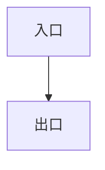

# Astro 导入契约

> 目标：`design/` 原样复制到 `src/content/docs/design/` 即可构建——不改文件名、不改链接、不加自定义插件。
> 基线：Astro 7.4.5、Starlight 0.42.8、github-slugger 2.x（2026-11-04 实测）。升级后按 §10 复验。

## 1. 两种主档

| 主档 | 适用 | 需要的站点配置 | 谁负责路由/TOC/侧边栏 |
| --- | --- | --- | --- |
| Starlight | 文档站 | `docsLoader()` + `docsSchema()` | Starlight |
| 最小内容集合 | 已有 Astro 站点 | 自定义 schema + 页面模板 | 站点模板 |

同一份 Markdown 同时适配两种主档；差别只在站点配置，不在正文。

## 2. frontmatter

每个文件以 YAML frontmatter 开头，只允许以下字段：

```yaml
---
title: 总体方案与架构
description: 系统边界、模块清单、依赖方向与控制流。
sidebar:
  order: 1
  label: 总体方案与架构
  hidden: false
draft: false
lastUpdated: 2026-11-04
---
```

| 字段 | 类型 | 必填 | 默认 | 说明 |
| --- | --- | --- | --- | --- |
| `title` | string | 是 | — | 页面标题，由布局渲染为 H1 |
| `description` | string | 否 | 空 | meta description 与列表摘要 |
| `sidebar.order` | number | 否 | 按 `id` 排序 | 导航顺序；同一目录内唯一 |
| `sidebar.label` | string | 否 | 取 `title` | 导航短名 |
| `sidebar.hidden` | boolean | 否 | `false` | 不在导航显示，仍可直达 |
| `draft` | boolean | 否 | `false` | 生产构建排除 |
| `lastUpdated` | date | 否 | 空 | 不写引号；Starlight 期望 `Date` |

规则：

- 顶层只允许 `title`、`description`、`sidebar`、`draft`、`lastUpdated` 五个键；禁止 `slug` 与任何未列出的字段。
- Astro/Starlight 不会因未知字段失败，但会静默丢弃；拼错 `sidebar_lable` 只会让导航失效，所以必须人工或校验器检查。
- `title` 必填；正文不写 H1，页面标题由 `title` 渲染。
- `lastUpdated` 不写引号。写了引号会变成字符串，Starlight 的 `Date` 校验会失败；若站点 schema 用字符串，统一改成 `z.coerce.date()`。
- YAML 用空格缩进，不用 Tab；字符串含 `:`、`#`、`{}`、`[]`、`&`、`*`、`|`、`>` 时加引号；`description` 保持单行。

## 3. 文件、路由与标题

| 规则 | 说明 |
| --- | --- |
| 内容根 | `design/` 整体复制到 `src/content/docs/design/` |
| `id` | 相对内容根的路径去掉 `.md`，`/` 分隔，无扩展名 |
| 路由 | `/design/<id>/`，尾斜杠 |
| 首页 | `index.md` → `/design/`；其他页链接封面写 `./` 或 `../`（按层级），不写 `./index/` |
| 文件名 | 小写 ASCII kebab-case：`^[a-z0-9]+(-[a-z0-9]+)*$`；禁止中文、空格、大写、下划线 |
| 目录 | 目录即路由层级；`modules/<module>.md` → `/design/modules/<module>/` |
| 正文标题 | 不写 H1；从 H2 开始，不跳级 |
| 章节标题 | `## <编号>. <英文标题>` |
| 小节标题 | `### <编号>.<子编号> <英文标题>` |
| 中文标题 | 放 frontmatter `title`、`sidebar.label` 与正文首句，不进标题 |

示例：

```md
---
title: 总体方案与架构
sidebar:
  order: 1
---

## 1. Architecture

系统边界与外部参与者如下。

### 1.1 Boundary

正文。
```

## 4. 锚点

锚点由 github-slugger 2.x 对标题文本生成，规则固定：

| 标题 | 锚点 |
| --- | --- |
| `## 1. Architecture` | `1-architecture` |
| `## 3.2 Permission Matrix` | `32-permission-matrix` |
| `### 1.1 Boundary` | `11-boundary` |
| `### 3.2.1 Permission Matrix` | `321-permission-matrix` |
| 同文件重复标题 | 依次加 `-1`、`-2` |

规则：

- 不写 `{#id}`。Astro 不识别该语法，会把 `{#id}` 原样渲染进正文。
- 禁止标题里出现 `&`、`/`、`：`、`:`、`?`、`!`、`(`、`)`、`【`、`】`、引号；这些字符会被删除或变成连续连字符，产生不可读锚点。
- 标题文本一旦发布即冻结；改措辞必须同步改锚点、更新全部引用，并在 `review.md` 记录影响范围。
- 注意 `1.1` 的锚点是 `11-`，不是 `1-1-`；这是 github-slugger 的固定行为，不是笔误。
- 脚注会生成隐藏标题 `footnote-label`；生成 TOC 时必须过滤，或干脆不用脚注。

## 5. 链接

站内页间链接一律写**相对路由**（不含 `.md` 后缀）：路由结构与文件层级一一对应（`modules/cli.md` → `/design/modules/cli/`），相对链接在任何部署基路径（含子路径）下都能被浏览器正确解析；根绝对路由 `/design/…` 在子路径部署后会失效，禁止写进正文。

| 形态 | 写法 | 例子 |
| --- | --- | --- |
| 页间（同目录） | `./<id>/#<锚点>` | `[权限矩阵](./permissions/#183-permission-matrix)` |
| 页间（跨目录） | `../<id>/#<锚点>` | `[CLI](../modules/cli/#12-command-line)` |
| 页间（章首） | `./<id>/` 或 `../<id>/` | `[架构](./architecture/)` |
| 链回封面 | `./`、`../`（按层级） | `[返回目录](../)` |
| 页内 | `#<锚点>` | `[见下文](#183-permission-matrix)` |
| 外链 | `https://…` | 仅 https；`http://localhost` 例外 |

规则：

- 目录路由必须带尾斜杠（`./permissions/`，不是 `./permissions`）；`./` 与 `../` 指向内容根（封面）。
- 禁止：`.md` 后缀、根绝对路由 `/design/…`、裸文件名（不带尾斜杠）、`file://`、`/public/…`、`/_astro/…`、绝对文件系统路径。
- 原因一：Astro 不会把 Markdown 文件链接改写成路由，`.md` 链接会原样进入 `href`，发布后 404。
- 原因二：根绝对链接不做 base 改写，站点部署到 `/docs` 等子路径时全部失效；相对路由天然免疫。
- `../` 层级必须与当前文件位置一致，越出内容根属于错误（校验器会报 DOC-LINK-002）。

## 6. 资源与 Mermaid

| 项 | 规则 |
| --- | --- |
| 位置 | 内容根内：`design/assets/…`；随章节分目录时用 `design/<section>/assets/…` |
| 引用 | 相对当前 Markdown 文件：`` |
| 语法 | Markdown 图片语法；不要用 ``，原始 HTML 不经过 Astro 图片管线 |
| 替代文本 | 必填，描述图的信息，不写“图片” |
| SVG | 带 `viewBox`、`currentColor`、无 `<script>`、无外链 `<use>` |
| 远程图 | 禁止（离线要求与隐私） |
| 图标 | 内联 SVG；禁止 emoji、符号字符、位图 |
| Mermaid | 构建期渲染为 SVG；正文放图片 + `<details>` 图源码 |

Mermaid 的标准写法：

````md


<details>
<summary>图源码</summary>



</details>
````

不要在正文只留 `mermaid` 围栏：Astro 会把它当普通代码块高亮，不会渲染成图。

## 7. 代码块、HTML 与 MDX

- 围栏必须标语言；伪代码用 `ts`/`tsx`/`text`。
- 不依赖 `title=` 元信息：核心 Astro 忽略它，只有 Starlight 的 Expressive Code 会显示。文件名写在围栏内首行注释或图注里。
- `.md` 不解析 JSX、组件或表达式：`<Callout>` 只是未知 HTML 标签，`{1 + 1}` 只是文本。
- 允许的原始 HTML：`<details>`、`<summary>`、`<kbd>`、`<br>`、`<sub>`、`<sup>`、`<mark>`、`<abbr>`。仅用于语义，不依赖站点 CSS 类名。
- 禁止：`<script>`、`<style>`、`<iframe>`、`<form>`、`on*` 事件属性、`javascript:`、HTML 注释、``、`<h1>`–`<h6>`。
- 提示块用引用块约定：`> **注意**：伪代码只表达契约，不是可运行实现。`
- MDX 默认不启用；确需组件时另立 MDX 档，转义 `{}` 与 `<`，并限制 `import` 白名单。

## 8. TOC 与 draft

- 目录使用页面渲染结果里的 `headings`（字段 `depth`/`slug`/`text`），过滤 `footnote-label`，只取 H2–H3。
- Starlight 自动生成 TOC 与侧边栏；`sidebar.order` 控制同目录排序。
- Starlight 生产构建排除 `draft: true`；最小内容集合的页面模板必须自己过滤 `data.draft`。
- `lastUpdated` 为可选；Starlight 配置了 `lastUpdated` 才显示。

## 9. 站点配置

直接使用模板，不手抄配置：

| 模板 | 适用 | 内容根 |
| --- | --- | --- |
| `templates/site-starlight` | 文档站（默认） | `src/content/docs/design/` |
| `templates/site-minimal` | 已有站点或最小集合 | 同上 |

`scripts build/dev` 会按 `--minimal` 复制对应模板；接入已有站点用 `--site <dir>`，由站点自己提供 `content.config.ts` 与页面路由。

模板中的关键文件：

- `package.json`：Astro/Starlight/`@astrojs/check`/TypeScript 版本；
- `astro.config.mjs`：站点配置；
- `src/content.config.ts`：集合 schema；
- `src/pages/design/[...slug].astro`（仅 minimal）：路由、H1、TOC、draft 过滤。

`index.md` 的 `id` 是 `index`；若 `params: { slug: undefined }` 不匹配 `/design/`，为封面单独放 `src/pages/design/index.astro`，或在路由层把 `index` 映射为空 slug。

## 10. 导入与验收清单

导入步骤：

1. 运行 `node scripts/cli.mjs build <design>`（首次加 `--install`）；或手工复制 `design/` 到 `src/content/docs/design/`。
2. 按 §9 选模板，或让已有站点提供 `content.config.ts`。
3. 运行 `node scripts/cli.mjs check <design>`，再 `build`。
4. 逐项核对下表。

| 检查 | 通过标准 |
| --- | --- |
| 构建 | `astro build` 退出码 0；每个非 draft 文件生成一个页面 |
| 路由 | `/design/`、`/design/architecture/`、`/design/modules/<module>/` 均存在 |
| 遗留语法 | 产物中没有字面量 `{#`，没有 `href` 以 `.md` 结尾 |
| H1 | 每页恰好一个 H1，正文无 H1 |
| 锚点 | 每个标题 id 与 github-slugger 输出一致；重复标题带 `-1` |
| 链接 | 所有相对路由链接（`./`、`../`）可达；`#fragment` 在目标页存在；无根绝对路由与 `.md` 链接 |
| TOC | 不含 `footnote-label`；H2–H3 齐全 |
| 图片 | 有 alt、来自内容目录、相对引用、无远程 |
| Mermaid | 显示 SVG；源码在 `<details>` 内；无可见的 `data-language="mermaid"` 代码块 |
| draft | `draft: true` 不出现在生产产物 |

### 10.1 本地命令

```bash
node scripts/cli.mjs check <design>
node scripts/cli.mjs build <design> --install
node scripts/cli.mjs dev <design> --port 4321
```

脚本不渲染 HTML，只做校验、同步与调用 Astro；生成站点在 `<design>/.design-doc/`。

## 11. 已知边界

- Astro 7 内容层不再提供 `entry.slug`；路由以 `entry.id` 和文件路径为准。
- Astro 7 默认 Markdown 处理器是 Sätteri；`remarkPlugins`/`rehypePlugins` 需另装 `@astrojs/markdown-remark`。本契约不依赖这两个插件。
- Astro 静态产物使用根绝对资源路径（`/_astro/…`），按 HTTP 访问；本地预览用 `scripts dev`，不提供 `file://` 阅读页。
- 升级 Astro/Starlight 后重跑 §10 清单；版本差异记录在 `review.md`。
