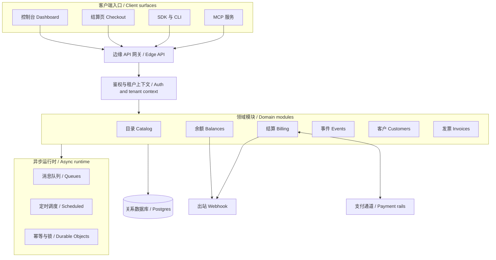
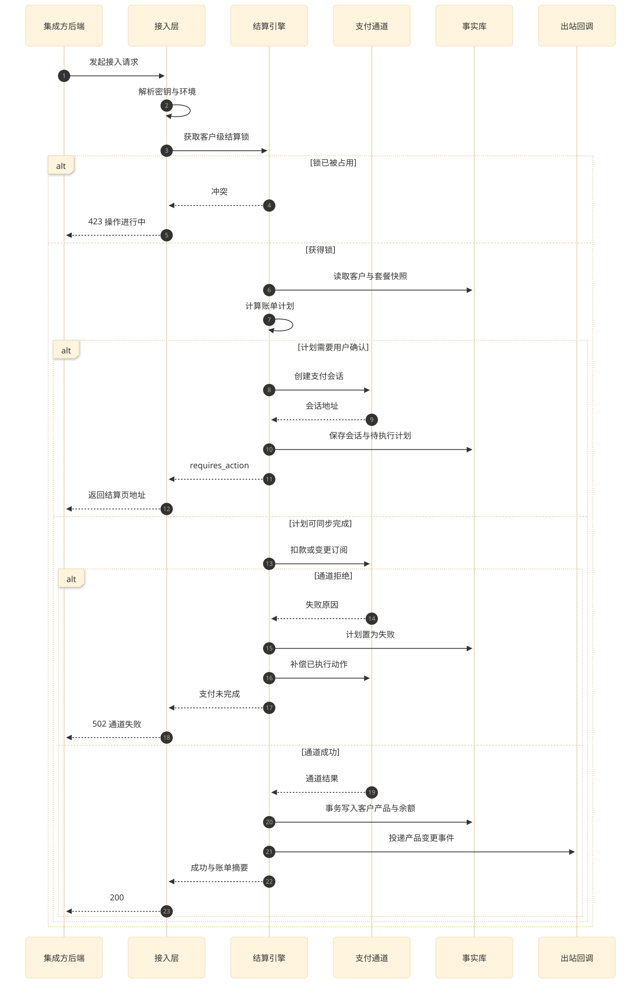
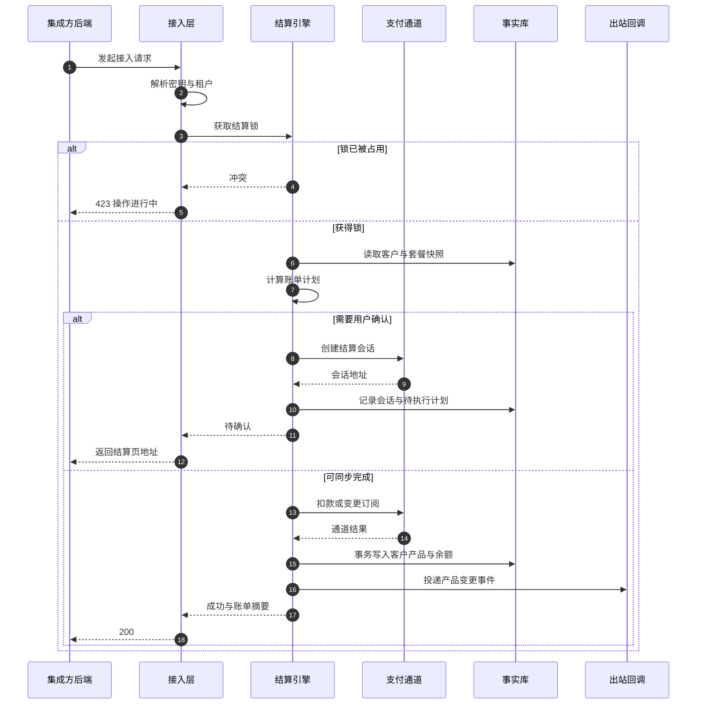
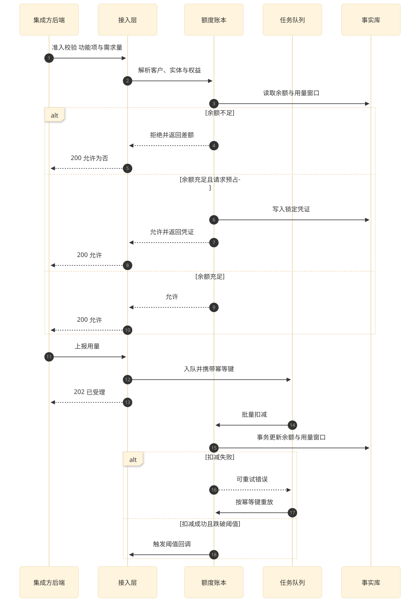
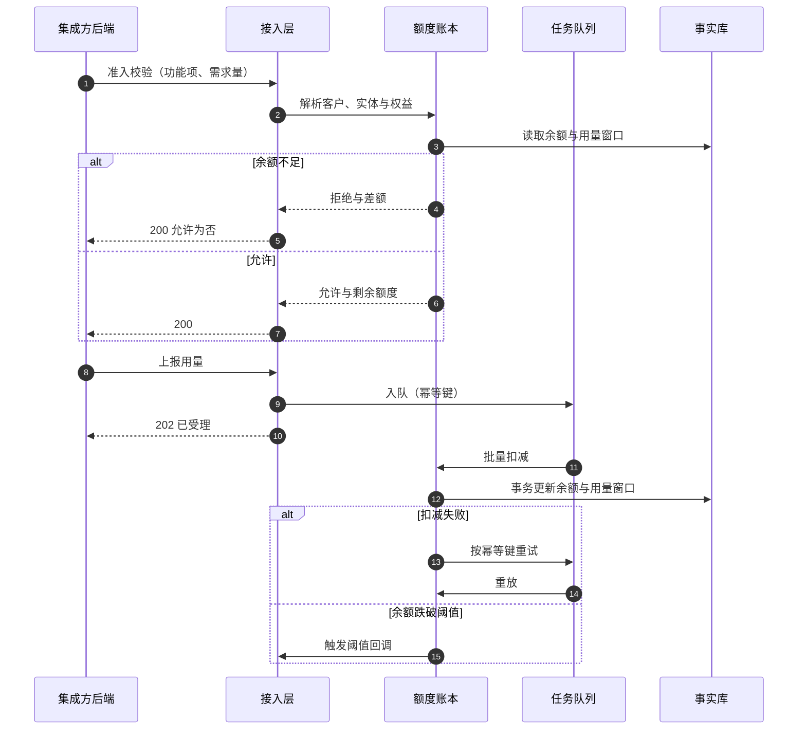

本章给出系统边界、模块划分、核心业务判定与运行拓扑；后续各模块章只展开自己那一块，跨模块的接口、权限、错误码、状态与字段一律以专章为准。

## 1. System Boundary

### 1.1 External Actors

| 参与者 | 身份 | 交互方式 | 关心什么 |
| --- | --- | --- | --- |
| 集成方后端 | 持有环境密钥的机器身份 | 服务端接口、命令行、SDK | 能否稳定地判断准入、上报用量、发起购买 |
| 集成方前端 | 只持有可公开密钥的浏览器身份 | 嵌入式组件、结算页 | 购买流程是否顺畅、价格与额度是否实时 |
| 终端用户 | 被计费的最终使用者 | 结算页、托管账单页 | 付多少钱、买到什么、何时续费 |
| 运营者 | 组织成员，分角色 | 控制台 | 定价、客户、发票、额度运营与排障 |
| 支付通道 | 第三方服务 | 主动调用与回调 | 授权、扣款、退款、对账的一致性 |
| 智能体 | 外部模型客户端 | 智能体协议 | 用自然语言完成查询与定价变更 |

### 1.2 In Scope

本系统负责：定价与权益的声明式定义；客户与子实体的计费身份；额度账本与准入判定；购买、变更、续期、退款与发票；支付通道适配与回调验签；用量事件的采集与入账；批量迁移；面向集成方的接口、工具链与运营控制台。

### 1.3 Out of Scope

本系统不负责：商户自身的税务申报与合规归档；终端用户身份体系（以集成方传入的客户标识为准）；支付服务商内部的清结算；集成方业务侧的权限模型（只提供准入判断结果）。跨出边界的部分在接口章以回调与查询两种方式暴露，不做隐式耦合。

## 2. Module Map

### 2.1 Module List

全系统划分为 12 个模块，其中 3 个核心域、9 个支撑域。模块名统一使用一个英文单词，职责边界如下。

| 模块 | 职责边界 | 拥有的数据 | 主要依赖 |
| --- | --- | --- | --- |
| Catalog 定价目录 | 定义「卖什么」：功能项、套餐、价格、权益与版本，不持有任何客户实例 | 功能项、套餐、价格、权益模板、套餐版本 | 无（仅身份与租户上下文） |
| Balances 额度账本 | 定义「还能不能用」：余额、重置、回滚、锁定与准入判定 | 客户权益实例、余额、用量窗口、回滚记录、锁定凭证 | Catalog、Customers、Events |
| Billing 结算引擎 | 定义「钱怎么动」：购买、变更、续期、退款，生成并执行账单计划 | 客户产品实例、账单计划、结算动作、折扣与试用 | Catalog、Balances、Customers、Invoices、Payments |
| Customers 客户 | 计费主体与子实体的身份、缓存与生命周期 | 客户、实体、客户级计费控制 | Tenancy |
| Events 事件 | 用量上报的接收、去重、批量与异步入账 | 用量事件、事件批次 | Balances、Catalog |
| Checkout 购买会话 | 购买意图、支付方式选择、会话状态与确认 | 结算会话、支付意图 | Billing、Payments |
| Payments 支付通道 | 服务商差异隔离：授权、扣款、退款、回调与对账 | 通道配置、通道事件、履约记录 | Checkout、Invoices |
| Invoices 发票 | 账单文档、行项目与状态推进 | 发票、行项目、发票模板 | Billing、Customers |
| Identity 身份 | 账号、会话、密钥、机器身份与授权 | 账号、会话、密钥、授权码 | Tenancy |
| Tenancy 租户 | 组织、环境隔离、成员与角色 | 组织、环境、成员、角色绑定 | Identity |
| Migrations 迁移 | 套餐与客户的批量迁移、试运行与回滚 | 迁移任务、迁移项、迁移运行 | Catalog、Balances、Customers |
| Toolchain 工具链 | 对外能力面：接口描述、SDK、命令行、智能体接入 | 接口描述、生成客户端、命令配置 | 全部领域模块（只读契约） |

### 2.2 Dependency Direction

依赖方向自外向内单向收敛，不允许反向依赖：

```text
Toolchain → Identity → Tenancy → Customers → Catalog → Balances → Billing → Invoices → Payments
                                                        ↑            ↓
                                                     Events ←── Checkout
                                                        ↑
                                                   Migrations
```

三条约束：一是 Catalog 不感知任何客户数据，任何「这个客户的套餐」都属于 Billing 与 Balances；二是 Balances 的判定是只读的纯函数式决策，写动作只能由 Billing、Events、Migrations 发起；三是 Payments 只对外提供通道语义，不判断业务是否该扣款。

## 3. Core Business Identification

### 3.1 Core Flow

选定的核心业务流是一次完整的「定价 → 购买 → 计量 → 准入 → 续费」闭环：

1. 集成方在控制台定义功能项与套餐（Catalog）。
2. 终端用户点击升级，前端调用接入动作，服务端生成账单计划并执行（Billing），必要时跳转结算页（Checkout）。
3. 支付成功后支付通道回调，Billing 落库客户产品，Balances 依据权益模板生成余额实例。
4. 集成方每次调用前校验准入（Balances 读路径），使用后上报用量（Events 入队，Balances 异步扣减）。
5. 周期结束时定时调度触发余额重置与试用到期处理，支付通道回调触发续费与开票（Billing、Invoices）。

### 3.2 Judgement Table

三判据：① 主链不可缺；② 失守即失格；③ 砍余仍可用。命中 ① 且命中 ②③ 之一方可入列。

| 候选模块 | 承担的价值 | ① 主链不可缺 | ② 失守即失格 | ③ 砍余仍可用 | 判定 |
| --- | --- | --- | --- | --- | --- |
| Catalog | 定义全部可售物与额度语义，主链第一步 | 是 | 是：定价模型错误等于卖错东西 | 否 | 核心 |
| Balances | 每次准入与计量都经过它，是产品承诺的兑现点 | 是 | 是：额度算错等于多收或少收 | 是：目录加账本即可提供限流与配额 | 核心 |
| Billing | 所有资金动作与套餐生命周期都由此推进 | 是 | 是：账算错、钱扣错直接失去经营资格 | 否 | 核心 |
| Customers | 计费身份载体，但没有它可用外部标识临时替代 | 是 | 否 | 否 | 支撑 |
| Events | 用量入口，可退化为同步直扣 | 否 | 否 | 否 | 支撑 |
| Checkout | 支付交互，可退化为直连通道 | 否 | 否 | 否 | 支撑 |
| Payments | 通道适配，单通道时可内联 | 否 | 否 | 否 | 支撑 |
| Invoices | 账单文档，可后置补开 | 否 | 否 | 否 | 支撑 |
| Identity | 准入门槛，可由上游网关代管 | 否 | 否 | 否 | 支撑 |
| Tenancy | 多组织隔离，单组织部署时退化 | 否 | 否 | 否 | 支撑 |
| Migrations | 存量数据演进工具 | 否 | 否 | 否 | 支撑 |
| Toolchain | 对外能力面，可退回裸接口 | 否 | 否 | 否 | 支撑 |

### 3.3 Ratio Check

核心域 3 个、模块总数 12 个，比例 25%，落在 0.1–0.4 的可接受区间内，无需调整模块粒度。三个核心域的深化要求在各自模块章落实：铁律级决策、覆盖失败分支的伪代码、不少于 4 条含失败与幂等路径的验收。

## 4. Component View



<details>
<summary>图源码</summary>



</details>

## 5. Runtime Topology

### 5.1 Synchronous Path

一次请求经过五段：边缘接入（路由与跨域）、身份解析（密钥或会话）、租户绑定（组织与环境）、领域处理、事实落库。接入层与领域层都在同一个边缘运行时内，事实库通过连接代理访问外部关系库，因此单次请求的耗时主要由数据库往返决定；需要多次往返的聚合在请求范围内复用同一连接与缓存。

同步路径只允许做「可立即给出结论」的事：读判定、写一个事务内的账本变更、生成账单计划并执行其中的同步部分。凡是需要与支付通道多轮交互、或需要跨分钟推进的动作，一律转为异步，不在请求内串行等待。

### 5.2 Asynchronous Path

异步有四条通道，职责不重叠：

| 通道 | 承载 | 触发 | 失败语义 |
| --- | --- | --- | --- |
| 任务队列 | 余额批量同步、用导入账、发票行项目、出站回调 | 领域动作入队 | 仅少数幂等任务重试，其余记录并确认 |
| 定时调度 | 试用到期、余额重置、悬挂会话清理、一次性产品过期 | 每分钟一次 | 各任务独立捕获异常，不阻塞同批其他任务 |
| 长任务运行器 | 批量迁移、缓存预热 | 由接口触发 | 有限次重试，按客户串行 |
| 幂等与互斥 | 结算锁、支付回调去重、锁凭证到期 | 请求内获取，过期自动释放 | 存储不可用时放行并记录，不阻断主流程 |

### 5.3 Multi Environment

同一套代码支撑两类环境：沙箱与生产。二者共享组织与账号数据模型，但密钥、支付通道账号、事件流、队列与存储桶相互隔离；请求通过环境标识与密钥前缀确定环境，服务端不接受跨环境的客户标识。组织是数据归属单位，环境是同一组织内的数据分区，二者共同构成所有查询的默认作用域。

## 6. Core Sequences

### 6.1 Attach

集成方发起购买，服务端先取结算锁，再计算账单计划；计划包含金额、行项目与需要执行的通道动作。若计划需要用户确认，则返回结算页地址并结束本次请求；若全部可同步完成，则在同一事务内落库并触发出站回调。



<details>
<summary>图源码</summary>



</details>

失败分支：通道失败时回写计划状态并释放余额预留，不产生客户产品；事务失败时通道动作按计划登记的可回滚动作执行退款或作废；锁在超时后自动释放，重复请求由幂等键识别为同一计划。

### 6.2 Track and Check

计量与准入是同一条数据流的读写两端：写端入队、批量落库、异步更新余额；读端直接读账本，不做扣减。



<details>
<summary>图源码</summary>



</details>

### 6.3 Renewal and Invoice

续费由支付通道的回调驱动，不由定时任务驱动：定时任务只处理试用到期、余额重置与悬挂发票作废。回调进入后先做事件级去重，再按通道状态推进客户产品，最后落行项目与发票状态，并对齐通道侧金额与本地行项目。

### 6.4 Failure and Compensation

| 失败点 | 观测 | 补偿 | 幂等 |
| --- | --- | --- | --- |
| 通道扣款成功、本地事务失败 | 计划状态停留在执行中 | 按计划登记的回滚动作退款或作废订阅 | 计划标识全局唯一 |
| 本地成功、回调重复到达 | 同一通道事件编号重复 | 直接确认，不重复推进 | 事件表唯一键 |
| 队列消息丢失 | 余额与用量事件不一致 | 定时任务按窗口重算并修正 | 批次键与时间窗 |
| 锁存储不可用 | 记录降级日志 | 放行并依赖数据库唯一约束兜底 | 业务键唯一 |
| 出站回调失败 | 投递方记录失败 | 由投递方按退避重试 | 事件编号 |

## 7. Data Ownership and Consistency

| 数据 | 唯一写入方 | 读取方 | 一致性要求 |
| --- | --- | --- | --- |
| 功能项、套餐、价格、权益模板 | Catalog | 全部领域 | 强一致读，发布后不可原地改，只能新增版本 |
| 客户与实体 | Customers | 全部领域 | 强一致读，写入需带缓存失效 |
| 客户产品与账单计划 | Billing | Balances、Invoices、控制台 | 事务内写入，与通道动作按计划对齐 |
| 余额与用量窗口 | Balances（经 Billing、Events、Migrations 发起） | 全部读路径 | 单事务多行更新，写后失效缓存 |
| 用量事件 | Events | Balances、分析 | 幂等追加，不更新既有事件 |
| 发票与行项目 | Invoices | Billing、控制台 | 与通道发票号一一对应，允许重算覆盖行项目 |
| 结算会话与支付意图 | Checkout、Payments | Billing、控制台 | 状态机单向推进，回调可重放 |

跨模块一致性采用「先落库、后分发」：任何状态变更先在事实库提交，再投递事件；订阅方按事件编号幂等消费，读到旧事件时以库内状态为准，不做逆向覆盖。

## 8. Design Invariants

以下五条是全系统铁律，任何模块章不得违反：

1. **准入与执行分离**：判定只读、不扣减；扣减只发生在写入路径，且必须先有可回滚的凭证。
2. **先权限后执行**：任何写入在解析出租户与环境后立即校验资源归属，越权一律在领域逻辑之前拒绝。
3. **先落库后分发**：状态与事件分离提交，事件丢失可由库内状态重放，库内丢失不可由事件恢复。
4. **金额只增不改**：发票行项目与账本流水只追加，修正通过反向分录，不原地覆盖。
5. **配置不可变版本**：定价与权益模板发布后冻结，变更产生新版本，存量客户通过迁移显式切换。
