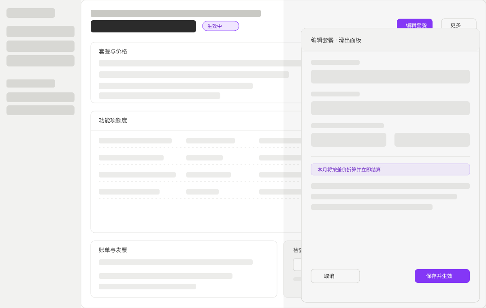

本方案包含五个产品端：运营控制台、结算页、开发者文档站、命令行、智能体接入。它们服务不同人群、不同入口，不能合并成「一个端」。路由标识统一写 `/design/<id>/`，只作设计命名，不是部署路径。

## 1. Surfaces

| 产品端 | 服务人群 | 入口与设备 | 权限边界 | 明确不做 |
| --- | --- | --- | --- | --- |
| 控制台 | 组织内的所有者、管理员、开发者、销售、成员 | 桌面浏览器，最小宽度 640 | 会话 + 角色 + 作用域 | 不做终端用户的购买流程 |
| 结算页 | 集成方的终端用户 | 移动优先的浏览器，可来自邮件或应用内跳转 | 单会话令牌，只读自己的订单 | 不做账号体系，不展示他人订单 |
| 文档站 | 集成方开发者与评估者 | 任意浏览器 | 公开 | 不做业务操作，只提供示例与跳转 |
| 命令行 | 集成方开发者与 CI | 终端 | 授权码或环境密钥 | 不做图形化编辑 |
| 智能体接入 | 集成方开发者与其智能体 | MCP 客户端 | 令牌 + 工具作用域 | 破坏性操作不直接执行 |

## 2. Page Inventory

### 2.1 Dashboard

| 页面标识 | 路由 | 功能边界 | 可用角色 | 主要操作 | 关键区域与状态 |
| --- | --- | --- | --- | --- | --- |
| `/design/dash-signin/` | `/sign-in` | 登录、注册、找回 | 公开 | 验证码登录、密码登录、第三方登录、通行密钥 | 表单区、错误提示、加载态 |
| `/design/dash-onboarding/` | `/sandbox/quickstart` | 首次接入引导 | 组织成员 | 选择模板、复制密钥、查看示例 | 步骤条、代码片段、实时预览 |
| `/design/dash-customers/` | `/customers` | 客户列表与筛选 | 成员及以上 | 搜索、筛选、创建、进入详情 | 表格、空态、分页、保存视图 |
| `/design/dash-customer/` | `/customers/:id` | 客户详情与运营操作 | 成员及以上 | 改套餐、记用量、查额度、退款 | 五段式区块、滑出面板、四态 |
| `/design/dash-plan-editor/` | `/products/:id` | 套餐编辑与版本发布 | 开发者及以上 | 增删权益行、改价、发布、迁移客户 | 套餐卡片、右侧面板、保存条 |
| `/design/dash-catalog/` | `/products?tab=features` | 功能项与信用系统 | 开发者及以上 | 创建计量项、配置换算、归档 | 列表、编辑面板、引用提示 |
| `/design/dash-migrations/` | `/migrations` | 迁移列表 | 具备迁移读权限 | 查看进度、取消、进入详情 | 表格、状态徽标 |
| `/design/dash-migration/` | `/migrations/:id` | 迁移三步编辑 | 具备迁移写权限 | 设筛选、设操作、预演、运行 | 步骤条、影响预览、实时进度 |
| `/design/dash-analytics/` | `/analytics` | 用量与收入分析 | 具备分析读权限 | 切时间范围、按功能项聚合、下钻 | 图表、筛选条、空态 |
| `/design/dash-developer/` | `/dev` | 密钥、通道、回调 | 具备密钥或平台读权限 | 创建密钥、连接通道、配置回调 | 分页签、密钥只显示一次 |
| `/design/dash-settings/` | `/settings` | 组织、成员、账单、外观 | 管理员及以上 | 改组织名、邀成员、配发票模板 | 分组导航、表单校验 |
| `/design/dash-admin/` | `/admin` | 平台管理 | 平台管理员 | 查组织、代登录、改开关 | 表格、危险操作二次确认 |

### 2.2 Checkout

| 页面标识 | 路由 | 功能边界 | 可用角色 | 主要操作 | 关键区域与状态 |
| --- | --- | --- | --- | --- | --- |
| `/design/checkout-order/` | `/c/:checkout_id` | 新购订单确认 | 会话持有者 | 改数量、用折扣、选支付方式、确认 | 抬头、套餐卡、订单摘要、确认区 |
| `/design/checkout-update/` | `/u/:checkout_id` | 变更订阅确认 | 会话持有者 | 确认变更、查看差价 | 同左，文案改为变更语义 |
| `/design/checkout-result/` | 同页终态 | 结果反馈 | 会话持有者 | 回到应用、重试 | 成功、过期、不可用、失败四态 |

### 2.3 Documentation and Website

| 页面标识 | 路由 | 功能边界 | 主要操作 |
| --- | --- | --- | --- |
| `/design/docs-quickstart/` | `/docs/quickstart` | 三步接入 | 复制代码、切换语言 |
| `/design/docs-concepts/` | `/docs/concepts` | 定价模型与额度概念 | 阅读、跳转示例 |
| `/design/docs-api/` | `/docs/api` | 接口参考 | 搜索、试用请求 |
| `/design/docs-cli/` | `/docs/cli` | 命令行用法 | 复制命令 |
| `/design/site-pricing/` | `/` | 官网与定价 | 了解能力、进入控制台 |

### 2.4 CLI and Agent

| 界面标识 | 命令或工具 | 功能边界 | 主要操作 |
| --- | --- | --- | --- |
| `/design/cli-auth/` | `login`、`logout` | 授权与环境切换 | 浏览器授权、写入环境变量 |
| `/design/cli-sync/` | `push`、`pull` | 配置同步 | 预览差异、确认、回拉 |
| `/design/cli-inspect/` | `customers`、`plans`、`events` | 只读查询 | 过滤、分页、输出 JSON 或表格 |
| `/design/mcp-tools/` | 工具集 | 查询与变更 | 列出客户、预览变更、确认写入 |

## 3. Page Flow

| 来源 | 触发 | 目标 | 返回行为 |
| --- | --- | --- | --- |
| 登录页 | 登录成功 | 客户列表 | 浏览器后退回到登录页时重定向到列表 |
| 客户列表 | 点击行 | 客户详情 | 返回保留筛选与分页 |
| 客户详情 | 点击「编辑套餐」 | 同页滑出面板 | 关闭面板回到详情，详情局部刷新 |
| 套餐编辑 | 保存且已有客户 | 版本发布确认 | 确认后留在编辑页并提示版本号 |
| 套餐编辑 | 删除被引用套餐 | 阻断弹层 | 关闭后保留当前编辑内容 |
| 迁移列表 | 新建 | 迁移三步编辑 | 离开时若有未保存操作提示 |
| 结算页 | 确认成功 | 结果终态 | 2 秒后跳回集成方成功地址，后退不回退订单 |
| 结算页 | 会话过期 | 过期终态 | 提供「返回应用」入口，不提供重试 |
| 任意页面 | 无权限 | 无权限态 | 说明原因并提供申请入口，不渲染空白 |

## 4. Core Path Wireframe

客户详情是控制台使用频率最高的页面，也是「列表 → 详情 → 滑出编辑」这一交互范式的代表。线框展示三段式布局：左侧导航、中部五段区块、右侧滑出面板；面板打开时中部内容按固定宽度让位，不做整体缩放。

线框中的文案与数据为演示值，不代表真实客户；线框不接入任何接口，也不包含真实金额。真实页面在加载、空、失败、无权限四态下的表现见第 6 节。

## 5. Interaction Model

控制台统一采用「画布 + 面板」模型：列表与详情是静态画布，所有写操作在右侧固定宽度面板或模态中完成，保存后面板关闭、画布局部刷新。这样做的原因是写操作大多需要预览影响（改价影响多少客户、退款影响哪张发票），面板比整页跳转更能保持上下文。

结算页采用「单页四段」模型：抬头、套餐、摘要、确认自上而下，不做分步向导；数量调整触发防抖预览，摘要区在请求期间降低不透明度但不改变布局高度，避免跳动。

命令行采用「差异确认」模型：任何写命令先输出差异，再要求确认；无交互环境（CI）必须有显式跳过确认参数，否则直接失败。

## 6. Page States

| 状态 | 控制台 | 结算页 | 通用规则 |
| --- | --- | --- | --- |
| 加载 | 区块骨架，几何尺寸与最终内容一致 | 订单摘要骨架 | 不用整页转圈；骨架不引起布局位移 |
| 空 | 说明用途并给出创建入口 | 不适用（订单必有内容） | 区分「尚无数据」与「筛选无结果」，后者提供清除筛选 |
| 失败 | 区块内错误条 + 重试，保留筛选 | 错误终态 + 返回应用 | 重试保持当前筛选与分页 |
| 无权限 | 说明角色不足与申请入口 | 会话无效则提示联系商户 | 不用空白代替，不暴露资源是否存在 |
| 部分可用 | 单区块失败不影响其他区块 | 摘要失败时禁用确认 | 降级要可见，不能静默显示旧值 |

## 7. URL State

可分享、可恢复的页面状态一律写入查询参数：列表的 `search`、`status`、`plan`、`page`、`limit`、`sort`；详情的 `tab`、`entity`；套餐编辑的 `sheet`、`item`；分析页的 `range`、`group_by`。写入规则为筛选变化用替换式写入，翻页与打开详情用新增历史记录；非法值回落到默认值并在界面上提示已重置。密码、密钥、会话令牌不进 URL。

草稿类状态（未保存的套餐编辑、迁移操作集合）存本地存储，按「组织 + 环境 + 资源标识」隔离，恢复时优先使用草稿但明确提示「已恢复未保存的修改」，提供一键丢弃。
