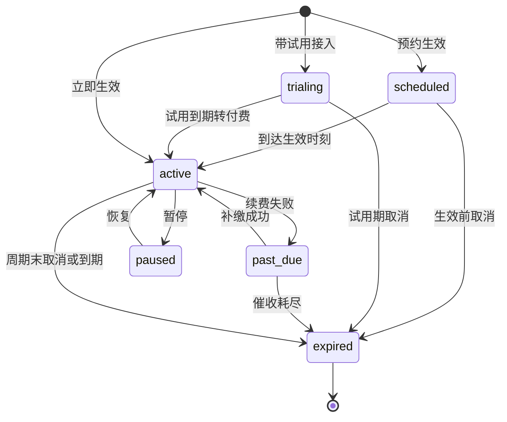
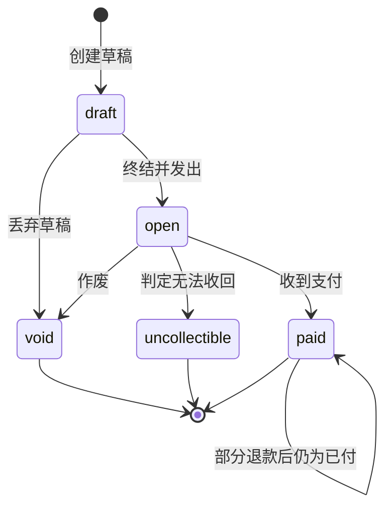
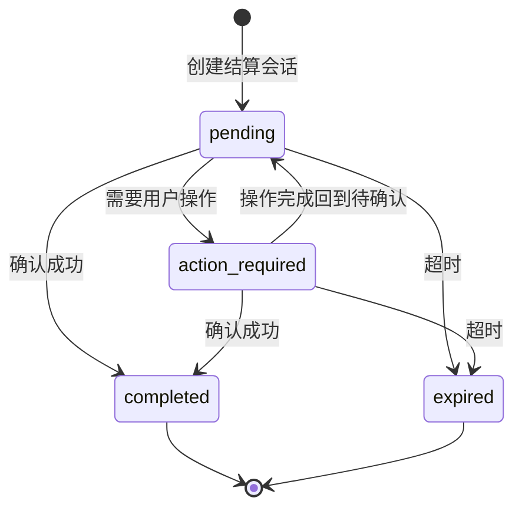
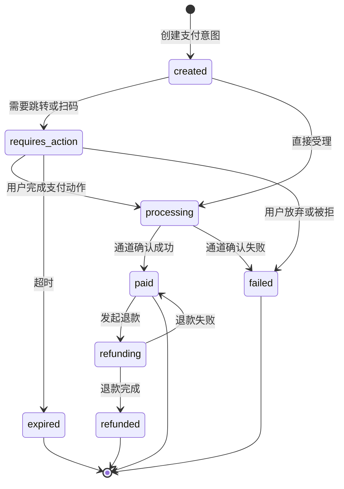

本章给出状态数量达到三个以上的实体状态机：节点为状态枚举值，边上标注触发动作、执行者与判定条件。非法转移与对应失败码的对照表在 错误码表 第 5 节，两处必须一致。

## 1. Customer Product

客户产品是「客户持有某套餐的一次实例」，是订阅语义的载体。

图源码

| 转移 | 触发动作 | 执行者 | 判定条件 |
| --- | --- | --- | --- |
| 预约 → 生效 | 到达预约时刻 | 定时调度 | 支付方式有效且未在生效前取消 |
| 试用 → 生效 | 试用到期 | 定时调度 | 试用结束策略为转付费且扣款成功 |
| 生效 → 欠费 | 续费扣款失败 | 支付通道回调 | 通道返回失败且未超过催收次数 |
| 欠费 → 生效 | 补缴成功 | 支付通道回调 | 收到该订阅的有效支付 |
| 欠费 → 到期 | 催收耗尽 | 定时调度 | 连续失败次数达到上限 |
| 生效 → 暂停 | 主动暂停 | 运营 | 组织已上线且具备写权限 |
| 生效 → 到期 | 周期末取消或自然到期 | 定时调度 | 取消标志为真且已达周期末，或套餐无续费 |
| 任意 → 到期 | 立即取消 | 运营或集成方 | 需同时作废未付发票 |

取消是标志位而非状态：取消后实例在周期末才转为到期，期间仍保持生效，保证已付费周期内的使用权。

## 2. Invoice

图源码

| 转移 | 触发动作 | 执行者 | 判定条件 |
| --- | --- | --- | --- |
| 草稿 → 待付 | 终结 | 结算引擎 | 至少一条行项目且金额非负 |
| 待付 → 已付 | 标记支付 | 支付通道回调或运营 | 金额一致且未作废 |
| 待付 → 作废 | 作废 | 结算引擎或运营 | 未支付，或取消导致 |
| 待付 → 无法收回 | 判定坏账 | 运营 | 超过催收期限 |
| 已付 → 已付 | 部分退款 | 运营 | 累计退款不超过已付 |

状态只前进不回退：已作废发票不可恢复，退款不改状态只改已退金额。

## 3. Checkout Session

图源码

确认成功是终态，重复确认返回首次结果；过期是终态，确认返回 `CHK-410-001`。待操作与待确认之间的往返由支付方式选择驱动，不产生业务副作用。

## 4. Payment Intent

图源码

| 转移 | 触发动作 | 执行者 | 判定条件 |
| --- | --- | --- | --- |
| 创建 → 待操作 | 通道返回跳转或二维码 | 支付通道适配器 | 通道要求用户在场 |
| 待操作 → 处理中 | 用户完成支付动作 | 支付通道回调 | 签名验证通过 |
| 处理中 → 已付 | 通道确认成功 | 支付通道回调 | 金额与订单一致 |
| 处理中 → 失败 | 通道确认失败 | 支付通道回调 | 明确失败原因 |
| 已付 → 退款中 | 发起退款 | 运营 | 可退金额大于零 |
| 退款中 → 已退款 | 退款完成 | 支付通道回调 | 通道返回成功 |

已付是资金事实，任何情况下都不回退为失败；退款失败回到已付并保留失败记录。

## 5. Migration

| 运行状态 | 允许的下一状态 | 触发 | 说明 |
| --- | --- | --- | --- |
| 排队 | 运行中、已取消 | 调度领取、取消请求 | 同一迁移只允许一个活动运行 |
| 运行中 | 成功、失败、已取消 | 处理完毕、异常终止、取消请求 | 取消后不再领取新客户 |
| 成功 | 终态 | — | 不允许再次运行同一运行 |
| 失败 | 运行中 | 重试 | 已完成项跳过，失败项重跑 |
| 已取消 | 终态 | — | 需新建运行才能继续 |

单客户项的状态为：待处理、处理中、成功、跳过、失败。处理中超过租约时长会被判定为孤儿并允许重新领取。

## 6. Balance Lock Receipt

| 状态 | 允许的下一状态 | 触发 | 说明 |
| --- | --- | --- | --- |
| 预占中 | 已结算、已释放、已过期 | 显式结算、显式释放、到期 | 预占量与凭证号唯一 |
| 已结算 | 终态 | — | 预占转为实际扣减 |
| 已释放 | 终态 | — | 预占归还余额 |
| 已过期 | 终态 | 调度扫描 | 等价于释放，保留审计 |

重复结算或重复释放返回当前状态而不报错，保证重放安全。
