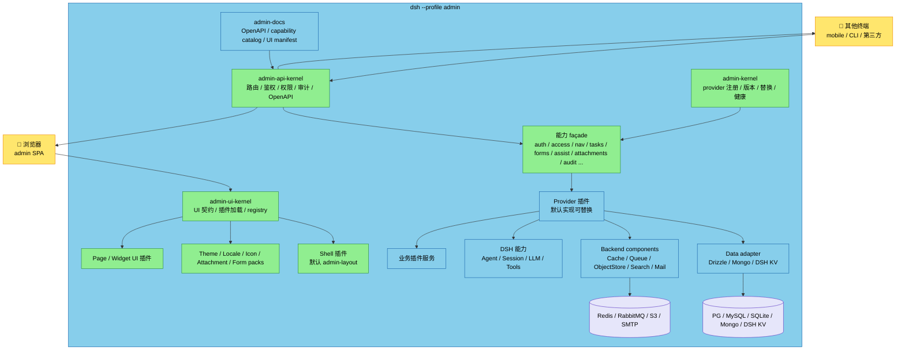
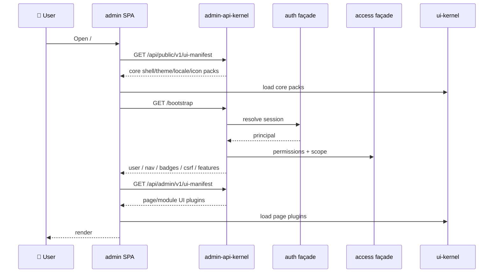
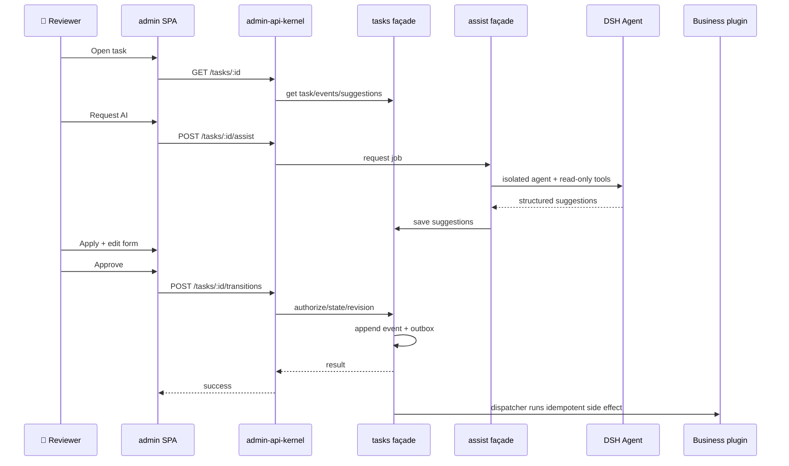

# DSH 通用 AI 后台管理平台设计方案（草案 v3.1）

[English](admin-system-design.md) | 中文

状态：待评审。本文只确定方案，不包含实现代码。

本版在 v3“契约优先的平台内核”基础上，补上**数据库与通用后端组件**：ORM-first，支持 PostgreSQL/MySQL/SQLite/MongoDB，并保留 DSH storage KV 兼容适配；Redis、MQ、对象存储、搜索、邮件、锁、缓存等通过统一端口 + 可替换适配器接入。`admin-app` 仍然只是默认组合。

平台原则不变：认证、权限、菜单、路由、API、文档、任务、表单、AI、附件、主题、语言、图标、布局等基础设施先定义接口，再由可替换的 provider 插件实现。

目标读者：DSH 插件开发者、后台平台架构师、需要替换/升级基础设施的团队。预备知识：DSH profile/bundle、Cordis Service、storage domain、Agent/Session、HTTP、RBAC、前端插件化。

阅读路径：只看结论 → 0、2、12；评审底座 → 2–7；评审人工闭环与 AI → 5、10；评审可替换性 → 2、7；评审安全 → 11。

## 0. 结论摘要

| 问题 | 结论 |
|---|---|
| 运行形态 | 独立 profile `admin`，命令 `dsh --profile admin`；不是 DSH Web 的一个面板 |
| 平台内核 | `admin-kernel` 提供稳定的能力 façade、provider 注册、版本协商、替换/回滚、健康与目录 |
| 契约 | `admin-contract`（Host）与 `admin-ui-contract`（Browser）定义所有基础设施接口、token、错误码、版本 |
| 默认实现 | 每个能力有默认 provider 插件：auth/access/nav/api/audit/tasks/forms/assist/attachments/notifications/jobs/search/docs；可替换 |
| 前端 | `admin-layout` 只是默认 shell；shell、页面、主题、语言、图标、表单字段、附件渲染器都是 UI 插件 |
| 统一 API | 所有 provider/module 通过 `adminApi` 注册路由；统一鉴权、权限、审计、错误、分页、幂等、OpenAPI |
| 统一文档 | OpenAPI + capability catalog + UI manifest + 插件文档；`/api/admin/v1/capabilities`、`/api/admin/v1/ui-manifest` |
| 数据库 | ORM-first：PostgreSQL/MySQL/SQLite 走 Drizzle ORM，MongoDB 走官方驱动；DSH storage KV 作为兼容适配；一个部署一个主数据库 |
| 后端组件 | 统一端口 + 适配器：cache/Redis、queue/MQ、lock、object storage/S3、search、mail、telemetry；默认不强依赖 Redis/MQ |
| 人工闭环 | Task/Approval/Form 引擎；审核、审批、退回、转交、评论、SLA、Outbox |
| AI 协助 | DSH Agent/LLM 产出摘要、风险、表单预填建议；人类决定，P1 不自动审批 |
| 可替换性 | 能力 provider、功能 module、UI 插件可独立安装/替换/升级；契约/kernel 是版本化稳定底座 |
| 首期重点 | 契约、kernel、profile、API、auth/access/nav/audit、默认 shell/theme/locale/icon、capability catalog |
| 非目标 | 不受控的远程脚本/iframe、多租户、AI 自动审批、跨实例集群、插件市场 |

一句话：**平台只暴露接口和稳定的能力 façade；默认实现只是插件；换实现不换消费者。**

### 0.1 八条铁律

1. 消费方只依赖 `admin-contract` / `admin-ui-contract`，不 import 任何 provider 实现。
2. 每个能力只有一个稳定 façade；provider 是 façade 后面的可替换实现。
3. 所有 API 走 `adminApi` 注册表；所有菜单/页面走 `adminNavigation`/UI registry。
4. 所有权限在服务端校验；菜单、路由、按钮隐藏只是体验。
5. 所有写操作有审计；破坏性操作有确认；AI 只给建议。
6. 所有插件可卸载；注册必须返回 disposer；逆序清理。
7. 契约有版本；provider 有兼容范围；不兼容显式拒绝，不静默降级。
8. 默认 bundle 只是组合；高级用户可以用 profile 行替换任意 provider。

### 0.2 v2 到 v3 的变化

| v2 | v3 |
|---|---|
| 固定 `admin-host` + 固定 `admin-layout` | 能力契约 + provider；shell 是插件 |
| 基础设施写在 host/UI 内部 | 每个基础设施有独立契约与默认 provider |
| 自定义页面 P2 构建期注册 | UI 插件运行时 + UI registry（P1/P2） |
| P3 才考虑运行时 UI 模块 | UI kernel 是底座的一部分 |
| 文档靠手写 | OpenAPI/capability catalog/UI manifest 生成 |
| 替换靠改代码 | 替换 provider、版本协商、drain/rollback |

### 0.3 v3.1 补充

| v3 | v3.1 |
|---|---|
| 以 DSH storage KV 为默认持久化 | ORM-first；PG/MySQL/SQLite/Mongo；DSH KV 只做兼容 |
| 没有数据库/事务抽象 | Repository + UnitOfWork + Migrator；SQL 事务、Mongo 事务/降级、KV reconciliation |
| Redis/MQ 容易被当成隐含依赖 | 端口 + 可选 adapter；默认 memory/outbox |
| 后端组件散落在 admin | 独立 `packages/backend/*` 通用库，可被其他 DSH 插件复用 |

## 1. 目标与边界

### 1.1 目标

- **通用**：不是只为论坛/内容写死，任何 AI 后端管理场景都能挂进来。
- **面向接口**：消费者看到的是能力接口，不是某个类、某个包、某张表。
- **可替换**：认证、权限、任务、表单、AI、附件、主题、语言、图标、shell 都能换实现。
- **可独立升级**：provider 与 kernel/contract 分开版本；升级一个 provider 不需要重写消费者。
- **统一**：一套 API、一套错误、一套权限、一套文档、一套 UI 运行时。
- **人工闭环**：审核/审批/表单/AI 协助是平台一等公民。
- **可运维**：健康、审计、限流、迁移、回滚、测试节点。
- **兼容常用后端栈**：PostgreSQL/MySQL/SQLite/MongoDB、Redis、RabbitMQ/Kafka、S3/MinIO、SMTP、OpenTelemetry 都能作为适配器接入，而不是把某一种中间件写死。
- **通用后端组件库**：数据库/ORM/UoW、缓存、锁、队列、对象存储、搜索、邮件、遥测以独立库 + 端口的形式提供，可被 admin 之外的 DSH 插件复用。

### 1.2 非目标

- 不做不受控的远程脚本/iframe 插件；UI 插件必须同源、声明契约、可卸载。
- 不做多租户 SaaS；P1 单组织单实例。
- 不做 AI 自动审批；P1 只建议。
- 不做可视化工作流设计器；工作流由插件代码定义、版本化。
- 不做跨 DSH 实例集群控制面；P3 再评估。
- 不做插件市场/计费/签名分发；P3 再评估。
- 不要求“任意 npm 包即插即用”；插件必须实现契约。
- 不做跨数据库/跨 MQ 的分布式事务；用 UnitOfWork + Outbox + 幂等保证。
- 不在一个部署里混用多个主数据库；一个 admin 实例只选一个主数据库引擎。
- 不强制 Redis/MQ：单进程可用内存/DB outbox；多实例再启用 Redis/MQ 适配器。

### 1.3 用户与场景

| 角色 | 场景 |
|---|---|
| 平台维护者 | 替换 auth/任务/主题/shell，升级 provider，不影响业务模块 |
| 管理员 | 初始化、用户/角色、审计、能力健康 |
| 审核员 | 任务箱、审核、审批、AI 建议、表单 |
| 运营 | 创建任务、补全表单、附件、评论、转交 |
| 终端用户 | 移动端/CLI 通过 terminal API 处理任务 |
| 插件作者 | 实现一个 capability provider 或一个业务 module |

## 2. 契约优先模型

### 2.1 什么是“能力”

一个能力 = **稳定接口 + 稳定 token + 能力清单 + 版本范围 + 默认 provider**。

| 组成 | 作用 |
|---|---|
| Interface | 消费方看到的纯类型契约；不依赖实现 |
| Token | Cordis 注入用的稳定服务名/令牌 |
| Manifest | provider 声明：能力、契约版本、优先级、必需/可选、数据域、配置 schema |
| Façade | kernel 提供的稳定对象，代理到当前 active provider |
| Provider | 真正实现能力的插件；可替换、可升级、可回滚 |
| Contract tests | 每个 provider 必须通过的公共行为测试 |

### 2.2 为什么用 façade，而不是让消费者直接注入 provider

如果消费者直接 `inject` 某个 provider 的 Service，替换实现时消费者要重新解析服务，in-flight 请求、缓存、UI 绑定都会抖动。Façade 模式：

- 消费者永远注入 `ctx.adminAuth` 这样的稳定 façade。
- kernel 在 façade 后面切换 active provider。
- 替换时先停止新请求进入旧 provider，等待 in-flight 完成，再切到新 provider；失败回滚。
- façade 统一做版本检查、健康、指标、错误归一化、审计。

这就是“面向接口而非实现”的落点。

### 2.3 必需能力与可选能力

| 类型 | 例子 | 缺失行为 |
|---|---|---|
| 必需 | data、auth、access、navigation、audit | 启动失败，列出缺失能力与候选 provider |
| 可选 | tasks、forms、assist、attachments、search、notifications、jobs、docs | 能力关闭；菜单/页面隐藏；其他功能正常 |

必需能力也允许替换，但必须有兼容 provider；不能“没有认证也启动”。API 网关/kernel 是平台基础设施，不属于可替换能力。

### 2.4 契约版本与能力协商

- 契约版本用 major.minor：major 不兼容，minor 只加字段/方法。
- Provider manifest 声明 `contract: '^1.2'`；kernel 只激活满足范围的 provider。
- API 用 `/v1` 路径版本；UI 插件用 `uiContract` 版本；不兼容显式拒绝。
- 废弃走弃用窗口：先标记 deprecated，再升 major；消费者有迁移期。
- 能力目录返回每个能力的 active provider、版本、健康、可用替代。

### 2.5 数据归属

- 每个 provider 拥有自己的表/collection/schema；不共享表。
- 替换 provider 时，数据迁移由 provider 声明：`migrateFrom` / `export` / `import`；没有迁移就明确要求人工导出，不静默丢数据。
- 业务 module 只存任务引用/表单值/审计等治理数据，业务数据仍归业务插件。
- 契约层不暴露表结构，只暴露操作。

### 2.6 关键决策

| 决策 | 选择 | 理由 | 放弃的方案 |
|---|---|---|---|
| 数据库/ORM | 通用数据库 + Repository/UoW；SQL 用 Drizzle，Mongo 用官方驱动，DSH KV 兼容 | 兼容常见后端；事务/索引/迁移可控；消费者不感知数据库 | 只依赖 DSH KV，或把 SQL 写进业务代码 |
| 数据库引擎 | 一个部署一个主库：PG/MySQL/SQLite/Mongo | 避免跨库事务和双写；替换靠迁移 | 每个能力各自选库 |
| 缓存/队列 | 端口 + 可选适配器 | 单进程不强依赖 Redis/MQ；多实例再启用 | 把 Redis/MQ 作为硬依赖 |
| 事务/副作用 | UnitOfWork + Outbox | SQL/Mongo 尽量原子；KV 用 reconciliation | 直接跨服务写两套数据 |
| UI 基础设施 | shell/theme/locale/icon/renderer 全是插件 | 可替换、可独立升级 | 固定一套 UI 写死 |
| 统一接口 | façade + contract + provider manifest | 换实现不换消费者 | 消费者直接 import provider |

## 3. 总体架构



### 3.1 分层

| 层 | 组件 | 负责 |
|---|---|---|
| 契约层 | `admin-contract` / `admin-ui-contract` | 接口、token、错误码、版本、manifest 类型 |
| 内核层 | `admin-kernel` / `admin-ui-kernel` | provider 注册、版本协商、替换/回滚、健康、目录 |
| 网关层 | `admin-api-kernel` | 路由表、鉴权、权限、审计、错误、OpenAPI、幂等 |
| 能力层 | auth/access/nav/tasks/forms/assist/attachments/... providers | 每个能力的实现 |
| 数据层 | data-drizzle / data-mongodb / data-dsh-kv；Repository/UoW/Migrator | 主数据库、事务、迁移 |
| 后端组件 | cache/queue/lock/object-store/search/mail/telemetry adapters | 常用中间件的可选适配 |
| UI 层 | shell/theme/locale/icon/form/attachment/page plugins | 所有可见基础设施与页面 |
| 业务层 | `admin-module-*` | 权限、路由、任务类型、表单、处理器 |
| 运行层 | `admin-app` | profile bundle、startup、webserver、静态 SPA |

### 3.2 消费者视角

业务 module 只做三件事：

1. 声明自己需要的权限、导航、API、任务类型、表单。
2. 通过 façade 调用能力（`ctx.adminTasks.create`、`ctx.adminAttachments.put`）。
3. 提供 handler/页面，不关心 auth 用 Better Auth 还是 OIDC，也不关心主题/图标用哪套 pack，更不关心底层是 PG/MySQL/SQLite/Mongo/DSH KV。

### 3.3 进程边界

- `admin` 与 `web` 是兄弟 profile；同一个 `DSH_HOME` 只允许一个写进程。
- admin profile 管理自己的数据与 profile；跨 profile/跨实例是 P3。
- 其他终端只调 admin API，不直接访问 storage。

## 4. Profile 与启动

### 4.1 安装与启动

```text
dsh plugin --profile admin add @veren/admin-app
dsh --profile admin --host 127.0.0.1 --port 3081 --no-open
```

`admin` 不是内置模板名，不要用 `--from-default-profile web` 创建。`dsh plugin` 会把 profile 初始化为默认 base 层，再把 `admin-app` 加入 `dsh.profile.bundles`。

### 4.2 默认组合不是硬编码

`admin-app` 只是默认 provider 的组合：

```text
dsh-base
admin-kernel
admin-api-kernel
admin-ui-kernel
admin-data-drizzle
admin-auth-better
admin-access-rbac
admin-navigation-default
admin-audit-default
admin-tasks-default
admin-forms-json-schema
admin-assist-dsh
admin-attachments-local
admin-notifications-default
admin-jobs-default
admin-settings-default
admin-docs-openapi
admin-web
admin-shell-default
admin-theme-default
admin-locale-zh-en
admin-icons-default
```

高级用户可以：

- 禁用 `admin-auth-better`，启用 `admin-auth-oidc`；
- 禁用 `admin-theme-default`，启用自有主题 pack；
- 禁用 `admin-shell-default`，启用自有 shell；
- 不装默认组合，自己用 profile patch 只装 kernel + 需要的 provider。

`admin-app` 的 patch 行只负责默认装配；替换 provider 不需要改 kernel/contract。

### 4.3 启动顺序

1. `admin-startup` 解析参数，提供 `adminStartup`。
2. `webserver` 启动 HTTP。
3. `admin-kernel` 建立能力 façade 与 provider 注册表。
4. 默认 provider 注册；kernel 选择 active provider，检查必需能力。
5. `admin-api-kernel` 注册 `/api/*` 路由。
6. `admin-ui-kernel` 提供 `/admin/ui-runtime` 与 `ui-manifest`。
7. `admin-web` 服务 SPA、深链、静态资源和 `/admin/ui-plugins/*`。
8. `admin-runtime` 打印 URL，健康自检。

### 4.4 关键配置

| 字段 | 默认 | 说明 |
|---|---|---|
| `server.publicUrl` | 空 | 对外 URL；不改变监听 |
| `server.trustProxy` | false | 是否信任 forwarded header |
| `server.trustedOrigins` | [] | 浏览器 Origin 白名单 |
| `auth.sessionDays` | 7 | 会话时长 |
| `auth.idleHours` | 12 | 空闲过期 |
| `auth.setupTtlMinutes` | 15 | 首次 setup token |
| `auth.loginRateLimit` | 10/60s | 登录限流 |
| `api.maxBodyBytes` | 1 MiB | JSON body 上限 |
| `api.rateLimit` | 120/min | API 限流基线 |
| `attachments.maxBytes` | 25 MiB | 单附件上限 |
| `attachments.allowedMime` | 安全列表 | 允许的 MIME |
| `tasks.overdueScanSeconds` | 60 | 超时扫描 |
| `assist.enabled` | true | 是否允许 AI |
| `assist.model` | DSH 默认 | assist 模型 |
| `assist.timeoutMs` | 120000 | 单次超时 |
| `assist.maxConcurrency` | 2 | 并发上限 |
| `audit.retentionDays` | 180 | 审计保留 |
| `audit.maxEntries` | 100000 | 审计上限 |
| `database.driver` | `sqlite` | `postgres` / `mysql` / `sqlite` / `mongodb` / `dsh-kv`（兼容） |
| `database.url` | SQLite 文件 | 连接串；密码走 env/credentials |
| `database.pool` | 10 | SQL 连接池大小 |
| `database.migrateOnBoot` | true | 启动时跑迁移，带迁移锁 |
| `database.ssl` | false | SQL TLS |
| `cache.driver` | `memory` | `memory` / `redis` |
| `lock.driver` | `memory` | `memory` / `redis` / `db` |
| `queue.driver` | `outbox` | `outbox` / `redis-streams` / `rabbitmq` / `kafka` |
| `objectStorage.driver` | `local` | `local` / `s3`（MinIO 兼容） |
| `search.driver` | `database` | `database` / `meilisearch` |
| `mail.driver` | `disabled` | `disabled` / `smtp` |
| `telemetry.driver` | `none` | `none` / `otel` |
| `ui.defaultLocale` | zh | 默认语言 |

配置非法在加载时显式失败；秘密走 `ctx.credentials`。

### 4.5 包目录

```text
plugins/admin/
  contract/          @veren/admin-contract（Host 契约）
  ui-contract/       @veren/admin-ui-contract（Browser 契约）
  kernel/            @veren/admin-kernel
  ui-kernel/         @veren/admin-ui-kernel
  api/               @veren/admin-api-kernel
  providers/
    data-postgres/   @veren/admin-data-postgres（PostgreSQL，已交付默认）
    data-drizzle/    @veren/admin-data-drizzle（多引擎，未来）
    data-mongodb/    @veren/admin-data-mongodb（可选）
    data-dsh-kv/     @veren/admin-data-dsh-kv（兼容嵌入式）
    auth-better/     @veren/admin-auth-better
    auth-oidc/       @veren/admin-auth-oidc（可选）
    access-rbac/     @veren/admin-access-rbac
    nav-default/     @veren/admin-navigation-default
    audit-default/   @veren/admin-audit-default
    tasks-default/   @veren/admin-tasks-default
    forms-json/      @veren/admin-forms-json-schema
    assist-dsh/      @veren/admin-assist-dsh
    attachments-local/ @veren/admin-attachments-local
    notifications-default/ ...
    jobs-default/ ...
    settings-default/ ...
    docs-openapi/    @veren/admin-docs-openapi
  ui/
    shell-default/   @veren/admin-shell-default
    theme-default/   @veren/admin-theme-default
    locale-zh-en/    @veren/admin-locale-zh-en
    icons-default/   @veren/admin-icons-default
    ui-kit/          @veren/admin-ui-kit
  web/               @veren/admin-web
  app/               @veren/admin-app
  modules/           admin-module-*（业务）
```

对外入口只有 `admin-app`（安装/启动）、`admin-contract`（Host 契约）、`admin-ui-contract`（UI 契约）。其他是 provider/默认实现，随默认 bundle 安装，也可逐个替换。

通用后端组件库不放在 `plugins/admin`，而是独立在 `packages/backend/`，不依赖 Cordis，可被其他 DSH 插件复用：

| 包 | 作用 |
|---|---|
| `@veren/backend-contract` | Database/UoW/Migrator、Cache、Lock、Queue、ObjectStore、Search、Mail、Telemetry 端口 |
| `@veren/backend-kit` | 配置、生命周期、健康、优雅关闭、重试/超时等公共实现 |
| `@veren/backend-drizzle` | PG/MySQL/SQLite ORM、schema、migration |
| `@veren/backend-mongodb` | MongoDB 驱动、collection/index/migration |
| `@veren/backend-dsh-kv` | DSH storage KV 兼容适配（受限事务） |
| `@veren/backend-redis` | cache/lock/rate-limit |
| `@veren/backend-queue-*` | outbox/redis-streams/rabbitmq/kafka |
| `@veren/backend-storage-*` | local/S3/MinIO |
| `@veren/backend-search-*` | database/meilisearch |
| `@veren/backend-mail-smtp` | SMTP |
| `@veren/backend-otel` | OpenTelemetry |

`plugins/admin/providers/data-*` 只是把上述库接到 `ctx` 与 kernel 的适配器插件，不重复实现数据库逻辑。

### 4.6 DSH 依赖规则

- DSH 包只写 `peerDependencies` + `devDependencies`；版本契约写 `engines.dsh`。
- `dependencies` 只放非 DSH 库：Better Auth、Zod、Ajv、React Router 等。
- 绝不在 `dependencies` 放 `cordis`/`dsh-*`。
- 提供服务/能力的包默认导出 Service 类；只注册 provider/module 的函数插件用命名 `apply`；不要混用。
- 启动自检：缺 `webserver`、`storageDomain`、`agent` 等关键服务时，报缺失包并停止。

## 5. Host 能力层

### 5.1 能力清单

| 能力 | 契约接口 | 默认 provider | 必需 | 数据域 |
|---|---|---|---|---|
| `data` | DatabaseAdapter/UoW/Migrator；SQL/Mongo/KV | `data-drizzle`（SQL） | 是 | 当前主数据库 |
| `auth` | 用户、密码、会话、API Token | `auth-better` | 是 | `admin_auth` |
| `access` | 角色、权限、数据范围、授权 | `access-rbac` | 是 | `admin_access` |
| `navigation` | 菜单树、路由 manifest、badge | `navigation-default` | 是 | 代码/模块注册 |
| `audit` | intent/outcome/denied、查询、保留 | `audit-default` | 是 | `admin_audit` |
| `tasks` | 任务、状态机、Outbox、通知 | `tasks-default` | 可选 | `admin_tasks` |
| `forms` | 表单定义、校验、版本 | `forms-json-schema` | 可选 | 代码/模块 |
| `assist` | AI job、建议、预填 | `assist-dsh` | 可选 | `admin_assist` |
| `attachments` | 上传、元数据、下载、配额 | `attachments-local` | 可选 | `admin_attachments` + 文件 |
| `notifications` | 站内通知、未读、已读 | `notifications-default` | 可选 | `admin_notifications` |
| `jobs` | 后台任务、进度、取消 | `jobs-default` | 可选 | `admin_jobs` |
| `settings` | 模块配置 schema、读取、校验、revision | `settings-default` | 可选 | profile 配置 |
| `search` | 任务/审计/模块搜索 | `search-default` | 可选 | `admin_search` |
| `docs` | OpenAPI、能力目录、UI manifest | `docs-openapi` | 可选 | 无 |

必需能力缺失 -> 启动失败。可选能力缺失 -> `bootstrap.features` 标 false，菜单/页面隐藏。

通用后端组件（独立于业务能力，单进程可全部走内存/DB 实现）：

| 组件 | 端口 | 常见适配器 | 是否必需 |
|---|---|---|---|
| cache | `Cache` | memory / Redis | 否 |
| lock | `Lock` | memory / Redis / DB advisory | 否 |
| queue | `Queue` | DB outbox / Redis Streams / RabbitMQ / Kafka | 否（outbox 默认） |
| object storage | `ObjectStore` | local FS / S3 / MinIO | 附件需要时 |
| search | `Search` | DB full-text / Meilisearch | 否 |
| mail | `Mailer` | disabled / SMTP | 否 |
| telemetry | `Telemetry` | none / OpenTelemetry | 否 |

原则：缓存/搜索不是权威源；锁只做并发协调；队列至少一次投递 + 消费端幂等；对象存储只存字节，元数据在数据库；邮件失败不回滚业务。

### 5.2 Kernel：注册、选择、替换

Provider 包的 `package.json` 声明 `dsh.admin.provider`；kernel 扫描 active profile 的 provider，不维护硬编码列表。manifest 至少包含：

| 字段 | 含义 |
|---|---|
| `id` | provider 唯一 id |
| `capability` | 能力名 |
| `contract` | 兼容的契约范围 |
| `priority` | 同能力多 provider 时的选择优先级 |
| `essential` | 是否必需 |
| `dataDomain` | 拥有/迁移的 domain |
| `config` | Schemastery 配置 schema |
| `migrations` | 从哪些旧 provider/版本迁移 |
| `health` | 健康检查入口 |

`data` provider 额外声明 `engine` 与 `features`（transactions / json / fullText / secondaryIndexes）；领域 provider 声明 `requiredDataFeatures`，kernel 在选库时校验，不兼容直接拒绝启动。

替换流程：

1. 新 provider 注册，manifest 校验通过。
2. kernel 检查契约版本、能力冲突、必需能力覆盖。
3. 停止新请求进入旧 provider，等待 in-flight 完成（有超时）。
4. 激活新 provider；健康检查。
5. 失败则回滚旧 provider；成功则释放旧 provider。
6. 写审计：谁在什么时候替换了哪个能力、从哪个 provider 到哪个 provider。
7. 数据迁移按 manifest 的 `migrations` 执行；没有迁移则拒绝自动替换。

替换不是零成本：in-flight 请求、缓存、UI 订阅都要处理；P1 支持“重启后切换”，P2 再支持热替换。

### 5.3 统一 API 与文档

所有 provider/module 都通过 `adminApi` 注册路由：

- `audience`: `admin` / `terminal` / `public`
- `permission` / `scopes`
- `input` / `output` Zod schema
- `handler`
- `summary` / `tags`
- `idempotent`

`adminApi` 统一处理：requestId、CORS、body 限制、认证、CSRF、权限、限流、校验、审计、错误、分页、OpenAPI。

统一响应：

```text
{ items, nextCursor? }
{ error: { code, message, details?, requestId } }
```

统一文档：

- `/api/openapi.json`：当前路由表生成的 OpenAPI 3.1。
- `/api/admin/v1/capabilities`：能力、active provider、版本、健康、可替换候选。
- `/api/public/v1/ui-manifest`：登录前需要的核心 UI pack（shell/theme/locale/icons/login），不泄露业务数据。
- `/api/admin/v1/ui-manifest`：登录后的完整 UI 插件、契约版本、入口、贡献项。
- `/api/admin/v1/docs`：文档索引（OpenAPI、能力目录、插件说明）。
- 文档页在 admin shell 中渲染；不手写第二份 API spec。
- 由 OpenAPI + contract schema 生成 TypeScript 客户端，SPA/UI 插件只使用 runtime 提供的 client，不各自手写 fetch；外部 SDK 在 P2 生成。

### 5.4 身份、权限与数据范围

- 认证是能力；默认 `auth-better` 参考现有登录门禁的 Better Auth 用法，但用户/会话/Token 表落在 `ctx.backend.db` 的主数据库，不复用 DSH storage domain；也可换 OIDC/LDAP provider。
- 首次启动 setup token；不开放公开注册。
- 会话 cookie `HttpOnly`、`SameSite=Lax`、`Secure` iff TLS；CSRF 双提交。
- API Token 给终端：只存哈希、前缀可见、可撤销、scope 收窄。
- 权限字符串：`admin.<domain>.<action>`、`terminal.<domain>.<action>`。
- 角色：owner/admin/reviewer/operator/auditor/viewer；数据范围 all/assigned/own。
- 每个 API/菜单/页面/任务迁移/附件操作都声明权限；服务端强制。
- 防自锁：最后 owner、最后管理角色、内置角色不可改。

### 5.5 Task / Approval / Form / AI

- `tasks` 能力：任务类型、状态机、领取、决定、评论、Outbox、SLA、通知。
- `forms` 能力：JSON Schema + UI Schema、服务端校验、版本化。
- `assist` 能力：隔离 DSH Agent 产出结构化建议；人类应用；不自动通过。
- DSH `ctx.approval` 只用于 Agent 工具放行；业务审批走 `tasks`，两者不混用。
- 任务事件权威、快照可重建；通过 `ctx.backend.db.transaction` 把事件+快照+Outbox 放进同一事务；不支持事务的 adapter（DSH KV/单机 Mongo）用 reconciliation 修复。
- 副作用用 Outbox + 幂等 handler；失败可见可重试。
- AI 默认无 shell/fs/network 工具；任务类型声明只读工具；输出 schema 校验；P1 不自动审批。

### 5.6 附件能力

附件是平台基础设施，不是某个模块的私货。

Host 契约：

| 方法 | 作用 |
|---|---|
| `createUpload` | 创建上传会话：文件名、MIME、大小、配额、权限 |
| `put` | 写入字节（流式/分片） |
| `complete` | 完成上传，生成附件 id/元数据 |
| `get` | 读取元数据（按权限） |
| `open` | 认证下载流 |
| `delete` | 软删/硬删（按策略） |
| `list` | 按任务/表单/资源列出 |

能力点：

- 存储 provider 可替换：本地、S3、对象存储；附件 id 稳定，URL 不直接暴露物理路径。
- MIME/大小/数量配额；MIME sniff；可选病毒扫描 hook。
- 下载必须认证/授权；`Content-Disposition` 安全；禁止路径穿越。
- 附件可挂在任务、评论、表单字段；删除走引用计数/软删。
- 审计上传/下载/删除；敏感附件可要求额外权限。

UI 契约：

- `AttachmentRenderer` 按 MIME/kind 注册：image、pdf、text、audio、video、download fallback。
- 上传组件、附件列表、预览弹窗由 UI 插件提供；默认 ui-kit。
- 附件渲染器可替换，不能绕过下载鉴权。

### 5.7 数据库、ORM 与迁移

**主数据库不是 DSH storage KV**；DSH KV 只作为嵌入式/兼容适配。默认走通用 ORM/数据库。

#### 5.7.1 引擎与 ORM

| 引擎 | 适配器 | 驱动/ORM | 适用 |
|---|---|---|---|
| PostgreSQL | `admin-data-postgres` | `pg` | 已交付生产默认；事务/jsonb/索引 |
| MySQL | `admin-data-drizzle` | Drizzle + `mysql2` | 未来；常见生产环境 |
| SQLite | `admin-data-drizzle` | Drizzle + `better-sqlite3` | 未来；本机/单机默认 |
| MongoDB | `admin-data-mongodb` | 官方 `mongodb` 驱动 | 文档模型/已有 Mongo 环境 |
| DSH KV | `admin-data-dsh-kv` | DSH storage domain | 嵌入式兼容/迁移，不作为生产默认 |

ORM 选择：

- **已交付的 PostgreSQL 适配器直接使用 `pg`**：`AdminDatabase` 端口只有一小组固定操作，ORM 只会增加映射与迁移机制，并不会在边界上买来类型安全。schema 引导是 PostgreSQL advisory lock 下的幂等 DDL。
- **Drizzle 仍是未来多引擎适配器（`admin-data-drizzle`，MySQL/SQLite）的首选底层**：TypeScript 原生、类型安全、迁移明确，适合 Repository/UoW。
- **MongoDB 用官方驱动**：Drizzle 不覆盖 Mongo；官方驱动 + Zod 校验更直接，事务需要 replica set。
- **Prisma 作为可选适配器**：如果团队更熟悉 Prisma，可作为 `admin-data-prisma` 实现同一 `Database` 契约；不让 ORM 泄漏到业务模块。
- **一个部署一个主引擎**：不要在同一个 admin 实例混用 PG + Mongo；跨能力不做跨库 join，只走契约/API。
- SQL 驱动（`pg`/`mysql2`/`better-sqlite3`）是可选 peer；启动时按 `database.driver` 检查已安装，缺依赖直接报错，不隐式回退。

#### 5.7.2 Schema 归属与索引

每个能力 provider 拥有自己的表/collection，使用统一前缀：

| 能力 | 表/集合示例 | 关键索引 |
|---|---|---|
| auth | `veren_users`、`veren_sessions`、`veren_tokens` | 唯一 `(lower(email))`、唯一 `(token_hash)`、唯一 `(secret_hash)`、`user_id` |
| access | `veren_roles`、`veren_bindings` | 唯一 `(user_id, role_id)`、`role_id` |
| audit | `veren_audit` | `(at DESC)`、`(actor_id, at DESC)`、`(action)`、`(result)` |
| 其他集合 | `veren_records` | 主键 `(collection, id)`、`(collection)` |
| tasks | `tasks`、`task_events`、`task_outbox` | status+assignee+due、task_id+seq、outbox status+next_attempt |
| assist | `assist_jobs`、`assist_suggestions` | task_id、status |
| attachments | `attachments` | owner、task_id、created_at |
| notifications | `notifications` | user_id+read_at |
| jobs | `jobs` | status、next_run_at |
| api | `idempotency`、`preferences` | actor+key、subject |

已交付的 `admin-data-postgres` 表把完整记录放在 JSONB `data` 列，并把需要索引的字段投影为可空列，因为 `AdminDatabase` 端口按调用方交来的值存储记录且只校验 `id`。未知集合共享以 `(collection, id)` 为键的 `veren_records`。

规则：

- 能力之间不建跨 provider 外键、不做跨表 join；需要组合时走服务/契约，保持可替换。
- 同一 provider 内部可以有外键/事务。
- ID 用 UUIDv7/ULID（时间有序）；时间统一 UTC；每行有 `version` 做乐观并发；删除用软删。
- JSON 字段：PG `jsonb`、MySQL `JSON`、SQLite `TEXT` + JSON1、Mongo 原生文档；不要存不可查询的巨型 blob。
- 大字段/文件走对象存储，数据库只存元数据和引用。
- schema 变更由各 provider 的 migration 管理，不共享一张“万能表”。

#### 5.7.3 UnitOfWork 与事务

`Database` 契约提供 `transaction(fn)`，Repository 从当前事务上下文取连接。语义按引擎：

| 引擎 | 事务 | 任务事件 + 快照 + Outbox |
|---|---|---|
| PG/MySQL/SQLite | 支持 | 同一事务原子写入 |
| MongoDB | replica set 支持；单机不支持 | 有事务则原子；否则事件先写 + reconciliation |
| DSH KV | 不支持跨表事务 | 事件先写 + reconciliation，明确降级 |

- 业务副作用不放在数据库事务里；事务只写任务事件、快照、outbox。
- 跨服务/跨 MQ 不做分布式事务；用 Outbox + 幂等 consumer。
- 事务失败显式回滚；不能吞掉错误。
- 连接池耗尽/数据库不可用返回 `CAPABILITY_UNAVAILABLE`，健康检查标红。

#### 5.7.4 迁移

- 每个 provider 拥有自己的 migration 目录和版本；已交付的 PostgreSQL 适配器使用 PostgreSQL advisory lock 串行化的幂等启动引导（`CREATE ... IF NOT EXISTS`、`ADD COLUMN IF NOT EXISTS`），`migrateOnBoot` 可配置。未来 SQL 适配器用 Drizzle Kit，Mongo 用独立 runner，KV 用 domain version。
- 使用版本化迁移 runner 时由 `_admin_migrations` 记录已应用版本；幂等引导不保留历史。
- `database.migrateOnBoot` 默认 true；生产可以改为部署任务执行。
- 迁移前自动备份/要求备份；破坏性迁移必须显式确认；失败停止启动，不带着半套 schema 服务。
- provider 替换必须声明 `migrateFrom`/`migrateTo`；没有迁移就拒绝自动替换。

#### 5.7.5 DSH KV 兼容

- `admin-data-dsh-kv` 实现同一 `Database`/Repository 端口，用于嵌入式、零配置、旧数据迁移。
- 键段按 UTF-8 十六进制编码并以 `_` 连接，因此 JSON 后端的 path-safe 规则接受任意集合名与 id；早期的 `:` 键不可读。
- 明确限制：无跨表事务、无二级索引、查询需扫描、并发写弱；只适合小数据/单机。
- `bootstrap.features`/能力目录暴露 `transactions: false`、`secondaryIndexes: false`，任务/审计用 reconciliation 兜底。
- 不作为生产默认；大规模部署使用已交付的 PostgreSQL 适配器（MySQL 为未来适配器），文档型选 Mongo。

### 5.8 通用后端组件库

`packages/backend/*` 是独立于 admin 的通用库，不依赖 Cordis；admin 只提供 `plugins/admin/providers/*` 适配插件。

| 端口 | 最小能力 | 适配器 |
|---|---|---|
| `Database` / `UnitOfWork` / `Migrator` | query、transaction、migration、health | drizzle、mongodb、dsh-kv、memory（测试） |
| `Cache` | get/set/del、TTL、tag invalidation | memory、redis |
| `Lock` | acquire/release、TTL、fencing token | memory、redis、DB advisory |
| `Queue` | publish、consume、ack、retry、dead-letter | outbox、redis-streams、rabbitmq、kafka |
| `ObjectStore` | put/get/delete、metadata、signed/authenticated URL | local、s3/minio |
| `Search` | index/query/delete | database、meilisearch |
| `Mailer` | send、template、retry | disabled、smtp |
| `Telemetry` | trace/metric/log adapter | none、otel |

`admin-kernel` 挂载稳定的 `ctx.backend`，暴露 `db` / `cache` / `lock` / `queue` / `objectStore` / `search` / `mail` / `telemetry` 端口；provider 注入端口，不各自 new 客户端。具体 adapter 由配置选择，可独立替换。

统一约定：

- 初始化/关闭/健康检查都走 `backend-kit` 的生命周期；配置非法 fail loud。
- 可选组件未配置时使用内存/禁用实现；生产配置了但连不上则启动失败或能力降级，显式可见。
- Cache/Search 不是权威源；权威源是数据库。
- Queue 至少一次投递；consumer 必须幂等；DB outbox 是默认可靠路径，MQ 用于多实例/解耦。
- Lock 只做并发协调，不替代数据库唯一约束/乐观锁。
- ObjectStore 只存字节；元数据/权限在数据库。
- Mail 异步发送；失败重试，不影响任务状态。
- Telemetry 不阻塞业务；采样率/端点可配。
- 每个适配器有 contract tests；同一端口的行为一致。

## 6. UI 内核与契约

### 6.1 UI kernel

`admin-ui-kernel` 是双半边：Host 半边扫描 UI 插件/生成 manifest/提供同源资源，Browser 半边加载插件并维护 UI registry。

- 提供稳定的 UI runtime 模块：通过 import map 把 `@veren/admin-ui-runtime` 映射到同源 `/admin/ui-runtime.js`，导出 React、ReactDOM、React Router、UI kit、API client、i18n、theme、icons；插件构建时 externalize 这些 specifier，不各自打包 React。
- `admin-ui-kernel` 的 Host 半边扫描 active profile 中声明 `dsh.admin.ui` 的包，解析 ESM 入口，由 `admin-web` 以 `/admin/ui-plugins/<id>/...` 同源提供；manifest 只列同源入口。
- 登录前从 `/api/public/v1/ui-manifest` 读取核心 shell/theme/locale/icon/login pack；登录后从 `/api/admin/v1/ui-manifest` 读取页面/模块插件。两者都是同源静态入口，动态 `import()` 加载。
- 校验 `uiContract` 版本、声明的能力、依赖；不兼容拒绝并显示错误。
- 插件导出 `activate(runtime)` / `deactivate()`；注册项返回 disposer。
- 插件加载失败隔离：一个页面/主题失败不拖垮整个后台。
- 卸载时逆序清理：页面、widget、字段渲染器、主题、语言、图标。
- 共享依赖通过 import map/全局运行时提供，插件不得自带第二份 React。

UI 插件 manifest：

| 字段 | 含义 |
|---|---|
| `id` / `version` | 插件标识 |
| `uiContract` | 兼容的 UI 契约版本 |
| `entry` | 同源 ESM 入口 |
| `capabilities` | 依赖的 Host 能力 |
| `contributions` | 页面/导航/主题/语言/图标/渲染器 |
| `integrity` | 可选校验 |

UI 插件包的 `package.json` 用 `dsh.admin.ui` 声明 `contract`、`entry`、`files`；没有该声明的包不会进入 manifest，也不会被加载。

### 6.2 UI 契约

| 契约 | 作用 | 默认实现 |
|---|---|---|
| `AdminShell` | 顶栏、侧栏、内容区、响应式、焦点管理 | `shell-default` |
| `PageContribution` | 路由页面、详情、表单、任务箱 | 内置通用页面 |
| `NavContribution` | 菜单项、分组、badge | `navigation-default` + shell |
| `ThemePack` | 颜色/间距/圆角/阴影 token、亮暗/系统 | `theme-default` |
| `LocalePack` | zh/en/其他语言字典、日期格式 | `locale-zh-en` |
| `IconPack` | 图标名 → React 图标 | `icons-default` |
| `FormFieldRenderer` | 字段类型 → 控件 | `ui-kit` |
| `AttachmentRenderer` | MIME/kind → 预览/下载 | `ui-kit` |
| `WidgetContribution` | 仪表盘卡片 | 模块 |
| `CommandContribution` | 命令面板动作 | 模块 |

契约规则：

- Shell 只负责布局和渲染，不 fetch、不鉴权；数据由页面/内核提供。
- 页面不接触 `window`/fetch 细节；使用 runtime 提供的 API client、i18n、theme、icons。
- 主题只接受 token/受控 CSS，不接受任意远程 CSS。
- 语言包只注册字典；缺失 key 回退英文/key。
- 图标包只提供本地组件；不接受远程 SVG。
- 附件渲染器必须走认证下载，不得直接拼物理路径。

### 6.3 替换 UI 基础设施

- 换 shell：禁用 `shell-default`，启用 `shell-compact`；页面/nav 注册不变。
- 换导航策略：替换 `navigation` provider；shell/页面不用改。
- 换主题：禁用 `theme-default`，启用品牌主题包；颜色 token 变化，页面不改。
- 换语言：启用新 locale pack；服务端 `labelKey` 不变。
- 换图标：启用新 icon pack；菜单只引用图标名。
- 换附件渲染器：注册新的 MIME renderer；任务/评论不改。

### 6.4 统一 UX

- 路由：History API + SPA fallback；`/login`/`/setup` 公开；未知路径 404；无权限 403。
- 菜单：服务端 manifest，按权限/范围过滤；shell 只渲染。
- 页面骨架：页头、工具条、内容、底部、抽屉、Toast；加载/空/错/403/冲突状态齐全。
- 主题：light/dark/system；只走 token；尊重 reduced motion。
- 语言：zh/en 起步；日期/数字 `Intl`。
- 可访问性：语义表格、焦点管理、键盘、`aria-live`、对比度。

## 7. 插件模型与替换升级

### 7.1 三类插件

| 类型 | 例子 | 职责 |
|---|---|---|
| Capability provider | `auth-better`、`tasks-default`、`theme-default` | 实现一个能力契约 |
| Feature module | `admin-module-content`、`admin-module-orders` | 注册权限/导航/API/任务/表单 |
| UI plugin | `shell-default`、`page-audit`、`icons-brand` | 注册 UI 贡献 |

### 7.2 模块注册

Module descriptor：

| 字段 | 含义 |
|---|---|
| `identity` | id、version、apiVersion |
| `permissions` | 新权限 |
| `navigation` | 菜单/路由 |
| `api` | admin/terminal 路由组 |
| `tasks` | 任务类型、工作流、表单、handler |
| `pages` | UI 页面 componentId（可选） |
| `settings` | 模块设置 schema |

`ctx.admin.registerModule(descriptor)` 先完整校验再提交；返回 disposer；卸载逆序清理。

### 7.3 独立替换/升级

- Provider 与 module 分离版本；module 只依赖契约版本。
- 替换 provider：安装新包、禁用旧包、kernel 选择新 provider；必要时迁移/重启。
- 升级 provider：契约兼容范围内直接升级；major 变更需消费者迁移。
- UI 插件：manifest + uiContract；不兼容拒绝；可独立启停。
- 默认 `admin-app` 只是组合；可用 profile patch 替换任意行。
- 回滚：保留旧 provider 行，切回即可；数据迁移需可逆或备份。
- 数据库引擎/adapter 替换是维护操作：备份 → 迁移 → 切换 → 验证；不做热替换，不允许两个主库同时写。
- cache/queue/object-store/search 适配器可以独立替换；替换时保留降级路径（memory/outbox/local）。
- 测试：契约测试 + provider swap 测试 + UI unload 测试 + DB migration/rollback 测试。

### 7.4 不可替换的部分

- `admin-contract`/`admin-ui-contract`/`admin-kernel`/`admin-ui-kernel`/`admin-api-kernel` 是平台底座，不承诺“随便换”；它们通过版本升级。
- `ctx.backend` 是稳定端口 façade；替换的是它后面的 DB/cache/queue/storage adapter，不是端口契约本身。
- `data` 能力可以在维护窗口替换 adapter/引擎，但不做运行中热替换；一个部署一个主库。
- 业务 module 的 handler 逻辑属于该 module；换 module 不是“替换基础设施”，是换业务。
- 数据迁移不是自动的；provider 必须声明能力。

## 8. API 面

### 8.1 统一入口

| 受众 | 前缀 | 认证 |
|---|---|---|
| admin | `/api/admin/v1` | session cookie + CSRF |
| terminal | `/api/terminal/v1` | Bearer Token + scope |
| public | `/api/public/v1` | 无/轻量 |

核心端点：

| 方法 | 路径 | 用途 |
|---|---|---|
| `GET/POST` | `/api/public/v1/setup` | 首次 setup |
| `POST` | `/api/public/v1/login` | 登录 |
| `POST` | `/api/admin/v1/logout` | 退出 |
| `GET` | `/api/admin/v1/bootstrap` | 用户/权限/菜单/badge/CSRF/features |
| `GET` | `/api/admin/v1/capabilities` | 能力目录/健康/active provider |
| `GET` | `/api/admin/v1/health/backends` | 数据库/缓存/队列/对象存储/搜索健康 |
| `GET` | `/api/public/v1/ui-manifest` | 登录前核心 UI pack |
| `GET` | `/api/admin/v1/ui-manifest` | 登录后完整 UI 插件清单 |
| `GET` | `/api/admin/v1/tasks` | 任务列表 |
| `GET` | `/api/admin/v1/tasks/:id` | 任务详情 |
| `POST` | `/api/admin/v1/tasks` | 创建任务 |
| `POST` | `/api/admin/v1/tasks/:id/claim` | 领取 |
| `POST` | `/api/admin/v1/tasks/:id/confirmations` | 高危确认 token |
| `POST` | `/api/admin/v1/tasks/:id/transitions` | 决定 |
| `POST` | `/api/admin/v1/tasks/:id/comments` | 评论 |
| `POST` | `/api/admin/v1/tasks/:id/assist` | AI 建议 |
| `GET/DELETE` | `/api/admin/v1/assist/jobs/:id` | 查询/取消 AI job |
| `POST` | `/api/admin/v1/suggestions/:id/apply` | 应用建议 |
| `GET/POST` | `/api/admin/v1/attachments` | 附件列表/上传 |
| `GET` | `/api/admin/v1/attachments/:id` | 元数据 |
| `GET` | `/api/admin/v1/attachments/:id/content` | 认证下载 |
| `DELETE` | `/api/admin/v1/attachments/:id` | 删除 |
| `GET` | `/api/admin/v1/audit` | 审计 |
| `GET` | `/api/admin/v1/notifications` | 通知 |
| `GET/PUT` | `/api/admin/v1/settings` | 模块配置读取/写入 |
| `GET` | `/api/terminal/v1/tasks` | 终端任务 |
| `POST` | `/api/terminal/v1/tasks/:id/transitions` | 终端决定 |
| `GET` | `/api/openapi.json` | OpenAPI |

### 8.2 统一语义

- 成功列表 `{ items, nextCursor? }`；错误 `{ error: { code, message, details?, requestId } }`。
- `Idempotency-Key` header；24 小时；同 key 不同 body 409。
- 写操作审计 intent/outcome；拒绝/CSRF/限流记 denied。
- 权限/范围在 API 层强制；分页/导出同范围。
- 错误码稳定：AUTH_REQUIRED / FORBIDDEN / CSRF_FAILED / VALIDATION_FAILED / CONFLICT / NOT_FOUND / TASK_STATE_INVALID / FORM_INVALID / ATTACHMENT_TOO_LARGE / ATTACHMENT_MIME / CAPABILITY_UNAVAILABLE / BACKEND_UNAVAILABLE / MIGRATION_FAILED / AI_UNAVAILABLE / INTERNAL。

## 9. 界面与交互

任务箱/详情/人工闭环采用以下约定，由 UI 插件/pack 渲染：

- 路由地图：`/login`、`/setup`、`/`、`/tasks`、`/tasks/:taskId`、`/audit`、`/settings`、`/system/*`。
- 壳：默认 shell 提供左侧菜单、顶栏、通知、用户菜单、主题/语言切换；可替换。
- 任务箱：我的待办/角色队列/全部/超时/已完成；筛选、领取、批量。
- 详情：表单、时间线、AI 建议面板、决定栏、附件、评论。
- 状态：加载/空/403/404/依赖不可用/冲突/审计不完整。
- 主题/语言/图标/附件渲染器全部来自 pack/UI 插件。

## 10. 关键流程

### 10.1 登录与 bootstrap



### 10.2 任务 + AI + 人工决定 + Outbox



### 10.3 替换 provider

1. 安装新 provider 包，profile 行启用；旧 provider 行保留但禁用/降级。
2. kernel 校验 manifest/契约/能力/数据迁移。
3. 停止新请求进入旧 provider；等待 in-flight。
4. 激活新 provider；健康检查；失败回滚。
5. 审计替换；UI 能力目录刷新；消费者继续使用同一 façade。

## 11. 安全与运维

- 默认 loopback；非 loopback 要 TLS/可信代理；Cookie `Secure` 按协议。
- CSRF、CSP、CORS、限流、body 限制；密码强策略；登录锁定。
- API Token 哈希、scope、撤销；附件认证下载、MIME/大小/扫描。
- 服务端权限；防自锁；审计只追加。
- UI 插件同源、manifest 校验、uiContract 校验、无远程脚本、可卸载。
- AI 提示注入：任务内容不可信；只读工具；结构化输出；人类决定。
- 单写进程；数据库/迁移不可用停止；Outbox 可见重试。
- 数据库最小权限账号、TLS、连接池上限、迁移锁；迁移前备份，破坏性迁移需确认。
- Redis ACL/TLS、MQ 认证、S3/MinIO 最小权限；所有连接串/密码走 env/credentials，不进日志。
- DSH KV 适配明确标注无事务/无二级索引，只用于小数据/嵌入式和迁移。
- 备份/恢复；审计导出 P2；能力目录/健康页/后端健康页。

## 12. 路线图

| 阶段 | 目标 | 交付 | 完成标准 |
|---|---|---|---|
| P0 契约与内核 | `dsh --profile admin` 跑起来 | contract/ui-contract、kernel、api-kernel、ui-kernel、data-drizzle（SQLite 默认）、migration/UoW、auth/access/nav/audit 默认 provider、shell/theme/locale/icons 默认 pack、web/app、docs/capability catalog | 登录；菜单/权限/路由；换主题/语言/图标不换页面；迁移可跑；缺必需能力显式失败 |
| P1 人工闭环 | 审核/审批/附件/AI 可用 | tasks/forms/assist/attachments/notifications/jobs providers、任务箱/详情、Outbox、UI 插件运行时、terminal token、memory cache/lock、local object storage | 任务→AI→人工→副作用→审计；附件上传/下载；UI 插件可加载/卸载；SQL 事务/Outbox 正确 |
| P2 可替换与治理 | 独立升级、常用后端栈 | PostgreSQL/MySQL/MongoDB 适配器、Redis cache/lock/rate-limit、RabbitMQ/Kafka/Redis Streams、S3/MinIO、search/mail/OTel、provider swap/rollback、契约测试、OpenAPI/SDK、高级治理 | 替换 auth/nav/theme/shell provider 消费者不改；PG/MySQL/Mongo 迁移通过；Redis/MQ 可选接入；不兼容拒绝；回滚可用 |
| P3 平台化 | 运营与生态 | 插件市场/签名（评估）、Webhook/邮件、多实例、自动审批策略、分析 | 第三方按契约接入；策略有双人复核和审计 |

P1 不做：多租户、AI 自动审批、可视化工作流设计器、跨实例集群。

## 13. 测试与验收

### 13.1 契约测试

- 每个 capability 有一套共享 contract tests；默认 provider 和新 provider 都跑。
- API 路由 schema/错误/权限/审计一致。
- UI 契约：shell/theme/locale/icon/attachment renderer/form field 的公共行为。
- Provider manifest/version negotiation；不兼容拒绝。

### 13.2 替换测试

- 在 composition 测试里换 auth/access/nav/theme/shell provider，消费者不变。
- 缺必需能力启动失败；缺可选能力功能隐藏。
- 替换失败回滚；in-flight 请求完成；数据迁移缺失时拒绝。
- UI 插件卸载后无残留；重复加载幂等。
- 数据适配器矩阵：SQLite/PG/MySQL/Mongo/DSH KV 跑同一 repository/migration contract tests。
- 事务/Outbox：SQL 原子；Mongo 有/无 replica set 两种路径；DSH KV 走 reconciliation。
- 后端组件：cache/lock/queue/object-store/search/mail 的契约测试；配置了但连不上要 fail loud。
- 迁移：正常/失败/回滚/并发迁移锁；无备份时拒绝破坏性迁移。

### 13.3 业务与安全

- 任务状态机/并发/幂等/Outbox/审计。
- 附件 MIME/大小/权限/路径穿越/下载授权。
- CSRF/越权/Token scope/AI 注入/UI 插件逃逸。
- E2E：测试节点安装、`dsh --profile admin`、登录、任务、附件、替换主题/shell、审计。
- 测试节点安全：独立 `DSH_HOME`、own store、copy、零共享 inode、绝不写 `~/.dsh`。

### 13.4 完成定义

- P0 能在真实 profile 启动；能力目录/健康可见。
- 换 theme/locale/icon/shell 不需要改页面。
- 换 auth provider 后业务 module 不改。
- 换数据库/引擎走迁移流程，不双写；DSH KV 兼容路径有明确限制。
- 缺必需能力/必需后端 fail loud；缺可选能力优雅降级。
- 所有写操作审计；所有权限服务端校验。
- UI 插件加载/卸载安全；契约不兼容拒绝。
- 测试节点安装/卸载通过；无 `~/.dsh` 写入。

## 14. 风险与待确认

| 风险 | 缓解 |
|---|---|
| 契约抽象过度 | 只抽真实有替换需求的能力；P0 只做 auth/access/nav/api/audit/tasks/forms/assist/attachments/ui |
| UI 插件安全 | 同源、manifest、uiContract、CSP、可卸载；P1 不做远程市场 |
| Provider 数据迁移 | manifest 声明；无迁移拒绝；备份/回滚 |
| 版本漂移 | 契约 semver + contract tests + capability catalog |
| 多 provider 冲突 | kernel 单 active + priority；冲突显式拒绝 |
| AI 成本/延迟 | 预算、并发、超时、取消、失败不阻塞人工 |
| 附件安全 | MIME/大小/扫描/认证下载/配额 |
| 数据库/ORM 差异 | 统一 Repository/UoW + contract tests；SQL 用 Drizzle，Mongo 用驱动；不把 SQL 泄漏到业务 |
| 迁移失败/并发 | 迁移锁、备份、失败停止启动；破坏性迁移确认 |
| Mongo 无副本集事务 | 事件先写 + reconciliation；能力目录标注 transactions=false |
| DSH KV 限制 | 明确无事务/无二级索引；只用于小数据/嵌入式/迁移 |
| Redis/MQ 运维成本 | 默认 memory/outbox；Redis/MQ 只在多实例/规模需要时启用 |
| 单写进程 | 文档+启动检查；并行用独立 HOME |

### 14.1 需要确认

1. 首批要替换的基础设施优先级：auth、theme、shell、tasks，哪个先？
2. 其他终端具体是什么：移动端、CLI、第三方系统、DSH Desktop？
3. UI 插件 P1 是否就要允许第三方安装，还是 P1 只保证默认 pack 可替换、P2 再开放第三方？
4. 认证是否允许 OIDC/LDAP provider，还是先只做本地账号？
5. 附件存储是否 P1 就接对象存储，还是先本地文件？
6. 单实例后台，还是多实例控制面？
7. 是否接受“provider 默认 bundle + 高级用户自行替换”的交付方式？
8. P0/P1 的主数据库选 SQLite 还是 PostgreSQL？是否必须同时支持 MySQL/Mongo？
9. Redis/MQ 是 P1 就要接，还是 P1 只用 memory/outbox、P2 再接？
10. DSH storage KV 兼容是必须保留，还是只作为迁移工具？

## 15. 附录

### 15.1 能力/权限清单

| 权限 | 用途 |
|---|---|
| `admin.dashboard.read` | 仪表盘 |
| `admin.tasks.read/create/claim/decide/comment/assist` | 任务 |
| `admin.attachments.read/upload/delete` | 附件 |
| `admin.audit.read` | 审计 |
| `admin.users.manage` / `admin.roles.manage` | 用户/角色 |
| `admin.tokens.manage` | API Token |
| `admin.capabilities.read` | 能力目录 |
| `admin.settings.write` | 设置 |
| `admin.plugins.manage` | 当前 profile 插件 |
| `terminal.tasks.read/decide` | 终端 |

### 15.2 术语

| 术语 | 含义 |
|---|---|
| Capability | 稳定接口 + token + manifest + provider |
| Façade | kernel 提供的稳定代理对象 |
| Provider | 能力的可替换实现插件 |
| Contract | 消费方依赖的接口/版本/错误码 |
| UI kernel | 浏览器侧 UI 插件运行时 |
| Pack | theme/locale/icon 等可替换 UI 资源包 |
| Outbox | 决定后待执行的业务副作用队列 |
| ORM | 对象关系映射；SQL 侧默认 Drizzle |
| UoW | UnitOfWork；把多个 repository 操作放进一个事务边界 |
| Adapter | 端口的具体实现，如 PG/MySQL/SQLite/Mongo/Redis/MQ/S3 |
| Capability catalog | 能力、provider、版本、健康目录 |

### 15.3 参考

- [DSH Profile / app boot](../deepseek/deepseek-harness/packages/boot/app-boot/README.md)
- [Web Server 子系统](../deepseek/deepseek-harness/docs/subsystems/web-server.md)
- [Storage 子系统](../deepseek/deepseek-harness/docs/subsystems/storage.md)
- [Settings 子系统](../deepseek/deepseek-harness/docs/subsystems/settings.md)
- [登录门禁插件](../plugins/auth/README.cn.md)
- [CMS Bridge 插件](../plugins/cms-bridge/README.cn.md)
- [Notebook 插件](../plugins/notebook/README.cn.md)
