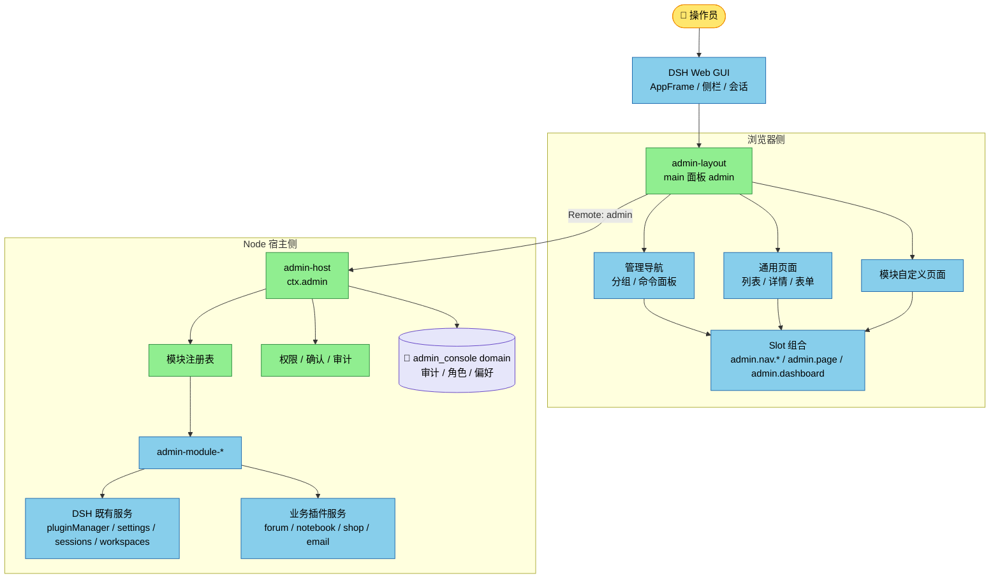
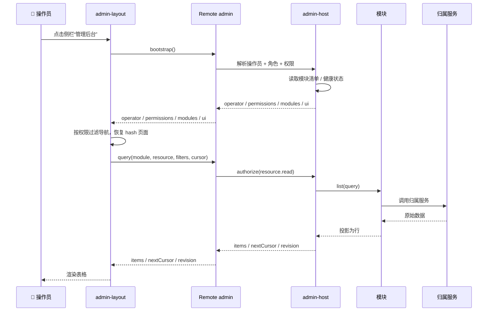
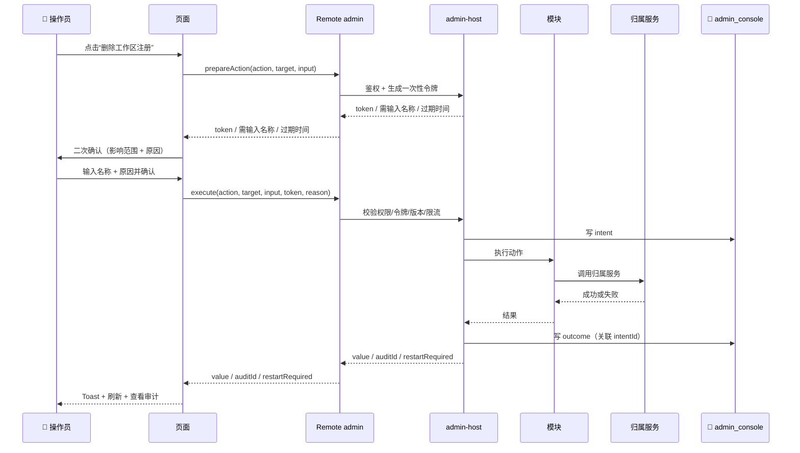

# DSH 后台管理系统设计方案（草案）

[English](admin-system-design.md) | 中文

状态：待评审。本文只确定方案，不包含实现代码。目标是把后台管理做成 DSH 的一组可拆卸插件，而不是另做一个独立的管理网站。

目标读者：DSH 插件开发者与架构评审者。预备知识：Cordis Service、Loader、Slot、Typert Remote、storage domain。

阅读路径：只看结论 → 0、2、11；评审架构 → 3–5、10；评审安全 → 6；评审界面 → 8。

## 0. 结论摘要

| 问题 | 结论 |
|---|---|
| 系统形态 | DSH Web GUI 里的一个主面板，面板 key 为 `admin`，从侧栏入口进入 |
| 服务端 | `@veren/admin-host`，提供唯一的 `ctx.admin` 服务、模块注册表、权限、审计和 `admin` Remote 命名空间 |
| 前端 | `@veren/admin-layout`，提供管理壳、导航、页面槽位和 hash 子路由；`@veren/admin-ui` 提供通用列表/详情组件 |
| 扩展方式 | 新增后台能力 = 新增一个 `admin-module-*` 插件，不改 host/layout |
| 权限 | Host 对每次查询和写操作鉴权；前端隐藏按钮只改善体验，不承担安全 |
| 审计 | 每个写操作先记意图、后记结果；拒绝的尝试也记录；敏感字段脱敏 |
| 首期范围 | 系统控制台：总览、工作区/会话、设置、审计，以及跳转原生插件管理面板 |
| 多用户 | 首期明确按“单操作员”设计；命名用户与 RBAC 放到第二阶段，先补身份桥 |
| 非目标 | 独立 SPA、独立登录页、独立数据库、替换 DSH 侧栏、直接读写别的插件存储 |

一句话：**`admin-host` 管住“谁能做什么、做了什么”，`admin-layout` 管住“看起来怎样、怎么操作”，具体业务由模块插件挂进来。**

### 0.1 先记住五条

1. 后台是 DSH 的一部分，不是 DSH 外面的另一套系统。
2. 所有写操作只走 `admin-host` 的 `execute`，模块不能自己开一条绕过审计的写入口。
3. 后台页面通过 Slot 组合；模块不能运行时 import 另一个模块的组件。
4. 管理数据（审计、角色、偏好）归 admin 自己；业务数据仍归各业务插件，后台只调用它们的服务。
5. 先做“系统控制台”，再做“用户与内容”，不要一开始就做通用低代码平台。

### 0.2 适合与不适合

| 适合 | 不适合 |
|---|---|
| 本机或受信内网的 DSH 部署 | 面向公网的多租户 SaaS 控制台 |
| 一个或少数几个受信操作员 | 需要强隔离的多用户组织 |
| 管理 DSH 自身的插件、设置、会话、审计 | 替代 DSH 的会话/工作区主界面 |
| 给论坛、笔记、商城、邮件等插件加入管理页 | 让后台直接读其他插件的持久化文件 |

## 1. 目标、边界与假设

### 1.1 目标

- 提供**一个入口**：部署所有者在一个地方看到运行状态、插件、设置、会话、审计，后续再扩展到用户与内容。
- 提供**可插拔的扩展面**：新增一类后台页面时，只新增模块插件，不改 `admin-host` 和 `admin-layout`。
- 提供**可信的写路径**：权限检查、破坏性操作确认、审计记录在 Host 侧完成，客户端无法绕过。
- 提供**与 DSH 一致的外观和手感**：复用主题 token、`ui-primitives`、多语言、Remote 传输、桌面端能力。
- 提供**可安装、可禁用、可卸载**的交付形态：一个组合包，成员插件可以独立启用或移除。

### 1.2 非目标

- 不做独立的管理网站、独立登录页、独立前端工程或独立数据库。
- 不复制 DSH 已有的插件管理面板、定时任务面板和设置表单；能跳转原生面板就先跳转，能复用 primitives 就复用。
- 不直接读写 `forum`、`notebook`、`shop`、`email` 等插件的 storage domain；后台调用这些插件公开的服务方法。
- 首期不做多租户、审批流、对外开放 API、模型可调用的 `admin_*` 工具。
- 不替换 DSH 的 `sidebar` 槽位。管理导航放在 `main` 面板内部，避免破坏会话/工作区的主动线。

### 1.3 用户与场景

| 角色 | 关心什么 | 首期能力 |
|---|---|---|
| 部署所有者 | 整个部署是否正常，谁能做什么 | 全部只读 + 安全写操作 |
| 运维 | 插件、设置、会话、后台任务 | 插件/设置/会话/审计页面 |
| 内容运营 | 论坛、笔记、商城、邮件内容 | 第二阶段的内容模块 |
| 审计员 | 谁在什么时候改了什么 | 第二阶段只读审计角色 |

### 1.4 设计假设

- 部署形态是本机 DSH Desktop/Web，或受信内网中的单实例 DSH；不假设公网多租户。
- 认证由现有 `@veren/web-login-gate` 或启动 token 负责；admin 不新建登录页。
- 后台与 DSH 运行在同一进程、同一版本代际内；不跨版本混跑 Host/Client。
- 持久化使用 DSH storage domain，后端可以是 JSON 或 SQLite；admin 不直接访问文件系统。
- 首期所有被准入的浏览器都按同一个 `owner` 操作员处理；这条限制在第 6.6 节展开。

## 2. 关键设计决策

| 决策 | 选择 | 理由 | 放弃的方案 |
|---|---|---|---|
| 系统形态 | DSH 主面板 | 复用认证、Remote、主题、语言、桌面 IPC；安装即用 | 独立 React 管理站，需要第二套登录/传输/构建 |
| 服务端权威 | 一个 `admin-host` 聚合 | 权限和审计只在一个地方实现，模块无法绕过 | 每个模块各自暴露 Remote，权限分散 |
| 前端外壳 | 自有 admin 导航 + DSH primitives | 管理界面需要信息密度和稳定导航；外观仍与 DSH 一致 | 替换 DSH `sidebar`，会破坏会话导航 |
| 扩展模型 | 模块注册表 + 通用资源 + 自定义页 | 标准 CRUD 复用，特殊页面有逃生口 | 全部硬编码在 layout，或一开始做完整低代码平台 |
| 传输 | Typert Remote，命名空间 `admin` | 与现有插件一致，Web/Desktop 都能用 | 自定义 `/admin-api` REST，桌面端要另做桥 |
| 身份 | 首期单操作员，预留 RBAC | DSH 浏览器 Peer 目前固定为 owner，不能假装已多用户 | 首期直接宣称多租户隔离 |
| 数据归属 | admin 只拥有治理数据 | 业务不变量留在业务插件，避免双写和迁移耦合 | 后台直接读业务 storage |
| 路由 | `#/admin/<page>` 私有 hash | 不改 DSH 路由，支持刷新/前进后退/深链 | 无路由，刷新回到首页 |
| 危险操作 | prepare + execute，一次性令牌 | 防误触、防重放，给审计一个明确的意图点 | 只靠前端确认框 |

### 2.1 为什么不是独立后台

独立后台看起来自由，但会立刻带来四份重复：登录态、Remote 客户端、主题/语言、桌面端 IPC。更关键的是，独立站点仍然要调用同一套 Host 服务，权限和审计还是要回到 DSH；多出来的只是一个需要长期维护的第二前端。把它做成 DSH 面板，才能“装一个插件就多一个后台”。

### 2.2 为什么不让每个模块自己开 Remote

如果论坛模块、用户模块、插件模块各自开一个 Remote 命名空间，客户端要分别挂载、分别处理错误、分别做权限；Host 侧也没有一个地方能保证“所有写操作都审计”。`admin-host` 的价值就是做那条唯一的窄管道：模块提供资源和动作，管道负责鉴权、确认、审计、错误归一化。

代价是通用 `query/execute` 不如专用方法类型精确。缓解办法是：协议包统一 Zod schema，Host 在 wire 边界严格校验；这是跨进程/浏览器的 wire 边界，不是同进程类型边界，所以校验是必要的。真正的复杂页面仍可注册自己的 Remote 命名空间，但默认走通用管道。

## 3. 总体架构



### 3.1 分层职责

| 层 | 组件 | 负责 | 不负责 |
|---|---|---|---|
| DSH 应用壳 | `ui-layout`、`ui-sidebar`、会话/工作区 | 应用框架、会话、原生导航 | 后台业务 |
| 管理壳 | `admin-layout` | 面板入口、管理导航、页面框架、hash 路由、通用表格/详情 | 权限判定、业务写操作 |
| 管理核心 | `admin-host` | 模块注册、鉴权、确认、审计、查询/执行管道、`admin` Remote | 具体业务字段和业务规则 |
| 管理模块 | `admin-module-*` | 资源描述、动作实现、页面组件、模块文案 | 绕过管道直接写业务存储 |
| 业务插件 | `pluginManager`、`settings`、`sessionController`、`forum` 等 | 各自领域的不变量和持久化 | 后台导航和审计 |
| 持久化 | `admin_console` domain | 审计、角色、绑定、偏好、保存的视图 | 业务数据副本 |

### 3.2 数据流

- **读**：页面 → `query/get` → 权限检查 → 模块的只读适配器 → 业务服务 → 投影成行 → 页面渲染。
- **写**：页面 →（危险操作先 `prepareAction`）→ `execute` → 权限/令牌/版本检查 → 模块动作 → 业务服务 → 审计结果 → 页面刷新。
- **刷新**：首期不做长连接推送；写成功后页面主动刷新，总览按配置轮询；后续可以加 `admin/changed` 事件或 Remote stream。

### 3.3 包关系

| 包 | 角色 | 运行时依赖 |
|---|---|---|
| `@veren/admin-protocol` | 共享类型、错误码、权限语法、wire schema、API 版本常量 | 无 Cordis 生命周期，浏览器安全 |
| `@veren/admin-host` | Host 服务、注册表、权限、审计、Remote | Cordis、schemastery、storage-domain、protocol |
| `@veren/admin-layout` | Client 管理壳、导航、页面槽位 | React、ui-primitives、slots、locale、protocol |
| `@veren/admin-bundle` | Profile 组合包，只负责 patch 和依赖 | host、layout、默认模块 |
| `@veren/admin-module-*` | 一类后台能力的 Host + Client 半边 | admin-host、protocol、对应业务服务 |
| `@veren/admin-ui` | 通用表格、筛选栏、统计卡、资源页等纯展示组件（P1 推荐） | React、ui-primitives；被 layout 和模块复用，不带 Cordis 生命周期 |

`admin-layout` 不运行时 import `admin-host` 的值，只 import `admin-protocol` 的类型和 schema；业务行为通过 `ctx.remote.admin` 和 `ctx.slots` 跨边界。`admin-module-*` 也不互相 import，模块之间不共享单例。

建议目录：

```text
plugins/admin/
  protocol/            @veren/admin-protocol
  host/                @veren/admin-host
  layout/              @veren/admin-layout
  ui/                  @veren/admin-ui（P1 推荐的展示库）
  bundle/              @veren/admin-bundle
  modules/
    system/            @veren/admin-module-system
    settings/          @veren/admin-module-settings
    sessions/          @veren/admin-module-sessions
    audit/             @veren/admin-module-audit
```

`admin-ui` 是纯展示库，不带 Cordis 生命周期；第一版允许各客户端 bundle 私有打包。若产物体积或样式重复成为问题，再评估把它加入客户端共享模块表，而不是让模块互相 import 组件。

## 4. 两个核心插件

### 4.1 `@veren/admin-host`

Host 半边是后台的“唯一权威”。它提供 Cordis 服务 `ctx.admin` 和 Typert Remote 命名空间 `admin`，并在自己的 storage domain 中保存审计与权限数据。

职责：

- 打开并校验 `admin_console` domain；打不开就显式失败，绝不降级成“无审计后台”。
- 维护模块注册表：注册、校验、卸载、版本检查、权限声明查重。
- 解析操作员身份与角色，计算权限集合。
- 实现 `bootstrap/query/get/prepareAction/execute` 五个 Remote 方法。
- 对每次 `execute` 做权限、确认令牌、版本、超时、限流检查。
- 写审计：意图、结果、拒绝；敏感字段脱敏。
- 暴露健康状态和模块清单，供 layout 渲染导航和空状态。

不负责：

- 具体业务资源的字段和规则（归模块）。
- 管理界面的布局和文案（归 layout/模块）。
- 直接读写 forum/notebook/shop/email 的 storage。

建议源码布局（遵守单包不超过 5 个源文件的约束）：

| 文件 | 内容 |
|---|---|
| `src/index.ts` | 默认导出 `AdminService`（从 `service.ts` 重导出），让 Loader 把该包当服务插件加载 |
| `src/service.ts` | `AdminService extends TypertRemoteService`；`static inject`、`static Config`、构造时 `super(ctx, 'admin')`，`Service.init` 打开 domain，五个 Remote 方法和管道 |
| `src/registry.ts` | 模块/资源/动作注册表、版本校验、释放 |
| `src/access.ts` | 身份解析、角色/权限匹配、确认令牌、限流 |
| `src/store.ts` | `admin_console` domain、审计/角色/绑定/偏好读写、保留策略 |

`admin-host` 采用**默认导出 Service 类**的插件形态，不混用 `apply` 函数插件；原因是它要提供 `admin` 能力并拥有自己的生命周期。公共类型放 `@veren/admin-protocol`，host 不在 `src/types.ts` 里复制一份。`service.ts` 只做编排，重逻辑放 `registry/access/store`；任一文件超过 300 行就拆成独立包，而不是把 host 做成大杂烩。

### 4.2 `@veren/admin-layout`

Client 半边是后台的“壳”。它注册一个 `main` 面板，面板内部再组织管理导航和页面。

入口与挂载顺序：

1. 外层插件注入 `slots`、`locale`、`remote`、`layout`，用 `ctx.remote.$mount` 挂载 `admin` 命名空间。
2. 内层面板插件注入刚挂载的 `remote.admin`（inject 解析走注册表，所以同级挂载也能解析）。
3. 内层插件注册 `main` 面板、侧栏入口、管理导航槽位和页面槽位。
4. 卸载时逆序释放：先卸页面/导航注册，再卸面板，最后卸 Remote。
5. `$mount` 只登记客户端 codec，不验证 Host 是否在线。如果 Host 服务不存在，入口仍会出现，但 `bootstrap` 调用会失败（网关返回未知服务）；壳把它归一化为 `admin/dependency-unavailable`，显示完整错误页，提示安装或启用 `admin-host`，并给出诊断 id。

面板标识：

- `PANEL_ID = 'admin' as MainPanelId`。
- `sidebar.panellist` 注册项 `id` 与 `main` 的 `key` 一致。
- 侧栏顺序建议放在最后（`order: 90`），避免和会话/插件入口抢位置。
- 图标用盾牌/控制台语义的 16px 线稿，颜色继承 `currentColor`。
- 往 `main`、`sidebar.panellist` 这类由官方包声明的槽位注册时，必须用 `ctx.slots.inject(name, () => ctx.slots.register(...))`；裸 `register` 到未声明槽位会在加载时报错。

管理壳的 Slot 约定：

| 槽位 | 类型 | Owner 提供 | 用途 |
|---|---|---|---|
| `admin.nav.overview` | list | `activePage`、`selectPage`、`can`、`collapsed` | 总览分组 |
| `admin.nav.content` | list | 同上 | 内容分组 |
| `admin.nav.operations` | list | 同上 | 运营分组 |
| `admin.nav.system` | list | 同上 | 系统分组 |
| `admin.page` | keyed | `bootstrap`、`can`、`query`、`get`、`prepare`、`execute`、`refresh`、`navigate` | 页面主体 |
| `admin.dashboard` | list | `bootstrap`、`can`、`query`、`refreshToken` | 总览卡片 |
| `admin.header.action` | list | `bootstrap`、`can`、`refresh` | 页头全局动作 |

约定：

- `main:admin` 不是会话面板，不接收 Session 绑定；后台里的“打开会话”只是导航动作，不把会话内容嵌入后台。
- 页面 key 使用 `<module>.<page>`，例如 `system.overview`、`sessions.list`、`users.list`。
- 导航项的 `id` 与页面 key 对齐；只跳原生面板的导航项使用 `native:<panel>`，不注册页面。
- 页面组件不接触 `ctx`、不 import 服务类；所有数据和回调来自 owner props 或注册时注入的普通数据/回调。
- 通用页面组件由 `@veren/admin-ui` 提供；模块注册时绑定自己的 module/resource id。layout 只提供壳，不替模块决定资源。
- 所有页面文案走模块自己的 locale namespace；壳文案走 `admin` namespace。

建议源码布局：

| 文件 | 内容 |
|---|---|
| `src/index.ts` | Node 半边空 `apply`，让 Loader 有可导入的入口 |
| `src/client/index.tsx` | 外层挂载 Remote、内层面板插件、槽位注册 |
| `src/client/shell.tsx` | 管理壳、导航、页头、hash 路由、状态处理 |
| `src/client/remote.ts` | 手工构造 `admin` Remote contribution 和 wire codec |
| `src/client/locales.ts` | `zh`/`en` 字典与 key 类型 |
| `src/client/styles.css` 或 `styles.ts` | 只使用 `--dsw-*` token 的样式 |

构建建议沿用 `cms-bridge` 的 `tsdown + lightningcss` 方案：CSS Modules 编译成带 data 标记的 style 注入，产物是 `window.__ModuleLoader__.load` 的单文件 `lib/client.js`。如果不想引入 CSS 管线，也可以像 `forum-ui` 一样用一张字符串样式表，但后台页面多，建议用 CSS Modules 保持可维护性。

### 4.3 `@veren/admin-protocol` 与 `@veren/admin-bundle`

**protocol** 存在的理由只有一个：Host 和 Client 对同一份 wire 契约不能各写一遍。它放：

- `ADMIN_API_VERSION` 和模块兼容规则。
- `AdminBootstrap`、`AdminQuery`、`AdminExecution` 等 wire 类型。
- 稳定错误码和 `AdminResult` 联合类型。
- 权限字符串语法与校验函数。
- Zod schema：Host 用于输入校验，Client 用于 Remote codec。

它不依赖 Cordis、不打开 storage、不注册任何东西，因此可以被两端安全引用。

**bundle** 只做组合，不写业务：

```text
admin-host  →  admin-layout  →  admin-module-system
                             →  admin-module-settings
                             →  admin-module-sessions
                             →  admin-module-audit
```

成员插件不各自声明 `dsh.bundle`，只作为普通依赖随组合包安装；组合包的 `cordis.patch.yml` 按依赖顺序插入 Loader 行。这样 profile 里只有一层 bundle，避免 reconciliation 重复激活。

## 5. 模块化扩展模型

### 5.1 四种扩展点

| 扩展点 | 用途 | 例子 | 什么时候不该用 |
|---|---|---|---|
| Resource | 标准列表/详情/编辑 | 用户、帖子、订单、邮件 | 页面有复杂交互或跨资源工作流 |
| Action | 一条有名字的命令 | 禁用插件、归档会话、重置密码 | 需要展示大量数据或复杂表单 |
| Page | 完全自定义页面 | 总览、审计时间线、内容审核台 | 只是标准 CRUD |
| Widget | 总览上的卡片 | 运行状态、最近失败、待处理数 | 需要整页交互 |

第一版只把 Resource 做到“列表 + 详情 + 只读字段”；通用编辑表单等第二个真实模块出现后再抽象。不要先造一个覆盖所有情况的低代码引擎。

### 5.2 模块描述符

一个 Host 模块至少声明：

| 字段 | 含义 | 必填 |
|---|---|---|
| `id` | 稳定模块 id，和页面 key 前缀一致 | 是 |
| `apiVersion` | 兼容的 admin API 版本 | 是 |
| `permissions` | 该模块新增的权限点 | 是，可为空 |
| `resources` | 资源描述：id、字段、只读/可写能力、所需权限 | 否 |
| `actions` | 动作描述：id、危险级别、输入 schema、所需权限、超时 | 否 |
| `titleKey` | 模块标题的文案 key，供壳和命令面板使用 | 否 |

资源描述里只放“机器可读的事实”：字段名、类型、是否可排序/筛选、是否敏感、所需权限。**展示文案不放 Host**，由模块的 Client 半边用 locale 字典提供；Host 返回 `labelKey` 时，Client 找不到就回退到字段名。

### 5.3 注册与释放

Host 侧：

- 模块插件 `inject: ['admin']`，在 `apply` 中用 `ctx.effect(() => ctx.admin.registerModule(descriptor), '...')` 注册。
- `registerModule` 返回释放函数；模块卸载、HMR、禁用时，注册表删除该模块的资源/动作/权限。
- 注册时校验：id 唯一、权限不重复、动作引用的资源存在、`apiVersion` 兼容、资源/动作至少有一个。
- 先完整校验再提交；任一校验失败都不留下半套资源/动作。校验失败显式抛错，不静默跳过；错误信息点名模块和字段。

Client 侧：

- 模块 Client 插件注入 `slots`、`locale`，用 `ctx.slots.inject('admin.nav.<group>', ...)` 和 `ctx.slots.inject('admin.page', ...)` 注册。
- 导航组件和页面组件都是普通展示组件；页面通过 owner props 拿到 `query/execute`，不直接拿 `ctx`。
- 卸载时 Slot 注册自动释放；页面若还停留在已卸载的 key，壳显示“模块已卸载，请选择其他页面”。

### 5.4 模块目录

| 模块 | 阶段 | Host 数据来源 | Client 页面 | 说明 |
|---|---|---|---|---|
| `admin-module-system` | P1 | `pluginManager`、`pluginInventory`、`sessionController`、`workspaceRegistry` | 总览、关于/诊断 | 只读统计 + 跳原生面板 |
| `admin-module-settings` | P1 | `settingsController` | 设置 | 复用 `SettingsForm` 系列 primitives |
| `admin-module-sessions` | P1 | `sessionController`、`workspaceController` | 工作区/会话 | 列表、详情、打开、重命名、归档；工作区删除需二次确认 |
| `admin-module-audit` | P1 | `admin-host` 自己的审计表 | 审计日志 | 只读；过滤、详情、复制 |
| `admin-module-users` | P2 | 待补的 `webAuth` 服务 | 用户与角色 | 依赖身份桥，不在 P1 承诺 |
| `admin-module-content` | P2 | `forum`、`notebook` 等服务 | 论坛/笔记审核 | 每个内容域一个子页面或独立模块 |
| `admin-module-commerce` | P3 | `shop` 服务 | 商品/订单 | 等 shop 插件有稳定服务面 |
| `admin-module-email` | P3 | `email` 服务 | 邮件/模板 | 等 email 插件有稳定服务面 |

### 5.5 模块作者检查清单

1. Host 半边只调用归属服务，不打开别人的 storage domain；提供服务的包默认导出 Service 类，只注册模块的包用命名 `apply`，不要混用两种形态。
2. 每个写动作都有权限点、危险级别、输入 schema、超时。
3. 每个资源都声明字段的敏感性和可筛选/可排序能力。
4. Client 半边不 import 另一个模块的组件，不 import Host 服务的值。
5. 文案全部走 locale 字典；组件不接触 `ctx`。
6. 注册都带 disposer；写一个卸载/HMR 测试。
7. 提供中英文 README 和 package `description`，说明“什么时候用、什么时候不用”。

## 6. 权限、身份与审计

### 6.1 首期信任模型

首期按**单操作员**设计：

- 如果安装了 `@veren/web-login-gate`，登录门禁证明浏览器属于某个命名用户；但 DSH 官方连接层创建的浏览器 Peer 目前固定为 `owner`，Remote 调用里没有可靠的命名用户身份。
- 因此 `admin-host` 在首期把所有被准入的浏览器都视为同一个操作员，审计里记录 `owner`，不宣称多用户隔离。
- 这适合本机、单人维护的 DSH；不适合把同一个后台暴露给互不信任的多个用户。

> 这条限制必须在部署文档里写清楚。等第 6.6 节的身份桥完成，再开放多用户 RBAC，否则“有角色表”只是摆设。

### 6.2 角色与权限

权限字符串采用三段式：

```text
<module>.<resource>.<verb>     例如 sessions.workspace.read
<module>.<action>              例如 plugins.bundle.install
*                              仅内置 owner 使用
<module>.*                     模块内全部权限
```

动词约定：`read`、`create`、`update`、`delete`、`execute`、`export`、`manage`。能不用 `manage` 就不用，避免一个权限盖住太多动作。

| 内置角色 | 权限 | 首期是否启用 |
|---|---|---|
| `owner` | `*` | 是（唯一实际角色） |
| `admin` | 除角色/权限变更外的全部 | 否，P2 |
| `operator` | 会话、内容、设置的日常操作 | 否，P2 |
| `auditor` | 审计、系统信息的只读 | 否，P2 |
| `viewer` | 非敏感只读 | 否，P2 |

首期也把角色/绑定表建好，但只有 `owner` 生效。这样 P2 接身份桥时不用改数据模型。

### 6.3 鉴权发生在哪里

- `bootstrap` 返回当前操作员、角色、权限集合、模块清单、健康状态。前端用它隐藏无权导航和按钮。
- `query/get` 在 Host 侧按资源声明的权限检查；`execute` 按动作声明的权限检查。
- 模块动作里的动态规则（例如“不能删除最后一个 owner”）由模块自己再检查一次；这是业务不变量，不是 UI 规则。
- 默认拒绝：没有声明权限的资源/动作不能被调用。
- 防自锁：不能通过后台移除最后一个 owner、不能禁用 `admin-host` 自身、不能修改内置角色、不能删除审计记录。

### 6.4 破坏性操作协议

危险级别：

| 级别 | 例子 | 要求 |
|---|---|---|
| `normal` | 刷新、打开详情、只读查询 | 无 |
| `sensitive` | 修改设置、禁用插件、归档会话 | 需要 `reason`，记录审计 |
| `destructive` | 删除工作区注册、移除 bundle、批量删除 | 需要一次性令牌 + 输入目标名称 + `reason` |

流程：

1. 页面调用 `prepareAction`，传模块、动作、目标、输入。
2. Host 检查权限，生成一次性令牌；令牌绑定操作员、动作、目标、输入摘要、过期时间（默认 120 秒）。
3. 页面弹确认框，展示影响范围、不可逆提示、需要输入的名称/短语、原因输入框。
4. 用户确认后调用 `execute`，带上令牌和原因。
5. Host 再次检查权限、令牌、目标版本、限流；令牌单次使用，过期或复用直接拒绝。
6. 执行成功后返回 `auditId`；页面 Toast 提供“查看审计”入口。

令牌只存在 Host 内存中，进程重启即失效；不落盘、不跨进程。这样既能防误触和重放，又不需要额外的签名密钥。

### 6.5 审计

审计是后台的硬要求，不是日志的附属品。

| 字段 | 含义 |
|---|---|
| `id` | 时间可排序的 id（UTC 时间前缀 + 随机后缀） |
| `at` | ISO 时间 |
| `kind` | `intent` / `outcome` / `denied` |
| `intentId` | `outcome` 关联的意图 id |
| `actor` | 操作员标识；首期为 `owner` |
| `roles` | 当时的角色快照 |
| `module` / `action` | 模块与动作 |
| `target` | 目标类型和 id |
| `input` | 脱敏、截断后的输入 |
| `result` | `ok` / `error`，可带简短摘要 |
| `errorCode` | 失败时的稳定错误码 |
| `durationMs` | 动作耗时 |
| `traceId` | 关联日志的追踪 id |
| `confirmationId` | 危险操作的令牌 id |

写入顺序：

1. 执行前写 `intent`；写失败则**中止动作**。
2. 执行业务动作。
3. 写 `outcome`，关联 `intentId`。
4. 如果业务成功但 `outcome` 写失败：不假装成功回滚，返回成功并带 `auditWarning`，同时打错误日志、在总览显示“审计不完整”警报。

其他规则：

- 权限拒绝、输入校验失败也写 `denied`，但绝不记录密码、token、密钥、完整文件内容。
- 默认脱敏键名匹配 `password|secret|token|key|credential|authorization`；值截断到 2 KB；可配置追加。
- 保留策略默认 90 天 / 50,000 条；启动和每日清理，清理本身写一条系统审计。
- 审计表只追加；除了保留策略清理，没有删除/修改 API。导出是后续阶段能力。

### 6.6 身份桥（第二阶段）

多用户 RBAC 的前提是 Host 能可靠回答“这次调用是谁”。可选路径：

| 方案 | 做法 | 优点 | 代价 | 适用 |
|---|---|---|---|---|
| A. 官方 Principal 扩展 | 连接层按登录会话创建命名 principal | 全链路身份，最正确 | 需要官方扩展点或改动 | 长期 |
| B. 管理专用 HTTP 路由 | `/admin-api` 读取 Better Auth cookie | 隔离、可用 HttpOnly/CSRF | 桌面端 IPC 不支持，需要另一套客户端 | Web 多用户 |
| C. 管理会话令牌 | 登录后换短时 token，Remote 携带 | 兼容桌面/Remote | token 在 JS 内存，XSS 风险 | 过渡 |

建议：Web 多用户先做 B，长期推动 A；不要把 C 当成正式的多用户隔离。无论选哪条，`@veren/web-login-gate` 都需要暴露一个窄的 `webAuth` 服务（校验会话、读取用户、必要时校验密码），而不是让 admin 直接打开 `web_login_gate` domain。

### 6.7 安全检查清单

- CSRF：只走同源 Remote；如果加 HTTP 路由，必须校验 Origin，并沿用 SameSite=Strict 的 cookie。
- XSS：用户数据只用 React 文本节点；Markdown 用 `MarkdownText` 的受控链接策略；禁止 `dangerouslySetInnerHTML`。
- 秘密：设置页只写不读；审计不落秘密；错误信息不回显秘密。
- 限流：危险动作按操作员/动作限流，返回 `admin/rate-limited` 和 `retryAfter`。
- 路径：首期不做任意文件浏览；工作区/会话按 id 操作，不按用户传入的路径操作。
- 依赖：模块新增 Host 值依赖要按 DSH 依赖规则分类；Client 只用 `import type` 和协议包。
- 供应链：bundle 安装沿用 `pluginManager` 的审批/兼容检查，不绕过。

## 7. 数据与 API

### 7.1 存储域

`admin_console` domain，`version: 1`，`layout: 'per-record'`。表：

| 表 | 键 | 内容 | 保留 |
|---|---|---|---|
| `audit` | 时间前缀 id | 审计意图/结果/拒绝 | 默认 90 天 / 50k 条 |
| `roles` | role id | 自定义角色与权限 | 永久，内置角色不落库 |
| `role_bindings` | subject | 用户/主体到角色的绑定 | 永久，P2 使用 |
| `preferences` | `subject + key` | 每操作员的界面偏好 | 永久，可清空 |
| `saved_views` | `subject + view id` | 保存的筛选/列视图 | P2 |

原则：

- admin 只拥有治理数据；业务数据不复制进来，避免双写和漂移。
- 审计 id 用 UTC 时间前缀，便于按时间排序和前缀过滤；KV 没有二级索引，查询时按 id 倒序扫描，默认只看最近 200 条。
- 审计规模上限是明确的已知限制：50k 条以内适合本地 KV；更大规模应换 SQLite 后端或独立审计存储，而不是无限扫描。
- 域打开失败让插件加载失败；宁可没有后台，也不要一个没有审计的后台。

### 7.2 Remote API

| 方法 | 用途 | 权限 | 副作用 |
|---|---|---|---|
| `bootstrap` | 操作员、权限、模块清单、健康、UI 默认值 | 已准入 | 无 |
| `query` | 列表查询：模块、资源、搜索、过滤、排序、游标、页大小 | 资源 `read` | 无；敏感资源可按配置记读审计 |
| `get` | 单条详情 | 资源 `read` | 无 |
| `prepareAction` | 校验动作并签发确认令牌 | 动作 `execute` | 无业务写 |
| `execute` | 执行动作 | 动作 `execute` + 令牌（危险操作） | 业务写 + 审计 |

所有方法返回统一联合：

```text
{ ok: true, value: ... }
{ ok: false, error: { code, message, details?, traceId } }
```

预期内的拒绝（无权限、校验失败、冲突、未找到、限流）走 `ok: false`，页面按 code 渲染；真正的内部错误抛 `RemoteError`，由网关归一化，页面显示 code + traceId，不显示堆栈。

### 7.3 载荷要点

`bootstrap` 返回：

| 字段 | 内容 |
|---|---|
| `apiVersion` | 协议版本 |
| `runtime` | DSH 版本、admin 版本、平台（web/desktop） |
| `operator` | id、显示名、kind（首期 `owner`）、roles |
| `permissions` | 已授予的权限字符串数组 |
| `modules` | 模块 id、资源、动作的机器可读描述 |
| `features` | 可选服务可用性：pluginManager、settings、auth、jobs 等 |
| `health` | storage、audit、可选服务的状态 |
| `ui` | 默认页、页大小、轮询秒数、密度 |

`query` 返回：

| 字段 | 内容 |
|---|---|
| `items` | 行数组，每行必须有 `id`；可选 `revision` |
| `nextCursor` | 下一页游标；没有更多则省略 |
| `total` | 可选总数；昂贵时省略，页面显示“50+” |
| `columns` | 可选列描述；不返回则由页面用资源描述渲染 |
| `revision` | 集合级版本；用于冲突提示 |

`execute` 返回：

| 字段 | 内容 |
|---|---|
| `value` | 动作结果，必须可 JSON 序列化 |
| `auditId` | 意图审计 id |
| `changed` | 是否改动了状态 |
| `restartRequired` | 是否需要重启 DSH 才生效（插件管理） |
| `auditWarning` | 审计结果写失败时的警告，不掩盖业务成功 |

### 7.4 错误码

| 错误码 | 含义 | 页面行为 |
|---|---|---|
| `admin/unauthenticated` | 没有有效身份 | 提示重新登录/重载 |
| `admin/forbidden` | 权限不足 | 403 状态，不显示敏感数据 |
| `admin/unknown-module` | 模块未安装/已卸载 | 提示安装或切换页面 |
| `admin/unknown-resource` | 资源不存在 | 空状态 |
| `admin/unknown-action` | 动作不存在 | 禁用按钮 |
| `admin/bad-request` | 输入校验失败 | 字段级错误 |
| `admin/conflict` | 版本冲突 | 刷新并提供重试 |
| `admin/confirmation-required` | 需要/过期确认令牌 | 重新走确认框 |
| `admin/rate-limited` | 触发限流 | 显示 retryAfter |
| `admin/dependency-unavailable` | 依赖服务不可用 | 页面降级说明 |
| `admin/storage-unavailable` | 审计/治理存储不可用 | 只读/停止写，显式告警 |
| `admin/internal` | 未预期错误 | 显示 traceId，复制诊断信息 |

### 7.5 一致性与限制

- 分页用不透明游标，`limit` 默认 50、上限 200；不接受页面传入任意大页。
- 列表查询有超时（默认 5 秒）；动作有超时（默认 30 秒）；超时返回稳定错误码。
- 不做跨模块事务。一个动作只调用一个归属服务；如果要跨服务，拆成两个动作或在模块内做补偿，并在结果里报告部分成功。
- 编辑使用 `expectedRevision` 做乐观并发；冲突时不覆盖，提示刷新。
- 总览统计允许 5–10 秒缓存；写操作后主动失效相关缓存。
- 审计写入是业务动作的一部分，但不回滚业务；失败语义见 6.5。

### 7.6 版本与兼容

- `ADMIN_API_VERSION = 1`；模块声明 `apiVersion`，Host 不兼容时拒绝注册并点名。
- Host 输入严格校验；Client 对 Host 返回值使用宽松 schema，允许 Host 追加字段而不让页面崩溃。
- 删除/改名字段必须升 API 版本；只加字段不升。
- `admin_console` domain 版本独立于 API 版本；记录 schema 变化时按 storage-domain 的迁移规则升版本。
- 发布包写 `engines.dsh` 范围；DSH 仍是 pre-stable，升级时先跑 composition 测试。

## 8. 界面与交互

### 8.1 入口与整体布局

侧栏入口：

```text
DSH 侧栏
  ...
  [会话/工作区]
  [插件] [定时任务]
  [🛡 管理后台]   ← 新增
```

进入后，管理界面占用 `main` 面板：

```text
┌─────────────────────────────────────────────────────────────────────┐
│ DSH 侧栏 │ 管理导航            │ 页面标题                 [刷新] [操作] │
│ 会话     │ 概览                │ 描述 / 环境 / 面包屑                  │
│ 工作区   │ 内容                ├──────────────────────────────────────┤
│          │  论坛               │ 搜索 [____]  状态 [全部]  视图 [默认] │
│          │  笔记               │ ┌──────────────────────────────────┐ │
│          │ 运营                │ │ 表格 / 卡片                       │ │
│          │  工作区与会话       │ │                                  │ │
│          │  审计日志           │ └──────────────────────────────────┘ │
│          │ 系统                │ 50 条 / 下一页                       │
│          │  插件（原生面板）    │                                      │
│          │  设置                │                                      │
└─────────────────────────────────────────────────────────────────────┘
```

- 管理导航宽度约 232px，可折叠成 56px 图标栏；折叠状态存 admin preferences。
- 内容区只保留一个纵向滚动容器；表格横向滚动在自己的容器里，不让整页横滚。
- 页头固定，表格表头 sticky；详情用右侧 drawer，避免整页跳转。
- 可选“专注模式”：进入后台时折叠 DSH 侧栏，退出时恢复；默认不自动折叠，避免用户迷失。
- 路由只改 hash：`#/admin/<page>?<filters>`。page id 只允许小写字母、数字、点和连字符；未知 id 回退默认页；不使用 path 形式的 `pushState`，避免和 DSH 的静态入口/启动 token 路径冲突。

### 8.2 导航分组

| 分组 | 首期页面 | 后续页面 | 说明 |
|---|---|---|---|
| 概览 | 总览 | 趋势、告警 | 只读，默认落地页 |
| 内容 | — | 论坛、笔记、商品、邮件 | P2/P3，按模块出现 |
| 运营 | 工作区与会话、审计日志 | 任务、调度、导出 | 日常操作 |
| 系统 | 插件（原生）、设置、关于 | 用户与角色、存储、诊断 | 配置与治理 |

导航项的顺序由注册时的 `order` 决定；同一分组内按升序，相同 order 保留注册顺序。分组标题由 layout 提供中英文文案，模块不重复定义。

### 8.3 页面目录

| 页面 | 阶段 | 数据来源 | 主要操作 | 权限 |
|---|---|---|---|---|
| 总览 | P1 | system 模块聚合 | 刷新、跳转、查看最近审计 | `admin.overview.read` |
| 工作区与会话 | P1 | session/workspace 服务 | 搜索、查看、打开会话、重命名、归档、删除工作区注册 | `admin.sessions.read` / `.write` |
| 设置 | P1 | `settingsController` | 按 schema 编辑、保存、处理冲突、秘密字段只写 | `admin.settings.read` / `.write` |
| 审计日志 | P1 | admin 审计表 | 过滤、详情、复制 JSON | `admin.audit.read` |
| 插件与组合 | P1 | 原生插件面板 | 跳转；首期不在后台内做安装/卸载 | `admin.plugins.read` |
| 用户与角色 | P2 | `webAuth` 服务 | 列表、角色分配、禁用用户 | `admin.users.*` / `admin.roles.*` |
| 论坛内容 | P2 | `forum` 服务 | 帖子/评论查看、置顶，以及归属服务提供的治理动作 | `admin.content.forum.*` |
| 笔记内容 | P2 | `notebook` 服务 | 查看/删除，按归属服务能力 | `admin.content.notebook.*` |
| 商品/订单 | P3 | `shop` 服务 | 商品、订单、退款 | `admin.commerce.*` |
| 邮件 | P3 | `email` 服务 | 模板、发送记录、退信 | `admin.email.*` |

P1 刻意**不**在后台里重做插件安装/卸载。插件管理面板已经有安装审批、兼容检查、日志、重启提示；后台先做摘要和跳转，等有明确的统一体验需求再迁移。

### 8.4 页面骨架

所有标准页面遵循同一骨架：

- **页头**：标题、一句话说明、环境/版本徽章、刷新、主操作。
- **工具条**：搜索、筛选、排序、密度、保存视图（P2）。
- **内容**：表格或卡片；表头 sticky；行 hover；选中行有明确状态。
- **底部**：游标分页、当前筛选摘要、选中计数。
- **抽屉**：详情、元数据、危险区；不覆盖整页，保留上下文。
- **反馈**：Toast 成功/失败；失败带错误码和“复制诊断”；危险操作成功带“查看审计”。

状态必须齐全：

| 状态 | 表现 |
|---|---|
| 加载中 | 骨架屏；不要整页 spinner 闪烁 |
| 空 | 说明为什么空 + 下一步动作（安装模块、清除筛选、创建第一条） |
| 无权限 | 403 说明 + 返回有权限的页面；不显示敏感数据 |
| 依赖不可用 | 说明缺哪个服务/插件，提供安装或启用的入口 |
| 冲突 | 保留草稿，提示数据已变化，提供刷新/对比 |
| 审计不完整 | 顶部警示条，不阻塞当前页面，但明确告知 |

### 8.5 交互规范

- 搜索：输入即过滤当前资源，300ms 防抖；不跨资源全局搜索，P2 再做命令面板。
- 筛选：筛选项来自资源描述；值用受控枚举或文本，不接受任意表达式。
- 排序：只允许资源声明的字段；默认按 `updatedAt` 或资源指定字段倒序。
- 分页：游标；页面显示“当前 50 条 / 下一页”，不伪造总页数。
- 批量操作：P2；必须有选中计数、影响预览、危险确认。
- 保存视图：P2；每个操作员私有，可分享给同角色（P3）。
- 键盘：Tab 顺序自然；Escape 关闭 drawer/modal；Enter 提交；不抢占 DSH 已有快捷键。
- 命令面板：P2；首期只做导航搜索。
- 响应式：≥1280 双栏；960–1279 导航变窄、表格列降级；<960 导航变 drawer、表格变卡片。
- 主题：只使用 `--dsw-*` 语义 token；亮/暗主题都测；不写死颜色。
- 语言：壳用 `admin` namespace，模块用各自 namespace；日期/数字用 `Intl`；中文/英文都测。
- 无障碍：表格有 caption/scope；页面切换移动焦点到标题；Toast 用 `aria-live`；确认框焦点陷阱；尊重 reduced motion。

复用优先级：

1. `@deepseek-ai/dsh-client-ui-primitives`：Button、Input、Checkbox、Switch、Modal、Toast、Menu、Tooltip、Tag、StateDot、JsonTree、SettingsForm 系列。
2. `@veren/admin-ui`（P1 推荐）：DataTable、FilterBar、StatCard、DetailDrawer、EmptyState、ConfirmDialog、ResourcePage 的展示壳。
3. 模块自己的组件：只放该模块特有的可视化。

不要在后台里引入第二套设计系统、Tailwind 或硬编码颜色。

## 9. 关键流程

### 9.1 首次打开与读取



要点：

- `bootstrap` 是唯一一次“拿全量清单”的调用；页面数据按需查询，不在首屏拉所有资源。
- 权限过滤只是体验；真正的拒绝在 `query` 里还会发生一次。
- 如果 `bootstrap` 失败，壳显示错误页和重试，不渲染半套导航。

### 9.2 危险写操作



失败分支：

- `prepareAction` 无权限：直接 403，不生成令牌。
- 令牌过期/复用：`admin/confirmation-required`，重新走确认。
- 业务失败：写 `outcome`（`error` + `errorCode`），返回结构化错误。
- 审计 `intent` 写失败：不执行业务，返回 `admin/storage-unavailable`。
- 业务成功、`outcome` 写失败：返回成功 + `auditWarning`，总览亮“审计不完整”。

### 9.3 权限拒绝

1. 页面隐藏无权按钮（体验）。
2. 如果客户端仍调用 `execute`，Host 返回 `admin/forbidden`，并在审计写 `denied`。
3. 页面显示 403 状态和“返回有权限的页面”，不显示目标详情。
4. 连续拒绝触发限流，返回 `admin/rate-limited`，避免暴力探测。

### 9.4 模块卸载/HMR

1. Host 模块 fiber 释放 → `registerModule` 的 disposer 删除资源/动作/权限。
2. Client 模块 fiber 释放 → 导航/页面 Slot 注册消失。
3. 如果当前页面还停在已卸载 key，壳的 `hasPage` 返回 false，显示“模块已卸载”，并建议跳到默认页。
4. Remote 仍有旧页面在途请求时，返回 `admin/unknown-module`；页面忽略过期响应，不覆盖新状态。
5. HMR 后重新注册，导航/页面重新出现；不保留旧模块的单例或缓存。

## 10. 生命周期、打包与加载

### 10.1 Loader 行与 patch

`admin-bundle` 的 `cordis.patch.yml` 建议顺序：

| 顺序 | 行 id | 包 | 作用 |
|---|---|---|---|
| 1 | `admin-host` | `@veren/admin-host` | 打开 domain、提供 `ctx.admin`、Remote |
| 2 | `admin-module-system` | `@veren/admin-module-system` | 总览/系统信息 |
| 3 | `admin-module-settings` | `@veren/admin-module-settings` | 设置 |
| 4 | `admin-module-sessions` | `@veren/admin-module-sessions` | 工作区/会话 |
| 5 | `admin-module-audit` | `@veren/admin-module-audit` | 审计页面 |
| 6 | `admin-layout` | `@veren/admin-layout` | Client 入口/管理面板 |

Host 行在前，模块行在中间，layout 行在后。内层插件等待的是 layout 自己挂载的 `remote.admin`（客户端 codec），不是 Host 服务；Host 是否在线由运行时的 `bootstrap` 判断。行顺序只保证 Loader 装配顺序可读。

`admin-layout` 的 `package.json` 需要：

- `dsh.client.platform: 'web'`。
- `./client` 导出指向 `lib/client.js`。
- `dsh.client.inject` 列出信息性依赖：`@deepseek-ai/dsh-api-remotes`、`@deepseek-ai/dsh-client-connection`、`@deepseek-ai/dsh-client-locale`、`@deepseek-ai/dsh-client-ui-layout`、`@deepseek-ai/dsh-client-ui-primitives`、`@deepseek-ai/dsh-client-ui-renderer`、`@deepseek-ai/dsh-client-ui-sidebar`、`@deepseek-ai/dsh-client-ui-slots`。
- Node 半边 `src/index.ts` 导出空 `apply`，让该行可导入；浏览器半边才是实际内容。

`admin-host` 的 `package.json` 写 `dsh: {}`，不声明 client；`admin-bundle` 声明 `dsh.bundle.patch`，成员插件不声明 bundle。

### 10.2 激活握手

1. Web 启动，Loader 装配 host 行，`admin-host` 打开 domain、注册 `ctx.admin`。
2. Client 模块加载 `admin-layout` 的 `lib/client.js`。
3. 外层插件 `ctx.remote.$mount(adminRemote)`，拿到卸载函数。
4. 内层插件 `inject: ['remote.admin']`，注册 `main:admin` 和 `sidebar.panellist`。
5. 用户点击入口，`ctx.layout.selectPanel('admin')`。
6. 管理壳读取 hash，调用 `bootstrap`，渲染导航/页面。
7. 卸载时逆序：页面/导航 → 面板 → Remote → host 模块 → admin 服务 → domain 关闭。

### 10.3 配置

Host 配置（`@veren/admin-host` 的 `Config`）：

| 字段 | 默认 | 说明 |
|---|---|---|
| `storage.backend` | `json` | `admin_console` domain 的后端 |
| `storage.routes` | `{}` | domain 路由意图，校验后端存在 |
| `access.mode` | `local-owner` | 首期唯一模式；P2 加 `named` |
| `access.defaultRole` | `viewer` | P2 命名用户的默认角色 |
| `audit.retentionDays` | `90` | 审计保留天数 |
| `audit.maxEntries` | `50000` | 审计条数上限 |
| `audit.includeInput` | `true` | 是否记录脱敏输入 |
| `audit.redactKeys` | 默认列表 | 追加脱敏键名 |
| `limits.queryPageSize` | `50` | 默认页大小 |
| `limits.maxPageSize` | `200` | 页大小上限 |
| `limits.actionTimeoutMs` | `30000` | 动作超时 |
| `limits.confirmTtlSeconds` | `120` | 确认令牌有效期 |
| `ui.defaultPage` | `system.overview` | 默认页面 |
| `ui.pollSeconds` | `30` | 总览轮询 |
| `ui.density` | `comfortable` | 默认密度 |

配置非法在加载时显式失败：未注册的 storage 后端、domain 打不开、API 版本不兼容、令牌配置越界。不要在插件里写死这些可部署变化的常量。

### 10.4 失败行为

| 失败 | 行为 | 用户看到 |
|---|---|---|
| domain 打不开 | host 加载失败 | 管理入口不出现；启动日志点名 domain/错误码 |
| host 未安装/被禁用 | 入口仍出现，`bootstrap` 失败并归一化为依赖错误 | 完整错误页，提示安装/启用 `admin-host` |
| 模块注册冲突 | 模块加载失败 | 该模块页面不出现；日志点名冲突字段 |
| 模块依赖缺失 | 模块保持 pending 或加载失败 | 对应导航不出现；不阻塞其他页面 |
| 业务服务不可用 | `query/execute` 返回依赖错误 | 页面显示依赖不可用，其他页面正常 |
| 审计存储写失败 | 写操作中止或带警告 | 明确提示，不静默成功 |
| 认证过期 | Remote 返回未认证 | 提示重新登录/重载，不循环弹窗 |

### 10.5 安装与测试节点

沿用仓库的测试节点规范：

- 使用一次性节点 `~/.dsh_test/<编号>`，自己的 `store-dir` 和 `package-import-method=copy`。
- 先写 profile `.npmrc`，再初始化 profile，再安装 bundle tarball。
- 安装后检查 `bundles` 列表包含 `@veren/admin-bundle`，并确认与 `~/.dsh` 零共享 inode。
- 任何 `dsh plugin` 命令前打印 `DSH_HOME` 核对；绝不对 `~/.dsh` 做写操作。
- 测试结束清理节点。

## 11. 路线图

| 阶段 | 目标 | 交付 | 完成标准 |
|---|---|---|---|
| P0 骨架 | 证明组合可行 | protocol、host 空壳、layout 空壳、bundle、总览只读 | 测试节点能装、侧栏能进、bootstrap 返回健康信息、卸载无泄漏 |
| P1 系统控制台 | 日常运维可用 | 总览、工作区/会话、设置、审计、原生插件跳转 | 5 个 Remote 方法稳定；权限/审计生效；亮暗/中英；核心测试通过 |
| P2 用户与内容 | 从“系统”走向“业务” | 身份桥、用户/角色、论坛/笔记模块、通用资源编辑 | 命名用户可区分；角色可分配；内容页面可审核；冲突/限流可用 |
| P3 平台化 | 可扩展、可运营 | 保存视图、批量操作、导出、对外 API、告警、商城/邮件模块 | 第三方模块按文档接入；审计可导出；有升级/兼容策略 |

P1 明确不做：多用户 RBAC、通用创建/编辑表单、批量删除、对外 REST、`admin_*` 模型工具、审批流。

## 12. 测试与验收

### 12.1 测试矩阵

| 层 | 重点 | 方式 |
|---|---|---|
| protocol | 权限语法、schema、错误码、版本常量 | vitest 单元测试 |
| host 单元 | 鉴权矩阵、确认令牌过期/复用、审计意图/结果、分页上限、冲突 | vitest + 内存 storage |
| host 组合 | 真实 Loader 装配、模块注册/卸载、domain 打开/关闭、HMR | `loader-smoke` 或等价 composition 测试 |
| client 单元 | 导航过滤、页面切换、空/错/403、确认框、locale、hash 路由 | vitest + jsdom |
| e2e | 测试节点安装、打开后台、读一条、写一条、审计可查、重载恢复 | 真实 DSH 测试节点 |
| 安全 | 直接调用 Remote 绕过 UI、审计脱敏、XSS 字符串、限流 | host/client 专项测试 |
| 无障碍 | 键盘走查、焦点、表格语义、对比度 | 手动 + 组件断言 |
| 性能 | 列表 50/200 行、审计 5k 行、首屏 bootstrap | 基准 fixture，记录预算 |

### 12.2 完成定义

- Host 和 Client 都能在真实 profile 中装配，不依赖手工 `ctx.plugin` 的假装配。
- `bootstrap/query/execute` 的成功和失败路径都有测试；错误码稳定。
- 权限拒绝在 Host 侧可复现，UI 隐藏不是唯一手段。
- 危险操作有 prepare/execute 测试；令牌过期、复用、跨操作员都拒绝。
- 审计 intent/outcome/denied 都能查；秘密字段不出现。
- 导航/页面/HMR 卸载后无残留；重新加载能恢复。
- 亮/暗主题、中/英、1280 和 960 宽度都检查。
- 测试节点安装/卸载通过，且没有写 `~/.dsh`。

### 12.3 风险与缓解

| 风险 | 影响 | 缓解 |
|---|---|---|
| 多用户身份缺口 | 不能安全地给多人用 | P1 明确单操作员；P2 先做身份桥 |
| 插件管理操作会重启/重载 | 后台页面中断 | P1 只跳原生面板；操作前提示，操作后刷新 |
| KV 审计规模 | 查询变慢 | 50k 上限 + 保留策略；更大规模换后端 |
| 业务服务没有管理 API | 模块做不了 | 先把需求变成归属服务的窄方法，不直接读 storage |
| DSH pre-stable API 漂移 | 编译/运行失败 | 固定 `engines.dsh`，type-only 跨包，升级先跑 composition |
| 后台范围膨胀 | 做成半个低代码平台 | 阶段门禁：P1 只做系统控制台；通用抽象等第二个真实用例 |
| 桌面/HTTP 差异 | 某条路径只在 Web 可用 | P1 只用 Typert Remote；自定义 HTTP 路由留到 P2 并单独验证 desktop |

## 13. 需要确认的问题

1. **首期范围**：是否同意先做“系统控制台”，用户/内容放 P2？推荐同意。
2. **多用户**：是否近期就需要多个互不信任的操作员？如果是，身份桥要提到 P0/P1，整体工期会增加。
3. **部署形态**：本机 Desktop、单机 Web，还是内网多人访问？这决定认证、CSRF、审计保留策略。
4. **插件管理**：首期是否接受“跳转原生插件面板”，还是必须在后台内完成安装/卸载？推荐先跳转。
5. **内容模块优先级**：论坛、笔记、商城、邮件，哪个先做？建议先论坛（已有服务面）。
6. **视觉品牌**：是否沿用 DSH 主题 token，还是需要独立后台品牌色？建议沿用，减少维护。
7. **模型工具**：是否需要让 Agent 调用 `admin_*` 工具？建议首期不做，避免把高权限操作暴露给模型。

## 14. 附录

### 14.1 首期权限清单

| 权限 | 用途 |
|---|---|
| `admin.overview.read` | 查看总览 |
| `admin.sessions.read` | 查看工作区/会话 |
| `admin.sessions.write` | 重命名、归档、删除工作区注册 |
| `admin.settings.read` | 读取设置（秘密已脱敏） |
| `admin.settings.write` | 修改设置 |
| `admin.audit.read` | 查看审计 |
| `admin.plugins.read` | 查看插件摘要/跳转原生面板 |
| `admin.modules.read` | 查看已安装后台模块 |
| `admin.health.read` | 查看健康状态 |
| `admin.roles.manage` | P2：管理角色与绑定 |
| `admin.users.manage` | P2：管理用户 |

### 14.2 术语

| 术语 | 含义 |
|---|---|
| Host | Node 侧 Cordis 运行时，拥有服务和持久化 |
| Client | 浏览器侧 Cordis 运行时，拥有 Slot/React |
| Remote | Host 服务暴露给 Client 的 Typert 调用 |
| Slot | Client 的 UI 组合点，声明和注册必须成对 |
| Service | Cordis 的能力对象，通过 `inject` 等待 |
| Domain | DSH storage 的持久化单元，带 schema 和版本 |
| Profile | DSH 的一组 Loader 行和配置 |
| Bundle | 只负责组合多个插件的 patch 包 |

### 14.3 参考

- [Web Client 架构](../deepseek/deepseek-harness/docs/subsystems/web-client.md)
- [Slots 参考](../deepseek/deepseek-harness/docs/subsystems/slots.md)
- [Settings 子系统](../deepseek/deepseek-harness/docs/subsystems/settings.md)
- [Web Server 子系统](../deepseek/deepseek-harness/docs/subsystems/web-server.md)
- [Storage 子系统](../deepseek/deepseek-harness/docs/subsystems/storage.md)
- [论坛组合包 patch](../plugins/forum-bundle/cordis.patch.yml)
- [笔记插件](../plugins/notebook/README.cn.md)
- [登录门禁插件](../plugins/auth/README.cn.md)
- [CMS Bridge 插件](../plugins/cms-bridge/README.cn.md)（Host + Client + Remote 的完整样例）
