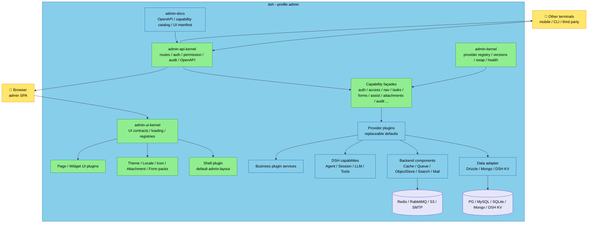
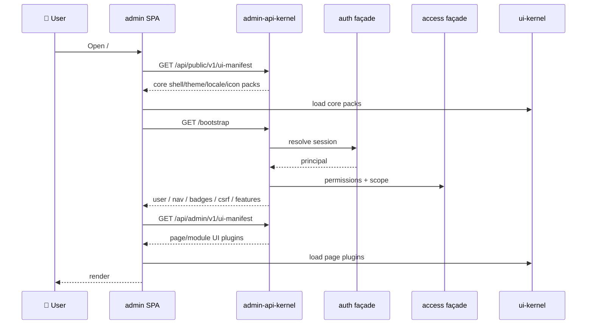
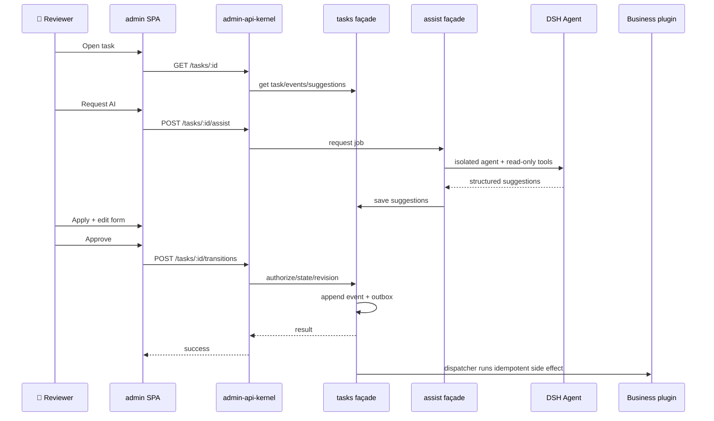

# DSH Universal AI Admin Platform: System Design (Draft v3.1)

[中文](admin-system-design.cn.md) | English

Status: for review. This document fixes the design only; it contains no implementation code.

This version builds on v3's contract-first platform kernel and adds **database and common backend components**: ORM-first support for PostgreSQL/MySQL/SQLite/MongoDB, plus a compatibility adapter for DSH storage KV; Redis, MQ, object storage, search, mail, locks, and cache enter through stable ports and replaceable adapters. `admin-app` remains only the default composition.

The platform principle is unchanged: authentication, authorization, navigation, routing, API, documentation, tasks, forms, AI, attachments, themes, locales, icons, and layout start as interfaces, then are implemented by replaceable provider plugins.

Audience: DSH plugin developers, admin-platform architects, and teams that need to replace or upgrade infrastructure. Prerequisites: DSH profiles/bundles, Cordis services, storage domains, Agent/Session, HTTP, RBAC, and frontend plugin architecture.

Reading path: conclusions only → 0, 2, 12; foundation review → 2–7; human loop and AI → 5, 10; replaceability → 2, 7; security → 11.

## 0. Summary

| Question | Decision |
|---|---|
| Runtime form | A standalone `admin` profile: `dsh --profile admin`, not a panel inside DSH Web |
| Platform kernel | `admin-kernel` provides stable capability façades, provider registration, version negotiation, replacement/rollback, health, and catalog |
| Contracts | `admin-contract` (Host) and `admin-ui-contract` (Browser) define every infrastructure interface, token, error code, and version |
| Default implementations | Each capability has a default provider plugin: auth/access/nav/audit/tasks/forms/assist/attachments/notifications/jobs/search/docs; all replaceable |
| Frontend | `admin-layout` is only the default shell; shell, pages, theme, locale, icons, form fields, and attachment renderers are UI plugins |
| Unified API | Every provider/module registers routes through `adminApi`; one auth, permission, audit, error, pagination, idempotency, and OpenAPI pipeline |
| Unified docs | OpenAPI + capability catalog + UI manifest + plugin docs; `/api/admin/v1/capabilities`, `/api/admin/v1/ui-manifest` |
| Database | ORM-first: PostgreSQL/MySQL/SQLite via Drizzle, MongoDB via the official driver; DSH storage KV as a compatibility adapter; one primary database per deployment |
| Backend components | Stable ports + adapters: cache/Redis, queue/MQ, lock, object storage/S3, search, mail, telemetry; Redis/MQ are not required by default |
| Human loop | Task/Approval/Form engine; review, approve, request changes, transfer, comments, SLA, outbox |
| AI assistance | DSH Agent/LLM produces summaries, risks, and form prefill suggestions; humans decide; P1 never auto-approves |
| Replaceability | Capability providers, feature modules, and UI plugins install/replace/upgrade independently; contracts/kernel are the versioned stable base |
| First focus | Contracts, kernel, profile, API, auth/access/nav/audit, default shell/theme/locale/icons, capability catalog |
| Non-goals | Uncontrolled remote scripts/iframes, multi-tenancy, AI auto-approval, multi-instance clusters, plugin marketplace |

One sentence: **the platform exposes interfaces and stable capability façades; default implementations are just plugins; replacing an implementation does not change consumers.**

### 0.1 Eight rules

1. Consumers depend only on `admin-contract` / `admin-ui-contract`, never on a provider implementation.
2. Each capability has one stable façade; providers are replaceable implementations behind it.
3. Every API goes through the `adminApi` registry; every menu/page goes through `adminNavigation`/UI registries.
4. Every permission is checked on the server; hiding menus, routes, or buttons is UX only.
5. Every write is audited; destructive actions are confirmed; AI only advises.
6. Every plugin can unload; every registration returns a disposer; cleanup is in reverse order.
7. Contracts are versioned; providers declare a compatible range; incompatibility is rejected, never silently degraded.
8. The default bundle is only a composition; advanced users can replace any provider through profile rows.

### 0.2 v2 → v3 changes

| v2 | v3 |
|---|---|
| Fixed `admin-host` and fixed `admin-layout` | Capability contracts + providers; shell is a plugin |
| Infrastructure lived inside host/UI | Every infrastructure capability has a contract and default provider |
| Custom pages registered at build time in P2 | UI plugin runtime + UI registries (P1/P2) |
| Runtime UI modules were P3 | UI kernel is part of the foundation |
| Documentation was hand-written | OpenAPI/capability catalog/UI manifest are generated |
| Replacement required code changes | Replace providers with version negotiation and drain/rollback |

### 0.3 v3.1 additions

| v3 | v3.1 |
|---|---|
| DSH storage KV as the default persistence | ORM-first; PG/MySQL/SQLite/Mongo; DSH KV compatibility only |
| No database/transaction abstraction | Repository + UnitOfWork + Migrator; SQL transactions, Mongo transactions/fallback, KV reconciliation |
| Redis/MQ could become implicit dependencies | Ports + optional adapters; memory/outbox by default |
| Backend components scattered across admin | Independent `packages/backend/*` library reusable by other DSH plugins |

## 1. Goals and boundaries

### 1.1 Goals

- **Universal**: not hard-coded to forum/content; any AI admin scenario can plug in.
- **Interface-first**: consumers see capability interfaces, not a class, package, or table.
- **Replaceable**: auth, access, tasks, forms, AI, attachments, themes, locales, icons, and shell can all swap implementations.
- **Independently upgradeable**: providers version separately from kernel/contract; upgrading one provider does not rewrite consumers.
- **Unified**: one API, one error model, one permission model, one documentation surface, one UI runtime.
- **Human loop**: review, approval, forms, and AI assistance are first-class.
- **Operable**: health, audit, rate limits, migration, rollback, test nodes.
- **Common backend stack**: PostgreSQL/MySQL/SQLite/MongoDB, Redis, RabbitMQ/Kafka, S3/MinIO, SMTP, and OpenTelemetry can all enter as adapters; no single middleware is hard-coded.
- **Common backend library**: database/ORM/UoW, cache, lock, queue, object storage, search, mail, and telemetry are provided as independent libraries + ports, reusable outside admin.

### 1.2 Non-goals

- No uncontrolled remote scripts/iframes; UI plugins must be same-origin, contract-declared, and unloadable.
- No multi-tenant SaaS; P1 is single-organization, single-instance.
- No AI auto-approval; P1 advice only.
- No visual workflow designer; workflows are code-defined and versioned by plugins.
- No cross-DSH-instance cluster control plane; evaluate in P3.
- No plugin marketplace/billing/signed distribution; evaluate in P3.
- No "any npm package works" claim; plugins must implement contracts.
- No distributed transaction across databases/MQs; use UnitOfWork + outbox + idempotency.
- No multiple primary databases in one deployment; one admin instance picks one primary engine.
- Redis/MQ are not mandatory: single-process can use memory/DB outbox; multi-instance enables Redis/MQ adapters.

### 1.3 Users and scenarios

| Role | Scenario |
|---|---|
| Platform maintainer | Replace auth/tasks/theme/shell, upgrade a provider without touching business modules |
| Administrator | Bootstrap, users/roles, audit, capability health |
| Reviewer | Inbox, review, approve, AI suggestions, forms |
| Operator | Create tasks, complete forms, attachments, comments, transfer |
| Terminal user | Process tasks via mobile/CLI terminal API |
| Plugin author | Implement a capability provider or a business module |

## 2. Contract-first model

### 2.1 What a capability is

A capability = **stable interface + stable token + manifest + version range + default provider**.

| Part | Purpose |
|---|---|
| Interface | Pure type contract consumers see; no implementation dependency |
| Token | Stable Cordis injection name/token |
| Manifest | Provider declaration: capability, contract version, priority, essential/optional, data domain, config schema |
| Façade | Stable object the kernel provides and delegates to the active provider |
| Provider | The plugin that implements the capability; replaceable, upgradeable, rollbackable |
| Contract tests | Shared behavior tests every provider must pass |

### 2.2 Why a façade instead of injecting a provider directly

If consumers inject a provider Service directly, replacing the implementation forces re-resolution, and in-flight requests, caches, and UI bindings all jitter. Façade model:

- Consumers always inject `ctx.adminAuth`-style stable façades.
- The kernel switches the active provider behind the façade.
- Replacement stops new calls entering the old provider, waits for in-flight calls, then activates the new provider; failure rolls back.
- The façade owns version checks, health, metrics, error normalization, and audit.

This is the concrete meaning of "interface-first, not implementation-first."

### 2.3 Essential vs optional capabilities

| Type | Examples | Missing behavior |
|---|---|---|
| Essential | data, auth, access, navigation, audit | Boot fails, naming the missing capability and candidate providers |
| Optional | tasks, forms, assist, attachments, search, notifications, jobs, docs | Capability off; menus/pages hide; the rest works |

Essential capabilities may be replaced, but only with a compatible provider; the platform never starts without authentication. The API gateway/kernel is platform infrastructure, not a replaceable capability.

### 2.4 Contract versions and capability negotiation

- Contract versions use major.minor: major is incompatible; minor adds fields/methods.
- Provider manifests declare `contract: '^1.2'`; the kernel activates only providers that satisfy the range.
- APIs use `/v1` paths; UI plugins use a `uiContract` version; incompatible versions are rejected.
- Deprecation: mark deprecated, then bump major; consumers get a migration window.
- The capability catalog returns the active provider, version, health, and available alternatives.

### 2.5 Data ownership

- Each provider owns its tables/collections/schema; no shared tables.
- Replacing a provider uses declared `migrateFrom` / `export` / `import`; without migration, explicit export is required, never silent data loss.
- Business modules store task references, form values, audit, and governance data only; business data stays with the business plugin.
- Contracts expose operations, never table structures.

### 2.6 Key decisions

| Decision | Choice | Rationale | Rejected alternative |
|---|---|---|---|
| Database/ORM | General database + Repository/UoW; Drizzle for SQL, official Mongo driver, DSH KV compatibility | Common backend stack; transactions/indexes/migrations are controllable; consumers do not see the database | DSH KV only, or SQL leaking into business code |
| Database engine | One primary per deployment: PG/MySQL/SQLite/Mongo | Avoids cross-DB transactions and dual writes; replacement is migration | Each capability choosing its own database |
| Cache/queue | Ports + optional adapters | No Redis/MQ hard dependency for single-process; enable for multi-instance | Redis/MQ as mandatory infrastructure |
| Transactions/side effects | UnitOfWork + outbox | SQL/Mongo atomic where possible; KV uses reconciliation | Writing two systems directly |
| UI infrastructure | Shell/theme/locale/icon/renderer are plugins | Replaceable and independently upgradeable | One fixed UI hard-coded |
| Unified interface | Façade + contract + provider manifest | Replace implementation without changing consumers | Consumers importing providers |

## 3. Architecture



### 3.1 Layers

| Layer | Components | Owns |
|---|---|---|
| Contracts | `admin-contract` / `admin-ui-contract` | Interfaces, tokens, error codes, versions, manifest types |
| Kernel | `admin-kernel` / `admin-ui-kernel` | Provider registration, negotiation, swap/rollback, health, catalog |
| Gateway | `admin-api-kernel` | Route table, auth, permission, audit, errors, OpenAPI, idempotency |
| Capabilities | auth/access/nav/tasks/forms/assist/attachments/... providers | Capability implementations |
| Data | data-drizzle / data-mongodb / data-dsh-kv; Repository/UoW/Migrator | Primary database, transactions, migrations |
| Backend components | cache/queue/lock/object-store/search/mail/telemetry adapters | Optional adapters for common middleware |
| UI | shell/theme/locale/icon/form/attachment/page plugins | All visible infrastructure and pages |
| Business | `admin-module-*` | Permissions, routes, task types, forms, handlers |
| Runtime | `admin-app` | Profile bundle, startup, webserver, static SPA |

### 3.2 Consumer view

A business module does only three things:

1. Declare its permissions, navigation, APIs, task types, and forms.
2. Call capabilities through façades (`ctx.adminTasks.create`, `ctx.adminAttachments.put`).
3. Provide handlers/pages; it does not care whether auth uses Better Auth or OIDC, which theme/icon pack is active, or whether the database is PG/MySQL/SQLite/Mongo/DSH KV.

### 3.3 Process boundary

- `admin` and `web` are sibling profiles; one `DSH_HOME` allows only one writing process.
- The admin profile manages its own data/profile; cross-profile/cross-instance is P3.
- Other terminals call the admin API only; they never touch storage directly.

## 4. Profile and boot

### 4.1 Install and start

```text
dsh plugin --profile admin add @veren/admin-app
dsh --profile admin --host 127.0.0.1 --port 3081 --no-open
```

`admin` is not a shipped template name; do not create it with `--from-default-profile web`. `dsh plugin` initializes the profile with the default base layer, then adds `admin-app` to `dsh.profile.bundles`.

### 4.2 The default composition is not hard-coded

`admin-app` is just a composition of default providers:

```text
dsh-base
admin-kernel
admin-api-kernel
admin-ui-kernel
admin-data-drizzle
admin-auth-better
admin-access-rbac
admin-navigation-default
admin-audit-default
admin-tasks-default
admin-forms-json-schema
admin-assist-dsh
admin-attachments-local
admin-notifications-default
admin-jobs-default
admin-settings-default
admin-docs-openapi
admin-web
admin-shell-default
admin-theme-default
admin-locale-zh-en
admin-icons-default
```

Advanced users can:

- disable `admin-auth-better` and enable `admin-auth-oidc`;
- disable `admin-theme-default` and enable a branded theme pack;
- disable `admin-shell-default` and enable their own shell;
- skip the default composition and use a profile patch with only the kernel and providers they need.

`admin-app` patch rows are only default assembly; replacing a provider never changes the kernel/contract.

### 4.3 Boot order

1. `admin-startup` parses flags and provides `adminStartup`.
2. `webserver` starts HTTP.
3. `admin-kernel` creates capability façades and the provider registry.
4. Default providers register; the kernel selects active providers and checks essential capabilities.
5. `admin-api-kernel` registers `/api/*` routes.
6. `admin-ui-kernel` provides `/admin/ui-runtime` and the `ui-manifest`.
7. `admin-web` serves the SPA, deep links, static assets, and `/admin/ui-plugins/*`.
8. `admin-runtime` prints the URL and runs health checks.

### 4.4 Key configuration

| Field | Default | Meaning |
|---|---|---|
| `server.publicUrl` | empty | Advertised URL; does not change the listener |
| `server.trustProxy` | false | Trust forwarded headers |
| `server.trustedOrigins` | [] | Browser origin allowlist |
| `auth.sessionDays` | 7 | Session lifetime |
| `auth.idleHours` | 12 | Idle expiry |
| `auth.setupTtlMinutes` | 15 | First-run setup token |
| `auth.loginRateLimit` | 10/60s | Login attempts |
| `api.maxBodyBytes` | 1 MiB | JSON body limit |
| `api.rateLimit` | 120/min | API baseline |
| `attachments.maxBytes` | 25 MiB | Per-attachment limit |
| `attachments.allowedMime` | safe list | Allowed MIME |
| `tasks.overdueScanSeconds` | 60 | Overdue scan |
| `assist.enabled` | true | Allow AI |
| `assist.model` | DSH default | Assist model |
| `assist.timeoutMs` | 120000 | Per-assist timeout |
| `assist.maxConcurrency` | 2 | Concurrency |
| `audit.retentionDays` | 180 | Audit retention |
| `audit.maxEntries` | 100000 | Audit cap |
| `database.driver` | `sqlite` | `postgres` / `mysql` / `sqlite` / `mongodb` / `dsh-kv` (compat) |
| `database.url` | SQLite file | Connection string; secrets via env/credentials |
| `database.pool` | 10 | SQL pool size |
| `database.migrateOnBoot` | true | Run migrations at boot with a migration lock |
| `database.ssl` | false | SQL TLS |
| `cache.driver` | `memory` | `memory` / `redis` |
| `lock.driver` | `memory` | `memory` / `redis` / `db` |
| `queue.driver` | `outbox` | `outbox` / `redis-streams` / `rabbitmq` / `kafka` |
| `objectStorage.driver` | `local` | `local` / `s3` (MinIO compatible) |
| `search.driver` | `database` | `database` / `meilisearch` |
| `mail.driver` | `disabled` | `disabled` / `smtp` |
| `telemetry.driver` | `none` | `none` / `otel` |
| `ui.defaultLocale` | zh | Default locale |

Invalid config fails at load; secrets go through `ctx.credentials`.

### 4.5 Package layout

```text
plugins/admin/
  contract/          @veren/admin-contract (Host contracts)
  ui-contract/       @veren/admin-ui-contract (Browser contracts)
  kernel/            @veren/admin-kernel
  ui-kernel/         @veren/admin-ui-kernel
  api/               @veren/admin-api-kernel
  providers/
    data-drizzle/    @veren/admin-data-drizzle (PG/MySQL/SQLite)
    data-mongodb/    @veren/admin-data-mongodb (optional)
    data-dsh-kv/     @veren/admin-data-dsh-kv (embedded compatibility)
    auth-better/     @veren/admin-auth-better
    auth-oidc/       @veren/admin-auth-oidc (optional)
    access-rbac/     @veren/admin-access-rbac
    nav-default/     @veren/admin-navigation-default
    audit-default/   @veren/admin-audit-default
    tasks-default/   @veren/admin-tasks-default
    forms-json/      @veren/admin-forms-json-schema
    assist-dsh/      @veren/admin-assist-dsh
    attachments-local/ @veren/admin-attachments-local
    notifications-default/ ...
    jobs-default/ ...
    settings-default/ ...
    docs-openapi/    @veren/admin-docs-openapi
  ui/
    shell-default/   @veren/admin-shell-default
    theme-default/   @veren/admin-theme-default
    locale-zh-en/    @veren/admin-locale-zh-en
    icons-default/   @veren/admin-icons-default
    ui-kit/          @veren/admin-ui-kit
  web/               @veren/admin-web
  app/               @veren/admin-app
  modules/           admin-module-* (business)
```

Only three entry points matter externally: `admin-app` (install/start), `admin-contract` (Host contracts), and `admin-ui-contract` (UI contracts). Everything else is a provider/default implementation installed with the default bundle and replaceable individually.

The common backend library lives in `packages/backend/`, not `plugins/admin`, and has no Cordis dependency; other DSH plugins can reuse it:

| Package | Purpose |
|---|---|
| `@veren/backend-contract` | Database/UoW/Migrator, Cache, Lock, Queue, ObjectStore, Search, Mail, Telemetry ports |
| `@veren/backend-kit` | Config, lifecycle, health, graceful shutdown, retry/timeout |
| `@veren/backend-drizzle` | PG/MySQL/SQLite ORM, schema, migrations |
| `@veren/backend-mongodb` | MongoDB driver, collections/indexes/migrations |
| `@veren/backend-dsh-kv` | DSH storage KV compatibility (limited transactions) |
| `@veren/backend-redis` | Cache/lock/rate-limit |
| `@veren/backend-queue-*` | Outbox/Redis Streams/RabbitMQ/Kafka |
| `@veren/backend-storage-*` | Local/S3/MinIO |
| `@veren/backend-search-*` | Database/Meilisearch |
| `@veren/backend-mail-smtp` | SMTP |
| `@veren/backend-otel` | OpenTelemetry |

`plugins/admin/providers/data-*` only adapts those libraries to `ctx` and the kernel; it does not reimplement database logic.

### 4.6 DSH dependency rules

- DSH packages belong only in `peerDependencies` + `devDependencies`; the version contract is `engines.dsh`.
- `dependencies` contains only non-DSH libraries: Better Auth, Zod, Ajv, React Router, etc.
- Never put `cordis`/`dsh-*` in `dependencies`.
- A package providing a service/capability default-exports a Service class; a plugin that only registers providers/modules uses a named `apply`; never mix.
- Startup self-check: missing `webserver`, `storageDomain`, `agent`, etc. prints the missing packages and stops.

## 5. Host capability layer

### 5.1 Capability catalog

| Capability | Contract | Default provider | Essential | Data domain |
|---|---|---|---|---|
| `data` | DatabaseAdapter/UoW/Migrator; SQL/Mongo/KV | `data-drizzle` (SQL) | Yes | Current primary database |
| `auth` | Users, passwords, sessions, API tokens | `auth-better` | Yes | `admin_auth` |
| `access` | Roles, permissions, scopes, authorization | `access-rbac` | Yes | `admin_access` |
| `navigation` | Menu tree, route manifest, badges | `navigation-default` | Yes | code/module registry |
| `audit` | intent/outcome/denied, query, retention | `audit-default` | Yes | `admin_audit` |
| `tasks` | Tasks, state machine, outbox, notifications | `tasks-default` | Optional | `admin_tasks` |
| `forms` | Form definitions, validation, versions | `forms-json-schema` | Optional | code/module |
| `assist` | AI jobs, suggestions, prefill | `assist-dsh` | Optional | `admin_assist` |
| `attachments` | Upload, metadata, download, quota | `attachments-local` | Optional | `admin_attachments` + files |
| `notifications` | In-app notifications, unread/read | `notifications-default` | Optional | `admin_notifications` |
| `jobs` | Background jobs, progress, cancel | `jobs-default` | Optional | `admin_jobs` |
| `settings` | Module config schema, read, validation, revision | `settings-default` | Optional | profile config |
| `search` | Task/audit/module search | `search-default` | Optional | `admin_search` |
| `docs` | OpenAPI, capability catalog, UI manifest | `docs-openapi` | Optional | none |

Missing essential capability → boot fails. Missing optional capability → `bootstrap.features` false, menus/pages hide.

Common backend components (independent of business capabilities; a single process can use memory/DB implementations):

| Component | Port | Common adapters | Essential |
|---|---|---|---|
| cache | `Cache` | memory / Redis | No |
| lock | `Lock` | memory / Redis / DB advisory | No |
| queue | `Queue` | DB outbox / Redis Streams / RabbitMQ / Kafka | No (outbox default) |
| object storage | `ObjectStore` | local FS / S3 / MinIO | Needed for attachments |
| search | `Search` | DB full-text / Meilisearch | No |
| mail | `Mailer` | disabled / SMTP | No |
| telemetry | `Telemetry` | none / OpenTelemetry | No |

Rules: cache/search are never the source of truth; locks only coordinate concurrency; queues are at-least-once with idempotent consumers; object storage stores bytes while metadata lives in the database; mail failure never rolls back business state.

### 5.2 Kernel: registration, selection, replacement

A provider package declares `dsh.admin.provider` in `package.json`; the kernel scans active profile providers and maintains no hard-coded list. The manifest contains at least:

| Field | Meaning |
|---|---|
| `id` | Unique provider id |
| `capability` | Capability name |
| `contract` | Compatible contract range |
| `priority` | Selection priority when several providers exist |
| `essential` | Whether the capability is essential |
| `dataDomain` | Owned/migrated domain |
| `config` | Schemastery config schema |
| `migrations` | Source providers/versions |
| `health` | Health check entry |

A `data` provider additionally declares `engine` and `features` (transactions / json / fullText / secondaryIndexes); domain providers declare `requiredDataFeatures`, and the kernel validates them when selecting a database. Incompatible combinations are rejected at boot.

Replacement flow:

1. New provider registers; manifest validation passes.
2. Kernel checks contract version, capability conflicts, essential coverage.
3. Stop new calls entering the old provider; wait for in-flight calls (with a timeout).
4. Activate the new provider; run health checks.
5. On failure, roll back to the old provider; on success, dispose the old one.
6. Audit who replaced which capability, from which provider to which.
7. Data migration follows manifest `migrations`; without migration, automatic replacement is refused.

Replacement is not free: in-flight requests, caches, and UI subscriptions must be handled. P1 supports switch-on-restart; P2 adds hot swap.

### 5.3 Unified API and docs

Every provider/module registers routes through `adminApi`:

- `audience`: `admin` / `terminal` / `public`
- `permission` / `scopes`
- `input` / `output` Zod schemas
- `handler`
- `summary` / `tags`
- `idempotent`

`adminApi` owns requestId, CORS, body limits, auth, CSRF, permission, rate limit, validation, audit, errors, pagination, and OpenAPI.

Unified responses:

```text
{ items, nextCursor? }
{ error: { code, message, details?, requestId } }
```

Unified docs:

- `/api/openapi.json`: OpenAPI 3.1 generated from the route table.
- `/api/admin/v1/capabilities`: capability, active provider, version, health, candidates.
- `/api/public/v1/ui-manifest`: core UI packs needed before login (shell/theme/locale/icons/login), no business data.
- `/api/admin/v1/ui-manifest`: full UI plugins, contract versions, entries, and contributions after login.
- `/api/admin/v1/docs`: documentation index (OpenAPI, capability catalog, plugin docs).
- The docs page renders in the admin shell; no second hand-written API spec.
- OpenAPI + contract schemas generate the TypeScript client; the SPA/UI plugins use only the runtime client and do not hand-write fetch calls. External SDKs are generated in P2.

### 5.4 Identity, permissions, and data scope

- Auth is a capability; the default `auth-better` follows the existing login gate's Better Auth usage, but user/session/token tables live in `ctx.backend.db` (the primary database), not a DSH storage domain; OIDC/LDAP providers are alternatives.
- First-run setup token; no public sign-up.
- Session cookie `HttpOnly`, `SameSite=Lax`, `Secure` iff TLS; double-submit CSRF.
- API tokens for terminals: hash only, visible prefix, revocable, scope-narrowed.
- Permission strings: `admin.<domain>.<action>`, `terminal.<domain>.<action>`.
- Roles: owner/admin/reviewer/operator/auditor/viewer; data scopes all/assigned/own.
- Every API/menu/page/task transition/attachment operation declares a permission; the server enforces it.
- Self-lockout guards: last owner, last admin role, built-in roles immutable.

### 5.5 Task / Approval / Form / AI

- `tasks`: task types, state machines, claim, decisions, comments, outbox, SLA, notifications.
- `forms`: JSON Schema + UI Schema, server validation, versioning.
- `assist`: isolated DSH Agent produces structured suggestions; humans apply; no auto-approval.
- DSH `ctx.approval` is only for Agent tool permission; business approval uses `tasks`; do not conflate them.
- Task events are authoritative and snapshots rebuildable; use `ctx.backend.db.transaction` to put the event, snapshot, and outbox in one transaction; adapters without transactions (DSH KV/standalone Mongo) use reconciliation.
- Side effects use outbox + idempotent handlers; failures are visible and retryable.
- AI has no shell/fs/network tools by default; task types declare read-only tools; output schema validation; P1 no auto-approval.

### 5.6 Attachments

Attachments are platform infrastructure, not a private feature of one module.

Host contract:

| Method | Purpose |
|---|---|
| `createUpload` | Create upload session: name, MIME, size, quota, permission |
| `put` | Write bytes (stream/chunk) |
| `complete` | Complete upload; generate id/metadata |
| `get` | Read metadata (permission-checked) |
| `open` | Authenticated download stream |
| `delete` | Soft/hard delete per policy |
| `list` | List by task/form/resource |

Capabilities:

- Storage provider replaceable: local, S3, object storage; stable attachment id, no physical path in URLs.
- MIME/size/count quotas; MIME sniff; optional virus scan hook.
- Download must authenticate/authorize; safe `Content-Disposition`; no path traversal.
- Attachments can attach to tasks, comments, and form fields; deletion uses reference counting/soft delete.
- Audit upload/download/delete; sensitive attachments can require extra permission.

UI contract:

- `AttachmentRenderer` by MIME/kind: image, PDF, text, audio, video, download fallback.
- Upload component, list, preview modal from UI plugins; default ui-kit.
- Renderers cannot bypass download authorization.

### 5.7 Database, ORM, and migrations

**The primary database is not DSH storage KV**; DSH KV is only an embedded/compatibility adapter. The default path is a general ORM/database.

#### 5.7.1 Engines and ORM

| Engine | Adapter | Driver/ORM | Fit |
|---|---|---|---|
| PostgreSQL | `admin-data-drizzle` | Drizzle + `pg` | Production default; transactions/jsonb/indexes/full-text |
| MySQL | `admin-data-drizzle` | Drizzle + `mysql2` | Common production environment |
| SQLite | `admin-data-drizzle` | Drizzle + `better-sqlite3` | Local/single-machine default, no external service |
| MongoDB | `admin-data-mongodb` | Official `mongodb` driver | Document model/existing Mongo environment |
| DSH KV | `admin-data-dsh-kv` | DSH storage domain | Embedded compatibility/migration, not production default |

ORM choice:

- **SQL uses Drizzle**: TypeScript-native, type-safe, supports PG/MySQL/SQLite, explicit migrations, and fits a Repository/UoW base.
- **MongoDB uses the official driver**: Drizzle does not cover Mongo; the official driver + Zod validation is direct, and transactions require a replica set.
- **Prisma is an optional adapter**: teams familiar with Prisma can implement `admin-data-prisma` against the same `Database` contract; the ORM never leaks into business modules.
- **One primary engine per deployment**: do not mix PG + Mongo in one admin instance; no cross-capability joins, only contracts/APIs.
- SQL drivers (`pg`/`mysql2`/`better-sqlite3`) are optional peers; startup checks the driver selected by `database.driver` and fails loudly instead of silently falling back.

#### 5.7.2 Schema ownership and indexes

Each capability provider owns its tables/collections with a consistent prefix:

| Capability | Tables/collections | Key indexes |
|---|---|---|
| auth | `auth_users`, `auth_sessions`, `auth_tokens` | email, session hash, token hash |
| access | `access_roles`, `access_bindings` | subject, role |
| audit | `audit_entries` | at, actor, action, result |
| tasks | `tasks`, `task_events`, `task_outbox` | status+assignee+due, task_id+seq, outbox status+next_attempt |
| assist | `assist_jobs`, `assist_suggestions` | task_id, status |
| attachments | `attachments` | owner, task_id, created_at |
| notifications | `notifications` | user_id+read_at |
| jobs | `jobs` | status, next_run_at |
| api | `idempotency`, `preferences` | actor+key, subject |

Rules:

- No cross-provider foreign keys or cross-table joins; compose through services/contracts to keep providers replaceable.
- Foreign keys/transactions are allowed inside one provider.
- IDs use UUIDv7/ULID (time-ordered); timestamps are UTC; each row has `version` for optimistic concurrency; deletes are soft by default.
- JSON columns: PG `jsonb`, MySQL `JSON`, SQLite `TEXT` + JSON1, Mongo native documents; do not store huge unqueryable blobs.
- Large files go to object storage; the database stores metadata/references only.
- Schema changes belong to each provider's migrations; no shared "do-everything" table.

#### 5.7.3 UnitOfWork and transactions

The `Database` contract exposes `transaction(fn)`; repositories take the current transaction context. Semantics by engine:

| Engine | Transactions | Task event + snapshot + outbox |
|---|---|---|
| PG/MySQL/SQLite | Supported | Atomic in one transaction |
| MongoDB | Replica set only; standalone no | Atomic with a transaction; otherwise event-first + reconciliation |
| DSH KV | No cross-table transaction | Event-first + reconciliation, explicitly degraded |

- Business side effects do not run inside the database transaction; the transaction writes task events, snapshots, and outbox only.
- No distributed transactions across services/MQ; use outbox + idempotent consumers.
- Transaction failure rolls back explicitly; never swallow errors.
- Pool exhaustion/database unavailability returns `CAPABILITY_UNAVAILABLE` and marks health red.

#### 5.7.4 Migrations

- Each provider owns its migration directory and version; SQL uses Drizzle Kit, Mongo uses a dedicated runner, KV uses domain versions.
- `_admin_migrations` records applied versions; startup takes a migration lock (PG advisory lock / MySQL GET_LOCK / SQLite transaction).
- `database.migrateOnBoot` defaults true; production may run migrations as a deployment job.
- Back up before migration or require a backup; destructive migrations require explicit confirmation; failure stops boot, never serves a half-migrated schema.
- Provider replacement declares `migrateFrom`/`migrateTo`; without migration, automatic replacement is refused.

#### 5.7.5 DSH KV compatibility

- `admin-data-dsh-kv` implements the same `Database`/Repository ports for embedded, zero-config, or legacy migration.
- Explicit limits: no cross-table transactions, no secondary indexes, scan-based queries, weaker concurrent writes; small data/single machine only.
- `bootstrap.features`/capability catalog expose `transactions: false` and `secondaryIndexes: false`; tasks/audit use reconciliation.
- Not the production default; large deployments use PG/MySQL, document workloads use Mongo.

### 5.8 Common backend library

`packages/backend/*` is independent of admin and has no Cordis dependency; admin only provides `plugins/admin/providers/*` adapters.

| Port | Minimum capability | Adapters |
|---|---|---|
| `Database` / `UnitOfWork` / `Migrator` | query, transaction, migration, health | drizzle, mongodb, dsh-kv, memory (tests) |
| `Cache` | get/set/del, TTL, tag invalidation | memory, redis |
| `Lock` | acquire/release, TTL, fencing token | memory, redis, DB advisory |
| `Queue` | publish, consume, ack, retry, dead-letter | outbox, redis-streams, rabbitmq, kafka |
| `ObjectStore` | put/get/delete, metadata, signed/authenticated URL | local, s3/minio |
| `Search` | index/query/delete | database, meilisearch |
| `Mailer` | send, template, retry | disabled, smtp |
| `Telemetry` | trace/metric/log adapter | none, otel |

`admin-kernel` mounts a stable `ctx.backend` exposing `db` / `cache` / `lock` / `queue` / `objectStore` / `search` / `mail` / `telemetry` ports; providers inject ports instead of constructing clients. Config selects the adapter, and each adapter is independently replaceable.

Rules:

- Initialization/shutdown/health go through `backend-kit` lifecycle; invalid config fails loudly.
- Unconfigured optional components use memory/disabled implementations; configured-but-unreachable production components fail boot or degrade visibly.
- Cache/search are never the source of truth; the database is.
- Queues are at-least-once; consumers must be idempotent; DB outbox is the default reliable path, MQ is for multi-instance/decoupling.
- Locks only coordinate concurrency; they do not replace database unique constraints/optimistic locking.
- ObjectStore stores bytes; metadata/permissions live in the database.
- Mail is async with retries; failure never changes task state.
- Telemetry never blocks business; sampling/endpoints are configurable.
- Every adapter shares contract tests; behavior is identical behind the same port.

## 6. UI kernel and contracts

### 6.1 UI kernel

`admin-ui-kernel` has two halves: the Host half scans UI plugins/generates the manifest/serves same-origin assets; the Browser half loads plugins and maintains the UI registries.

- Provides a stable UI runtime module: an import map maps `@veren/admin-ui-runtime` to the same-origin `/admin/ui-runtime.js`, exporting React, ReactDOM, React Router, UI kit, API client, i18n, theme, and icons; plugins externalize these specifiers and never bundle their own React.
- The Host half of `admin-ui-kernel` scans active profile packages declaring `dsh.admin.ui`, resolves their ESM entries, and `admin-web` serves them same-origin at `/admin/ui-plugins/<id>/...`; the manifest lists only same-origin entries.
- Before login, reads core shell/theme/locale/icon/login packs from `/api/public/v1/ui-manifest`; after login, reads page/module plugins from `/api/admin/v1/ui-manifest`. Both are same-origin static entries loaded with dynamic `import()`.
- Validates `uiContract` version, declared capabilities, and dependencies; incompatible plugins are rejected with an error.
- Plugins export `activate(runtime)` / `deactivate()`; registrations return disposers.
- Plugin failure is isolated: one failed page/theme does not take down the admin.
- Unload cleans pages, widgets, field renderers, theme, locale, icons in reverse order.
- Shared dependencies come from the runtime/import map; plugins must not bundle a second React.

UI plugin manifest:

| Field | Meaning |
|---|---|
| `id` / `version` | Plugin identity |
| `uiContract` | Compatible UI contract version |
| `entry` | Same-origin ESM entry |
| `capabilities` | Required Host capabilities |
| `contributions` | Pages/nav/theme/locale/icons/renderers |
| `integrity` | Optional verification |

A UI plugin package declares `contract`, `entry`, and `files` under `dsh.admin.ui` in `package.json`; packages without that declaration never enter the manifest or load.

### 6.2 UI contracts

| Contract | Purpose | Default |
|---|---|---|
| `AdminShell` | Header, sidebar, content, responsive, focus management | `shell-default` |
| `PageContribution` | Route pages, detail, form, task inbox | Built-in generic pages |
| `NavContribution` | Menu items, groups, badges | `navigation-default` + shell |
| `ThemePack` | Color/spacing/radius/shadow tokens, light/dark/system | `theme-default` |
| `LocalePack` | zh/en/other dictionaries, date formats | `locale-zh-en` |
| `IconPack` | Icon name → React icon | `icons-default` |
| `FormFieldRenderer` | Field type → control | `ui-kit` |
| `AttachmentRenderer` | MIME/kind → preview/download | `ui-kit` |
| `WidgetContribution` | Dashboard cards | modules |
| `CommandContribution` | Command palette actions | modules |

Rules:

- Shell only lays out and renders; it does not fetch or authorize. Pages/kernel provide data.
- Pages do not touch `window`/fetch details; they use the runtime API client, i18n, theme, icons.
- Themes accept tokens/controlled CSS only; no arbitrary remote CSS.
- Locale packs only register dictionaries; missing keys fall back to English/key.
- Icon packs provide local components only; no remote SVG.
- Attachment renderers must use authenticated download, never physical paths.

### 6.3 Replacing UI infrastructure

- Swap shell: disable `shell-default`, enable `shell-compact`; page/nav registrations stay.
- Swap navigation policy: replace the `navigation` provider; shell/pages do not change.
- Swap theme: disable `theme-default`, enable a branded pack; token values change, pages do not.
- Swap locale: enable a new locale pack; server `labelKey`s stay.
- Swap icons: enable a new icon pack; menus reference icon names only.
- Swap attachment renderer: register a new MIME renderer; tasks/comments do not change.

### 6.4 Unified UX

- Routing: History API + SPA fallback; `/login`/`/setup` public; unknown 404; forbidden 403.
- Menus: server manifest filtered by permission/scope; shell only renders.
- Page skeleton: header, toolbar, content, footer, drawer, toast; loading/empty/error/403/conflict states.
- Theme: light/dark/system; tokens only; respect reduced motion.
- Locale: zh/en first; `Intl` for dates/numbers.
- Accessibility: semantic tables, focus management, keyboard, `aria-live`, contrast.

## 7. Plugin model and replacement

### 7.1 Three plugin types

| Type | Example | Responsibility |
|---|---|---|
| Capability provider | `auth-better`, `tasks-default`, `theme-default` | Implement one capability contract |
| Feature module | `admin-module-content`, `admin-module-orders` | Register permissions/nav/API/tasks/forms |
| UI plugin | `shell-default`, `page-audit`, `icons-brand` | Register UI contributions |

### 7.2 Module registration

Module descriptor:

| Field | Meaning |
|---|---|
| `identity` | id, version, apiVersion |
| `permissions` | New permissions |
| `navigation` | Menus/routes |
| `api` | Admin/terminal route groups |
| `tasks` | Task types, workflows, forms, handlers |
| `pages` | UI page componentIds (optional) |
| `settings` | Module settings schema |

`ctx.admin.registerModule(descriptor)` validates the whole descriptor before committing; returns a disposer; unload cleans in reverse order.

### 7.3 Independent replacement/upgrade

- Providers and modules version separately; modules depend on contract versions only.
- Replace a provider: install the new package, disable the old one, kernel selects the new provider; migrate/restart if needed.
- Upgrade a provider: compatible range upgrades directly; major changes require consumer migration.
- UI plugins: manifest + uiContract; incompatible rejected; independently enabled/disabled.
- The default `admin-app` is only a composition; any row can be replaced through a profile patch.
- Rollback: keep the old provider row; switch back; data migration must be reversible or backed up.
- Database engine/adapter replacement is a maintenance operation: backup → migrate → switch → verify; no hot swap and no two primary writers.
- Cache/queue/object-store/search adapters replace independently; keep a degraded path (memory/outbox/local).
- Tests: contract tests + provider swap tests + UI unload tests + DB migration/rollback tests.

### 7.4 What is not replaceable

- `admin-contract`/`admin-ui-contract`/`admin-kernel`/`admin-ui-kernel`/`admin-api-kernel` are the stable platform base; they upgrade by version, not by arbitrary swap.
- `ctx.backend` is the stable port façade; what gets replaced is the DB/cache/queue/storage adapter behind it, not the port contract itself.
- The `data` capability can replace its adapter/engine in a maintenance window, but never hot-swaps; one primary database per deployment.
- A business module's handler logic belongs to that module; replacing a module is a business change, not infrastructure replacement.
- Data migration is not automatic; providers must declare it.

## 8. API surface

### 8.1 Unified entry

| Audience | Prefix | Auth |
|---|---|---|
| admin | `/api/admin/v1` | session cookie + CSRF |
| terminal | `/api/terminal/v1` | Bearer token + scope |
| public | `/api/public/v1` | none/light |

Core endpoints:

| Method | Path | Purpose |
|---|---|---|
| `GET/POST` | `/api/public/v1/setup` | First-run setup |
| `POST` | `/api/public/v1/login` | Sign in |
| `POST` | `/api/admin/v1/logout` | Sign out |
| `GET` | `/api/admin/v1/bootstrap` | User/permissions/menus/badges/CSRF/features |
| `GET` | `/api/admin/v1/capabilities` | Capability catalog/health/active provider |
| `GET` | `/api/admin/v1/health/backends` | Database/cache/queue/object-store/search health |
| `GET` | `/api/public/v1/ui-manifest` | Core UI packs before login |
| `GET` | `/api/admin/v1/ui-manifest` | Full UI plugin manifest after login |
| `GET` | `/api/admin/v1/tasks` | Task list |
| `GET` | `/api/admin/v1/tasks/:id` | Task detail |
| `POST` | `/api/admin/v1/tasks` | Create task |
| `POST` | `/api/admin/v1/tasks/:id/claim` | Claim |
| `POST` | `/api/admin/v1/tasks/:id/confirmations` | High-risk confirmation token |
| `POST` | `/api/admin/v1/tasks/:id/transitions` | Decide |
| `POST` | `/api/admin/v1/tasks/:id/comments` | Comment |
| `POST` | `/api/admin/v1/tasks/:id/assist` | AI assistance |
| `GET/DELETE` | `/api/admin/v1/assist/jobs/:id` | Query/cancel AI job |
| `POST` | `/api/admin/v1/suggestions/:id/apply` | Apply suggestion |
| `GET/POST` | `/api/admin/v1/attachments` | List/upload attachment |
| `GET` | `/api/admin/v1/attachments/:id` | Metadata |
| `GET` | `/api/admin/v1/attachments/:id/content` | Authenticated download |
| `DELETE` | `/api/admin/v1/attachments/:id` | Delete |
| `GET` | `/api/admin/v1/audit` | Audit |
| `GET` | `/api/admin/v1/notifications` | Notifications |
| `GET/PUT` | `/api/admin/v1/settings` | Module configuration read/write |
| `GET` | `/api/terminal/v1/tasks` | Terminal tasks |
| `POST` | `/api/terminal/v1/tasks/:id/transitions` | Terminal decision |
| `GET` | `/api/openapi.json` | OpenAPI |

### 8.2 Unified semantics

- Success lists `{ items, nextCursor? }`; errors `{ error: { code, message, details?, requestId } }`.
- `Idempotency-Key` header; 24 hours; same key with a different body is 409.
- Writes audit intent/outcome; denials/CSRF/rate limits record `denied`.
- Permission/scope enforced in the API; pagination/export obey the same scope.
- Stable codes: AUTH_REQUIRED/FORBIDDEN/CSRF_FAILED/VALIDATION_FAILED/CONFLICT/NOT_FOUND/TASK_STATE_INVALID/FORM_INVALID/ATTACHMENT_TOO_LARGE/ATTACHMENT_MIME/CAPABILITY_UNAVAILABLE/BACKEND_UNAVAILABLE/MIGRATION_FAILED/AI_UNAVAILABLE/INTERNAL.

## 9. Interface and interaction

- Route map: `/login`, `/setup`, `/`, `/tasks`, `/tasks/:taskId`, `/audit`, `/settings`, `/system/*`.
- Shell: default shell provides sidebar, header, notifications, user menu, theme/locale switches; replaceable.
- Inbox: my work/role queue/all/overdue/completed; filters, claim, bulk.
- Detail: form, timeline, AI suggestions, decision bar, attachments, comments.
- States: loading/empty/403/404/dependency-unavailable/conflict/audit-incomplete.
- Theme/locale/icons/attachment renderers all come from packs/UI plugins.

## 10. Key flows

### 10.1 Login and bootstrap



### 10.2 Task + AI + human decision + outbox



### 10.3 Replacing a provider

1. Install the new provider package and enable its row; keep the old row disabled/standby.
2. Kernel validates manifest/contract/capability/data migration.
3. Stop new calls entering the old provider; wait for in-flight calls.
4. Activate the new provider; health check; roll back on failure.
5. Audit the replacement; UI capability catalog refreshes; consumers keep the same façade.

## 11. Security and operations

- Default loopback; non-loopback requires TLS/trusted proxy; cookie `Secure` follows protocol.
- CSRF, CSP, CORS, rate limits, body limits; strong passwords; login lockout.
- API tokens hashed, scoped, revocable; attachments authenticated, MIME/size/scan checked.
- Server-side permissions; self-lockout guards; append-only audit.
- UI plugins same-origin, manifest/uiContract validated, no remote scripts, unloadable.
- AI prompt injection: task content untrusted; read-only tools; structured output; humans decide.
- One writer per DSH_HOME; database/migration failure stops boot; outbox visible/retryable.
- Least-privilege database account, TLS, pool caps, migration lock; backup before migration; destructive migrations require confirmation.
- Redis ACL/TLS, MQ auth, S3/MinIO least privilege; all connection strings/passwords via env/credentials, never logs.
- The DSH KV adapter explicitly reports no transactions/no secondary indexes and is limited to small data/embedded/migration.
- Backup/restore; audit export P2; capability catalog/health page/backend health page.

## 12. Roadmap

| Phase | Goal | Deliverables | Done when |
|---|---|---|---|
| P0 Contracts and kernel | `dsh --profile admin` runs | contract/ui-contract, kernel, api-kernel, ui-kernel, data-drizzle (SQLite default), migration/UoW, default auth/access/nav/audit providers, default shell/theme/locale/icons packs, web/app, docs/capability catalog | Login; menus/permissions/routes; swap theme/locale/icons without page changes; migrations run; missing essential capability fails loudly |
| P1 Human loop | Review/approval/attachments/AI usable | tasks/forms/assist/attachments/notifications/jobs providers, inbox/detail, outbox, UI plugin runtime, terminal tokens, memory cache/lock, local object storage | Task → AI → human → side effect → audit; attachment upload/download; UI plugin load/unload; SQL transactions/outbox correct |
| P2 Replaceable and governed | Independent upgrades and common backend stack | PostgreSQL/MySQL/MongoDB adapters, Redis cache/lock/rate-limit, RabbitMQ/Kafka/Redis Streams, S3/MinIO, search/mail/OTel, provider swap/rollback, contract tests, OpenAPI/SDK, advanced governance | Swap auth/nav/theme/shell providers without consumer changes; PG/MySQL/Mongo migrations pass; optional Redis/MQ; incompatibility rejected; rollback works |
| P3 Platform | Operations and ecosystem | Plugin marketplace/signing (evaluate), webhooks/email, multi-instance, auto-approval policy, analytics | Third parties follow contracts; policies have dual control and audit |

P1 excludes multi-tenancy, AI auto-approval, a visual workflow designer, and a multi-instance cluster.

## 13. Testing and acceptance

### 13.1 Contract tests

- Every capability has shared contract tests; default and replacement providers both run them.
- API routes agree on schema/errors/permissions/audit.
- UI contracts: shell/theme/locale/icon/attachment renderer/form field common behavior.
- Provider manifest/version negotiation; incompatible rejected.

### 13.2 Replacement tests

- Swap auth/access/nav/theme/shell providers in composition tests; consumers unchanged.
- Missing essential capability fails boot; missing optional capability hides features.
- Failed replacement rolls back; in-flight requests finish; missing data migration is refused.
- UI plugin unload leaves no residue; duplicate load is idempotent.
- Data adapter matrix: SQLite/PG/MySQL/Mongo/DSH KV run the same repository/migration contract tests.
- Transactions/outbox: SQL atomic; Mongo with/without replica set; DSH KV reconciliation.
- Backend components: cache/lock/queue/object-store/search/mail contract tests; configured-but-unreachable fails loudly.
- Migrations: success/failure/rollback/concurrent migration lock; destructive migration without backup is refused.

### 13.3 Business and security

- Task state machine/concurrency/idempotency/outbox/audit.
- Attachment MIME/size/permission/path traversal/download authorization.
- CSRF/privilege escalation/token scope/AI injection/UI plugin escape.
- E2E: test-node install, `dsh --profile admin`, login, task, attachment, theme/shell swap, audit.
- Test-node safety: isolated `DSH_HOME`, own store, copy, zero shared inodes, never write `~/.dsh`.

### 13.4 Definition of done

- P0 boots in a real profile; capability catalog/health visible.
- Swapping theme/locale/icon/shell requires no page changes.
- Swapping the auth provider requires no business-module changes.
- Database/engine replacement follows migration, never dual-writes; the DSH KV compatibility path documents its limits.
- Missing essential capability/backend fails loudly; missing optional capability degrades gracefully.
- Every write is audited; every permission is server-checked.
- UI plugins load/unload safely; incompatible contracts rejected.
- Test-node install/uninstall passes; no `~/.dsh` writes.

## 14. Risks and questions

| Risk | Mitigation |
|---|---|
| Over-abstraction | Abstract only capabilities with real replacement needs; P0 limits auth/access/nav/audit/tasks/forms/assist/attachments/ui |
| UI plugin security | Same-origin, manifest, uiContract, CSP, unloadable; no remote marketplace in P1 |
| Provider data migration | Manifest declaration; refuse without migration; backup/rollback |
| Version drift | Contract semver + contract tests + capability catalog |
| Multiple provider conflicts | Kernel single active + priority; conflicts rejected |
| AI cost/latency | Budget, concurrency, timeout, cancel; failure never blocks manual |
| Attachment security | MIME/size/scan/authenticated download/quota |
| Database/ORM differences | Shared Repository/UoW + contract tests; Drizzle for SQL, official Mongo driver; no SQL leaks into business |
| Migration failure/concurrency | Migration lock, backup, stop on failure; destructive migration confirmation |
| Mongo without replica-set transactions | Event-first + reconciliation; capability catalog exposes transactions=false |
| DSH KV limits | Explicit no transactions/no secondary indexes; small data/embedded/migration only |
| Redis/MQ operational cost | Memory/outbox by default; Redis/MQ only for multi-instance/scale |
| One writer per DSH_HOME | Documentation + startup check; separate HOMEs for parallel |

### 14.1 Questions to confirm

1. Which infrastructure to replace first: auth, theme, shell, or tasks?
2. What exactly are the other terminals: mobile, CLI, third-party systems, or DSH Desktop?
3. Must P1 allow third-party UI plugin installation, or is P1 limited to replaceable default packs with third-party loading in P2?
4. Should auth allow OIDC/LDAP providers, or local accounts only at first?
5. Should attachments use object storage in P1, or local files first?
6. Single-instance backend, or a multi-instance control plane?
7. Is "default provider bundle + advanced users replace rows" an acceptable delivery model?
8. Does P0/P1 use SQLite or PostgreSQL as the primary database? Must MySQL/Mongo be supported at the same time?
9. Should Redis/MQ be connected in P1, or is P1 memory/outbox with P2 adapters acceptable?
10. Must DSH storage KV compatibility remain, or is it only a migration tool?

## 15. Appendix

### 15.1 Capability/permission list

| Permission | Purpose |
|---|---|
| `admin.dashboard.read` | Dashboard |
| `admin.tasks.read/create/claim/decide/comment/assist` | Tasks |
| `admin.attachments.read/upload/delete` | Attachments |
| `admin.audit.read` | Audit |
| `admin.users.manage` / `admin.roles.manage` | Users/roles |
| `admin.tokens.manage` | API tokens |
| `admin.capabilities.read` | Capability catalog |
| `admin.settings.write` | Settings |
| `admin.plugins.manage` | Current profile plugins |
| `terminal.tasks.read/decide` | Terminal |

### 15.2 Glossary

| Term | Meaning |
|---|---|
| Capability | Stable interface + token + manifest + provider |
| Façade | Stable proxy object provided by the kernel |
| Provider | Replaceable implementation plugin of a capability |
| Contract | Interfaces/version/error codes consumers depend on |
| UI kernel | Browser-side UI plugin runtime |
| Pack | Replaceable theme/locale/icon resource pack |
| Outbox | Queue of business side effects after a decision |
| ORM | Object-relational mapping; SQL defaults to Drizzle |
| UoW | UnitOfWork; groups repository operations into one transaction boundary |
| Adapter | Concrete port implementation: PG/MySQL/SQLite/Mongo/Redis/MQ/S3 |
| Capability catalog | Capability/provider/version/health directory |

### 15.3 References

- [DSH profile / app boot](../deepseek/deepseek-harness/packages/boot/app-boot/README.md)
- [Web Server subsystem](../deepseek/deepseek-harness/docs/subsystems/web-server.md)
- [Storage subsystem](../deepseek/deepseek-harness/docs/subsystems/storage.md)
- [Settings subsystem](../deepseek/deepseek-harness/docs/subsystems/settings.md)
- [Login gate plugin](../plugins/auth/README.cn.md)
- [CMS Bridge plugin](../plugins/cms-bridge/README.cn.md)
- [Notebook plugin](../plugins/notebook/README.cn.md)
