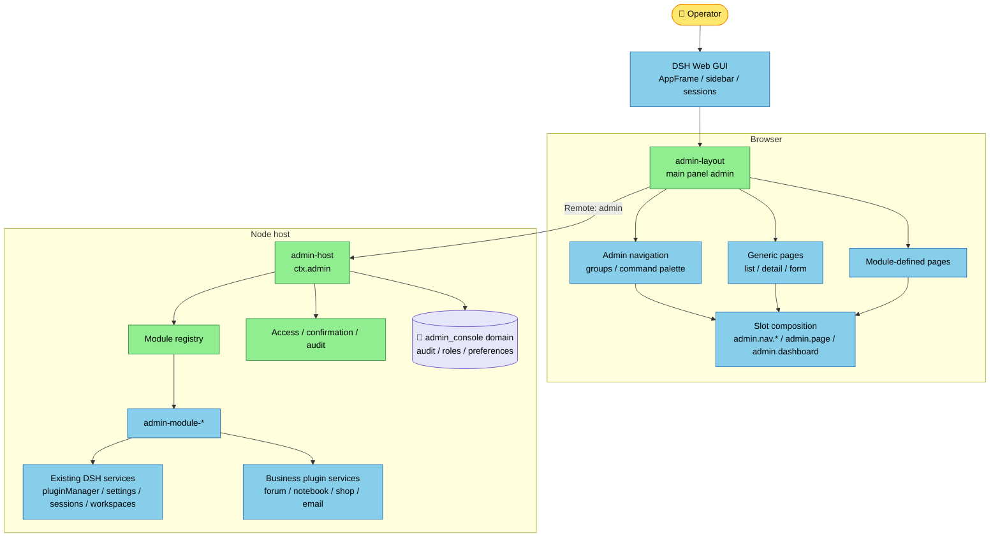
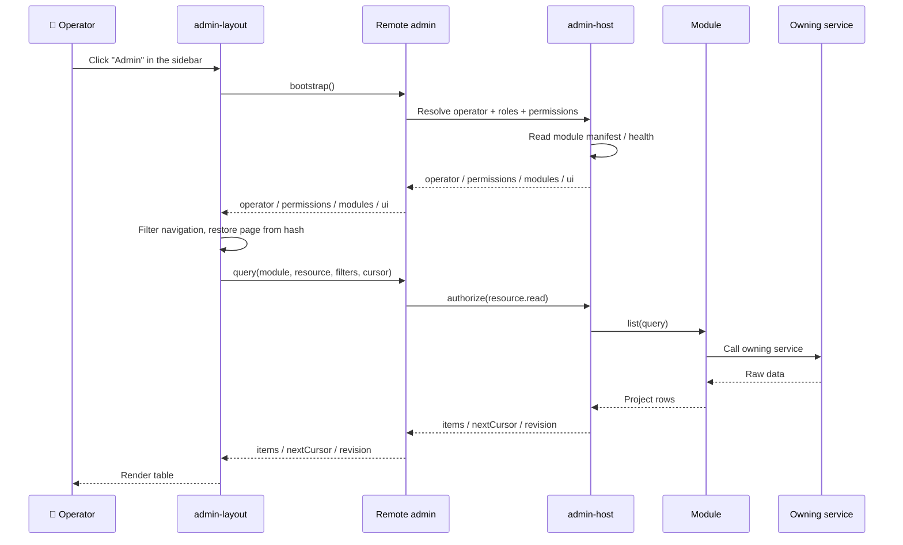
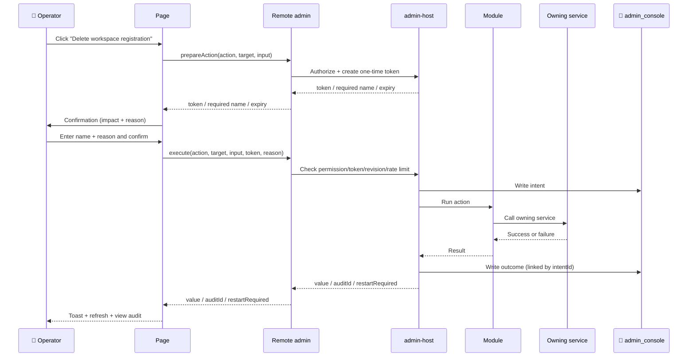

# DSH Admin Console: System Design (Draft)

[中文](admin-system-design.cn.md) | English

Status: for review. This document fixes the design only; it contains no implementation code. The goal is to build administration as a removable set of DSH plugins, not as a separate management web application.

Audience: DSH plugin developers and architecture reviewers. Prerequisites: Cordis services, Loader, Slots, Typert Remote, and storage domains.

Reading path: conclusions only → 0, 2, 11; architecture review → 3–5, 10; security review → 6; interface review → 8.

## 0. Summary

| Question | Decision |
|---|---|
| Product form | A main panel inside the DSH Web GUI, panel key `admin`, entered from the sidebar |
| Host side | `@veren/admin-host`: the only `ctx.admin` service, module registry, access checks, audit, and `admin` Remote namespace |
| Client side | `@veren/admin-layout`: admin shell, navigation, page slots, and hash sub-routing; `@veren/admin-ui` supplies the generic list/detail components |
| Extension model | A new admin capability is a new `admin-module-*` plugin; host/layout stay unchanged |
| Authorization | The Host authorizes every query and write; hiding a button is UX, never security |
| Audit | Every write records intent and outcome; denied attempts are recorded; secrets are redacted |
| First release | System console: overview, workspaces/sessions, settings, audit, and links to native plugin management |
| Multi-user | Explicitly single-operator at first; named users and RBAC belong to phase 2 behind an identity bridge |
| Non-goals | A separate SPA, a separate login page, a separate database, replacing the DSH sidebar, or directly reading another plugin's storage |

One sentence: **`admin-host` owns "who may do what, and what happened"; `admin-layout` owns "how it looks and how it is operated"; feature modules contribute the actual resources and pages.**

### 0.1 Five rules to remember

1. The console is part of DSH, not a second system beside it.
2. Every write goes through `admin-host.execute`; a module must not open a write path that bypasses audit.
3. Admin pages compose through Slots; modules never runtime-import another module's components.
4. Governance data (audit, roles, preferences) belongs to admin; business data stays with its owning plugin and is reached through that plugin's service.
5. Build the system console first, then users and content. Do not start with a general low-code platform.

### 0.2 Fit and non-fit

| Fits | Does not fit |
|---|---|
| A local or trusted-intranet DSH deployment | A public multi-tenant SaaS control plane |
| One or a few trusted operators | Multiple mutually untrusted organizations |
| Managing DSH plugins, settings, sessions, and audit | Replacing DSH's conversation/workspace primary UI |
| Adding admin pages to forum, notebook, shop, or email plugins | Reading other plugins' durable files directly |

## 1. Goals, boundaries, and assumptions

### 1.1 Goals

- Provide **one entry point** for deployment health, plugins, settings, sessions, and audit, later extended to users and content.
- Provide a **pluggable extension surface**: a new admin area is a new module plugin, with no change to `admin-host` or `admin-layout`.
- Provide a **trustworthy write path**: authorization, destructive-action confirmation, and audit happen on the Host, outside client control.
- Provide **DSH-consistent presentation**: theme tokens, `ui-primitives`, locales, Remote transport, and desktop capabilities.
- Provide an **installable, disableable, removable** delivery shape: one bundle, with independently manageable member plugins.

### 1.2 Non-goals

- No separate admin site, login page, frontend project, or database.
- Do not duplicate the existing plugin manager, schedule panel, or settings forms; link to native panels and reuse primitives first.
- Do not read or write the `forum`, `notebook`, `shop`, or `email` storage domains directly; call the owning service.
- No multi-tenancy, approval workflows, public API, or model-facing `admin_*` tools in the first release.
- Do not replace DSH's `sidebar` slot. Admin navigation lives inside the `main` panel so conversation/workspace flow stays intact.

### 1.3 Users and scenarios

| Role | Cares about | First release |
|---|---|---|
| Deployment owner | Whether the deployment is healthy and who may do what | Full read plus safe writes |
| Operator | Plugins, settings, sessions, background work | Plugin/settings/session/audit pages |
| Content operator | Forum, notebook, shop, email content | Phase 2 content modules |
| Auditor | Who changed what, and when | Phase 2 read-only audit role |

### 1.4 Assumptions

- The deployment is local DSH Desktop/Web, or a single DSH instance on a trusted network; public multi-tenancy is out of scope.
- Authentication is owned by the existing `@veren/web-login-gate` or the launch token; admin does not add a login page.
- Admin Host and Client run in the same DSH process and version generation; Host/Client are not mixed across versions.
- Persistence uses a DSH storage domain over JSON or SQLite; admin does not touch the filesystem directly.
- At first, every admitted browser is treated as the same `owner` operator. Section 6.6 explains this limit.

## 2. Key decisions

| Decision | Choice | Rationale | Rejected alternative |
|---|---|---|---|
| Product form | A DSH main panel | Reuses authentication, Remote, theme, locale, and desktop IPC; install and use | A standalone React admin site with a second login/transport/build |
| Host authority | One `admin-host` aggregator | Authorization and audit live in one place; modules cannot bypass them | Each module exposing its own Remote, with scattered policy |
| Client shell | Own admin navigation plus DSH primitives | Admin needs information density and stable navigation while keeping DSH appearance | Replacing DSH `sidebar`, which breaks session navigation |
| Extension model | Module registry + generic resources + custom pages | Standard CRUD is shared; unusual pages keep an escape hatch | Everything hard-coded in layout, or a full low-code platform up front |
| Transport | Typert Remote, namespace `admin` | Matches existing plugins and works on Web and Desktop | A custom `/admin-api` REST surface with a second desktop bridge |
| Identity | Single operator first, RBAC reserved | The DSH browser Peer is currently fixed as `owner`; pretending otherwise would be false isolation | Claiming multi-tenant isolation in phase 1 |
| Data ownership | Admin owns governance data only | Business invariants stay with business plugins; no dual writes or migration coupling | Admin reading business storage directly |
| Routing | Private hash `#/admin/<page>` | Does not touch DSH routing; supports refresh, back/forward, and deep links | No routing, so refresh always returns to the first page |
| Dangerous actions | `prepare` + `execute` with a one-time token | Prevents accidental and replayed actions and gives audit a clear intent point | A client-side confirmation dialog only |

### 2.1 Why not a standalone admin site

A separate site looks more flexible, but it immediately duplicates four things: login state, the Remote client, theme/locale, and desktop IPC. More importantly, it still calls the same Host services, so authorization and audit still live in DSH. The extra artifact is a second frontend to maintain forever. As a DSH panel, installing one plugin adds one admin surface.

### 2.2 Why modules do not expose separate Remotes

If forum, users, and plugins each opened their own Remote namespace, the client would mount each one, handle each error model, and implement policy separately; the Host would have no single place that guarantees every write is audited. The value of `admin-host` is that narrow pipeline: modules supply resources and actions; the pipeline owns authorization, confirmation, audit, and error normalization.

The price is that generic `query/execute` is less statically typed than dedicated methods. Mitigation: one protocol package owns the Zod schemas; the Host validates strictly at the wire boundary. This is a process/browser wire boundary, not a same-process typed boundary, so validation is required. Genuinely complex pages may register their own Remote namespace, but the default path is the generic pipeline.

## 3. Architecture



### 3.1 Layer responsibilities

| Layer | Component | Owns | Does not own |
|---|---|---|---|
| DSH application shell | `ui-layout`, `ui-sidebar`, sessions/workspaces | Application frame, sessions, native navigation | Admin business |
| Admin shell | `admin-layout` | Panel entry, admin navigation, page frame, hash routing, generic table/detail | Authorization or business writes |
| Admin core | `admin-host` | Module registry, authorization, confirmation, audit, query/execute pipeline, `admin` Remote | Concrete business fields and rules |
| Admin modules | `admin-module-*` | Resource descriptors, action handlers, page components, module copy | Bypassing the pipeline to write business storage |
| Business plugins | `pluginManager`, `settings`, `sessionController`, `forum`, etc. | Domain invariants and persistence | Admin navigation and audit |
| Persistence | `admin_console` domain | Audit, roles, bindings, preferences, saved views | Copies of business data |

### 3.2 Data flow

- **Read**: page → `query/get` → authorization → module read adapter → owning service → row projection → render.
- **Write**: page → (`prepareAction` for dangerous actions) → `execute` → permission/token/revision checks → module action → owning service → audit outcome → page refresh.
- **Refresh**: no push channel in phase 1. Pages refresh after writes; overview polls on a configured interval. An `admin/changed` event or Remote stream can be added later.

### 3.3 Package relationships

| Package | Role | Runtime dependencies |
|---|---|---|
| `@veren/admin-protocol` | Shared types, error codes, permission grammar, wire schemas, API version constants | No Cordis lifecycle; browser-safe |
| `@veren/admin-host` | Host service, registry, authorization, audit, Remote | Cordis, schemastery, storage-domain, protocol |
| `@veren/admin-layout` | Client shell, navigation, page slots | React, ui-primitives, slots, locale, protocol |
| `@veren/admin-bundle` | Profile composition; patch and dependencies only | host, layout, default modules |
| `@veren/admin-module-*` | Host + Client halves for one admin capability | admin-host, protocol, corresponding business service |
| `@veren/admin-ui` | Presentational table, filter bar, stat card, drawer, resource page (recommended for P1) | React, ui-primitives; consumed by layout and modules, with no Cordis lifecycle |

`admin-layout` must not runtime-import `admin-host` values. It imports types/schemas from `admin-protocol`; behavior crosses through `ctx.remote.admin` and `ctx.slots`. `admin-module-*` packages do not import each other and do not share singletons.

Suggested directory:

```text
plugins/admin/
  protocol/            @veren/admin-protocol
  host/                @veren/admin-host
  layout/              @veren/admin-layout
  ui/                  @veren/admin-ui (presentation library, recommended for P1)
  bundle/              @veren/admin-bundle
  modules/
    system/            @veren/admin-module-system
    settings/          @veren/admin-module-settings
    sessions/          @veren/admin-module-sessions
    audit/             @veren/admin-module-audit
```

`admin-ui` is a presentational library with no Cordis lifecycle; the first version lets each client bundle carry its own copy. If bundle size or duplicate styles become a problem, evaluate adding it to the client shared-module table rather than letting modules import each other's components.

## 4. The two core plugins

### 4.1 `@veren/admin-host`

The Host half is the single authority. It provides the Cordis service `ctx.admin` and the Typert Remote namespace `admin`, and stores audit and access data in its own storage domain.

Responsibilities:

- Open and validate the `admin_console` domain. If it cannot open, fail loudly; never degrade into an admin console without audit.
- Maintain the module registry: register, validate, unload, check versions, reject duplicate permission declarations.
- Resolve the operator and roles, then compute the permission set.
- Implement the five Remote methods: `bootstrap`, `query`, `get`, `prepareAction`, `execute`.
- Authorize every `execute`, and check the confirmation token, target revision, timeout, and rate limit.
- Write audit intent, outcome, and denied attempts; redact sensitive fields.
- Expose health and the module manifest for layout navigation and empty states.

Non-responsibilities:

- Concrete resource fields and rules (module-owned).
- Admin layout and copy (layout/module-owned).
- Direct reads/writes of forum, notebook, shop, or email storage.

Suggested source layout (stay within the five-source-file package rule):

| File | Contents |
|---|---|
| `src/index.ts` | Default-export `AdminService` (re-exported from `service.ts`) so the Loader loads this package as a service plugin |
| `src/service.ts` | `AdminService extends TypertRemoteService`; `static inject`, `static Config`, `super(ctx, 'admin')`, `Service.init` opens the domain, five Remote methods and pipeline |
| `src/registry.ts` | Module/resource/action registry, version checks, disposal |
| `src/access.ts` | Identity resolution, role/permission matching, confirmation tokens, rate limiting |
| `src/store.ts` | `admin_console` domain, audit/roles/bindings/preferences, retention |

`admin-host` takes the **default-export Service class** form, not the `apply` function-plugin form; it provides the `admin` capability and owns its lifecycle. Public types live in `@veren/admin-protocol`; the host does not copy them into `src/types.ts`. `service.ts` only orchestrates, with the heavy logic in `registry/access/store`; any file over 300 lines becomes its own package rather than turning the host into a grab bag.

### 4.2 `@veren/admin-layout`

The Client half is the shell. It registers one `main` panel and organizes admin navigation and pages inside it.

Entry and mount order:

1. The outer plugin injects `slots`, `locale`, `remote`, and `layout`, then mounts the `admin` namespace with `ctx.remote.$mount`.
2. The inner panel plugin injects the freshly mounted `remote.admin` (inject resolution uses the registry, so a sibling mount resolves).
3. The inner plugin registers the `main` panel, the sidebar entry, admin navigation slots, and page slots.
4. Disposal is reversed: page/nav registrations, panel, then Remote.
5. `$mount` registers client codecs only; it does not prove the Host is online. If the Host service is absent, the entry still appears, but `bootstrap` fails (the gateway reports an unknown service); the shell normalizes that to `admin/dependency-unavailable` and renders a full error page with install/enable guidance and a diagnostic id.

Panel identity:

- `PANEL_ID = 'admin' as MainPanelId`.
- The `sidebar.panellist` registration `id` matches the `main` key.
- Put the sidebar entry last (`order: 90`) so it does not compete with sessions or plugins.
- Use a 16px shield/console line icon that inherits `currentColor`.
- When registering into a slot declared by an official package (`main`, `sidebar.panellist`), use `ctx.slots.inject(name, () => ctx.slots.register(...))`; a bare `register` into an undeclared slot fails at load.

Admin shell Slots:

| Slot | Kind | Owner supplies | Purpose |
|---|---|---|---|
| `admin.nav.overview` | list | `activePage`, `selectPage`, `can`, `collapsed` | Overview group |
| `admin.nav.content` | list | same | Content group |
| `admin.nav.operations` | list | same | Operations group |
| `admin.nav.system` | list | same | System group |
| `admin.page` | keyed | `bootstrap`, `can`, `query`, `get`, `prepare`, `execute`, `refresh`, `navigate` | Page body |
| `admin.dashboard` | list | `bootstrap`, `can`, `query`, `refreshToken` | Overview cards |
| `admin.header.action` | list | `bootstrap`, `can`, `refresh` | Global header actions |

Conventions:

- `main:admin` is not a Session panel and receives no Session binding. "Open session" inside admin is a navigation action; it does not embed the conversation in the admin page.
- Page keys use `<module>.<page>`, for example `system.overview`, `sessions.list`, `users.list`.
- A nav item's `id` matches its page key. Nav items that only open a native panel use `native:<panel>` and register no page.
- Page components never touch `ctx` and never import service classes; data and callbacks arrive through owner props or plain values captured at registration.
- `@veren/admin-ui` provides the generic page components; a module binds its own module/resource id at registration. Layout owns only the shell and does not choose resources for modules.
- All copy goes through locale namespaces: `admin` for the shell, one namespace per module.

Suggested source layout:

| File | Contents |
|---|---|
| `src/index.ts` | Empty Node-half `apply`, so the Loader row has an importable entry |
| `src/client/index.tsx` | Outer Remote mount, inner panel plugin, slot registrations |
| `src/client/shell.tsx` | Shell, navigation, header, hash routing, states |
| `src/client/remote.ts` | Hand-built `admin` Remote contribution and wire codecs |
| `src/client/locales.ts` | `zh`/`en` dictionaries and key types |
| `src/client/styles.css` or `styles.ts` | Styles that use only `--dsw-*` tokens |

Build with the `cms-bridge` pattern (`tsdown` + `lightningcss`): CSS Modules compile into a tagged style injection, and the artifact is a single `lib/client.js` in the `window.__ModuleLoader__.load` envelope. A string stylesheet like `forum-ui` also works, but admin has many pages, so CSS Modules are easier to maintain.

### 4.3 `@veren/admin-protocol` and `@veren/admin-bundle`

**protocol** exists for one reason: Host and Client must not write the same wire contract twice. It contains:

- `ADMIN_API_VERSION` and module compatibility rules.
- Wire types such as `AdminBootstrap`, `AdminQuery`, and `AdminExecution`.
- Stable error codes and the `AdminResult` union.
- Permission-string grammar and validation.
- Zod schemas: Host uses them for input validation; Client uses them for Remote codecs.

It has no Cordis dependency, opens no storage, and registers nothing, so both sides can import it safely.

**bundle** only composes:

```text
admin-host  →  admin-layout  →  admin-module-system
                             →  admin-module-settings
                             →  admin-module-sessions
                             →  admin-module-audit
```

Member plugins do not declare `dsh.bundle` themselves; they ship as ordinary dependencies of the bundle, whose `cordis.patch.yml` inserts the Loader rows in dependency order. This keeps one profile layer and avoids duplicate activation during reconciliation.

## 5. Module extension model

### 5.1 Four extension points

| Extension point | Use | Example | When not to use |
|---|---|---|---|
| Resource | Standard list/detail/edit | Users, posts, orders, email | The page has complex interaction or a cross-resource workflow |
| Action | A named command | Disable a plugin, archive a session, reset a password | The action needs a large data view or a complex form |
| Page | Fully custom page | Overview, audit timeline, content review desk | It is ordinary CRUD |
| Widget | Card on the overview | Health, recent failures, pending count | It needs a whole-page interaction |

The first version only takes Resource as far as "list + detail + read-only fields." Do not build a general edit form or a low-code engine until a second real module needs it.

### 5.2 Module descriptor

A Host module declares at least:

| Field | Meaning | Required |
|---|---|---|
| `id` | Stable module id, matching the page-key prefix | Yes |
| `apiVersion` | Compatible admin API version | Yes |
| `permissions` | Permission points contributed by this module | Yes, may be empty |
| `resources` | Resource descriptors: id, fields, read/write capability, required permission | No |
| `actions` | Action descriptors: id, danger level, input schema, required permission, timeout | No |
| `titleKey` | Copy key for the shell and command palette | No |

Resource descriptors carry **machine-readable facts only**: field name, type, sortable/filterable, sensitive, required permission. **Display copy does not live on the Host.** The module's Client half supplies it through its locale dictionary; if the Host returns a `labelKey` that the Client cannot resolve, the Client falls back to the field name.

### 5.3 Registration and disposal

Host side:

- The module plugin `inject: ['admin']` and registers in `apply` with `ctx.effect(() => ctx.admin.registerModule(descriptor), '...')`.
- `registerModule` returns a disposer. Module unload, HMR, and disable remove that module's resources/actions/permissions.
- Registration validates: unique id, unique permissions, action references an existing resource, compatible `apiVersion`, at least one resource/action.
- Validate the whole descriptor before committing; a failure leaves no partial resources/actions. Validation fails loudly, naming the module and field; never skip silently.

Client side:

- The module's Client plugin injects `slots` and `locale`, then registers with `ctx.slots.inject('admin.nav.<group>', ...)` and `ctx.slots.inject('admin.page', ...)`.
- Nav and page components are ordinary presentation components. Pages receive `query/execute` through owner props and never reach `ctx`.
- Disposal removes Slot registrations automatically. If the shell is still on the removed key, it shows "module unloaded; choose another page."

### 5.4 Module catalog

| Module | Phase | Host data source | Client pages | Notes |
|---|---|---|---|---|
| `admin-module-system` | P1 | `pluginManager`, `pluginInventory`, `sessionController`, `workspaceRegistry` | Overview, about/diagnostics | Read-only stats plus native-panel links |
| `admin-module-settings` | P1 | `settingsController` | Settings | Reuses `SettingsForm` primitives |
| `admin-module-sessions` | P1 | `sessionController`, `workspaceController` | Workspaces/sessions | List, detail, open, rename, archive; workspace deletion needs confirmation |
| `admin-module-audit` | P1 | Admin audit table | Audit log | Read-only; filter, detail, copy |
| `admin-module-users` | P2 | A future `webAuth` service | Users and roles | Depends on the identity bridge; not promised in P1 |
| `admin-module-content` | P2 | `forum`, `notebook`, etc. | Forum/notebook review | One module per content domain, or subpages |
| `admin-module-commerce` | P3 | `shop` service | Products/orders | Wait for a stable shop service surface |
| `admin-module-email` | P3 | `email` service | Mail/templates | Wait for a stable email service surface |

### 5.5 Module author checklist

1. The Host half calls owning services only; it does not open another plugin's storage domain. A package that provides a service default-exports a Service class; a package that only registers a module uses a named `apply`. Do not mix the two forms.
2. Every write action has a permission, danger level, input schema, and timeout.
3. Every resource declares sensitivity and filter/sort capability for its fields.
4. The Client half imports no other module's components and no Host service values.
5. All copy goes through locale dictionaries; components do not touch `ctx`.
6. Every registration has a disposer, plus an unload/HMR test.
7. Provide bilingual READMEs and a package `description` stating when to use and when not to use it.

## 6. Access, identity, and audit

### 6.1 Trust model in the first release

Phase 1 is designed for **one operator**:

- If `@veren/web-login-gate` is installed, it proves the browser belongs to a named user. However, the official DSH connection layer currently creates the browser Peer fixed as `owner`; a Remote call carries no reliable named-user identity.
- Therefore `admin-host` treats every admitted browser as the same operator and records `owner` in audit. It does not claim multi-user isolation.
- This is appropriate for a local, single-maintainer DSH. It is not appropriate for exposing one admin console to multiple mutually untrusted users.

> This limit must be explicit in deployment docs. Do not advertise multi-user RBAC until the identity bridge in 6.6 lands; otherwise a role table is only decoration.

### 6.2 Roles and permissions

Permission strings have three parts:

```text
<module>.<resource>.<verb>     example: sessions.workspace.read
<module>.<action>              example: plugins.bundle.install
*                              built-in owner only
<module>.*                     every permission in the module
```

Verbs: `read`, `create`, `update`, `delete`, `execute`, `export`, `manage`. Prefer a specific verb over `manage`; do not let one permission cover too many actions.

| Built-in role | Permissions | Active in phase 1 |
|---|---|---|
| `owner` | `*` | Yes, the only effective role |
| `admin` | Everything except role/permission changes | No, P2 |
| `operator` | Daily session, content, and settings work | No, P2 |
| `auditor` | Read-only audit and system information | No, P2 |
| `viewer` | Non-sensitive read-only | No, P2 |

The role/binding tables exist from day one, but only `owner` is effective. This avoids changing the data model when P2 adds the identity bridge.

### 6.3 Where authorization happens

- `bootstrap` returns the operator, roles, permission set, module manifest, and health. The client uses it to hide unauthorized navigation and buttons.
- `query/get` checks the permission declared by the resource; `execute` checks the permission declared by the action.
- Dynamic rules inside a module action (for example, "cannot remove the last owner") are checked again by the module. Those are business invariants, not UI rules.
- Deny by default: a resource or action with no declared permission cannot be called.
- Self-lockout guards: cannot remove the last owner through admin, cannot disable `admin-host`, cannot modify built-in roles, cannot delete audit records.

### 6.4 Destructive-action protocol

| Danger level | Example | Requirement |
|---|---|---|
| `normal` | Refresh, open detail, read-only query | None |
| `sensitive` | Change settings, disable a plugin, archive a session | `reason`, recorded in audit |
| `destructive` | Delete a workspace registration, remove a bundle, bulk delete | One-time token + target name + `reason` |

Flow:

1. The page calls `prepareAction` with module, action, target, and input.
2. The Host checks permission and issues a one-time token bound to operator, action, target, input digest, and expiry (default 120 seconds).
3. The page opens a confirmation dialog showing impact, irreversibility, the required target name/phrase, and a reason field.
4. After confirmation the page calls `execute` with the token and reason.
5. The Host rechecks permission, token, target revision, and rate limit. The token is single-use; expired or reused tokens are refused.
6. Success returns an `auditId`; the toast offers "View audit."

Tokens live only in Host memory and die with the process. They are not persisted or shared across processes. This prevents accidental actions and replay without adding a signing-key subsystem.

### 6.5 Audit

Audit is a hard requirement, not an optional log.

| Field | Meaning |
|---|---|
| `id` | Time-sortable id (UTC prefix + random suffix) |
| `at` | ISO timestamp |
| `kind` | `intent` / `outcome` / `denied` |
| `intentId` | Intent id linked by an outcome |
| `actor` | Operator identifier; `owner` in phase 1 |
| `roles` | Role snapshot at the time |
| `module` / `action` | Module and action |
| `target` | Target type and id |
| `input` | Redacted, truncated input |
| `result` | `ok` / `error`, with a short summary |
| `errorCode` | Stable code on failure |
| `durationMs` | Action duration |
| `traceId` | Trace id for logs |
| `confirmationId` | Token id for dangerous actions |

Write order:

1. Write `intent` before executing; if it fails, **abort the action**.
2. Execute the business action.
3. Write `outcome`, linked by `intentId`.
4. If the business action succeeded but `outcome` failed: do not fake a rollback. Return success with `auditWarning`, log an error, and raise an "audit incomplete" alert on the overview.

Other rules:

- Permission denials and validation failures also write `denied`, but never record passwords, tokens, keys, or full file content.
- Default redaction keys match `password|secret|token|key|credential|authorization`; values are truncated to 2 KB; extra keys are configurable.
- Default retention is 90 days / 50,000 entries; prune at startup and daily; pruning itself writes a system audit entry.
- The audit table is append-only. Apart from retention pruning there is no update/delete API. Export is a later-phase capability.

### 6.6 Identity bridge (phase 2)

Multi-user RBAC requires the Host to answer "who made this call" reliably. Options:

| Option | Approach | Benefit | Cost | Fit |
|---|---|---|---|---|
| A. Official Principal extension | Create a named principal per login session at the connection layer | End-to-end identity; most correct | Needs an official extension point or change | Long term |
| B. Admin-specific HTTP route | `/admin-api` reads the Better Auth cookie | Isolated; HttpOnly/CSRF possible | Desktop IPC does not support it; second client path | Web multi-user |
| C. Admin session token | Exchange login for a short-lived token carried by Remote | Works with Remote and desktop | Token in JS memory; XSS exposure | Transitional |

Recommendation: use B for Web multi-user first, and push A long term. Do not treat C as real multi-user isolation. In every case, `@veren/web-login-gate` should expose a narrow `webAuth` service (verify session, read user, optionally verify password) instead of letting admin open the `web_login_gate` domain.

### 6.7 Security checklist

- CSRF: same-origin Remote only; if an HTTP route is added, check Origin and keep SameSite=Strict cookies.
- XSS: user data goes through React text nodes; Markdown uses `MarkdownText` and its link policy; never use `dangerouslySetInnerHTML`.
- Secrets: settings are write-only from the client; audit never stores secrets; errors never echo secrets.
- Rate limits: dangerous actions are limited per operator/action; return `admin/rate-limited` with `retryAfter`.
- Paths: no arbitrary file browsing in phase 1; workspace/session actions use ids, not user-supplied paths.
- Dependencies: classify new Host value dependencies per DSH rules; Client uses `import type` and the protocol package only.
- Supply chain: bundle installation uses the existing plugin-manager approval and compatibility checks; do not bypass them.

## 7. Data and API

### 7.1 Storage domain

`admin_console` domain, `version: 1`, `layout: 'per-record'`. Tables:

| Table | Key | Contents | Retention |
|---|---|---|---|
| `audit` | Time-prefixed id | Audit intent/outcome/denied | 90 days / 50k entries by default |
| `roles` | Role id | Custom roles and permissions | Permanent; built-in roles are not stored |
| `role_bindings` | Subject | Subject-to-role bindings | Permanent; used in P2 |
| `preferences` | `subject + key` | Per-operator UI preferences | Permanent; clearable |
| `saved_views` | `subject + view id` | Saved filters/columns | P2 |

Principles:

- Admin owns governance data only; business data is never copied in, to avoid dual writes and drift.
- Audit ids use a UTC time prefix for ordering and prefix filtering. KV has no secondary indexes; queries scan in reverse id order and return the latest 200 by default.
- The audit cap is a known limitation: up to 50k entries is reasonable for local KV. Larger deployments should move to SQLite or a dedicated audit store instead of scanning without bound.
- If the domain fails to open, the plugin fails to load. Better no console than a console without audit.

### 7.2 Remote API

| Method | Purpose | Permission | Side effects |
|---|---|---|---|
| `bootstrap` | Operator, permissions, module manifest, health, UI defaults | Admitted | None |
| `query` | List: module, resource, search, filters, sort, cursor, page size | Resource `read` | None; sensitive reads may be audited by config |
| `get` | One record | Resource `read` | None |
| `prepareAction` | Validate an action and issue a confirmation token | Action `execute` | No business write |
| `execute` | Run an action | Action `execute` + token for dangerous actions | Business write + audit |

Every method returns one union:

```text
{ ok: true, value: ... }
{ ok: false, error: { code, message, details?, traceId } }
```

Expected refusals (no permission, validation, conflict, not found, rate limit) use `ok: false`; the page renders by code. Genuine internal failures throw `RemoteError`, which the gateway normalizes; the page shows code + traceId, never a stack.

### 7.3 Payloads

`bootstrap` returns:

| Field | Contents |
|---|---|
| `apiVersion` | Protocol version |
| `runtime` | DSH version, admin version, platform (web/desktop) |
| `operator` | id, display name, kind (`owner` in phase 1), roles |
| `permissions` | Granted permission strings |
| `modules` | Machine-readable module/resource/action descriptors |
| `features` | Optional service availability: pluginManager, settings, auth, jobs, etc. |
| `health` | Storage, audit, and optional-service status |
| `ui` | Default page, page size, poll seconds, density |

`query` returns:

| Field | Contents |
|---|---|
| `items` | Rows; every row has `id`, optionally `revision` |
| `nextCursor` | Next cursor; omitted when there is no more |
| `total` | Optional total; omitted when expensive, in which case the page shows "50+" |
| `columns` | Optional column descriptors; otherwise the page renders from the resource descriptor |
| `revision` | Collection revision for conflict messages |

`execute` returns:

| Field | Contents |
|---|---|
| `value` | JSON-serializable action result |
| `auditId` | Intent audit id |
| `changed` | Whether state changed |
| `restartRequired` | Whether DSH must restart (plugin management) |
| `auditWarning` | Set when the outcome audit write failed; does not hide business success |

### 7.4 Error codes

| Code | Meaning | UI behavior |
|---|---|---|
| `admin/unauthenticated` | No valid identity | Prompt to sign in/reload |
| `admin/forbidden` | Insufficient permission | 403 state; no sensitive data |
| `admin/unknown-module` | Module not installed or unloaded | Offer install or switch page |
| `admin/unknown-resource` | Resource does not exist | Empty state |
| `admin/unknown-action` | Action does not exist | Disable the control |
| `admin/bad-request` | Input validation failed | Field-level errors |
| `admin/conflict` | Revision conflict | Refresh and retry |
| `admin/confirmation-required` | Token missing/expired | Reopen confirmation |
| `admin/rate-limited` | Rate limit hit | Show retryAfter |
| `admin/dependency-unavailable` | Required service unavailable | Degraded page explanation |
| `admin/storage-unavailable` | Governance storage unavailable | Stop writes; show an explicit alert |
| `admin/internal` | Unexpected failure | Show traceId and copy diagnostics |

### 7.5 Consistency and limits

- Pagination uses an opaque cursor; `limit` defaults to 50 and is capped at 200. Never accept an arbitrarily large page from the client.
- List queries have a timeout (5 seconds by default); actions have a timeout (30 seconds by default). Timeouts return a stable code.
- No cross-module transactions. One action calls one owning service. If a workflow needs two services, split it into two actions or compensate inside the module and report partial success.
- Edits use `expectedRevision` for optimistic concurrency; on conflict, do not overwrite, prompt to refresh.
- Overview statistics may cache for 5–10 seconds; writes invalidate the relevant cache.
- Audit writes are part of the business action but do not roll it back; see 6.5.

### 7.6 Versioning

- `ADMIN_API_VERSION = 1`; modules declare `apiVersion`; the Host refuses incompatible modules by name.
- Host input is validated strictly; the Client uses loose schemas for Host responses so additive Host fields do not break pages.
- Removing or renaming a field bumps the API version; adding a field does not.
- The `admin_console` domain version is independent of the API version; schema changes follow storage-domain migration rules.
- Published packages declare an `engines.dsh` range. DSH is pre-stable; run composition tests before widening the range.

## 8. Interface and interaction

### 8.1 Entry and layout

Sidebar entry:

```text
DSH sidebar
  ...
  [sessions/workspaces]
  [plugins] [schedules]
  [🛡 Admin]   ← new
```

After entry, admin occupies the `main` panel:

```text
┌─────────────────────────────────────────────────────────────────────┐
│ DSH sidebar │ Admin nav           │ Page title              [Refresh] │
│ sessions    │ Overview            │ Description / environment         │
│ workspaces  │ Content             ├────────────────────────────────────┤
│             │  Forum              │ Search [____]  Status [All]  View  │
│             │  Notebook           │ ┌────────────────────────────────┐ │
│             │ Operations          │ │ Table / cards                  │ │
│             │  Workspaces         │ │                                │ │
│             │  Audit log          │ └────────────────────────────────┘ │
│             │ System              │ 50 rows / Next                     │
│             │  Plugins (native)   │                                    │
│             │  Settings           │                                    │
└─────────────────────────────────────────────────────────────────────┘
```

- Admin navigation is about 232px and can collapse to a 56px icon rail; the collapsed state is stored in admin preferences.
- The content area has one vertical scroll container; tables scroll horizontally inside their own container, never the whole page.
- The header is fixed and the table header is sticky; details open in a right drawer instead of a full-page navigation.
- Optional focus mode: collapse the DSH sidebar on entry and restore it on exit. Do not collapse automatically by default; it disorients users.
- Routing changes the hash only: `#/admin/<page>?<filters>`. A page id allows lowercase letters, digits, dots, and hyphens; an unknown id falls back to the default page. Do not use path-style `pushState`, which would conflict with DSH's static entry and launch-token paths.

### 8.2 Navigation groups

| Group | Phase 1 pages | Later pages | Notes |
|---|---|---|---|
| Overview | Overview | Trends, alerts | Read-only default landing page |
| Content | — | Forum, notebook, products, email | P2/P3; appears per module |
| Operations | Workspaces/sessions, audit log | Jobs, schedules, export | Daily operation |
| System | Plugins (native), settings, about | Users/roles, storage, diagnostics | Configuration and governance |

Ordering within a group is ascending `order`; equal orders keep registration order. Group headings are provided by layout in both locales; modules do not redefine them.

### 8.3 Page catalog

| Page | Phase | Data source | Main actions | Permission |
|---|---|---|---|---|
| Overview | P1 | System module aggregation | Refresh, navigate, view recent audit | `admin.overview.read` |
| Workspaces and sessions | P1 | Session/workspace services | Search, view, open session, rename, archive, delete workspace registration | `admin.sessions.read` / `.write` |
| Settings | P1 | `settingsController` | Edit by schema, save, resolve conflicts, write-only secrets | `admin.settings.read` / `.write` |
| Audit log | P1 | Admin audit table | Filter, detail, copy JSON | `admin.audit.read` |
| Plugins and bundles | P1 | Native plugin panel | Navigate; no install/remove inside admin in P1 | `admin.plugins.read` |
| Users and roles | P2 | `webAuth` service | List, assign roles, disable users | `admin.users.*` / `admin.roles.*` |
| Forum content | P2 | `forum` service | View posts/comments, pin, and governance actions the owning service exposes | `admin.content.forum.*` |
| Notebook content | P2 | `notebook` service | View/delete, according to the owning service's capabilities | `admin.content.notebook.*` |
| Products/orders | P3 | `shop` service | Products, orders, refunds | `admin.commerce.*` |
| Email | P3 | `email` service | Templates, send history, bounces | `admin.email.*` |

P1 deliberately does **not** rebuild plugin install/remove inside admin. The existing plugin manager already has install approval, compatibility checks, logs, and restart messaging. Admin provides a summary and a link until there is a concrete need to unify the experience.

### 8.4 Page skeleton

Every standard page follows one skeleton:

- **Header**: title, one-line description, environment/version badge, refresh, primary action.
- **Toolbar**: search, filters, sort, density, saved views (P2).
- **Content**: table or cards; sticky header; row hover; clear selected state.
- **Footer**: cursor pagination, active-filter summary, selected count.
- **Drawer**: details, metadata, danger zone; keeps page context.
- **Feedback**: success/failure toast; failure carries a code and "copy diagnostics"; dangerous success offers "View audit."

States must be complete:

| State | Presentation |
|---|---|
| Loading | Skeleton; avoid a full-page spinner flash |
| Empty | Why it is empty + next action (install module, clear filters, create first item) |
| Forbidden | 403 explanation + return to an allowed page; no sensitive data |
| Dependency unavailable | Name the missing service/plugin; offer install/enable |
| Conflict | Keep draft; explain data changed; offer refresh/compare |
| Audit incomplete | Top warning bar; does not block the page but states the fact |

### 8.5 Interaction standards

- Search: filter the current resource with a 300ms debounce; no cross-resource global search until P2.
- Filters: derived from the resource descriptor; controlled enums or text, never an arbitrary expression language.
- Sort: only declared fields; default `updatedAt` or a resource-specific field in descending order.
- Pagination: cursor; show "50 rows / Next", never invent a total page count.
- Bulk actions: P2; require selected count, impact preview, and dangerous confirmation.
- Saved views: P2; private per operator, shareable to a role in P3.
- Keyboard: natural Tab order; Escape closes drawer/modal; Enter submits; do not steal existing DSH shortcuts.
- Command palette: P2; phase 1 only navigates.
- Responsive: ≥1280 two columns; 960–1279 narrower nav and reduced columns; <960 nav drawer and card tables.
- Theme: only semantic `--dsw-*` tokens; test light and dark; no literal colors.
- Locale: shell uses `admin`; modules use their own namespaces; use `Intl` for dates/numbers; test Chinese and English.
- Accessibility: table caption/scope; move focus to the page heading on navigation; `aria-live` toasts; modal focus trap; respect reduced motion.

Reuse priority:

1. `@deepseek-ai/dsh-client-ui-primitives`: Button, Input, Checkbox, Switch, Modal, Toast, Menu, Tooltip, Tag, StateDot, JsonTree, SettingsForm family.
2. `@veren/admin-ui` (recommended for P1): DataTable, FilterBar, StatCard, DetailDrawer, EmptyState, ConfirmDialog, and ResourcePage presentation shells.
3. Module-specific components: only the visualization unique to that module.

Do not add a second design system, Tailwind, or hard-coded colors.

## 9. Key flows

### 9.1 First open and read



Key points:

- `bootstrap` is the only "load the full manifest" call; page data is queried on demand.
- Permission filtering is UX only; `query` refuses again on the Host.
- If `bootstrap` fails, the shell shows a full error page with retry; it does not render a partial navigation.

### 9.2 Dangerous write



Failure branches:

- `prepareAction` without permission: 403, no token.
- Expired/reused token: `admin/confirmation-required`, restart confirmation.
- Business failure: write an `outcome` with `error` + `errorCode`, return a structured error.
- `intent` write failure: do not execute; return `admin/storage-unavailable`.
- Business success but `outcome` write failure: return success + `auditWarning`, raise the "audit incomplete" alert on the overview.

### 9.3 Permission denial

1. The page hides the unauthorized control (UX).
2. If the client still calls `execute`, the Host returns `admin/forbidden` and writes a `denied` audit record.
3. The page shows a 403 state and a link back to an allowed page; target details are not shown.
4. Repeated denials hit the rate limit and return `admin/rate-limited`, preventing probing.

### 9.4 Module unload/HMR

1. The Host module fiber is disposed; the `registerModule` disposer removes its resources/actions/permissions.
2. The Client module fiber is disposed; its nav/page Slot registrations disappear.
3. If the current page still points at the removed key, the shell's `hasPage` returns false and shows "module unloaded," suggesting the default page.
4. In-flight requests from the old page return `admin/unknown-module`; the page ignores stale responses and does not overwrite the new state.
5. After HMR re-registration, nav/page reappear; no old module singleton or cache survives.

## 10. Lifecycle, packaging, and loading

### 10.1 Loader rows and patch

Suggested order in `admin-bundle`'s `cordis.patch.yml`:

| Order | Row id | Package | Purpose |
|---|---|---|---|
| 1 | `admin-host` | `@veren/admin-host` | Open domain, provide `ctx.admin`, Remote |
| 2 | `admin-module-system` | `@veren/admin-module-system` | Overview/system information |
| 3 | `admin-module-settings` | `@veren/admin-module-settings` | Settings |
| 4 | `admin-module-sessions` | `@veren/admin-module-sessions` | Workspaces/sessions |
| 5 | `admin-module-audit` | `@veren/admin-module-audit` | Audit page |
| 6 | `admin-layout` | `@veren/admin-layout` | Client entry/admin panel |

Host first, modules in the middle, layout last. The inner plugin waits for the client `remote.admin` codec that layout itself mounts, not for the Host service; Host availability is decided by `bootstrap` at runtime. Row order only makes the assembly readable.

`admin-layout`'s `package.json` needs:

- `dsh.client.platform: 'web'`.
- A `./client` export pointing to `lib/client.js`.
- `dsh.client.inject` with informational dependencies: `@deepseek-ai/dsh-api-remotes`, `@deepseek-ai/dsh-client-connection`, `@deepseek-ai/dsh-client-locale`, `@deepseek-ai/dsh-client-ui-layout`, `@deepseek-ai/dsh-client-ui-primitives`, `@deepseek-ai/dsh-client-ui-renderer`, `@deepseek-ai/dsh-client-ui-sidebar`, `@deepseek-ai/dsh-client-ui-slots`.
- An empty `apply` in the Node half so the row is importable; the browser half is the actual content.

`admin-host` declares `dsh: {}` and no client entry. `admin-bundle` declares `dsh.bundle.patch`; member plugins do not declare bundles.

### 10.2 Activation handshake

1. Web starts; the Loader assembles the host row; `admin-host` opens the domain and registers `ctx.admin`.
2. The Client module loads `admin-layout`'s `lib/client.js`.
3. The outer plugin calls `ctx.remote.$mount(adminRemote)` and keeps the unmount function.
4. The inner plugin `inject: ['remote.admin']` and registers `main:admin` plus `sidebar.panellist`.
5. The operator clicks the entry; `ctx.layout.selectPanel('admin')`.
6. The shell reads the hash, calls `bootstrap`, and renders navigation/pages.
7. Disposal is reversed: page/nav → panel → Remote → host modules → admin service → domain close.

### 10.3 Configuration

Host config (the `Config` of `@veren/admin-host`):

| Field | Default | Meaning |
|---|---|---|
| `storage.backend` | `json` | Backend for the `admin_console` domain |
| `storage.routes` | `{}` | Domain routing intent; every backend must exist |
| `access.mode` | `local-owner` | The only phase-1 mode; `named` is P2 |
| `access.defaultRole` | `viewer` | Default role for named users in P2 |
| `audit.retentionDays` | `90` | Audit retention |
| `audit.maxEntries` | `50000` | Audit entry cap |
| `audit.includeInput` | `true` | Record redacted input |
| `audit.redactKeys` | built-in list | Additional redaction keys |
| `limits.queryPageSize` | `50` | Default page size |
| `limits.maxPageSize` | `200` | Page-size cap |
| `limits.actionTimeoutMs` | `30000` | Action timeout |
| `limits.confirmTtlSeconds` | `120` | Confirmation token lifetime |
| `ui.defaultPage` | `system.overview` | Default page |
| `ui.pollSeconds` | `30` | Overview polling |
| `ui.density` | `comfortable` | Default density |

Invalid config fails at load: an unregistered storage backend, a domain that will not open, an incompatible API version, or an out-of-range token setting. Do not hard-code deployment-varying values in the plugin.

### 10.4 Failure behavior

| Failure | Behavior | User sees |
|---|---|---|
| Domain will not open | Host load fails | No admin entry; startup log names the domain/error code |
| Host not installed/disabled | Entry appears; `bootstrap` fails and is normalized to a dependency error | Full error page with install/enable guidance |
| Module registration conflict | Module load fails | That module's page does not appear; log names the field |
| Module dependency missing | Module stays pending or fails | Its navigation does not appear; other pages work |
| Business service unavailable | `query/execute` returns a dependency error | Page explains the dependency; other pages work |
| Audit storage write fails | Abort the write or return a warning | Explicit message; never silently succeed |
| Auth expiry | Remote returns unauthenticated | Prompt to sign in/reload; no dialog loop |

### 10.5 Install and test node

Follow the repository's test-node rules:

- Use a one-off node `~/.dsh_test/<number>` with its own `store-dir` and `package-import-method=copy`.
- Write the profile `.npmrc` first, initialize the profile, then install the bundle tarball.
- After installation, verify the `bundles` list contains `@veren/admin-bundle` and that no inode is shared with `~/.dsh`.
- Print and verify `DSH_HOME` before every `dsh plugin` command; never write to `~/.dsh`.
- Clean up the test node afterward.

## 11. Roadmap

| Phase | Goal | Deliverables | Done when |
|---|---|---|---|
| P0 Skeleton | Prove composition | protocol, host stub, layout stub, bundle, read-only overview | Test node installs; sidebar opens; bootstrap returns health; unload leaves no leak |
| P1 System console | Daily operations | Overview, workspaces/sessions, settings, audit, native plugin link | Five Remote methods stable; authorization/audit working; light/dark and zh/en; core tests pass |
| P2 Users and content | From system to business | Identity bridge, users/roles, forum/notebook modules, generic resource edit | Named users distinguishable; roles assignable; content review; conflict/rate limit work |
| P3 Platform | Extensible and operable | Saved views, bulk actions, export, public API, alerts, shop/email modules | Third-party modules follow docs; audit export; upgrade/compatibility policy |

P1 explicitly excludes multi-user RBAC, generic create/edit forms, bulk delete, public REST, `admin_*` model tools, and approval workflows.

## 12. Testing and acceptance

### 12.1 Test matrix

| Layer | Focus | Method |
|---|---|---|
| protocol | Permission grammar, schemas, error codes, version constants | vitest unit tests |
| Host unit | Authorization matrix, token expiry/reuse, audit intent/outcome, page caps, conflicts | vitest + in-memory storage |
| Host composition | Real Loader assembly, module register/unload, domain open/close, HMR | `loader-smoke` or equivalent composition test |
| Client unit | Navigation filtering, page switching, empty/error/403, confirmation, locale, hash routing | vitest + jsdom |
| E2E | Test-node install, open admin, one read, one write, audit visible, reload recovery | Real DSH test node |
| Security | Direct Remote call bypassing UI, audit redaction, XSS strings, rate limits | Host/client focused tests |
| Accessibility | Keyboard walk, focus, table semantics, contrast | Manual walkthrough + component assertions |
| Performance | 50/200-row list, 5k audit rows, first-paint bootstrap | Benchmark fixtures with recorded budgets |

### 12.2 Definition of done

- Host and Client assemble in a real profile, not only through hand-built `ctx.plugin` tests.
- `bootstrap/query/execute` have success and failure tests; codes are stable.
- A Host-side permission denial is reproducible; hiding UI is not the only control.
- Dangerous actions have `prepare/execute` tests; expired, reused, and cross-operator tokens are refused.
- Audit intent/outcome/denied are queryable; secrets never appear.
- Navigation/page/HMR unload leaves no residue; reload restores state.
- Light/dark, Chinese/English, 1280 and 960 widths are checked.
- Test-node install/uninstall passes and writes nothing under `~/.dsh`.

### 12.3 Risks and mitigations

| Risk | Impact | Mitigation |
|---|---|---|
| Multi-user identity gap | Unsafe for multiple people | P1 is explicitly single-operator; P2 starts with the identity bridge |
| Plugin operations restart/reload | Admin page interrupted | P1 links to the native panel; warn before and refresh after |
| KV audit scale | Slow queries | 50k cap + retention; move to another backend for larger scales |
| Business services lack admin APIs | Modules cannot be built | Add narrow methods to the owning service; never read its storage directly |
| DSH pre-stable API drift | Compile/runtime failures | Pin `engines.dsh`, type-only cross-package imports, composition tests on upgrade |
| Admin scope creep | Becomes half a low-code platform | Phase gate: P1 is the system console only; generalize after a second real use case |
| Desktop/HTTP differences | A path works only on Web | P1 uses Typert Remote only; custom HTTP routes are P2 and tested on desktop separately |

## 13. Questions to confirm

1. **First-release scope**: agree to start with the system console and leave users/content for P2? Recommended: yes.
2. **Multi-user**: are multiple mutually untrusted operators needed soon? If so, the identity bridge moves into P0/P1 and the schedule grows.
3. **Deployment**: local Desktop, single-machine Web, or multi-user intranet? This decides authentication, CSRF, and audit retention.
4. **Plugin management**: is "link to the native plugin panel" acceptable in P1, or must install/remove happen inside admin? Recommended: link first.
5. **Content priority**: forum, notebook, shop, or email first? Recommended: forum, because its service surface already exists.
6. **Visual brand**: reuse DSH theme tokens or introduce admin-specific branding? Recommended: reuse, to reduce maintenance.
7. **Model tools**: should agents call `admin_*` tools? Recommended: no in the first release; keep high-privilege operations human-only.

## 14. Appendix

### 14.1 Phase 1 permissions

| Permission | Purpose |
|---|---|
| `admin.overview.read` | View the overview |
| `admin.sessions.read` | View workspaces/sessions |
| `admin.sessions.write` | Rename, archive, delete workspace registration |
| `admin.settings.read` | Read settings (secrets redacted) |
| `admin.settings.write` | Change settings |
| `admin.audit.read` | Read audit |
| `admin.plugins.read` | View plugin summary/link to native panel |
| `admin.modules.read` | View installed admin modules |
| `admin.health.read` | View health |
| `admin.roles.manage` | P2: manage roles and bindings |
| `admin.users.manage` | P2: manage users |

### 14.2 Glossary

| Term | Meaning |
|---|---|
| Host | Node-side Cordis runtime that owns services and persistence |
| Client | Browser-side Cordis runtime that owns slots and React |
| Remote | A Typert call surface exposed by a Host service to the Client |
| Slot | A Client UI composition point; declaration and registration must match |
| Service | A Cordis capability object awaited through `inject` |
| Domain | A DSH storage unit with a schema and version |
| Profile | A set of DSH Loader rows and configuration |
| Bundle | A patch package that only composes other plugins |

### 14.3 References

- [Web Client architecture](../deepseek/deepseek-harness/docs/subsystems/web-client.md)
- [Slots reference](../deepseek/deepseek-harness/docs/subsystems/slots.md)
- [Settings subsystem](../deepseek/deepseek-harness/docs/subsystems/settings.md)
- [Web Server subsystem](../deepseek/deepseek-harness/docs/subsystems/web-server.md)
- [Storage subsystem](../deepseek/deepseek-harness/docs/subsystems/storage.md)
- [Forum bundle patch](../plugins/forum-bundle/cordis.patch.yml)
- [Notebook plugin](../plugins/notebook/README.cn.md)
- [Login gate plugin](../plugins/auth/README.cn.md)
- [CMS Bridge plugin](../plugins/cms-bridge/README.cn.md) (a complete Host + Client + Remote example)
