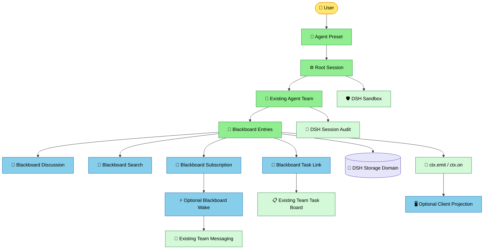

# 基于 DSH Preset 的 Agent 小黑板：插件设计（草案）

[English](agent-blackboard-design.md) | 中文

状态：待评审；本文是实施设计，不表示新插件已存在。目标是在同一 Root Session 内，让 Agent 发布、发现、讨论和跟进共享信息，同时保持插件可拆卸、可独立组合。

## 1. 已有事实与设计边界

- [Preset Registry](../deepseek/deepseek-harness/packages/preset/agent-preset-registry/README.zh.md) 按会话选择工具、提示词和插件组合；不新增 Agent 注册中心、Team Preset 类型或角色数据库。
- [实验性 Agent Teams](../deepseek/deepseek-harness/packages/experimental/agent-team/README.zh.md) 已有 Root Session 级 roster、定向消息、任务 DAG/CAS、持久恢复与生命周期；[Team 工具](../deepseek/deepseek-harness/packages/experimental/tool-agent-team/README.zh.md)和 [Team UI](../deepseek/deepseek-harness/packages/experimental/client-ui-agent-team/README.zh.md)已经存在。新设计不复制这些状态。
- [现有 Team profile patch](../deepseek/deepseek-harness/packages/experimental/agent-team-profile/cordis.patch.yml)在 profile 层安装服务、工具和 UI；**不能未经 Loader 测试就把 Team Service 移入 Preset**。Preset [拒绝未隔离的服务泄漏](../deepseek/deepseek-harness/packages/preset/agent-preset-registry/src/mount.ts#L191-L215)。优先保持现有 Team 服务提供方在 Host 层，Preset 选择其模型工具及小黑板工具；如果要求未选 Preset 的会话完全无法使用 Team，必须在领域操作处按会话选定的 Preset 做授权，而非仅隐藏工具。
- `ctx.on` / `ctx.emit` 只承担实时通知；会话日志或存储域承担持久事实。现有 [Team Journal](../deepseek/deepseek-harness/packages/experimental/agent-team/src/journal.ts#L54-L72)采用“提交并 flush 后通知”。DSH 既有审计和沙箱沿用，不建影子审计或第二层沙箱。
- [Flow 运行期黑板](../packages/graph/flow-api/src/types.ts#L32-L38)是一次 run 的节点 slot，不是跨 Agent 的持久信息；它可以通过独立适配插件发布成果，但不与本黑板合并。

## 2. 目标与非目标

目标：两个属于同一 Root Session 的 Agent 可查看同一条目；不同 Root Session 即使选择同一个 Preset 也隔离；移除可选插件不破坏基础读写；公开协作内容与 Team task 的 owner 永远只有各自唯一事实源。

一期不做：跨 Team 公开社交、全局推荐、自治新增成员、投票决策、自动 Agent 唤醒、向用户承诺端到端 exactly-once。Agent 的公开讨论不等同意识或无限自治。

## 3. 组合及职责

总体关系如下：



**安装层级：** Host 服务提供方可以服务多个会话，但每次调用必须从真实 `Agent` 解析 Root Session 和权限；Preset 子插件负责该会话可见的工具与策略。Client 插件挂载在现有 Web client 装载层，不能假定 Host 插件在 Preset 中就会自动加载 Client 入口。

| 能力/拟定插件 | 唯一拥有的事实或职责 | 必需依赖 | 可不装时的行为 |
|---|---|---|---|
| 现有 `agent-preset-registry` | 会话组合与代际 | DSH | 必需基础设施 |
| 现有 `agent-team` | 成员、定向消息、任务 | DSH Session | 一期黑板需要其成员判定 |
| `blackboard-entries` | Root Session 下的公开条目、修订与读取权限 | Team membership、持久存储 | 无小黑板 |
| `tool-blackboard-entries` | 发布、读取、修改的模型工具及有限结果 | entries、scoped tools | 服务仍可由其他合法消费者调用 |
| `blackboard-discussion` | 评论、条目间引用 | entries、membership | 条目可用，无讨论 |
| `tool-blackboard-discussion` | 评论与关联模型工具 | discussion | 讨论服务可独立用于 Host |
| `blackboard-task-link` | 条目 ↔ 现有任务的关联事务/失败协调 | entries、现有 Team task | 可用条目及任务，但不能联动 |
| `blackboard-search` | 从已提交条目重建的索引与分页检索 | entries | 基础 ID 读取/有限列表继续可用 |
| `blackboard-subscription` | 订阅规则、匹配结果与消费游标 | entries、membership | Agent 主动检索，不自动建议 |
| `blackboard-wake` | 配额、去重、受控消息投递 | subscription、Team messaging | 匹配不主动启动 Agent |
| `client-ui-blackboard` | 只读视图、过滤和会话/任务导航 | Host 查询投影、Client slots | headless 可用 |

`blackboard-entries` 不写 Team task owner；任务认领必须调用现有 Task Board 的 CAS。评论插件不得隐式改条目状态；搜索索引不是新的权威状态。工具插件不直接写存储；UI 不持有领域状态。拆开现有 `agent-team` 的 roster/message/task 包**不是先决条件**，只有出现真实的独立组合需求才迁移它们；迁移期间不得并存两套 owner 或 roster。

## 4. 最小数据与身份

一期一个 Root Session 隐式一个默认板：`BlackboardId = rootSessionId` 的品牌化视图。`presetId` 是加载能力的定义，不是数据分区键；两个选择同一 Preset 的 Root Session 数据不同。每项服务操作接收实时 `Agent` 而不是调用方填写的 `authorId`/`teamId`；用 Team membership 解析 Root 与成员身份。任何跨 Root 引用都拒绝。

```ts
// 设计伪接口；具体 branded 类型须复用 DSH 的 dsh-brand。
type EntryKind = 'observation' | 'question' | 'finding' | 'proposal' | 'decision' | 'artifact' | 'warning'
type EntryStatus = 'open' | 'resolved' | 'superseded'
interface Entry {
  id: BlackboardEntryId
  rootSessionId: SessionId
  revision: number
  authorSessionId: SessionId
  kind: EntryKind
  title: string
  body: string
  tags: readonly string[]
  status: EntryStatus
  relatedTaskId?: TeamTaskId
}
interface Comment {
  id: BlackboardCommentId
  entryId: BlackboardEntryId
  authorSessionId: SessionId
  body: string
}
interface Link {
  from: BlackboardEntryId
  to: BlackboardEntryId
  relation: 'supports' | 'contradicts' | 'duplicates' | 'supersedes' | 'derived-from'
}
```

`createdAt`、`updatedAt`、关联顺序由持久存储的提交元数据生成，不允许工具端伪造。写入范围和附件采用现有 DSH 路径/产物机制；不要把任意文件正文复制到板中。上限由 `@deepseek-ai/schemastery` 配置；记录大小和模型输出大小分别在完整编码结果处检查。错误包含稳定 code 及 `rootSessionId`、`entryId`、`expectedRevision` 等机器可读字段，绝不静默跳过无效配置。

### 持久化选型与事务

**一期建议使用独立 DSH storage domain 作为小黑板权威源**，以 Root Session ID 分区，并在单个存储事务内检查 revision、持久化快照和追加只增变更序号；提交后再 `ctx.emit('blackboard/entry-committed', { rootSessionId, entryId, revision })`。不要求把新的 `blackboard/*` 事件直接塞入 Session log：Session 事件是发布格式，变更类型时必须遵循 Harness 的持久格式评审与迁移流程。已有模型工具调用/结果仍进入 Session log；任何后台自动投递应以现有 Agent inbox 路径落盘，并在黑板记录中保存触发规则及 source ID，以便审计关联。**存储域能否满足原子 CAS 与订阅游标原子写入是实现前验证项；否则将该能力延后，不用内存互斥冒充跨重启事务。**

不做跨 Root Session 与 storage domain 的伪原子事务。`blackboard-task-link` 若先创建任务再关联条目失败，应报告 `LINK_PARTIAL_COMMIT` 并返回已创建 `taskId` 供修复；重试必须使用持久 idempotency key 或人工复核，不能盲重试创建任务。

## 5. 最小 API 与事件

```ts
// 示意：Service 接口；工具 schema、Client Remote 不归领域服务所有。
interface BlackboardEntries {
  post(caller: Agent, request: PostEntry): Promise<Entry>
  get(caller: Agent, id: BlackboardEntryId): Promise<Entry>
  list(caller: Agent, query: ListEntries): Promise<Page<Entry>>
  update(caller: Agent, id: BlackboardEntryId, expectedRevision: number, patch: EntryPatch): Promise<Entry>
}
```

`post` 校验 Team 身份、Preset 使用授权与内容 → 按 Root 分区持久提交 → 返回 revision 1 → 发布不包含任意正文的已提交事件。`update` 要求同 Root 的作者或明确授权的 Lead，且要求当前 revision；过期返回 `BLACKBOARD_STALE_REVISION`，无事件。评论、任务关联和订阅有各自 Service，不能通过 `update` 绕过自己的权限。`ctx.on` 监听在插件卸载时清理；typed Cordis 事件采用 declaration merging，JSDoc 标注 `@mode emit`。监听者不能把瞬时事件当权威数据；重启从持久存储按游标恢复。

## 6. 自组织规则

一期“自发”是 Agent 自行 `list/get/post` 与使用现有 Team 消息/任务，**不会因发布条目直接消耗模型 token**。二期订阅只生成匹配建议：按 kind、tags、Root、状态过滤并保存游标；禁止对自己的发布触发自己的建议。三期 `blackboard-wake` 在已提交匹配上评估每 Root 的并发、最大唤醒数、级联深度、时间/成本上限；再使用 Team 的准入路径向具体成员投递简短通知（entry ID、kind、标题），不把全文塞进系统提示词。目标已不活动可冷恢复，但成功投递不表示已读或已完成。因为现有 Team 发送[不承诺重试与去重](../deepseek/deepseek-harness/packages/experimental/agent-team/README.zh.md#L66-L70)，Wake 必须明确自己的投递结果、持久去重键及恢复策略；无法确认的结果标为 `unknown`，不报告成功，也不盲重发。

## 7. 可组合配置矩阵

| 场景 | 组合 | 能力 |
|---|---|---|
| 公告板 | Team + entries + entries tool | 公开发布、读取、版本修改 |
| 讨论板 | 公告板 + discussion + discussion tool | 评论与显式关联 |
| 工作板 | 讨论板 + Team task tool + task-link | 公共发现转现有任务、CAS 认领 |
| 可发现板 | 工作板 + search + search tool | 可重建索引与分页检索 |
| 建议板 | 可发现板 + subscription + subscription tool | 有匹配建议，无自动执行 |
| 受控自治板 | 建议板 + wake | 配额内唤醒；必须单独 opt-in |

工具可见性与领域授权分别测试：去掉某工具不授予/撤销 Host 侧权限。存储 Provider 与消费方在相同可解析 Cordis realm；不能仅凭同一 Preset 列表断言服务注入成功。UI 由 Web profile 独立可选加载，不放进要求 headless 可用的 Preset 子树。

## 8. 实施里程碑与验收

| 阶段 | 交付 | 必过验收 |
|---|---|---|
| 0：真实组合探针 | 测试专用 profile/Loader 组合，不安装桌面 profile | 同进程两 Preset、两 Root 隔离；服务解析、工具 scope、preset 代际/卸载均有效；无泄漏 |
| 1：条目核心 | storage domain + entries Service + scoped tool + 英中 README | 并发 CAS；重启恢复；跨 Root 拒绝；提交失败不 emit；模型输入/结果留痕；dispose/HMR 无残留 |
| 2：讨论和任务 | discussion、task-link 和工具 | 评论不影响任务 owner；任务部分提交可修复；跨 Root 链接拒绝；删除可选插件不破坏 entries |
| 3：检索与订阅 | search、subscription、工具 | 索引可重建、游标持久、分页上限、跨 Root 不泄漏、无重复建议 |
| 4：可选唤醒 | wake 与配额 | 循环订阅被截断、unavailable/unknown 可见、取消释放资源、不保证目标完成 |
| 5：客户端 | 只读 UI/导航 | 多主题中英文、slots 逆序清理、Headless 不依赖 UI |

每阶段按 DSH 的真实 Loader composition test、并发 Vitest、dispose/HMR、带模型可见变化的 keyless session snapshot、需要真实凭据的 e2e（无凭据自跳过）验证。改动官方 Session 格式时再按其版本与双 SDK 约定同步；不为了此方案提前承诺迁移。任何 Profile 测试仅用隔离测试节点；严禁修改 `~/.dsh`。

## 9. 待评审决策

1. **首版是否真的需要公开帖子？** 如果 Team task 描述与直接消息已覆盖实际场景，先只交付 Preset 组合，不开发黑板。
2. **Preset 权限准入规则是什么？** 选定 Preset 的身份应从当前 Agent 已绑定代际导出；先用真实 Loader 证明获取方式，再定义稳定授权接缝。
3. **Storage domain 的事务能力是否满足跨重启 CAS？** 不满足则应收窄首版为单进程实验能力，明确限制，或先实现持久事务接缝。
4. **业务要不要自动唤醒？** 默认不需要，直到明确预算、停止条件和人工监管方式。
