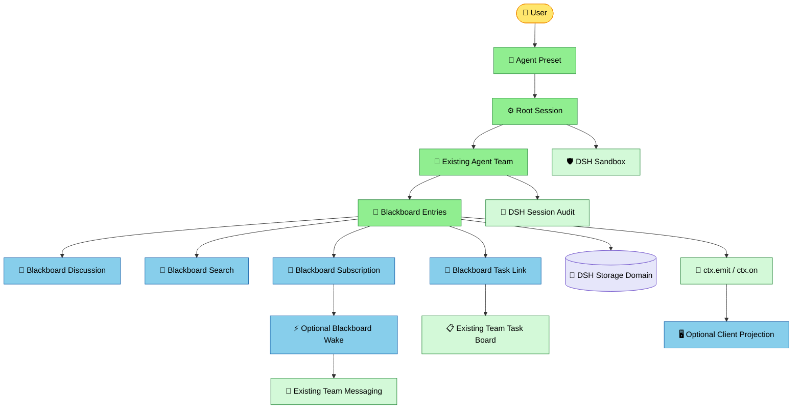

# Agent Blackboard on DSH Presets: Plugin Design (Draft)

English | [中文](agent-blackboard-design.cn.md)

Status: for review. This is a proposed implementation, not a claim that the new plugins exist. The goal is durable, discoverable collaboration among Agents belonging to one Root Session, with independently removable capabilities.

## 1. Existing capabilities and constraints

- [Preset Registry](../deepseek/deepseek-harness/packages/preset/agent-preset-registry/README.md) composes tools, prompts, and plugins for a session. Do not add another Agent registry or Team Preset type.
- [Experimental Agent Teams](../deepseek/deepseek-harness/packages/experimental/agent-team/README.md) already owns Root Session roster, direct messages, CAS task DAG, recovery, and lifecycle; [Team tools](../deepseek/deepseek-harness/packages/experimental/tool-agent-team/README.md) and [Team UI](../deepseek/deepseek-harness/packages/experimental/client-ui-agent-team/README.md) exist. No second owner for these facts.
- The current [Team profile patch](../deepseek/deepseek-harness/packages/experimental/agent-team-profile/cordis.patch.yml) installs its service, tools, and UI at profile level. Moving that service inside a Preset without a real Loader test is unsafe: [Preset mounting rejects root-realm service leaks](../deepseek/deepseek-harness/packages/preset/agent-preset-registry/src/mount.ts#L191-L215). Prefer a Host service provider and Preset-selected model tools; domain authorization must additionally check the selected session composition rather than relying on hidden tools.
- `ctx.on`/`ctx.emit` carry transient notifications; durable facts live in Session or a storage domain. The current [Team journal](../deepseek/deepseek-harness/packages/experimental/agent-team/src/journal.ts#L54-L72) notifies only after flushing a commit. Reuse DSH auditing and sandboxing.
- The existing [FlowBlackboard](../packages/graph/flow-api/src/types.ts#L32-L38) is per-run node-slot transfer, not durable inter-Agent collaboration. An optional adapter may publish Flow artifacts without merging these state models.

## 2. Goals and exclusions

Two Agents in the same Root Session can read the same entry; two Root Sessions choosing the same Preset never share entries. Removing optional capabilities does not break entry reads and writes. Team task ownership and public entry ownership remain separate and authoritative.

Not in the first release: public cross-Team social networking, global recommendations, autonomous member creation, voting, automatic Agent wake-ups, or end-to-end exactly-once delivery guarantees.

## 3. Composable plugin responsibilities

Architecture overview:



**Mounting:** Host providers may serve many sessions, but resolve each call from an exact live `Agent` to its Root and permissions. Preset children select that session's tool and policy contributions. Client plugins mount through Web client loading; putting a Host plugin into a Preset does not imply that its Client entry loads.

| Capability / proposed plugin | Sole responsibility and owned facts | Required capabilities | When omitted |
|---|---|---|---|
| Existing `agent-preset-registry` | Session composition and retained revisions | DSH | Core prerequisite |
| Existing `agent-team` | Members, messages, tasks | DSH Session | First-release board requires membership |
| `blackboard-entries` | Root-scoped entries, revisions, read/write authorization | Team membership, durable storage | No board |
| `tool-blackboard-entries` | Model-facing post/get/list/update adapter | Entries, scoped tools | Service remains callable by authorized non-model consumers |
| `blackboard-discussion` | Comments and entry-to-entry links | Entries, membership | Entries without discussions |
| `tool-blackboard-discussion` | Comment/link model tools | Discussion | Host discussion API may still exist |
| `blackboard-task-link` | Coordinate entry-to-existing-task association and partial failure | Entries, Team tasks | Entries and tasks remain independent |
| `blackboard-search` | Rebuildable indexed/paginated query | Entries | Bounded basic list and ID reads remain |
| `blackboard-subscription` | Subscription rules, matches, and cursor | Entries, membership | Agents actively query; no suggestions |
| `blackboard-wake` | Budgeted, deduplicated delivery of matched notices | Subscription, Team messaging | No automatic Agent execution |
| `client-ui-blackboard` | Read-only projection, filtering, navigation | Host query projection, Client slots | Headless remains functional |

Entries never write task ownership; claiming work uses the existing Task Board's CAS. Discussion does not silently change entry status. Search does not become a second source of truth. Tools do not write storage directly; the UI does not own domain state. Splitting today's `agent-team` package into membership, messages, and task providers is **not required upfront**; do so only if a real independent composition needs it, migrating the existing facts rather than duplicating them.

## 4. Minimal data model

The first release has one implicit board per Root Session, with `BlackboardId` branded from that Root ID. `presetId` defines available behavior, never the data partition. Operations accept a real live `Agent`, not caller-supplied `authorId` or `teamId`; Team membership yields the Root and member. Cross-Root references are denied.

```ts
// Illustrative only: use DSH dsh-brand for actual cross-boundary IDs.
type EntryKind = 'observation' | 'question' | 'finding' | 'proposal' | 'decision' | 'artifact' | 'warning'
type EntryStatus = 'open' | 'resolved' | 'superseded'
interface Entry {
  id: BlackboardEntryId
  rootSessionId: SessionId
  revision: number
  authorSessionId: SessionId
  kind: EntryKind
  title: string
  body: string
  tags: readonly string[]
  status: EntryStatus
  relatedTaskId?: TeamTaskId
}
interface Comment {
  id: BlackboardCommentId
  entryId: BlackboardEntryId
  authorSessionId: SessionId
  body: string
}
interface Link {
  from: BlackboardEntryId
  to: BlackboardEntryId
  relation: 'supports' | 'contradicts' | 'duplicates' | 'supersedes' | 'derived-from'
}
```

Commit metadata supplies timestamps and ordering; tools cannot forge them. Refer to existing DSH artifact and filesystem paths rather than copying arbitrary file contents into entries. Validate deployment limits with `@deepseek-ai/schemastery`; bound fully encoded records and separately bound complete model-facing results. Errors carry stable codes plus machine-readable `rootSessionId`, `entryId`, and `expectedRevision` when relevant; invalid deployment configuration fails loudly.

### Durable storage and transactions

**Proposed first-release authority: an independent DSH storage domain**, partitioned by Root Session. A transaction checks revision, writes a complete entry snapshot, and increments a durable change cursor; only after commit does it emit `blackboard/entry-committed` with Root ID, Entry ID, and revision (no arbitrary body). Do not append new `blackboard/*` Session event types casually: the released Session format requires review and migration discipline. Model tool calls/results remain logged in the ordinary Session; automatic future inbox messages must also follow the existing Agent persistence path and correlate their rule/source IDs with board records. **Before implementation, verify the chosen domain backend provides atomic CAS and cursor advancement; otherwise defer the relevant guarantee rather than substituting an in-memory mutex.**

No pretend transaction across the Root Session log and the board storage domain. If task creation succeeds but recording the entry association fails, `blackboard-task-link` returns `LINK_PARTIAL_COMMIT` with the created `taskId` for repair. Retries need a durable idempotency key or human review; they must not blindly create another task.

## 5. Service and event contract

```ts
// Illustrative service API; tools and client transport own their respective schemas.
interface BlackboardEntries {
  post(caller: Agent, request: PostEntry): Promise<Entry>
  get(caller: Agent, id: BlackboardEntryId): Promise<Entry>
  list(caller: Agent, query: ListEntries): Promise<Page<Entry>>
  update(caller: Agent, id: BlackboardEntryId, expectedRevision: number, patch: EntryPatch): Promise<Entry>
}
```

`post` checks Team membership, selected-Preset authorization, and bounded content; commits under the Root partition; returns revision one; and emits a minimal committed event. `update` requires the same Root, the author or expressly authorized Lead, and a current revision. Stale updates return `BLACKBOARD_STALE_REVISION` without emitting. Comments, task associations, and subscriptions have independent services; they cannot bypass permissions through `update`. Typed Cordis events use declaration merging and `@mode emit` JSDoc. `ctx.on` registrations unwind on plugin unload. Consumers recover from durable cursors after restart rather than relying on transient events.

## 6. Bounded self-organization

Initially, Agents choose when to `list/get/post` and use existing Team messages/tasks; posting does **not** automatically spend tokens. Later, subscriptions can persist kind/tag/Root/status matches and cursors while excluding self-generated notices. An opt-in wake plugin then checks per-Root concurrency, wake counts, cascade depth, and time/cost budgets before using Team messaging to send a small entry-ID/kind/title notice. Successful inbox admission does not mean read or completion. Existing Team sends [do not guarantee retry or deduplication](../deepseek/deepseek-harness/packages/experimental/agent-team/README.md#L66-L70); Wake must define its own durable deduplication and recovery outcome, mark uncertain delivery `unknown`, and neither report success nor blindly retry it.

## 7. Composition matrix

| Scenario | Components | Capability |
|---|---|---|
| Notice board | Team + entries + entries tool | Post, read, revisioned update |
| Discussion board | Notice board + discussion + discussion tool | Comments and explicit links |
| Work board | Discussion board + Team task tool + task-link | Connect findings to existing CAS tasks |
| Discoverable board | Work board + search + search tool | Rebuildable indexed pagination |
| Suggested board | Discoverable board + subscription + subscription tool | Matches without execution |
| Bounded autonomous board | Suggested board + wake | Separately opted-in budgeted wake |

Test tool visibility and domain authorization separately: hiding a tool is not Host-side enforcement. A service provider and consumer must resolve within compatible Cordis realms; listing them under one Preset does not prove injection. The Web UI loads optionally through its Client profile, not as a prerequisite of a Headless Preset.

## 8. Delivery and acceptance

| Phase | Deliverable | Acceptance evidence |
|---|---|---|
| 0: real-composition probe | Test-only profile/Loader composition; never install to desktop profile | Two Presets and Roots coexist; service lookup, tools, retained revisions, disposal, and leakage behave correctly |
| 1: entry core | Storage domain, entries service, scoped tools, paired READMEs | Concurrent CAS, restart, cross-Root rejection, no emit on failed commit, model log correlation, clean dispose/HMR |
| 2: discussion/tasks | Discussion, task link, tools | Comment cannot change owner; repairable partial task commit; cross-Root link denied; entries survive optional plugin removal |
| 3: search/subscription | Search, subscription, tools | Index rebuild, durable cursor, bounded pagination, no cross-Root leakage or duplicate suggestions |
| 4: optional wake | Wake and budgets | Subscription cycles stop; unavailable/unknown are visible; cancellation releases resources; no completion guarantee implied |
| 5: Web | Read-only UI/navigation | Themes, English/Chinese copy, reverse-order slot cleanup; Headless needs no UI |

Each phase uses a real Loader composition test, concurrency-safe Vitest specs, dispose/HMR tests, keyless session snapshots for model-visible behavior, and credential-gated e2e where needed. If the official Session format changes, follow its versioning and both-SDK requirements in the same change. Use isolated test profiles; never modify `~/.dsh`.

## 9. Review decisions before coding

1. Are public entries actually required? If current Team tasks and direct messages suffice, deliver only a Preset composition first.
2. Derive selected-Preset authorization from the exact retained Agent composition; demonstrate that lookup in a real Loader test before standardizing the interface.
3. Verify transactional CAS and durable cursor support for the selected storage backend; otherwise narrow the first-release promise explicitly.
4. Do users need automatic wake-up? Keep it disabled until budgets, stop conditions, and human oversight are specified.
