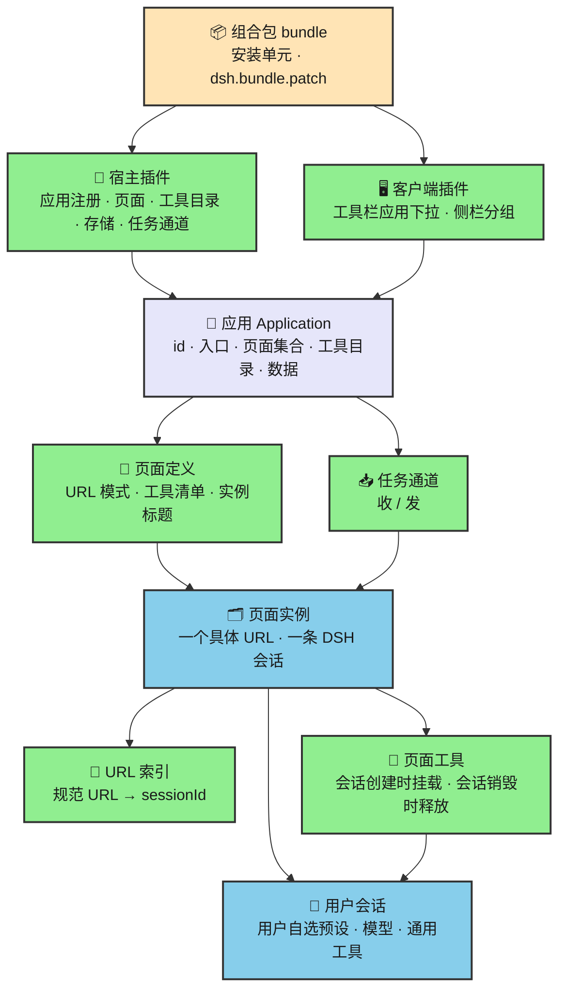
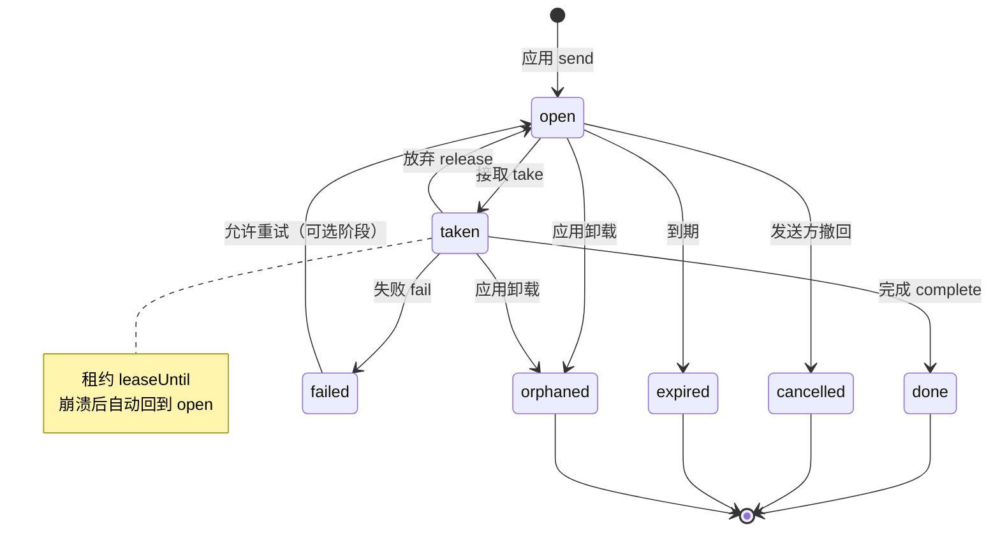
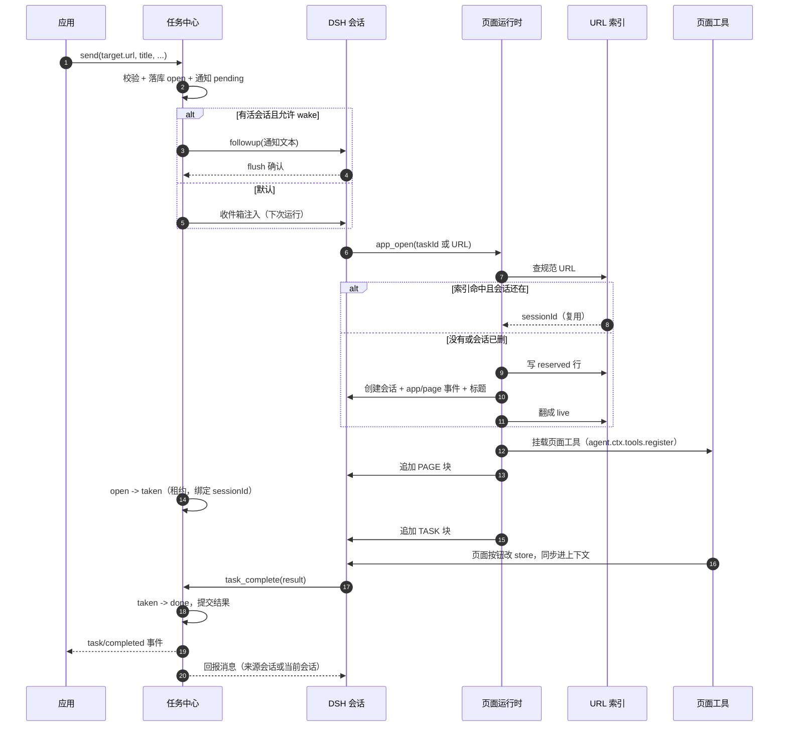

# 应用（Application）：Veren / DSH 插件体系的基础框架设计

[English](application-concept.md) | 中文

**目标读者：** DSH 插件开发者、页面运行时维护者、Agent 产品设计者。

**前置知识：** Cordis 插件与 Service、Agent Preset、DSH Session、`@veren/prompt-page` 的页面模型、DSH 组合包（bundle）与 profile（记录当前装了哪些插件的运行配置）安装。

**状态：** 概念设计草案，已按用户三轮决策修订。本文只做分析与设计，不改代码、不新建包、不动测试。文中的类型和接口都是**示意**，用于说明字段与职责，不是最终实现。

> **本版的三条硬约束（用户已拍板）：**
> 1. **一个会话一个页面，会话内不允许换页。** 要换页面，就创建或复用另一条页面会话。
> 2. **一个 URL 一个页面实例。** `/task/1` 和 `/task/2` 是两条不同的页面会话；完整 URL（含具体路径参数与查询串）是页面实例的主键，也是会话复用的钥匙。
> 3. **输入框工具栏上加应用下拉**，紧邻预设选择器；不做独立的应用启动器或应用首页。
>
> 页面不再与任何预设绑定（上一轮已定）；预设回归用户自选的通用配置。页面工具在会话创建时挂上，会话销毁时释放。被否方案记录在 §9.1。

---

## 0. 先把结论说清楚

今天系统里已经有“页面”，但没有“应用”。页面是全局注册表里的一条记录，谁先注册谁占住 URL；页面又被包装成 Agent Preset，一个页面一个预设。于是“应用”该有的入口、页面集合、归属、任务、通知、卸载清理，全都散落在用它的那个插件里。`page-sync-bench` 把其中一半做成了原型：有任务、有页面、有按钮、有状态同步，但它的任务存在内存里，页面没有归属，导航只是往上下文里写一行文字。

这份设计要加的不是“又一个注册表”，而是四层东西：

1. **应用层**：一个稳定 id、一个入口、一份页面集合、一份工具目录、一条任务通道。应用是用户安装和选择的产品单元，插件只是它的实现单元。
2. **页面实例层**：一个 URL 就是一个页面实例，页面实例与 DSH 会话一一对应；页面工具在这个会话创建时挂上，会话销毁时释放。
3. **任务中心**：宿主级的持久任务队列，应用往里投任务，人在收件箱里看到，Agent 打开任务指定的 URL 对应的会话去完成，完成后回报给发任务的应用。
4. **命名空间与生命周期**：应用 id 进入页面 URL、存储域、任务 kind 和工具名前缀；URL 索引负责“同一个 URL 回到同一条会话”；任务不随应用消失而静默蒸发。

### 0.1 五个验收问题的直接回答

| 问题 | 一句话回答 | 详见 |
| --- | --- | --- |
| 应用由哪些字段定义？装一个应用发生哪几步？ | 应用由 `id`、名称、描述、入口页面、版本/所有者、可选权限与工具前缀定义。安装 = 装 bundle → Loader 激活宿主插件 → 插件向 `ctx.apps` 注册应用 → 注册页面与工具目录 → 登记任务通道 → 打开自己的存储域。**不注册任何预设。** | §2.3、§7.1 |
| 入口页面怎么指定，应用内怎么跳转？ | 应用定义里写入口页面键（如 `entry: 'list'`）；选中应用即打开入口页面的会话。**应用内没有“跳转”这个动作**：每个页面链接对应另一条页面会话，点击就是切换会话，不是在当前会话里换页。 | §3.2、§3.4、§3.8 |
| 一条任务从产生到完成经过哪些环节？通知长什么样？ | 应用 `send` → 任务中心持久化 → 通知投递 → 人/Agent 打开任务 URL → URL 索引找到或创建该 URL 的会话 → 页面工具随会话挂载 → 页面里完成 → `task_complete` 写入结果 → 发 `task/completed` 事件并回报来源会话。通知是一条带任务 id、应用名、标题、页面 URL 和完成指令的短消息。 | §4.4、§5.1–§5.5 |
| 多个应用页面 URL 怎么不冲突？工具重名怎么办？应用之间怎么隔离？ | 页面 URL 统一是 `/apps/<appId>/<应用内路径>`；页面工具在模型面前统一是 `<appToolPrefix>__<本地名>`，重名在构造上消失。隔离是“命名 + 所有权 + 数据域”的隔离，不是安全沙箱。 | §6.1–§6.3、§3.4.3 |
| 卸载或禁用时，页面、工具和在途任务怎么收拾？ | 页面 = 会话：会话归档/删除时工具随 agent 作用域释放；应用卸载/禁用/热重载时，应用 fiber 的清理器摘掉该应用所有页面会话的工具，并标记这些会话“应用不可用”。在途任务不删除，禁用时停投递并在租约到期后回到待办，卸载时标为 `orphaned`。 | §7.2、§7.4、§3.4.4 |

---

## 1. 现状：今天一个页面是怎么活的

### 1.1 三个部件，各管一段

**页面定义**是 `@veren/prompt-page` 里的一个普通对象，字段是 `name`、`url`、`description`、可选的 `preset`、`events`，以及一个 `tree(params, state)` 函数。`definePage` 只做很薄的校验：名字非空、URL 必须以 `/` 开头且不能带查询串、`:param` 不能重复、描述非空。它不关心这个页面属于谁，也不关心同一个系统里还有多少别的页面。

**页面注册表**是宿主级的 `PageRegistryService`（服务名 `pageRegistry`），内部是一个数组。`register` 遇到重复的页面名或重复的 URL 模式会直接抛错；`resolve(url)` 按注册顺序找第一个命中的页面，把路径参数和查询参数合并（同名时路径参数优先）；`catalog()` 返回所有页面的 `{ name, url, description }`。它是一个**部署级单例**：会话子作用域通过 `inject: ['pageRegistry']` 找到的是同一个实例。

**页面会话**由 `mountPage` 创建。它不是 DSH 的 Session，而是一个独立的 `MessageHost`：里面有一条自己的版本链和快照基线，绑定到一个外部 store，页面树在 store 变化时重新渲染，渲染结果以 `SNAPSHOT` / `PATCH` 的形式追加进消息。`mountPage` 还会生成一条“指针消息”（`OPEN /task-detail/t-12 {"taskId":"t-12"}`），约定把它当作新会话的第一条用户消息。所以“一页 = 一个页面会话，页面会话 ≠ DSH 会话”是现状的基本事实——本设计要把这层错位补上：**页面实例就是 DSH 会话本身**。

### 1.2 一次“打开页面”实际发生了什么

以 `page-sync-bench` 为例，完整链路是这样的：

1. `composition` 角色在宿主作用域里创建 `TaskStore`，把三个页面注册进 `pageRegistry`，并为每个页面动态注册一个 Agent Preset（id 是 `page.<name>`，内容是“系统提示词 + 工具行 + 一个 context 行”）。
2. 用户在新会话里选中 `page.task-list` 这个预设，DSH 创建会话；预设里的 `context` 行被激活，它从 `pageRegistry.get('task-list')` 拿到页面定义，`mountPage` 挂出页面会话。
3. 之后每一轮模型请求之前，`agent/pre-step` 把页面会话自上次游标以来的增量渲染成消息，追加进上下文；页面 store 变化时，这条链路自动把变化送进模型。
4. 模型调用页面按钮对应的工具（`take_task`、`complete_task`），工具改 store，store 触发重渲染，再回到第 3 步。
5. 另一个工具 `open_page` 解析 URL、关掉当前页面会话、`mountPage` 新页面。

这条链路能跑，但只覆盖了“单页面、单来源、单活动页面”的场景。第 5 步就是本版要禁止的动作：**会话内换页**。在会话里换页会让工具集、系统提示词、任务上下文都处于“一半旧一半新”的状态，代价远大于收益。

### 1.3 页面没有归属

现状里没有任何字段回答“这个页面属于哪个应用”：

- 页面名和 URL 是全局唯一的，两个插件都想用 `/list` 就会在注册时炸掉；而且是在加载期炸，用户看到的是“插件装不上”，不是“两个应用重名”。
- 页面 URL 直接暴露给所有模型会话：`page_catalog` 工具会把全部页面列出来，没有“只看本应用”的视角。
- 一个页面一个 Preset，三个页面就在预设选择器里多三条；十个页面就是十条。用户看到的是“页面列表”，不是“应用入口”。
- 页面状态（store）在 `page-sync-bench` 里是模块级单例 `pageRuntime.store`；`activeSession` 是 composition 闭包里唯一的一个。这意味着两个 DSH 会话同时“打开页面”会互相覆盖，宿主里根本没有“每个会话各自的当前页面”这个概念。
- `PageDefinition.onLoad` 和 `onComplete` 声明了，但仓库里没有任何地方调用它们。生命周期钩子目前是摆设。

### 1.4 具体疼在哪里

| 现象 | 根因 | 代价 |
| --- | --- | --- |
| 第二个应用装不上，报 URL 重名 | 注册表是全局扁平命名空间 | 应用之间必须先私下约定路径，装得越多越容易撞 |
| 预设选择器被页面淹没 | 页面 = Preset，入口 = 某个页面 | 用户不知道从哪进，应用没有“首页” |
| 点“跳转”没反应 | `PageIO.navigate` 只是 `session.host.note('NAVIGATE …')`，`open_page` 只换页面树 | 页面之间不能真正导航，换页后系统提示词和工具还是旧页面的 |
| 两个会话抢同一个页面 | `activeSession` 是宿主级单例 | 多会话并行时状态串台，页面上下文互相污染 |
| 重启后任务全丢 | 任务在内存 store 里，无持久化 | 不能当工作台用，只能当演示 |
| 任务没有生命周期 | 只有 `open/taken/done`，没有失败、过期、取消、租约 | 失败没人管，崩溃后任务永远卡在“进行中” |
| 人不在会话里就收不到任务 | 只有 cordis 事件和页面内 `append` | 没有收件箱，没有“通知到达”这件事 |
| 卸载后状态不清 | 页面随 fiber 释放，但 store/任务没有归属和清理协议 | 热重载或重装后残留旧状态 |

“疼”的本质不是页面运行时不够强，而是**页面之上缺一层归属**：谁拥有这些页面、这些页面共享哪份状态、从哪个入口进、生命周期跟谁走。

### 1.5 仓库里已经有的、可以复用的部件

这份设计不打算从零造所有东西。以下能力已经存在，应该复用而不是重写：

| 能力 | 现有实现 | 对本设计的价值 |
| --- | --- | --- |
| 持久存储域 | `@veren/notebook`、`@veren/forum` 都用 `storageDomain.open`，JSON 或 SQLite 后端，插件卸载时关闭句柄 | URL 索引、任务中心、应用数据都用同一套持久化 |
| 通知投递纪律 | `plugins/forum/src/session-link.ts` 与 `notifications.ts`：先写持久行，再尝试唤醒，`ctx.sessions.flush` 确认，失败只降级 | 任务通知照抄“写行 → 投递 → 确认”的顺序 |
| 会话目录与恢复 | `ctx.sessions` / `ctx.agents` / `workspaceRegistry` 能按 sessionId 找会话、恢复归档、检查存活 | URL 索引只需要存 sessionId，剩下的交给会话系统 |
| 作用域工具注册 | `ctx.tools.register` 在 `agent.ctx` 上调用时，注册同时具有“对该 agent 可见”和“随该 agent 生命周期释放”两个性质 | 页面工具“随会话挂、随会话走”的机制基础 |
| 会话标题 | DSH 的 `session/title` 事件与重命名接口 | 页面实例标题、会话列表可读性 |
| 安装单元 | 组合包（bundle）声明 `dsh.bundle.patch`，成员插件作为普通依赖随行 | 应用不需要新的发布格式 |
| 插件管理 | DSH 插件管理页：安装、启用、禁用、卸载、版本不兼容提示 | 应用的安装/卸载动作可以映射到已有的 bundle 操作 |
| 输入框工具栏 | `conversation.hero.options`（新会话行，工作区/预设右侧）与 `conversation.session.header.actions`（已有会话头部） | 应用下拉和当前应用标识的落点 |
| 个人级身份 | DSH `identity`、本地 profile | 任务收件人先按“本机这个人”处理 |

有一个现状必须讲清楚：**Web GUI 今天的“页面”不是浏览器 URL。** 面板切换走的是布局 store 的 `selectPanel(panelId)`，侧栏入口是 `sidebar.panellist` 里的一条；仓库里没有把浏览器地址映射到面板或会话的路由。所以本文说的“page URL”首先是 `@veren/prompt-page` 世界里的页面地址（例如 `/apps/review-workbench/review/pr-42`），它能在模型消息、任务、工具之间传递；要让它在浏览器地址栏里可点，是后续阶段另外一件事。

---

## 2. 应用是什么

### 2.1 一句话定义

**应用是一个可安装的产品单元：它有一个稳定 id、一个入口页面、一组页面、一份工具目录、一份自己的数据，以及一条可以接收和发送任务的通道。**

用户装的是应用，打开的是应用，卸载的也是应用。插件负责实现它，组合包负责把实现装进来，但用户不需要知道这两层。

五个概念的分工如下：

| 概念 | 回答什么问题 | 今天的状态 |
| --- | --- | --- |
| 插件 plugin | 一段可加载的代码，向宿主提供能力 | 存在，是唯一的组织单位 |
| 组合包 bundle | 一次安装装好哪些行，声明 `dsh.bundle.patch` | 存在，插件市场的安装单元 |
| 应用 application | 用户看到的产品：入口、页面、工具、任务、数据 | **缺失，本文要补的层** |
| 预设 preset | **用户自选的通用配置**：模型、系统提示词、通用工具行、审批姿态 | 存在；今天被页面滥用成“每页一个”，本版把它还原 |
| 会话 session | 一次实际对话及其日志；在本设计里，一条页面实例就是一条会话 | 存在，由 DSH 管理 |

一句话划清边界：**预设决定“你用什么样的助手”，应用决定“你在做什么产品”，页面实例决定“你正在处理哪一条具体的记录”。**

### 2.2 为什么应用不是插件，也不是组合包，更不是预设

**应用不是插件**，因为一个应用通常不止一段代码：一个宿主插件负责页面注册、工具目录、存储、任务通道，一个客户端插件负责工具栏入口和面板。把这些都叫“一个插件”会让安装、卸载、权限都失去单一对象。反过来，一个插件也可以只提供能力而不构成应用（例如 `page-registry`）。

**应用不是组合包**，因为组合包只是“安装时插哪些行”的清单，它没有运行时身份，也不该被用户看见。用户说“我装了审阅工作台”，说的是应用，不是“我装了三个 npm 包”。

**应用也不是预设。** 预设是用户自己的选择：用哪个模型、用什么说话方式、带哪些通用工具。应用不能注册预设，也不能要求用户“先切到某个预设”才能打开页面。应用提供的是页面、页面工具、任务通道和它自己的数据；这些东西挂在**用户已经选好的会话**上。



### 2.3 应用由哪些字段定义

应用的定义分两处表达，但**每个事实只有一个权威来源**：

- **安装前的展示信息**放在组合包的 `package.json` 里（可选，推荐后续阶段再做）：`dsh.application` 里写 `id`、`name`、`description`、`entry`。它让插件市场在安装前就能显示“这是一个应用、入口是什么”，并在安装前发现 id 冲突。
- **运行时行为**由宿主插件调用 `ctx.apps.register(...)` 声明：同一个 id、入口、应用级说明、页面注册入口、工具目录、任务能力、权限请求。运行时是权威；如果 `package.json` 也写了，两者不一致就 fail loud（`app/manifest-mismatch`）。

字段如下（示意）：

| 字段 | 类型 | 要求 | 说明 |
| --- | --- | --- | --- |
| `id` | 稳定 slug（URL 友好的短标识），如 `review-workbench` | 是 | 进入页面 URL、存储域、任务归属、默认工具前缀；安装后不可改 |
| `name` | 显示名 | 是 | 应用列表、任务通知、工具栏下拉里给人看 |
| `description` | 一句话说明 | 是 | 目录和商店用；和页面描述一样要求非空 |
| `entry` | 应用内页面键，如 `list` | 是 | “一个应用有一个入口页面”的落点；激活时校验存在 |
| `owner` | 提供它的包名 | 自动 | 由注册时的 fiber 推导，不允许手写；卸载和权限校验用 |
| `version` | semver | 自动 | 从组合包版本推导；页面实例和任务里存快照，供升级判断 |
| `permissions` | 能力列表 | 否 | 默认空；页面工具声明的能力必须在这里被授予 |
| `toolPrefix` | 工具名前缀 | 否 | 默认由 id 推导（连字符换下划线）；全宿主唯一，≤32 字符 |
| `instructions` | 应用级说明 | 否 | 打开该应用任意页面时附在 PAGE 块里的短说明；**不是系统提示词**，不改变用户预设 |

示意类型（不是最终代码）：

```ts
/** 应用身份：安装后稳定，进入所有命名空间。 */
interface ApplicationDefinition {
  readonly id: AppId
  readonly name: string
  readonly description: string
  /** 应用内页面键，不是 URL。URL 由宿主拼。 */
  readonly entry: PageKey
  /** 应用级上下文说明，不是系统提示词。 */
  readonly instructions?: string
  /** 页面工具名前缀；默认 appId 把连字符换成下划线。 */
  readonly toolPrefix?: string
  readonly permissions?: readonly AppCapability[]
}
```

`AppId` 用现有约定做成 brand（带类型标签的字符串，零运行时开销）；但它必须满足一个可读的 slug 规则：小写字母开头，只含小写字母、数字和连字符，长度不超过 32，不能占用保留字（`api`、`apps`、`system`、`__global__`）。

### 2.4 一个插件能有几个应用

建议的规则是：**默认一个组合包一个应用；一个应用可以由多个插件实现；第 1 阶段不允许一个组合包注册多个应用。**

理由：

- 安装单元是组合包，用户的心智是“装一个东西得到一个应用”。一个包塞两个应用，卸载、权限、任务归属都会变成“你要卸载哪一个”，但安装器只有一个开关。
- 一个应用需要宿主插件和 UI 插件协作，这是常态，不是“多个应用”。把它们视为同一应用的多个实现插件即可。
- 如果将来真有一个套件要装多个应用（例如“办公套件”），更合适的做法是发布一个**套件组合包**，里面每个应用各自一个子包、各自注册，而不是让一个插件注册多个 id。这样 id 冲突、权限、卸载仍然是一对一的。

应用 id 的唯一性由注册表保证：同一个宿主里重复注册直接抛错；安装前如果 `package.json` 声明了 id，插件管理器可以先查一遍，把冲突挡在安装动作之前。

### 2.5 和应用商店、安装卸载的关系

应用商店（今天的“插件 → 发现”）只认组合包：索引里列出的是有 `dsh.bundle.patch` 的包，安装的是索引里写死的版本。这条链路不需要为应用改。

应用要补的是**展示与语义**：

- 商店卡片上显示“应用”而不是“插件”，显示应用名、简介、图标、入口页面名、请求的能力。
- 安装一个应用 = 安装它所属的组合包。安装完成后应用是否“出现”，取决于宿主插件是否成功注册；注册失败（id 冲突、入口缺失、版本不兼容）应该显示为“安装成功但应用不可用”，并给出稳定错误码，而不是假装装好了。
- **安装和更新都不会往预设选择器里加条目。** 应用不注册预设，用户选什么预设是用户的事。
- 卸载应用 = 卸载组合包。应用自己的数据不跟着包走（见 §7.4），所以卸载不是“删库”。
- 更新应用 = 更新组合包版本。应用 id 不变；页面实例和任务按 §7.3 处理版本变化。

一句话：**应用是组合包的运行时人格，不是新的发布格式。**

---

## 3. 应用与页面

### 3.1 页面归属：注册时绑定 appId

页面注册从“全局注册一条”改成“向某个应用注册一条”：

```ts
// 示意：页面作者仍然写短名和短路径
const pages = ctx.apps.pages('review-workbench')
const dispose = pages.register({
  name: 'review',                       // 应用内唯一即可
  url: '/review/:pr',                   // 应用内路径，不含 /apps 前缀
  description: '审阅一个 PR 的改动',
  // 这一页需要哪些工具；名字来自应用的工具目录，不是全局工具名
  tools: ['read_diff', 'submit_verdict'],
  // 这一页给模型的说明；随页面实例挂载，不写进预设
  instructions: '这是一个审阅页：先读 diff，再给结论；结论必须引用文件和行号。',
  // 一个具体实例在会话列表里的标题；参数决定标题
  instanceTitle: (params) => `审阅 PR #${params.pr}`,
  // 页面契约版本：页面 URL/工具名/说明发生不兼容变化时 +1（见 §7.3）
  pageRevision: 1,
  tree: (params, state) => <ReviewPage pr={params.pr} state={state} />,
})
```

上面只画了其中一页；示例应用的入口页 `inbox` 用同样的方式注册，只是它的 `url` 没有参数。

宿主在注册时完成四件事：

1. 把 `name` 规范成全局唯一的页面键 `appId/pageName`（例如 `review-workbench/review`），注册表内部按这个键去重；
2. 把 `url` 拼成对外 URL 模式 `/apps/<appId>/<url>`；应用内路径只在本应用内比较，不同应用写同一个 `/list` 不会冲突；
3. 记录 `owner`（哪个包、哪个 fiber 注册的）。只有同一个应用能注销这条记录；别的应用或全局代码想删它会得到 `app/forbidden`；
4. 校验 `tools` 引用的本地名都在应用工具目录里，`pageRevision` 是正整数，`instanceTitle` 是函数（可缺省）。

`PageDefinition` 的字段要跟着调整：**删除 `preset` 字段**（页面不再带系统提示词），新增 `tools`、`instructions`、`instanceTitle`、`pageRevision`。`tools` 里写的是应用工具目录里的本地名，不是挂到模型面前的最终名；最终名在挂载时由前缀拼出来（§3.4.3）。`instructions` 是页面给模型的说明，不是系统提示词。迁移期旧页面没有 `pageRevision` 时按 `1` 处理，`instanceTitle` 缺省时用 `description` 兜底。

> **第 1 阶段落地形态（收尾会话 E 补记）：页面注册只有一个入口。**
> 应用作者只调 `ctx.apps.pages(id).register(page)` 一次；app-registry 内部通过页面镜像面自动把同一条页面写进 page-registry 的注册表（`registerAppPage` 是内部原语，应用作者不再调用）。镜像失败（如 URL 模式冲突）会回滚应用侧登记并原样抛错，因此"目录可见却无法被 openUrl 解析"的静默漂移在构造上消失；残留漂移（如镜像面未装配）由 `pageRegistry.auditAppPages(apps)` 审计发现。宿主未装配镜像面时注册只告警，不崩。

### 3.2 入口页面：应用定义里写页面键

入口不是 URL，也不是“第一个注册的页面”，而是应用定义里显式写的 `entry`：

```ts
ctx.apps.register({
  id: 'review-workbench',
  name: '审阅工作台',
  description: '接收审阅任务，逐条给出结论',
  entry: 'inbox',                 // 应用内页面键
  instructions: '审阅工作台负责接收审阅任务，并把结论交回任务中心。',
})
```

激活应用时，注册表检查 `entry` 对应的页面是否存在；不存在就报 `app/entry-missing`，应用标记为 `broken`（第 1 阶段实现取"注册期不抛到宿主启动"的取态：入口页缺失只标 broken 并给出原因，页面注册后自动愈合为 active；`app_list`/`app_pages` 对 broken 应用返回该原因），并在工具栏下拉和应用列表里显示原因。**不允许"自动取第一个页面"当入口**：那会让页面注册顺序变成隐式契约，重排一次注册就换了首页。

入口的对外 URL 是 `/apps/<appId>/<entry 的路径>`；在工具栏选中应用 = 打开这个 URL 对应的页面实例会话（见 §8.2）。

### 3.3 页面集合怎么被发现

发现分两个视角，**不再有一个全局平铺的页面目录**：

- **应用内（模型和页面自己）**：`app_pages` 工具只返回当前应用的页面（页面键、URL 模式、描述、是否入口、这一页挂哪些工具、页面契约版本）。页面自己的说明里写“本应用有这些页面”，模型据此决定去哪个 URL。这替代了今天的 `page_catalog`。
- **应用外（人和宿主）**：人看到的是工具栏里的“应用下拉”和侧栏里的应用分组，不是页面列表；从应用下拉进入入口，从会话列表进入具体页面实例。

这个两级结构是有意的：页面数量随应用增长，如果全局平铺，模型每轮都要读一遍所有应用的内部页面，既费 token 又泄露别的应用的实现细节。代价是跨应用跳转不再是一步，需要先选应用；这正是产品上想要的边界。

`catalog()` 今天返回的是 URL **模式**（带 `:param`），不是具体 URL。应用目录要同时提供两者：模式用于展示，`format(entry, params)` 用于生成可打开的地址。任务里存的是规范 URL，见 §4.2。

`app_list`、`app_pages`、`app_open`、`task_list` 是宿主级工具，在所有会话里都可见。这是有意的“引导带”：模型要先能发现应用、打开页面、看任务，才有机会用上页面工具。它们数量少、schema 稳定，不随页面变化，因此对前缀缓存友好。页面自己的工具不在这个全局集合里，见下一节。

### 3.4 页面实例 = 会话：一个会话只属于一个页面

这是本版的核心。结论：

- **页面实例与 DSH 会话一一对应。** 一个会话从创建到归档/删除，只属于一个页面 URL；
- **会话内不允许换页。** 没有“在同一个会话里打开另一个页面”的路径，也没有“替换当前页面”“返回旧页面”；
- 页面工具在会话创建（或恢复）时挂载一次，之后直到会话销毁都不变；
- 页面说明作为会话开头的 `PAGE` 块写入日志，之后不再重写；
- 打开另一个页面 = 创建或复用**另一条会话**，然后由 GUI 切换选中会话。

页面里的跳转按钮也一样：它调用 `app_open(目标 URL)`，页面运行时找到/创建目标会话，GUI 切过去；当前会话的页面、工具、历史都不变。

#### 3.4.1 一对一带来的简化

上一版为了“会话内换页”设计了：换页时先摘旧工具、追加 `PAGE closed`、维护 generation、对账残留、回滚旧页。现在这些全部不需要了：

| 上一版的机制 | 现在还需要吗 | 为什么 |
| --- | --- | --- |
| 换页时摘旧工具/挂新工具 | 不需要 | 会话里没有第二页 |
| `PAGE closed` | 不需要 | 页面结束 = 会话归档/删除，不需要页内标记 |
| 每页 generation 校验 | 不需要 | 工具集在会话生命周期内不变 |
| 换页失败的回滚 | 不需要 | 创建会话失败就是没创建，不存在“旧页已摘”的中间态 |
| 差量挂载 | 不需要 | 同上 |
| 页面工具与页面会话的订阅交接 | 不需要 | 二者同生共死 |

仍然需要保留的只有三条兜底：**会话销毁、应用卸载/禁用、应用热重载**。原因见 §3.4.4。

#### 3.4.2 页面工具在会话创建时挂载

页面工具的定义在应用级目录，页面只列本地名：

```ts
// 应用激活时注册工具目录（示意）
const tools = ctx.apps.tools('review-workbench')
tools.define({
  name: 'read_diff',
  description: '读取当前 PR 的 diff',
  parameters: { pr: { type: 'string', required: true } },
  requires: ['files:read'],
  execute: async (args, exec) => readDiff(args.pr, exec),
})
```

当一条页面会话的 agent 被创建或恢复时，页面运行时在创建/恢复流程里按会话绑定的页面，把这些工具注册到 `agent.ctx` 上：

- 工具最终名是 `<toolPrefix>__<本地名>`，例如 `review_workbench__read_diff`；
- 注册只对这个会话的 agent 可见；
- 注册的生命周期跟着 agent 作用域：会话销毁时自动释放；
- 页面工具集在会话生命周期内**不变**，所以系统提示词里的工具 schema 只在会话开始/恢复时确定一次，之后没有换页导致的缓存失效。

页面说明同时作为一条 `PAGE` 用户消息追加到会话开头：

```text
PAGE review-workbench/review {"pr":"42"}
本页工具：review_workbench__read_diff、review_workbench__submit_verdict
说明：这是一个审阅页：先读 diff，再给结论；结论必须引用文件和行号。
```

如果应用定义了 `instructions`，先放应用段，再放页面段。`PAGE` 块是页面实例的“开场白”，之后不再重写；它满足“模型可见即可从日志重建”。

#### 3.4.3 工具重名：应用前缀，不做后挂覆盖

两个应用都定义 `complete_task`，不会冲突，因为模型看到的名字是：

```text
task_workbench__complete_task
review_workbench__complete_task
```

规则：

- **应用内唯一**：工具目录按本地名去重，重复定义在注册时抛错（`app/tool-duplicate`）。
- **跨应用命名空间**：最终名 = `<toolPrefix>__<本地名>`。前缀在应用注册时分配，全宿主唯一；重复前缀直接拒绝安装（`app/tool-prefix-conflict`）。
- **前缀格式**：小写字母开头，只含小写字母、数字、下划线，≤32 字符；本地名 ≤24 字符；最终名 ≤64 字符（工具名的通用上限）。
- **不覆盖、不静默**：如果最终名和会话里已有的**非本页**工具撞了（例如某个插件恰好也叫这个名字），会话创建在任何状态改变之前失败（`page/tool-conflict`），提示改前缀。页面工具永远不会覆盖用户预设里的工具。
- **和宿主工具的关系**：`task_complete`、`app_open` 这类宿主工具是全局的；页面工具因为带前缀，不会和它们同名。模型不会混淆，因为 PAGE 块会列出本页工具的完整名字。

为什么选“加前缀”而不是“本地名 + 冲突则拒绝”：

- 本地名会让同一个页面在不同预设下表现不一致：预设里恰好有个同名工具，页面就打不开；没有就打得开。这违反“页面行为与预设无关”。
- 后挂覆盖是权限漏洞：页面可以替换 `read_file` 或 `task_complete`，用户看不出来。
- 加前缀是唯一能同时满足“任意预设可用”“多应用共存”“不覆盖”的方案。代价是名字变长；用较短的 `toolPrefix` 和 PAGE 块里的完整清单来控制。

#### 3.4.4 摘除与兜底：现在只剩三条路径

| 路径 | 触发 | 工具怎么释放 |
| --- | --- | --- |
| 会话销毁 | 会话被删除，或承载它的 agent 被销毁 | 工具注册在 `agent.ctx` 上，随 agent 作用域自动释放 |
| 应用卸载/禁用 | 应用 fiber 销毁 | 应用 fiber 上的清理器遍历该应用所有活着的页面会话，逐个摘掉工具；会话本身保留为“应用不可用” |
| 应用热重载 | 开发时宿主插件重新加载 | 旧 fiber 的清理器先摘旧工具；新 fiber 激活时，对活着的页面会话重新挂载当前版本的工具（§3.4.5） |

为什么只剩这三条：页面与会话同生共死，没有“页面还在、会话还在、但页面换了”的状态；会话销毁是正常出口，应用生命周期变化是外部出口，热重载是开发期出口。

**兜底顺序：**

1. 正常路径：会话销毁由 agent 作用域释放工具；
2. 应用生命周期：清理器在应用 fiber 销毁时主动摘工具，不依赖 agent 是否还活着；
3. 热重载：新 fiber 激活时对活会话做一次“重挂”，先确认旧注册已释放，再挂新版本；
4. 崩溃：进程死了，agent 作用域和工具一起消失；进程没死但页面运行时抛错，会话保留、工具仍归 agent 作用域，下一次打开会话时按当前版本重新挂载或标记为 stale（§7.3）。

**“如果摘不掉会发生什么？”** 现在没有“摘一半”的状态：工具注册是成组挂在 agent 作用域上的，agent 销毁就是整组释放；应用清理器摘的是“这个应用的所有页面会话”，按 sessionId 逐个执行，单个失败只影响那个会话，并记录 `page/binding-release-failed` 供对账。残留工具只可能出现在“进程活着、应用清理器没跑完”的窗口；下一次打开该会话时，页面运行时会先对账再挂载。

#### 3.4.5 恢复、热重载与崩溃

- **会话恢复**：从会话日志里读 `app/page` 事件（§3.5），确认应用/页面/页面契约版本仍可用；可用就挂当前版本的页面工具和 PAGE 说明（日志里已有的 PAGE 块不重复追加），不可用就进入 stale 流程（§7.3）。
- **热重载**：应用插件重新加载时，旧 fiber 的清理器摘掉活会话里的旧工具；新 fiber 激活后，按会话绑定的页面重新挂载。挂载是同一组名字、同一组 schema；不追加新的 PAGE 块，也不改变会话的页面绑定。
- **崩溃**：进程级崩溃随进程消失；会话级异常（store 订阅、渲染抛错）由页面运行时捕获，记录 `page/crashed`，会话保留，但页面面板显示错误和“重新加载”动作。重新加载 = 重新挂载当前版本，不是换页。
- **归档**：归档会话时 agent 被销毁，工具释放；索引保留（§3.5），再次打开 URL 时恢复归档会话并重新挂载。

#### 3.4.6 被否掉的方案：会话内换页

**用户已决策放弃“会话内换页 / 替换当前页面”。** 当时支持它的理由是“少建会话、上下文连续”，但代价是：

- 一个会话里出现两套页面工具和两段页面说明，模型容易串台；
- 换页时工具集、系统提示词、任务块不是同一个提交，容易出现“页面是新的、工具是旧的”；
- 任务绑定、页面状态、会话标题都会在换页时失去唯一归属；
- 为了实现“干净地换页”，需要 generation、回滚、对账、PAGE closed 等一整套机制，复杂度高且收益不确定。

现在改成“换页 = 换会话”：上下文连续性的代价由会话列表和任务中心承担，换来的是每条会话语义单一、可索引、可恢复。

### 3.5 URL 是页面实例的主键：持久索引

#### 3.5.1 规范 URL

页面实例的键是**规范 URL**，不是页面模式，也不是 sessionId。规范规则：

1. 路径规范化：补前导 `/`、去尾 `/`（根除外）、百分号编码统一（解码后按 RFC 3986 重新编码）；
2. 查询串参与身份：`/task/1?tab=diff` 和 `/task/1` 是不同实例；
3. 查询参数按 key 排序（同 key 多值按 value 排序），去掉空查询串；
4. 不做 host/scheme 规范化：这是系统内路径，不是外链；
5. 不接受片段（`#...`）；片段不是页面身份的一部分。

规范 URL 是任务、索引、通知、工具参数共用的那一份；页面作者看到的 `params` 由同一个解析器产生。

#### 3.5.2 索引表

索引是宿主级持久存储域 `app-pages` 的一张表 `instances`：

| 字段 | 说明 |
| --- | --- |
| `url` | 规范 URL，主键 |
| `sessionId` | 页面实例对应的 DSH 会话；唯一 |
| `appId` / `page` | 便于按应用分组、卸载清理 |
| `params` | 解析出来的参数快照 |
| `appVersion` | 创建时的应用版本 |
| `pageRevision` | 创建时的页面契约版本 |
| `title` | 页面实例标题（§3.6） |
| `state` | `reserved` / `live` / `orphaned` / `stale` |
| `createdAt` / `lastOpenedAt` | 时间 |
| `supersededBy` | stale 时指向新会话（§7.3） |

唯一约束：`url` 唯一、`sessionId` 唯一。一个会话不能同时属于两个 URL。

#### 3.5.3 打开一个 URL 的协议

1. **解析与校验**：规范 URL、应用已安装且启用、页面存在、工具与能力可用。
2. **查索引**：
   - 行存在、`state = live`、`sessionId` 对应的会话还在 → 直接复用（归档的就恢复），返回 `created: false`；
   - 行存在但会话已被删除 → 删除该行，走创建；
   - 行存在但 `state = stale` → 进入 §7.3 的升级流程，不静默复用；
   - 行不存在 → 创建。
3. **创建（两阶段）**：
   - 先 mint 一个 sessionId，写入 `state = reserved` 的索引行；
   - 创建 DSH 会话，写入 `app/page` 事件和标题；
   - 把索引行翻成 `live`。
   任何一步失败都删除 reserved 行；会话创建失败不会留下“幽灵索引”。
4. **挂载**：页面工具和 PAGE 块随会话创建/恢复挂载一次（§3.4.2）。
5. **返回**：`{ sessionId, created, title }`，GUI 切换到这条会话。

为什么先写索引再建会话：崩溃时最坏留下的是 `reserved` 行（可清理），不会出现“会话已经能打开、索引却不知道它”的重复实例。启动时扫描 `reserved` 且超过一定时间的行，确认没有对应会话后删除。

#### 3.5.4 重启、删除与重建

- **重启**：索引是持久的，同一个 URL 直接找回原会话；归档会话会被恢复，删除会话会让行失效。
- **删除**：会话被删除后，打开 URL 时发现 `ctx.sessions.get` 找不到，删行并重建；`orphaned` 行保留来源信息，便于解释“这条页面属于哪个应用”。
- **reserved 启动清扫（已实现）**：启动时对 `reserved` 行做一次存活探测（会话不在即删，`KvPageInstanceIndex.sweepReserved`）；没有会话探测能力时不动任何行——确认不了就不删，不假装做了。
- **索引丢失/损坏**：会话日志里的 `app/page` 事件是事实来源。启动时如果索引域为空或版本不兼容，触发一次重建：扫描会话目录中带 `app/page` 事件的会话，按事件里的规范 URL 重建行，选择最新的非 stale 会话；重建完成前，打开 URL 会等待或返回 `page/index-rebuilding`，避免重复建会话。**第 1 阶段未实现**：页面运行时的会话端口没有"枚举会话/读会话日志"的面，做不了真实重建；已归入第 2 阶段，待宿主暴露会话枚举后补。
- **重建的成本**：需要遍历会话目录一次，代价随会话数增长；这是低频故障路径，可以接受。日常打开只走索引。

#### 3.5.5 和 forum `SessionLink` 的对照

| 维度 | forum `SessionLink` | 页面 URL 索引 |
| --- | --- | --- |
| 键 | 预设 id → 活会话 | 规范 URL → 会话 |
| 持久性 | 内存，进程结束即丢 | 持久化，重启仍在 |
| 冲突策略 | 后出现的会话覆盖前一个 | 一个 URL 只允许一个 live 会话 |
| 用途 | 把通知投递给“正在为这个预设工作的会话” | 把页面 URL 映射到“这个页面实例的会话” |
| 失败处理 | 没有活会话就留在收件箱 | 会话没了就删行重建 |

可以借用的是 forum 的**投递纪律**：先写持久行，再执行副作用，失败只降级并记录，不假装成功；`ctx.sessions.flush` 确认消息真的进了会话。不能借用的是它的“预设键”和“内存映射”——页面身份必须是 URL，且必须跨重启存在。

#### 3.5.6 走一遍：/task/1、/task/2 与重启

假设 `review-workbench` 的页面是 `/task/:id`：

1. 打开 `/apps/review-workbench/task/1`：索引没有这一行 → 写 reserved → 创建会话 A → 写 `app/page`、标题「任务 #1」→ 翻 live → 挂 `review_workbench__*` 工具和 PAGE 块。
2. 处理完，打开 `/apps/review-workbench/task/2`：规范 URL 不同 → 索引没有 → 创建会话 B；会话 A 原样保留，工具和页面都不动。
3. 重启 DSH，再打开 `/apps/review-workbench/task/1`：索引命中会话 A → 直接恢复 A，按当前应用版本重新挂工具（`pageRevision` 未变）；不会再建一条。
4. 如果在第 3 步之前删除了会话 A：索引行的 sessionId 找不到会话 → 删行 → 按第 1 步重建会话 C。旧的「任务 #1」历史没了（因为用户删了会话），但 URL 仍然能打开一个新实例。
5. 如果应用升级且 `pageRevision` 从 1 变成 2：第 3 步不会直接恢复 A，而是提示「查看旧会话 / 用新版本打开」，选后者才创建新会话并更新索引（§7.3）。

### 3.6 会话标题与分组

一个页面实例一条会话，列表会迅速变长；没有标题和分组，工作台不可用。

#### 3.6.1 实例标题

页面定义提供 `instanceTitle(params)`：

- 有参数：`/task/:id` → `任务 #1`；
- 无参数：用 `page.description` 或应用名 + 页面名；
- 上限 60 字符，超出截断；
- 创建会话时写进 `session/title`（或创建后立即重命名），同时写入索引的 `title`；
- 用户之后重命名，以用户的重命名为准；应用升级不覆盖旧会话标题。

任务打开的页面实例，标题优先用任务标题（例如“审阅 PR #42”），没有任务标题才用 `instanceTitle`；这样任务列表和会话列表对得上。

#### 3.6.2 会话列表分组

侧栏保持“工作区”为第一级；应用会话在第二级按应用折叠：

```text
cursour
  ├─ 审阅工作台        （应用分组，可折叠）
  │    ├─ 任务 #1
  │    └─ 任务 #2
  ├─ 任务工作台
  │    └─ 任务 #7
  └─ 普通会话
       └─ …
```

- 页面会话带一个 `app` 投影（appId、name、icon、page、url），侧栏据此分组；
- 应用分组默认展开最近使用的 1–2 个，其余折叠；分组头显示应用名和实例数；
- 提供按应用筛选（侧栏搜索或筛选 chip），以及“归档此应用的全部页面会话”动作；
- 普通会话不强行归入应用；没有 `app` 投影的会话留在“普通会话”。

**十个页面、五个应用会不会把列表撑爆？** 不会自动撑爆：只有实际打开过的 URL 才建会话，页面定义本身不是会话。一个应用十个页面，只有用户点过的那些实例出现；再加上实例标题、应用折叠、按应用归档，列表仍然可用。真正需要控制的是“同一个 URL 被反复打开”——URL 索引保证它复用同一条会话，不会每次新建。

#### 3.6.3 会话与页面的投影

会话日志里追加一条 `app/page` 事件（declaration merging，append-only）：

```ts
interface AppPageEvent {
  readonly appId: AppId
  readonly page: PageKey
  readonly url: string            // 规范 URL
  readonly params: Readonly<Record<string, string>>
  readonly appVersion: string
  readonly pageRevision: number
  readonly title: string
  readonly supersededBy?: SessionId
}
```

这条事件是索引重建的事实来源，也是会话列表分组的依据。它满足 DSH 的“模型可见即可从日志重建”规则：PAGE 块和同步消息本来就在日志里，`app/page` 补上“这条会话属于哪个页面实例”。

### 3.7 应用与 workspace 的关系

工具栏上的三个选择器各回答一个问题：

| 选择器 | 回答 | 来源 |
| --- | --- | --- |
| 工作区 workspace | 代码在哪 | 用户选择或当前会话 |
| 预设 preset | 怎么工作（模型、人设、通用工具） | 用户选择或当前会话 |
| 应用 app | 在哪个产品里工作 | 应用注册表 |

**推荐：应用跟随当前 workspace，不声明“默认 workspace”。**

理由：

- workspace 是“这段代码在哪”的环境选择；同一个应用应该能用于任何仓库。应用如果硬编码默认 workspace，换个项目就用不了，用户也会被莫名其妙带到别的目录。
- 页面会话的工作目录应该由用户当次的选择决定，而不是由应用替用户决定；应用需要的是“当前仓库”，不是“某个固定仓库”。
- 任务从某个会话打开时，继承那个会话的 workspace；从工具栏打开时，继承当前选择；没有选择时允许无 workspace 的页面会话（有些应用不需要文件）。

如果同一个 URL 已经在另一个 workspace 下有会话，按“URL 一个会话”的规则复用它，并把 GUI 的 workspace 切到那条会话的 workspace；不会为同一个 URL 再建一条不同 workspace 的会话。这一点要在 UI 上明示（切换后工作区选择器显示的是原会话的 workspace），避免用户以为进错了目录。

应用如果要“只读某个固定目录”，那是页面工具自己的能力/配置，不是应用身份的一部分；不要把它放进 `ApplicationDefinition`。

### 3.8 工具栏应用下拉：应用的唯一入口

用户拍板的入口形态是：**在输入框工具栏、预设选择器右侧，加一个应用下拉。** 不做独立的应用启动器，也不做应用首页。

三个选择器并排，各回答一个问题（§3.7）：**工作区 = 代码在哪；预设 = 怎么工作；应用 = 在哪个产品里工作。**

落点：

- **新会话行**：`conversation.hero.options`（工作区、预设右侧的紧凑选项区），下拉项 id `application`；
- **已有页面会话**：`conversation.session.header.actions` 显示当前应用（图标 + 名称），点击打开同一个下拉；
- 下拉数据来自应用注册表（Remote），显示图标、名称、入口页面；最近使用的在前，超过 8 个可搜索。

交互规则：

| 当前状态 | 选择应用后发生什么 |
| --- | --- |
| 空白新会话（无消息、无草稿） | 解析入口 URL → 查索引：有会话就切过去；没有就**把当前空白会话收养为页面会话**，用当前 workspace/预设创建，写标题、挂工具，避免多出一条空会话 |
| 空白新会话（有草稿） | 不动草稿；按入口 URL 新建/复用页面会话，当前空白会话保留 |
| 普通会话 | 打开/复用入口页面会话，当前会话不动 |
| 页面会话，选的是同一个应用 | 跳到该应用的入口页面会话；如果当前就是入口会话，则无操作（复用） |
| 页面会话，选的是另一个应用 | 打开/复用另一个应用的入口页面会话，当前会话不动 |
| 页面会话，选“无应用” | 不提供：会话不能从页面变回普通会话；要普通会话就新建一条 |

三个必须讲清楚的点：

1. **应用下拉是“入口启动器”，不是“会话模式开关”。** 它只决定“打开哪条页面会话”，不会修改当前会话的页面、工具或标题。
2. **重复选择复用，不新建。** 同一个入口 URL 由 URL 索引保证只有一条 live 会话；再选一次就是聚焦它。
3. **页面实例之间的跳转不靠这个下拉。** 下拉只到应用入口；具体页面实例（`/task/1`）通过任务通知、页面里的链接、会话列表进入。给每个页面做一个下拉项会把下拉变成页面目录，正是要避免的。

为什么不做独立应用启动器/首页：应用入口已经出现在“用户本来就要用的地方”（新会话工具栏）；再做一个启动页，等于让用户先离开会话、再进来，多一步且多一套入口状态。任务收件箱是任务中心的面板，不是应用启动器，两者不要混。

客户端实现上，这是一个客户端插件：用 `ctx.slots.inject('conversation.hero.options', ...)` 注册下拉，用 `conversation.session.header.actions` 注册当前应用标识；组件只拿注入的普通数据和回调，不碰 `ctx`。

---

## 4. 应用与任务中心

### 4.1 任务中心是什么，不是什么

任务中心是**宿主级的持久工作队列 + 个人收件箱**：谁都可以往里投任务，投递对象是“这个人”，任务指定“打开哪个应用的哪个页面 URL 去做”，做完把结果写回去。

它刻意**不是**下面这些东西：

| 已有概念 | 作用域 | 为什么不是任务中心 |
| --- | --- | --- |
| `todo_write` | 单个会话内的计划清单 | 它是 Agent 的草稿纸，会随会话结束而失去意义，不跨应用、不投递、不指派 |
| 后台 jobs | 进程级任务执行与输出 | 它管“跑一个命令/工作流”，不管“这个人要处理什么事” |
| `schedule` | 时间触发的提醒 | 它管“什么时候提醒”，任务中心管“提醒之后要做什么”；两者可以组合，但不合并 |
| forum 通知 | 帖子/评论的提及与回复 | 它是社交消息，任务是可认领、可完成、有结果的工作项 |

任务中心本身**不做成一个应用**。它是宿主基础设施，必须在“一个应用都没装”的时候也存在；如果它是应用，卸载它就把收件箱一起卸载了。它的界面（收件箱面板、角标）是宿主面板，通过 Remote 命名空间读任务中心服务。

### 4.2 任务的数据形状

任务分两张表：**任务记录**（工作项本身）和**通知记录**（这次任务怎么送达）。分开的原因见 §4.5。

任务记录（示意）：

| 字段 | 说明 |
| --- | --- |
| `id` | `TaskId`，全局唯一，brand |
| `appId` | 谁发的；只有注册且启用的应用能发 |
| `kind` | 应用自定义类型，如 `review-request` |
| `title` | 必填，已 trim，长度上限（例如 200） |
| `body` | 可选说明；进入上下文时有字节上限 |
| `target` | `{ url, appId, page, params }`；`url` 是规范 URL，页面实例的主键 |
| `appVersion` / `pageRevision` | 发送时快照；用于升级判断（§7.3） |
| `assignee` | 收件人；第 1 阶段固定 `local`（本机这个人） |
| `status` | 见 §4.4 |
| `revision` | 乐观并发版本；每次迁移 +1 |
| `createdAt` / `updatedAt` | ISO 时间 |
| `dueAt` / `expiresAt` | 可选；过期只对“待办”生效 |
| `claimedBy` | `{ sessionId?, actor, leaseUntil }`；接取者和租约 |
| `result` | 完成时写入 `{ summary, artifacts? }`；有界 |
| `failure` | 失败时写入 `{ code, message }`；稳定 code |
| `origin` | 可选 `{ sessionId }`；如果任务是某个会话让应用代发的，回报给它 |
| `idempotencyKey` | 可选；应用重试发送时去重 |
| `schemaVersion` | 持久化格式版本；读者向前兼容 |

通知记录（示意）：

| 字段 | 说明 |
| --- | --- |
| `id` | `NoticeId` |
| `taskId` | 指向任务 |
| `recipient` | 收件人（第 1 阶段 `local`） |
| `mode` | `inbox` 或 `wake` |
| `state` | `pending` / `delivered` / `read` |
| `attempts` | 投递尝试次数 |
| `lastAt` / `lastError` | 最近一次尝试 |

为什么目标存 `url` 又存 `{ appId, page, params }`：**URL 现在是页面实例的主键**，所以它必须原样保存；解析字段用于校验、分组和升级判断，不替代 URL。通知文本里的 URL 和任务目标里的 URL 是同一份规范 URL。

应用发任务时应使用**稳定的规范 URL**：查询串参与页面实例身份（§3.5.1），把一个临时视图参数（例如 `?tab=diff`）放进任务目标，会让它变成另一个页面实例。页面内部的临时视图切换应该走页面自己的状态，不要改 URL。

### 4.3 谁发、发给谁、怎么打开

**发送方**必须是注册且启用的应用，并且声明了 `tasks:send`（默认给本应用页面）。发送动作走 `ctx.taskCenter.send`，由任务中心校验：

- 应用已注册、已启用；
- `target.url` 能解析、`target.appId` 是自己（默认）或自己声明了 `tasks:target:other`；
- 页面存在、工具与能力可用；
- 标题/正文/参数在限额内；
- `idempotencyKey` 没重复。

**接收方**是“这个人”，不是某个会话，更不是某个预设。第 1 阶段 DSH 是单用户部署，`assignee` 固定为 `local`；多用户是后续阶段的事。任务中心不假设收件人一定在线：先落库，再尝试投递。投递目标的选择顺序是：

1. 如果这个人有一个**活着的会话**（任意预设），把通知作为用户消息交给它（`wake`，需要用户授权）；
2. 否则写进持久收件箱，等下一次有人开始会话时注入（`inbox`，默认）。

**打开任务 = 打开 URL 对应的页面会话。** 任务中心调用页面运行时的 `openUrl(target.url, { taskId })`：索引命中就返回已有会话，没有就创建；然后 GUI 切换到那条会话。它**不会**修改当前会话，也**不会**在当前会话里换页。任务本身不要求会话是某个预设；页面工具随目标会话挂载。

### 4.4 生命周期

状态机（示意）：



| 状态 | 含义 | 谁可以进入 | 允许的下一步 |
| --- | --- | --- | --- |
| `open` | 待办，已落库，通知可能还没送达 | 应用发送、放弃退回、失败重试、租约过期回收 | `taken`、`cancelled`、`expired` |
| `taken` | 进行中，某个页面会话接取了 | 接收方接取 | `done`、`failed`、`open` |
| `done` | 完成，带结果 | 接取者提交 | 终态 |
| `failed` | 失败，带错误码 | 接取者或应用 | 终态；可配置回 `open` 重试 |
| `expired` | 过期，未在期限内接取 | 系统时钟 | 终态 |
| `cancelled` | 发送方撤回 | 发送方 | 终态 |
| `orphaned` | 所属应用已卸载，任务保留但不可执行 | 卸载流程 | 人工关闭或导出 |

几条硬规则：

- **任务与页面实例是一对一。** 一条任务只指向一个规范 URL；打开任务就是打开那条页面会话。同一个 URL 的多条任务共享同一条页面会话，因此同一会话同一时刻只允许一个未结束任务（`task/another-active`）。
- **只有 `open` 会自然过期。** 已经接取的工作不应该在半夜悄悄过期；如果接取者失联，用租约回收回 `open`。
- **接取是 CAS（比较并交换，用版本号防并发）。** 接取时比较 `revision`，并写入 `claimedBy.leaseUntil`（租约：接取者在这段时间内独占任务，例如 30 分钟）。同一接取者重复接取是幂等的；另一个接取者会得到 `task/already-taken`。页面会话每次调任务工具时续租；宿主启动时扫描过期租约，把 `taken` 收回 `open`（`task/lease-expired`）。
- **完成是幂等的（重复调用结果相同）。** 已经 `done` 再完成，返回当前结果并标记 `alreadyCompleted`，不报错。
- **每次迁移都在一个串行写链里完成**，先提交状态，再发事件。事件监听者失败不能回滚任务状态。
- **目标页面必须在接取时和打开时各校验一次**。更新/卸载后可能没了，打开时失败要给出 `task/target-gone`，并把任务留在 `open`。

### 4.5 任务状态与通知投递是两条轴

这两件事经常被混在一起，混在一起就会丢信息：

- 一条任务可能已经完成，但通知从未送达（人是从 Web 收件箱直接打开的）；
- 一条通知可能已读，但任务还在待办；
- 一条任务过期了，通知再送达也没有意义；
- 投递失败不等于任务失败，只说明“这次没叫醒”。

所以任务记录里只有 `status`，通知记录里只有 `state`，两者互不推导。投递前检查任务状态：已经 `done` / `cancelled` / `expired` 的通知直接标 `read` 或丢弃。任务完成时不强制把所有通知标已读。

这套模型直接来自 forum：`deliverNotification` 先写行、再尝试唤醒、唤醒失败就把行保持在 `pending`，并明确告诉调用方“这是降级，不是成功”。任务中心照抄这个契约。

### 4.6 与 todo / jobs / schedule / forum 的分工

- **todo** 留在页面会话里，是 Agent 处理这一条任务的内部步骤。
- **jobs** 是任务执行的一种手段：一个任务可以启动一个后台 job，job 的输出作为 `result.artifacts` 引用回任务。
- **schedule** 可以创建任务（例如“每天 9 点给我一条审阅任务”），但投递仍走任务中心。
- **forum** 的通知是社交消息；如果论坛想让某人“处理一个帖子”，正确做法是发一条任务，`target` 指向论坛应用的页面 URL。

---

## 5. 通知到闭环

### 5.1 通知长什么样

通知有两个读者，两种呈现，但来自同一条记录。

**给模型的文本**（进入会话的用户消息，或收件箱注入）：

```text
[task-center] 新任务 task-7c1a · 审阅工作台
标题：审阅 PR #42 的错误处理
来源：review-workbench
页面：/apps/review-workbench/review/pr-42
参数：{"pr":"42"}
要求：调用 app_open 打开该 URL；完成后调用 task_complete，失败调用 task_fail。
期限：2026-10-21T12:00:00+08:00
```

这段文本遵守 DSH 的模型面写作规则：只出现任务相关概念，不写“点击卡片”“侧栏”这种 UI 词汇；工具名是模型能调用的真实工具；URL 是完整可解析的地址。它**没有**“请先切换到某个预设”这种要求，因为不需要。

**给人的卡片**（Web 收件箱）字段是：应用图标与名称、任务标题、状态徽标、期限、来源、一句摘要，以及“打开”按钮。人不需要看到工具名和 `revision`。

通知文本有长度上限（例如 2 KB）；任务正文超出时截断并给任务 id。正文的完整内容放在应用存储里，通过页面读取。

### 5.2 三个投递面

| 投递面 | 谁看 | 机制 | 何时用 |
| --- | --- | --- | --- |
| 活会话唤醒 `wake` | 正在运行任意预设的 Agent | `agent.followup` 写一条真正的用户消息，`ctx.sessions.flush` 确认 | 用户明确允许自动唤醒，且确实有活会话 |
| 持久收件箱 `inbox` | 下一次运行的 Agent | 写通知行；会话启动时注入，或下一次 pre-step 带上 | 默认；没有活会话时唯一正确选择 |
| Web 收件箱 / 角标 | 人 | 任务中心 Remote 命名空间 + 面板；读任务列表 | 人主动查看；不依赖会话 |

第 1 阶段只做 `inbox`。`wake` 会花 token、会在用户没看着的时候改动会话，必须由用户显式开启，默认关闭。

第 1 阶段没有独立 Web 收件箱；投递钩子已实现为**页面运行时的投递泵**：页面会话创建或恢复时，向任务中心取"发给这个人、还没投递"的通知（`pendingDeliveries`），逐条作为用户消息注入，并回报投递结果（`markDelivered`，成功翻 `delivered`、失败保持 `pending` 并记原因）。投递泵失败只降级，不阻塞页面打开；`wake` 与独立收件箱面板是第 2 阶段的事。

### 5.3 从通知到页面：完整时序



关键点：

- `app_open` 可能返回**另一条会话**的 id；GUI 切换到它，当前会话不变；
- 索引命中时不创建会话，也不重复挂工具；
- 索引未命中时创建会话、写 `app/page`、翻 live，再挂工具和 PAGE 块；
- **先接取、再写 TASK 块**：接取失败（已被别人拿走）时只打开页面，不写任务上下文，避免会话里出现一条不属于它的任务；
- 工具只挂一次，任务完成后不摘（会话继续存在）；要结束就归档/删除会话。

### 5.4 任务上下文怎么带进页面

任务上下文有两条通道：

1. **页面参数**：`target.params` 里的业务参数（例如 `pr=42`）进入页面 URL 和 `PageDefinition.tree` 的 `params`。
2. **TASK 块**：创建/打开任务会话时追加一条用户消息，包含 `taskId`、标题、期限、完成/失败工具名。

TASK 块只在任务成功接取并绑定到会话时追加一次；同一 URL 的后续任务在旧任务结束后再追加新的 TASK 块，不重复挂工具、不改页面绑定。

不要让页面只靠 URL 里的 `?task=` 判断任务：URL 是页面实例的主键，不是任务 id 的容器；权威绑定在任务记录的 `claimedBy.sessionId` 和 `target.url` 上。

### 5.5 完成与失败怎么回报

完成的入口只有一个：`task_complete`（或任务中心服务的 `complete`）。页面工具、模型工具、Web 按钮都调它。

完成的调用者必须就是接取者：任务中心校验 `claimedBy.sessionId` 与调用会话一致，否则返回 `task/not-claimant`。第 2 阶段的 Web 按钮如果要跨会话完成，必须走用户显式动作（`actor: 'user'`），不能由模型代劳。

完成后任务中心做四件事，顺序固定：

1. 校验状态和 `revision`，写入 `result`，状态改 `done`，提交；
2. 发 `task/completed` 事件，载荷含 `{ taskId, appId, result, sessionId }`；只有发任务的应用能收到自己任务的完成事件；
3. 回报来源：如果任务有 `origin.sessionId`，向该会话追加一条短消息；否则不主动打扰；
4. 更新通知状态（已读或已处理），让 Web 收件箱和角标同步。

失败同理，走 `task_fail`，写 `failure.code` / `failure.message`。失败不是异常抛出的副产品：应用要显式决定“这次任务失败了”，否则任务会一直 `taken` 到租约过期。

结果里只放摘要和引用，不放大块内容。

### 5.6 异常与降级

| 情况 | 行为 | 稳定错误码 |
| --- | --- | --- |
| 没有活会话 | 留在收件箱，不标已送达 | —（正常降级） |
| 唤醒后 flush 没确认 | 保持 `pending`，记录原因 | `notice/unconfirmed` |
| 应用被禁用 | 停止新投递；已有任务仍可见；打开被拒 | `app/disabled` |
| 应用未安装 | 打开/完成被拒；任务保留 | `app/not-installed` |
| 应用已卸载 | 任务标 `orphaned`；打开/完成被拒 | `task/orphaned` |
| 目标页面不存在 | 任务留在 `open`，提示应用需要更新 | `task/target-gone` |
| 任务已过期 | 打开被拒，收件箱显示已过期 | `task/expired` |
| 任务已被别人接取 | 打开被拒，显示接取者 | `task/already-taken` |
| 完成者不是接取者 | 拒绝，提示回到接取会话或走用户动作 | `task/not-claimant` |
| 同一会话已有未结束任务 | 拒绝，提示先完成或释放旧任务 | `task/another-active` |
| 页面工具和已有工具重名 | 在创建会话之前失败，不留下半条会话 | `page/tool-conflict` |
| 页面引用了不存在的工具 | 注册期 fail loud，页面标 broken | `page/unknown-tool` |
| 页面工具能力未授权 | 在创建会话之前拒绝 | `app/permission-denied` |
| 索引写入失败 | 不创建会话（或删除 reserved 行），返回错误 | `page/index-unavailable` |
| 索引重建中 | 打开请求等待或稍后重试 | `page/index-rebuilding` |
| 会话创建失败 | 删除 reserved 行，返回错误 | `page/session-create-failed` |
| 应用升级导致页面契约不兼容 | 不静默复用旧会话；提示重建（§7.3） | `app/page-stale` |
| 任务目标的应用已升级 | 提示查看旧会话或用新版本打开；任务保持 `open` | `task/app-upgraded` |
| 会话绑定释放失败 | 记录并重试；会话标“需对账” | `page/binding-release-failed` |
| 完成者会话与接取记录不一致（工具层校验） | 拒绝改写 taken 任务 | `task/not-claimant` |
| 任务处于不允许迁移的状态 | 拒绝并说明当前状态 | `task/invalid-state` |
| 任务中心存储域打开失败 | 所有写操作拒绝，降级为不可用而非假成功 | `task-center/storage-unavailable` |
| URL 规范化失败（畸形输入/片段） | fail loud，不产生实例 | `page/url-invalid` |
| 索引冲突（URL 已有行 / sessionId 已被占用） | 拒绝写行 | `page/index-conflict` |
| 宿主能力缺失（sessions/agents/tools 注册表） | openUrl/注入失败并给出明确码，不假成功 | `page/host-unavailable` |

> **冻结常量是权威。** 实现里各包的冻结错误码常量表（`app-registry` 的 `AppErrorCode`、`task-center` 的 `TaskErrorCode`、`prompt-page` 的 `PageErrorCode`）比本表更全——例如 `task/not-found`、`task/lease-expired`、`task/draft-invalid`、`task/send-forbidden`、`app/manifest-invalid`、`app/tool-duplicate`、`app/tool-prefix-conflict`、`app/entry-missing`、`app/forbidden`。以常量表为准，本表只列 §5.6 场景相关的核心码；新增码先改常量表再回填本表。

这些错误码要出现在工具结果、Web 卡片和日志里，不能只写一句“失败了”。模型的下一步动作应该能从 code 直接推出来：`task/expired` 就放弃，`app/disabled` 就告诉用户去启用，`task/target-gone` 就建议更新应用，`app/page-stale` 就提示重建会话。

### 5.7 这次简化省掉了哪些失败模式

页面与会话一对一、会话内不换页之后，上一版依赖“换页”和“预设切换”的失败模式全部消失：

| 上一版的失败模式 | 为什么现在没有了 |
| --- | --- |
| 目标应用没有注册预设 / 预设注册失败 | 应用不注册预设，安装步骤里没有这一步 |
| 会话不是目标应用的预设，不能打开页面 | 任意会话都能打开任意页面；页面会话创建时用用户当前预设 |
| 打开任务要先切预设，任务上下文断在切换处 | 打开任务 = 打开/创建 URL 对应的会话，没有预设切换 |
| 预设切换导致系统提示词/工具集变化，页面行为不一致 | 页面工具由页面会话挂载，与预设无关 |
| 预设选择器被应用/页面条目淹没 | 应用和页面都不进预设选择器 |
| 一个页面一个预设导致“换页 = 新建会话” | 现在换页本来就是新建/复用会话，语义统一 |
| 会话内换页导致旧工具残留、PAGE 块混杂 | 没有换页，工具集在会话内不变 |
| 换页失败要回滚旧页 | 创建会话失败就没有会话，不存在半挂载 |
| 换页导致任务上下文、页面状态串台 | 一条任务只对应一条页面会话 |
| 每次换页一次工具 schema 缓存失效 | 工具集只在会话开始/恢复时确定一次 |
| 旧页面工具在新页面里“惰性残留” | 没有换页，没有 generation 对账 |

仍然存在的失败模式是页面实例/任务自身的：URL 没索引、会话被删、任务过期、工具前缀撞了、应用卸载、应用升级导致页面契约不兼容。它们都有稳定 code，见 §5.6。

---

## 6. URL、命名空间、隔离、权限

### 6.1 URL 方案对比

| 方案 | 例子 | 冲突 | 可读性 | 迁移成本 | 结论 |
| --- | --- | --- | --- | --- | --- |
| 全局扁平 | `/task-list` | 装第二个应用就撞 | 好 | 低 | 现状，不可扩展 |
| 应用前缀 | `/apps/review-workbench/review/pr-42` | 由构造保证不撞 | 好 | 中 | **推荐** |
| 包名前缀 | `/@veren/review-workbench/review` | 不撞 | 差，暴露实现 | 中 | 不选 |
| 协议式 | `app://review-workbench/review` | 不撞 | 一般 | 高，多一个解析器 | 暂不选 |
| 哈希路由 | `#/review-workbench/review` | 不撞 | 一般 | 高 | 不选 |

选择应用前缀的理由：

- **冲突在构造上消失**：应用内路径只需应用内唯一，两个应用都可以有 `/list`、`/detail`；
- **一个解析器服务三种调用者**：模型工具、任务通知、工具栏下拉都用同一个 `resolve`；
- **可读、可复制**：人在消息里看到 `/apps/review-workbench/review/pr-42` 就知道是哪个应用；
- **可迁移**：以后加版本段或换域名，只需要改 `format`/`resolve`，页面作者和任务数据不动。

保留前缀：`/api`、`/apps` 本身、`/system` 不分配给应用；应用 id 也不允许叫 `api`、`apps`、`system`、`__global__`。应用内路径不能以 `/apps` 开头。

### 6.2 命名空间清单

| 资源 | 规则 | 例子 |
| --- | --- | --- |
| 应用 id | 小写 slug，全局唯一，安装后不变 | `review-workbench` |
| 页面键 | `appId/pageName`，应用内唯一 | `review-workbench/review` |
| 页面 URL | `/apps/<appId>/<应用内路径>` | `/apps/review-workbench/review/pr-42` |
| 规范 URL | 页面 URL + 查询串，作为页面实例主键 | `/apps/review-workbench/review/pr-42?tab=diff` |
| 工具前缀 | 全宿主唯一，≤32 字符，默认 id 连字符换下划线 | `review_workbench` |
| 页面工具名 | `<toolPrefix>__<本地名>`，≤64 字符 | `review_workbench__read_diff` |
| 存储域（应用） | `app.<appId>`，应用独占 | `app.review-workbench` |
| 存储域（索引） | `app-pages`，宿主独占 | — |
| 存储域（任务） | `task-center`，宿主独占 | — |
| 任务 kind | `<appId>/<kind>` | `review-workbench/review-request` |
| 任务事件 | `task/completed`、`task/failed`，载荷带 appId | — |
| 应用领域事件 | `app/<appId>/<event>`，避免跨应用误听 | `app/review-workbench/changed` |
| 会话投影 | `app`：appId、name、icon、page、url | — |
| 能力名 | `<域>:<动作>` | `tasks:send`、`files:read` |

工具前缀为什么也要唯一：最终工具名是前缀 + 本地名，前缀重复会让两个应用的同名工具在模型面前重新撞上。前缀在应用注册时分配；应用卸载后，tombstone 期间仍然保留，避免新应用复用旧前缀、让旧会话记录产生歧义。

### 6.3 隔离的真实边界

必须诚实地说：**这里的隔离是命名与所有权隔离，不是安全沙箱。**

Cordis 插件运行在同一个宿主进程里，拿到 `ctx` 就能碰所有服务。一个恶意的应用插件可以绕过注册表直接读别人的存储、直接调 `ctx.sessions`。本设计能保证的是：

- **不会误撞**：命名空间让两个正常应用不会互相覆盖；
- **不会误删**：每个注册动作返回 disposer，只有注册者能注销；卸载只清理自己的东西；
- **不会误投**：任务只投给收件人，不会广播给所有会话；
- **不会误挂**：页面工具只用本应用前缀，创建会话前检查重名，不覆盖用户预设的工具；
- **可审计**：应用 id 出现在 URL、任务、事件、日志和工具名里，出问题能定位到应用。

不能保证的是“恶意代码拿不到别的数据”。真正的安全边界需要 worker/子进程/权限沙箱，成本高，且会改变页面运行时“共享 store、同进程同步”的基本模型，不在本阶段。

### 6.4 权限：声明、授予、执行点

| 能力 | 允许什么 | 默认 | 执行点 |
| --- | --- | --- | --- |
| `pages:register` | 向自己的应用注册页面 | 隐式拥有 | 应用注册表，校验 fiber 归属 |
| `tools:mount` | 把页面工具挂进页面会话 | 隐式拥有（限本应用目录） | 页面运行时，校验工具目录与能力 |
| `tasks:send` | 向自己的页面发任务 | 授予 | 任务中心 `send` |
| `tasks:target:other` | 向别的应用的页面发任务 | 拒绝 | 任务中心 `send`，后续阶段开放 |
| `tasks:receive` | 作为任务目标应用 | 隐式（有页面即可） | 任务中心校验 `target.appId` |
| `storage` | 打开自己的存储域 | 授予 | 存储服务校验域名前缀 |
| `notifications:wake` | 唤醒活会话 | 拒绝 | 通知投递 |
| `sessions:create` | 从任务打开新会话 | 拒绝 | 后续阶段，由 Web 动作触发 |

页面工具的授权链是三层：

1. **安装时**：应用声明 `permissions`（例如 `files:read`），用户确认后写进 profile 的应用记录；
2. **挂载时**：每个工具定义声明 `requires`，页面运行时逐项检查是否在应用授权里；缺一个就拒绝创建页面会话（`app/permission-denied`）；
3. **调用时**：工具处理器只能拿到应用自己的存储句柄和当前会话，不能拿别的应用的数据。

用户的知情方式：安装确认框列出应用请求的能力；页面会话开头的 PAGE 块列出本页挂载的工具名；Web 页面面板（后续阶段）显示“本页已挂载 N 个工具”的详情。用户归档/删除会话即撤销这一页的工具，不需要改预设。

**预设边界**：预设的 `tools.restrict` 不会摘掉页面工具（§3.4.2 的注册发生在 agent 自己的层里）。这意味着“用一个受限预设打开一个有更多能力的页面”会绕过预设的工具限制。第 1 阶段用 PAGE 块明示 + 安装授权来控制；是否要让预设限制页面能力，见 §9.2。

### 6.5 应用与 workspace

见 §3.7：应用跟随当前 workspace，不声明默认 workspace；任务从会话继承 workspace；同一个 URL 跨 workspace 复用它已有的会话。

---

## 7. 生命周期

### 7.1 安装一个应用，系统里发生哪几步

1. **安装组合包**：`dsh plugin add`（或插件市场）把包写进 profile，pnpm 装上依赖，`dsh.bundle.patch` 被记录。
2. **Loader 激活行**：组合包的 patch 插入宿主插件和 UI 插件的行；Cordis 按服务依赖激活它们。此时还没有“应用”这个概念，只有插件。
3. **注册应用**：宿主插件在 `apply` 里调用 `ctx.apps.register({ id, name, description, entry, instructions, permissions, toolPrefix })`。注册表校验 id 唯一、slug 合法、入口存在、工具前缀唯一、版本兼容；失败则应用标 `broken` 并给出原因。
4. **注册页面与工具目录**：`ctx.apps.tools(id).define(...)` 定义应用工具；`ctx.apps.pages(id).register(...)` 逐页注册，URL 自动加前缀，页面键自动带应用前缀，工具引用校验存在；同时登记“关闭本应用所有页面会话的页面工具”的清理器（必须早于任何页面打开）。所有 disposer 挂到当前 fiber。
5. **登记任务通道**：声明能收/发哪些 kind，订阅 `task/completed` 等事件；订阅同样走 `ctx.effect`。
6. **打开存储域（惰性）**：第一次读写时 `storageDomain.open('app.<id>')`；失败降级为“应用只读/不可用”，不拖垮宿主。
7. **挂 UI（可选）**：客户端插件把应用注册进工具栏的应用下拉，并在侧栏提供应用分组。

**没有“注册预设”这一步。** 第 3 到第 5 步必须**全部成功才算应用可用**；任何一步失败，fiber 销毁会逆序释放已经完成的部分，注册表把应用标为 `broken`。第 6 步的存储失败不阻止应用出现，只把它降级为“只读/不可用”。

页面 URL 索引是宿主级服务，随宿主启动打开 `app-pages` 域；它不依赖任何应用。

### 7.2 启用与禁用

- 禁用 = 关闭组合包对应的 Loader 行。fiber 销毁，页面、工具目录、工具栏入口、任务订阅、存储句柄按注册的逆序释放；注册表把应用标为 `disabled`，但保留记录。
- **页面工具立即摘掉**：应用 fiber 上的清理器遍历该应用所有活着的页面会话，逐个释放工具注册；会话本身保留，页面面板显示“应用已禁用”。
- **新任务停止投递**：`send` 以 `app/disabled` 拒绝；收件箱里的通知保留，但不再尝试唤醒。
- **在途任务不删除**：`taken` 的任务在租约到期后回到 `open`；页面会话还在，但工具已摘，重新启用后重新挂载。
- **URL 索引不动**：重新启用后同一个 URL 仍然找回同一条会话，重新挂载页面工具。
- **数据不动**：存储域关闭但文件保留；禁用不是删除。

### 7.3 应用更新之后，已存在的页面会话怎么办

这是本版必须回答的新问题。核心冲突：会话是历史记录，页面代码是当前版本；升级后不能让旧会话“悄悄变成新页面”，也不能让旧会话永远打不开。

先定义**页面契约版本** `pageRevision`：页面 URL 模式、参数含义、工具名/语义、页面说明发生不兼容变化时，作者必须 +1。应用版本 `appVersion` 是组合包版本，变化不一定意味着页面契约变化。

| 方案 | 做法 | 优点 | 缺点 |
| --- | --- | --- | --- |
| 固定旧版本 | 旧会话继续用旧版代码 | 历史完全一致 | 要同时保留多份应用代码，安装/加载复杂，不现实 |
| 自动迁移 | 把旧会话直接挂上新版工具，继续用 | 用户无感 | 旧消息里的工具名/语义可能已经不存在，模型会调用死工具 |
| **标记 stale + 提示重建** | 旧会话保留为只读历史；同 URL 新建会话，索引指向新会话 | 不串版本、可回看、实现简单 | 用户需要多点一次；旧会话不能继续工作 |

**推荐：标记 stale + 提示重建，按 `pageRevision` 判断是否需要。**

打开 URL 时的判断：

1. 索引行的 `appVersion` / `pageRevision` 与当前应用一致 → 正常复用，重新挂载当前工具（版本相同，等价）。
2. `appVersion` 变了但 `pageRevision` 相同 → 视为兼容：复用会话，重新挂载当前工具；在会话里追加一条 `PAGE updated` 提示（“应用已更新，页面契约未变”），不重建。
3. `pageRevision` 变了 → 会话标 `stale`：
   - 旧会话仍然可以打开为**只读历史**：能看到完整对话和页面快照，但页面工具不挂载、页面树不重新渲染（避免用新代码解释旧数据）；
   - 打开 URL 时弹出选择：「查看旧会话」/「用新版本打开」；
   - 选“用新版本” → 创建新会话，写新的 `app/page`（`supersededBy` 指回旧会话），索引行更新为新 sessionId；旧会话保留，标 `stale`，不删除；
   - 任务如果指向该 URL：打开时提示“应用已升级”，任务保持 `open`，用户在新会话里完成后回报；如果任务正文已经过时，可以取消或让应用重发（`task/app-upgraded`）。

为什么旧会话不自动迁移：旧会话的 PAGE 块、工具调用记录、任务块都是旧契约；把新工具挂上去，模型会看到“旧说明 + 新工具”，比只读更危险。只读历史是诚实的状态。

为什么新会话复用同一个 URL：用户的心智是“这个任务页”，不是“这个任务的第 2 条会话”；索引保证同一个 URL 只指向一条 live 会话，旧会话是历史旁支。

### 7.4 卸载

| 东西 | 谁负责 | 卸载时怎么做 |
| --- | --- | --- |
| 页面注册 | 应用的页面注册器 | fiber 销毁自动注销；注册表校验归属，不会误删别的应用 |
| 工具目录 | 应用宿主插件 | 注销定义；活会话里的页面工具由清理器摘掉 |
| 工具栏入口 | UI 插件 | 从应用下拉移除 |
| 任务通道 | 应用宿主插件 | 退订事件，停止收新任务 |
| 页面会话 | 会话系统 + 页面运行时 | 会话保留，标“应用已卸载”；页面工具摘掉；页面面板显示不可用 |
| URL 索引 | 页面运行时 | 行标 `orphaned`，保留 URL→sessionId 以便解释来源；重新安装后可恢复 |
| 在途任务 | 任务中心 | 标 `orphaned`，停止投递，保留记录 |
| 收件箱通知 | 任务中心 | 保留为“应用已卸载”，不再唤醒 |
| 应用存储域 | 应用宿主插件 + 存储服务 | 关闭句柄，文件默认保留；提供显式的“同时删除数据”选项 |
| 包文件 | pnpm/profile + 插件管理器 | 删除依赖和 patch 行 |
| 注册表记录 | 应用注册表 | 删除活动记录，留下 tombstone（id、版本、工具前缀、卸载时间） |

两个原则：

1. **卸载不删用户数据，除非用户明确选择。** 任务、页面会话、笔记都是用户的记录。
2. **卸载不静默成功。** 如果还有 `open`/`taken` 的任务或活页面会话，卸载确认框要显示数量，并说清楚它们会变成“无法执行/不可用，但保留”。

### 7.5 崩溃与重启

- **应用注册表不持久化**：每次启动从活跃 Loader 行重建，profile 是“装了什么”的唯一真相。
- **任务持久化**：启动时扫描：到期的 `open` 标 `expired`；`taken` 且租约过期的回 `open`；`orphaned` 保持；`pending` 通知重试。
- **URL 索引持久化**：重启后同一个 URL 仍指向原会话；归档会话恢复，删除会话删行重建；`reserved` 残留行清理。
- **页面工具不持久化**：工具注册在 agent 作用域里，进程重启即消失；打开会话时按当前应用版本重新挂载（或按 §7.3 标 stale）。
- **重复投递**：通知的 `attempts` 递增，收件方按 `taskId` 去重；任务完成幂等。

### 7.6 谁负责清理

**注册者负责自己的 disposer，页面运行时负责页面工具的成组释放，agent 作用域负责兜底，任务中心负责任务记录，URL 索引负责页面实例映射，注册表负责应用记录，插件管理器负责包文件。** 所有清理都是逆序释放，不依赖调用顺序的巧合。

---

## 8. 分阶段落地

### 8.1 第 1 阶段：最小闭环（模型侧 + 会话模型）

目标：证明“应用 → 页面 URL → 页面会话 → 动态工具 → 任务 → 完成 → 回报”这条链在真实宿主里成立。

范围：

- `ctx.apps` 应用注册表：id、名称、描述、入口、应用说明、工具前缀、权限声明；激活时校验入口和工具前缀。
- 页面注册改为应用作用域，URL 加 `/apps/<id>` 前缀；删除页面级的 `preset` 字段；新增 `tools`、`instructions`、`instanceTitle`、`pageRevision`。
- 应用工具目录：`ctx.apps.tools(id).define(...)`，工具名应用内唯一，带 `requires`。
- **页面运行时 + URL 索引**：一个 URL 一个页面实例、一条会话；两阶段创建（reserved → live）；工具随会话创建挂载、随会话销毁释放；会话内不换页；索引持久化、重启可找回、失效可重建。
- 会话标题：`instanceTitle` 写入 `session/title` 与索引。
- `ctx.taskCenter`：`send / list / get / take / release / complete / fail / cancel`，两张表，租约，幂等，懒过期；只用 `inbox` 投递；任务目标存规范 URL。
- 宿主引导工具：`app_list`、`app_pages`、`app_open`、`task_list`、`task_get`、`task_take`、`task_complete`、`task_fail`、`task_cancel`；页面工具不在其中。
- 一个示例应用：把 `page-sync-bench` 的三个任务页面收编成一个 `task-workbench` 应用，作为参考实现和验收载体；`page-sync-bench` 保留为基准。

验收场景（必须全部走通）：

1. 装示例应用 → 应用可被发现（`app_list`）、入口 URL 可解析；预设选择器里**没有**新增条目；
2. 打开 `/task/1` → 创建会话 A、挂页面工具、写索引；再打开 `/task/2` → 创建会话 B；A 的工具和页面不变；
3. 关闭应用再重开，打开 `/task/1` → 回到会话 A，不再新建；
4. 删除会话 A 后打开 `/task/1` → 索引失效、重建会话 C，页面工具正常；
5. 同一页面的两个应用同名工具 → 以不同前缀共存，不互相覆盖；
6. 应用发任务 → 活会话收到通知 → `app_open` 打开 URL 对应会话 → `task_complete` → 应用收到 `task/completed`；
7. 任务过期后打开 → `task/expired`；应用禁用后打开 → `app/disabled`；
8. 卸载应用 → 工具摘掉、会话保留、任务变 `orphaned`；重装后页面会话可恢复工具。

明确不做：工具栏应用下拉的完整交互（第 2 阶段）、侧栏应用分组（第 2 阶段）、应用启动器/应用首页、跨应用任务、权限强制、多用户、任务附件。

> **第 1 阶段完成状态（收尾会话 E 记录）。** 上列范围与八个验收场景已全部实现并验收通过，
> 逐条结论、四个对接缺口（任务通知投递、应用禁用/卸载语义执行者、页面注册单入口、工具释放）
> 的修复情况与遗留风险见 [phase1-acceptance.cn.md](phase1-acceptance.cn.md)。与正文的两处实现
> 取态差异已在 §3.2（入口缺失标 broken 不抛宿主启动）与 §3.1（页面注册单入口镜像）就地更新；
> 另两处如实标注：索引重建扫描因第 1 阶段会话端口没有"枚举会话/读 app/page 事件"的面而
> **未实现，归入第 2 阶段**（§3.5.4）；`reserved` 残留行的启动清扫已实现（`sweepReserved`，
> 需要会话存活探测，确认不了就不删）。

### 8.2 第 2 阶段：GUI 入口与可读性

- **工具栏应用下拉**：完整交互按 §3.8 实现；第 2 阶段把它接进新会话行和会话头部，并接上 URL 索引。
- **侧栏应用分组**：按 workspace → app 折叠，显示实例标题，支持按应用筛选、按应用归档。
- **Web 收件箱**：任务列表、详情、打开、忽略；打开 = 切到任务 URL 的会话。
- **页面工具指示**：页面面板显示“本页已挂载 N 个工具”，可展开看名字和来源。
- **升级 UX**：`pageRevision` 变化时提示“查看旧会话 / 用新版本打开”，旧会话只读。
- **权限确认**与**卸载数据选项**。

### 8.3 第 3 阶段：长出来的能力

- 浏览器地址栏深链（`/apps/<id>/<page>` 直接打开/切换会话）；
- 应用间 intent（`launch` 另一个应用的页面，带参数），带用户确认；
- 任务附件、交付物引用、任务模板、批量任务；
- 定时/周期任务（复用 schedule）；
- 多用户收件人、任务转派、SLA/提醒升级；
- 应用配额（任务速率、存储上限、上下文预算）；
- 真正的隔离（worker/子进程）。

### 8.4 迁移与风险

| 风险 | 影响 | 建议 |
| --- | --- | --- |
| 今天每个页面的 `page.<name>` 预设消失 | 旧会话恢复可能失败 | 由迁移插件注册一个只做引导的兼容预设（把旧会话指向新应用页面），不恢复旧页面注册；至少保留一个版本 |
| URL 规范化规则改变 | 同一个页面被拆成两条实例 | 规范规则纳入兼容承诺；变更时做一次索引迁移 |
| 索引丢失/损坏 | 打开 URL 时重复建会话 | 启动重建 + `reserved` 清理；重建期间拒绝新开 |
| 会话列表膨胀 | 工作台难用 | 实例标题 + 应用折叠 + 按应用归档；只对打开过的 URL 建会话 |
| 页面契约升级未 bump `pageRevision` | 旧会话被错误复用 | 把 `pageRevision` 写进页面审查清单；默认把工具名/说明/参数变化视为需要 bump |
| 同一个 URL 跨 workspace | 复用原会话，工作区被切走 | UI 明示会话所属 workspace；需要独立实例时在 URL 里带业务参数，而不是靠 workspace 分区 |
| 工具名变长 | 模型可能记错或漏写前缀 | PAGE 块列出完整名字；工具描述重复本名；失败时给出“可用工具”清单 |
| 任务中心成为单点 | 存储失败/写链阻塞影响所有应用 | 存储失败降级为“只读/不可用”，错误码明确；写链按任务串行 |
| 卸载留下孤儿任务/页面会话 | 列表长期有死条目 | tombstone + 显式“清理孤儿”动作；卸载确认框显示数量 |

---

## 9. 决策记录与开放问题

### 9.1 已定：会话内不换页，页面与会话一对一

用户已拍板：

- **一个会话一个页面，不允许中途换页面；换页面就是创建或复用页面的会话。**
- **一个 URL 一个页面实例**：`/task/1` 和 `/task/2` 是两条不同的页面会话；完整 URL 是页面实例主键，也是会话复用的钥匙。
- **输入框工具栏加应用下拉**，紧邻预设选择器；不做独立应用启动器或应用首页。

| 被否方案 | 当时的理由 | 放弃的原因 |
| --- | --- | --- |
| 会话内换页（`open_page` 换页面树） | 少建会话，对话上下文连续 | 工具集、提示词、任务块会出现“一半旧一半新”；需要 generation、回滚、对账、PAGE closed，复杂度高 |
| 替换当前页面（任务打开另一页时覆盖当前会话） | 任务不会开一堆会话 | 当前会话的页面、任务、历史会被静默改掉；用户失去“这条会话是什么”的确定性 |
| 一个页面一个预设 | 页面级提示词/工具最独立 | 预设选择器被页面淹没；换页等于新建会话，任务上下文断 |
| 一个应用一个预设 | 预设数量等于应用数量 | 仍要求用户切到应用预设才能进页面；任务通知也要切预设；页面级工具隔离消失 |

本版的选择：**页面实例 = 会话，URL = 主键，应用下拉 = 入口。** 预设只负责“怎么工作”，不参与页面身份。

### 9.2 待拍板

以下四项需要确认；其余上一版问题按推荐值执行，不再单列。

1. **预设是否应该成为页面工具的硬边界**：一个“禁止 shell”的预设，打开一个带 shell 工具的页面，页面工具仍然能跑（§6.4）。要不要在创建页面会话时做“预设允许的能力 ∩ 应用授权”的交集，默认拒绝越界？
   推荐：后续阶段做交集，拒绝时给 `app/preset-restricted`；第 1 阶段先用安装授权 + PAGE 块明示。

2. **工具名用应用前缀，还是本地名 + 冲突拒绝**：本版选前缀（`review_workbench__read_diff`），模型可见的名字更长，但页面行为与预设无关、多应用可共存。要不要为了名字短一点改成“本地名 + 冲突时拒绝创建会话”？
   推荐：保留前缀。本地名会让同一个页面在某个预设下打不开、在另一个预设下正常，违反一致性。

3. **应用与 workspace 的关系**：应用是否声明默认 workspace（选中应用自动带过去），还是跟随当前 workspace？
   推荐：跟随当前 workspace，不声明默认值（§3.7）。理由是应用应该能用于任何仓库，workspace 是用户当次的环境选择；硬编码默认目录会让换项目时莫名其妙。需要确认的是：某些“只针对固定仓库”的应用，是否允许在应用配置里覆盖这个默认。

4. **应用升级后的页面会话策略**：采用“`pageRevision` 兼容则复用，不兼容则旧会话只读 + 新会话重建”，还是允许旧会话在新工具下继续跑？
   推荐：前者（§7.3）。旧会话只读历史、新会话用新页面，避免旧消息里的工具名/语义和新工具错配。需要确认的是：用户是否接受“升级后旧任务页需要重开一次”，以及 `pageRevision` 是否由应用作者手动 bump。

---

## 附录 A：示意接口（不是最终代码）

```ts
// 应用注册表（宿主服务）
interface ApplicationRegistry {
  register(definition: ApplicationDefinition): () => void
  get(id: AppId): ApplicationRecord | undefined
  catalog(): readonly ApplicationRecord[]
  /** 只有应用自己能拿到这两个注册面；内部校验 fiber 归属。 */
  pages(id: AppId): AppPageRegistrar
  tools(id: AppId): AppToolRegistrar
}

interface ApplicationRecord {
  readonly definition: ApplicationDefinition
  readonly owner: string          // 包名，注册时推导
  readonly version: string        // 组合包版本快照
  readonly toolPrefix: string     // 分配到的最终前缀
  readonly state: 'active' | 'disabled' | 'broken'
  readonly brokenReason?: string
}

/** 应用工具目录：定义在应用级，页面只引用本地名。 */
interface AppToolDefinition {
  readonly name: string
  readonly description: string
  readonly parameters: Record<string, unknown>
  readonly requires?: readonly AppCapability[]
  execute(args: unknown, exec: ToolExecution): Promise<unknown>
}

/** 页面作者写的字段。 */
interface PageDefinition<S> {
  readonly name: string
  readonly url: string
  readonly description: string
  readonly tools: readonly string[]
  readonly instructions: string
  readonly instanceTitle?: (params: PageParams) => string
  /** 页面契约版本：URL/参数/工具名/说明不兼容变化时 +1。 */
  readonly pageRevision: number
  readonly tree: (params: PageParams, state: S) => ElementInput
  readonly events?: PageEventMap
}

/** 页面实例索引：规范 URL → 会话。 */
interface PageInstanceIndex {
  resolve(url: string): Promise<PageInstanceRecord | undefined>
  reserve(url: string, sessionId: SessionId): Promise<void>
  commit(url: string, sessionId: SessionId): Promise<void>
  release(url: string, reason: string): Promise<void>
  markStale(url: string, supersededBy: SessionId): Promise<void>
  rebuild(): Promise<void>
}

interface PageInstanceRecord {
  readonly url: string
  readonly sessionId: SessionId
  readonly appId: AppId
  readonly page: PageKey
  readonly params: Readonly<Record<string, string>>
  readonly appVersion: string
  readonly pageRevision: number
  readonly title: string
  readonly state: 'reserved' | 'live' | 'orphaned' | 'stale'
  readonly supersededBy?: SessionId
}

/** 页面运行时：没有“当前页”，只有“打开 URL”。 */
interface PageRuntime {
  openUrl(url: string, options?: { taskId?: TaskId; workspaceId?: WorkspaceId }): Promise<OpenPageResult>
  /** 应用卸载/禁用/热重载时，重挂或摘除该应用所有页面会话的工具。 */
  rebindApp(appId: AppId): Promise<void>
  releaseApp(appId: AppId, reason: string): Promise<void>
}

interface OpenPageResult {
  readonly sessionId: SessionId
  readonly url: string
  readonly created: boolean
  readonly title: string
}

// 任务中心（宿主服务）
interface TaskCenter {
  send(draft: TaskDraft): Promise<TaskRecord>
  list(query: TaskQuery): Promise<readonly TaskRecord[]>
  get(id: TaskId): Promise<TaskRecord | undefined>
  take(id: TaskId, claim: TaskClaim): Promise<TaskRecord>
  release(id: TaskId, reason: string): Promise<TaskRecord>
  complete(id: TaskId, result: TaskResult): Promise<TaskRecord>
  fail(id: TaskId, failure: TaskFailure): Promise<TaskRecord>
  cancel(id: TaskId, reason: string): Promise<TaskRecord>
}

interface TaskDraft {
  readonly kind: string
  readonly title: string
  readonly body?: string
  readonly target: { readonly url: string; readonly appId: AppId; readonly page: PageKey }
  readonly expiresAt?: string
  readonly dueAt?: string
  readonly origin?: { readonly sessionId: string }
  readonly idempotencyKey?: string
}
```

工具面（模型看到的）建议保持窄：全局只放 `app_list` / `app_pages` / `app_open` / `task_*`；页面工具在页面会话创建时挂载，名字带应用前缀。每个工具的描述都要写清“什么时候用、失败会得到什么 code”。

## 附录 B：现状证据

- 页面定义与校验：[packages/prompt-page/src/types.ts](../packages/prompt-page/src/types.ts)、[page.tsx](../packages/prompt-page/src/page.tsx)
- 全局注册表：[packages/prompt-page/src/registry.ts](../packages/prompt-page/src/registry.ts)
- 页面会话挂载：[packages/prompt-page/src/mount.ts](../packages/prompt-page/src/mount.ts)
- 宿主服务：[plugins/page-registry/src/service.ts](../plugins/page-registry/src/service.ts)
- 页面套件原型：[plugins/page-sync-bench/src/index.ts](../plugins/page-sync-bench/src/index.ts)、[page.tsx](../plugins/page-sync-bench/src/page.tsx)、[store.ts](../plugins/page-sync-bench/src/store.ts)
- 通知投递先例：[plugins/forum/src/session-link.ts](../plugins/forum/src/session-link.ts)、[notifications.ts](../plugins/forum/src/notifications.ts)
- 持久存储先例：[plugins/notebook/src/index.ts](../plugins/notebook/src/index.ts)
- 组合包安装形态：[plugins/notebook-bundle/cordis.patch.yml](../plugins/notebook-bundle/cordis.patch.yml)、[package.json](../plugins/notebook-bundle/package.json)
- 输入框工具栏槽位：[ui-conversation slots](../deepseek/deepseek-harness/packages/client/ui-conversation/src/client/contract/slots.ts)、[ui-agent-preset](../deepseek/deepseek-harness/packages/client/ui-agent-preset/src/client/index.ts)
- 作用域工具注册（页面工具挂载的机制基础）：[DSH tools](../deepseek/deepseek-harness/packages/core/tools/src/index.ts)、[tools 子系统](../deepseek/deepseek-harness/docs/subsystems/tools.md)、[术语表](../deepseek/deepseek-harness/docs/glossary.md)
- 会话创建与恢复：[DSH session-controller](../deepseek/deepseek-harness/packages/api/session-controller/src/client/contract/sessions.ts)
- 会话标题事件：[DSH known event types](../deepseek/deepseek-harness/packages/core/session/src/known-event-types.ts)
- 面板选择（非浏览器路由）：[DSH ui-layout](../deepseek/deepseek-harness/packages/client/ui-layout/src/client/service.ts)

---

## 附录 C：实现分工与文件归属（第 1 阶段工作合同）

> 本节是给后续并行实现会话看的合同：谁的文件是谁的；跨目录改动必须先报告，得到确认后再动。

| 目录 | 归属 |
| --- | --- |
| `plugins/app-registry/**` | 会话 A（应用注册表实现） |
| `plugins/task-center/**` | 会话 B（任务中心实现） |
| `packages/prompt-page/**`、`plugins/page-registry/**` | 会话 C（页面契约运行时与 URL 索引） |
| `plugins/task-workbench/**`（示例应用，尚未创建） | 会话 D（参考实现与验收载体） |

共享文件与修改规则：

- root `package.json`、`pnpm-workspace.yaml`、`pnpm-lock.yaml` **只有第 0 步（契约与接线）可以改**；A/B/C/D 一律不许改，需要新依赖或新 workspace 成员时，先报告并等第 0 步统一处理，避免并发改 lock 冲突。
- 跨包引用只走第 0 步铺好的依赖声明与契约导出：应用侧契约在 `plugins/app-registry/src/types.ts`，任务侧在 `plugins/task-center/src/types.ts`，页面实例/URL 契约在 `packages/prompt-page/src/contract.ts`（`PageInstanceKey`、`CanonicalizePageUrl`、`PageInstanceIndex`、`PageInstanceRecord`、`/apps` URL 校验器）。`prompt-page` 不 import 任何插件包。
- 不改 `plugins/page-sync-bench/**`（保留为基准）；其 `preset` 声明在迁移期被 `definePage` 忽略，属已知事实，不是回归。
- `plugins/app-registry` 与 `plugins/task-center` 的 `service.ts` 是会话 A/B 各自的实现落点；双方 `types.ts` 里已导出的契约常量（错误码等）要改动时也必须先报告。
