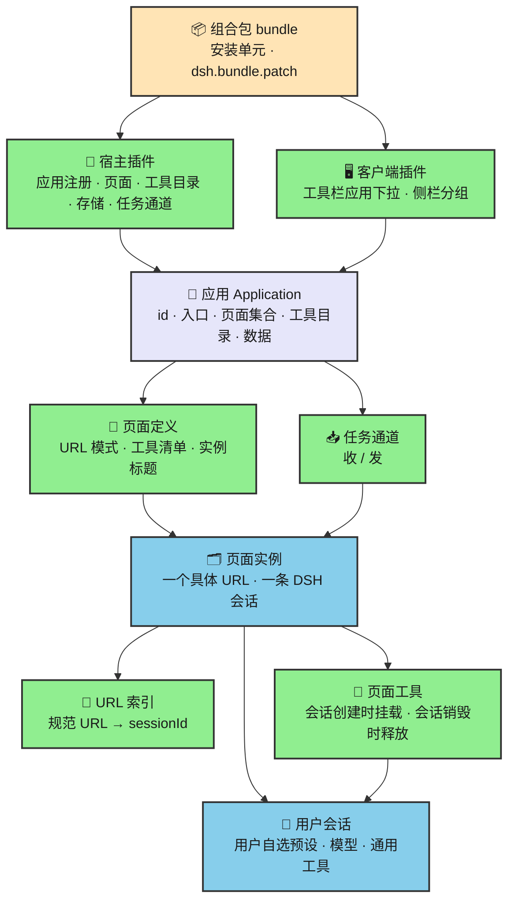
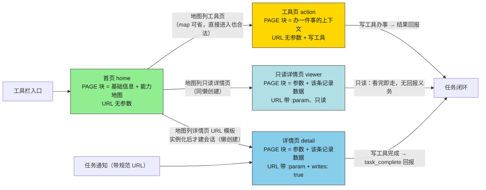
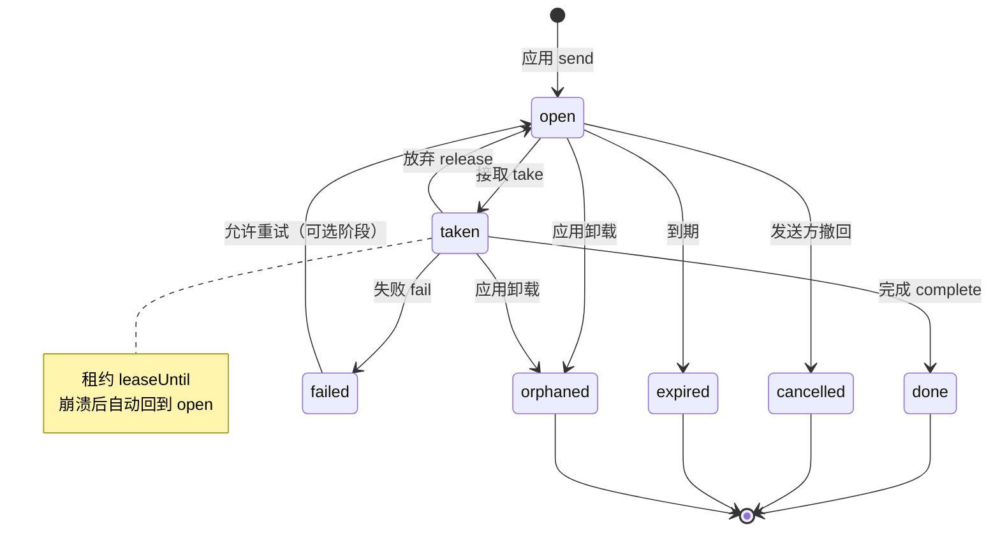
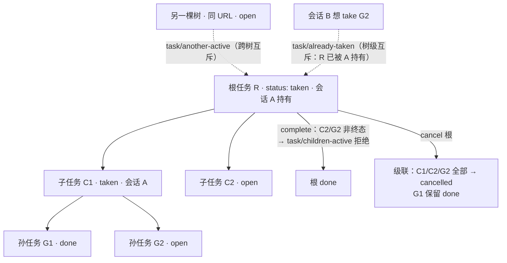
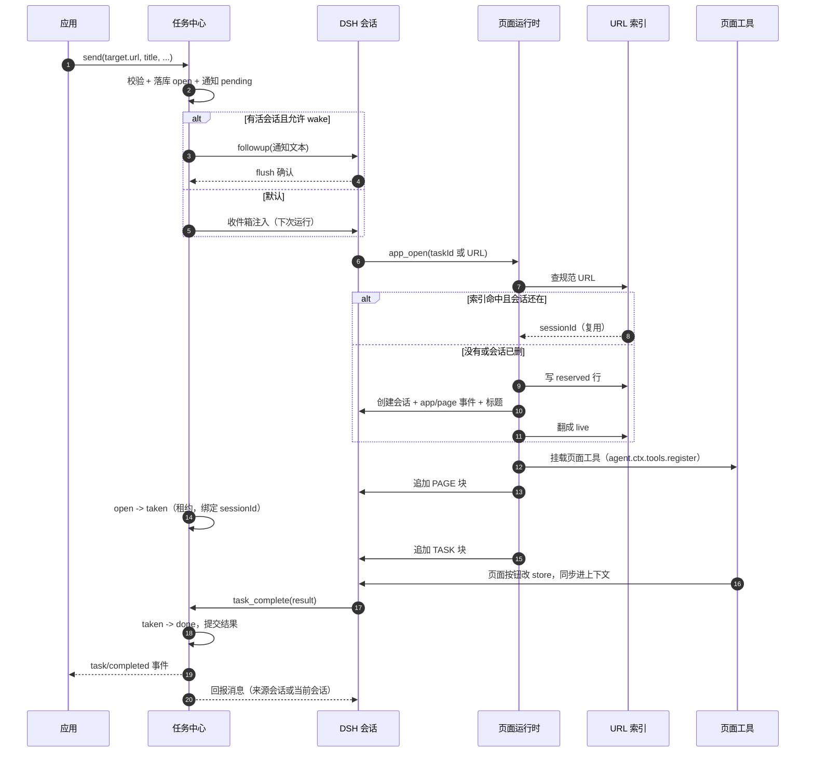
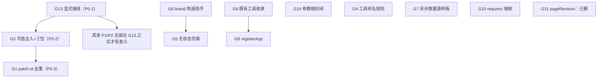

# 应用（Application）：Veren / DSH 插件体系的基础框架设计

[English](application-concept.md) | 中文

**目标读者：** DSH 插件开发者、页面运行时维护者、Agent 产品设计者。

**前置知识：** Cordis 插件与 Service、Agent Preset、DSH Session、`@veren/prompt-page` 的页面模型、DSH 组合包（bundle）与 profile（记录当前装了哪些插件的运行配置）安装。

**状态：** 概念设计草案，已按用户三轮决策修订。本文只做分析与设计，不改代码、不新建包、不动测试。文中的类型和接口都是**示意**，用于说明字段与职责，不是最终实现。

> **本版的三条硬约束（用户已拍板）：**
> 1. **一个会话一个页面，会话内不允许换页。** 要换页面，就创建或复用另一条页面会话。
> 2. **一个 URL 一个页面实例。** `/task/1` 和 `/task/2` 是两条不同的页面会话；完整 URL（含具体路径参数与查询串）是页面实例的主键，也是会话复用的钥匙。
> 3. **输入框工具栏上加应用下拉**，紧邻预设选择器；不做独立的应用启动器或应用首页。
>
> 页面不再与任何预设绑定（上一轮已定）；预设回归用户自选的通用配置。页面工具在会话创建时挂上，会话销毁时释放。被否方案记录在 §9.1。

---

## 0. 先把结论说清楚

今天系统里已经有“页面”，但没有“应用”。页面是全局注册表里的一条记录，谁先注册谁占住 URL；页面又被包装成 Agent Preset，一个页面一个预设。于是“应用”该有的入口、页面集合、归属、任务、通知、卸载清理，全都散落在用它的那个插件里。`page-sync-bench` 把其中一半做成了原型：有任务、有页面、有按钮、有状态同步，但它的任务存在内存里，页面没有归属，导航只是往上下文里写一行文字。

这份设计要加的不是“又一个注册表”，而是四层东西：

1. **应用层**：一个稳定 id、一个入口、一份页面集合、一份工具目录、一条任务通道。应用是用户安装和选择的产品单元，插件只是它的实现单元。
2. **页面实例层**：一个 URL 就是一个页面实例，页面实例与 DSH 会话一一对应；页面工具在这个会话创建时挂上，会话销毁时释放。
3. **任务中心**：宿主级的持久任务队列，应用往里投任务，人在收件箱里看到，Agent 打开任务指定的 URL 对应的会话去完成，完成后回报给发任务的应用。
4. **命名空间与生命周期**：应用 id 进入页面 URL、存储域、任务 kind 和工具名前缀；URL 索引负责“同一个 URL 回到同一条会话”；任务不随应用消失而静默蒸发。

### 0.1 五个验收问题的直接回答

| 问题 | 一句话回答 | 详见 |
| --- | --- | --- |
| 应用由哪些字段定义？装一个应用发生哪几步？ | 应用由 `id`、名称、描述、入口页面、版本/所有者、可选权限与工具前缀定义。安装 = 装 bundle → Loader 激活宿主插件 → 插件向 `ctx.apps` 注册应用 → 注册页面与工具目录 → 登记任务通道 → 打开自己的存储域。**不注册任何预设。** | §2.3、§7.1 |
| 入口页面怎么指定，应用内怎么跳转？ | 应用定义里写入口页面键（如 `entry: 'list'`）；选中应用即打开入口页面的会话。**应用内没有“跳转”这个动作**：每个页面链接对应另一条页面会话，点击就是切换会话，不是在当前会话里换页。 | §3.2、§3.4、§3.8 |
| 一条任务从产生到完成经过哪些环节？通知长什么样？ | 应用 `send` → 任务中心持久化 → 通知投递 → 人/Agent 打开任务 URL → URL 索引找到或创建该 URL 的会话 → 页面工具随会话挂载 → 页面里完成 → `task_complete` 写入结果 → 发 `task/completed` 事件并回报来源会话。通知是一条带任务 id、应用名、标题、页面 URL 和完成指令的短消息。 | §4.4、§5.1–§5.5 |
| 多个应用页面 URL 怎么不冲突？工具重名怎么办？应用之间怎么隔离？ | 页面 URL 统一是 `/apps/<appId>/<应用内路径>`；页面工具在模型面前统一是 `<appToolPrefix>__<本地名>`，重名在构造上消失。隔离是“命名 + 所有权 + 数据域”的隔离，不是安全沙箱。 | §6.1–§6.3、§3.4.3 |
| 卸载或禁用时，页面、工具和在途任务怎么收拾？ | 页面 = 会话：会话归档/删除时工具随 agent 作用域释放；应用卸载/禁用/热重载时，应用 fiber 的清理器摘掉该应用所有页面会话的工具，并标记这些会话“应用不可用”。在途任务不删除，禁用时停投递并在租约到期后回到待办，卸载时标为 `orphaned`。 | §7.2、§7.4、§3.4.4 |

---

## 1. 现状：今天一个页面是怎么活的

### 1.1 三个部件，各管一段

**页面定义**是 `@veren/prompt-page` 里的一个普通对象，字段是 `name`、`url`、`description`、可选的 `preset`、`events`，以及一个 `tree(params, state)` 函数。`definePage` 只做很薄的校验：名字非空、URL 必须以 `/` 开头且不能带查询串、`:param` 不能重复、描述非空。它不关心这个页面属于谁，也不关心同一个系统里还有多少别的页面。

**页面注册表**是宿主级的 `PageRegistryService`（服务名 `pageRegistry`），内部是一个数组。`register` 遇到重复的页面名或重复的 URL 模式会直接抛错；`resolve(url)` 按注册顺序找第一个命中的页面，把路径参数和查询参数合并（同名时路径参数优先）；`catalog()` 返回所有页面的 `{ name, url, description }`。它是一个**部署级单例**：会话子作用域通过 `inject: ['pageRegistry']` 找到的是同一个实例。

**页面会话**由 `mountPage` 创建。它不是 DSH 的 Session，而是一个独立的 `MessageHost`：里面有一条自己的版本链和快照基线，绑定到一个外部 store，页面树在 store 变化时重新渲染，渲染结果以 `SNAPSHOT` / `PATCH` 的形式追加进消息。`mountPage` 还会生成一条“指针消息”（`OPEN /task-detail/t-12 {"taskId":"t-12"}`），约定把它当作新会话的第一条用户消息。所以“一页 = 一个页面会话，页面会话 ≠ DSH 会话”是现状的基本事实——本设计要把这层错位补上：**页面实例就是 DSH 会话本身**。

### 1.2 一次“打开页面”实际发生了什么

以 `page-sync-bench` 为例，完整链路是这样的：

1. `composition` 角色在宿主作用域里创建 `TaskStore`，把三个页面注册进 `pageRegistry`，并为每个页面动态注册一个 Agent Preset（id 是 `page.<name>`，内容是“系统提示词 + 工具行 + 一个 context 行”）。
2. 用户在新会话里选中 `page.task-list` 这个预设，DSH 创建会话；预设里的 `context` 行被激活，它从 `pageRegistry.get('task-list')` 拿到页面定义，`mountPage` 挂出页面会话。
3. 之后每一轮模型请求之前，`agent/pre-step` 把页面会话自上次游标以来的增量渲染成消息，追加进上下文；页面 store 变化时，这条链路自动把变化送进模型。
4. 模型调用页面按钮对应的工具（`take_task`、`complete_task`），工具改 store，store 触发重渲染，再回到第 3 步。
5. 另一个工具 `open_page` 解析 URL、关掉当前页面会话、`mountPage` 新页面。

这条链路能跑，但只覆盖了“单页面、单来源、单活动页面”的场景。第 5 步就是本版要禁止的动作：**会话内换页**。在会话里换页会让工具集、系统提示词、任务上下文都处于“一半旧一半新”的状态，代价远大于收益。

### 1.3 页面没有归属

现状里没有任何字段回答“这个页面属于哪个应用”：

- 页面名和 URL 是全局唯一的，两个插件都想用 `/list` 就会在注册时炸掉；而且是在加载期炸，用户看到的是“插件装不上”，不是“两个应用重名”。
- 页面 URL 直接暴露给所有模型会话：`page_catalog` 工具会把全部页面列出来，没有“只看本应用”的视角。
- 一个页面一个 Preset，三个页面就在预设选择器里多三条；十个页面就是十条。用户看到的是“页面列表”，不是“应用入口”。
- 页面状态（store）在 `page-sync-bench` 里是模块级单例 `pageRuntime.store`；`activeSession` 是 composition 闭包里唯一的一个。这意味着两个 DSH 会话同时“打开页面”会互相覆盖，宿主里根本没有“每个会话各自的当前页面”这个概念。
- `PageDefinition.onLoad` 和 `onComplete` 声明了，但仓库里没有任何地方调用它们。生命周期钩子目前是摆设。

### 1.4 具体疼在哪里

| 现象 | 根因 | 代价 |
| --- | --- | --- |
| 第二个应用装不上，报 URL 重名 | 注册表是全局扁平命名空间 | 应用之间必须先私下约定路径，装得越多越容易撞 |
| 预设选择器被页面淹没 | 页面 = Preset，入口 = 某个页面 | 用户不知道从哪进，应用没有“首页” |
| 点“跳转”没反应 | `PageIO.navigate` 只是 `session.host.note('NAVIGATE …')`，`open_page` 只换页面树 | 页面之间不能真正导航，换页后系统提示词和工具还是旧页面的 |
| 两个会话抢同一个页面 | `activeSession` 是宿主级单例 | 多会话并行时状态串台，页面上下文互相污染 |
| 重启后任务全丢 | 任务在内存 store 里，无持久化 | 不能当工作台用，只能当演示 |
| 任务没有生命周期 | 只有 `open/taken/done`，没有失败、过期、取消、租约 | 失败没人管，崩溃后任务永远卡在“进行中” |
| 人不在会话里就收不到任务 | 只有 cordis 事件和页面内 `append` | 没有收件箱，没有“通知到达”这件事 |
| 卸载后状态不清 | 页面随 fiber 释放，但 store/任务没有归属和清理协议 | 热重载或重装后残留旧状态 |

“疼”的本质不是页面运行时不够强，而是**页面之上缺一层归属**：谁拥有这些页面、这些页面共享哪份状态、从哪个入口进、生命周期跟谁走。

### 1.5 仓库里已经有的、可以复用的部件

这份设计不打算从零造所有东西。以下能力已经存在，应该复用而不是重写：

| 能力 | 现有实现 | 对本设计的价值 |
| --- | --- | --- |
| 持久存储域 | `@veren/notebook`、`@veren/forum` 都用 `storageDomain.open`，JSON 或 SQLite 后端，插件卸载时关闭句柄 | URL 索引、任务中心、应用数据都用同一套持久化 |
| 通知投递纪律 | `plugins/forum/src/session-link.ts` 与 `notifications.ts`：先写持久行，再尝试唤醒，`ctx.sessions.flush` 确认，失败只降级 | 任务通知照抄“写行 → 投递 → 确认”的顺序 |
| 会话目录与恢复 | `ctx.sessions` / `ctx.agents` / `workspaceRegistry` 能按 sessionId 找会话、恢复归档、检查存活 | URL 索引只需要存 sessionId，剩下的交给会话系统 |
| 作用域工具注册 | `ctx.tools.register` 在 `agent.ctx` 上调用时，注册同时具有“对该 agent 可见”和“随该 agent 生命周期释放”两个性质 | 页面工具“随会话挂、随会话走”的机制基础 |
| 会话标题 | DSH 的 `session/title` 事件与重命名接口 | 页面实例标题、会话列表可读性 |
| 安装单元 | 组合包（bundle）声明 `dsh.bundle.patch`，成员插件作为普通依赖随行 | 应用不需要新的发布格式 |
| 插件管理 | DSH 插件管理页：安装、启用、禁用、卸载、版本不兼容提示 | 应用的安装/卸载动作可以映射到已有的 bundle 操作 |
| 输入框工具栏 | `conversation.hero.options`（新会话行，工作区/预设右侧）与 `conversation.session.header.actions`（已有会话头部） | 应用下拉和当前应用标识的落点 |
| 个人级身份 | DSH `identity`、本地 profile | 任务收件人先按“本机这个人”处理 |

有一个现状必须讲清楚：**Web GUI 今天的“页面”不是浏览器 URL。** 面板切换走的是布局 store 的 `selectPanel(panelId)`，侧栏入口是 `sidebar.panellist` 里的一条；仓库里没有把浏览器地址映射到面板或会话的路由。所以本文说的“page URL”首先是 `@veren/prompt-page` 世界里的页面地址（例如 `/apps/review-workbench/review/pr-42`），它能在模型消息、任务、工具之间传递；要让它在浏览器地址栏里可点，是后续阶段另外一件事。

---

## 2. 应用是什么

### 2.1 一句话定义

**应用是一个可安装的产品单元：它有一个稳定 id、一个入口页面、一组页面、一份工具目录、一份自己的数据，以及一条可以接收和发送任务的通道。**

用户装的是应用，打开的是应用，卸载的也是应用。插件负责实现它，组合包负责把实现装进来，但用户不需要知道这两层。

五个概念的分工如下：

| 概念 | 回答什么问题 | 今天的状态 |
| --- | --- | --- |
| 插件 plugin | 一段可加载的代码，向宿主提供能力 | 存在，是唯一的组织单位 |
| 组合包 bundle | 一次安装装好哪些行，声明 `dsh.bundle.patch` | 存在，插件市场的安装单元 |
| 应用 application | 用户看到的产品：入口、页面、工具、任务、数据 | **缺失，本文要补的层** |
| 预设 preset | **用户自选的通用配置**：模型、系统提示词、通用工具行、审批姿态 | 存在；今天被页面滥用成“每页一个”，本版把它还原 |
| 会话 session | 一次实际对话及其日志；在本设计里，一条页面实例就是一条会话 | 存在，由 DSH 管理 |

一句话划清边界：**预设决定“你用什么样的助手”，应用决定“你在做什么产品”，页面实例决定“你正在处理哪一条具体的记录”。**

### 2.2 为什么应用不是插件，也不是组合包，更不是预设

**应用不是插件**，因为一个应用通常不止一段代码：一个宿主插件负责页面注册、工具目录、存储、任务通道，一个客户端插件负责工具栏入口和面板。把这些都叫“一个插件”会让安装、卸载、权限都失去单一对象。反过来，一个插件也可以只提供能力而不构成应用（例如 `page-registry`）。

**应用不是组合包**，因为组合包只是“安装时插哪些行”的清单，它没有运行时身份，也不该被用户看见。用户说“我装了审阅工作台”，说的是应用，不是“我装了三个 npm 包”。

**应用也不是预设。** 预设是用户自己的选择：用哪个模型、用什么说话方式、带哪些通用工具。应用不能注册预设，也不能要求用户“先切到某个预设”才能打开页面。应用提供的是页面、页面工具、任务通道和它自己的数据；这些东西挂在**用户已经选好的会话**上。



### 2.3 应用由哪些字段定义

应用的定义分两处表达，但**每个事实只有一个权威来源**：

- **安装前的展示信息**放在组合包的 `package.json` 里（可选，推荐后续阶段再做）：`dsh.application` 里写 `id`、`name`、`description`、`entry`。它让插件市场在安装前就能显示“这是一个应用、入口是什么”，并在安装前发现 id 冲突。
- **运行时行为**由宿主插件调用 `ctx.apps.register(...)` 声明：同一个 id、入口、应用级说明、页面注册入口、工具目录、任务能力、权限请求。运行时是权威；如果 `package.json` 也写了，两者不一致就 fail loud（`app/manifest-mismatch`）。

字段如下（示意）：

| 字段 | 类型 | 要求 | 说明 |
| --- | --- | --- | --- |
| `id` | 稳定 slug（URL 友好的短标识），如 `review-workbench` | 是 | 进入页面 URL、存储域、任务归属、默认工具前缀；安装后不可改 |
| `name` | 显示名 | 是 | 应用列表、任务通知、工具栏下拉里给人看 |
| `description` | 一句话说明 | 是 | 目录和商店用；和页面描述一样要求非空 |
| `entry` | 应用内页面键，如 `list` | 是 | “一个应用有一个入口页面”的落点；激活时校验存在 |
| `owner` | 提供它的包名 | 自动 | 由注册时的 fiber 推导，不允许手写；卸载和权限校验用 |
| `version` | semver | 自动 | 从组合包版本推导；页面实例和任务里存快照，供升级判断 |
| `permissions` | 能力列表 | 否 | 默认空；页面工具声明的能力必须在这里被授予 |
| `toolPrefix` | 工具名前缀 | 否 | 默认由 id 推导（连字符换下划线）；全宿主唯一，≤32 字符 |
| `instructions` | 应用级说明 | 否 | 打开该应用任意页面时附在 PAGE 块里的短说明；**不是系统提示词**，不改变用户预设 |

示意类型（不是最终代码）：

```ts
/** 应用身份：安装后稳定，进入所有命名空间。 */
interface ApplicationDefinition {
  readonly id: AppId
  readonly name: string
  readonly description: string
  /** 应用内页面键，不是 URL。URL 由宿主拼。 */
  readonly entry: PageKey
  /** 应用级上下文说明，不是系统提示词。 */
  readonly instructions?: string
  /** 页面工具名前缀；默认 appId 把连字符换成下划线。 */
  readonly toolPrefix?: string
  readonly permissions?: readonly AppCapability[]
}
```

`AppId` 用现有约定做成 brand（带类型标签的字符串，零运行时开销）；但它必须满足一个可读的 slug 规则：小写字母开头，只含小写字母、数字和连字符，长度不超过 32，不能占用保留字（`api`、`apps`、`system`、`__global__`）。

### 2.4 一个插件能有几个应用

建议的规则是：**默认一个组合包一个应用；一个应用可以由多个插件实现；第 1 阶段不允许一个组合包注册多个应用。**

理由：

- 安装单元是组合包，用户的心智是“装一个东西得到一个应用”。一个包塞两个应用，卸载、权限、任务归属都会变成“你要卸载哪一个”，但安装器只有一个开关。
- 一个应用需要宿主插件和 UI 插件协作，这是常态，不是“多个应用”。把它们视为同一应用的多个实现插件即可。
- 如果将来真有一个套件要装多个应用（例如“办公套件”），更合适的做法是发布一个**套件组合包**，里面每个应用各自一个子包、各自注册，而不是让一个插件注册多个 id。这样 id 冲突、权限、卸载仍然是一对一的。

应用 id 的唯一性由注册表保证：同一个宿主里重复注册直接抛错；安装前如果 `package.json` 声明了 id，插件管理器可以先查一遍，把冲突挡在安装动作之前。

### 2.5 和应用商店、安装卸载的关系

应用商店（今天的“插件 → 发现”）只认组合包：索引里列出的是有 `dsh.bundle.patch` 的包，安装的是索引里写死的版本。这条链路不需要为应用改。

应用要补的是**展示与语义**：

- 商店卡片上显示“应用”而不是“插件”，显示应用名、简介、图标、入口页面名、请求的能力。
- 安装一个应用 = 安装它所属的组合包。安装完成后应用是否“出现”，取决于宿主插件是否成功注册；注册失败（id 冲突、入口缺失、版本不兼容）应该显示为“安装成功但应用不可用”，并给出稳定错误码，而不是假装装好了。
- **安装和更新都不会往预设选择器里加条目。** 应用不注册预设，用户选什么预设是用户的事。
- 卸载应用 = 卸载组合包。应用自己的数据不跟着包走（见 §7.4），所以卸载不是“删库”。
- 更新应用 = 更新组合包版本。应用 id 不变；页面实例和任务按 §7.3 处理版本变化。

一句话：**应用是组合包的运行时人格，不是新的发布格式。**

---

## 3. 应用与页面

### 3.1 页面归属：注册时绑定 appId

页面注册从“全局注册一条”改成“向某个应用注册一条”：

```ts
// 示意：页面作者仍然写短名和短路径
const pages = ctx.apps.pages('review-workbench')
const dispose = pages.register({
  name: 'review',                       // 应用内唯一即可
  url: '/review/:pr',                   // 应用内路径，不含 /apps 前缀
  description: '审阅一个 PR 的改动',
  // 这一页需要哪些工具；名字来自应用的工具目录，不是全局工具名
  tools: ['read_diff', 'submit_verdict'],
  // 这一页给模型的说明；随页面实例挂载，不写进预设
  instructions: '这是一个审阅页：先读 diff，再给结论；结论必须引用文件和行号。',
  // 一个具体实例在会话列表里的标题；参数决定标题
  instanceTitle: (params) => `审阅 PR #${params.pr}`,
  tree: (params, state) => <ReviewPage pr={params.pr} state={state} />,
})
```

上面只画了其中一页；示例应用的入口页 `inbox` 用同样的方式注册，只是它的 `url` 没有参数。

宿主在注册时完成四件事：

1. 把 `name` 规范成全局唯一的页面键 `appId/pageName`（例如 `review-workbench/review`），注册表内部按这个键去重；
2. 把 `url` 拼成对外 URL 模式 `/apps/<appId>/<url>`；应用内路径只在本应用内比较，不同应用写同一个 `/list` 不会冲突；
3. 记录 `owner`（哪个包、哪个 fiber 注册的）。只有同一个应用能注销这条记录；别的应用或全局代码想删它会得到 `app/forbidden`；
4. 校验 `tools` 引用的本地名都在应用工具目录里，`instanceTitle` 是函数（可缺省）。

`PageDefinition` 的字段要跟着调整：**删除 `preset` 字段**（页面不再带系统提示词），新增 `tools`、`instructions`、`instanceTitle`。`tools` 里写的是应用工具目录里的本地名，不是挂到模型面前的最终名；最终名在挂载时由前缀拼出来（§3.4.3）。`instructions` 是页面给模型的说明，不是系统提示词。`instanceTitle` 缺省时用 `description` 兜底。

> **第 1 阶段落地形态（收尾会话 E 补记）：页面注册只有一个入口。**
> 应用作者只调 `ctx.apps.pages(id).register(page)` 一次；app-registry 内部通过页面镜像面自动把同一条页面写进 page-registry 的注册表（`registerAppPage` 是内部原语，应用作者不再调用）。镜像失败（如 URL 模式冲突）会回滚应用侧登记并原样抛错，因此"目录可见却无法被 openUrl 解析"的静默漂移在构造上消失；残留漂移（如镜像面未装配）由 `pageRegistry.auditAppPages(apps)` 审计发现。宿主未装配镜像面时注册只告警，不崩。

### 3.2 入口页面：应用定义里写页面键

入口不是 URL，也不是“第一个注册的页面”，而是应用定义里显式写的 `entry`：

```ts
ctx.apps.register({
  id: 'review-workbench',
  name: '审阅工作台',
  description: '接收审阅任务，逐条给出结论',
  entry: 'inbox',                 // 应用内页面键
  instructions: '审阅工作台负责接收审阅任务，并把结论交回任务中心。',
})
```

激活应用时，注册表检查 `entry` 对应的页面是否存在；不存在就报 `app/entry-missing`，应用标记为 `broken`（第 1 阶段实现取"注册期不抛到宿主启动"的取态：入口页缺失只标 broken 并给出原因，页面注册后自动愈合为 active；`app_list`/`app_pages` 对 broken 应用返回该原因），并在工具栏下拉和应用列表里显示原因。**不允许"自动取第一个页面"当入口**：那会让页面注册顺序变成隐式契约，重排一次注册就换了首页。

入口的对外 URL 是 `/apps/<appId>/<entry 的路径>`；在工具栏选中应用 = 打开这个 URL 对应的页面实例会话（见 §8.2）。

### 3.3 页面集合怎么被发现

发现分两个视角，**不再有一个全局平铺的页面目录**：

- **应用内（模型和页面自己）**：`app_pages` 工具只返回当前应用的页面（页面键、URL 模式、描述、是否入口、这一页挂哪些工具、页面契约版本）。页面自己的说明里写“本应用有这些页面”，模型据此决定去哪个 URL。这替代了今天的 `page_catalog`。
- **应用外（人和宿主）**：人看到的是工具栏里的“应用下拉”和侧栏里的应用分组，不是页面列表；从应用下拉进入入口，从会话列表进入具体页面实例。

这个两级结构是有意的：页面数量随应用增长，如果全局平铺，模型每轮都要读一遍所有应用的内部页面，既费 token 又泄露别的应用的实现细节。代价是跨应用跳转不再是一步，需要先选应用；这正是产品上想要的边界。

`catalog()` 今天返回的是 URL **模式**（带 `:param`），不是具体 URL。应用目录要同时提供两者：模式用于展示，`format(entry, params)` 用于生成可打开的地址。任务里存的是规范 URL，见 §4.2。

`app_list`、`app_pages`、`app_open`、`task_list` 是宿主级工具，在所有会话里都可见。这是有意的“引导带”：模型要先能发现应用、打开页面、看任务，才有机会用上页面工具。它们数量少、schema 稳定，不随页面变化，因此对前缀缓存友好。页面自己的工具不在这个全局集合里，见下一节。

### 3.4 页面实例 = 会话：一个会话只属于一个页面

这是本版的核心。结论：

- **页面实例与 DSH 会话一一对应。** 一个会话从创建到归档/删除，只属于一个页面 URL；
- **会话内不允许换页。** 没有“在同一个会话里打开另一个页面”的路径，也没有“替换当前页面”“返回旧页面”；
- 页面工具在会话创建（或恢复）时挂载一次，之后直到会话销毁都不变；
- 页面说明作为会话开头的 `PAGE` 块写入日志，之后不再重写；
- 打开另一个页面 = 创建或复用**另一条会话**，然后由 GUI 切换选中会话。

页面里的跳转按钮也一样：它调用 `app_open(目标 URL)`，页面运行时找到/创建目标会话，GUI 切过去；当前会话的页面、工具、历史都不变。

#### 3.4.1 一对一带来的简化

上一版为了“会话内换页”设计了：换页时先摘旧工具、追加 `PAGE closed`、维护 generation、对账残留、回滚旧页。现在这些全部不需要了：

| 上一版的机制 | 现在还需要吗 | 为什么 |
| --- | --- | --- |
| 换页时摘旧工具/挂新工具 | 不需要 | 会话里没有第二页 |
| `PAGE closed` | 不需要 | 页面结束 = 会话归档/删除，不需要页内标记 |
| 每页 generation 校验 | 不需要 | 工具集在会话生命周期内不变 |
| 换页失败的回滚 | 不需要 | 创建会话失败就是没创建，不存在“旧页已摘”的中间态 |
| 差量挂载 | 不需要 | 同上 |
| 页面工具与页面会话的订阅交接 | 不需要 | 二者同生共死 |

仍然需要保留的只有三条兜底：**会话销毁、应用卸载/禁用、应用热重载**。原因见 §3.4.4。

#### 3.4.2 页面工具在会话创建时挂载

页面工具的定义在应用级目录，页面只列本地名：

```ts
// 应用激活时注册工具目录（示意）。工具本体直接用 @deepseek-ai/dsh-tools 的
// defineTool 产出（DSH ToolDefinition），不另造形状；能力等应用侧元数据走
// define 的第二个参数，第 1 阶段只记录、不强制。
const tools = ctx.apps.tools('review-workbench')
tools.define(
  defineTool({
    name: 'read_diff',
    description: '读取当前 PR 的 diff',
    parameters: { pr: { type: 'string', required: true } },
    output: { schema: { type: 'object', additionalProperties: true }, render: renderValue },
    execute: async (args, exec) => readDiff(args.pr, exec),
  }),
  { requires: ['files:read'] },
)
```

当一条页面会话的 agent 被创建或恢复时，页面运行时在创建/恢复流程里按会话绑定的页面，把这些工具注册到 `agent.ctx` 上：

- 工具最终名是 `<toolPrefix>__<本地名>`，例如 `review_workbench__read_diff`；
- 注册只对这个会话的 agent 可见；
- 注册的生命周期跟着 agent 作用域：会话销毁时自动释放；
- 页面工具集在会话生命周期内**不变**，所以系统提示词里的工具 schema 只在会话开始/恢复时确定一次，之后没有换页导致的缓存失效。

页面说明同时作为一条 `PAGE` 用户消息追加到会话开头：

```text
PAGE review-workbench/review {"pr":"42"}
本页工具：review_workbench__read_diff、review_workbench__submit_verdict
说明：这是一个审阅页：先读 diff，再给结论；结论必须引用文件和行号。
```

如果应用定义了 `instructions`，先放应用段，再放页面段。`PAGE` 块是页面实例的“开场白”，之后不再重写；它满足“模型可见即可从日志重建”。

#### 3.4.3 工具重名：应用前缀，不做后挂覆盖

两个应用都定义 `complete_task`，不会冲突，因为模型看到的名字是：

```text
task_workbench__complete_task
review_workbench__complete_task
```

规则：

- **应用内唯一**：工具目录按本地名去重，重复定义在注册时抛错（`app/tool-duplicate`）。
- **跨应用命名空间**：最终名 = `<toolPrefix>__<本地名>`。前缀在应用注册时分配，全宿主唯一；重复前缀直接拒绝安装（`app/tool-prefix-conflict`）。
- **前缀格式**：小写字母开头，只含小写字母、数字、下划线，≤32 字符；本地名 ≤24 字符；最终名 ≤64 字符（工具名的通用上限）。
- **不覆盖、不静默**：如果最终名和会话里已有的**非本页**工具撞了（例如某个插件恰好也叫这个名字），会话创建在任何状态改变之前失败（`page/tool-conflict`），提示改前缀。页面工具永远不会覆盖用户预设里的工具。
- **和宿主工具的关系**：`task_complete`、`app_open` 这类宿主工具是全局的；页面工具因为带前缀，不会和它们同名。模型不会混淆，因为 PAGE 块会列出本页工具的完整名字。

为什么选“加前缀”而不是“本地名 + 冲突则拒绝”：

- 本地名会让同一个页面在不同预设下表现不一致：预设里恰好有个同名工具，页面就打不开；没有就打得开。这违反“页面行为与预设无关”。
- 后挂覆盖是权限漏洞：页面可以替换 `read_file` 或 `task_complete`，用户看不出来。
- 加前缀是唯一能同时满足“任意预设可用”“多应用共存”“不覆盖”的方案。代价是名字变长；用较短的 `toolPrefix` 和 PAGE 块里的完整清单来控制。

#### 3.4.4 摘除与兜底：现在只剩三条路径

| 路径 | 触发 | 工具怎么释放 |
| --- | --- | --- |
| 会话销毁 | 会话被删除，或承载它的 agent 被销毁 | 工具注册在 `agent.ctx` 上，随 agent 作用域自动释放 |
| 应用卸载/禁用 | 应用 fiber 销毁 | 应用 fiber 上的清理器遍历该应用所有活着的页面会话，逐个摘掉工具；会话本身保留为“应用不可用” |
| 应用热重载 | 开发时宿主插件重新加载 | 旧 fiber 的清理器先摘旧工具；新 fiber 激活时，对活着的页面会话重新挂载当前版本的工具（§3.4.5） |

为什么只剩这三条：页面与会话同生共死，没有“页面还在、会话还在、但页面换了”的状态；会话销毁是正常出口，应用生命周期变化是外部出口，热重载是开发期出口。

**兜底顺序：**

1. 正常路径：会话销毁由 agent 作用域释放工具；
2. 应用生命周期：清理器在应用 fiber 销毁时主动摘工具，不依赖 agent 是否还活着；
3. 热重载：新 fiber 激活时对活会话做一次“重挂”，先确认旧注册已释放，再挂新版本；
4. 崩溃：进程死了，agent 作用域和工具一起消失；进程没死但页面运行时抛错，会话保留、工具仍归 agent 作用域，下一次打开会话时按当前版本重新挂载或标记为 stale（§7.3）。

**“如果摘不掉会发生什么？”** 现在没有“摘一半”的状态：工具注册是成组挂在 agent 作用域上的，agent 销毁就是整组释放；应用清理器摘的是“这个应用的所有页面会话”，按 sessionId 逐个执行，单个失败只影响那个会话，并记录 `page/binding-release-failed` 供对账。残留工具只可能出现在“进程活着、应用清理器没跑完”的窗口；下一次打开该会话时，页面运行时会先对账再挂载。

#### 3.4.5 恢复、热重载与崩溃

- **会话恢复**：从会话日志里读 `app/page` 事件（§3.5），确认应用/页面/页面契约版本仍可用；可用就挂当前版本的页面工具和 PAGE 说明（日志里已有的 PAGE 块不重复追加），不可用就进入 stale 流程（§7.3）。
- **热重载**：应用插件重新加载时，旧 fiber 的清理器摘掉活会话里的旧工具；新 fiber 激活后，按会话绑定的页面重新挂载。挂载是同一组名字、同一组 schema；不追加新的 PAGE 块，也不改变会话的页面绑定。
- **崩溃**：进程级崩溃随进程消失；会话级异常（store 订阅、渲染抛错）由页面运行时捕获，记录 `page/crashed`，会话保留，但页面面板显示错误和“重新加载”动作。重新加载 = 重新挂载当前版本，不是换页。
- **归档**：归档会话时 agent 被销毁，工具释放；索引保留（§3.5），再次打开 URL 时恢复归档会话并重新挂载。

#### 3.4.6 被否掉的方案：会话内换页

**用户已决策放弃“会话内换页 / 替换当前页面”。** 当时支持它的理由是“少建会话、上下文连续”，但代价是：

- 一个会话里出现两套页面工具和两段页面说明，模型容易串台；
- 换页时工具集、系统提示词、任务块不是同一个提交，容易出现“页面是新的、工具是旧的”；
- 任务绑定、页面状态、会话标题都会在换页时失去唯一归属；
- 为了实现“干净地换页”，需要 generation、回滚、对账、PAGE closed 等一整套机制，复杂度高且收益不确定。

现在改成“换页 = 换会话”：上下文连续性的代价由会话列表和任务中心承担，换来的是每条会话语义单一、可索引、可恢复。

### 3.5 URL 是页面实例的主键：持久索引

#### 3.5.1 规范 URL

页面实例的键是**规范 URL**，不是页面模式，也不是 sessionId。规范规则：

1. 路径规范化：补前导 `/`、去尾 `/`（根除外）、百分号编码统一（解码后按 RFC 3986 重新编码）；
2. 查询串参与身份：`/task/1?tab=diff` 和 `/task/1` 是不同实例；
3. 查询参数按 key 排序（同 key 多值按 value 排序），去掉空查询串；
4. 不做 host/scheme 规范化：这是系统内路径，不是外链；
5. 不接受片段（`#...`）；片段不是页面身份的一部分。

规范 URL 是任务、索引、通知、工具参数共用的那一份；页面作者看到的 `params` 由同一个解析器产生。

#### 3.5.2 索引表

> **语义已反转（用户决策，§9.1）**：打开一个页面 URL **一律新建会话**；该 URL 上原来的会话标废弃。
> URL 索引因此不再是"身份找回"（重开同一 URL 回到原会话的旧设计已放弃），只回答两件事：
> **这个 URL 当前哪条会话是活的；历史上哪些会话已废弃。**

索引是宿主级持久存储域 `app-pages` 的一张表 `instances`，键空间分两类：

- **当前指针行**：键 = 规范 URL，一个 URL 至多一行（`reserved` / `live`）；
- **废弃历史行**：键 = `deprecated:<sessionId>`（规范 URL 以 `/` 开头，键空间不相交）。

| 字段 | 说明 |
| --- | --- |
| `url` | 规范 URL（历史行保留来源 URL） |
| `sessionId` | 页面实例对应的 DSH 会话；全局唯一 |
| `appId` / `page` | 便于按应用分组、卸载清理 |
| `params` | 解析出来的参数快照 |
| `appVersion` | 创建时的应用版本 |
| `title` | 页面实例标题（§3.6） |
| `state` | `reserved` / `live` / `deprecated` |
| `createdAt` / `lastOpenedAt` | 时间 |
| `deprecatedAt` | 废弃时间（仅 `deprecated` 行携带） |

唯一约束：`url` 唯一（当前指针行内）、`sessionId` 全局唯一。一个会话不能同时属于两个 URL。

**为什么仍保留 `reserved → live` 两阶段**：它不再是防"并发重复打开复用"的锁，而是崩溃安全——
创建中途崩溃最多留下一个 `reserved` 行（启动清扫可删），绝不会把一条没建成的会话写成 live 指针
或废弃历史行。并发重复打开的收敛见 §3.5.3。

#### 3.5.3 打开一个 URL 的协议（一律新建 + 旧会话废弃）

1. **解析与校验**：规范 URL、应用已安装且启用、页面存在。
2. **废弃旧会话**（索引里有当前行时，按此顺序释放）：
   1. **摘页面工具**：旧会话整组注销它的页面工具；
   2. **释放任务租约**：旧会话持有的 `taken` 租约逐条 release（§4.4）。没有这一步，新会话打开
      同一 URL 会 `already-taken`——任务被一条已废弃的会话占死；
   3. **写废弃标记**：当前行挪进 `deprecated:<sessionId>` 历史键，URL 腾出。旧会话本身**不销毁**：
      它变成一条普通会话，仍然可读，但不再追加 PAGE 块、不再挂页面工具、不再经 URL 访问。
3. **创建（两阶段）**：mint sessionId → 写 `reserved` 行 → 建 DSH 会话 → 挂工具 → 写 PAGE 块 → 翻 `live`。
4. **返回**：`{ sessionId, title }`（打开一律新建，结果就是新会话），GUI 切到这条会话。

**失败收敛**：任何一步失败都不留"两条都当自己是活的"——

- 摘工具/释放租约失败：只影响旧会话自身，废弃标记照写（旧会话已不该被 URL 访问）；
- 废弃标记写失败：整步中止，旧会话仍是索引里的活会话，下次打开重试废弃；
- 建新会话失败：半成品清理 + `reserved` 行删除；旧会话已废弃、URL 无活会话，下次打开重试。

**并发重复打开**：索引写操作串行（FIFO）。两个 openUrl 同时到达时，后到者会把先到者刚写的
`reserved` 行也废弃掉——先到者的 commit 随之失败并清理自己的半成品会话。结果收敛为
"恰好一条活会话"，先到者收到错误。

#### 3.5.4 重启、删除与重建

- **重启**：索引是持久的，重启后 URL 行仍指向**最新那条活会话**；再打开该 URL 才会新建并把它标
  废弃。废弃历史行跨重启保留可查，旧会话不会被误当活的。
- **删除**：会话被删除后，打开 URL 时发现 `ctx.sessions.get` 找不到，删除该行并按"无行"新建。
- **reserved 启动清扫（已实现）**：启动时对 `reserved` 行做一次存活探测（会话不在即删，
  `KvPageInstanceIndex.sweepReserved`）；没有会话探测能力时不动任何行——确认不了就不删，不假装做了。
- **索引丢失/损坏**：会话日志里的 `app/page` 事件是事实来源，重建扫描归第 2 阶段（第 1 阶段的
  会话端口没有"枚举会话/读会话日志"的面）。注意反转后的重建语义很简单：**任何 URL 都可以
  直接新建**，重建只是恢复"哪些 URL 有活会话"的记录，慢一点也不产生重复实例。

#### 3.5.5 和 forum `SessionLink` 的对照

| 维度 | forum `SessionLink` | 页面 URL 索引 |
| --- | --- | --- |
| 键 | 预设 id → 活会话 | 规范 URL → 当前活会话 |
| 持久性 | 内存，进程结束即丢 | 持久化，重启仍在 |
| 冲突策略 | 后出现的会话覆盖前一个 | 一个 URL 只允许一个 live 会话（重开 = 旧的废弃） |
| 用途 | 把通知投递给"正在为这个预设工作的会话" | 记录"这个 URL 当前哪条会话是活的 + 哪些已废弃" |
| 失败处理 | 没有活会话就留在收件箱 | 会话没了就删行，下次打开新建 |

可以借用的是 forum 的**投递纪律**：先写持久行，再执行副作用，失败只降级并记录，不假装成功；`ctx.sessions.flush` 确认消息真的进了会话。不能借用的是它的"预设键"和"内存映射"——页面身份必须是 URL，且必须跨重启存在。

#### 3.5.6 走一遍：/task/1、/task/2 与重启

假设 `review-workbench` 的页面是 `/task/:id`：

1. 打开 `/apps/review-workbench/task/1`：索引没有这一行 → 写 reserved → 创建会话 A → 写 `app/page`、标题「任务 #1」→ 翻 live → 挂 `review_workbench__*` 工具和 PAGE 块。
2. 处理完，打开 `/apps/review-workbench/task/2`：规范 URL 不同 → 创建会话 B；会话 A 原样保留，工具和页面都不动。
3. 再打开 `/apps/review-workbench/task/1`：**新建会话 C**（不再复用 A）；A 的工具摘除、租约释放、标废弃；索引改指 C。A 的历史仍可在会话列表里读。
4. 重启 DSH 后：URL 行仍指向 C（最新活会话，跨重启保留）；再打开才新建 D 并把 C 标废弃。
5. 应用升级：不再产生 `page/stale` 拒绝（该码已随 G11 删除）——打开本来就是新建，新会话自然用新版本页面（§9.1）。

### 3.6 会话标题与分组

一个页面实例一条会话，列表会迅速变长；没有标题和分组，工作台不可用。

#### 3.6.1 实例标题

页面定义提供 `instanceTitle(params)`：

- 有参数：`/task/:id` → `任务 #1`；
- 无参数：用 `page.description` 或应用名 + 页面名；
- 上限 60 字符，超出截断；
- 创建会话时写进 `session/title`（或创建后立即重命名），同时写入索引的 `title`；
- 用户之后重命名，以用户的重命名为准；应用升级不覆盖旧会话标题。

任务打开的页面实例，标题优先用任务标题（例如“审阅 PR #42”），没有任务标题才用 `instanceTitle`；这样任务列表和会话列表对得上。

#### 3.6.2 会话列表分组

侧栏保持“工作区”为第一级；应用会话在第二级按应用折叠：

```text
cursour
  ├─ 审阅工作台        （应用分组，可折叠）
  │    ├─ 任务 #1
  │    └─ 任务 #2
  ├─ 任务工作台
  │    └─ 任务 #7
  └─ 普通会话
       └─ …
```

- 页面会话带一个 `app` 投影（appId、name、icon、page、url），侧栏据此分组；
- 应用分组默认展开最近使用的 1–2 个，其余折叠；分组头显示应用名和实例数；
- 提供按应用筛选（侧栏搜索或筛选 chip），以及“归档此应用的全部页面会话”动作；
- 普通会话不强行归入应用；没有 `app` 投影的会话留在“普通会话”。

**十个页面、五个应用会不会把列表撑爆？** 只有实际打开过的 URL 才建会话，页面定义本身不是会话；一个应用十个页面，只有用户点过的那些实例出现。注意语义反转（§3.5、§9.1）后，同一 URL 反复打开会累积会话（旧的自动废弃但保留）——列表膨胀由会话列表自身的清理/归档承担，URL 索引不再靠"复用"兜底。

#### 3.6.3 会话与页面的投影

会话日志里追加一条 `app/page` 事件（declaration merging，append-only）：

```ts
interface AppPageEvent {
  readonly appId: AppId
  readonly page: PageKey
  readonly url: string            // 规范 URL
  readonly params: Readonly<Record<string, string>>
  readonly appVersion: string
  readonly title: string
  readonly supersededBy?: SessionId
}
```

这条事件是索引重建的事实来源，也是会话列表分组的依据。它满足 DSH 的“模型可见即可从日志重建”规则：PAGE 块和同步消息本来就在日志里，`app/page` 补上“这条会话属于哪个页面实例”。

### 3.7 应用与 workspace 的关系

工具栏上的三个选择器各回答一个问题：

| 选择器 | 回答 | 来源 |
| --- | --- | --- |
| 工作区 workspace | 代码在哪 | 用户选择或当前会话 |
| 预设 preset | 怎么工作（模型、人设、通用工具） | 用户选择或当前会话 |
| 应用 app | 在哪个产品里工作 | 应用注册表 |

**推荐：应用跟随当前 workspace，不声明“默认 workspace”。**

理由：

- workspace 是“这段代码在哪”的环境选择；同一个应用应该能用于任何仓库。应用如果硬编码默认 workspace，换个项目就用不了，用户也会被莫名其妙带到别的目录。
- 页面会话的工作目录应该由用户当次的选择决定，而不是由应用替用户决定；应用需要的是“当前仓库”，不是“某个固定仓库”。
- 任务从某个会话打开时，继承那个会话的 workspace；从工具栏打开时，继承当前选择；没有选择时允许无 workspace 的页面会话（有些应用不需要文件）。

如果同一个 URL 已经在另一个 workspace 下有会话，按“URL 一个会话”的规则复用它，并把 GUI 的 workspace 切到那条会话的 workspace；不会为同一个 URL 再建一条不同 workspace 的会话。这一点要在 UI 上明示（切换后工作区选择器显示的是原会话的 workspace），避免用户以为进错了目录。

应用如果要“只读某个固定目录”，那是页面工具自己的能力/配置，不是应用身份的一部分；不要把它放进 `ApplicationDefinition`。

### 3.8 工具栏应用下拉：应用的唯一入口

用户拍板的入口形态是：**在输入框工具栏、预设选择器右侧，加一个应用下拉。** 不做独立的应用启动器，也不做应用首页。

三个选择器并排，各回答一个问题（§3.7）：**工作区 = 代码在哪；预设 = 怎么工作；应用 = 在哪个产品里工作。**

落点：

- **新会话行**：`conversation.hero.options`（工作区、预设右侧的紧凑选项区），下拉项 id `application`；
- **已有页面会话**：`conversation.session.header.actions` 显示当前应用（图标 + 名称），点击打开同一个下拉；
- 下拉数据来自应用注册表（Remote），显示图标、名称、入口页面；最近使用的在前，超过 8 个可搜索。

交互规则：

| 当前状态 | 选择应用后发生什么 |
| --- | --- |
| 空白新会话（无消息、无草稿） | 解析入口 URL → 查索引：有会话就切过去；没有就**把当前空白会话收养为页面会话**，用当前 workspace/预设创建，写标题、挂工具，避免多出一条空会话 |
| 空白新会话（有草稿） | 不动草稿；按入口 URL 新建/复用页面会话，当前空白会话保留 |
| 普通会话 | 打开/复用入口页面会话，当前会话不动 |
| 页面会话，选的是同一个应用 | 跳到该应用的入口页面会话；如果当前就是入口会话，则无操作（复用） |
| 页面会话，选的是另一个应用 | 打开/复用另一个应用的入口页面会话，当前会话不动 |
| 页面会话，选“无应用” | 不提供：会话不能从页面变回普通会话；要普通会话就新建一条 |

三个必须讲清楚的点：

1. **应用下拉是“入口启动器”，不是“会话模式开关”。** 它只决定“打开哪条页面会话”，不会修改当前会话的页面、工具或标题。
2. **重复选择复用，不新建。** 同一个入口 URL 由 URL 索引保证只有一条 live 会话；再选一次就是聚焦它。
3. **页面实例之间的跳转不靠这个下拉。** 下拉只到应用入口；具体页面实例（`/task/1`）通过任务通知、页面里的链接、会话列表进入。给每个页面做一个下拉项会把下拉变成页面目录，正是要避免的。

为什么不做独立应用启动器/首页：应用入口已经出现在“用户本来就要用的地方”（新会话工具栏）；再做一个启动页，等于让用户先离开会话、再进来，多一步且多一套入口状态。任务收件箱是任务中心的面板，不是应用启动器，两者不要混。

客户端实现上，这是一个客户端插件：用 `ctx.slots.inject('conversation.hero.options', ...)` 注册下拉，用 `conversation.session.header.actions` 注册当前应用标识；组件只拿注入的普通数据和回调，不碰 `ctx`。

---

### 3.9 `page_send`：按 URL 幂等投递——智能自主行动的承载物

**问题**：页面工具由宿主按当前页面下发，而页面作用域屏蔽了 `app_open`/`app_list`/`app_pages`（§9.1 反转 + 防自开页级联的两条决定叠加）。结果：一个页面会话里的智能被钉死在落地那一页上——它翻不了页，也拿不到其它页面的写接口，跨页工作流没有承载物。

**能力**：宿主工具 `page_send(url, message, wake?)`，语义是**按 URL 幂等投递**：

```
规范化 URL → 查页面实例索引
  · 该 URL 有绑定且存活的会话 → 直接 append 一条消息给它（唤醒它干活）
  · 没有 → 新建会话、绑定该 URL（沿用 openUrl 的两阶段创建路径）、再投递
返回：{ sessionId, url, created, redirected }
```

- 它面向**智能**（页面 agent 也拿得到：`page_send` 是全局工具，不在页面会话的屏蔽名单里）；
- 它解决"投递"，不解决"切换"：新建路径不发 GUI focus，绝不是导航；
- 与 `session_dispatch` 的分工：那个按 **sessionId**（点对点、带结算看守、有回报），这个按 **URL**（幂等寻址、无结算回报、不知会话只知页面）。互不合并、互不绕行——知道确切会话用前者，只知道页面用后者。

**与 §9.1.1 的关系**：不推翻"人打开即新建、旧的废弃"。`page_send` 的"有会话则 append"查的是**索引的 live 行**，不是"身份找回"——人重开 URL 后，旧会话立即退出寻址，投递只会命中当前活会话或为其新建。索引反转后的语义（"这个 URL 现在谁是活的"）恰好是投递需要的全部。

**三个风险的对策**：

1. **级联**（A 投 B、B 投 C……）：投递运行时持有链深台账（sessionId → 深度，进程内），入口做硬上限检查——`MAX_DELIVERY_HOPS = 4`，超限拒绝并给稳定错误码 **`page/hop-limit`**。闸门在 page-registry 的投递运行时**一处**，任何调用方都绕不过，不靠调用方自觉。台账随会话消失惰性清理；重启清零（级联是活递归现象，重启清零不放大风险）。
2. **成本**：每次唤醒 = 一个模型回合。`wake` 由**调用方逐次选择**：缺省 `true`（投递的本来目的就是让对方干活）；`wake: false` 只把消息落会话日志，不 followup、不产生回合，目标下次被唤醒时一并消费。无人消费的浪费靠两点避免：投递永不自动重发（没有重投泵），链深硬上限封死了最坏情形的总回合数。
3. **废弃竞态**（人此刻重开同一 URL，§9.1.1 新建并废弃旧的）：**投递后重查索引**——指针已易主则把消息**补投给当前活会话**（消息跟着 URL 走，不跟会话走），至多 `MAX_DELIVERY_ATTEMPTS = 3` 次，结果如实带 `redirected: true`。旧会话上已落地的那份是既成事实（它已被废弃、工具已摘，不会再行动），可读但无害。

**页面工具完备性（轻量方案）**：页面定义新增可选声明 `writes?: boolean`（"本页职责需要写能力"）。装配期（app-host wire）逐页核对：声明了 `writes: true` 却一个工具都没挂 → 打一条警告——"页面开着、活干不了"。只提醒、不做门禁，五秒钟看懂在提醒什么。`writes` 是**写意图声明**而非事实陈述，价值正在于和"挂没挂工具"这个**事实**交叉核对——所以它保持声明式，**有意不从挂载的工具推断**：工具目录没有读/写标记，"挂了工具"≠"要写"（person-agent 的工作区浏览页就挂着只读工具，纯浏览）；若改成推断，本警告就无从触发（推断结果与事实同义反复）。只读详情页（viewer，§3.10.1）不声明本字段，警告对它天然沉默。

**落在哪些包**：投递运行时与链深台账在 `plugins/page-registry`（`delivery.ts`、`service.deliverUrl`、工具 `page_send`）；会话端口的 `wake` 面与新消息源 `page/send`、装配注册与完备性警告在 `plugins/app-host`。平台（cordis / dsh-tools）零改动。

---

### 3.10 页面的信息组织：首页 / 详情页 / 只读详情页 / 工具页四档（面向 AI）

> **背景（用户决策，2026-10）：这条产品线面向 AI，不面向人。** 不做可视化、不做交互（GUI 是另一条线，另行立项）。所以"页面"的本质是：**把信息组织成 AI 能直接读懂并行动的形态**，不是给人看的界面。首页不只是能力地图，还必须有基础信息（如任务中心首页 = 任务列表 + 能力地图）；详情页的参数要直接进上下文，减少 agent 为了"知道自己在哪里、眼前是什么"再次调工具。

#### 3.10.1 页面四档分类（一等公民）

> **2026-10-21 二次修正（迁移证伪了两档假设）**：上一轮把四个应用按本节迁完后，写地图的人撞出了三个反例——① `task-workbench` 的发布页是"无参写页"：既不是首页（不是地图）也不是详情页（没有 `:param`），两档模型给它没有位置；② `person-agent` 没有任何 `:param` 页（下钻靠工具），两档模型对"只读仪表盘"类应用近乎空转；③ 规则 1"首页 map 非空"实际强制**每个应用至少两页**，单页应用的 map 无处可指。修正为**三档分类**；规则 1 收窄为"只对有详情页的应用强制"（§3.10.5），单页应用与纯仪表盘应用是合法形态。
>
> **2026-10-21 三次修正（补上 viewer 空隙）**：三档模型留了最后一个空隙——**只读详情页**（有 `:param`、有记录身份、但纯浏览不做事，如 `/workspace/:wsId` 只读下钻）会被规则 3 逼着声明 `writes: true` 才能注册：一个合法的只读页必须谎称自己要写，**这比没有校验更糟**——它在教人为了让门禁通过而写假声明，`writes` 字段一旦不可信，§3.9 里依赖它的检查全部跟着失效。修正为**四档**：新增 viewer（只读详情）档，分类升级为**两轴**表述。`writes` 有意维持**声明式**、不从挂载的工具推断（B 方案否决理由：工具目录没有读/写标记，"挂了工具"≠"要写"——person-agent 的工作区浏览页就是挂着读工具的纯只读页，推断会把它误判成写页；且推断让 §3.9 的"声明 × 事实"交叉核对变成同义反复，警告通道实质死亡）。只读详情页现在如实注册：不声明 `writes`、不挂写工具（挂只读工具也合法）、零额外要求。

页面分四档，外加一种合法剩余形态。分类由**两轴 + 入口归属**推导：**记录身份轴**（URL 是否带 `:param`——有没有"这一条"）× **写意图轴**（是否声明 `writes: true`——要不要动这条记录），再加 entry 归属。推导规则写进注册契约（`@veren/prompt-page` 的 `pageArchetypeOf`），不是口头约定——不需要在页面定义上新增字段：

| 档位 | URL 形态 | 职责 | 必须有什么 | 主要面向谁 |
| --- | --- | --- | --- | --- |
| **首页（home）** | 无 `:param`，且是本应用 `entry` | **基础信息 + 能力地图**，人/AI 的入口 | 基础信息（load/data）；`map` 仅当本应用还有记录页时必须非空（规则 1） | 人（入口下拉、会话列表分组的落点）+ AI（先看全局再行动） |
| **详情页（detail）** | 至少 1 个 `:param` **且声明 `writes: true`**：`/apps/task-workbench/task/:taskId` | 单一记录的执行单元（处理那一条） | `writes: true` + 至少挂 1 个工具 + 非空 `instructions`（规则 3） | AI（由任务通知、首页地图、`page_send`/`app_open` 进入），**懒创建**——只有真有那条记录要处理才开 |
| **只读详情页（viewer）** | 至少 1 个 `:param`、**未声明 `writes`**：`/apps/person-agent/workspace/:wsId` | 单一记录的**只读下钻**（看那一条，不动它） | 除 definePage 基础校验外**无额外要求**（可挂只读工具辅助下钻；首页 map 应列出它——规则 1 同口径） | AI（由首页地图、`page_send`/`app_open` 进入），懒创建 |
| **工具页（action）** | 无 `:param`、非 `entry`、声明 `writes: true`：`/apps/task-workbench/publish` | **"做一件事"的页面**（发布、导入、批量操作…） | 写工具（= `writes: true` 声明 + 至少挂 1 个工具；缺了走 §3.9 完备性警告）+ 非空 `instructions`；**不需要 map** | AI（从首页地图或任务流进入） |

推导规则一句话：URL 带 `:param` 就看写意图轴——声明 `writes: true` 是详情页，**未声明是只读详情页（viewer）**；无参且是 `entry` 即首页；无参、非 `entry`、声明了 `writes: true` 即工具页。此外还有一种**合法的剩余形态**：无参、非 `entry`、只读（未声明 `writes`）= **只读副页**（如 person-agent 的工作区浏览页）——仪表盘类应用的第二屏，除 definePage 的基础校验外无额外要求。**纯只读应用**（所有页面都不声明 `writes`，如 person-agent）因此是合法形态：规则 1 对它自动豁免（没有记录页 → `map` 可空），规则 3 无从触发（没有声明 `writes` 的带参页），§3.9 完备性警告对它天然沉默。

术语解释：**能力地图**指首页 PAGE 块里列出"本应用有哪些可去的页面（详情页、只读详情页、只读副页、工具页）、各自的 URL 模板、什么时候该去"；**懒创建**指带参页实例不预先存在，第一次被打开才建会话（打开一律新建，§3.5.3）。

分工边界一句话：**首页回答"这个应用现在整体什么样、我能去哪"；详情页回答"这一条记录是什么、我怎么处理它"；只读详情页回答"这一条记录是什么"——到此为止，不处理；工具页回答"我要做一件事，这一页替我把事办成"。** 首页不承载对单条记录的写操作（缺写工具合法，见 §3.10.5 规则 2）；详情页与只读详情页不承担"浏览全局"；工具页既不绑定记录也不承担"浏览全局"。



**detail 与 action 的分界判据（记录身份轴）**：看页面要处理的对象有没有"**记录身份**"。URL 能回答"哪一条"的是 detail/viewer——那条记录由 URL 钉住，页面因它而存在，丢了 URL 就丢了上下文；URL 回答不出来的、面向"一个动作"的是 action——它作用于全局或新建一条记录，页面上没有"这一条"，做完即走。自测问题："同一 URL 再开一次，是同一件事吗？"详情页是同一条记录（按 §9.1.1 仍新建会话，但记录没变）；工具页是把这件事重做一遍。例：`/task/:taskId`（处理一条已存在的任务）= detail；`/publish`（发布一条新任务）= action。

**detail 与 viewer 的分界判据（写意图轴）**：看页面在这条记录上**有没有要干的活**——要动它（接取、回复、改状态）的是 detail，必须声明 `writes: true` 并挂写工具；只看不动（下钻浏览、读取展示）的是 viewer，不声明 `writes`、零额外要求。自测问题："这一页除了看，还要对这条记录做什么？"答"不做"就是 viewer。两轴正交：先按记录身份切 detail/viewer 与 action/readonly，再按写意图把带参侧切成 detail 与 viewer、无参侧切成 action 与 readonly——没有哪一格需要说谎。

**四档的形态差异能做成校验规则吗？能，而且都是注册期正则/集合级校验，成本极低**：`:param` 的有无、`entry` 归属、`writes` 声明、map 长度全是纯字符串/集合事实。规则见 §3.10.5；与现状代码的冲突（现状允许无参"详情形态"页、允许 entry 指向带参页）在 §3.10.7 列出。

#### 3.10.2 PAGE 块的正式结构

**落地状态（读 `plugins/page-registry/src/runtime.ts` 的 `componentPageBlock`）**：PAGE 块由 page-registry 在会话创建时拼好、以 followup 用户消息追加一次，之后不再重写。减法之后所有页面都是组件页，块的形状是：定位行 + map（注册表推导）+ tools 行 + 说明 + **组件渲染出的 Markdown 正文**——**没有 `params:` / `data:` JSON 行**（URL 本身表达 params；首屏数据经 `meta.load` → `useSnapshot` 由组件渲染进正文）：

```text
PAGE task-workbench/list /apps/task-workbench/list
map:（能力地图——本应用可去的页面；把模板里的 :参数 替换为实际值即为可打开 URL）
- /apps/task-workbench/task/:taskId → 任务详情页：接取本页任务，处理该任务的字段与子任务树
- /apps/task-workbench/publish → 要发布新任务时打开发布页（或直接调 publish_task）
tools: task_workbench__take_task（接取列表中的任务）、task_workbench__publish_task（发布新任务）
应用说明：<应用 instructions>
说明：<页面 instructions>
# 任务工作台 · 任务列表
open 12 · taken 2 · done 30。接取用 take_task；完成用 complete_task……
```

| 字段 | 内容 | 规则 |
| --- | --- | --- |
| 第 1 行 | `PAGE <pageKey> <规范URL>` | 规范 URL（§3.5.1）必须显式出现，模型引用地址不用自己拼；实例参数已代入 URL（路径参数与模式逐字一致，挂载期按 §3.10.5 规则 5 校验，违反即 `page/params-mismatch` fail loud） |
| `map` | 能力地图：**注册表自动推导**——本应用的兄弟页（排除自身、按注册序），每行 `- URL 模板 → description`，模型照抄模板、替换 `:参数` 即得可打开 URL | 有兄弟页就必出；单页应用没有兄弟行，整段省略。**应用作者不写 map**——页面注册时注册表已经掌握全部页面，手写 map 只会漂移 |
| `tools` | 本页工具全名 + 一句什么时候用（description 首句，截 60 字） | 目录工具（`meta.tools` 解析）+ 会话内动态注册（`ctx.page.tool`）合并挂载后改外名列出 |
| `应用说明` / `说明` | 应用 `instructions` + 页面 `instructions` | 应用级在前、页面级在后；不得充当系统提示词 |
| 正文 | 页面组件渲染出的 Markdown（WYSIWYG） | 模型读到什么 = 组件写了什么；首屏数据与失败态都在正文里如实表达，**不许静默空白** |

**谁来拼、什么时候写、什么时候追加**：

- 拼：page-registry 运行时（`componentPageBlock`，和现状同一个拼装点），应用作者只写组件与 meta；
- 写：会话创建时一次（沿用两阶段 commit：`load` 完成才翻 `live`，PAGE 块随 commit 写入）；
- 追加：数据变了**不重写旧块**（会话日志 append-only）。页面声明了 `meta.store` 时，store 每次变化先重渲、diff 出只含变化单元行的 **`PAGE-PATCH`** 块（`PAGE-PATCH <pageKey> <url> v<版本>` + 补丁文本），追加在 `agent/pre-step` 里进入下一轮模型请求；语义仍是"同页以最新一次为准"，旧正文自然过时但保留在日志里可回溯。注入受版本门控（无变化零注入），且 PAGE 块已覆盖的版本由绑定游标声明——块里已有的首屏正文不会被当成补丁重发。PATCH 本身是增量（只发变化行），**没有独立的条数/字节截断上限**（早期 `pageDataMax*` 配置已随减法删除）。**map 不参与追加**：map 随 PAGE 块在建会话时写一次、永不追加，体积天然有界（一行一个可去页面、用途短语截 60 字）。真机教训（2026-10-21）仍然成立：map 必须以"可照抄的行"进块，验收以**块文本包含模板与用途**为准（`plugins/page-registry` 测试 + AGENTS.md 真机清单第 7 条）。

#### 3.10.3 参数与首屏数据一次性进上下文

**参数怎么进上下文**：

- PAGE 块**没有独立的 `params` 行**：实例参数已代入定位行的规范 URL（`PAGE task-workbench/detail /apps/task-workbench/task/t-6`），agent 读第 1 行就知道 `taskId=t-6`，不需要调任何工具来定位自己。
- 一致性照旧强校验：实例参数必须覆盖 URL 模式声明的每个 `:param` 且逐字一致，挂载期写 PAGE 块前 fail loud（`page/params-mismatch`，§3.10.5 规则 5；解析器 `matchPath` 在构造上保证，断言是廉价防线）。

**首屏数据从哪来——`meta.load` 经 `useSnapshot` 进组件。** `load` 仍是"首屏数据的唯一合法来源"：宿主在建会话时执行 `load(params, env)`（`PageLoadEnv` 见 §3.10.8），结果经视图的 `setSnapshot` 下发面交给组件，组件在首帧用 `useSnapshot()` 读到它并渲染进正文。首屏数据不再是 PAGE 块里的一个 JSON 字段——**它就是正文本身**，模型读到什么由组件写什么。

官方模式（示意，摘自 `plugins/task-workbench/src/pages.tsx`）：

```tsx
const ListPage: PageFC = () => {
  const items = useSnapshot<TaskItem[]>() ?? []      // meta.load/store 的首屏结果
  return (
    <>
      <h1>任务工作台 · 任务列表</h1>
      <p>open {…} · taken {…} · done {…}。接取用 take_task；完成用 complete_task。</p>
      <ul>{items.map((t) => <li key={t.id}>{t.id} {t.title}（{t.state}）</li>)}</ul>
    </>
  )
}
const ListMeta: ComponentPageMeta = {
  name: 'list', url: '/apps/task-workbench/list',
  description: '任务工作台列表页：浏览全部任务，接取/完成任务',
  tools: ['take_task', 'complete_task'], store,       // store 变化 → 重渲 → PAGE-PATCH
  instructions: '…',
}
// 注册：ctx.apps.pages(id, ctx).register(ListPage, ListMeta)
```

- **加载态**：两阶段 commit 允许先落 `reserved`，`load` 完成才翻 `live` 并写 PAGE 块——模型看不到半截首屏。
- **失败态**：`load` 抛错/超时（10s）记 `page/load-failed`，失败态（附"重开本页 URL 即可重取"的重试指引）同样经 `setSnapshot` 交给组件——错误也是信息，组件把它渲染进正文，空白不是。
- **刷新策略（选定）**：**声明权威 store，订阅驱动**。页面 meta 带 `store` 时，宿主为每个页面会话挂载订阅 store 的视图：store 每次变化 → 重渲 → diff 出增量 `PAGE-PATCH` 块追加进下一轮请求——没有 `pageRuntime.refresh` 这类手动刷新面，也没有 TTL / 自动轮询，要不要"新鲜度"由应用决定（store 只在被业务动作迁移时变化，心跳天然不触发）。
- **代价**：追加不触发额外模型回合（模型下一回合自然看见），每个 `PAGE-PATCH` 是真实 token 成本；PATCH 只发变化行，无变化零注入。对列表页，推荐 store 迁移只发生在"任务被接取/完成/新建"等结构性动作里，而不是每次状态心跳。

#### 3.10.4 可衡量：省掉几轮工具调用

估算方式（粗但可复算）：**一个"轮" = 模型为拿到一份事实所需的一次工具调用往返**（并行多调算一轮）。对照"任务中心首页 + 处理一条任务"这个最小场景：

| 动作 | 旧形态（首页只有地图、无数据） | 新形态（数据一次进正文） |
| --- | --- | --- |
| 知道有哪些任务 | 调 `task_workbench__list_tasks`：**1 轮** | 读首页 PAGE 块正文：**0 轮** |
| 知道某条任务的详情 | 打开详情页后再调 `task_workbench__get_task`：**1 轮** | 读详情页第 1 行 URL + 正文：**0 轮** |
| 定位自己在哪（taskId） | 从上一轮工具返回里回忆/再查：**0–1 轮** | 读第 1 行 URL：**0 轮** |
| **合计（每处理 1 条任务）** | **2–3 轮** | **0 轮** |

量级估算：省掉的轮数 ≈ 每页原本需要的数据获取调用数（2–3）× 被打开的页面实例数。按每天处理 20 条任务计，约省 **40–60 次模型回合/天**；每次往返除延迟外还携带工具 schema 与返回值 token，实际成本节省高于轮数比例。这不改变"打开一律新建会话"（§9.1.1）——每条新会话的 PAGE 块都自带 data，代价是建会话时多一次 `load`（宿主侧异步取数，不占模型回合）。

#### 3.10.5 校验规则（注册期为主，轻量）

| # | 规则 | 校验时机 | 失败行为 |
| --- | --- | --- | --- |
| 1 | 首页：URL 模式不含任何 `:param`。map 由注册表自动推导（兄弟页、排除自身、按注册序），**无手写 map 可查**——"单页应用无 map 行、多页应用列全可去页面"在构造上成立 | 注册 | 拒绝注册，`page/home-invalid` |
| 2 | **首页、viewer 与只读副页不因缺写工具报警**（首页是地图、viewer 与只读副页是只读下钻/仪表盘，只读都合法） | —— | 不校验 |
| 3 | **详情页**（写意图轴的进入声明）：带 `:param` **且声明了 `writes: true`** 的页，`tools` 至少 1 个、`instructions` 非空。带 `:param` 而**未声明** `writes` = viewer，**豁免本条**（如实注册是它的合法形态，不再被逼谎称要写） | 注册 | 拒绝注册，`page/detail-invalid` |
| 3b | 工具页：无参、非 entry、声明 `writes: true`；必须有写工具（= `writes: true` + 至少挂 1 个工具）与非空 `instructions` | 装配 | §3.9 完备性警告（只提醒不门禁——与 `writes` 警告同一条通道，口径一致，不新增门禁） |
| 4 | 应用 `entry` 必须指向首页 | 应用激活 | `app/entry-missing` 同路新增原因 `entry-not-home` |
| 5 | PAGE 块 `params` 键集合 = URL 模式 `:param` 键集合（+查询参数），逐字一致 | 挂载（写 PAGE 块前） | fail loud，`page/params-mismatch` |
| 6 | 首屏数据不许静默空白：未声明 `load` → 空快照（`null`）交组件如实渲染；`load` 抛错/超时 → `page/load-failed` 失败态（附重试指引）交组件 | 挂载（取首屏时） | 失败态进正文，错误也是信息 |

全部是字符串/集合判断，不引入新依赖，一次注册期遍历可完成。规则 1 只剩 URL 形态一项——map 行由注册表推导，应用作者写不出也不必写第二份。与 §3.9 的 `writes?: boolean` 完备性警告的分工：规则 3（详情页）在注册期一次拦死——**只约束声明了写意图的带参页**，viewer 因不声明而天然豁免，`writes` 警告对声明者只剩兜底价值；规则 3b（工具页）**有意走警告通道**——工具页数量多、形态轻，误标 `writes` 的代价是"多一条五秒钟看懂的警告"，不是"应用起不来"，不值得动用门禁。

#### 3.10.6 与会话废弃语义的关系（§9.1.1 自洽）

会话复用已取消（§9.1.1：人打开总新建、旧的废弃只读保留）。四档分类是否意味着"人只开首页、AI 开带参页/工具页"，从而废弃语义可以不同？**结论：是，且应当不同——分界不在"四档"，而在"URL 有没有参数"。**

- **无参页（首页、工具页、只读副页）**：无参数 → 同一 URL 的实例没有"记录身份"，丢失的只是"读过地图和旧列表"这一层上下文，而 `data` 每次进页重取（§3.10.3），**零状态损失**（工具页重开 = 把这件事重做一遍，由调用方决定要不要）。所以无参页的废弃可以更激进：重开入口即废弃旧会话，无需任何补偿动作。
- **带参页（详情页/只读详情页）**：带参数 → 实例绑定一条具体记录（的处理过程/的只读视图），废弃 = 该记录的上下文丢失。现有协议（§3.5.3）已经覆盖最危险的部分（先释放任务租约再废弃），保留为只读历史供审计即可。viewer 废弃零额外损失：它没有租约、没有执行状态，丢的只是"读到一半"。

**这确实简化了一个我们一直担心的竞态**：人快速重复点入口/连续重开无参页时，旧实现要担心"两条会话抢同一页面状态"（§1.3 的 `activeSession` 串台）；在新语义下，无参页重开竞态的最坏结果只是"地图读了两遍"——任务租约、执行状态全在带参页与任务中心，不随无参页废弃而受损。**不需要为无参页增加任何防抖或合并机制，§3.5.3 的统一协议（摘工具 → 释放租约 → 写废弃标记 → 新建）对四档一视同仁即可**；差别只在"废弃造成的损失等级"，而那是数据性质决定的，不需要新机制。

#### 3.10.7 与（当时）现状代码的冲突清单（上一轮读码发现，条目后附落地状态）

1. **`pageBlock` 形状不符**：现状 PAGE 首行是 `PAGE <pageKey> <params JSON>`，无规范 URL、无 `data`/`map` 字段、工具行无用途短语（`plugins/page-registry/src/runtime.ts`）。落规范需改该拼装函数——**该插件正被另一会话修改（§3.9 的 `page_send` 即其产物），本轮只记不改**。（状态：已落地——`pageBlock` 现按 §3.10.2 的规范形态拼装，见该节"落地状态"。）
2. **"写一次不再重写"与追加语义冲突**：现状 PAGE 块写后永不追加，`PAGE-DATA` 更新块没有承载通道，需要 page-registry 提供追加面（同上，待协调）。（状态：已落地，形状按减法收敛——追加通道是 PAGE-PATCH 增量补丁，由 page-registry 的 PAGE-DATA 端口与 app-host 的 `createPageDataSync` 承载；设计期设想的条数/字节截断上限已随减法删除。）
3. **注册不区分两级**：现状允许字面量无参 URL 的"详情形态"页（测试里有 `url: '/apps/twin/task/1'`），也允许 entry 指向带参页——按 §3.10.5 两条都会被拒，属有意的 fail loud。（状态 2026-10-21：规则 1/3 已在注册面落地；本轮补上第三档工具页后，"无参写页"不再落入分类空隙，规则 1 已收窄为"仅对有记录页的应用强制"。补充同日：三档留下的最后一个空隙——只读详情页被规则 3 逼着谎称 `writes: true`——由 **viewer 档**补上，带 `:param` 未声明 `writes` 即 viewer，规则 3 收窄为只约束声明了写意图的带参页。）
4. **G7 未落地**：`load` 字段尚不存在（§10.9 待修），`data` 字段暂无来源；升格为核心能力后应先于"首页带列表"的任何应用落地。（状态：已落地——`load`/`PageLoadEnv` 见 §3.10.3/§3.10.8，四个应用的首屏全部走它。）

#### 3.10.8 `PageLoadEnv`：页面会话事实与"身份不进 URL"

**正式定义**：`PageLoadEnv` 是宿主在建页面会话、执行首屏 `load(params, env)` 时传入的**页面会话事实**（类型在 `@veren/prompt-page` 的 `types.ts`）。它不是页面定义的一部分，是宿主在挂载时刻提供的运行时事实：

| 字段 | 类型 | 谁提供 | 什么时候可用 |
| --- | --- | --- | --- |
| `preset` | `string \| undefined` | 宿主装配（app-host 的会话端口 `presetOf`，与会话头 `agentPreset` **同源**），page-registry 建会话时经 `ports.presetOf(sessionId)` 取到并塞进 env | 仅在首屏 `load` 执行的那一刻；页面会话创建后归属恒定 |

缺席语义：宿主未暴露该事实 → 字段缺省（env 为 `{}`），`load` 必须显式表达"归属未知"（如记事本的 `available: false`），**不编造数据**。页面工具取调用者身份走同一口径（执行上下文的 `agentPreset`），两条路径同源——"load 怎么判归属"与"工具怎么判调用者"永远一致。

**"身份类信息不进 URL"原则**：URL 是可分享、可复现、被任务与通知长期引用的**定位符**，它只回答"哪一页、哪条记录"；调用者是谁（身份）不是页面的属性。身份进 URL 意味着换个身份打开同一页就得换一个 URL，分享出去的链接会携带并固化身份——所以身份只经 `PageLoadEnv` 与页面工具的调用者解析进入取数路径，**永远不出现在 URL 模式里**（URL 模式里的 `:param` 只允许是记录标识）。

**由此产生的取数语义（有意为之，不是泄漏）**：同一 URL 在不同 preset 下打开，`load` 拿到**不同的数据**——记事本各预设只看到自己的笔记，论坛各预设以自己名义读写。这是按预设隔离数据的应用的定义性行为；代价由 §3.10.2 兜住：PAGE 块的 `data` 行对"归属未知"有显式表达义务（不许静默空白），模型的上下文里永远是"这份 data 属于谁"可判定的事实。

---

## 4. 应用与任务中心

### 4.1 任务中心是什么，不是什么

任务中心是**宿主级的持久工作队列 + 个人收件箱**：谁都可以往里投任务，投递对象是“这个人”，任务指定“打开哪个应用的哪个页面 URL 去做”，做完把结果写回去。

它刻意**不是**下面这些东西：

| 已有概念 | 作用域 | 为什么不是任务中心 |
| --- | --- | --- |
| `todo_write` | 单个会话内的计划清单 | 它是 Agent 的草稿纸，会随会话结束而失去意义，不跨应用、不投递、不指派 |
| 后台 jobs | 进程级任务执行与输出 | 它管“跑一个命令/工作流”，不管“这个人要处理什么事” |
| `schedule` | 时间触发的提醒 | 它管“什么时候提醒”，任务中心管“提醒之后要做什么”；两者可以组合，但不合并 |
| forum 通知 | 帖子/评论的提及与回复 | 它是社交消息，任务是可认领、可完成、有结果的工作项 |

任务中心本身**不做成一个应用**。它是宿主基础设施，必须在“一个应用都没装”的时候也存在；如果它是应用，卸载它就把收件箱一起卸载了。它的界面（收件箱面板、角标）是宿主面板，通过 Remote 命名空间读任务中心服务。

### 4.2 任务的数据形状

任务分两张表：**任务记录**（工作项本身）和**通知记录**（这次任务怎么送达）。分开的原因见 §4.5。

任务记录（示意）：

| 字段 | 说明 |
| --- | --- |
| `id` | `TaskId`，全局唯一，brand |
| `appId` | 谁发的；只有注册且启用的应用能发 |
| `kind` | 应用自定义类型，如 `review-request` |
| `title` | 必填，已 trim，长度上限（例如 200） |
| `body` | 可选说明；进入上下文时有字节上限 |
| `target` | `{ url, appId, page, params }`；`url` 是规范 URL，页面实例的主键 |
| `appVersion` | 发送时快照；人读展示与升级判定（§7.3） |
| `assignee` | 收件人；第 1 阶段固定 `local`（本机这个人） |
| `status` | 见 §4.4 |
| `revision` | 乐观并发版本；每次迁移 +1 |
| `createdAt` / `updatedAt` | ISO 时间 |
| `dueAt` / `expiresAt` | 可选；过期只对“待办”生效 |
| `claimedBy` | `{ sessionId?, actor, leaseUntil }`；接取者和租约 |
| `result` | 完成时写入 `{ summary, artifacts? }`；有界 |
| `failure` | 失败时写入 `{ code, message }`；稳定 code |
| `origin` | 可选 `{ sessionId }`；如果任务是某个会话让应用代发的，回报给它 |
| `idempotencyKey` | 可选；应用重试发送时去重 |
| `schemaVersion` | 持久化格式版本；读者向前兼容 |

通知记录（示意）：

| 字段 | 说明 |
| --- | --- |
| `id` | `NoticeId` |
| `taskId` | 指向任务 |
| `recipient` | 收件人（第 1 阶段 `local`） |
| `mode` | `inbox` 或 `wake` |
| `state` | `pending` / `delivered` / `read` |
| `attempts` | 投递尝试次数 |
| `lastAt` / `lastError` | 最近一次尝试 |

为什么目标存 `url` 又存 `{ appId, page, params }`：**URL 现在是页面实例的主键**，所以它必须原样保存；解析字段用于校验、分组和升级判断，不替代 URL。通知文本里的 URL 和任务目标里的 URL 是同一份规范 URL。

应用发任务时应使用**稳定的规范 URL**：查询串参与页面实例身份（§3.5.1），把一个临时视图参数（例如 `?tab=diff`）放进任务目标，会让它变成另一个页面实例。页面内部的临时视图切换应该走页面自己的状态，不要改 URL。

### 4.3 谁发、发给谁、怎么打开

**发送方**必须是注册且启用的应用，并且声明了 `tasks:send`（默认给本应用页面）。发送动作走 `ctx.taskCenter.send`，由任务中心校验：

- 应用已注册、已启用；
- `target.url` 能解析、`target.appId` 是自己（默认）或自己声明了 `tasks:target:other`；
- 页面存在、工具与能力可用；
- 标题/正文/参数在限额内；
- `idempotencyKey` 没重复。

**接收方**是“这个人”，不是某个会话，更不是某个预设。第 1 阶段 DSH 是单用户部署，`assignee` 固定为 `local`；多用户是后续阶段的事。任务中心不假设收件人一定在线：先落库，再尝试投递。投递目标的选择顺序是：

1. 如果这个人有一个**活着的会话**（任意预设），把通知作为用户消息交给它（`wake`，需要用户授权）；
2. 否则写进持久收件箱，等下一次有人开始会话时注入（`inbox`，默认）。

**打开任务 = 打开 URL 对应的页面会话。** 任务中心调用页面运行时的 `openUrl(target.url, { taskId })`：索引命中就返回已有会话，没有就创建；然后 GUI 切换到那条会话。它**不会**修改当前会话，也**不会**在当前会话里换页。任务本身不要求会话是某个预设；页面工具随目标会话挂载。

### 4.4 生命周期

状态机（示意）：



| 状态 | 含义 | 谁可以进入 | 允许的下一步 |
| --- | --- | --- | --- |
| `open` | 待办，已落库，通知可能还没送达 | 应用发送、放弃退回、失败重试、租约过期回收 | `taken`、`cancelled`、`expired` |
| `taken` | 进行中，某个页面会话接取了 | 接收方接取 | `done`、`failed`、`open` |
| `done` | 完成，带结果 | 接取者提交 | 终态 |
| `failed` | 失败，带错误码 | 接取者或应用 | 终态；可配置回 `open` 重试 |
| `expired` | 过期，未在期限内接取 | 系统时钟 | 终态 |
| `cancelled` | 发送方撤回 | 发送方 | 终态 |
| `orphaned` | 所属应用已卸载，任务保留但不可执行 | 卸载流程 | 人工关闭或导出 |

几条硬规则：

- **任务与页面实例是一对一。** 一条任务只指向一个规范 URL；打开任务就是打开那条页面会话。同一个 URL 的多条任务共享同一条页面会话，因此同一会话同一时刻只允许一个未结束任务（`task/another-active`）。
- **只有 `open` 会自然过期。** 已经接取的工作不应该在半夜悄悄过期；如果接取者失联，用租约回收回 `open`。
- **接取是 CAS（比较并交换，用版本号防并发）。** 接取时比较 `revision`，并写入 `claimedBy.leaseUntil`（租约：接取者在这段时间内独占任务，例如 30 分钟）。同一接取者重复接取是幂等的；另一个接取者会得到 `task/already-taken`。页面会话每次调任务工具时续租；宿主启动时扫描过期租约，把 `taken` 收回 `open`（`task/lease-expired`）。
- **完成是幂等的（重复调用结果相同）。** 已经 `done` 再完成，返回当前结果并标记 `alreadyCompleted`，不报错。
- **每次迁移都在一个串行写链里完成**，先提交状态，再发事件。事件监听者失败不能回滚任务状态。
- **目标页面必须在接取时和打开时各校验一次**。更新/卸载后可能没了，打开时失败要给出 `task/target-gone`，并把任务留在 `open`。
- **互斥规则在引入子任务后细化为“树级互斥”**：同一规范 URL 上，来自不同任务树的未结束任务仍然互斥（`task/another-active`）；同一棵任务树内，整棵树在同一时刻至多被一条会话持有 `taken` 任务——树内有活跃接取者时，其他会话（包括想接同树任何节点的会话）都会被拒。细化和理由见 §4.7.3。

### 4.5 任务状态与通知投递是两条轴

这两件事经常被混在一起，混在一起就会丢信息：

- 一条任务可能已经完成，但通知从未送达（人是从 Web 收件箱直接打开的）；
- 一条通知可能已读，但任务还在待办；
- 一条任务过期了，通知再送达也没有意义；
- 投递失败不等于任务失败，只说明“这次没叫醒”。

所以任务记录里只有 `status`，通知记录里只有 `state`，两者互不推导。投递前检查任务状态：已经 `done` / `cancelled` / `expired` 的通知直接标 `read` 或丢弃。任务完成时不强制把所有通知标已读。

这套模型直接来自 forum：`deliverNotification` 先写行、再尝试唤醒、唤醒失败就把行保持在 `pending`，并明确告诉调用方“这是降级，不是成功”。任务中心照抄这个契约。

### 4.6 与 todo / jobs / schedule / forum 的分工

- **todo** 留在页面会话里，是 Agent 处理这一条任务的内部步骤。
- **jobs** 是任务执行的一种手段：一个任务可以启动一个后台 job，job 的输出作为 `result.artifacts` 引用回任务。
- **schedule** 可以创建任务（例如“每天 9 点给我一条审阅任务”），但投递仍走任务中心。
- **forum** 的通知是社交消息；如果论坛想让某人“处理一个帖子”，正确做法是发一条任务，`target` 指向论坛应用的页面 URL。

### 4.7 子任务（subtask）

一个大任务在执行中经常需要拆成几个步骤。子任务回答的就是这件事：**子任务是一条完整的任务记录，挂在父任务下面，在父任务的页面实例里被认领和完成；收件箱只出现父任务。** 本节只做设计，实现归第 2 阶段。

#### 4.7.1 数据形状：`parentId` + `ancestorIds`，支持任意层级

`TaskRecord` 新增两个字段，其余字段不动：

| 字段 | 说明 |
| --- | --- |
| `parentId?` | 直接父任务 id；缺省 = 根任务。创建时写一次，之后**任何接口都不允许改它** |
| `ancestorIds` | 从根到直接父的 id 数组（根任务为 `[]`，孙任务为 `[根id, 父id]`）。持久化，随创建一次定型 |

取舍：

- **选 `ancestorIds` 数组，不选路径字符串（`path: '/1/3/7'`）。** 两者都支持“一次查询取整棵子树”（前缀匹配），但：路径字符串做前缀匹配要靠 `LIKE '/1/3/%'` 这类字符串扫描，且 id 里若出现 `/` 就要转义；`ancestorIds` 是结构化数组，存储层可以建多值索引（array containment），查询是“`ancestorIds` 包含某 id”的精确谓词，取直接子节点用 `parentId` 索引，取整棵子树用 `ancestorIds` 索引——两种查询都有索引可走。环校验也变成数组相等比较而不是字符串解析。
- **环在构造上不可能，靠两条共同保证**：① `parentId` 只在创建子任务时写一次，之后不可变——没有“改父”，就不可能把 A 挂到 A 的后代下面；② 创建时校验 `parent.ancestorIds` 与 `parent.id` 的并集里不含任何本树以外的诡异物是不必要的——因为创建的是**新**记录（还没有 id），新记录不可能出现在任何已有记录的祖先链里，环在时间上不可能闭合。两句合起来：**不可变父指针消灭“改出环”，新建式挂载消灭“建出环”**。
- **安全上限（保护，不是设计约束）**：深度 ≤ **8**、单节点直接子节点 ≤ **32**、单棵树节点总数 ≤ **200**。理由：8 层足够任何“任务拆步骤再拆步骤”的真实场景（人读树每深一层可读性减半）；32 和 200 挡的是失控生成（模型抽风一次拆几百条）；上限触发统一返回 `task/subtree-limit`，错误码带机器可读字段 `{ kind: 'depth' | 'width' | 'size', limit, actual }`，超限是 fail loud，不静默截断。
- **`status` / `revision` / `claimedBy` / `result` / `failure` 不变**：子任务是完整任务记录，走同一套状态机、同一套 CAS、同一套租约。不为子任务发明第二套生命周期。
- **`target` 受约束**：整棵树上所有节点的 `target.url` 必须等于根任务的 `target.url`（`task/subtask-target-mismatch`）。理由见 §4.7.4：任务树在根任务的页面实例里完成，独立 URL 会引入“每个子任务一条会话”的爆炸。
- **`expiresAt` / `dueAt` 由创建方自己填**，不从父任务复制也不联动：过期语义（§4.4“只有 `open` 会自然过期”）对子任务同样成立，保持每条记录自治，避免“父改期限 → 全树重写”。

**索引与级联复杂度**：任务表在 `parentId` 上建单值索引（取直接子节点，O(直接子数)），在 `ancestorIds` 上建多值索引（取整棵子树，O(子树大小)）。级联操作（取消/过期/孤儿/完成校验）都沿 `ancestorIds` 前缀查询一次拿到整棵子树，在既有的**串行写链**里逐条迁移（每条仍走自己的 CAS `revision`）；不递归逐层查，深树也不会产生 N 次往返。完成校验（`task/children-active`）同样是一次子树查询里数非终态节点。

新增稳定错误码（先进 `task-center` 的 `TaskErrorCode` 常量表，再回填 §5.6 表）：`task/subtree-limit`（超深度/宽度/节点数任一上限，带 `{ kind: 'depth'|'width'|'size', limit, actual }`）、`task/subtask-target-mismatch`、`task/children-active`、`task/parent-gone`、`task/cascade-cancelled`。语义有变的两条既有码：`task/another-active` 判定边界改为跨树（§4.7.3），`task/already-taken` 覆盖“同树已被别的会话持有”的新场景。

#### 4.7.2 状态语义：父不自动完成，父死子跟着死，租约各自独立

这是子任务最容易做错的一块，三条规则一次说死：

**规则一：子任务全完成，父任务不自动完成；父任务 `complete` 时若子树中存在任何非终态后代则被拒绝（`task/children-active`，校验范围是整棵子树，见 §4.7.1 的索引）。**

- 不自动完成的理由（采纳用户倾向）：父任务可能还有子任务之外的工作；自动完成把“父任务做完了”这个决定从接取者手里拿走，接取者失去“补最后一件事再提交”的空间。
- 父 `complete` 被拒绝而不是级联完成子任务的理由：级联完成会伪造子任务的 `result`——子任务的完成结果必须是它自己的接取者写的，不能由父顺手盖章。拒绝时错误码直接告诉模型“先处理子任务”，下一步动作可以从 code 推出来（§5.6 的纪律）。存在 `failed`/`cancelled` 子任务时，父要么先 `fail` 自己，要么显式重发子任务；不给 `force` 逃生口，避免静默吞掉失败。

**规则二：父任务进入 `cancelled` / `expired` / `orphaned` 时，整棵子树级联进入对应终态（`task/cascade-cancelled`），理由写进每条子任务的取消记录。** 细则：

- 父 `cancelled` → 整棵子树里所有非终态节点 `cancelled`；
- 父 `expired`（只发生在根任务还是 `open` 时）→ 子树里 `open` 节点 `expired`，`taken` 节点 `cancelled`（根已死，继续做没有产出消费者）；
- 父 `orphaned`（应用卸载）→ 子树里所有非终态节点 `orphaned`；
- 父 `done` / `failed` → **不**级联：`done` 前提是整棵子树已无非终态节点（规则一），`failed` 是接取者自己的判断，子树事实保留；
- **操作范围**：级联用 §4.7.1 的 `ancestorIds` 前缀查询一次取整棵子树，在串行写链里逐条迁移，每条走自己的 CAS；不递归逐层查。

为什么不能“父死子各自独立存活”：那会产生“父已经取消、某个深处的子任务还在 `taken`、租约续着、结果写回去没人消费”的孤儿态，而且收件箱里只有根任务，人根本看不到那个子任务还活着——独立存活等于不可观测的悬空工作。级联不是“随意”，是把“祖先是后代的存在前提”这条隐含契约显式化。

**规则三：租约各自独立，接取互不隐式预占。**

- `take` 父任务**不**隐式接取子任务：子树节点保持 `open`，由页面会话（通常就是接了父任务的那条会话）随后逐个 `take`。隐式预占会把“一条租约”复制成 N 条要分别续期、分别回收的影子租约，崩溃恢复的语义立刻翻倍，而预占换来的排他性在 `assignee = 'local'` 的第 1 阶段没有任何真实竞争者。
- 祖先与后代的租约**互不联动**：父的租约到期回收不影响已接取的后代（后代按自己的租约走）；反过来也一样。真正的互斥由树级互斥规则（§4.7.3）保证：同树同刻只有一条会话能持有 `taken`，所以“父租约过期回收、子任务还 `taken`”只会发生在同一接取者会话失联的场景，两条租约各自按自己的节奏回收，状态始终一致。
- 与互斥规则的相互作用：§4.4 原来规定“同一会话同一时刻只允许一个未结束任务”。子任务全在根任务的 URL 上，如果照抄，根 `taken` 时就永远接不了后代，子任务设计直接作废。所以该规则细化为**树级互斥**（§4.7.3）。

#### 4.7.3 互斥规则：树级互斥

`task/another-active` 的本意是防止两条会话同时在同一个页面实例上干活、互相覆盖 store。它需要的是“一个页面实例一个写者”，不是“一个页面实例一条任务”。树可以任意深之后，互斥的边界要写死，不留“每层各自互斥”“父子可以不同人接”这类中间态：

- **互斥的单位是整棵任务树。** 一棵树在同一时刻**至多被一条会话持有 `taken` 任务**：树内有任何 `taken` 节点时，其他会话接取同树**任何**节点（不管哪一层）都被拒（`task/already-taken`）；树内已持有的那条会话可以继续接取同树的任何 `open` 节点（逐个接，不隐式预占，§4.7.2 规则三）。
- **跨树仍互斥**：同一规范 URL 上，两棵不同任务树不能同时各有一个活跃接取者（`task/another-active`），维持 §4.4 原意。
- **`task/another-active` 的判定边界**：接取时先查“这条任务的 `ancestorIds` 并上它自己的 id”构成的树内有无 `taken` 节点且 `claimedBy.sessionId` 不是本会话 → 有则 `task/already-taken`（同树别人持有）；再查同 URL 上**其它树**（`ancestorIds` 前缀不相交的根任务）有无**活跃接取者**（`taken` 且租约存活）→ 有则 `task/another-active`（跨树）。两个查询都走 §4.7.1 的两个索引，各一次。
  **为什么跨树口径是“活跃接取者”而不是“未结束任务”**：若按字面的“未结束”（含 `open`）判定，一个 URL 上只要躺着任何一条 `open` 的兄弟树，谁都接不了任何树——先到者永远锁死 URL，且与“只有根任务时行为完全不变”（见本节末）直接矛盾。`another-active` 要防的是“两个写者同时在同一页面实例上干活”，`open` 的任务还没有写者，不构成冲突。
- **为什么整树一个接取者，而不是每层各自互斥或父子可不同人接**：子任务全在根任务的页面实例里干活（§4.7.4），页面 store 只有一个写者位；允许父子被不同会话同时接取，等于两个写者在同一页面状态上并发，“another-active 要防的事”原样发生在树内。分层互斥是同一个漏洞的松一点版本，还把判定复杂度抬了一层。整树一个接取者规则最短，判定就是两个索引查询。

这条是对 §4.4 既有硬规则的修订（§4.4 已就地加注指向本节）。在“只有根任务”的数据上行为完全不变。



#### 4.7.4 会话与页面：子任务没有自己的 URL 和会话

**子任务不创建页面实例，不产生会话。** 子任务的 `target.url` 强制等于父任务的（§4.7.1），所以子任务的展示、认领、完成全部发生在父任务那一条页面会话里：父任务页面树里展开一个子任务区，页面工具照常操作。

和铁律怎么共存：

- **一个 URL 一个页面实例**没有被违反：URL 的数量一个都没多，只是多条任务记录共享同一个 URL——§4.4 本来就允许“同一个 URL 的多条任务共享同一条页面会话”。
- **一条会话一条页面**没有被违反：会话还是那一条父任务页面会话，页面上多渲染了子任务数据，不是换页。
- **每子任务一条会话（如 `/task/1/sub/2`）被否**：一棵深树就是几十条会话，会话列表和收件箱线性膨胀，而且这些会话操作的是同一份页面状态，互斥规则会让它们排成一队，纯属灾难。子任务的粒度是“步骤”，不是“产品记录”；有独立 URL 身份的东西才配独立会话。

代价与对策：子任务的上下文不进独立会话日志，而是随根任务页面的 TASK 块 / 页面同步消息进入模型上下文（子任务树是页面状态的一部分）。这符合“模型可见即可从日志重建”。

**深树怎么呈现**：页面就是根任务的页面实例（URL 不变，仍是 `/apps/task-workbench/task/:rootId`），深树在页面树里作为一个可逐层**展开/折叠**的树形区渲染——默认展开到有活跃（非终态）节点的分支，终态分支折叠成进度徽标；`instanceTitle` 始终用**根任务**标题（任务通知、会话列表、任务 URL 三处对得上，不因树深而变）。为什么深树仍然不需要新增 URL 或会话：页面实例的身份由 URL 决定，树的形状是**数据**不是身份；展开/折叠是页面自己的视图状态（§4.2 已明确“页面内部的临时视图切换走页面自己的状态，不要改 URL”）。渲染量由安全上限兜住（§4.7.1：单树 ≤ 200 节点），一次页面同步进上下文没有规模问题。

#### 4.7.5 收件箱与通知：只显示根任务

- **收件箱只出现根任务**，整棵子树在根任务页面内展开（沿用用户强倾向，深树下不变）。理由：通知的对象是“人要做的事”，人要决定的是“开不开这棵树”，不是“几十个节点各开一次”。子任务进收件箱等于把收件箱变成任务树浏览器，那是根任务详情页的职责。
- **投递表（通知记录）不改**：子任务不产生通知记录。投递纪律（先落库、再投递、失败降级）原样适用。
- **已读/未读按根任务算**：读完根任务 = 通知标 `read`，与子树无关；子任务状态变化不产生已读/未读信号（两条轴的原则不变，子任务只是任务记录，不是通知源）。没有遗漏面：投递前检查任务状态（§4.5）也只对根任务通知生效；级联取消/过期/孤儿发生时，根任务的通知按既有规则标已读或丢弃，不需要为子树补投递。

#### 4.7.6 谁创建子任务：第 1 阶段只做 Agent 现拆

| 方式 | 做法 | 结论 |
| --- | --- | --- |
| 应用 `send` 带嵌套模板（`TaskDraft.children`） | 发送时一次创建整棵树 | **留到后续阶段** |
| Agent 执行中调工具现拆（`task_split` → `addSubtask`） | 接取任务后按需拆 | **第 1 阶段做这个** |

理由：模板嵌套让 `send` 的三处同时复杂化——校验要递归（每层都查 URL/限额/幂等）、幂等键要定义树的语义、通知要定义“只发根”的折叠规则；而当前的真实需求（执行中发现任务太大，拆开做）只需要一条工具。先做 `addSubtask(parentId, draft)`（服务面，深浅都走它）+ `task_split`（模型工具，仅当**整棵树**已被调用会话持有 `taken`（树级互斥下的唯一活跃接取者，复用 `task/not-claimant`）时可用，可拆树上**任意** `open` 节点的下一层，受 §4.7.1 安全上限约束），应用侧模板等有真实应用提出需求再设计。

服务面 `addSubtask` 对**已终结的父任务**一律拒绝（`task/invalid-state`，父不存在则 `task/parent-gone`）：级联（§4.7.2 规则二）发生在祖先死亡的那一刻，事后补挂的子任务不会被任何级联扫到——父已 `cancelled` 后还能长出 `open` 子任务，就是一条收件箱永远看不到的悬空工作。

#### 4.7.7 迁移与兼容

- **任务表加两列**：`parentId`（可空）、`ancestorIds`（非空，根任务为空数组）；`schemaVersion` +1，读者向前兼容。老数据没有 `parentId` = 根任务，行为与今天完全一致。
- **`TaskStatus` 枚举不加值**。不做 `blocked`：“存在非终态后代”是一个可以派生的事实（`ancestorIds` 索引一次子树查询），加枚举值就要进状态机、迁移表、错误码三处，还要回答“谁有权把 blocked 翻回来”，收益配不上成本。需要展示时由页面算进度（`2/5`），不落库。
- **通知表不动**；存储迁移只有加列，向后兼容。
- **索引**：`parentId` 单值索引 + `ancestorIds` 多值索引，随加列一起建（§4.7.1）。
- **八个验收场景复核**：场景全部无子任务（每棵树只有一个根节点），新逻辑全部以 `parentId` 存在为前提，树级互斥在单节点树时与旧规则等价——**结论不变**。但两处实现的判定范围扩大了，落地时要注意：①场景 6 的完成链路——`complete` 校验从“无”变成“子树无非终态后代”（单节点树查询结果为空，行为不变）；②场景 8 的卸载孤儿判定——从“标该任务 `orphaned`”变成“按 `ancestorIds` 前缀扫整棵子树逐条标 `orphaned`”（单节点树等价，多节点树必须一次扫全）。

#### 4.7.8 对示例应用（task-workbench）的改动清单

只列改动面，不描述实现：

1. `list` 页：根任务条目显示**整棵子树**的进度徽标（`2/5` = 全树终态/全树节点，不是只数直接子节点——人关心的是“这棵树做完没有”）；有非终态后代时加“进行中”标记；
2. `task/:taskId` 详情页：新增子任务树区，支持**逐层展开/折叠**，默认展开活跃分支、终态分支折叠成进度徽标；`instanceTitle` 保持根任务标题；
3. 详情页工具清单：新增本地名 `split_task`（挂到页面工具目录，最终名带应用前缀）；语义覆盖“拆根任务”和“拆树中任意 `open` 节点”（接取者即整树唯一活跃接取者，二者无权限差）；
4. 页面 store / types：任务条目形状从扁平列表改为**树**（含 `children` 嵌套或 `parentId`/`ancestorIds` 投影），列表页做树内聚合（进度、活跃分支）；
5. 页面 instructions（详情页）：补 `split_task` 的用法、可拆的节点范围、安全上限触达时的 `task/subtree-limit` 处理、`task/children-active` / `task/already-taken`（树级互斥）的下一步指引；
6. 多语言文案：进度徽标、展开/折叠、级联取消提示（“父任务已取消，N 个子任务一并取消”）等中英文各一份；
7. `publish` 页：**不**支持带子任务发布（§4.7.6 的决定，明确不做）。

---

## 5. 通知到闭环

### 5.1 通知长什么样

通知有两个读者，两种呈现，但来自同一条记录。

**给模型的文本**（进入会话的用户消息，或收件箱注入）：

```text
[task-center] 新任务 task-7c1a · 审阅工作台
标题：审阅 PR #42 的错误处理
来源：review-workbench
页面：/apps/review-workbench/review/pr-42
参数：{"pr":"42"}
要求：调用 app_open 打开该 URL；完成后调用 task_complete，失败调用 task_fail。
期限：2026-10-21T12:00:00+08:00
```

这段文本遵守 DSH 的模型面写作规则：只出现任务相关概念，不写“点击卡片”“侧栏”这种 UI 词汇；工具名是模型能调用的真实工具；URL 是完整可解析的地址。它**没有**“请先切换到某个预设”这种要求，因为不需要。

**给人的卡片**（Web 收件箱）字段是：应用图标与名称、任务标题、状态徽标、期限、来源、一句摘要，以及“打开”按钮。人不需要看到工具名和 `revision`。

通知文本有长度上限（例如 2 KB）；任务正文超出时截断并给任务 id。正文的完整内容放在应用存储里，通过页面读取。

### 5.2 三个投递面

| 投递面 | 谁看 | 机制 | 何时用 |
| --- | --- | --- | --- |
| 活会话唤醒 `wake` | 正在运行任意预设的 Agent | `agent.followup` 写一条真正的用户消息，`ctx.sessions.flush` 确认 | 用户明确允许自动唤醒，且确实有活会话 |
| 持久收件箱 `inbox` | 下一次运行的 Agent | 写通知行；会话启动时注入，或下一次 pre-step 带上 | 默认；没有活会话时唯一正确选择 |
| Web 收件箱 / 角标 | 人 | 任务中心 Remote 命名空间 + 面板；读任务列表 | 人主动查看；不依赖会话 |

第 1 阶段只做 `inbox`。`wake` 会花 token、会在用户没看着的时候改动会话，必须由用户显式开启，默认关闭。

第 1 阶段没有独立 Web 收件箱；投递钩子已实现为**页面运行时的投递泵**：页面会话创建或恢复时，向任务中心取"发给这个人、还没投递"的通知（`pendingDeliveries`），逐条作为用户消息注入，并回报投递结果（`markDelivered`，成功翻 `delivered`、失败保持 `pending` 并记原因）。投递泵失败只降级，不阻塞页面打开；`wake` 与独立收件箱面板是第 2 阶段的事。

### 5.3 从通知到页面：完整时序



关键点：

- `app_open` 可能返回**另一条会话**的 id；GUI 切换到它，当前会话不变；
- 索引命中时不创建会话，也不重复挂工具；
- 索引未命中时创建会话、写 `app/page`、翻 live，再挂工具和 PAGE 块；
- **先接取、再写 TASK 块**：接取失败（已被别人拿走）时只打开页面，不写任务上下文，避免会话里出现一条不属于它的任务；
- 工具只挂一次，任务完成后不摘（会话继续存在）；要结束就归档/删除会话。

### 5.4 任务上下文怎么带进页面

任务上下文有两条通道：

1. **页面参数**：`target.params` 里的业务参数（例如 `pr=42`）进入页面 URL 和 `PageDefinition.tree` 的 `params`。
2. **TASK 块**：创建/打开任务会话时追加一条用户消息，包含 `taskId`、标题、期限、完成/失败工具名。

TASK 块只在任务成功接取并绑定到会话时追加一次；同一 URL 的后续任务在旧任务结束后再追加新的 TASK 块，不重复挂工具、不改页面绑定。

不要让页面只靠 URL 里的 `?task=` 判断任务：URL 是页面实例的主键，不是任务 id 的容器；权威绑定在任务记录的 `claimedBy.sessionId` 和 `target.url` 上。

### 5.5 完成与失败怎么回报

完成的入口只有一个：`task_complete`（或任务中心服务的 `complete`）。页面工具、模型工具、Web 按钮都调它。

完成的调用者必须就是接取者：任务中心校验 `claimedBy.sessionId` 与调用会话一致，否则返回 `task/not-claimant`。第 2 阶段的 Web 按钮如果要跨会话完成，必须走用户显式动作（`actor: 'user'`），不能由模型代劳。

完成后任务中心做四件事，顺序固定：

1. 校验状态和 `revision`，写入 `result`，状态改 `done`，提交；
2. 发 `task/completed` 事件，载荷含 `{ taskId, appId, result, sessionId }`；只有发任务的应用能收到自己任务的完成事件；
3. 回报来源：如果任务有 `origin.sessionId`，向该会话追加一条短消息；否则不主动打扰；
4. 更新通知状态（已读或已处理），让 Web 收件箱和角标同步。

失败同理，走 `task_fail`，写 `failure.code` / `failure.message`。失败不是异常抛出的副产品：应用要显式决定“这次任务失败了”，否则任务会一直 `taken` 到租约过期。

结果里只放摘要和引用，不放大块内容。

### 5.6 异常与降级

| 情况 | 行为 | 稳定错误码 |
| --- | --- | --- |
| 没有活会话 | 留在收件箱，不标已送达 | —（正常降级） |
| 唤醒后 flush 没确认 | 保持 `pending`，记录原因 | `notice/unconfirmed` |
| 应用被禁用 | 停止新投递；已有任务仍可见；打开被拒 | `app/disabled` |
| 应用未安装 | 打开/完成被拒；任务保留 | `app/not-installed` |
| 应用已卸载 | 任务标 `orphaned`；打开/完成被拒 | `task/orphaned` |
| 目标页面不存在 | 任务留在 `open`，提示应用需要更新 | `task/target-gone` |
| 任务已过期 | 打开被拒，收件箱显示已过期 | `task/expired` |
| 任务已被别人接取 | 打开被拒，显示接取者；子任务后也覆盖“同树任意层已被别的会话持有”（§4.7.3） | `task/already-taken` |
| 完成者不是接取者 | 拒绝，提示回到接取会话或走用户动作 | `task/not-claimant` |
| 同一规范 URL 上另一棵任务树已有活跃接取者（树级互斥，§4.7.3） | 拒绝对另一棵树任意节点的接取 | `task/another-active` |
| 父任务完成时子树仍有非终态后代 | 拒绝；先处理子任务（§4.7.2 规则一） | `task/children-active` |
| 超出子树安全上限（深度 ≤ 8、单节点 ≤ 32 子、单树 ≤ 200 节点） | 拒绝拆分，携带 `{ kind: 'depth' \| 'width' \| 'size', limit, actual }` | `task/subtree-limit` |
| 子任务 target 与父任务不一致 | 拒绝拆分 | `task/subtask-target-mismatch` |
| 要拆分的父任务已不存在 | 拒绝拆分 | `task/parent-gone` |
| 祖先被取消/过期/判孤儿 | 整棵非终态子树级联进入对应终态，理由写入每条记录 | `task/cascade-cancelled` |
| 页面工具和已有工具重名 | 在创建会话之前失败，不留下半条会话 | `page/tool-conflict` |
| 页面引用了不存在的工具 | 注册期 fail loud，页面标 broken | `page/unknown-tool` |
| 页面工具能力未授权 | 在创建会话之前拒绝 | `app/permission-denied` |
| 索引写入失败 | 不创建会话（或删除 reserved 行），返回错误 | `page/index-unavailable` |
| 索引重建中 | 打开请求等待或稍后重试 | `page/index-rebuilding` |
| 会话创建失败 | 删除 reserved 行，返回错误 | `page/session-create-failed` |
| ~~应用升级导致页面契约不兼容~~ | 该错误码已随 G11 删除：打开一律新建（§9.1.1），无升级分叉语义 | ~~`app/page-stale`~~ |
| 任务目标的应用已升级 | 提示查看旧会话或用新版本打开；任务保持 `open` | `task/app-upgraded` |
| 会话绑定释放失败 | 记录并重试；会话标“需对账” | `page/binding-release-failed` |
| 完成者会话与接取记录不一致（工具层校验） | 拒绝改写 taken 任务 | `task/not-claimant` |
| 任务处于不允许迁移的状态 | 拒绝并说明当前状态 | `task/invalid-state` |
| 任务中心存储域打开失败 | 所有写操作拒绝，降级为不可用而非假成功 | `task-center/storage-unavailable` |
| URL 规范化失败（畸形输入/片段） | fail loud，不产生实例 | `page/url-invalid` |
| 索引冲突（URL 已有行 / sessionId 已被占用） | 拒绝写行 | `page/index-conflict` |
| 宿主能力缺失（sessions/agents/tools 注册表） | openUrl/注入失败并给出明确码，不假成功 | `page/host-unavailable` |

> **冻结常量是权威。** 实现里各包的冻结错误码常量表（`app-registry` 的 `AppErrorCode`、`task-center` 的 `TaskErrorCode`、`prompt-page` 的 `PageErrorCode`）比本表更全——例如 `task/not-found`、`task/lease-expired`、`task/draft-invalid`、`task/send-forbidden`、`app/manifest-invalid`、`app/tool-duplicate`、`app/tool-prefix-conflict`、`app/entry-missing`、`app/forbidden`。以常量表为准，本表只列 §5.6 场景相关的核心码；新增码先改常量表再回填本表。`task-center` 抛出的全部码——含本表列出的 `task/not-claimant`、`task/orphaned`、`task/invalid-state`、`task/children-active`、`task/subtree-limit`、`task/subtask-target-mismatch`、`task/parent-gone`、`task/cascade-cancelled`，以及存储接缝码 `task-center/storage-unavailable`——均已收录在 `TaskErrorCode` 常量表里（2026-10 逐个核对过，常量表与本节描述完全一致，没有只以字符串字面量抛出的遗漏码）。

这些错误码要出现在工具结果、Web 卡片和日志里，不能只写一句“失败了”。模型的下一步动作应该能从 code 直接推出来：`task/expired` 就放弃，`app/disabled` 就告诉用户去启用，`task/target-gone` 就建议更新应用。（`app/page-stale` 已随 G11 升级分叉的取消而从码表中删除，不再出现。）

### 5.7 这次简化省掉了哪些失败模式

页面与会话一对一、会话内不换页之后，上一版依赖“换页”和“预设切换”的失败模式全部消失：

| 上一版的失败模式 | 为什么现在没有了 |
| --- | --- |
| 目标应用没有注册预设 / 预设注册失败 | 应用不注册预设，安装步骤里没有这一步 |
| 会话不是目标应用的预设，不能打开页面 | 任意会话都能打开任意页面；页面会话创建时用用户当前预设 |
| 打开任务要先切预设，任务上下文断在切换处 | 打开任务 = 打开/创建 URL 对应的会话，没有预设切换 |
| 预设切换导致系统提示词/工具集变化，页面行为不一致 | 页面工具由页面会话挂载，与预设无关 |
| 预设选择器被应用/页面条目淹没 | 应用和页面都不进预设选择器 |
| 一个页面一个预设导致“换页 = 新建会话” | 现在换页本来就是新建/复用会话，语义统一 |
| 会话内换页导致旧工具残留、PAGE 块混杂 | 没有换页，工具集在会话内不变 |
| 换页失败要回滚旧页 | 创建会话失败就没有会话，不存在半挂载 |
| 换页导致任务上下文、页面状态串台 | 一条任务只对应一条页面会话 |
| 每次换页一次工具 schema 缓存失效 | 工具集只在会话开始/恢复时确定一次 |
| 旧页面工具在新页面里“惰性残留” | 没有换页，没有 generation 对账 |

仍然存在的失败模式是页面实例/任务自身的：URL 没索引、会话被删、任务过期、工具前缀撞了、应用卸载、应用升级导致页面契约不兼容。它们都有稳定 code，见 §5.6。

---

## 6. URL、命名空间、隔离、权限

### 6.1 URL 方案对比

| 方案 | 例子 | 冲突 | 可读性 | 迁移成本 | 结论 |
| --- | --- | --- | --- | --- | --- |
| 全局扁平 | `/task-list` | 装第二个应用就撞 | 好 | 低 | 现状，不可扩展 |
| 应用前缀 | `/apps/review-workbench/review/pr-42` | 由构造保证不撞 | 好 | 中 | **推荐** |
| 包名前缀 | `/@veren/review-workbench/review` | 不撞 | 差，暴露实现 | 中 | 不选 |
| 协议式 | `app://review-workbench/review` | 不撞 | 一般 | 高，多一个解析器 | 暂不选 |
| 哈希路由 | `#/review-workbench/review` | 不撞 | 一般 | 高 | 不选 |

选择应用前缀的理由：

- **冲突在构造上消失**：应用内路径只需应用内唯一，两个应用都可以有 `/list`、`/detail`；
- **一个解析器服务三种调用者**：模型工具、任务通知、工具栏下拉都用同一个 `resolve`；
- **可读、可复制**：人在消息里看到 `/apps/review-workbench/review/pr-42` 就知道是哪个应用；
- **可迁移**：以后加版本段或换域名，只需要改 `format`/`resolve`，页面作者和任务数据不动。

保留前缀：`/api`、`/apps` 本身、`/system` 不分配给应用；应用 id 也不允许叫 `api`、`apps`、`system`、`__global__`。应用内路径不能以 `/apps` 开头。

### 6.2 命名空间清单

| 资源 | 规则 | 例子 |
| --- | --- | --- |
| 应用 id | 小写 slug，全局唯一，安装后不变 | `review-workbench` |
| 页面键 | `appId/pageName`，应用内唯一 | `review-workbench/review` |
| 页面 URL | `/apps/<appId>/<应用内路径>` | `/apps/review-workbench/review/pr-42` |
| 规范 URL | 页面 URL + 查询串，作为页面实例主键 | `/apps/review-workbench/review/pr-42?tab=diff` |
| 工具前缀 | 全宿主唯一，≤32 字符，默认 id 连字符换下划线 | `review_workbench` |
| 页面工具名 | `<toolPrefix>__<本地名>`，≤64 字符 | `review_workbench__read_diff` |
| 存储域（应用） | `app.<appId>`，应用独占 | `app.review-workbench` |
| 存储域（索引） | `app-pages`，宿主独占 | — |
| 存储域（任务） | `task-center`，宿主独占 | — |
| 任务 kind | `<appId>/<kind>` | `review-workbench/review-request` |
| 任务事件 | `task/completed`、`task/failed`，载荷带 appId | — |
| 应用领域事件 | `app/<appId>/<event>`，避免跨应用误听 | `app/review-workbench/changed` |
| 会话投影 | `app`：appId、name、icon、page、url | — |
| 能力名 | `<域>:<动作>` | `tasks:send`、`files:read` |

工具前缀为什么也要唯一：最终工具名是前缀 + 本地名，前缀重复会让两个应用的同名工具在模型面前重新撞上。前缀在应用注册时分配；应用卸载后，tombstone 期间仍然保留，避免新应用复用旧前缀、让旧会话记录产生歧义。

### 6.3 隔离的真实边界

必须诚实地说：**这里的隔离是命名与所有权隔离，不是安全沙箱。**

Cordis 插件运行在同一个宿主进程里，拿到 `ctx` 就能碰所有服务。一个恶意的应用插件可以绕过注册表直接读别人的存储、直接调 `ctx.sessions`。本设计能保证的是：

- **不会误撞**：命名空间让两个正常应用不会互相覆盖；
- **不会误删**：每个注册动作返回 disposer，只有注册者能注销；卸载只清理自己的东西；
- **不会误投**：任务只投给收件人，不会广播给所有会话；
- **不会误挂**：页面工具只用本应用前缀，创建会话前检查重名，不覆盖用户预设的工具；
- **可审计**：应用 id 出现在 URL、任务、事件、日志和工具名里，出问题能定位到应用。

不能保证的是“恶意代码拿不到别的数据”。真正的安全边界需要 worker/子进程/权限沙箱，成本高，且会改变页面运行时“共享 store、同进程同步”的基本模型，不在本阶段。

### 6.4 权限：声明、授予、执行点

| 能力 | 允许什么 | 默认 | 执行点 |
| --- | --- | --- | --- |
| `pages:register` | 向自己的应用注册页面 | 隐式拥有 | 应用注册表，校验 fiber 归属 |
| `tools:mount` | 把页面工具挂进页面会话 | 隐式拥有（限本应用目录） | 页面运行时，校验工具目录与能力 |
| `tasks:send` | 向自己的页面发任务 | 授予 | 任务中心 `send` |
| `tasks:target:other` | 向别的应用的页面发任务 | 拒绝 | 任务中心 `send`，后续阶段开放 |
| `tasks:receive` | 作为任务目标应用 | 隐式（有页面即可） | 任务中心校验 `target.appId` |
| `storage` | 打开自己的存储域 | 授予 | 存储服务校验域名前缀 |
| `notifications:wake` | 唤醒活会话 | 拒绝 | 通知投递 |
| `sessions:create` | 从任务打开新会话 | 拒绝 | 后续阶段，由 Web 动作触发 |

页面工具的授权链是三层：

1. **安装时**：应用声明 `permissions`（例如 `files:read`），用户确认后写进 profile 的应用记录；
2. **挂载时**：每个工具定义声明 `requires`，页面运行时逐项检查是否在应用授权里；缺一个就拒绝创建页面会话（`app/permission-denied`）；
3. **调用时**：工具处理器只能拿到应用自己的存储句柄和当前会话，不能拿别的应用的数据。

用户的知情方式：安装确认框列出应用请求的能力；页面会话开头的 PAGE 块列出本页挂载的工具名；Web 页面面板（后续阶段）显示“本页已挂载 N 个工具”的详情。用户归档/删除会话即撤销这一页的工具，不需要改预设。

**预设边界**：预设的 `tools.restrict` 不会摘掉页面工具（§3.4.2 的注册发生在 agent 自己的层里）。这意味着“用一个受限预设打开一个有更多能力的页面”会绕过预设的工具限制。第 1 阶段用 PAGE 块明示 + 安装授权来控制；是否要让预设限制页面能力，见 §9.2。

### 6.5 应用与 workspace

见 §3.7：应用跟随当前 workspace，不声明默认 workspace；任务从会话继承 workspace；同一个 URL 跨 workspace 复用它已有的会话。

---

## 7. 生命周期

### 7.1 安装一个应用，系统里发生哪几步

1. **安装组合包**：`dsh plugin add`（或插件市场）把包写进 profile，pnpm 装上依赖，`dsh.bundle.patch` 被记录。
2. **Loader 激活行**：组合包的 patch 插入宿主插件和 UI 插件的行；Cordis 按服务依赖激活它们。此时还没有“应用”这个概念，只有插件。
3. **注册应用**：宿主插件在 `apply` 里调用 `ctx.apps.register({ id, name, description, entry, instructions, permissions, toolPrefix })`。注册表校验 id 唯一、slug 合法、入口存在、工具前缀唯一、版本兼容；失败则应用标 `broken` 并给出原因。
4. **注册页面与工具目录**：`ctx.apps.tools(id).define(...)` 定义应用工具；`ctx.apps.pages(id).register(...)` 逐页注册，URL 自动加前缀，页面键自动带应用前缀，工具引用校验存在；同时登记“关闭本应用所有页面会话的页面工具”的清理器（必须早于任何页面打开）。所有 disposer 挂到当前 fiber。
5. **登记任务通道**：声明能收/发哪些 kind，订阅 `task/completed` 等事件；订阅同样走 `ctx.effect`。
6. **打开存储域（惰性）**：第一次读写时 `storageDomain.open('app.<id>')`；失败降级为“应用只读/不可用”，不拖垮宿主。
7. **挂 UI（可选）**：客户端插件把应用注册进工具栏的应用下拉，并在侧栏提供应用分组。

**没有“注册预设”这一步。** 第 3 到第 5 步必须**全部成功才算应用可用**；任何一步失败，fiber 销毁会逆序释放已经完成的部分，注册表把应用标为 `broken`。第 6 步的存储失败不阻止应用出现，只把它降级为“只读/不可用”。

页面 URL 索引是宿主级服务，随宿主启动打开 `app-pages` 域；它不依赖任何应用。

### 7.2 启用与禁用

- 禁用 = 关闭组合包对应的 Loader 行。fiber 销毁，页面、工具目录、工具栏入口、任务订阅、存储句柄按注册的逆序释放；注册表把应用标为 `disabled`，但保留记录。
- **页面工具立即摘掉**：应用 fiber 上的清理器遍历该应用所有活着的页面会话，逐个释放工具注册；会话本身保留，页面面板显示“应用已禁用”。
- **新任务停止投递**：`send` 以 `app/disabled` 拒绝；收件箱里的通知保留，但不再尝试唤醒。
- **在途任务不删除**：`taken` 的任务在租约到期后回到 `open`；页面会话还在，但工具已摘，重新启用后重新挂载。
- **URL 索引不动**：重新启用后同一个 URL 仍然找回同一条会话，重新挂载页面工具。
- **数据不动**：存储域关闭但文件保留；禁用不是删除。

### 7.3 应用更新之后，已存在的页面会话怎么办：无升级分叉

**结论（G11 已落地）：不存在升级分叉。** 按 §9.1.1 的反转语义，打开 URL 一律新建会话（§3.5.3），不存在"复用旧会话"的路径，因此没有旧契约预期，也就不需要任何版本判断。新会话自然使用当前版本的页面契约；旧会话按 §3.5.3 的统一规则废弃，保留为只读历史。

应用版本 `appVersion` 保留：它用于人读展示，以及应用卸载/升级相关的任务判定（`task/target-gone` / `task/app-upgraded`），不参与任何页面会话的版本分叉判断。

### 7.4 卸载

| 东西 | 谁负责 | 卸载时怎么做 |
| --- | --- | --- |
| 页面注册 | 应用的页面注册器 | fiber 销毁自动注销；注册表校验归属，不会误删别的应用 |
| 工具目录 | 应用宿主插件 | 注销定义；活会话里的页面工具由清理器摘掉 |
| 工具栏入口 | UI 插件 | 从应用下拉移除 |
| 任务通道 | 应用宿主插件 | 退订事件，停止收新任务 |
| 页面会话 | 会话系统 + 页面运行时 | 会话保留，标“应用已卸载”；页面工具摘掉；页面面板显示不可用 |
| URL 索引 | 页面运行时 | 行标 `orphaned`，保留 URL→sessionId 以便解释来源；重新安装后可恢复 |
| 在途任务 | 任务中心 | 标 `orphaned`，停止投递，保留记录 |
| 收件箱通知 | 任务中心 | 保留为“应用已卸载”，不再唤醒 |
| 应用存储域 | 应用宿主插件 + 存储服务 | 关闭句柄，文件默认保留；提供显式的“同时删除数据”选项 |
| 包文件 | pnpm/profile + 插件管理器 | 删除依赖和 patch 行 |
| 注册表记录 | 应用注册表 | 删除活动记录，留下 tombstone（id、版本、工具前缀、卸载时间） |

两个原则：

1. **卸载不删用户数据，除非用户明确选择。** 任务、页面会话、笔记都是用户的记录。
2. **卸载不静默成功。** 如果还有 `open`/`taken` 的任务或活页面会话，卸载确认框要显示数量，并说清楚它们会变成“无法执行/不可用，但保留”。

### 7.5 崩溃与重启

- **应用注册表不持久化**：每次启动从活跃 Loader 行重建，profile 是“装了什么”的唯一真相。
- **任务持久化**：启动时扫描：到期的 `open` 标 `expired`；`taken` 且租约过期的回 `open`；`orphaned` 保持；`pending` 通知重试。
- **URL 索引持久化**：重启后同一个 URL 仍指向原会话；归档会话恢复，删除会话删行重建；`reserved` 残留行清理。
- **页面工具不持久化**：工具注册在 agent 作用域里，进程重启即消失；打开会话时按当前应用版本重新挂载（或按 §7.3 标 stale）。
- **重复投递**：通知的 `attempts` 递增，收件方按 `taskId` 去重；任务完成幂等。

### 7.6 谁负责清理

**注册者负责自己的 disposer，页面运行时负责页面工具的成组释放，agent 作用域负责兜底，任务中心负责任务记录，URL 索引负责页面实例映射，注册表负责应用记录，插件管理器负责包文件。** 所有清理都是逆序释放，不依赖调用顺序的巧合。

---

## 8. 分阶段落地

### 8.1 第 1 阶段：最小闭环（模型侧 + 会话模型）

目标：证明“应用 → 页面 URL → 页面会话 → 动态工具 → 任务 → 完成 → 回报”这条链在真实宿主里成立。

范围：

- `ctx.apps` 应用注册表：id、名称、描述、入口、应用说明、工具前缀、权限声明；激活时校验入口和工具前缀。
- 页面注册改为应用作用域，URL 加 `/apps/<id>` 前缀；删除页面级的 `preset` 字段；新增 `tools`、`instructions`、`instanceTitle`。
- 应用工具目录：`ctx.apps.tools(id).define(...)`，工具名应用内唯一，带 `requires`。
- **页面运行时 + URL 索引**：一个 URL 一个页面实例、一条会话；两阶段创建（reserved → live）；工具随会话创建挂载、随会话销毁释放；会话内不换页；索引持久化、重启可找回、失效可重建。
- 会话标题：`instanceTitle` 写入 `session/title` 与索引。
- `ctx.taskCenter`：`send / list / get / take / release / complete / fail / cancel`，两张表，租约，幂等，懒过期；只用 `inbox` 投递；任务目标存规范 URL。
- 宿主引导工具：`app_list`、`app_pages`、`app_open`、`task_list`、`task_get`、`task_take`、`task_complete`、`task_fail`、`task_cancel`；页面工具不在其中。
- 一个示例应用：把 `page-sync-bench` 的三个任务页面收编成一个 `task-workbench` 应用，作为参考实现和验收载体；`page-sync-bench` 保留为基准。

验收场景（必须全部走通）：

1. 装示例应用 → 应用可被发现（`app_list`）、入口 URL 可解析；预设选择器里**没有**新增条目；
2. 打开 `/task/1` → 创建会话 A、挂页面工具、写索引；再打开 `/task/2` → 创建会话 B；A 的工具和页面不变；
3. **重开 `/task/1` → 一律新建会话 C；A 自动废弃（工具摘除、租约释放、标 `deprecated`），索引指向 C；A 的历史仍可读**（§3.5.3、§9.1）；
4. **整机重启后，索引仍指向最新活会话（不被误当废弃）；删除某条会话后打开 URL → 行失效、新建，页面工具正常**；
5. 同一页面的两个应用同名工具 → 以不同前缀共存，不互相覆盖；
6. 应用发任务 → 活会话收到通知 → `app_open` 打开 URL 对应会话 → `task_complete` → 应用收到 `task/completed`；
7. 任务过期后打开 → `task/expired`；应用禁用后打开 → `app/disabled`；
8. 卸载应用 → 工具摘掉、会话保留、任务变 `orphaned`；重装后打开新建会话并挂工具，旧会话废弃但可读；
9. **旧会话持有任务租约时被废弃 → 租约随废弃释放 → 新会话能正常接取该任务**（§3.5.3 的关键收敛）。

明确不做：工具栏应用下拉的完整交互（第 2 阶段）、侧栏应用分组（第 2 阶段）、应用启动器/应用首页、跨应用任务、权限强制、多用户、任务附件。

> **第 1 阶段完成状态（收尾会话 E 记录）。** 上列范围与八个验收场景已全部实现并验收通过，
> 逐条结论、四个对接缺口（任务通知投递、应用禁用/卸载语义执行者、页面注册单入口、工具释放）
> 的修复情况与遗留风险见 [phase1-acceptance.cn.md](phase1-acceptance.cn.md)。与正文的两处实现
> 取态差异已在 §3.2（入口缺失标 broken 不抛宿主启动）与 §3.1（页面注册单入口镜像）就地更新；
> 另两处如实标注：索引重建扫描因第 1 阶段会话端口没有"枚举会话/读 app/page 事件"的面而
> **未实现，归入第 2 阶段**（§3.5.4）；`reserved` 残留行的启动清扫已实现（`sweepReserved`，
> 需要会话存活探测，确认不了就不删）。

### 8.2 第 2 阶段：GUI 入口与可读性

> **宿主装配层（已落地，`@veren/app-host`）。** 第 1 阶段验收报告指出的"四个服务之间全是结构探测 + 惰性端口的松对接"由本插件收敛：一处显式接线（`wireAppHost`）——`taskCenter.setAppResolver ← apps.get`（发任务校验 + 卸载懒孤儿判定）、`apps.setPageMirror ← pageRegistry`（页面注册单入口 + 卸载摘工具）、`pageRegistry.bindPorts` ← 真实会话端口（页面工具挂**该会话 agent 作用域**，`agent/created`/`agent/disposed` 驱动挂载与释放；消息经 followup + flush 确认；focus 是已定接口的接缝，GUI 实现归工具栏下拉）。配合 `@veren/app-host-bundle`（纯配置组合包，四个 Loader 行按依赖顺序插入）可作为 Loader 行装进 profile。随之删除了 app-registry / task-center 的零配置探测兜底（镜像与 resolver 改为显式装配；未装配时行为是"只告警放行"，不再是隐式探测）；page-registry 的 `createHostSessionPort` 保留为独立/测试回退（无 app-host 时 PageRegistryService 仍可用），生产路径一律经 app-host 的真实端口。

> **阶段范围已收窄（用户决策，§9.1）。** Web 端只保留**工具栏应用下拉**——它的职责是
> "进某个应用的入口页面"（即建一条新会话）。智能只发生在会话里，Web 端是给人看的入口，
> 不承担会话管理工作。以下是明确**不做**的部分及理由：
>
> - **Web 收件箱**：收件箱通知走会话内注入（§5.2），Web 再做一份收件箱界面没有增量价值；
> - **侧栏应用分组**：属于会话列表管理，与"入口"职责无关；
> - **页面工具指示**（"本页已挂载 N 个工具"）：PAGE 块已把工具清单写给模型，人不需要第二个视图；
> - **升级 UX**（页面契约变化提示）：已随 G11 取消——打开一律新建后不存在"复用旧会话"的升级分叉（§3.5.6）。

- **工具栏应用下拉**：完整交互按 §3.8 实现；第 2 阶段把它接进新会话行和会话头部，并接上 URL 索引（focus 接口已由 app-host 定下）。
- **权限确认**与**卸载数据选项**。

### 8.3 第 3 阶段：长出来的能力

- 浏览器地址栏深链（`/apps/<id>/<page>` 直接打开/切换会话）；
- 应用间 intent（`launch` 另一个应用的页面，带参数），带用户确认；
- 任务附件、交付物引用、任务模板、批量任务；
- 定时/周期任务（复用 schedule）；
- 多用户收件人、任务转派、SLA/提醒升级；
- 应用配额（任务速率、存储上限、上下文预算）；
- 真正的隔离（worker/子进程）。

### 8.4 迁移与风险

| 风险 | 影响 | 建议 |
| --- | --- | --- |
| 今天每个页面的 `page.<name>` 预设消失 | 旧会话恢复可能失败 | 由迁移插件注册一个只做引导的兼容预设（把旧会话指向新应用页面），不恢复旧页面注册；至少保留一个版本 |
| URL 规范化规则改变 | 同一个页面被拆成两条实例 | 规范规则纳入兼容承诺；变更时做一次索引迁移 |
| 索引丢失/损坏 | 打开 URL 时重复建会话 | 启动重建 + `reserved` 清理；重建期间拒绝新开 |
| 会话列表膨胀 | 工作台难用 | 实例标题 + 应用折叠 + 按应用归档；只对打开过的 URL 建会话 |
| ~~页面契约升级未 bump 版本号~~ | 风险已随 G11 消除：打开一律新建，无复用可错 | 已删除，无需审查清单项 |
| 同一个 URL 跨 workspace | 复用原会话，工作区被切走 | UI 明示会话所属 workspace；需要独立实例时在 URL 里带业务参数，而不是靠 workspace 分区 |
| 工具名变长 | 模型可能记错或漏写前缀 | PAGE 块列出完整名字；工具描述重复本名；失败时给出“可用工具”清单 |
| 任务中心成为单点 | 存储失败/写链阻塞影响所有应用 | 存储失败降级为“只读/不可用”，错误码明确；写链按任务串行 |
| 卸载留下孤儿任务/页面会话 | 列表长期有死条目 | tombstone + 显式“清理孤儿”动作；卸载确认框显示数量 |

---

## 9. 决策记录与开放问题

### 9.1 已定：会话内不换页，页面与会话一对一

用户已拍板：

- **一个会话一个页面，不允许中途换页面；换页面就是新开一条会话。**
- **一个 URL 一个页面实例**：`/task/1` 和 `/task/2` 是两条不同的页面会话；完整 URL 是页面实例主键（§9.1.1 之后，它只记录"当前哪条会话是活的"，不再是"复用钥匙"）。
- **输入框工具栏加应用下拉**，紧邻预设选择器；不做独立应用启动器或应用首页。

| 被否方案 | 当时的理由 | 放弃的原因 |
| --- | --- | --- |
| 会话内换页（`open_page` 换页面树） | 少建会话，对话上下文连续 | 工具集、提示词、任务块会出现“一半旧一半新”；需要 generation、回滚、对账、PAGE closed，复杂度高 |
| 替换当前页面（任务打开另一页时覆盖当前会话） | 任务不会开一堆会话 | 当前会话的页面、任务、历史会被静默改掉；用户失去“这条会话是什么”的确定性 |
| 一个页面一个预设 | 页面级提示词/工具最独立 | 预设选择器被页面淹没；换页等于新建会话，任务上下文断 |
| 一个应用一个预设 | 预设数量等于应用数量 | 仍要求用户切到应用预设才能进页面；任务通知也要切预设；页面级工具隔离消失 |

本版的选择：**页面实例 = 会话，URL = 主键，应用下拉 = 入口。** 预设只负责“怎么工作”，不参与页面身份。

#### 9.1.1 已放弃：「重开同一 URL 复用原会话」（用户决策，2026-10）

**原设计**：URL 索引是"身份找回"——重开同一 URL 命中索引就回到原会话（恢复聚焦、按需重挂工具）。

**用户决策（原话）**：「一个页面仅有一个会话，开了新的，老的废弃；智能在会话中打开，会话中才有智能处理的能力；Web 端是给人类看的，没有意义。」

**新语义**：打开一个页面 URL **一律新建会话**；同 URL 旧会话标 `deprecated`——不再经 URL 访问、摘页面工具、释放任务租约，但仍可读。URL 索引降格为"记录该 URL 当前哪条会话是活的 + 历史哪些已废弃"，不再承担身份找回（§3.5）。

**为什么放弃复用**：

- "复用"意味着页面 URL 是会话的身份，但用户的真实心智是"打开一个页面 = 开一个新的工作面"；旧设计强迫用户回到旧轨迹，与心智冲突。
- 智能处理只发生在会话里；Web 端不需要、也不应该在会话之外维护"页面 → 会话"的找回界面。
- 复用牵出一整套为它服务的机制（恢复路径重挂、`page/stale` 升级分叉、reserved→live 防重入锁、升级 UX），全部可以删掉或大幅简化。

**连带修正（靠"复用"撑着、必须显式处理的地方）**：

- **任务租约**：旧设计里会话长期持有任务租约是安全的（会话不会"死"）；废弃语义引入后，废弃必须显式释放租约，否则新会话 `already-taken`、任务被废弃会话占死（§3.5.3）。
- **页面工具**：恢复路径的"缺席重挂"（hasTools 探测）删除；工具只随新建挂载、随废弃/销毁释放。
- **崩溃/重启**：不再有"索引找回会话"，重启后打开就是新建；索引行只用于保留"最新活会话"指针与废弃历史。
- **`page/stale` 与升级 UX**：已随 G11 从冻结码表删除；§7.3 的升级分叉一并取消。

### 9.2 待拍板

以下四项需要确认；其余上一版问题按推荐值执行，不再单列。

1. **预设是否应该成为页面工具的硬边界**：一个“禁止 shell”的预设，打开一个带 shell 工具的页面，页面工具仍然能跑（§6.4）。要不要在创建页面会话时做“预设允许的能力 ∩ 应用授权”的交集，默认拒绝越界？
   推荐：后续阶段做交集，拒绝时给 `app/preset-restricted`；第 1 阶段先用安装授权 + PAGE 块明示。

2. **工具名用应用前缀，还是本地名 + 冲突拒绝**：本版选前缀（`review_workbench__read_diff`），模型可见的名字更长，但页面行为与预设无关、多应用可共存。要不要为了名字短一点改成“本地名 + 冲突时拒绝创建会话”？
   推荐：保留前缀。本地名会让同一个页面在某个预设下打不开、在另一个预设下正常，违反一致性。

3. **应用与 workspace 的关系**：应用是否声明默认 workspace（选中应用自动带过去），还是跟随当前 workspace？
   推荐：跟随当前 workspace，不声明默认值（§3.7）。理由是应用应该能用于任何仓库，workspace 是用户当次的环境选择；硬编码默认目录会让换项目时莫名其妙。需要确认的是：某些“只针对固定仓库”的应用，是否允许在应用配置里覆盖这个默认。

4. **应用升级后的页面会话策略**：~~采用“`pageRevision` 兼容则复用，不兼容则旧会话只读 + 新会话重建”，还是允许旧会话在新工具下继续跑？~~ 已由 G11 拍板删除：打开一律新建（§9.1.1），无升级语义，旧会话按 §3.5.3 统一废弃为只读历史。

---

## 10. 框架缺口与修复规格（G13、G1–G11、G14）

> **来源与性质**：本节把 `task-workbench`、`forum`、`notebook`、`person-agent` 四次独立应用化撞出来的框架缺口去重整理，逐条给出修复规格。文中代码全部是**示意**，最终实现以各包契约为准。编号 G1–G11 在后续修复会话中直接引用，不再各自重新理解一遍。

### 10.0 总表与依赖顺序

> **2026-10-21 返工**：真机验证（[phase1-acceptance.cn.md](phase1-acceptance.cn.md) §〇，提交 `749556e`）推翻了"松对接可用"的基础假设，新增 **G13** 并排到 P0 第一位；G2 按真实守卫语义重新论证；G3 查实后命题不成立（关闭）；G14 新增；G11 按反转语义重推后改判为**删**。

| 编号 | 一句话 | 阶段 | 状态 |
| --- | --- | --- | --- |
| **G13** | 跨服务"结构探测 + 惰性端口"松对接在真实 cordis 上不可用，整套框架真机启动失败 | **P0-1** | 待修（**不修，其余全部轮不到触发**） |
| G2 | 应用层无可选注入形态；真机守卫按属主归因后命题重新界定 | P0-2 | 待修（表述已按真机修正） |
| G1 | bundle patch 跨组合包行 id 无去重契约 | P0-3 | **已修（2026-10-21，路线 A：组合包层去重，见 §10.2）** |
| G3 | ~~output.schema 契约类型上拦不住裸返回~~ **查实：命题不成立**——运行期有 `ToolOutputError` 强制，包装只是因工具而异的约定 | — | **关闭**（改写为文档澄清） |
| G14 | `defineTool` 参数根永远开放，未知参数穿透到业务代码抛错，错误路径与错误码变了 | P1 | 待修 |
| G4 | 全局工具与页面工具命名易混淆 | P1 | 待修 |
| G5 | 无"无状态页面"一等形态，逼出 `as never` | P1 | 待修 |
| G6 | brand id 只能靠 `as` 构造 | P1 | 待修 |
| G7 | 缺"异步数据源同步进同步 tree"的官方样板 | P1 | 待修 |
| G8 | 缺声明式 `registerApp({ tools, pages })` | P2 | 待修 |
| G9 | 缺"复用别包既有工具"的官方模式 | P2 | 待修 |
| G10 | `requires` 只记录不拦截 | P2 | 待修 |
| G11 | `pageRevision` 摆设 → **按反转语义重推：删** | P2 | **已落地（本轮删除，见 §10.13）** |

**P0 依赖关系**：G13 → G2 → G1。G13 是根：真实宿主上 A 半通、B 1/4、C–F 全部被装配失败阻塞，框架连启动都过不去，其余缺口（含 P1/P2）在真机上根本没有触发机会。G2 依赖 G13 的结论——只有确认了"守卫按属主归因、运行期探测通道不存在"，才能界定 optionalInject 到底要解决哪个问题（见 §10.3 的 G2 修正节）。G1 与前两条无技术依赖，纯 Loader 层，排最后只因优先级让位。



**合并/拆分判断**：G11、G13、G14 维持独立条目不合并。表面相近的几对其实修的是不同层：G3（工具返回值契约）与 G4（模型可见工具名）都关于工具，但一个改类型面、一个改注册期校验，合在一起会让两个修复互相等对方；G8（注册 API 形状）与 G9（工具来源）同属"应用装配"但改动面分别是 app-registry 与各工具包的导出，且 G8 依赖 G9 先行，拆开才排得出顺序。G11 严格说不是缺口而是决策，单列是因为它有完整的"删还是改"论证需要留档。

### 10.1 G13（P0-1）：跨服务"结构探测 + 惰性端口"松对接在真实 cordis 上不可用

**问题陈述**（依据 [phase1-acceptance.cn.md](phase1-acceptance.cn.md) §〇，真机实测，非推测）：

1. **对服务名的 `ctx.get('…')` 同样走属性代理守卫**：`task-workbench` 的 `createTaskChannel`（`src/app.ts:58`）设计的"缺席即优雅降级"通道根本到不了——访问本身就抛 `cannot get property "taskCenter" without inject`；`page-registry` 的 `hostPorts` 四个 getter（`src/service.ts:73` 等）全炸。
2. **守卫按被访问 ctx 的属主归因，不按调用方**：`app-host` 自己已 `inject` 三个服务，从它的 `apply` 调 `pageRegistry.bindPorts(...)` 仍然抛——`pageRegistry` 内部再去摸兄弟服务时，守卫算的是 `pageRegistry` 的属主。**"替兄弟摸兄弟"的松对接在真机 Loader 下全部不可用。**
3. **半接线状态**：`app-host` 的 apply 前两步（resolver、镜像面）已执行、第三步才炸，若不回滚，宿主带着"任务 resolver 与镜像面在、会话端口不在"的残缺状态运行。
4. **替身测试对这一整类错误零检出**：全部 spec 绿，真机 A 半通、B 1/4、C–F 全阻塞。

**结论：这条不修，其余所有 P0/P1 都轮不到触发。** 测试替身固化了"探测可用"的错误假设（包括 `packages/test-support` 造的替身），修复本条时必须以真实 Loader composition 测试为准。

**正确的接线形态**（三条规则，示意代码均非最终实现）：

1. **显式 inject 依赖链**：每个服务只声明自己需要什么，禁止运行期探测兄弟服务是否在场。
2. **兄弟服务通过参数显式传递**：A 拿到 B 的句柄后让 B 自己去摸 C 是被禁形态；C 的能力必须作为参数穿过 B 的公开接口。
3. **接线收进 `ctx.effect`**：一组接线要么全成、要么全回滚，不留半接线。

```ts
// page-registry：不再自己摸兄弟；端口全部由参数传入（示意）
export class PageRegistryService extends Service {
  /** 端口由装配层传入；服务内部永不触碰 ctx 上的兄弟服务。 */
  bindPorts(ports: {
    readonly session: SessionPort      // 挂载/释放页面工具的真实会话端口
    readonly mirror?: PageMirror       // 应用侧镜像面（可选能力，仍走参数）
  }): () => void { /* 仅保存参数与注销器 */ }
}

// app-host：显式 inject 三个服务（属主合法），apply 一次性接线（示意）
export const inject = [AppRegistryToken, PageRegistryToken, TaskCenterToken]
export const apply = (ctx: Context): void => {
  const apps = getOrThrow(ctx, AppRegistryToken)
  const pageRegistry = getOrThrow(ctx, PageRegistryToken)
  const taskCenter = getOrThrow(ctx, TaskCenterToken)
  ctx.effect(() => {
    // 兄弟能力作为参数穿过：taskCenter 不自己摸 apps，pageRegistry 不自己摸 taskCenter
    const d1 = taskCenter.setAppResolver(apps)
    const d2 = pageRegistry.bindPorts({
      session: createHostSessionPort(ctx),
      mirror: apps.pageMirror(),
    })
    return () => { d2(); d1() }   // 逆序清理；effect 体内抛错 → 整组回滚，无半接线
  }, 'app-host.wiring')
}
```

**取舍**：被否方案一"给 page-registry / task-workbench 补上 inject、保留惰性端口"——否：守卫按属主归因，B 拿到 C 的句柄后 B 内部摸 C 仍然炸，补 inject 治不了"替兄弟摸兄弟"；且惰性端口让"谁依赖谁"在类型面上不可见。被否方案二"try/catch 守卫式探测做可选降级"——否：把故障从加载期推到第一次调用，时点更晚、更难查，且探测本身照样抛。

**影响面**：

- `plugins/app-host`：重写 `apply` 接线为单一 `ctx.effect`；`wireAppHost` 的三步全成或全回滚。
- `plugins/page-registry`：删除 `hostPorts` 四个 getter，`bindPorts` 改为纯参数注入。
- `plugins/task-center`：`setAppResolver` 已是参数注入（方向正确），复核内部无残留探测。
- 四个应用：`task-workbench` 必改（删 `createTaskChannel` 的 `ctx.get` 降级，taskCenter 通道改为声明 inject 或由应用层包传参）；`forum`/`notebook`/`person-agent` 真机行激活无错误，但须逐一复核有无同型 `ctx.get` 探测。

**测试**：接线类改动一律以真实 Loader composition 测试（loader-smoke）为门禁——替身测试对本类错误零检出，这是本轮最重要的方法论结论；修完复跑真机 A–F 六项。

**落地记录（2026-10-21，page-registry + app-host 两个包先行；task-workbench 下一轮）**：

- `page-registry`：`hostPorts` 五个惰性 getter（apps/toolsOf/tasks/deliveries/releaseLeases）与探测式 `createHostSessionPort` 整体拆除；声明 `static inject = ['storageDomain']`；`bindPorts(ports, index?)` 改为**纯参数、整组替换**，端口集比规格示意更宽——apps/toolsOf 必填，tasks/deliveries/releaseLeases 按"可选能力仍走参数"收编。端口未接线时 openUrl/releaseApp 给 `page/host-unavailable`（新增错误码），不是假成功。`registerAppOpenTool` 的工具注册表改为注入参数（第四轮收敛为 `createAppOpenTool` 本体工厂：注册动作归 app-host 装配的整组 effect，修复"工具写好了但生产装配零调用方"的真机失败）。
- `app-host`：三步装配收进单个 `ctx.effect('app-host:wire')`；**回滚在 `wireAppHost` 内实现**（规格示意把回滚寄托在 effect 机制上，实际 cordis effect 不回滚 setup 体内的前序步骤，故用 try/catch + 逆序独立回滚，每个回滚步互不阻断，原始错误优先透出）。`sessions`/`agents` 走声明过的 inject + declaration merging 真实面，探测面接口删除；`@deepseek-ai/dsh-session` 补进 peer+dev。
- 回滚测试：`app-host/tests/assembly.spec.ts` 注入一个会失败的镜像面，断言 resolver 已回滚（send 不再被 send-forbidden 拦截）、端口未绑定（openUrl 给 page/host-unavailable）、镜像面不在场（注册只告警不镜像）。

**落地记录（2026-10-21 续，应用层四个包）**：

- 扫描结果：四个应用包共有 **13 处**运行期探测/幻觉降级，全部拆除——`task-workbench` 1 处（`createTaskChannel` 惰性 `ctx.get('taskCenter')` + `typeof send !== 'function'` 形状探测，即真机炸掉的那处）；`notebook` 2 处（`registerNotebookApp` 探测 `ctx.get('apps')` 缺席告警跳过；`callerOf` 探测 `agentPresets`）；`forum` 7 处（`callerOf` 探测 `agentPresets`/`workingDirectory`/`workspaceRegistry` 三处 `?.`；`compose.generatePost` 探测 `agentDefaultModel`；`session-link.requireAgent` 探测 `agents`；`runner.domain()` try/catch 探测 `storageDomain` 且带 `as` 类型逃逸；`webUrl()` try/catch 探测 `webApp`）；`person-agent-app` 3 处（`views.ts` 三个分区各自探测 `apps`/`workspaceRegistry`/`taskCenter`）。它们的共同假设——"服务缺席则降级"——在真实宿主上从未生效（守卫按属主归因，访问本身就抛），是幻觉不是能力。
- 换法：**服务依赖一律显式 `inject`**（task-workbench 增 `taskCenter`；notebook 增 `apps`；forum 增 `workingDirectory`/`workspaceRegistry`/`agentDefaultModel`；person-agent-app 增 `workspaceRegistry`/`taskCenter`），然后走 declaration merging 的真实服务面（`ctx.taskCenter.send` 等），没有发明 `optionalInject`；**兄弟能力走参数显式传递**（task-workbench 的 `createTaskChannel(taskCenter)`、forum 的 `generatePost(model, llm, input)` 与 `AutoPostRunner` 的 `RunnerFaces { domain, draft }`、person-agent-app 的 `OverviewFaces`）。没有自造 `unknown`/`Record` 逃逸；runner 的 `as ForumStore` 一并删除。
- **接线全有或全无**：task-workbench / forum / person-agent-app / notebook 的应用面（定义 → 工具 → 页面）收进单个 `ctx.effect`，体内 try/catch + 逆序回滚（与 app-host 同型——cordis effect 不回滚 setup 体内前序步骤）。测试：`task-workbench/tests/app.spec.ts` 注入"第三页镜像抛错"的镜像面，断言应用、工具目录、已镜像页面全部回滚（catalog 为空、listTools/listPages 抛错、page-registry 无残留），换健康镜像面后同上下文可重装。
- **降级语义的处置（本轮最容易做错的地方）**：所有"服务缺席即降级"分支都**删除**而不是平移——它们从未生效过。保留的只有两条**值层面**的失败语义：task-center 读取失败与"未配置默认模型"（`currentSelection() === undefined`）仍显式返回不可用/拒绝，这是运行错误与配置缺失，不是服务缺席探测。
- **报告给 G2 的三条**（本轮不改包结构）：① `notebook` 的应用层——全局工具在无应用框架的部署里照常可用是真实需求，硬 inject 会让整个插件在 headless 不激活；应按 G2 拆出 `-app` 包。② `forum` 的通知面板 URL——过去 try/catch 探测 `webApp`，属真正的"可选装饰性依赖"；本轮改为显式配置项 `panelUrl`（默认 `''`），G2 的 `optionalInject` 落地后可换回声明式可选注入。③ `person-agent-app` 对 `workspaceRegistry`/`taskCenter` 的"缺席显示不可用"诉求同理归 G2。`notebook-bundle` 的 README 仍描述旧的降级行为，属四包之外，留给 G2 改。
- 测试：四包用例数不变（task-workbench 23 / notebook 23 / person-agent-app 10 / forum 76），替换了依赖旧降级形态的用例（taskCenter 缺席 ×2 → 回滚用例 + 父任务缺失 fail-loud 用例；notebook apps 缺席 → `app.enabled=false` 配置开关用例；person-agent 缺席 ×2 → 读取失败/空注册表用例），全部走真实 cordis composition 路径。

**落地阶段与依赖**：P0 第一位，无前置；G2、G1 及全部 P1/P2 排在它之后。**与既有决策的关系**：推翻正文 §8.2"宿主装配层（已落地）"对松对接形态的描述与 phase1 报告"设计站得住"的对接结论——该报告第七节自己已指出"四个服务之间全是松对接"是设计低估的成本，本条把观察升格为规格。

### 10.2 G1（P0-3）：bundle patch 跨组合包的行 id 去重契约

**问题陈述**：`forum-bundle` 与 `app-host-bundle` 都 `insert` 了 `id: app-host` 的行，同装时同一行插入两次。查实的 Loader 行为（`deepseek-harness` 的 `vendor/include/src/index.ts` 的 `applyEntryPatches`）：对无锚点的顶层 `insert` 是**纯追加**（`data.push(...insert)`），不查重、不报错；行 id 索引只在后续 patch 定位/覆写时使用（同 id 后写覆盖前写的索引），双插的两行都会进挂载列表。行 id 本身是各 bundle 自己写的稳定 id，Loader 只按 id 字符串判等。

**已实现的方案（路线 A，组合包层去重；原路线 B「改 Loader 加 id 幂等」搁置）**：应用类组合包**不再插框架行**——`app-registry` / `page-registry` / `task-center` / `app-host` 由 `app-host-bundle` 独占插入；应用组合包（现 `forum-bundle`）只插自己的行，并把 `@veren/app-host-bundle` 声明为依赖。机制依据（查实于 `plugin-manager/src/operations.ts` 的 reconciliation）：已装依赖里凡是声明了 `dsh.bundle.patch` 的包都会被收进 profile 的 bundles 列表、自己成为一个 patch 层——所以装应用组合包会连带激活框架层，`app-host` 行构造上只有一份。

**缺失面 fail loud**：应用宿主（如 `@veren/forum`）硬注入 `apps`，框架层缺席时该行保持 pending、插件页显示未启用、启动日志留告警，绝不半激活；不是静默降级。

**守卫**：仓库根部 `scripts/check-bundle-patch-rows.mjs`（`pnpm check:bundles`）静态强制三件事——任一行 id 至多被一个组合包插入；框架 id 只允许 `app-host-bundle` 插；框架消费者组合包必须依赖 `app-host-bundle`。

**取舍**：路线 B（Loader 对 insert 按 id 幂等、异名冲突报 `loader/row-id-conflict`）更彻底，但要改平台代码（`deepseek/deepseek-harness` 的 vendor include），代价与纪律约束更高；路线 A 不动宿主即在构造上消除未定义行为，且把「谁拥有框架行」显式化为单一属主，组合更容易推理。若未来出现"两个 bundle 必须各自成套插同名行"的真实需求，再评估路线 B。

**影响面**：`forum-bundle` 的 patch / package.json / README / 测试；`app-host-bundle` README 补充所有权契约；`notebook-bundle`、`person-agent-bundle`、`startup-autostart-bundle` 本就不插框架行，不动。验证：真实宿主同装 `app-host-bundle` + `forum-bundle`，patch 展开后 `app-host` 行恰好一份；再装 `notebook-bundle` 仍一份。

**落地阶段与依赖**：P0，无前置。**与既有决策的关系**：不推翻任何结论；把原方案的 Loader 改动换成组合包所有权契约，`forum-bundle` 注释里"reconciliation 只激活这一层"的说法升级为跨组合包的所有权规则。

### 10.3 G2（P0-2）：可选注入 + 应用层独立成包（升格为官方形态）

**问题陈述**：cordis 的 `inject` 全是硬依赖，`person-agent-tool-*` 与 `task-workbench` 都硬 `inject: ['apps']`——应用框架缺席时整个插件不激活，连与框架无关的核心功能一起陪葬。person-agent 撞到并用实践给出了解法；不修，每个新应用都要么接受"框架没了全没"，要么各自再发明一次包拆分。

**建议方案**：两条腿，缺一不可，并**升格为官方形态**（新应用默认长这样，不是"一种可行做法"）：

1. **cordis 增加可选注入**（示意）：

```ts
export const inject = ['slots']                    // 硬依赖，缺席不激活
export const optionalInject = ['apps']             // 可选声明：缺席照常激活
export const apply = (ctx: Context) => {
  // 缺席的 optionalInject 由注入面显式交付 undefined（属主合法）；
  // 禁止运行期 ctx.get('apps') 探测——真机守卫按属主归因，访问本身就抛（G13）
  const apps: AppRegistry | undefined = injectedApps(ctx)
  // 应用层注册只在 apps 存在时执行；否则插件以"无应用"形态运行
}
```

2. **官方应用包结构 = 三包**（示意）：

```text
<app>/            核心包：Service、数据、领域逻辑；不依赖应用框架
<app>-app/        应用层包：inject ['apps']（硬），注册页面/工具目录/任务通道
<app>-bundle/     组合包：cordis.patch.yml + dependencies，统一插行
```

规则：**应用层必须独立成包，且该包可以整包不装**——核心照常工作，装上 `-app` 才成为应用。`optionalInject` 解决"框架在但个别服务/接缝缺失"的降级；拆包解决"框架整个不在"的隔离——两者回答的是不同的问题。

**取舍**：被否方案是"给所有应用插件统一加 `optionalInject`，不拆包"。否掉的理由：那会把故障从"包不激活"（边界清晰、插件页可见）变成"包激活但半残"——运行期 `undefined` 散布进每个 apply 分支，测的是组合爆炸。包边界是一次性、可测试、在插件管理页可见的隔离；person-agent 已经验证了这条路的成本可接受。反过来，只拆包不加 `optionalInject` 也不够：框架在但版本漂移（接缝没装配）时，硬 inject 仍会整包哑掉，需要一个显式的降级面。

**影响面**：cordis 核心（optionalInject 语义）；四个已上线应用**需要**跟着改包结构（task-workbench、notebook、forum 把应用层拆出 `-app` 包；person-agent 已是目标形态，基本不动）。测试：可选服务缺席的 composition 测试（核心激活、应用层不挂、无 inject 等待告警）。

**落地阶段与依赖**：P0 第二位，依赖 G13（见下）。**与既有决策的关系**：与 AGENTS.md"inject 依赖的是能力（Service）"一致，只是增加 optional 变体；§2.4"一个组合包一个应用"不变——三个包仍是同一个应用的多实现插件。

#### 10.3.1 真机守卫语义下的修正（2026-10-21）

真机验证确认：cordis 的属性守卫**按被访问 ctx 的属主归因，不按调用方**，因此对服务名的 `ctx.get('…')` 运行期探测通道根本不存在（G13 事实 1）。这迫使 G2 的命题重新界定：

- **optionalInject 解决的问题**（收窄后）：一个插件**声明了的**可选依赖（如应用层包声明"可选依赖 `apps`"）在其缺席或版本漂移时，不阻塞本插件激活，注入面以 `undefined` 显式交付。这是插件级、属主合法的声明，机制上成立。
- **optionalInject 不解决的问题**：运行期"偷看"未声明的兄弟服务。那是 G13 明令禁止的松对接，任何注入机制都不能为它翻案。本节初版把"框架缺席降级"和"运行期探测降级"混在一个命题里，现予拆开：前者归 optionalInject，后者直接禁止。
- **官方形态的权重调整**：三包拆分（结构性隔离）仍是主答案——它是包边界的一次性、可测试、插件页可见的隔离；optionalInject 降为补充（`-app` 包对框架版本漂移的显式降级面）。降级路径的写法必须是"缺席的注入面交付 `undefined`"，而不是任何形式的运行期探测。

#### 10.3.2 落地记录：包结构半边已实现，`optionalInject` 未做（2026-10-21）

> 用户拍板：**本轮只做包结构那一半，不动平台**——不给 cordis 加 `optionalInject`，不改 harness。

**已落地**（提交见 git log，`refactor(forum,notebook): split application layer into dedicated packages`）：

- 新建 `@veren/forum-app` 与 `@veren/notebook-app`：各自收编原宿主包内的应用定义、页面、应用级工具与 `ctx.apps` 接线；宿主包（`@veren/forum`、`@veren/notebook`）只保留服务、全局工具与远端命名空间，**不再 inject `apps`**，并在公开的 `toolsPort()` 上供应用层复用（页面工具与全局工具同一份实现、同一份记录集合，零复制）。
- 组合包调整：`forum-bundle` / `notebook-bundle` 各插三行（Host → `-app` → `-ui`），`notebook-bundle` 新增对 `app-host-bundle` 的依赖并进入 G1 检查脚本的框架消费者清单；`pnpm check:bundles` 通过。
- 验收测试（两条都是本轮拆分的全部理由）：
  - **框架缺席仍能激活**：`plugins/forum/tests/tools.spec.ts`（及 `storage-lifecycle.spec.ts`）与 `plugins/notebook/tests/app.spec.ts` 在**完全不提供 `apps`/`pageRegistry`** 的真实上下文上挂载真实宿主服务——断言服务照常激活、全局 `forum_*` / `notebook_*` 工具登记且端到端可用、全程**无任何注入等待告警**。
  - **框架在场应用层出现**：`plugins/forum-app/tests/app.spec.ts` 与 `plugins/notebook-app/tests/app.spec.ts` 在真实注册表（app-registry + page-registry + 镜像缝）与真实宿主服务之上挂载应用层插件——断言应用 active、入口 URL 可解析、`forum__*` / `notebook__*` 页面工具带前缀且作用于真实服务、单入口一致、卸载摘干净。

**未解决（留给 `optionalInject`）**：框架**在场但个别注入接缝缺席/版本漂移**的场景。现在 `-app` 包对 `apps`/`forum`/`notebook` 等全是硬 inject：只要其中一个服务因装配漂移没起来，整个应用层包哑掉（插件页 pending），而不是以"声明可选、缺席交付 `undefined`、页面标注不可用"的显式降级面运行。这对应 §10.3.1 收窄后的命题——插件级、属主合法的可选依赖声明；运行期探测仍然禁止（G13）。person-agent-app 对 `workspaceRegistry`/`taskCenter` 的"缺席显示不可用"诉求同属此类。

### 10.4 G3（已查实，关闭）：`output.schema` 没有"必须包装"这条契约

> **2026-10-21 查实结论：初版命题不成立，本条关闭，降级为文档澄清。** 两个改动过代码的会话给了相反说法（记事本：必须返回 `{note}`/`{notes}` 包装值且"不报错但违背契约"；session-fork-enhanced：直接返回扁平 `ForkValue`），查实代码后后者对。

**查实过程与结论**（`deepseek/deepseek-harness/packages/core/tools/src/schema.ts`、`index.ts`）：

1. **契约是什么**：`defineTool` 的 JSDoc 明言 `execute` "@returns The canonical value declared by `output.schema`"，类型是 `execute(args): Promise<InferValue<O>>`——即**返回值必须匹配你自己声明的 schema**，仅此而已。schema 声明 `{note: …}` 就返回 `{note: …}`，声明扁平对象就返回扁平对象（session-fork-enhanced 的 `output.schema` 与 `ForkValue` 逐键对应，完全合规）。
2. **运行期有强制，不存在"不报错"**：工具执行器的 `createSuccessResult` 对每次成功返回做 `validateJsonSchemaValue(tool.output.schema, …)`，违背抛 **`ToolOutputError`**（`index.ts:1842`）。裸视图若真与 schema 不符，运行期 fail loud——初版"不报错但违背契约"的前提是错的。
3. **包装是因工具而异的约定**：notebook 选 `{note}`/`{notes}` 包装、session-fork-enhanced 选扁平返回，都合法。**什么时候该包装**：一个工具需要区分多种返回形态（如"单条 vs 列表"共用渲染约定）、要为将来扩展保留顶层键、或多个工具要共享同一个 `renderValue` 时；单一扁平返回形态就直接声明扁平 schema。

**剩余的真实残留**（不值得单开缺口）：`defineTool` 内部对 `userExecute` 的结果有一次 cast，复杂 schema 下 `InferValue` 的静态推导可能不够精确——但运行期强制已在，静态偏差最迟在首次执行即抛。结论：**不改框架，不改代码**；各包文档凡写"必须返回 `{x}` 包装"处改为"返回值必须匹配本工具声明的 output.schema（运行期 ToolOutputError 强制）；包装键是本工具的局部约定"。

**对四应用的影响**：无（现有两种写法都合规）。**与既有决策的关系**：无冲突。

### 10.5 G14（P1）：`defineTool` 的参数根永远开放，未知参数穿透到业务代码

**问题陈述**：参数 DSL（property map）编译为"implicit open parameter object"，且**没有表达根级封闭的作者键**（`parameterSchemaSpecToJsonSchema` 明言 "no implicit-root openness override"，property-map 的键白名单不含 `additionalProperties`）。于是未知参数通过 `validateArgs`，一路穿透到业务代码才抛错。裸 JSON Schema 时代根级 `additionalProperties: false` 会在 schema 层就拒（`ToolArgsError` + violations）。合法输入的行为不变，**但错误路径与错误码变了**——同一类"模型传了不存在的参数"从 `INVALID_ARGS` 变成了各工具业务代码里五花八门的错误。

**建议方案**（示意）：DSL 支持根级封闭，默认保持开放（向后兼容）：

```ts
defineTool({
  parameters: {
    additionalProperties: false,          // 新允许的根级键：编译进根 schema
    sessionId: { type: 'string', required: true },
    atSeq: { type: 'integer' },
  },
  // 未知参数 → validateArgs 产生 violations → 既有 ToolArgsError 路径，
  // 错误码回到 schema 层，与裸 JSON Schema 时代对齐
})
```

**取舍**：被否方案一"明确根永远开放 + 执行器统一剥离未知参数"——静默剥离违反"misconfiguration fails loud"，且工具描述与实际接受的参数集从此漂移。被否方案二"各工具业务代码自查未知键"——把同一个校验复制进每个 execute，正是框架该收走的事。

**影响面**：`@deepseek-ai/dsh-tools` 的 schema.ts（property-map 编译与类型面各一处）。四个应用**建议**跟进：对外工具逐个声明根级封闭（模型幻觉参数是高频路径，封闭收益直接）。测试：根级封闭拒未知参数（断言 `ToolArgsError`）与默认开放不变的 spec。

**落地阶段与依赖**：P1，无前置。**与既有决策的关系**：落实 DSH "Trust TypeScript at typed boundaries；validate at model/tool JSON boundary" 的既有纪律，不改任何决策。

### 10.6 G4（P1）：全局工具与页面工具的命名混淆

**问题陈述**：notebook 同时暴露全局 `notebook_list` 和页面级 `notebook__list_notes`，模型两个都可能调，不报错、结果偏一点。不修，每个既有全局工具的应用化都会复刻这个混淆。

**建议方案**：把 §3.4.3 的前缀规则补上**全局侧的约束**并落到注册期校验（示意）：

```text
1. 全局宿主工具名禁止包含 "__"（双下划线是页面工具的保留分隔符）；
   违背在注册时抛 tool/name-reserved-separator。
2. 页面工具最终名必须是 <toolPrefix>__<local>，页面注册时校验。
3. 页面 instructions 里引用的工具名必须是最终名；页面注册时扫描
   instructions 文本，出现本应用本地名而非最终名时告警（第 1 步只告警）。
4. 已存在的全局工具（notebook_list 等）改名走废弃周期：先并行暴露
   带前缀名，PAGE 块与描述标注推荐名，一个版本后摘除旧名。
```

**取舍**：被否方案是"全局工具也带前缀"。否掉的理由：`app_list`、`task_complete` 是引导带（§3.3），短名是刻意的 schema 稳定性与缓存友好；加前缀解决混淆的代价是全模型面改名。保留分隔符 + 校验是更便宜的隔离。

**影响面**：app-registry 注册校验 + notebook 改名。四个应用**需要**跟着改（凡有全局工具与页面工具并存的）。测试：注册期命名冲突/分隔符 spec；模型侧无自动化，靠真机清单第 4 项（工具作用域互斥）覆盖。

**落地阶段与依赖**：P1，无前置。**与既有决策的关系**：细化 §3.4.3 与 §6.2 命名空间清单（加一条"双下划线保留"），不改方向。

### 10.7 G5（P1）：无状态页面的一等形态

**问题陈述**：`defineAppPage` 强制 `tree`，纯工具驱动页面只能落 `PageDefinition<never>`，于是到处 `pages.register(page as never)`——**框架自己逼人违反"禁止 as"规范**。task-workbench 撞到；不修，每个工具驱动型应用都带着这层类型谎言。

**建议方案**（示意）：`tree` 变为可选，缺省即"无状态页面"：

```ts
// 无状态页面：不写 tree，运行时用官方占位树（一段说明 PAGE 文案的组件）
defineAppPage({
  name: 'console',
  url: '/console',
  description: '工具驱动的控制台页',
  tools: ['run_query', 'export_result'],
  instructions: '本页没有界面状态，全部通过页面工具操作。',
  // tree: 省略 —— S 推导为 undefined，不再是 never
})
```

实现上 `defineAppPage<S = undefined>` 用重载区分有 tree / 无 tree 两个形态，注册器接受 `AppPageDefinition`（两者的联合），`as never` 在类型上消失。

**取舍**：被否方案是"tree 允许返回 undefined 但字段保留"。否掉的理由：那是半可选项——作者仍要写 `tree: () => undefined` 这类无意义字段，和现状只有 fifty steps 的差别；一等形态的价值恰恰在"不写"。

**影响面**：`packages/prompt-page` 类型 + page-registry 注册器。四个应用**需要**跟着改（删掉各自的 `as never`）。测试：无 tree 页面的注册、打开、PAGE 块生成 spec。

**落地阶段与依赖**：P1，**依赖 G6**（无状态页面的 id/key 构造要用 brand 助手，先有构造入口才谈得上消除 as）。**与既有决策的关系**：消除"框架逼人用 as"与 AGENTS.md 规范的直接冲突。

### 10.8 G6（P1）：brand id 的官方构造入口

**问题陈述**：`AppId`/`PageKey` 是 brand 类型，但构造只能 `as`，与"禁止用 as"的规范正面冲突。四个应用全都撞到；不修，每处跨边界 id 都是一次无人校验的类型谎言。

**建议方案**（示意）：提供校验型构造助手，非法值 fail loud：

```ts
// @veren/app-registry（或 core）导出
export function asAppId(s: string): AppId {
  // slug 规则校验（§2.3：小写字母开头、字符集、≤32、保留字），非法抛
  // app/id-invalid，载荷 { value, reason }
}
export function asPageKey(app: AppId, name: string): PageKey // 校验应用内命名
// 通用形态：brandOf<T>(tag, value, validate) —— 其余 brand id 复用
```

"零运行时开销"的精神保留：校验只在**构造边界**发生一次，之后仍是纯 string 的 brand。

**取舍**：被否方案是"放宽 brand 为普通 string"。否掉的理由：跨边界 id 用 brand 是 AGENTS.md 既有决策，放宽等于放弃 URL/存储域/工具前缀的构造性防撞。次选"构造函数返回 Result 类型"也被否：所有调用点都要拆包判错，而 slug 非法在应用化场景里永远是程序错误，抛错更诚实。

**影响面**：app-registry（或新助手模块）导出 + 四个应用替换全部 `as AppId` / `as PageKey`。测试：校验规则表驱动 spec（合法/非法样本）。

**落地阶段与依赖**：P1，**先于 G5 落地**。**与既有决策的关系**：不改既有决策，是给"跨边界 id 用 brand"补上缺失的官方构造面。

### 10.9 G7（P1）：异步数据源进同步 tree 的官方样板

> **2026-10-21 升格**：随 §3.10（页面的信息组织）落地，G7 从"补个样板"**升格为核心能力**——PAGE 块的 `data` 字段（首屏数据：首页的任务列表、详情页的记录详情）**只能**来自这里的 `load` 面，没有它"首页带基础信息"根本做不到。验收随 §3.10.2/§3.10.5 走；本节其余内容维持原样。

**问题陈述**：`tree(params, state)` 是同步的，但页面数据几乎总在异步源（存储、别的 Service）里；没有官方模式，person-agent 只能自建 refresh + cache，四个应用各写一套。不修，每页都有一份手搓的装载/刷新/竞态处理。

**建议方案**（示意）：页面定义新增可选 `load`，运行时在会话创建/恢复时装载一次，结果作为 state 初值：

```ts
defineAppPage({
  // ...
  load: async (params) => readTask(params.id),        // 失败抛 → 页面标 crashed
  tree: (params, state) => <TaskView task={state} />, // state 是 load 的结果
})
// 刷新 = pageRuntime.refresh(sessionId)：重跑 load、按引用/浅比较 diff，
// 增量以既有 SNAPSHOT/PATCH 通道进同步消息；load 进行中旧 state 保持可见
```

错误处理沿用既有页面崩溃路径：load 抛错记 `page/crashed`，新码 `page/load-failed`，页面面板显示重试；不做自动轮询（要不要轮询是应用自己的事，页面组件走 `ctx.page.effect` 订阅源变化后调 refresh）。

**取舍**：被否方案是"把 tree 改成 async"。否掉的理由：页面渲染是同步 SNAPSHOT/PATCH 增量管线，async tree 意味着每次渲染都要挂起-恢复，缓存失效、消息顺序、竞态全部翻新，成本与收益完全不成比例。次选"让应用继续自建"也被否：refresh+cache 的竞态（装载中打开、刷新中刷新）每家自己踩一遍，正是要收编的样板。

**影响面**：packages/prompt-page（load 语义）+ page-registry（refresh 面）。四个应用**需要**跟着改（person-agent 的自建实现收编为该模式的调用方）。测试：load 失败降级、刷新 diff、装载中打开的竞态 spec。

**落地阶段与依赖**：P1，无硬前置（建议在 G5 之后做，共用页面定义改版）。**与既有决策的关系**：无冲突；是 §1.1 "页面树在 store 变化时重新渲染"模型的官方化补全。

### 10.10 G8（P2）：声明式 `registerApp`

**问题陈述**：现在要求"工具先于页面"靠调用方手工排序，register 的内部顺序是隐式契约，装反了报错信息离病因很远。

**建议方案**（示意）：

```ts
ctx.apps.registerApp({
  definition: { id: 'review-workbench', name: '…', entry: 'inbox', /* … */ },
  tools: (t) => { t.define(readDiff, { requires: ['files:read'] }) },
  pages: (p) => { p.register(reviewPage); p.register(inboxPage) },
})
// 内部固定顺序：建目录 → 跑 tools → 跑 pages；单 fiber，disposer 逆序
```

**取舍**：被否方案是"只把调用顺序写进文档"。否掉的理由：顺序契约靠人记正是这批缺口里最典型的"不报错但错了"来源；既然 G9 已把工具来源收拢，包一层声明式入口的边际成本很小。保留底层 `register`/`define` 原语给测试和特殊场景。

**影响面**：app-registry 加一个入口函数；四个应用**建议**跟着改写（不改也能跑，属效率项）。测试：声明式入口的顺序保证与逆序清理 spec（复用既有 registry dispose 测试基建）。

**落地阶段与依赖**：P2，**依赖 G9**（tools 回调里要能收录既有工具，否则声明式入口一开始就不够用）。

### 10.11 G9（P2）：复用别包既有工具进应用目录

**问题陈述**：`ctx.apps.tools(id).define` 只收 `defineTool` 产物，而 defineTool 藏在各工具包内部；person-agent 想复用既有工具，只能去改两个包加 builder 导出——跨包边界被框架的一个封装决定卡住。

**建议方案**（示意），两层：

```ts
// 1）工具包导出 builder（主）：工具定义成为可复用的公共面
//    person-agent-tool-session 导出 buildSessionTool(options): ToolDefinition
// 2）目录收录口（辅）：把外部既有 ToolDefinition 原样收进应用目录
ctx.apps.tools('person-agent').register(existingTool, { requires: ['sessions:read'] })
```

`register` 与 `define` 的差别只在语义（收录 vs 定义），校验与去重共用一套；收录的工具名仍过 §10.4 的命名校验。

**取舍**：被否方案是"让应用自己重新实现一遍需要的工具"。否掉的理由：重复实现是漂移之源——同名工具两处行为渐渐不一致，模型和人都会被坑。次选"目录直接接受任何函数"也被否：丢掉 ToolDefinition 的 schema 契约（G3 的成果）。

**影响面**：相关工具包（person-agent-tool-* 等）导出 builder + app-registry 加 register 口。四个应用中 person-agent **需要**跟着改（回退它对两个包的手工补丁），其余不受影响。测试：收录工具的去重、命名校验、dispose spec。

**落地阶段与依赖**：P2，无前置（是 G8 的前置）。

### 10.12 G10（P2）：`requires` 从"只记录"到"拦截"

**问题陈述**：`requires` 目前注册时只记录不校验，写代码的人会以为有约束，实际没有——典型的"不报错但错了"。

**建议方案**：挂载时强制：页面会话创建前检查每个工具的 `requires ⊆ 应用 permissions`，缺任何一项拒绝创建（复用既有错误码 `app/permission-denied`，载荷列出缺失能力）。与 §9.2 待拍板第 1 项（预设能力交集）**合并为同一次决策**：同一挂载点、同一次交集运算（应用授权 × 预设允许），一次做完比分两波改挂载路径便宜。

**取舍**：被否方案是"维持只记录 + 文档警示"。否掉的理由：只记录的权限等于没有权限，而挂载点检查的实现成本很低（一个集合差）。放宽为"缺能力时摘掉该工具继续挂"也被否：页面声明的 `tools` 是页面契约的一部分，静默缺工具比拒绝打开更难排查。

**影响面**：page-registry 挂载路径 + profile 应用记录（授权存储，§6.4 安装时授予）。四个应用**需要**跟着改（补齐 permissions 声明，否则以前能打开的页面现在被拒——这是**有意的** fail loud）。测试：能力缺失拒绝、全授予放行的 spec。

**落地阶段与依赖**：P2，无技术前置；排期上与 §9.2.1 的拍板绑定。

### 10.13 G11（P2，已落地）：`pageRevision` 的明确判断——**删**（按反转语义重推）

> **2026-10-21 重推**：初版结论是"改用途：升级提示（`PAGE upgraded` + 事件）"。该结论仍暗中假设"存在一个需要被提示的旧会话读者"。会话复用已按 §9.1.1 彻底取消（打开一律新建、旧会话废弃），按新语义逐环节重推后读者消失，结论翻转为**删**。

**重新推导（不沿用旧结论）**：

1. **新会话没有旧预期**：打开 URL 一律新建会话，新会话天然挂当前版本的工具与说明。模型在一条全新会话里不存在"旧契约的预期"，`PAGE upgraded rev 2 -> 5` 这行提示**没有读者**——它只在"把旧会话拉出来继续用"的世界里有意义，而那个世界已被 §9.1.1 废除。
2. **应用自身不需要这个字段**：唯一潜在的信息需求是"这条 open 任务是在旧契约下发的"。但任务的发送方就是契约的 owner——应用发任务时自己正运行在某个契约上，它知道；字段对它冗余。人看到的"应用升级过"由 `appVersion` 承担，不需要第二份。
3. **废弃历史会话不构成读者**：废弃会话只读、工具不挂载、页面树不重渲染（§3.5.3），没有任何决策依赖"这条历史是用哪个 revision 建的"。
4. **`task/app-upgraded` 降格为 appVersion 驱动**：提示"任务发送时的应用版本与当前不同，任务正文可能过时"用 `appVersion` 足够；它从来不需要精确到页面契约。

**明确判断：删。** 从 `PageDefinition`、页面注册校验、索引行（`PageInstanceRecord.pageRevision`）、`AppPageEvent`、任务记录快照中全部移除 `pageRevision`。`appVersion` 保留（人读展示、`task/target-gone` / `task/app-upgraded` 的卸载与升级判定仍需要它）。

**取舍**：被否方案一"改用途为升级提示"（初版结论）——否：重推后无读者，保留就是逼应用作者认真维护第二个没人读的字段，比初版判断的"摆设"更糟。被否方案二"恢复它拦截新建"——等于部分恢复 §9.1.1 已放弃的复用语义，与用户决策正面冲突，不议。

**影响面**：`packages/prompt-page`（PageDefinition）、`plugins/page-registry`（索引行与事件）、`plugins/task-center`（任务快照）、`plugins/app-registry`（注册校验）各删一处字段；四个应用**需要**跟着改（删各自页面定义里的 `pageRevision` 与 bump 维护）。测试：删字段后注册/打开/发任务全链回归；§5.6 的 `app/page-stale` 维持冻结删除状态。

**落地阶段与依赖**：P2，无前置。**与既有决策的关系**：**终结 §7.3 与 §9.2.4**——两节的升级分叉本就随 §9.1.1 失效，本条给出最终答案：升级无分叉、无提示、无拦截；`pageRevision` 不复存在。§9.1.1 的用户决策本身不动。

**落地说明（2026-10-21，本轮删除）**：已从全部承载处删除 `pageRevision`——`PageDefinition`（packages/prompt-page）、页面实例索引行 `PageInstanceRecord`（page-registry）、`InstanceSnapshot` 与 `AppPageEvent`/任务快照（task-center）、app_pages 存储域 schema、bootstrap 工具描述；错误码 `page/stale` 一并从冻结码表删除。本文档 §7.3 已改写为"无升级分叉"说明。

---

## 附录 A：示意接口（不是最终代码）

```ts
// 应用注册表（宿主服务）
interface ApplicationRegistry {
  register(definition: ApplicationDefinition): () => void
  get(id: AppId): ApplicationRecord | undefined
  catalog(): readonly ApplicationRecord[]
  /** 只有应用自己能拿到这两个注册面；内部校验 fiber 归属。 */
  pages(id: AppId): AppPageRegistrar
  tools(id: AppId): AppToolRegistrar
}

interface ApplicationRecord {
  readonly definition: ApplicationDefinition
  readonly owner: string          // 包名，注册时推导
  readonly version: string        // 组合包版本快照
  readonly toolPrefix: string     // 分配到的最终前缀
  readonly state: 'active' | 'disabled' | 'broken'
  readonly brokenReason?: string
}

/** 应用工具目录：直接复用 DSH 的 ToolDefinition（@deepseek-ai/dsh-tools 的 defineTool 产物）。 */
type AppToolDefinition = ToolDefinition
/** 能力等应用侧元数据在注册面声明，不塞进 DSH 类型；第 1 阶段只记录不强制。 */
interface AppToolRegistrar {
  define(tool: ToolDefinition, meta?: { requires?: readonly AppCapability[] }): () => void
}

/** 页面作者写的字段。 */
interface PageDefinition<S> {
  readonly name: string
  readonly url: string
  readonly description: string
  readonly tools: readonly string[]
  readonly instructions: string
  readonly instanceTitle?: (params: PageParams) => string
  readonly tree: (params: PageParams, state: S) => ElementInput
  readonly events?: PageEventMap
}

/** 页面实例索引：规范 URL → 会话。 */
interface PageInstanceIndex {
  resolve(url: string): Promise<PageInstanceRecord | undefined>
  reserve(url: string, sessionId: SessionId): Promise<void>
  commit(url: string, sessionId: SessionId): Promise<void>
  release(url: string, reason: string): Promise<void>
  markStale(url: string, supersededBy: SessionId): Promise<void>
  rebuild(): Promise<void>
}

interface PageInstanceRecord {
  readonly url: string
  readonly sessionId: SessionId
  readonly appId: AppId
  readonly page: PageKey
  readonly params: Readonly<Record<string, string>>
  readonly appVersion: string
  readonly title: string
  readonly state: 'reserved' | 'live' | 'orphaned' | 'stale'
  readonly supersededBy?: SessionId
}

/** 页面运行时：没有“当前页”，只有“打开 URL”。 */
interface PageRuntime {
  openUrl(url: string, options?: { taskId?: TaskId; workspaceId?: WorkspaceId }): Promise<OpenPageResult>
  /** 应用卸载/禁用/热重载时，重挂或摘除该应用所有页面会话的工具。 */
  rebindApp(appId: AppId): Promise<void>
  releaseApp(appId: AppId, reason: string): Promise<void>
}

interface OpenPageResult {
  readonly sessionId: SessionId
  readonly url: string
  readonly created: boolean
  readonly title: string
}

// 任务中心（宿主服务）
interface TaskCenter {
  send(draft: TaskDraft): Promise<TaskRecord>
  list(query: TaskQuery): Promise<readonly TaskRecord[]>
  get(id: TaskId): Promise<TaskRecord | undefined>
  take(id: TaskId, claim: TaskClaim): Promise<TaskRecord>
  release(id: TaskId, reason: string): Promise<TaskRecord>
  complete(id: TaskId, result: TaskResult): Promise<TaskRecord>
  fail(id: TaskId, failure: TaskFailure): Promise<TaskRecord>
  cancel(id: TaskId, reason: string): Promise<TaskRecord>
}

interface TaskDraft {
  readonly kind: string
  readonly title: string
  readonly body?: string
  readonly target: { readonly url: string; readonly appId: AppId; readonly page: PageKey }
  readonly expiresAt?: string
  readonly dueAt?: string
  readonly origin?: { readonly sessionId: string }
  readonly idempotencyKey?: string
}
```

工具面（模型看到的）建议保持窄：全局只放 `app_list` / `app_pages` / `app_open` / `task_*`；页面工具在页面会话创建时挂载，名字带应用前缀。每个工具的描述都要写清“什么时候用、失败会得到什么 code”。

## 附录 B：现状证据

- 页面定义与校验：[packages/prompt-page/src/types.ts](../packages/prompt-page/src/types.ts)、[page.tsx](../packages/prompt-page/src/page.tsx)
- 全局注册表：[packages/prompt-page/src/registry.ts](../packages/prompt-page/src/registry.ts)
- 页面会话挂载：[packages/prompt-page/src/mount.ts](../packages/prompt-page/src/mount.ts)
- 宿主服务：[plugins/page-registry/src/service.ts](../plugins/page-registry/src/service.ts)
- 页面套件原型：[plugins/page-sync-bench/src/index.ts](../plugins/page-sync-bench/src/index.ts)、[page.tsx](../plugins/page-sync-bench/src/page.tsx)、[store.ts](../plugins/page-sync-bench/src/store.ts)
- 通知投递先例：[plugins/forum/src/session-link.ts](../plugins/forum/src/session-link.ts)、[notifications.ts](../plugins/forum/src/notifications.ts)
- 持久存储先例：[plugins/notebook/src/index.ts](../plugins/notebook/src/index.ts)
- 组合包安装形态：[plugins/notebook-bundle/cordis.patch.yml](../plugins/notebook-bundle/cordis.patch.yml)、[package.json](../plugins/notebook-bundle/package.json)
- 输入框工具栏槽位：[ui-conversation slots](../deepseek/deepseek-harness/packages/client/ui-conversation/src/client/contract/slots.ts)、[ui-agent-preset](../deepseek/deepseek-harness/packages/client/ui-agent-preset/src/client/index.ts)
- 作用域工具注册（页面工具挂载的机制基础）：[DSH tools](../deepseek/deepseek-harness/packages/core/tools/src/index.ts)、[tools 子系统](../deepseek/deepseek-harness/docs/subsystems/tools.md)、[术语表](../deepseek/deepseek-harness/docs/glossary.md)
- 会话创建与恢复：[DSH session-controller](../deepseek/deepseek-harness/packages/api/session-controller/src/client/contract/sessions.ts)
- 会话标题事件：[DSH known event types](../deepseek/deepseek-harness/packages/core/session/src/known-event-types.ts)
- 面板选择（非浏览器路由）：[DSH ui-layout](../deepseek/deepseek-harness/packages/client/ui-layout/src/client/service.ts)

---

## 附录 C：实现分工与文件归属（第 1 阶段工作合同）

> 本节是给后续并行实现会话看的合同：谁的文件是谁的；跨目录改动必须先报告，得到确认后再动。

| 目录 | 归属 |
| --- | --- |
| `plugins/app-registry/**` | 会话 A（应用注册表实现） |
| `plugins/task-center/**` | 会话 B（任务中心实现） |
| `packages/prompt-page/**`、`plugins/page-registry/**` | 会话 C（页面契约运行时与 URL 索引） |
| `plugins/task-workbench/**`（示例应用，尚未创建） | 会话 D（参考实现与验收载体） |

共享文件与修改规则：

- root `package.json`、`pnpm-workspace.yaml`、`pnpm-lock.yaml` **只有第 0 步（契约与接线）可以改**；A/B/C/D 一律不许改，需要新依赖或新 workspace 成员时，先报告并等第 0 步统一处理，避免并发改 lock 冲突。
- 跨包引用只走第 0 步铺好的依赖声明与契约导出：应用侧契约在 `plugins/app-registry/src/types.ts`，任务侧在 `plugins/task-center/src/types.ts`，页面实例/URL 契约在 `packages/prompt-page/src/contract.ts`（`PageInstanceKey`、`CanonicalizePageUrl`、`PageInstanceIndex`、`PageInstanceRecord`、`/apps` URL 校验器）。`prompt-page` 不 import 任何插件包。
- 不改 `plugins/page-sync-bench/**`（保留为基准）；其 `preset` 声明在迁移期被 `definePage` 忽略，属已知事实，不是回归。
- `plugins/app-registry` 与 `plugins/task-center` 的 `service.ts` 是会话 A/B 各自的实现落点；双方 `types.ts` 里已导出的契约常量（错误码等）要改动时也必须先报告。
