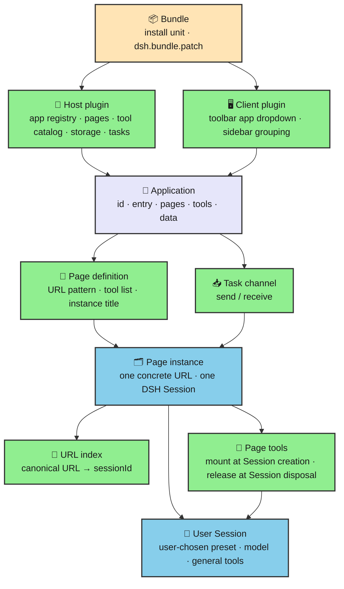
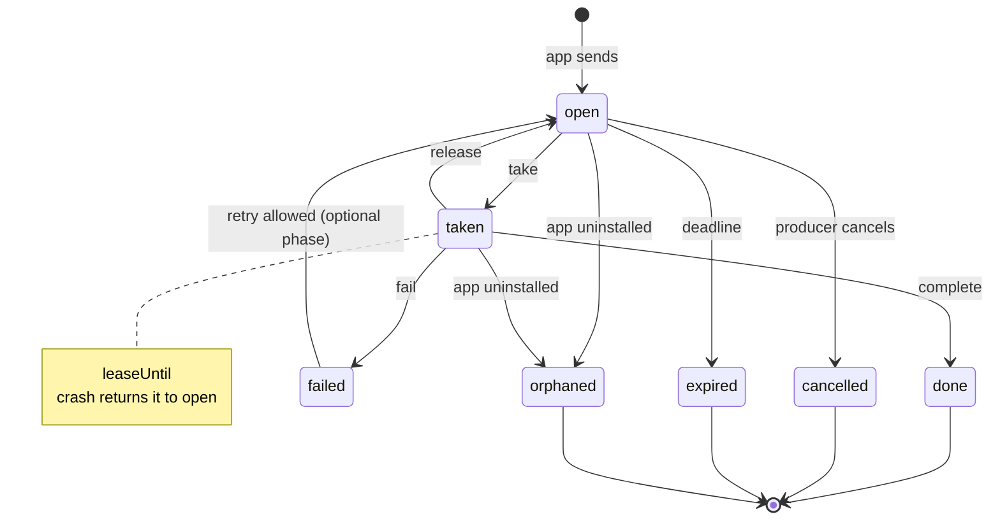
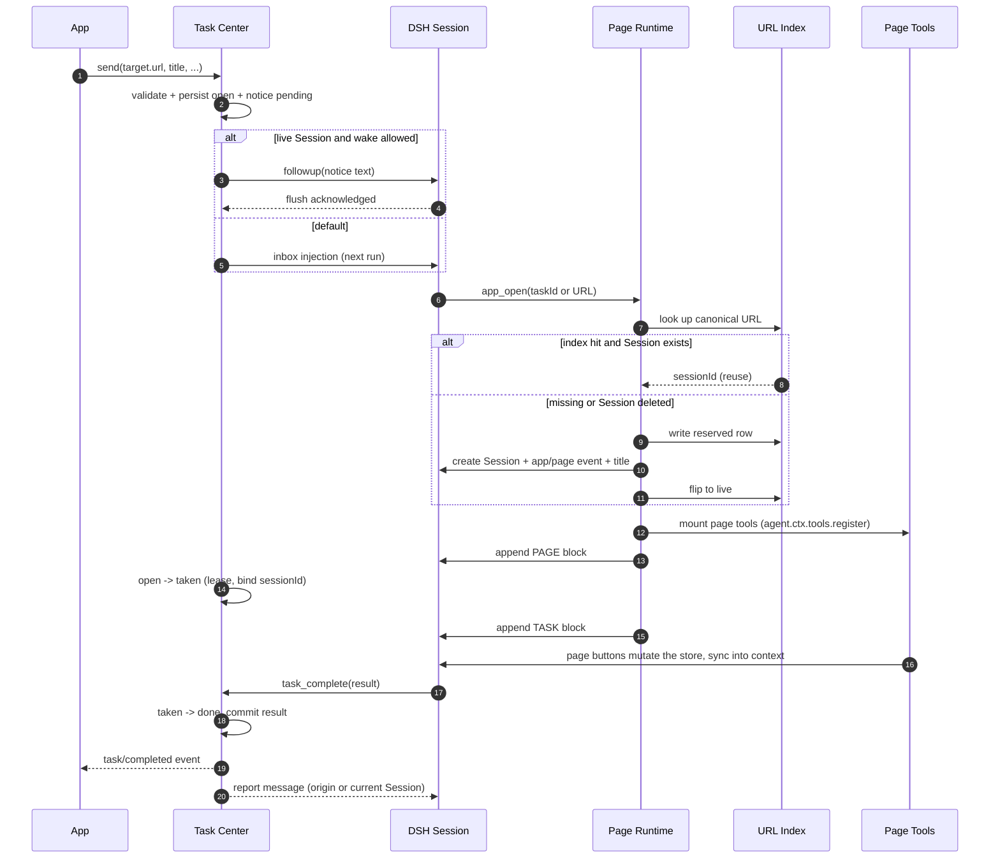

# Applications: A Base Framework for the Veren / DSH Plugin System

English | [中文](application-concept.cn.md)

**Audience:** DSH plugin developers, page-runtime maintainers, and agent-product designers.

**Prerequisites:** Cordis plugins and Services, agent presets, DSH Sessions, the `@veren/prompt-page` page model, and DSH bundle/profile installation (a profile is the run configuration that records which plugins are installed).

**Status:** design draft, revised after three rounds of user decisions. This document changes no code, creates no package, and touches no test. All types and interfaces below are **illustrative**: they state fields and responsibilities, not a final API.

> **Three hard constraints in this revision (decided by the user):**
> 1. **One Session, one page; switching pages inside a Session is forbidden.** To change pages, create or reuse another page Session.
> 2. **One URL, one page instance.** `/task/1` and `/task/2` are two different page Sessions; the full URL (concrete path parameters and query string included) is the page instance's primary key and the key to Session reuse.
> 3. **Add an app dropdown to the composer toolbar**, next to the preset selector; no separate app launcher or app home.
>
> Pages are no longer bound to any preset (decided in the previous round); presets return to being the user's general configuration. Page tools mount when the Session is created and release when it is destroyed. Rejected options are recorded in §9.1.

---

## 0. Conclusions first

The system already has pages, but it has no applications. A page is a row in a deployment-wide registry; whoever registers a URL first owns it. Pages are also wrapped as agent presets, one preset per page. So everything an application should own — the entry, the page set, attribution, tasks, notifications, uninstall cleanup — is scattered inside whichever plugin happens to use the pages. `page-sync-bench` prototypes half of it: tasks, pages, buttons, state sync. Its tasks live in memory, its pages belong to nobody, and navigation only writes a line of text into the context.

This design adds four things:

1. **An application layer** — a stable id, an entry page, a page set, a tool catalog, and a task channel. An application is what a person installs and opens; plugins are how it is implemented.
2. **A page-instance layer** — one URL is one page instance, and a page instance maps one-to-one to a DSH Session; page tools mount when that Session is created and release when it is destroyed.
3. **A task center** — a host-level durable work queue. Apps submit tasks, a person sees them in an inbox, an agent opens the Session for the task's URL, completes it, and reports the result back to the app.
4. **Namespaces and lifecycle** — the app id flows into page URLs, storage domains, task kinds, and tool-name prefixes. A URL index makes "the same URL returns to the same Session" true across restarts, and tasks do not silently evaporate when an app is uninstalled.

### 0.1 The five acceptance questions

| Question | Short answer | Detail |
| --- | --- | --- |
| What fields define an app, and what happens when one is installed? | `id`, name, description, entry page, version/owner, optional permissions and tool prefix. Install = install the bundle → Loader activates the host plugin → the plugin registers with `ctx.apps` → registers pages and the tool catalog → declares a task channel → opens its own storage domain. **No preset is registered.** | §2.3, §7.1 |
| How is the entry page declared, and how does in-app navigation work? | The app definition names an entry page key (`entry: 'list'`). Selecting the app opens the entry page's Session. **There is no "navigate inside the app" action**: each page link belongs to another page Session; following it switches Sessions, not pages inside the current one. | §3.2, §3.4, §3.8 |
| What does a task go through, and what does the notification look like? | App `send` → task center persists → notice delivery → the person/agent opens the task URL → the URL index finds or creates the Session for that URL → page tools mount with the Session → work completes → `task_complete` stores the result → `task/completed` fires and the origin Session is told. The notice is a short message with the task id, app name, title, page URL, and completion instruction. | §4.4, §5.1–§5.5 |
| How do many apps avoid URL collisions and tool-name collisions, and how are they isolated? | Every page URL is `/apps/<appId>/<local path>`; every page tool is `<appToolPrefix>__<local name>`, so collisions disappear by construction. Isolation is naming, ownership, and data-domain isolation — not a security sandbox. | §6.1–§6.3, §3.4.3 |
| What happens to pages, tools, and in-flight tasks on uninstall or disable? | Page = Session: archiving/deleting the Session releases tools with the agent scope. On app uninstall/disable/hot reload, the app fiber's cleaner removes the tools from every live page Session and marks those Sessions "app unavailable". In-flight tasks are never deleted: disabling stops delivery and leases return work to the queue; uninstalling marks tasks `orphaned`. | §7.2, §7.4, §3.4.4 |

---

## 1. Current state: how a page lives today

### 1.1 Three pieces

**A page definition** is a plain object in `@veren/prompt-page`: `name`, `url`, `description`, optional `preset` and `events`, and a `tree(params, state)` function. `definePage` validates only the obvious: a non-empty trimmed name, a URL starting with `/` and carrying no query string, no duplicate `:param`, a non-empty description. It does not know who owns the page or how many other pages exist.

**The page registry** is the host-level `PageRegistryService` (service name `pageRegistry`), backed by an array. `register` throws on a duplicate page name or duplicate URL pattern. `resolve(url)` scans in registration order, matches the first page, and merges path and query parameters (path wins on a collision). `catalog()` returns every page as `{ name, url, description }`. It is a **deployment-wide singleton**: child session scopes reach the same instance through `inject: ['pageRegistry']`.

**A page-session** is created by `mountPage`. It is not a DSH Session. It owns a separate `MessageHost` with its own version chain and snapshot baseline, binds to an external store, re-renders the page tree when the store changes, and appends the rendering as `SNAPSHOT` / `PATCH` messages. `mountPage` also produces a pointer message (`OPEN /task-detail/t-12 {"taskId":"t-12"}`), by convention the first user message of a new session. So "one page = one page-session, and a page-session is not a DSH Session" is the basic fact today — this design removes that gap: **the page instance is the DSH Session.**

### 1.2 What "opening a page" actually does

In `page-sync-bench`:

1. The `composition` role creates a `TaskStore` in the host scope, registers three pages, and dynamically registers one agent preset per page (`page.<name>`: system prompt + tool rows + a context row).
2. A person picks `page.task-list` for a new session. DSH creates the Session; the preset's `context` row resolves the page from `pageRegistry.get('task-list')` and mounts a page-session.
3. Before every model request, `agent/pre-step` renders the page-session's delta since the last cursor into messages and appends them to the context. Store changes automatically flow into the model this way.
4. The model calls the page's button tools (`take_task`, `complete_task`); tools mutate the store; the store re-renders; step 3 repeats.
5. The `open_page` tool resolves a URL, unsubscribes the current page-session, and mounts the next one.

This works for one page, one source, and one active page. Step 5 is exactly what this revision forbids: **switching pages inside a Session.** Doing so leaves the tool set, system prompt, and task context half-old and half-new, at a cost far larger than the benefit.

### 1.3 Pages have no owner

Nothing answers "which application owns this page":

- Page names and URLs are globally unique. Two plugins that both want `/list` fail at registration — at load time, so the person sees "the plugin will not install", not "two apps collided".
- Every model session sees every page: the `page_catalog` tool lists them all, with no "this app only" view.
- One page becomes one preset, so three pages add three entries to the preset picker; ten pages add ten. The person sees a page list, not an app entry.
- Page state is a module-level singleton (`pageRuntime.store`), and `activeSession` is a single variable in the composition closure. Two DSH Sessions that "open a page" overwrite each other; there is no per-session current page.
- `onLoad` and `onComplete` are declared on `PageDefinition` but nothing in the repository calls them. The lifecycle hooks are decoration.

### 1.4 Where it hurts

| Symptom | Root cause | Cost |
| --- | --- | --- |
| The second app cannot install; URL duplication | Flat, global registry namespace | Every app must negotiate paths privately; more apps, more collisions |
| The preset picker is flooded | Page = preset, entry = some page | Users cannot tell where to start; an app has no home |
| "Navigate" does nothing | `PageIO.navigate` only calls `session.host.note('NAVIGATE …')`; `open_page` only swaps the tree | Pages do not really navigate; the system prompt and tools still belong to the old page |
| Two sessions fight over one page | `activeSession` is host-wide | Concurrent sessions cross-contaminate |
| Tasks vanish on restart | In-memory store, no persistence | A demo, not a workbench |
| Tasks have no lifecycle | Only `open/taken/done`; no failure, expiry, cancel, lease | Crashes leave tasks stuck "in progress" |
| Tasks never reach a person outside a session | Only Cordis events and in-page `append` | No inbox, no "notification arrived" |
| Uninstall leaves state behind | Pages release with the fiber, but stores and tasks have no owner or cleanup contract | Hot reload and reinstall inherit stale state |

The real gap is not the page runtime. It is **the missing ownership layer above pages**: who owns the pages, which state they share, where the entry is, and which lifecycle they follow.

### 1.5 Parts worth reusing

| Capability | Existing implementation | Why it matters here |
| --- | --- | --- |
| Durable storage domains | `@veren/notebook` and `@veren/forum` open `storageDomain`s (JSON or SQLite), closed with the plugin | The URL index, task center, and app data share one persistence mechanism |
| Notification delivery discipline | `plugins/forum/src/session-link.ts` and `notifications.ts`: write the durable row first, then attempt the wake, confirm with `ctx.sessions.flush`, degrade on failure | Task notices copy "write → deliver → confirm" |
| Session directory and recovery | `ctx.sessions` / `ctx.agents` / `workspaceRegistry` find Sessions by id, restore archived ones, and check liveness | The URL index only stores a sessionId; everything else stays with the Session system |
| Scoped tool registration | Calling `ctx.tools.register` through `agent.ctx` gives a registration that is both visible to that agent and released with that agent's lifetime | The mechanism behind "page tools live and die with the Session" |
| Session titles | DSH's `session/title` event and rename surface | Readable page-instance titles and session list |
| Install unit | A bundle declares `dsh.bundle.patch`; member plugins ride as plain dependencies | Apps need no new distribution format |
| Plugin manager | Install, enable, disable, uninstall, compatibility prompts | App lifecycle maps onto existing bundle operations |
| Composer toolbar | `conversation.hero.options` (New Session row, right of workspace/preset) and `conversation.session.header.actions` (existing Session header) | Where the app dropdown and current-app label live |
| Person identity | DSH `identity`, local profile | The first task recipient is "the person on this machine" |

One current fact must be explicit: **a Web GUI page is not a browser URL today.** Panel switching goes through the layout store's `selectPanel(panelId)`; a sidebar entry is a `sidebar.panellist` row. The repository has no route that maps the browser address to a panel or Session. So the "page URL" here first of all belongs to the `@veren/prompt-page` world (for example `/apps/review-workbench/review/pr-42`), where it travels through model messages, tasks, and tools. Making it clickable in the address bar is a later phase.

---

## 2. What an application is

### 2.1 Definition

**An application is an installable product unit: a stable id, one entry page, a set of pages, a tool catalog, its own data, and a channel that can send and receive tasks.**

A person installs the app, opens the app, uninstalls the app. Plugins implement it; a bundle brings the implementation in. The person does not need to know either layer.

| Concept | Answers | Today |
| --- | --- | --- |
| Plugin | A loadable piece of code that provides capabilities | Exists, the only organizing unit |
| Bundle | What one installation inserts; declares `dsh.bundle.patch` | Exists, the market's install unit |
| Application | The product a person sees: entry, pages, tools, tasks, data | **Missing — this document's layer** |
| Preset | **The user's own general configuration**: model, system prompt, general tool rows, approval posture | Exists; today pages abuse it as "one per page", and this revision restores its role |
| Session | One actual conversation and its log; in this design, one page instance is one Session | Exists, owned by DSH |

The boundary in one sentence: **a preset decides what kind of assistant you are working with; an app decides what product you are in; a page instance decides which concrete record you are handling.**

### 2.2 Why an app is neither a plugin, a bundle, nor a preset

**Not a plugin.** An app usually needs more than one piece of code: a host plugin for pages, the tool catalog, storage, and the task channel; a client plugin for the toolbar entry and panels. Calling all of that "one plugin" destroys a single object for install, uninstall, and permissions. Conversely, a plugin can provide a capability without being an app (`page-registry` is exactly that).

**Not a bundle.** A bundle is only a list of Loader rows. It has no runtime identity and should not be visible to people. "I installed the review workbench" names an app, not "I installed three npm packages".

**Not a preset.** A preset is the user's own choice: which model, what tone, which general tools. An app must not register a preset, and must not require the user to "switch to some preset" before a page opens. An app provides pages, page tools, a task channel, and its own data; those attach to **the Session the user already chose**.



### 2.3 Fields

Application metadata is expressed in two places, but **every fact has exactly one authority**:

- **Pre-install display** may live in the bundle's `package.json` (`dsh.application`: `id`, `name`, `description`, `entry`). It lets the market show "this is an app, here is its entry" before installation and lets the plugin manager detect an id conflict before touching the profile.
- **Runtime behavior** is declared by the host plugin through `ctx.apps.register(...)`: the same id, entry, app-level instructions, page registration surface, tool catalog, task capabilities, and permission requests. Runtime is authoritative; if `package.json` also declares the app and the two disagree, fail loud (`app/manifest-mismatch`).

Fields:

| Field | Type | Requirement | Why |
| --- | --- | --- | --- |
| `id` | Stable slug (a URL-friendly short identifier), e.g. `review-workbench` | Yes | Flows into URLs, storage domain, task ownership, default tool prefix; immutable after install |
| `name` | Display name | Yes | App list, task notices, toolbar dropdown |
| `description` | One sentence | Yes | Catalog and store; non-empty like a page description |
| `entry` | In-app page key, e.g. `list` | Yes | The landing point of "an app has one entry page"; validated at activation |
| `owner` | Providing package | Derived | From the registering fiber; uninstall and permission checks read it |
| `version` | semver | Derived | From the bundle; snapshotted onto page instances and tasks for upgrade checks |
| `permissions` | Capability list | No | Empty by default; page tools may only require capabilities granted here |
| `toolPrefix` | Tool-name prefix | No | Defaults from the id (hyphens become underscores); host-wide unique, ≤32 chars |
| `instructions` | App-level context note | No | Short note in the PAGE block when any page of the app opens; **not a system prompt**, never changes the user's preset |

```ts
/** App identity: stable after install, present in every namespace. */
interface ApplicationDefinition {
  readonly id: AppId
  readonly name: string
  readonly description: string
  /** In-app page key, not a URL. The host builds the URL. */
  readonly entry: PageKey
  /** App-level context note, not a system prompt. */
  readonly instructions?: string
  /** Page tool-name prefix; defaults to appId with hyphens replaced. */
  readonly toolPrefix?: string
  readonly permissions?: readonly AppCapability[]
}
```

`AppId` should be a brand (a string with a type tag) with zero runtime cost, and must satisfy a readable slug rule: lowercase letter first, only lowercase letters, digits, and hyphens, at most 32 characters, and never a reserved word (`api`, `apps`, `system`, `__global__`).

### 2.4 One plugin, how many apps?

**Default: one bundle, one app. One app may span several plugins. Phase 1 forbids a single bundle from registering multiple apps.**

Reasons:

- The install unit is the bundle; the person's mental model is "install one thing, get one app". Two apps in one package turn uninstall, permissions, and task ownership into "which one?", while the installer still has one switch.
- A host plugin plus a UI plugin is normal, not "multiple apps". Treat them as implementation plugins of the same app.
- If a suite genuinely ships several apps, publish a **suite bundle** whose members each declare their own app, rather than one plugin registering several ids. Id conflicts, permissions, and uninstall stay one-to-one.

Uniqueness is enforced by the registry: a duplicate registration throws. If `package.json` declares the id, the plugin manager can pre-check and reject the conflict before installing.

### 2.5 App store, install, uninstall

The market only understands bundles: it lists packages that declare `dsh.bundle.patch`, and installs the pinned version from the index. That path needs no change.

What apps add is **presentation and semantics**:

- Store cards say "application", with app name, summary, icon, entry page, and requested capabilities.
- Installing an app = installing its bundle. Whether the app appears depends on successful host registration. A registration failure (duplicate id, missing entry, incompatible version) must surface as "installed, but the app is unavailable" with a stable code, not as a success.
- **Install and update never add anything to the preset picker.** Apps do not register presets; choosing a preset is the user's business.
- Uninstalling an app = uninstalling its bundle. App data does not follow the package (see §7.4), so uninstall is not "drop the database".
- Updating an app = updating the bundle. The app id stays; page instances and tasks follow §7.3.

In one sentence: **an application is the runtime personality of a bundle, not a new distribution format.**

---

## 3. Applications and pages

### 3.1 Attribution: register a page against an app

Page registration changes from "one global row" to "a row inside an app":

```ts
// Illustrative: authors still write short names and short paths.
const pages = ctx.apps.pages('review-workbench')
const dispose = pages.register({
  name: 'review',                       // unique inside this app
  url: '/review/:pr',                   // local path, no /apps prefix
  description: 'Review the changes in one PR',
  // Tools this page needs; local names from the app catalog, not global names.
  tools: ['read_diff', 'submit_verdict'],
  // Copy for the model, carried by the page instance, not the preset.
  instructions: 'This is a review page: read the diff, then conclude; cite files and lines.',
  // Title of one concrete instance in the session list.
  instanceTitle: (params) => `Review PR #${params.pr}`,
  // Page contract version: +1 when the URL/tool names/copy change incompatibly (§7.3).
  pageRevision: 1,
  tree: (params, state) => <ReviewPage pr={params.pr} state={state} />,
})
```

The snippet shows one page; the sample app's `inbox` entry is registered the same way, with a parameterless `url`.

The host does four things at registration:

1. Normalizes `name` into a global page key `appId/pageName` (for example `review-workbench/review`) and deduplicates by that key.
2. Prepends the URL pattern to `/apps/<appId>/<url>`. Local paths are compared only inside the app, so two apps can both own `/list`.
3. Records the `owner` (which package, which fiber). Only the same app may unregister the row; anyone else gets `app/forbidden`.
4. Validates that every `tools` reference exists in the app catalog, `pageRevision` is a positive integer, and `instanceTitle` is a function when present.

`PageDefinition` follows: **`preset` is deleted** (a page no longer carries a system prompt), and `tools`, `instructions`, `instanceTitle`, and `pageRevision` are added. `tools` names come from the app tool catalog, not the final model-facing names; the final names get the app prefix at mount time (§3.4.3). `instructions` is page copy for the model, not a system prompt. During migration, a page without `pageRevision` defaults to `1`, and a missing `instanceTitle` falls back to `description`.

### 3.2 Entry: a page key in the app definition

The entry is not a URL and not "the first registered page". It is an explicit field:

```ts
ctx.apps.register({
  id: 'review-workbench',
  name: 'Review Workbench',
  description: 'Take review tasks and conclude them one by one',
  entry: 'inbox',                 // in-app page key
  instructions: 'The workbench takes review tasks and returns conclusions to the task center.',
})
```

Activation checks that the entry page exists; otherwise fail loud (`app/entry-missing`), mark the app `broken`, and show the reason in the toolbar dropdown and app list. **Do not fall back to "the first page"**: registration order would become an implicit contract, and reordering registration would silently change the home page.

The public entry URL is `/apps/<appId>/<entry path>`. Selecting the app in the toolbar opens the page instance Session for that URL (§8.2).

### 3.3 Discovering the page set

There are two views, and **no flat global page catalog**:

- **Inside the app (model and pages):** `app_pages` returns only the current app's pages (key, URL pattern, description, whether it is the entry, which tools the page mounts, page contract version). The page copy says "this app has these pages"; the model uses that to decide which URL to open. This replaces today's `page_catalog`.
- **Outside the app (people and host):** people see the toolbar's app dropdown and the sidebar's app grouping, not a page list; the dropdown leads to the entry, the session list leads to concrete page instances.

The two-level structure is deliberate: pages grow with apps. A flat list means every model request reads every app's internal pages — wasted tokens and leaked implementation detail. The cost is that a cross-app jump is two steps, which is the boundary the product wants.

`catalog()` currently returns URL **patterns** (with `:param`), not concrete URLs. The app catalog should expose both: patterns for display, `format(entry, params)` for an address that can be opened. Tasks store canonical URLs (§4.2).

`app_list`, `app_pages`, `app_open`, and `task_list` are host-level tools visible in every Session. This is a deliberate bootstrap belt: the model must be able to discover apps, open pages, and see tasks before page tools exist. It is small, its schema is stable, and it does not change with the page, so it is cache-friendly. The page's own tools are not in this global set.

### 3.4 Page instance = Session: one Session belongs to one page

This is the core of the revision:

- **A page instance maps one-to-one to a DSH Session.** From creation to archive/delete, a Session belongs to exactly one page URL;
- **Switching pages inside a Session is forbidden.** There is no "open another page in this Session", no "replace the current page", no "return to the old page";
- Page tools mount once when the Session is created (or resumed), then stay unchanged until the Session is destroyed;
- Page copy is written once as the `PAGE` block at the start of the Session;
- Opening another page = creating or reusing **another Session**, then the GUI selects that Session.

A navigation button inside a page does the same thing: it calls `app_open(target URL)`, the page runtime finds or creates the target Session, and the GUI switches to it; the current Session's page, tools, and history stay untouched.

#### 3.4.1 What the one-to-one rule removes

The previous revision designed for "switch pages inside a Session": remove old tools, append `PAGE closed`, maintain a generation, reconcile leftovers, roll back the old page. None of that is needed now:

| Previous mechanism | Still needed? | Why |
| --- | --- | --- |
| Remove old tools / mount new tools on switch | No | There is no second page in the Session |
| `PAGE closed` | No | The page ends when the Session is archived/deleted |
| Per-page generation checks | No | The tool set is fixed for the Session's lifetime |
| Rollback after a failed switch | No | A failed Session creation simply creates nothing; there is no "old page already removed" state |
| Delta mounting | No | Same reason |
| Hand-off between page tools and the page-session subscription | No | They live and die together |

Only three fallbacks remain: **Session disposal, app uninstall/disable, and app hot reload.** Why is in §3.4.4.

#### 3.4.2 Page tools mount when the Session is created

Tools are defined in the app-level catalog; pages only reference local names:

```ts
// The app registers its tool catalog when it activates (illustrative).
// Tool bodies are DSH `ToolDefinition`s produced by `defineTool` from
// @deepseek-ai/dsh-tools — no second tool shape. App-side metadata such as
// capabilities rides the registrar's second argument (recorded, not enforced,
// in phase 1).
const tools = ctx.apps.tools('review-workbench')
tools.define(
  defineTool({
    name: 'read_diff',
    description: 'Read the diff of the current PR',
    parameters: { pr: { type: 'string', required: true } },
    output: { schema: { type: 'object', additionalProperties: true }, render: renderValue },
    execute: async (args, exec) => readDiff(args.pr, exec),
  }),
  { requires: ['files:read'] },
)
```

When a page Session's agent is created or resumed, the page runtime registers the tools for the Session's bound page on `agent.ctx` as part of that create/resume flow:

- The final name is `<toolPrefix>__<local name>`, for example `review_workbench__read_diff`;
- The registration is visible only to that Session's agent;
- Its lifetime follows the agent scope: it releases when the Session is destroyed;
- The page tool set is **fixed** for the Session's lifetime, so the tool schema in the system prompt is determined once at Session start/resume; no page-switch cache invalidation.

Page copy is appended once as a `PAGE` user message at the start of the Session:

```text
PAGE review-workbench/review {"pr":"42"}
Page tools: review_workbench__read_diff, review_workbench__submit_verdict
Instructions: review page: read the diff first, then conclude; cite files and lines.
```

If the app defines `instructions`, its section comes first. The `PAGE` block is the page instance's opening statement and is never rewritten; it satisfies "anything model-visible is reconstructable from the log".

#### 3.4.3 Tool-name collisions: app prefix, never last-write-wins

Two apps that both define `complete_task` do not collide, because the model sees:

```text
task_workbench__complete_task
review_workbench__complete_task
```

Rules:

- **Unique inside an app** — the catalog deduplicates by local name; a duplicate throws at registration (`app/tool-duplicate`).
- **Cross-app namespace** — final name = `<toolPrefix>__<local name>`. The prefix is allocated when the app registers and is host-wide unique; a duplicate prefix rejects installation (`app/tool-prefix-conflict`).
- **Prefix format** — lowercase letter first, only lowercase letters, digits, and underscores, ≤32 chars; local name ≤24; final name ≤64 (the common tool-name limit).
- **No shadowing, no silence** — if a final name collides with an existing **non-page** tool in the Session (for example a plugin happens to use that name), Session creation fails before any state change (`page/tool-conflict`) and asks for a different prefix. A page tool never overwrites a tool from the user's preset.
- **Relation to host tools** — `task_complete`, `app_open`, and friends are global; page tools are prefixed, so they never share a name. The model is not confused because the PAGE block lists the exact page-tool names.

Why prefix instead of "local names + reject on conflict":

- Local names make the same page behave differently per preset: if the preset happens to define a same-named tool, the page cannot open; otherwise it can. That violates "page behavior is independent of the preset".
- Last-write-wins is a privilege hole: a page could replace `read_file` or `task_complete` without the user noticing.
- Prefixing is the only option that satisfies "works under any preset", "many apps coexist", and "never overwrite". The cost is longer names; a short `toolPrefix` and the exact list in the PAGE block keep it manageable.

#### 3.4.4 Removal and fallbacks: only three paths remain

| Path | Trigger | How tools release |
| --- | --- | --- |
| Session disposal | The Session is deleted, or its agent is disposed | Tools are registered on `agent.ctx`; the agent scope releases them |
| App uninstall/disable | The app fiber is disposed | The app-fiber cleaner walks every live page Session of the app and removes its tools; the Sessions remain as "app unavailable" |
| App hot reload | The host plugin reloads during development | The old fiber's cleaner removes the old tools first; the new fiber, when activated, re-mounts the current version's tools on live page Sessions (§3.4.5) |

Why only these: the page and the Session live and die together; there is no state where "the Session lives but the page changed". Session disposal is the normal exit, app lifecycle changes are external exits, and hot reload is the development exit.

**Fallback order:**

1. Normal path: Session disposal releases tools through the agent scope;
2. App lifecycle: the cleaner removes tools when the app fiber disposes, regardless of whether the agent is still alive;
3. Hot reload: the new fiber re-mounts on live Sessions after confirming the old registrations were released;
4. Crash: the process died, so the agent scope and tools died with it; if the process lives but the page runtime throws, the Session survives, the tools still belong to the agent scope, and the next open re-mounts the current version or marks the Session stale (§7.3).

**"What if removal fails?"** There is no half-removed state now: tools are registered as a group on the agent scope, so disposing the agent releases the group; the app cleaner removes "all page Sessions of this app" one sessionId at a time, so a single failure only affects that Session and records `page/binding-release-failed` for reconciliation. A leftover tool can only exist in the window where the process is alive and the app cleaner has not finished; the next open reconciles before mounting.

#### 3.4.5 Resume, hot reload, and crashes

- **Session resume** — read the `app/page` event from the log (§3.5) and check that the app/page/page contract is still usable. If so, mount the current version's page tools and PAGE copy (the log's PAGE block is not appended again); if not, enter the stale flow (§7.3).
- **Hot reload** — when the app plugin reloads, the old fiber's cleaner removes the old tools from live Sessions; after activation, the new fiber re-mounts according to each Session's bound page. Names and schemas are the same; no new PAGE block, no change to the page binding.
- **Crash** — a process crash takes everything with it. A Session-level error (store subscription, rendering) is caught by the page runtime, records `page/crashed`, keeps the Session, and shows an error with a "reload" action. Reload = re-mount the current version, not switch pages.
- **Archive** — archiving disposes the agent and releases tools; the index is kept (§3.5), so opening the URL later restores the archived Session and re-mounts.

#### 3.4.6 Rejected option: switching pages inside a Session

**The user decided against in-Session page switching / replacing the current page.** The original argument was "fewer Sessions, continuous context", but the costs were:

- two page tool sets and two page-copy blocks in one Session, easy for the model to mix up;
- tools, system prompt, and task block were not committed together, producing "new page, old tools";
- task binding, page state, and Session title lost their single owner on every switch;
- making the switch clean required generations, rollback, reconciliation, and `PAGE closed` — high complexity for uncertain benefit.

Now "switch page = switch Session": continuity is carried by the session list and task center, in exchange for each Session having one meaning, one index entry, and one recovery path.

### 3.5 The URL is the page instance key: a durable index

#### 3.5.1 Canonical URL

A page instance is keyed by its **canonical URL**, not by the page pattern and not by sessionId. Rules:

1. Path normalization: leading `/`, no trailing `/` (except root), consistent percent-encoding (decode then re-encode per RFC 3986);
2. The query string participates in identity: `/task/1?tab=diff` and `/task/1` are different instances;
3. Sort query keys (and values for repeated keys); drop an empty query string;
4. No host/scheme normalization: this is an in-system path, not an external link;
5. Fragments (`#...`) are rejected; they are not part of page identity.

The canonical URL is the one value shared by tasks, the index, notices, and tool arguments; the `params` a page author sees come from the same parser.

#### 3.5.2 Index table

> **The semantics have been reversed (user decision, §9.1)**: opening a page URL **always creates a fresh Session**; the previous Session on that URL is deprecated. The URL index is therefore no longer "identity recovery" (the old design of "reopen the same URL and land back in the original Session" is abandoned); it only answers two questions: **which Session is currently live on this URL, and which Sessions in history were deprecated.**

The index is a host-level durable storage domain `app-pages`, table `instances`, with two key spaces:

- **Current-pointer rows**: keyed by canonical URL, at most one row per URL (`reserved` / `live`);
- **Deprecated-history rows**: keyed `deprecated:<sessionId>` (canonical URLs start with `/`, so the key spaces never collide).

| Field | Meaning |
| --- | --- |
| `url` | Canonical URL (history rows keep their source URL) |
| `sessionId` | The page instance's DSH Session; globally unique |
| `appId` / `page` | For app grouping and uninstall cleanup |
| `params` | Parsed parameter snapshot |
| `appVersion` | App version at creation |
| `pageRevision` | Page contract version at creation |
| `title` | Instance title (§3.6) |
| `state` | `reserved` / `live` / `deprecated` |
| `createdAt` / `lastOpenedAt` | Instants |
| `deprecatedAt` | Deprecation instant (deprecated rows only) |

Constraints: `url` unique (among current-pointer rows), `sessionId` globally unique. One Session cannot belong to two URLs.

**Why the two-phase `reserved → live` create stays**: it is no longer a re-entry lock guarding "concurrent duplicate opens with reuse"; it is crash safety — a crash mid-creation leaves at most a `reserved` row (sweepable at boot) and never records a half-built Session as a live pointer or a deprecated-history row. Convergence for concurrent duplicate opens is in §3.5.3.

#### 3.5.3 Protocol for opening a URL (always fresh + deprecate the previous one)

1. **Resolve and validate** — canonical URL, app installed and enabled, page exists.
2. **Deprecate the previous Session** (when the index has a current row, release in this order):
   1. **Strip page tools** — dispose the old Session's page tools as a group;
   2. **Release task leases** — release every `taken` lease the old Session holds (§4.4). Without this step, a fresh Session opening the same URL gets `already-taken` — the task is held hostage by a deprecated Session;
   3. **Write the deprecated marker** — move the current row to the `deprecated:<sessionId>` history key, freeing the URL. The old Session itself is **not destroyed**: it becomes an ordinary Session, still readable, but it never gets another PAGE block, never has page tools mounted, and is never addressed via the URL again.
3. **Create (two phases)**: mint sessionId → write the `reserved` row → create the DSH Session → mount tools → write the PAGE block → flip to `live`.
4. **Return** — `{ sessionId, title }` (opens always create; the result IS the fresh Session); the GUI selects that Session.

**Failure convergence** — no step can leave "two Sessions both believing they are live":

- tool-strip / lease-release failure: affects only the old Session; the deprecated marker is still written (the old Session must not be URL-addressable anyway);
- deprecated-marker write failure: the whole step aborts, the old Session remains the index's live row, the next open retries the deprecation;
- fresh-Session creation failure: half-built Session cleaned up + `reserved` row deleted; the old Session is already deprecated and the URL has no live Session — the next open retries.

**Concurrent duplicate opens**: index writes are serialized (FIFO). When two openUrl calls race, the later one deprecates the `reserved` row the earlier one just wrote; the earlier commit then fails and cleans up its half-built Session. The result converges to "exactly one live Session"; the earlier caller gets an error.

#### 3.5.4 Restart, deletion, rebuild

- **Restart** — the index is durable; after a restart the URL row still points at **the latest live Session**. Only the next open of that URL creates a fresh Session and deprecates it. Deprecated-history rows survive restarts and stay readable; an old Session is never mistaken for the live one.
- **Deletion** — when a Session is deleted, opening the URL finds `ctx.sessions.get` empty, deletes the row, and creates as if no row existed.
- **reserved startup sweep (implemented)** — at boot, probe `reserved` rows for liveness (delete those whose Session is gone, `KvPageInstanceIndex.sweepReserved`); without a liveness probe, touch nothing — no confirmation, no pretend.
- **Index loss/corruption** — the `app/page` event in the Session log is the source of truth; the rebuild scan belongs to phase 2 (the phase-1 Session port has no "enumerate sessions / read session logs" face). Note the reversed semantics make rebuilds trivially safe: **any URL can simply be created fresh**, so a rebuild only restores the "which URLs have a live Session" bookkeeping; slowness can no longer create duplicate instances.

#### 3.5.5 Comparison with forum's `SessionLink`

| Dimension | forum `SessionLink` | Page URL index |
| --- | --- | --- |
| Key | preset id → live Session | canonical URL → current live Session |
| Durability | in memory, lost on exit | durable across restarts |
| Conflict policy | a later Session overwrites the earlier one | one live Session per URL (reopen = deprecate the old one) |
| Purpose | deliver a notice to "the Session working for this preset" | record "which Session is live on this URL + which were deprecated" |
| Failure handling | no live Session → keep in the inbox | missing Session → drop the row; the next open creates fresh |

What we borrow is forum's **delivery discipline**: write the durable row first, perform the side effect second, degrade and record on failure, never pretend success; use `ctx.sessions.flush` to confirm the message really landed. What we do not borrow is its preset key and in-memory map: page identity must be the URL and must survive restarts.

#### 3.5.6 Walkthrough: `/task/1`, `/task/2`, and a restart

Suppose `review-workbench` has the page `/task/:id`:

1. Open `/apps/review-workbench/task/1`: the index has no row → write `reserved` → create Session A → write `app/page` and the title "Task #1" → flip to `live` → mount `review_workbench__*` tools and the PAGE block.
2. Finish and open `/apps/review-workbench/task/2`: a different canonical URL → create Session B; Session A stays exactly as it was, with its tools and page untouched.
3. Open `/apps/review-workbench/task/1` again: **create Session C** (no reuse of A); A's tools are stripped, its leases released, and it is marked deprecated; the index now points at C. A's history remains readable in the session list.
4. After restarting DSH: the URL row still points at C (the latest live Session, preserved across restarts); only the next open creates D and deprecates C.
5. The app is upgraded and `pageRevision` changes: no `page/stale` refusal anymore — opens always create, so the fresh Session naturally uses the new page version (§9.1).

### 3.6 Session titles and grouping

One Session per page instance means the list grows quickly; without titles and grouping the workbench is unusable.

#### 3.6.1 Instance titles

The page definition provides `instanceTitle(params)`:

- with params: `/task/:id` → `Task #1`;
- without params: use `page.description`, or app name + page name;
- cap at 60 characters; truncate beyond;
- write it into `session/title` (or rename immediately after creation) and into the index's `title`;
- a later user rename wins; app upgrades never overwrite an old Session's title.

A page instance opened from a task prefers the task title (for example "Review PR #42"), falling back to `instanceTitle`, so the task list and the session list agree.

#### 3.6.2 Session list grouping

The sidebar keeps the workspace as the first level; app Sessions fold into an app group at the second level:

```text
cursour
  ├─ Review Workbench      (app group, collapsible)
  │    ├─ Task #1
  │    └─ Task #2
  ├─ Task Workbench
  │    └─ Task #7
  └─ Plain Sessions
       └─ …
```

- Page Sessions carry an `app` projection (appId, name, icon, page, url); the sidebar groups by it;
- app groups default to expanding the 1–2 most recently used, collapsing the rest; the group header shows the app name and instance count;
- provide an app filter (sidebar search or filter chip) and an "archive all page Sessions of this app" action;
- plain Sessions are not forced into an app; a Session without the `app` projection stays under "Plain Sessions".

**Will ten pages and five apps blow up the list?** Only URLs actually opened create Sessions; page definitions are not Sessions. Ten pages produce instances only for the ones the user opened. Note that after the semantic reversal (§3.5, §9.1), repeatedly opening the same URL accumulates Sessions (old ones are deprecated automatically but kept) — list growth is handled by the session list's own cleanup/archiving, and the URL index no longer papers over it with "reuse".

#### 3.6.3 Session and page projections

Append an `app/page` event to the Session log (declaration merging, append-only):

```ts
interface AppPageEvent {
  readonly appId: AppId
  readonly page: PageKey
  readonly url: string            // canonical URL
  readonly params: Readonly<Record<string, string>>
  readonly appVersion: string
  readonly pageRevision: number
  readonly title: string
  readonly supersededBy?: SessionId
}
```

This event is the source of truth for index rebuilds and the basis for sidebar grouping. It satisfies the DSH rule that anything model-visible is reconstructable: PAGE blocks and sync messages are already logged, and `app/page` adds "which page instance this Session belongs to".

### 3.7 Apps and workspaces

The toolbar's three selectors each answer one question:

| Selector | Answers | Source |
| --- | --- | --- |
| Workspace | Where the code is | User selection or the current Session |
| Preset | How the assistant works (model, persona, general tools) | User selection or the current Session |
| App | Which product you are working in | App registry |

**Recommendation: an app follows the current workspace and does not declare a default workspace.**

Reasons:

- A workspace is an environment choice — "where this code is". The same app should work against any repository. Hardcoding a default workspace makes the app unusable on another project and teleports the user into an unexpected directory.
- A page Session's working directory should follow the user's current choice, not the app's; the app needs "the current repo", not "one fixed repo".
- A task opened from a Session inherits that Session's workspace; opened from the toolbar, it inherits the current selection; with no selection, a page Session may have no workspace (some apps do not need files).

If the same URL already has a Session under another workspace, "one URL, one Session" reuses it and switches the GUI workspace to that Session's workspace; it never creates a second Session of the same URL in a different workspace. The UI must show this explicitly (the workspace selector displays the original Session's workspace), so the user does not think they landed in the wrong directory.

If an app wants "only read a fixed directory", that is a capability/configuration of its page tools, not part of app identity; do not put it in `ApplicationDefinition`.

### 3.8 Toolbar app dropdown: the only app entry

The user chose this entry shape: **add an app dropdown to the composer toolbar, to the right of the preset selector.** No separate app launcher, no app home.

The three selectors sit side by side and each answers one question (§3.7): **workspace = where the code is; preset = how the assistant works; app = which product you are in.**

Placement:

- **New Session row**: `conversation.hero.options` (the compact options area right of workspace and preset), item id `application`;
- **Existing page Session**: `conversation.session.header.actions` shows the current app (icon + name); clicking opens the same dropdown;
- The dropdown is fed by the app registry (Remote), with icon, name, and entry page; most recently used first, searchable beyond 8.

Interaction rules:

| Current state | What selecting an app does |
| --- | --- |
| Blank new Session (no messages, no draft) | Resolve the entry URL → look up the index: switch to an existing Session, or **adopt the current blank Session as the page Session** (create with the current workspace/preset, write the title, mount tools) so no extra empty Session appears |
| Blank new Session with a draft | Keep the draft; create/reuse the page Session for the entry URL; the blank Session stays |
| Plain Session | Open/reuse the entry page Session; the current Session is untouched |
| Page Session, same app selected | Jump to that app's entry page Session; if the current Session is already the entry, no-op (reuse) |
| Page Session, another app selected | Open/reuse the other app's entry page Session; the current Session is untouched |
| Page Session, "No app" selected | Not offered: a Session cannot turn from a page back into a plain Session; create a new Session instead |

Three points must be explicit:

1. **The app dropdown is an entry launcher, not a Session-mode switch.** It only decides "which page Session to open"; it never changes the current Session's page, tools, or title.
2. **Selecting the same app reuses; it does not create.** The URL index guarantees one live Session per entry URL; selecting it again focuses that Session.
3. **Page-instance jumps do not go through this dropdown.** The dropdown only reaches the app entry; a concrete instance (`/task/1`) is reached through a task notice, an in-page link, or the session list. One dropdown item per page would turn it into a page directory — exactly what we are avoiding.

Why no separate app launcher/home: the app entry already appears where the user already is (the New Session toolbar); a launcher page would make the user leave the conversation and come back, adding a step and a second entry state. The task inbox is a task-center panel, not an app launcher; do not mix them.

On the client, this is a client plugin: `ctx.slots.inject('conversation.hero.options', ...)` for the dropdown and `conversation.session.header.actions` for the current-app label; components receive only injected plain data and callbacks, never `ctx`.

---

## 4. Applications and the task center

### 4.1 What it is, and is not

The task center is a **host-level durable work queue plus a personal inbox**: anyone can submit a task; the recipient is the person; the task names which app page URL to open and what to do; the result is written back.

It is deliberately **not**:

| Existing concept | Scope | Why it is not the task center |
| --- | --- | --- |
| `todo_write` | A plan inside one Session | An agent's scratch pad; meaningless after the Session, never cross-app, never delivered |
| Background jobs | Process-level execution and output | It runs a command or workflow, not "something this person must handle" |
| `schedule` | Time-triggered reminders | It decides when to remind; the task center decides what to do about it. They compose, not merge |
| Forum notifications | Mentions and replies on posts | Social messages; a task is claimable, completable work with a result |

The task center is deliberately **not an app**. It is host infrastructure and must exist when zero apps are installed; if it were an app, uninstalling it would take the inbox away. Its UI (inbox panel, badge) is a host panel over a Remote namespace.

### 4.2 Data

Two tables: the **task record** (the work) and the **notice record** (how it was delivered). §4.5 explains why they are separate.

Task record:

| Field | Meaning |
| --- | --- |
| `id` | `TaskId`, globally unique, branded |
| `appId` | Producer; only registered, enabled apps may send |
| `kind` | App-defined type, e.g. `review-request` |
| `title` | Required, trimmed, bounded (e.g. 200 chars) |
| `body` | Optional; byte-bounded when injected |
| `target` | `{ url, appId, page, params }`; `url` is the canonical URL and the page instance key |
| `appVersion` / `pageRevision` | Snapshots at send time; used for upgrade decisions (§7.3) |
| `assignee` | Recipient; Phase 1 is `local` (the person on this machine) |
| `status` | See §4.4 |
| `revision` | Optimistic concurrency; +1 per transition |
| `createdAt` / `updatedAt` | ISO instants |
| `dueAt` / `expiresAt` | Optional; expiry applies only to open tasks |
| `claimedBy` | `{ sessionId?, actor, leaseUntil }` |
| `result` | On completion `{ summary, artifacts? }`, bounded |
| `failure` | On failure `{ code, message }`, stable code |
| `origin` | Optional `{ sessionId }` when a Session asked the app to send |
| `idempotencyKey` | Optional; deduplicates app retries |
| `schemaVersion` | Durable format version; readers stay backward compatible |

Notice record:

| Field | Meaning |
| --- | --- |
| `id` | `NoticeId` |
| `taskId` | The task |
| `recipient` | Recipient (Phase 1 `local`) |
| `mode` | `inbox` or `wake` |
| `state` | `pending` / `delivered` / `read` |
| `attempts` | Delivery attempts |
| `lastAt` / `lastError` | Most recent attempt |

Why store both `url` and `{ appId, page, params }`: **the URL is now the page instance key**, so it must be preserved; the parsed fields are for validation, grouping, and upgrade checks, not a replacement. The URL in a notice is the same canonical URL as the task target.

An app should send a **stable canonical URL**: the query string participates in page-instance identity (§3.5.1), so putting a transient view parameter (for example `?tab=diff`) into a task target creates another page instance. Transient view changes belong to the page's own state, not the URL.

### 4.3 Who sends, who receives, how it opens

**Senders** must be registered, enabled apps with `tasks:send` (granted for their own pages by default). `ctx.taskCenter.send` validates:

- the app is registered and enabled;
- `target.url` resolves, and `target.appId` is itself (default) or it holds `tasks:target:other`;
- the page exists and its tools/capabilities are available;
- title, body, and params are within limits;
- `idempotencyKey` is not a duplicate.

**The recipient is the person**, not a Session and certainly not a preset. Phase 1 DSH is single-user, so `assignee` is `local`; multi-user is a later phase. The task center never assumes the recipient is online: persist first, then try delivery. Delivery targets, in order:

1. if the person has a **live Session** (any preset), hand the notice to it as a user message (`wake`, requires user authorization);
2. otherwise write it to the durable inbox and inject it when a Session next starts (`inbox`, the default).

**Opening a task = opening the page Session for its URL.** The task center calls the page runtime's `openUrl(target.url, { taskId })`: the index returns an existing Session or creates one, and the GUI selects it. It **does not modify the current Session** and **does not switch pages inside it**. The task does not require any preset; page tools mount with the target Session.

### 4.4 Lifecycle



| State | Meaning | Who enters it | Allowed next |
| --- | --- | --- | --- |
| `open` | Pending, persisted, notice may still be undelivered | App send, release, retry, lease reclaim | `taken`, `cancelled`, `expired` |
| `taken` | In progress, claimed by a page Session | Recipient take | `done`, `failed`, `open` |
| `done` | Completed with a result | Claimant completes | Terminal |
| `failed` | Failed with an error code | Claimant or app | Terminal; optional retry to `open` |
| `expired` | Deadline passed before anyone took it | System clock | Terminal |
| `cancelled` | Producer withdrew it | Producer | Terminal |
| `orphaned` | Owning app uninstalled; kept but not executable | Uninstall flow | Human close or export |

Hard rules:

- **A task maps one-to-one to a page instance.** A task points at one canonical URL; opening it opens that page Session. Multiple tasks for the same URL share the same Session, so one Session allows only one unfinished task (`task/another-active`).
- **Only `open` expires naturally.** Work already taken should not vanish at midnight; a lost claimant is reclaimed to `open` by lease.
- **Take is a CAS (compare-and-swap on the revision).** Compare `revision` and write `claimedBy.leaseUntil` (a lease: the claimant owns the task for that window, e.g. 30 minutes). The same claimant taking twice is idempotent; another gets `task/already-taken`. The page Session renews the lease on every task tool call; on host start, expired leases move `taken` back to `open` (`task/lease-expired`).
- **Complete is idempotent (repeating it yields the same result).** Completing a `done` task returns the current result with `alreadyCompleted`, not an error.
- **Every transition runs on one serialized write chain**, commits first, then emits. A failing listener cannot roll back the task.
- **Validate the target at take and at open.** After an update or uninstall it may be gone; opening must fail with `task/target-gone` and leave the task `open`.

### 4.5 Task state and notice delivery are two axes

Conflating them loses information:

- a task can be done while its notice was never delivered (the person opened it from the Web inbox);
- a notice can be read while the task is still open;
- a task can expire, after which delivering the notice is pointless;
- a failed wake is not a failed task; it only means "this time nobody was woken".

So the task record has only `status`, and the notice record has only `state`; neither derives the other. Delivery checks the task first: notices for `done` / `cancelled` / `expired` tasks are marked read or dropped. Completing a task does not force every notice to read.

This model comes directly from forum: `deliverNotification` writes the row first, then attempts to wake; a failed wake leaves the row `pending` and reports "degraded, not successful". The task center copies that contract.

### 4.6 Division of labour

- **todo** stays inside the page Session as the agent's internal steps for this task.
- **jobs** are one way to execute a task: a task may start a background job and reference its output in `result.artifacts`.
- **schedule** may create tasks ("every day at 9, give me a review task"), but delivery still goes through the task center.
- **forum** notices are social. If the forum wants someone to "handle a post", it should send a task whose target points at a forum app page URL.

### 4.7 Subtasks

A big task often needs to be split while it is being worked on. A subtask is a complete task record attached under a parent task; it is claimed and completed inside the parent task's page instance, and the inbox shows the root task only. (This section summarises the authoritative Chinese text §4.7; the wording below tracks the implemented behaviour.)

#### 4.7.1 Data shape: `parentId` + `ancestorIds`, arbitrary depth

`TaskRecord` gains two fields, everything else unchanged. `parentId?` is written once at creation and immutable afterwards — no API can change it. `ancestorIds` is the id array from the root to the direct parent (root: `[]`, grandchild: `[root, parent]`), fixed at creation. Together these make cycles structurally impossible: an immutable parent pointer removes "re-parenting", and attach-by-creation removes "creating a cycle" (a new record cannot appear in any existing ancestor chain).

Safety limits (protection, not a design constraint): depth ≤ 8, ≤ 32 direct children per node, ≤ 200 nodes per tree. Any over-limit split fails loud with `task/subtree-limit` carrying `{ kind: 'depth' | 'width' | 'size', limit, actual }` — never a silent truncation. The whole tree's `target.url` must equal the root's (`task/subtask-target-mismatch`). Storage keeps two indexes: single-value on `parentId` (direct children) and multi-value on `ancestorIds` (array containment — one exact lookup fetches the whole subtree; cascades, the completion check and the mutex never scan the table).

#### 4.7.2 State semantics

**Rule 1 — a parent never auto-completes.** `complete` on a parent whose subtree still has a non-terminal descendant is refused (`task/children-active`); no `force` escape exists.

**Rule 2 — a dead parent takes its subtree with it.** When an ancestor enters `cancelled` / `expired` / `orphaned`, one `ancestorIds` prefix query fetches the whole non-terminal subtree, and each row migrates through its own CAS revision (`task/cascade-cancelled`, reason written into every record). For an expired ancestor, `open` descendants expire and `taken` descendants cancel. `done` / `failed` do **not** cascade. Independently surviving children would be unobservable: the inbox shows the root only.

**Rule 3 — leases stay independent; taking is never implicit.** Taking a parent does not pre-claim children; each node has its own lease and is taken one by one.

#### 4.7.3 Mutex: tree-level

The unit of mutual exclusion is the whole task tree. At most one session holds a `taken` node per tree; other sessions are refused on any node of that tree (`task/already-taken`), while the holder keeps taking `open` nodes in its own tree. Cross-tree, the original rule holds: two different trees on one canonical URL cannot have active claimants at the same time (`task/another-active`).

The check is exactly two index queries: ① any `taken` node inside "this task's `ancestorIds` plus its own id" held by another session → `task/already-taken`; ② any **active claimant** (`taken` with a live lease) on another tree of the same URL → `task/another-active`. **Why "active claimant" and not "unfinished task" for the cross-tree check:** read literally, "unfinished" (which includes `open`) would mean a single lying `open` sibling tree locks the whole URL forever, contradicting "behaviour unchanged for single-node trees" below. `another-active` guards against two writers working one page instance; an `open` task has no writer yet and is not a conflict.

#### 4.7.4 Sessions and pages: subtasks have no URL and no Session of their own

The page is the root task's page instance (the URL never changes). The tree renders as an expand/collapse region — active branches expanded by default, terminal branches collapsed into progress badges — and `instanceTitle` always shows the root title. The tree is data, not identity; the 200-node cap bounds rendering.

#### 4.7.5 Inbox and notices: roots only

The inbox shows root tasks only; subtasks create no delivery rows. Read/unread is computed per root task; subtask status changes are not notice sources.

#### 4.7.6 Who creates subtasks: agent-side splitting only in phase 1

`addSubtask(parentId, draft)` is the service face and `task_split` the model tool, available only to the tree's one active claimant (`task/not-claimant` otherwise). Nested send-time templates are deliberately deferred. The service face refuses a **terminal parent** (`task/invalid-state`; missing parent → `task/parent-gone`): a cascade happens at the moment an ancestor dies, so a subtask attached afterwards would be invisible dangling work.

#### 4.7.7 Migration

Additive columns only; old rows without `parentId` are roots and behave exactly as before. Of the eight acceptance scenarios, two change scope: scenario 6's completion check now covers the subtree (empty for single-node trees), and scenario 8's uninstall-orphan sweep must cover whole trees.

#### 4.7.8 Example-app checklist (task-workbench)

Whole-subtree progress badges on the list page (`2/5`); a subtask tree region on the detail page; a `split_task` tool; store/types shaped as a tree; instructions and bilingual copy; publishing never carries nested task templates.

---

## 5. From notice to closed loop

### 5.1 What the notice looks like

Two readers, two renderings, one record.

**Model-facing text** (a user message in the Session, or an inbox injection):

```text
[task-center] New task task-7c1a · Review Workbench
Title: Review PR #42 error handling
From: review-workbench
Page: /apps/review-workbench/review/pr-42
Params: {"pr":"42"}
Action: call app_open for this URL; call task_complete when done, task_fail on failure.
Due: 2026-10-21T12:00:00+08:00
```

This follows the DSH model-facing rule: task concepts only, no UI vocabulary ("click the card", "sidebar"), real tool names, and a fully resolvable URL. It does **not** say "switch to some preset", because that is not required.

**Human card** (Web inbox): app icon and name, title, status chip, due date, source, one-line summary, and an "Open" button. No tool names, no `revision`.

Notice text is bounded (e.g. 2 KB). Overlong bodies are truncated with the task id; the full content belongs in app storage and is read through the page.

### 5.2 Three delivery surfaces

| Surface | Reader | Mechanism | When |
| --- | --- | --- | --- |
| `wake` | An agent running any preset | `agent.followup` writes a real user message; `ctx.sessions.flush` acknowledges | The person explicitly allowed auto-wake and a live Session exists |
| `inbox` | The next agent run | Persist the notice; inject at Session start or on the next pre-step | Default; the only correct choice without a live Session |
| Web inbox / badge | The person | Task-center Remote namespace + panel; reads the task list | The person looks; independent of Sessions |

Phase 1 implements `inbox` only. `wake` spends tokens and mutates a Session while the person may not be looking; it must be explicitly enabled, off by default.

Without a standalone Web inbox in Phase 1, there is exactly one delivery hook: a host hook in the task center (Session start or the next pre-step) asks the task center for undelivered notices addressed to this person and injects them. The sample app's list page reads the same task list.

### 5.3 Notice to page



Key points:

- `app_open` may return **another Session's** id; the GUI selects it, the current Session is untouched;
- an index hit creates no Session and mounts no second tool set;
- an index miss creates the Session, writes `app/page`, flips the row live, then mounts tools and the PAGE block;
- **take first, append the TASK block second**: if the take fails (someone else claimed it), only the page opens; no task context is written, so the Session never carries a task that does not belong to it;
- tools mount once and are not removed when the task completes (the Session continues); end it by archiving/deleting the Session.

### 5.4 Bringing task context into the page

Two channels:

1. **Page parameters** — business parameters in `target.params` (e.g. `pr=42`) become the page URL and the `params` passed to `PageDefinition.tree`.
2. **TASK block** — when a task Session is created/opened, append a user message with the `taskId`, title, due date, and completion/failure tool names.

The TASK block is appended once, after the task is successfully taken and bound to the Session; a later task for the same URL appends a new TASK block after the old task ends, without re-mounting tools or changing the page binding.

Do not let a page rely on `?task=` in the URL to decide it is in a task: the URL is the page instance key, not a task-id container; the authoritative binding is the task record's `claimedBy.sessionId` and `target.url`.

### 5.5 Reporting completion and failure

There is one completion entry: `task_complete` (or the task center's `complete`). Page tools, model tools, and a future Web button all call it.

The caller must be the claimant: the task center checks that `claimedBy.sessionId` matches the calling Session and otherwise returns `task/not-claimant`. A Phase 2 Web button that completes across Sessions must go through an explicit user action (`actor: 'user'`), never a model on its behalf.

On completion the task center does four things in a fixed order:

1. Validate state and `revision`, write `result`, set `done`, commit;
2. Emit `task/completed` with `{ taskId, appId, result, sessionId }`; only the producing app receives its own tasks' completion events;
3. Report to the origin: if the task has `origin.sessionId`, append a short message there; otherwise stay quiet;
4. Update notice state (read or handled) so the Web inbox and badge stay in sync.

Failure is the same through `task_fail`, writing `failure.code` and `failure.message`. Failure is not a side effect of a thrown error: the app must explicitly decide "this attempt failed", or the task stays `taken` until the lease expires.

Results carry a summary and references, not bulk content.

### 5.6 Failure and degradation

| Situation | Behaviour | Stable code |
| --- | --- | --- |
| No live Session | Stay in the inbox; not delivered | — (normal) |
| Wake not acknowledged | Stay `pending`, record why | `notice/unconfirmed` |
| App disabled | Stop new delivery; existing tasks visible; open refused | `app/disabled` |
| App not installed | Open/complete refused; the task is kept | `app/not-installed` |
| App uninstalled | Mark tasks `orphaned`; open/complete refused | `task/orphaned` |
| Target page missing | Task stays `open`; report that the app needs an update | `task/target-gone` |
| Task expired | Open refused; inbox shows expired | `task/expired` |
| Already taken by someone else | Open refused; show the claimant. With subtasks this also covers "another Session holds a `taken` node anywhere in this task tree" (§4.7.3) | `task/already-taken` |
| Completing Session is not the claimant | Refuse; return to the claiming Session or use a user action | `task/not-claimant` |
| Another task tree on the same canonical URL already has an active claimant (tree-level mutex, §4.7.3) | Refuse the take on any node of the other tree | `task/another-active` |
| The subtree still has a non-terminal descendant when the parent completes | Refuse; resolve the descendants first (§4.7.2 rule 1) | `task/children-active` |
| A subtree safety limit is exceeded (depth ≤ 8, ≤ 32 children per node, ≤ 200 nodes per tree) | Refuse the split, carrying `{ kind: 'depth' \| 'width' \| 'size', limit, actual }` | `task/subtree-limit` |
| The subtask target differs from its parent's target | Refuse the split | `task/subtask-target-mismatch` |
| The parent task to split no longer exists | Refuse the split | `task/parent-gone` |
| An ancestor was cancelled / expired / orphaned | The whole non-terminal subtree cascades into the matching terminal state; the reason is written into each record | `task/cascade-cancelled` |
| Page tool collides with an existing tool | Fail before creating the Session; no half Session | `page/tool-conflict` |
| Page references an unknown tool | Fail loud at registration; page marked broken | `page/unknown-tool` |
| Page tool capability is not granted | Refuse before creating the Session | `app/permission-denied` |
| Index write fails | Do not create the Session (or delete the reserved row); return the error | `page/index-unavailable` |
| Index is rebuilding | Wait or retry later | `page/index-rebuilding` |
| Session creation fails | Delete the reserved row; return the error | `page/session-create-failed` |
| App upgrade makes the page contract incompatible | Do not reuse silently; prompt rebuild (§7.3) | `app/page-stale` |
| The task target's app was upgraded | Offer the old Session or open with the new version; the task stays `open` | `task/app-upgraded` |
| Binding release fails | Record and retry; mark the Session "needs reconciliation" | `page/binding-release-failed` |

These codes must appear in tool results, Web cards, and logs — not just "failed". The model's next action should follow from the code: `task/expired` gives up, `app/disabled` tells the person to enable it, `task/target-gone` suggests updating the app, `app/page-stale` suggests rebuilding the Session.

### 5.7 Failure modes this simplification removes

With one page per Session and no in-Session page switching, every failure mode that depended on switching pages or presets disappears:

| Previous failure mode | Why it is gone |
| --- | --- |
| Target app has no preset / preset registration failed | Apps register no presets; the install step is gone |
| The Session is not the target app's preset, so the page cannot open | Any Session can open any page; the page Session is created with the user's current preset |
| Opening a task requires a preset switch; task context breaks at the switch | Opening a task opens/creates the Session for its URL; no preset switch |
| Preset switching changes prompt/tools and page behavior becomes inconsistent | Page tools mount with the page Session, independent of the preset |
| The preset picker is flooded by app/page entries | Neither apps nor pages enter the preset picker |
| One preset per page makes "switch page" a new Session | Switching pages is now always "create/reuse another Session", one meaning |
| In-Session switching leaves old tools and mixed PAGE blocks | There is no switching; the tool set is fixed for the Session |
| A failed switch needs rollback of the old page | A failed Session creation creates nothing; no half-mount |
| Switching pages mixes task context and page state | One task maps to one page Session |
| A tool-schema cache miss on every page switch | The tool set is fixed at Session start/resume |
| Old page tools linger inertly in the new page | No switching, no generation reconciliation |

The remaining failure modes are page-instance/task-local: no index, deleted Session, expired task, tool-prefix collision, app uninstall, or an incompatible app upgrade. All have stable codes (§5.6).

---

## 6. URLs, namespaces, isolation, permissions

### 6.1 URL options

| Option | Example | Collisions | Readability | Migration | Verdict |
| --- | --- | --- | --- | --- | --- |
| Flat global | `/task-list` | The second app collides | Good | Low | Today; does not scale |
| App prefix | `/apps/review-workbench/review/pr-42` | Impossible by construction | Good | Medium | **Recommended** |
| Package prefix | `/@veren/review-workbench/review` | None | Poor; leaks implementation | Medium | No |
| Protocol | `app://review-workbench/review` | None | Fair | High; a second parser | Defer |
| Hash route | `#/review-workbench/review` | None | Fair | High | No |

Why the app prefix:

- **Collisions disappear by construction.** Local paths only need to be unique inside an app; two apps may both own `/list` and `/detail`.
- **One resolver serves three callers.** Model tools, task notices, and the toolbar dropdown all use `resolve`.
- **Readable and copyable.** `/apps/review-workbench/review/pr-42` tells a person which app it is.
- **Migratable.** Adding a version segment or changing the host later touches only `format`/`resolve`; app authors and task data do not move.

Reserve `/api`, `/apps` itself, and `/system`. App ids may not be `api`, `apps`, `system`, or `__global__`. Local paths may not start with `/apps`.

### 6.2 Namespace table

| Resource | Rule | Example |
| --- | --- | --- |
| App id | Lowercase slug, globally unique, immutable | `review-workbench` |
| Page key | `appId/pageName`, unique inside the app | `review-workbench/review` |
| Page URL | `/apps/<appId>/<local path>` | `/apps/review-workbench/review/pr-42` |
| Canonical URL | Page URL + query, the page instance key | `/apps/review-workbench/review/pr-42?tab=diff` |
| Tool prefix | Host-wide unique, ≤32 chars, defaults from the id with hyphens→underscores | `review_workbench` |
| Page tool name | `<toolPrefix>__<local name>`, ≤64 chars | `review_workbench__read_diff` |
| Storage domain (app) | `app.<appId>`, exclusive | `app.review-workbench` |
| Storage domain (index) | `app-pages`, host-owned | — |
| Storage domain (tasks) | `task-center`, host-owned | — |
| Task kind | `<appId>/<kind>` | `review-workbench/review-request` |
| Task events | `task/completed`, `task/failed`, payload carries appId | — |
| App domain events | `app/<appId>/<event>`, preventing cross-app listeners | `app/review-workbench/changed` |
| Session projection | `app`: appId, name, icon, page, url | — |
| Capability | `<domain>:<action>` | `tasks:send`, `files:read` |

Why the tool prefix must also be unique: the final tool name is prefix + local name, so a duplicate prefix makes two apps' same-named tools collide again in front of the model. The prefix is allocated at app registration. After uninstall, the tombstone keeps the prefix reserved, so a new app cannot reuse it and create ambiguity for old Sessions.

### 6.3 The real isolation boundary

Be honest: **this is naming and ownership isolation, not a security sandbox.**

Cordis plugins run in the same host process. With `ctx`, an app can reach every service. A malicious app plugin can bypass the registry and read another app's storage. What this design guarantees:

- **No accidental collisions** — namespaces keep well-behaved apps from overwriting each other;
- **No accidental deletion** — every registration returns a disposer, and only the registrant can release it;
- **No accidental broadcast** — tasks go only to the recipient, never to every Session;
- **No accidental shadowing** — page tools use only their app prefix, check for collisions before creating the Session, and never replace a tool from the user's preset;
- **Auditability** — the app id appears in URLs, tasks, events, logs, and tool names.

It does not guarantee that malicious code cannot read other data. A real boundary needs workers, subprocesses, or a permission sandbox. That is expensive and would break the page runtime's "shared store, same-process synchronous" model, so it is out of scope.

### 6.4 Permissions

| Capability | Allows | Default | Enforcement |
| --- | --- | --- | --- |
| `pages:register` | Register pages into one's own app | Implicit | App registry checks fiber ownership |
| `tools:mount` | Mount page tools into a page Session | Implicit (own catalog only) | Page runtime checks the catalog and capabilities |
| `tasks:send` | Send tasks to one's own pages | Granted | Task center `send` |
| `tasks:target:other` | Send tasks to another app's page | Denied | Task center `send`; later phase |
| `tasks:receive` | Be a task target | Implicit with pages | Task center validates `target.appId` |
| `storage` | Open one's own domain | Granted | Storage validates the domain prefix |
| `notifications:wake` | Wake live Sessions | Denied | Notice delivery |
| `sessions:create` | Open a Session from a task | Denied | Later phase, via a Web action |

Page-tool authorization has three layers:

1. **At install** — the app declares `permissions` (for example `files:read`); the user confirms, and the grants are stored in the profile's app record;
2. **At mount** — each tool declares `requires`; the page runtime checks every entry against the app's grants and refuses to create the page Session (`app/permission-denied`) on a miss;
3. **At call** — a tool handler only receives the app's own storage handle and the current Session; it cannot reach another app's data.

How the user knows: the install dialog lists requested capabilities; the PAGE block lists mounted tool names; a later phase's page panel shows "N tools mounted for this page" with details. Archiving/deleting the Session revokes that page's tools without touching the preset.

**Preset boundary:** a preset's `tools.restrict` does not remove page tools (the registration happens in the agent's own layer, §3.4.2). That means "open a page with broader capabilities under a restricted preset" bypasses the preset's tool restriction. Phase 1 uses the PAGE block plus install grants; whether a preset should restrict page capabilities is an open question in §9.2.

### 6.5 Apps and workspaces

See §3.7: an app follows the current workspace and declares no default; tasks inherit the Session's workspace; the same URL across workspaces reuses its existing Session.

---

## 7. Lifecycle

### 7.1 Installing an app

1. **Install the bundle.** `dsh plugin add` (or the market) writes the package into the profile, pnpm installs dependencies, `dsh.bundle.patch` is recorded.
2. **The Loader activates rows.** The bundle patch inserts the host and UI plugin rows; Cordis activates them by service dependency. At this point there is no application, only plugins.
3. **Register the app.** The host plugin calls `ctx.apps.register({ id, name, description, entry, instructions, permissions, toolPrefix })`. The registry checks id uniqueness, slug validity, entry existence, tool-prefix uniqueness, and version compatibility; failure marks the app `broken` with a reason.
4. **Register pages and the tool catalog.** `ctx.apps.tools(id).define(...)` defines app tools; `ctx.apps.pages(id).register(...)` registers pages, prefixes URLs, prefixes page keys, and validates tool references. Also register the "remove page tools from all page Sessions of this app" cleaner here — it must exist before any page opens. All disposers attach to the current fiber.
5. **Declare the task channel.** Which kinds it sends and receives; subscribe to `task/completed` and friends, again through `ctx.effect`.
6. **Open storage lazily.** On first read/write, `storageDomain.open('app.<id>')`. Failure degrades to "read-only/unavailable" without taking down the host.
7. **Attach UI (optional).** The client plugin registers the app in the toolbar dropdown and provides the sidebar app grouping.

**There is no "register a preset" step.** Steps 3–5 must **all** succeed for the app to be usable. Any failure releases the completed parts in reverse through the fiber, and the registry marks the app `broken`. A storage failure in step 6 does not prevent the app from appearing; it only degrades it to "read-only/unavailable".

The page URL index is a host-level service that opens the `app-pages` domain with the host; it does not depend on any app.

### 7.2 Enable and disable

- Disable = turn off the bundle's Loader rows. The fiber disposes; pages, the tool catalog, toolbar entry, task subscriptions, and storage handles release in reverse registration order. The registry marks the app `disabled` but keeps the record.
- **Page tools are removed immediately.** The app-fiber cleaner walks every live page Session of the app and releases its tool registrations; the Sessions remain and their page panels show "app disabled".
- **New tasks stop.** `send` returns `app/disabled`; notices already in the inbox remain but are no longer woken.
- **In-flight tasks are not deleted.** `taken` tasks return to `open` when their lease expires; the page Sessions remain, but tools are gone and are re-mounted after re-enable.
- **The URL index is untouched.** After re-enable, the same URL finds the same Session and re-mounts page tools.
- **Data stays.** The storage domain closes; files remain. Disable is not delete.

### 7.3 After an app update: what happens to existing page Sessions

The core conflict: a Session is a historical record, page code is the current version. After an upgrade, an old Session must not silently become the new page, and must not become impossible to open forever.

Define a **page contract version** `pageRevision`: the author must increment it when the page URL pattern, parameter meaning, tool names/semantics, or page copy change incompatibly. `appVersion` is the bundle version; a change does not necessarily mean a page-contract change.

| Option | Approach | Pros | Cons |
| --- | --- | --- | --- |
| Pin the old version | Old Sessions keep using old code | Exact history | Must keep multiple app versions installed; complex, unrealistic |
| Auto-migrate | Attach new tools to the old Session and continue | Seamless | Old messages may reference dead tool names/meanings; the model calls dead tools |
| **Mark stale + prompt rebuild** | Old Session stays as read-only history; a new Session is created for the same URL, and the index points to it | No version mixing, history preserved, simple | One extra user action; the old Session cannot continue working |

**Recommendation: mark stale + prompt rebuild, using `pageRevision` to decide whether a rebuild is needed.**

Opening a URL:

1. The index row's `appVersion` / `pageRevision` matches the current app → reuse normally, re-mount current tools (same version, equivalent).
2. `appVersion` changed but `pageRevision` is the same → treat as compatible: reuse the Session, re-mount current tools, append a `PAGE updated` note ("app updated, page contract unchanged"), no rebuild.
3. `pageRevision` changed → mark the Session `stale`:
   - The old Session still opens as **read-only history**: the full conversation and page snapshot are visible, but page tools are not mounted and the page tree is not re-rendered (avoid interpreting old data with new code);
   - Opening the URL offers: "view the old Session" / "open with the new version";
   - Choosing the new version creates a new Session, appends a new `app/page` (`supersededBy` points to the old one), and updates the index row to the new sessionId; the old Session stays, marked `stale`, never deleted;
   - A task pointing at that URL: opening shows "the app was upgraded"; the task stays `open` and is completed in the new Session; if the task body is obsolete, it can be cancelled or re-sent (`task/app-upgraded`).

Why old Sessions are not auto-migrated: their PAGE block, tool-call records, and task block belong to the old contract. Mounting new tools makes the model see "old instructions + new tools", which is more dangerous than read-only. Read-only history is the honest state.

Why the new Session reuses the same URL: the user thinks in terms of "this task page", not "this task's second Session". The index guarantees one live Session per URL; the old Session is a historical branch.

### 7.4 Uninstall

| Thing | Owner | On uninstall |
| --- | --- | --- |
| Page registrations | The app's page registrar | Released by fiber disposal; the registry checks ownership |
| Tool catalog | App host plugin | Unregister definitions; live page Sessions have their tools removed by the cleaner |
| Toolbar entry | UI plugin | Remove from the app dropdown |
| Task channel | App host plugin | Unsubscribe; stop accepting new tasks |
| Page Sessions | Session system + page runtime | Sessions stay, marked "app uninstalled"; tools removed; page panels show unavailable |
| URL index | Page runtime | Rows marked `orphaned`, keeping URL→sessionId for source explanation; reinstall can revive |
| In-flight tasks | Task center | Mark `orphaned`, stop delivery, keep records |
| Inbox notices | Task center | Keep as "app removed", stop waking |
| App storage | App host plugin + storage service | Close the handle; files kept by default; offer explicit "delete data" |
| Package files | pnpm/profile + plugin manager | Remove the dependency and patch rows |
| Registry record | App registry | Remove the active record, leave a tombstone (id, version, tool prefix, removedAt) |

Two principles:

1. **Uninstall does not delete user data unless the user explicitly chooses so.** Tasks, page Sessions, and notes are the person's records.
2. **Uninstall never succeeds silently.** If unfinished tasks or live page Sessions exist, the confirmation shows the count and states that they will become "not executable/unavailable but kept".

### 7.5 Crash and restart

- **The app registry is not persisted.** It is rebuilt from active Loader rows on every start; the profile is the only truth.
- **Tasks are durable.** On start: expire due `open` tasks; return `taken` tasks with expired leases to `open`; keep `orphaned`; retry `pending` notices.
- **The URL index is durable.** After restart the same URL points at the same Session; archived Sessions are restored, deleted Sessions invalidate the row and create a new one; leftover `reserved` rows are cleaned.
- **Page tools are not durable.** They are registered in the agent scope and vanish on process restart; opening the Session re-mounts the current app version (or marks it stale per §7.3).
- **Duplicate delivery.** Notice `attempts` increase; recipients deduplicate by `taskId`. Completion is idempotent.

### 7.6 Who cleans up

**The registrant owns its disposer, the page runtime releases page tools as a group, the agent scope is the backstop, the task center owns task records, the URL index owns the page-instance mapping, the registry owns app records, and the plugin manager owns package files.** Every release is reverse-order and never depends on a lucky call order.

---

## 8. Phased delivery

### 8.1 Phase 1: the minimal loop (model side + Session model)

Goal: prove app → page URL → page Session → dynamic tools → task → complete → report inside a real host.

In scope:

- `ctx.apps`: id, name, description, entry, app instructions, tool prefix, permission declarations; entry and prefix validated at activation.
- App-scoped page registration with `/apps/<id>` prefixes; the page-level `preset` field is deleted; `tools`, `instructions`, `instanceTitle`, `pageRevision` are added.
- App tool catalog: `ctx.apps.tools(id).define(...)`, local names unique per app, each with `requires`.
- **Page runtime + URL index**: one URL, one page instance, one Session; two-phase creation (reserved → live); tools mount at Session creation and release at Session disposal; no in-Session switching; durable index, restart recovery, rebuild on loss.
- Session titles: `instanceTitle` written to `session/title` and the index.
- `ctx.taskCenter`: `send / list / get / take / release / complete / fail / cancel`, two tables, leases, idempotency, lazy expiry; `inbox` only; task targets store canonical URLs.
- Host bootstrap tools: `app_list`, `app_pages`, `app_open`, `task_list`, `task_get`, `task_take`, `task_complete`, `task_fail`, `task_cancel`; page tools are not among them.
- One sample app: fold `page-sync-bench`'s three pages into a `task-workbench` app as the reference implementation and acceptance vehicle; keep `page-sync-bench` as a benchmark.

Acceptance scenarios (all must pass):

1. Install the sample app → the app is discoverable (`app_list`) and the entry URL resolves; **no new preset** appears in the picker;
2. Open `/task/1` → create Session A, mount page tools, write the index; open `/task/2` → create Session B; A's tools and page stay unchanged;
3. **Reopen `/task/1` → always create Session C; A is deprecated automatically (tools stripped, leases released, marked `deprecated`), the index points at C; A's history stays readable** (§3.5.3, §9.1);
4. **After a full restart the index still points at the latest live Session (never mistaken for deprecated); after deleting a Session, opening the URL invalidates the row and creates fresh, with working page tools**;
5. Two apps with same-named tools → coexist under different prefixes, no overwrite;
6. The app sends a task → a live Session receives the notice → `app_open` opens the URL's Session → `task_complete` → the app receives `task/completed`;
7. Opening an expired task → `task/expired`; opening while disabled → `app/disabled`;
8. Uninstall → tools removed, Sessions kept, tasks `orphaned`; reinstall → opening creates a fresh Session with tools mounted; the old Session is deprecated but readable;
9. **A deprecated Session's task leases are released with it → the fresh Session can take the task normally** (the key convergence of §3.5.3).

Explicitly out: the full toolbar app-dropdown interaction (Phase 2), sidebar app grouping (Phase 2), app launcher/app home, cross-app tasks, permission enforcement, multi-user, task attachments.

### 8.2 Phase 2: GUI entry and readability

> **Phase scope narrowed (user decision, §9.1).** The Web side keeps only the **toolbar app dropdown** — its job is "enter an app's entry page" (i.e. create a fresh Session). Intelligence happens only inside Sessions; the Web side is an entry for humans and does not do session management. The following are explicitly **not built**, with reasons:
>
> - **Web inbox**: inbox notices are injected in-Session (§5.2); a second inbox UI on the Web adds nothing;
> - **Sidebar app grouping**: that is session-list management, unrelated to the "entry" job;
> - **Page tool indicator** ("N tools mounted for this page"): the PAGE block already tells the model the tool list; humans do not need a second view;
> - **Upgrade UX** (`pageRevision` change prompt): with opens always creating fresh, the "reuse the old Session" upgrade fork no longer exists (§3.5.6).

> **Host assembly layer (landed, `@veren/app-host`).** The "structural probing + lazy ports" loose wiring called out by the phase-1 acceptance report is converged by this plugin: one explicit wiring point (`wireAppHost`) — `taskCenter.setAppResolver ← apps.get` (sender checks + lazy orphan sweep), `apps.setPageMirror ← pageRegistry` (single-entry page registration + tool strip on uninstall), and `pageRegistry.bindPorts` ← the real session port (page tools mount into the owning session's **agent scope**, driven by `agent/created` / `agent/disposed`; messages go through followup + flush; focus is a fixed interface seam whose GUI implementation belongs to the toolbar dropdown). Together with `@veren/app-host-bundle` (a configuration-only bundle inserting the four loader rows in dependency order) it installs into a profile as loader rows. The zero-config probing fallbacks in app-registry / task-center were removed (mirror and resolver are now explicit assembly; unwired means "warn and pass", not implicit probing); page-registry's `createHostSessionPort` remains as the standalone/test fallback so PageRegistryService stays usable without app-host — production always goes through the real port.

- **Toolbar app dropdown**: implement the full interaction in §3.8; wire it into the New Session row and the Session header, backed by the URL index (the focus interface is already fixed by app-host).
- **Permission consent** and **uninstall data choice**.

### 8.3 Phase 3: capabilities that grow

- Browser address-bar deep links (`/apps/<id>/<page>` directly opens/switches a Session);
- Cross-app intents (`launch` another app's page with parameters) with user consent;
- Task attachments, deliverable references, templates, bulk tasks;
- Scheduled/recurring tasks (reuse schedule);
- Multi-user recipients, reassignment, SLA/escalation;
- App quotas (task rate, storage, context budget);
- Real isolation (workers/subprocesses).

### 8.4 Migration and risks

| Risk | Impact | Mitigation |
| --- | --- | --- |
| Today's `page.<name>` preset per page disappears | Old Sessions may fail to resume | A migration plugin registers one guidance-only compatibility preset that points old Sessions at the new app page; do not restore old page registrations; keep for one release |
| Canonical URL rules change | One page splits into two instances | Treat the rules as a compatibility promise; migrate the index when changing them |
| Index loss/corruption | Opening a URL creates duplicates | Boot rebuild + `reserved` cleanup; refuse new opens while rebuilding |
| Session list growth | Workbench becomes unusable | Instance titles + app folding + archive by app; only opened URLs create Sessions |
| Page contract upgrade without bumping `pageRevision` | Old Sessions reused incorrectly | Put `pageRevision` in the page review checklist; treat tool-name/copy/parameter changes as requiring a bump by default |
| Same URL across workspaces | Reuses the original Session and switches the workspace | UI shows the Session's workspace; for an independent instance, add a business parameter to the URL, not a workspace partition |
| Long tool names | The model may misremember or omit the prefix | PAGE block lists exact names; tool descriptions repeat the name; failures return the available-tool list |
| Task center becomes a single point | Storage failure or a blocked write chain affects every app | Degrade to read-only/unavailable with clear codes; serialize per task |
| Orphan tasks/page Sessions after uninstall | Permanently dead list entries | Tombstone + explicit "clean orphans"; show counts in the uninstall dialog |

---

## 9. Decisions and open questions

### 9.1 Decided: no in-Session page switching; one page per Session

The user decided:

- **One Session, one page; switching pages inside a Session is forbidden. Switching pages means opening a fresh Session.**
- **One URL, one page instance**: `/task/1` and `/task/2` are two Sessions; the full URL is the page instance key (and, since §9.1.1, the record of which Session is currently live — never a reuse key).
- **Add an app dropdown to the composer toolbar**, next to the preset selector; no separate app launcher or app home.

| Rejected option | Original argument | Why it was dropped |
| --- | --- | --- |
| Switching pages inside a Session (`open_page` swaps the tree) | Fewer Sessions, continuous context | Tools, prompt, and task block become half-old/half-new; requires generations, rollback, reconciliation, `PAGE closed`; high complexity |
| Replacing the current page (a task overwrites the current Session) | A task does not open a pile of Sessions | The current Session's page, task, and history are silently changed; the user loses certainty about what the Session is |
| One preset per page | Strongest page-level prompt/tool isolation | Floods the preset picker; switching pages means a new Session; task context breaks |
| One preset per app | Preset count equals app count | Still requires switching to the app preset; task notices must switch too; page-level tool isolation disappears |

This revision: **page instance = Session, URL = key, app dropdown = entry.** Presets only decide "how the assistant works"; they do not participate in page identity.

#### 9.1.1 Abandoned: "reopen the same URL and reuse the original Session" (user decision, 2026-10)

**Original design**: the URL index was "identity recovery" — reopening the same URL hit the index and landed back in the original Session (restore focus, re-mount tools when absent).

**User decision (verbatim)**: "One page has exactly one Session; open a new one and the old one is deprecated. Intelligence opens inside a Session; only in-Session work gets intelligent handling. The Web side is for humans — there is no point."

**New semantics**: opening a page URL **always creates a fresh Session**; the previous Session on the same URL is marked `deprecated` — no longer addressable via the URL, page tools stripped, task leases released, but still readable. The URL index is demoted to "which Session is currently live on this URL + which history rows were deprecated"; it no longer recovers identity (§3.5).

**Why reuse was dropped**:

- "Reuse" makes the page URL the Session's identity, but the user's actual mental model is "open a page = open a fresh work surface"; the old design forced people back into an old trajectory, contradicting the model.
- Intelligent handling happens only inside Sessions; the Web side neither needs nor should maintain a "page → Session" recovery UI outside Sessions.
- Reuse propped up a whole set of mechanisms (restore-path tool remounting, the `page/stale` upgrade fork, the reserved→live re-entry lock, upgrade UX), all of which can now be deleted or greatly simplified.

**Consequences — places that silently leaned on "reuse" and now need explicit handling**:

- **Task leases**: under the old design a Session holding a task lease indefinitely was safe (Sessions didn't "die"); with deprecation, deprecating must explicitly release leases, or a fresh Session hits `already-taken` and the task is held hostage by a deprecated Session (§3.5.3).
- **Page tools**: the restore path's "remount when absent" (hasTools probe) is deleted; tools mount only on create and release only on deprecation/destruction.
- **Crash/restart**: there is no longer an "index recovers the Session"; after a restart an open simply creates fresh; the index row only preserves the "latest live Session" pointer plus deprecated history.
- **`page/stale` and upgrade UX**: the code stays in the frozen table but the open path never produces it; §7.3's upgrade fork is void.

### 9.2 Still open

Four items need confirmation; the remaining questions from the previous revision follow their recommended values and are no longer listed.

1. **Should a preset be a hard boundary for page tools?** A "no shell" preset that opens a page with a shell tool still runs that page tool (§6.4). Should page Session creation intersect "capabilities the preset allows" with "capabilities the app is granted", refusing out-of-bounds by default?
   Recommended: do the intersection in a later phase, with `app/preset-restricted` on refusal; Phase 1 uses install grants + PAGE copy.

2. **Tool names: app prefix, or local names with conflict rejection?** This revision chooses prefixes (`review_workbench__read_diff`): longer model-facing names, but page behavior is independent of the preset and apps coexist. Should we switch to "local names + refuse to create the Session on conflict" for shorter names?
   Recommended: keep prefixes. Local names would make the same page fail under one preset and work under another, violating consistency.

3. **Apps and workspaces:** should an app declare a default workspace (selecting the app carries it over), or follow the current workspace?
   Recommended: follow the current workspace, no default (§3.7). An app should work against any repository; a hardcoded default directory surprises users when they switch projects. Confirm whether apps that are genuinely tied to one repository should be allowed to override this in app configuration.

4. **Page Sessions after an app upgrade:** adopt "reuse when `pageRevision` is compatible, otherwise old Session read-only + new Session rebuilt", or allow the old Session to continue under the new tools?
   Recommended: the former (§7.3). Old Session read-only history, new Session with the new page; avoids old tool names/meanings mismatching new tools. Confirm whether users accept "after an upgrade, an old task page must be reopened", and whether `pageRevision` is manually bumped by the app author.

---

## 10. Framework gap fixes (G1–G11, G13–G14)

> **Compact version, reworked 2026-10-21** after real-host verification (`749556e`) falsified the loose-wiring assumption: `ctx.get('service')` goes through the owner-attributed property guard, so cross-service "structural probing + lazy ports" does not work on a real host, and the whole framework fails to boot there. The authoritative, fully argued specification — per-gap problem statement, proposed API shapes with illustrative code, rejected alternatives, blast radius, phasing, and relation to existing decisions — is **§10 of the Chinese document** ([application-concept.cn.md](application-concept.cn.md)); details there are not yet mirrored here.

| ID | Gap | Fix (one line) | Phase |
| --- | --- | --- | --- |
| **G13** | Cross-service structural probing + lazy ports is unusable on real cordis (guard attributes by the accessed ctx's owner; `app-host` calling `pageRegistry.bindPorts` still throws; half-wired state on failure; stand-in tests detect none of this) | Explicit inject chains; sibling capabilities passed as **parameters** through public APIs (never "A fetches B's handle so B can fetch C"); each wiring group wrapped in one `ctx.effect` for all-or-nothing rollback. **Until this lands, no other gap can even trigger on a real host.** Real-Loader composition tests are the only gate for this class. | **P0-1** |
| G2 | No optional injection: a hard `inject: ['apps']` kills the whole plugin when the framework is absent | Add cordis `optionalInject` (a **declared**, owner-legitimate absence channel delivering `undefined` — never runtime probing, which G13 forbids) **and** promote person-agent's three-package shape (`<app>` / `<app>-app` / `<app>-bundle`) to the **official form**; the package split is the primary answer | P0-2 (after G13) |
| G1 | Bundle patches insert rows by id across bundles with no dedup contract (`forum-bundle` + `app-host-bundle` both insert `app-host`) | **Fixed 2026-10-21, route A (bundle-side; cn §10.2):** application bundles stop inserting framework rows; `app-host-bundle` owns them exclusively and application bundles depend on it — the plugin reconciliation installs that dependency as its own layer, so every row is inserted exactly once; `scripts/check-bundle-patch-rows.mjs` fails on any duplicate id | P0-3 |
| G3 | ~~output.schema wrapper contract not type-enforced~~ **Investigated: the premise is false.** The contract is "return matches your own declared schema", and the executor enforces it at runtime with `ToolOutputError`; `{note}`-style wrapping is a per-tool convention, not a framework rule | **Closed** — documentation clarification only (state the real contract wherever "must wrap" was written) | — |
| G14 | `defineTool`'s parameter root is permanently open: unknown args pass validation and surface as ad-hoc business-code errors instead of schema-level `ToolArgsError` | Let the DSL express root-level `additionalProperties: false` (default stays open); rejected: silent stripping or per-tool self-checks | P1 |
| G4 | Global tools (`notebook_list`) vs page tools (`notebook__list_notes`) confuse the model | Reserve `__` for page tools (global names may not contain it); registration-time name checks; deprecation cycle for existing global names | P1 |
| G5 | No first-class stateless page: tool-driven pages are forced into `PageDefinition<never>` + `as never` | Make `tree` optional; omitting it yields a stateless page with an official placeholder tree | P1 (after G6) |
| G6 | Branded ids (`AppId`/`PageKey`) can only be built with `as` | Official validated constructors `asAppId` / `asPageKey` / generic `brandOf`, fail loud on invalid | P1 (before G5) |
| G7 | No official pattern for async data feeding a synchronous `tree` (person-agent hand-rolled refresh + cache) | Optional `load(params)` on the page definition; runtime loads once at session create/restore, `refresh(sessionId)` diffs into the existing SNAPSHOT/PATCH channel | P1 |
| G8 | No declarative `registerApp({ tools, pages })`; tool-before-page ordering is a manual convention | Declarative entry that fixes the ordering internally; raw primitives stay for tests | P2 (after G9) |
| G9 | No official way to reuse another package's existing tool in an app catalog (person-agent had to patch two packages) | Tool packages export builders; catalog gains a `register(tool, meta)` adoption entry sharing define's validation | P2 (before G8) |
| G10 | `requires` is recorded but never enforced | Enforce at mount: `requires ⊆ app permissions`, else refuse session creation (`app/permission-denied`); decide together with §9.2 item 1 | P2 |
| G11 | `pageRevision` is dead weight since §9.1.1 abolished session reuse | **Verdict, re-derived under the always-new-session semantics: delete it** — a fresh session has no old-contract expectations, so an upgrade notice has no reader; the app that sent a task knows its own contract; removed from `PageDefinition`, index rows, `AppPageEvent`, and task snapshots (`appVersion` stays). Rewrites §7.3 / §9.2.4 as "no upgrade fork at all" | P2 |

P0 ordering and dependencies: G13 → G2 → G1. G13 is the root — the real host scores A half-pass, B 1/4, C–F all blocked, so nothing else can fire until wiring is fixed. G2 depends on G13's finding (only owner-attributed guards tell us optional injection must be a declared channel, not runtime probing). G1 is independent, ordered last by priority only. Merge/split judgment: none merged — the near pairs (G3/G4; G8/G9) fix different layers, and G8's dependency on G9 only falls out of a clean sequence if they stay separate.

---

## Appendix A: Illustrative interfaces

```ts
// Application registry (host service)
interface ApplicationRegistry {
  register(definition: ApplicationDefinition): () => void
  get(id: AppId): ApplicationRecord | undefined
  catalog(): readonly ApplicationRecord[]
  /** Only the app itself may use these surfaces; the registry checks fiber ownership. */
  pages(id: AppId): AppPageRegistrar
  tools(id: AppId): AppToolRegistrar
}

interface ApplicationRecord {
  readonly definition: ApplicationDefinition
  readonly owner: string          // package name, derived at registration
  readonly version: string        // bundle version snapshot
  readonly toolPrefix: string     // the final allocated prefix
  readonly state: 'active' | 'disabled' | 'broken'
  readonly brokenReason?: string
}

/** App tool catalog: DSH's `ToolDefinition` verbatim (a `defineTool` product). */
type AppToolDefinition = ToolDefinition
/** App-side metadata rides the registrar, not the DSH type; recorded, not enforced, in phase 1. */
interface AppToolRegistrar {
  define(tool: ToolDefinition, meta?: { requires?: readonly AppCapability[] }): () => void
}

/** Fields a page author writes. */
interface PageDefinition<S> {
  readonly name: string
  readonly url: string
  readonly description: string
  readonly tools: readonly string[]
  readonly instructions: string
  readonly instanceTitle?: (params: PageParams) => string
  /** Page contract version: +1 when URL/params/tool names/copy change incompatibly. */
  readonly pageRevision: number
  readonly tree: (params: PageParams, state: S) => ElementInput
  readonly events?: PageEventMap
}

/** Page instance index: canonical URL → Session. */
interface PageInstanceIndex {
  resolve(url: string): Promise<PageInstanceRecord | undefined>
  reserve(url: string, sessionId: SessionId): Promise<void>
  commit(url: string, sessionId: SessionId): Promise<void>
  release(url: string, reason: string): Promise<void>
  markStale(url: string, supersededBy: SessionId): Promise<void>
  rebuild(): Promise<void>
}

interface PageInstanceRecord {
  readonly url: string
  readonly sessionId: SessionId
  readonly appId: AppId
  readonly page: PageKey
  readonly params: Readonly<Record<string, string>>
  readonly appVersion: string
  readonly pageRevision: number
  readonly title: string
  readonly state: 'reserved' | 'live' | 'orphaned' | 'stale'
  readonly supersededBy?: SessionId
}

/** Page runtime: there is no "current page", only "open a URL". */
interface PageRuntime {
  openUrl(url: string, options?: { taskId?: TaskId; workspaceId?: WorkspaceId }): Promise<OpenPageResult>
  /** App uninstall/disable/hot reload: re-mount or remove tools on all page Sessions of the app. */
  rebindApp(appId: AppId): Promise<void>
  releaseApp(appId: AppId, reason: string): Promise<void>
}

interface OpenPageResult {
  readonly sessionId: SessionId
  readonly url: string
  readonly created: boolean
  readonly title: string
}

// Task center (host service)
interface TaskCenter {
  send(draft: TaskDraft): Promise<TaskRecord>
  list(query: TaskQuery): Promise<readonly TaskRecord[]>
  get(id: TaskId): Promise<TaskRecord | undefined>
  take(id: TaskId, claim: TaskClaim): Promise<TaskRecord>
  release(id: TaskId, reason: string): Promise<TaskRecord>
  complete(id: TaskId, result: TaskResult): Promise<TaskRecord>
  fail(id: TaskId, failure: TaskFailure): Promise<TaskRecord>
  cancel(id: TaskId, reason: string): Promise<TaskRecord>
}

interface TaskDraft {
  readonly kind: string
  readonly title: string
  readonly body?: string
  readonly target: { readonly url: string; readonly appId: AppId; readonly page: PageKey }
  readonly expiresAt?: string
  readonly dueAt?: string
  readonly origin?: { readonly sessionId: string }
  readonly idempotencyKey?: string
}
```

Keep the model-facing tool surface narrow: globally only `app_list` / `app_pages` / `app_open` / `task_*`; page tools mount when a page Session is created, with the app prefix. Each description must state when to use it and which codes it returns.

## Appendix B: Current-state evidence

- Page definition and validation: [packages/prompt-page/src/types.ts](../packages/prompt-page/src/types.ts), [page.tsx](../packages/prompt-page/src/page.tsx)
- Global registry: [packages/prompt-page/src/registry.ts](../packages/prompt-page/src/registry.ts)
- Page-session mounting: [packages/prompt-page/src/mount.ts](../packages/prompt-page/src/mount.ts)
- Host service: [plugins/page-registry/src/service.ts](../plugins/page-registry/src/service.ts)
- Page-suite prototype: [plugins/page-sync-bench/src/index.ts](../plugins/page-sync-bench/src/index.ts), [page.tsx](../plugins/page-sync-bench/src/page.tsx), [store.ts](../plugins/page-sync-bench/src/store.ts)
- Notification precedent: [plugins/forum/src/session-link.ts](../plugins/forum/src/session-link.ts), [notifications.ts](../plugins/forum/src/notifications.ts)
- Durable storage precedent: [plugins/notebook/src/index.ts](../plugins/notebook/src/index.ts)
- Bundle install shape: [plugins/notebook-bundle/cordis.patch.yml](../plugins/notebook-bundle/cordis.patch.yml), [package.json](../plugins/notebook-bundle/package.json)
- Composer toolbar slots: [ui-conversation slots](../deepseek/deepseek-harness/packages/client/ui-conversation/src/client/contract/slots.ts), [ui-agent-preset](../deepseek/deepseek-harness/packages/client/ui-agent-preset/src/client/index.ts)
- Scoped tool registration (the mechanism behind page tool mounting): [DSH tools](../deepseek/deepseek-harness/packages/core/tools/src/index.ts), [tools subsystem](../deepseek/deepseek-harness/docs/subsystems/tools.md), [glossary](../deepseek/deepseek-harness/docs/glossary.md)
- Session creation and recovery: [DSH session-controller](../deepseek/deepseek-harness/packages/api/session-controller/src/client/contract/sessions.ts)
- Session title events: [DSH known event types](../deepseek/deepseek-harness/packages/core/session/src/known-event-types.ts)
- Panel selection (not browser routing): [DSH ui-layout](../deepseek/deepseek-harness/packages/client/ui-layout/src/client/service.ts)

---

## Appendix C: Implementation Ownership & File Boundaries (Phase 1 working contract)

> This section is the contract for the parallel implementation sessions: each directory has one owner; any cross-directory change must be reported and approved first.

| Directory | Owner |
| --- | --- |
| `plugins/app-registry/**` | Session A (application registry) |
| `plugins/task-center/**` | Session B (task center) |
| `packages/prompt-page/**`, `plugins/page-registry/**` | Session C (page contract runtime & URL index) |
| `plugins/task-workbench/**` (sample app, not yet created) | Session D (reference implementation) |

Shared files and modification rules:

- Root `package.json`, `pnpm-workspace.yaml`, and `pnpm-lock.yaml` **may only be changed by step 0 (contract & wiring)**; sessions A/B/C/D must report first and wait for step 0 to apply dependency/workspace changes, avoiding concurrent lock-file conflicts.
- Cross-package references go only through the dependencies and contract exports laid down in step 0: app-side contracts in `plugins/app-registry/src/types.ts`, task-side in `plugins/task-center/src/types.ts`, page-instance/URL contracts in `packages/prompt-page/src/contract.ts`. `prompt-page` never imports plugin packages.
- Do not touch `plugins/page-sync-bench/**` (kept as the benchmark); its `preset` declarations are ignored by `definePage` during migration — a known fact, not a regression.
- `service.ts` in each new plugin is the implementation site for sessions A/B; changing exported contract constants (error codes, etc.) in either `types.ts` also requires reporting first.
