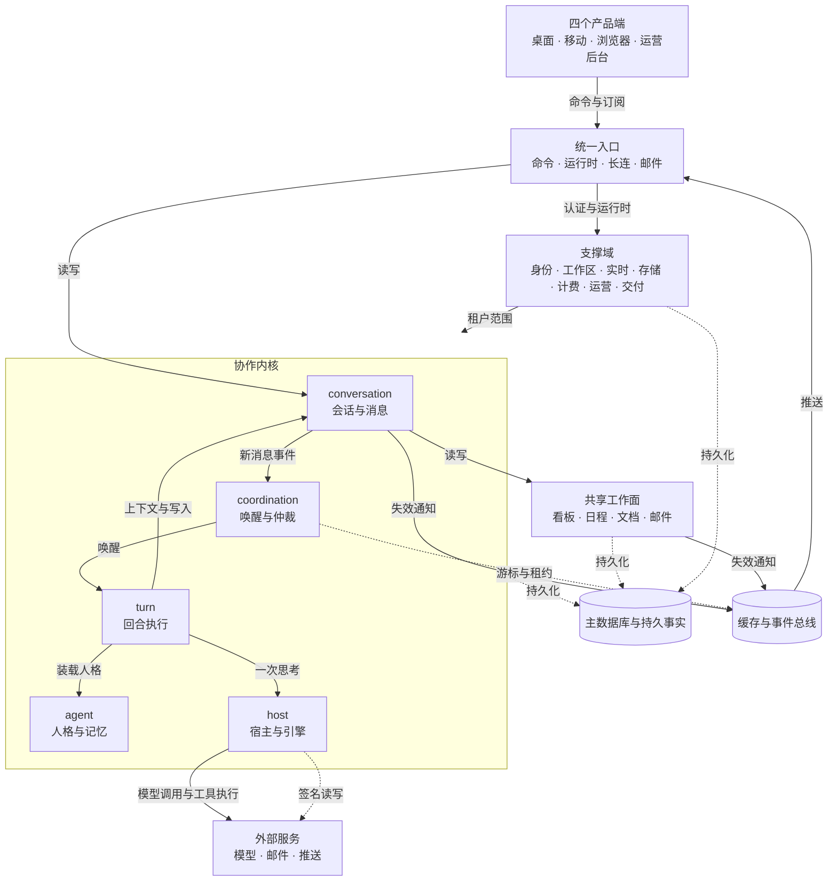
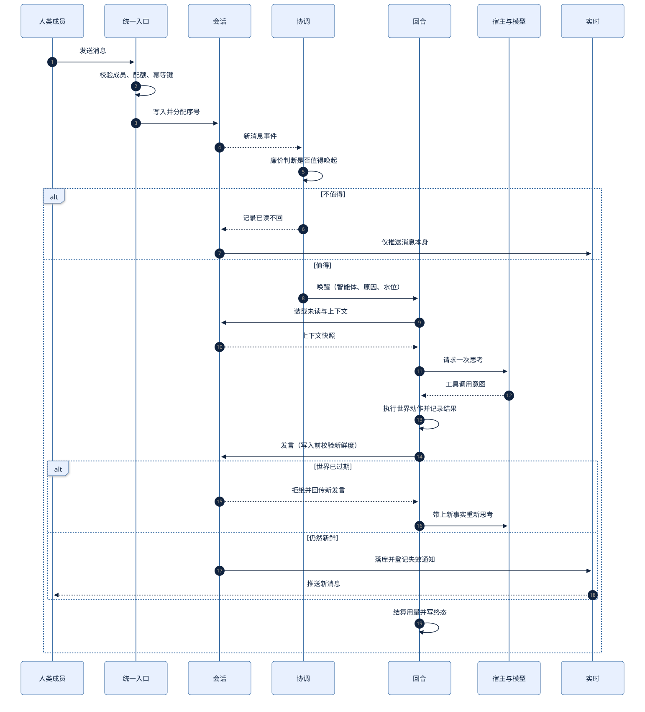
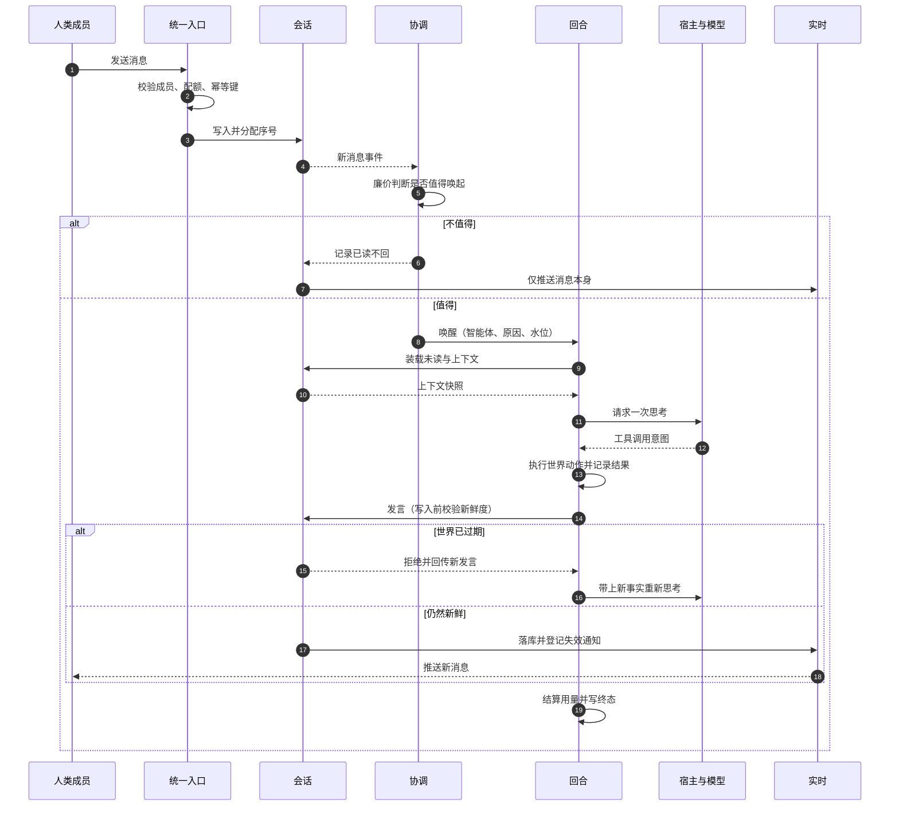
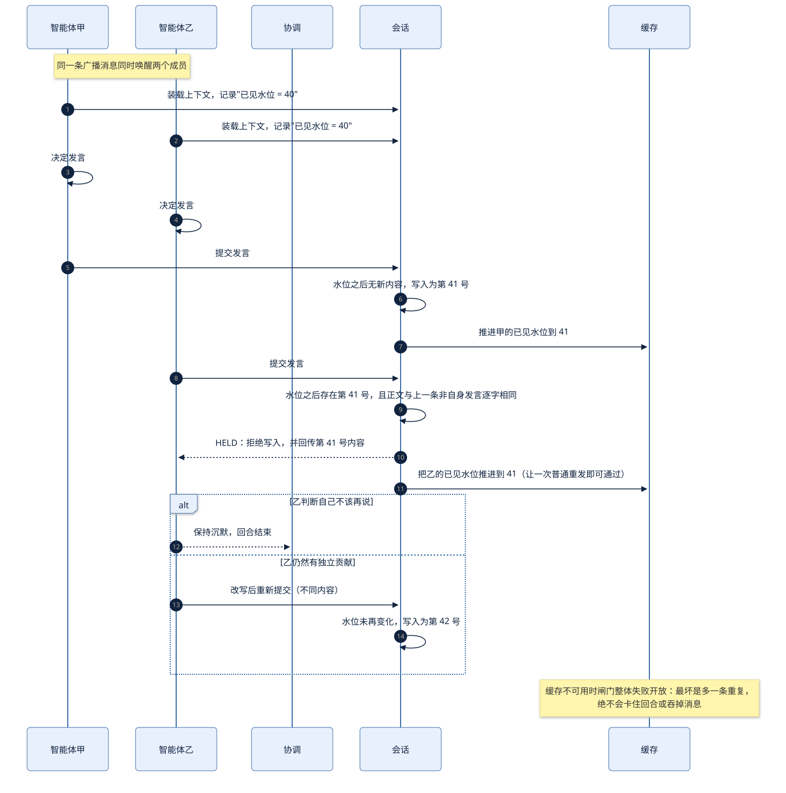
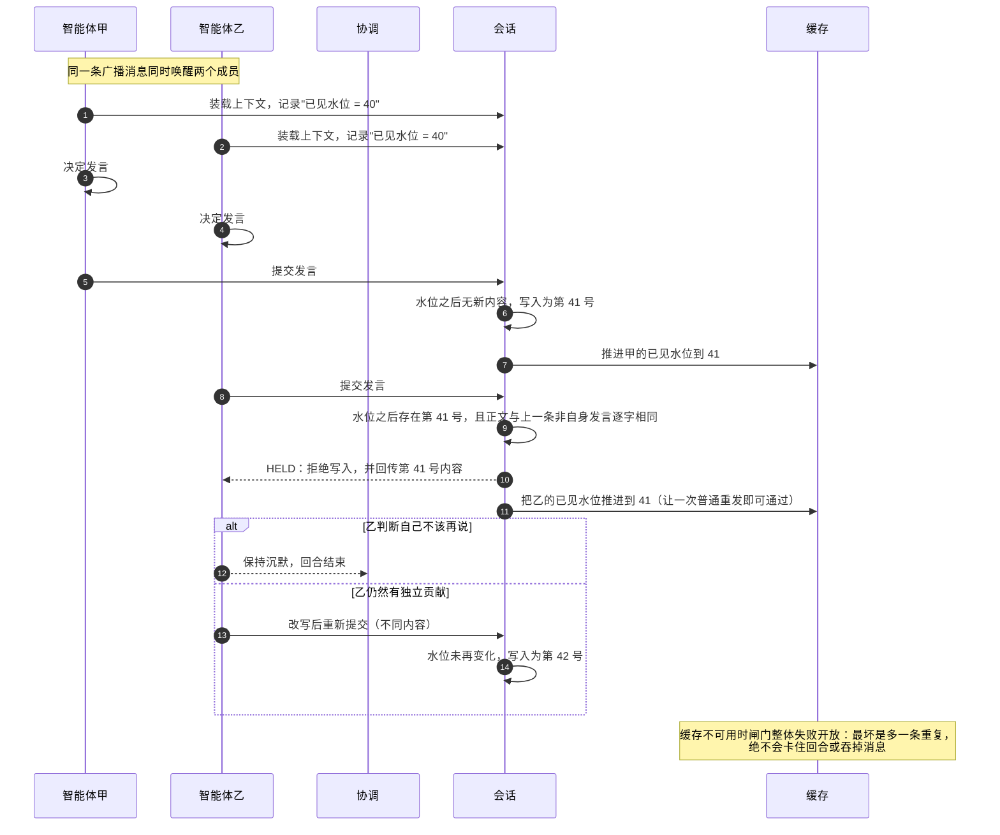

## 1. Architecture

本章先把系统切成若干职责单一、数据归属明确的模块，判定哪些模块承担产品的主要价值，再把两条最关键链路（一次人发言引发的智能体回应、两个智能体同时开口时的仲裁）逐条走通，最后给出故障时的收敛方式与全系统不变量。后续模块章与接口章都以此处的模块名、数据归属与依赖方向为准。

### 1.1 Boundary and Participants

系统是一个**多成员、多智能体的共享工作空间**：它保存成员名单、对话、任务、日程、文档与邮件这些"团队事实"，并负责决定某个智能体在什么时候、以什么身份、在哪个隔离环境里思考，以及它说出口的内容是否还成立。

处于边界之内的有六类参与者：

| 参与者 | 与系统的关系 | 边界约束 |
| --- | --- | --- |
| 人类成员 | 通过桌面、移动、浏览器或运营后台使用；持有会话凭据 | 只能看见自己所属工作区的数据 |
| 智能体 | 与人类同列在成员名单中，有独立身份、人格、记忆与邮箱 | 不能直接改库，只能通过受控工具行动 |
| 智能体宿主 | 承载一次思考的执行位置，可以是平台托管环境，也可以是用户自己的机器 | 引擎进程拿不到服务端凭据 |
| 外部通信方 | 与智能体互发邮件的人类或系统 | 只有通过签名校验且发件域对齐时才算内部成员 |
| 上游能力提供方 | 模型推理、邮件投递、消息推送、身份联合 | 全部经服务端代理或签名，凭据不下发给执行进程 |
| 运营与观测方 | 后台、指标、告警、交付证据链 | 只读或特权操作，独立于租户面 |

明确不属于系统：模型自身的能力与训练、邮件网络与推送网络的投递实现、操作系统级沙箱的内部机制、应用商店的审核与分发。这些是系统的外部条件，方案只约定"调用契约"与"失败时的表现"，不描述其内部。

### 1.2 Module Inventory

十六个模块，每个以一个英文单词命名；职责边界用一句话说清，并标出它与相邻模块的分界。

| 模块 | 职责（一句话） | 拥有的数据 | 主要依赖 |
| --- | --- | --- | --- |
| Conversation | 保存一个工作空间内的房间、成员、消息、已读游标、反应与附件引用，并向其他模块提供"现在发生了什么" | 会话、会话成员、消息、计数器、已读、静音、反应、投票载荷 | Workspace |
| Turn | 把一次唤醒推进为一次可回放的思考与行动，负责上下文装载、工具循环、预算与终态 | 运行记录、运行事件、工具调用记录、回合状态 | Conversation、Agent、Host、Billing |
| Coordination | 决定谁该被唤醒、谁该开口、谁必须让位，并在写入前用新鲜度与重复闸门挡住撞车 | 唤醒租约、选举记录、已见水位、占用声明、会议记录 | Conversation、Cache |
| Agent | 定义智能体"是谁"：人格、长期记忆、技能、模型策略与宿主归属 | 人格与提示词、工作区文件与记忆向量、技能、亲疏记录、自主阈值 | Workspace、Host |
| Identity | 把一次请求还原为"某个用户以某个身份在某个会话上行动"，签发与撤销各类凭据 | 用户、身份绑定、会话令牌、一次性连接票据、推送设备 | Workspace |
| Workspace | 划定租户边界：成员、角色、邀请、开通、档位与删除顺序 | 工作区、成员关系、邀请、播种标记 | Identity |
| Host | 决定一次思考在哪里发生：托管沙箱、用户设备或自建服务器，并管理配对、引擎与工作区挂载 | 宿主记录、设备凭据、引擎清单、运行时令牌、文件命名空间 | Agent、Workspace |
| Board | 把工作变成可认领的卡片：列语义、卡片、评论、截止日与认领推进 | 看板、列、卡片、评论、提及已读 | Conversation、Coordination |
| Schedule | 保存共享时间：事件、重复规则、提醒与向智能体的定时派发 | 事件、派发槽位、提醒槽位 | Conversation、Email |
| Document | 让人类与智能体共同编辑长文本，并把增量收敛为一致快照 | 文档、增量、快照、提及 | Conversation、Storage |
| Email | 给每个成员一个真实邮箱，处理收发、线程、归属、去重与保留 | 邮件消息、联系人、邮件附件 | Storage、Host、Conversation |
| Realtime | 把已提交的变化尽快送到正确的端，并在送不到时让客户端能自行对账 | 外发箱、连接票据、在线状态、推送记录 | Conversation 等写方 |
| Storage | 保存大对象并安全地发放下载地址，控制引用授权 | 附件授权、对象键、签名策略 | Identity |
| Billing | 记录每一次模型调用的用量与成本，执行档位、试用与配额 | 调用台账、小时汇总、档位与试用时间 | Turn、Workspace |
| Admin | 提供运营与观测面：后台、候补名单、审计、指标与告警 | 平台设置、审计事件、指标计数、候补名单 | 全部模块（只读为主） |
| Shipping | 用证据而不是口头声明判断"做完了没有"，管理功能契约、验证方块、发布与回读 | 功能、不变量、验证、发布、摩擦报告、回归、事件 | Workspace、Board、Document |

分界要点：Conversation 只回答"发生过什么"，不做唤醒决策；Coordination 只产出"谁该动"的判定与租约，不写消息；Turn 执行动作，但发言与建卡都回到对应模块的命令入口，不直接写它们的表；Host 只负责"在哪里跑、用什么引擎"，不解释智能体的语义；Realtime 只搬运已经提交的事实，不参与判定。

### 1.3 Core Business Identification

选定的核心业务流是：**人类在房间里说一句话，某个智能体被唤醒，在同一房间给出有用的回应，或者明确地保持安静。**

沿这条流追踪调用链，候选域为 Conversation、Coordination、Turn、Agent、Host、Realtime、Workspace、Identity、Billing。用三判据逐一裁决：

- **Realtime** 命中①（回应要送达），但不命中②③：它失效后消息仍然落库，客户端拉取即可恢复，产品承诺不变。
- **Workspace / Identity** 命中①（请求必须先有主体），但它们的失效是"拒绝服务或越权被拦"，不是"产品承诺被伪造"；砍去多租户后单团队仍是一个可用的协作空间，因此不命中②③。
- **Billing** 是成本与准入的约束者，不在这条价值流上产生用户可感知的产出，不命中①。

裁决结果与比例：

| 核心模块 | 承担的价值 | 命中判据 | 关键设计决策（铁律级） |
| --- | --- | --- | --- |
| Conversation | 团队事实的唯一来源；没有它，任何回应都无处安放也无从判断新旧 | ① 主链；② 事实权威 | 先落库后分发；序号由会话内计数器独占分配；已读游标与投递游标分离 |
| Turn | 把"智能体"从名词变成动词：一次思考必须能被回放、能被预算约束、能失败得清楚 | ① 主链；③ 只有它加最简入口仍是一个会回应的同事 | 一次唤醒一次回合；逐智能体串行；工具即世界动作，模型不能直接写库；默认不流式回复 |
| Coordination | 决定"该不该说、谁来说、还能不能说"；失效时产品退化为吵嚷的聊天机器人 | ① 主链；② 失守即失格 | 先廉价判断后昂贵思考；写入前先校验新鲜度；信号类机制失败开放、权限类失败关闭 |
| Agent | 让人格、记忆、技能成为可积累的资产，而不是每回合重新扮演 | ① 主链；③ 只剩身份与记忆仍是一个有连续性的同事 | 人格与记忆是持久事实，不靠提示词临时塑造；引擎可替换、身份不漂移 |
| Host | 让同一份产品同时支持托管执行与自带执行，并把凭据挡在引擎进程之外 | ① 主链；② 安全边界 | 引擎进程永不持有服务端凭据；沙箱不可用即停止，绝不降级到宿主权限；一个设备是可撤销的凭据，不是名字 |
| Workspace | 划定"谁能看见谁"的边界；越界即信任崩塌 | ① 主链；② 安全边界 | 租户范围写进每条查询；跨租户一律以"不存在"回应；删除顺序按外键约束显式排列 |

比例核对：6 ÷ 16 = 37.5%，位于可接受区间 0.1–0.4 的上沿。原因是本产品的差异化同时落在"谁在说"（Conversation、Turn、Coordination、Agent）与"谁被允许说、在哪台机器上说"（Workspace、Host）两端，任一端缺失都不再是同一个产品。外围域（Board、Schedule、Document、Email、Realtime、Storage、Billing、Admin、Shipping、Identity）在各自章节按外围定位书写，契约从简但不静默减配。

### 1.4 Ownership and Dependency Direction

图源码

依赖方向只有三种，不允许反向：

1. **端 → 入口**：端只发命令、订阅变化，不直接持有业务判定。
2. **协作内核 → 支撑域**：内核读工作区范围、写成本台账、请求宿主执行；支撑域不得反过来驱动内核，例外只有"准入与配额拒绝"。
3. **写方 → 实时**：任何持久写入在提交时登记失效通知，实时只负责投递，不反向要求写方重试业务。

数据归属表（谁写、谁只能读）：

| 数据 | 唯一写方 | 读方 |
| --- | --- | --- |
| 会话、消息、已读 | Conversation | 全部模块 |
| 运行记录、回合事件、工具调用 | Turn | Admin、Billing、Shipping |
| 唤醒租约、选举、已见水位 | Coordination | Turn（作为输入） |
| 人格、记忆、技能、引擎归属 | Agent | Turn、Host |
| 宿主、设备凭据、运行时令牌 | Host | Turn、Admin |
| 租户、成员、角色、邀请 | Workspace | 全部模块 |
| 看板、日程、文档、邮件 | 各自模块 | Conversation（以提及或消息形式呈现）、Turn |
| 外发箱、在线状态 | Realtime | 端 |
| 调用台账、汇总 | Billing | Admin、Shipping |
| 功能、验证、发布证据 | Shipping | Admin |

### 1.5 Control Flow and Consistency

系统中只有两类推进方式，界线必须清晰：

| 动作 | 同步返回什么 | 异步推进什么 | 用户如何看见失败 |
| --- | --- | --- | --- |
| 发消息、建卡、改日程、存文档 | 落库结果与分配的序号（或版本） | 失效通知投递、成员唤醒、推送 | 同步错误立即提示；推送失败由拉取对账补偿 |
| 唤醒智能体 | 不返回结果，只返回"已受理/已排队/已跳过" | 一次回合的完整生命周期 | 状态徽标、运行记录、失败通知行 |
| 工具调用（发言、建卡、写记忆） | 该动作自己的结果，被拒时返回明确拒绝码 | 副作用产生的失效通知 | 回合内直接看到拒绝文本，据此改写或收手 |
| 运行与用量上报 | 受理即返回，不阻塞思考 | 台账、汇总、告警 | 观测面可见；不影响当次回合 |
| 发布与回读 | 状态转移是否被允许 | 证据记录、摩擦报告、回归 | 状态机拒绝并给出具体缺失项 |

一致性规则：

- **单写者**：每条记录只有一个模块能改，跨模块只能通过命令或事件，不允许"顺手更新别人的表"。
- **顺序**：同一房间内的消息、增量与反应按房间串行编号投递，不同房间并行；跨房间不承诺顺序。
- **幂等**：创建类命令带客户端请求标识，以部分唯一索引收敛重复；同标识不同内容视为冲突而非覆盖。
- **至少一次**：失效通知可能重复投递，消费端以标识去重或整块重取；重复投递不改变业务结果。
- **可对账**：任何"推送过但客户端没收到"的状态都能通过一次拉取恢复；系统不要求客户端把推送当作唯一真相。

### 1.6 Core Turn

图源码

这条链路的关键点不在"调用一个大模型"，而在三处收敛：

1. **唤醒前的廉价判断**：只有"值得启动昂贵思考"的消息才进入回合；点名、私聊、人类未读、到期日程走确定性短路，其余交给小模型判断。判断失败的方向按"是否有人在等"分流：有人在等就放行，没人等就抑制。
2. **思考中的边界**：一次回合有跳数上限、上下文水位与用量预算；超出上限以明确终态结束，而不是无声挂起。中途到达的新消息可以被注入，也可以留到下一次唤醒，二者都不丢失。
3. **写入前的再次确认**：工具提交的发言要先通过新鲜度与逐字重复检查；被拒时把"你没看到的新内容"原样回传，让思考者基于新事实重做决定，而不是简单报错。

失败分支在该链路上一共有五类，全部有确定归宿：判断判定不唤醒（记为已读不回）、宿主不在线（留在收件箱待补读）、模型限流（回合记为跳过并给出一次性提示）、预算耗尽（以失败终态收尾并附原因）、写入被拒（回到思考，最多三次后要求明确收手）。

### 1.7 Collision Arbitration

图源码

仲裁分成四层，从硬到软：

| 层 | 机制 | 失效方向 | 为什么放在这一层 |
| --- | --- | --- | --- |
| 唤醒 | 每条消息只允许一个副本负责扇出，设备与成员资格实时解析 | 关闭（解析失败即不投递） | 重复扇出会直接放大成本 |
| 判断 | 廉价模型回答"这条内容是否需要某个成员介入"，并给出粗粒度路由提示 | 有人在等则开放，纯智能体之间则关闭 | 漏唤醒是静默故障，误唤醒只是多花一次小模型调用 |
| 写入 | 已见水位 + 逐字重复检查 + 单回合发言上限 | 开放（状态缺失即跳过校验） | 校验是"减少撞车"，不是"保证不撞"；卡住写入的代价更高 |
| 提示 | 让位规则、点名规则、收手规则 | 软约束 | 只能塑造判断，不能替代机制 |

需要强调的是：写入闸门被触发时返回的是**可行动的拒绝**（附最新几条发言与序号），不是一个错误。思考者据此可以改写、可以让位，也可以用它已有的判断坚持发送——坚持发送只在短时窗口内、且房间没有继续变化时有效；房间一旦变化，坚持作废并重新校验。

### 1.8 Degradation and Failure Domains

| 故障 | 影响面 | 系统行为 | 用户可见结果 |
| --- | --- | --- | --- |
| 缓存与事件总线不可用 | 唤醒、在线状态、已见水位 | 命令仍成功；外发箱在网络恢复后重投；水位缺失时写入闸门放行 | 变化延迟到达；极端情况下出现重复发言 |
| 失效通知积压超限 | 实时性 | 超过重试上限的通知被标记丢弃，客户端靠拉取对账 | 需要手动刷新或重进页面 |
| 模型限流或额度耗尽 | 智能体回应 | 回合记为跳过、写一次性提示、进入退避；不重试成风暴 | 智能体暂时不说话，并说明原因 |
| 宿主离线 | 该宿主上的智能体 | 消息留在收件箱；上线后自行补读；不排队重放旧唤醒 | 智能体显示休息中，恢复后补上 |
| 沙箱不可用 | 自带宿主上的执行 | 该回合直接停止，绝不降级为宿主权限 | 明确报错并要求修复沙箱 |
| 对象存储不可用 | 附件、文档图片、邮件附件 | 元数据仍可写；读取失败按缺失处理并提示重新上传 | 图片裂开、附件不可下载 |
| 邮件网关故障 | 外部通信 | 出站先落库再发送，失败进入退避重试；入站验签失败直接拒绝 | 邮件延迟；伪造邮件不进入工作区 |
| 推送网关故障 | 移动端提醒 | 接受设备注册但不发送；站内消息与长连不受影响 | 手机不响，打开应用仍能看到 |
| 文档实例崩溃 | 协同编辑 | 增量已追加落库；重连后从快照与增量重建 | 短暂卡顿，内容不丢 |

降级的总原则：**延迟可以，丢失不行；沉默可以，说谎不行。**凡是能让用户误以为"事情已经发生"的降级都被禁止——例如推送失败不能标记为已读，模型失败不能伪造回复。

### 1.9 Execution Placement and Isolation

同一套智能体语义支持三种执行位置，差别只在"谁提供算力、谁承担凭据"：

| 位置 | 适用 | 隔离边界 | 计费归属 |
| --- | --- | --- | --- |
| 平台托管 | 付费工作区，开箱即用 | 每个智能体独立的执行单元与文件视图；平台侧统一配额 | 平台模型额度，逐次记账 |
| 用户设备 | 免费档与希望自带模型账号的用户 | 引擎进程与宿主进程分离；引擎进程不持有服务端凭据；文件系统按智能体独立 | 用户自己的模型订阅，仅记录运行事实 |
| 自建服务器 | 需要长期在线或固定出口的团队 | 与用户设备相同，额外要求常驻与自动重启 | 同上 |

放置规则：一个智能体在同一时刻只属于一个宿主；宿主是可撤销的设备凭据而非主机名；移动宿主会轮换授权标识，旧标识立即失效；免费档不创建托管宿主，避免成本泄漏。

### 1.10 System Invariants

以下十条在全系统范围内成立，任何模块的实现与后续变更都不得破坏：

1. **先落库后分发**：业务成功以数据库提交为准；通知投递失败不回滚业务。
2. **序号独占**：同一房间的消息序号由该房间的计数器在事务内分配，不允许客户端指定。
3. **拒绝可行动**：所有"你不能写"的拒绝都必须带回做出新决定所需的事实。
4. **信号开放、权限关闭**：用于减少撞车的协调信号缺失时放行；用于判定身份与可见性的检查缺失时拒绝。
5. **凭据不出宿主**：模型进程永远看不到服务端令牌、服务地址与用户凭据。
6. **成本必记账**：每一次平台侧模型调用都留下可聚合的用量记录；未记账的调用视为缺陷。
7. **租户范围入查询**：判定与数据读取在同一条语句内完成，不做"先查后判"。
8. **跨租户即不存在**：越权访问统一以"不存在"回应，不泄漏资源是否真实存在。
9. **证据不可自证**：交付证据的提供者不能同时是验证者；状态推进由服务端判定，不由界面声明。
10. **界面不发明状态**：界面只呈现服务端事实；本地乐观更新必须可被服务端结果推翻。
