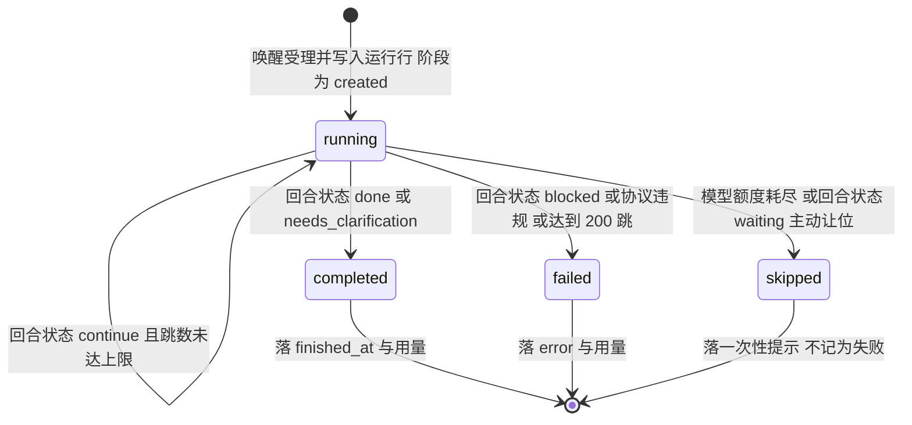
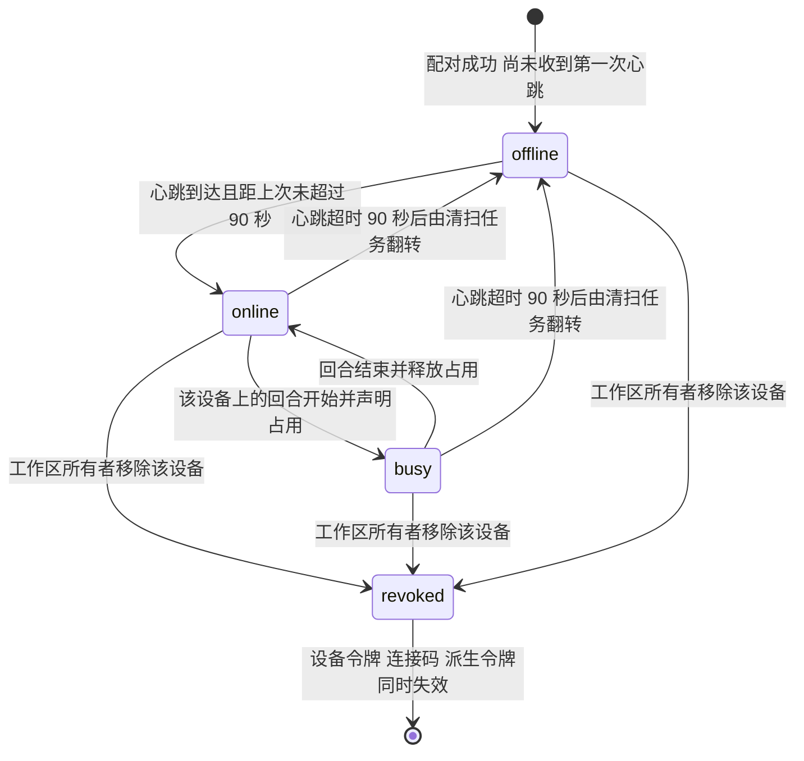
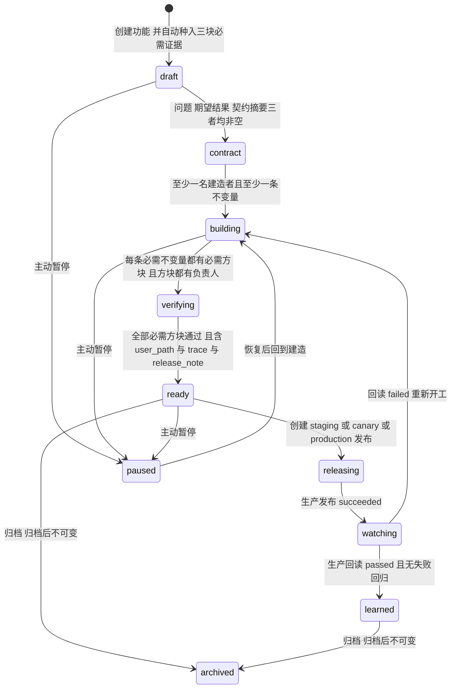
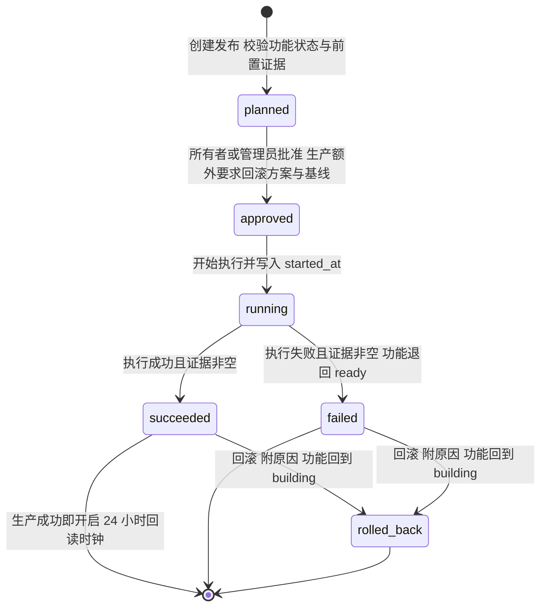

## 20. Errors and States

本章把"出错"从一句文案变成一份契约：任何拒绝都带稳定码、机器可读字段，以及"能不能重试"的明确判定；五类实体的状态由服务端状态机约束，界面不得自行发明状态。架构章已把"拒绝必须可行动"列为全系统不变量（见 [总体方案与架构](./architecture/)），这里给出它在传输层的形状、完整码表、重试规则与状态转移。

### 20.1 Error Envelope

现状只有 `{ error: "文案" }`：服务端存在两份互不相认的 `HttpError` 实现，各自配一个 `safe` 包装器，`instanceof` 不跨模块成立；`message` 就是唯一标识，同一语义在不同路由写成不同句子（"not a member of this conversation" 与 "not a member of this company"），客户端只能做字符串匹配；非生产环境还会把调用栈塞进响应体。结果是端侧无法区分"重试会成功"与"再试一百次也一样"，观测侧无法按码聚合，排障只能靠人读日志。

方案要求每次拒绝都返回统一响应体：码是稳定标识、文案是给人看的一句话、字段是让人或模型能重做决定的最小事实集。

```ts
type ErrorCode = string              // 闭集，见 20.2，服务端常量表即唯一来源
type ModuleName = 'conversation' | 'turn' | 'coordination' | 'agent' | 'identity'
  | 'workspace' | 'host' | 'board' | 'schedule' | 'document' | 'email'
  | 'realtime' | 'storage' | 'billing' | 'admin' | 'shipping'

interface ErrorEnvelope {
  error: {
    code: ErrorCode             // 大写下划线，只增不改，永不复用
    message: string             // 默认中文文案，按码查表生成
    requestId: string           // 与日志、追踪、审计同一标识
    retryable: boolean          // 调用方是否可以原样重试
    retryAfterMs: number | null // 仅在 retryable 为真时有值
    module: ModuleName          // 归属模块，决定告警归谁
    fields: FieldIssue[]        // 字段级问题：哪个字段、违反哪条规则
    details: DetailEntry[]      // 机器可读上下文，只放重做决定所需事实
    held: HeldEnvelope | null   // 仅 HELD 系列有值，见 20.3
  }
}

interface FieldIssue { field: string; rule: string; message: string }
interface DetailEntry { key: string; value: string }
interface HeldLine { sequence: number; authorName: string; excerpt: string }

interface HeldEnvelope {
  kind: 'freshness' | 'verbatim'
  conversationId: string
  unseenCount: number
  unseen: HeldLine[]            // 最多 8 条，每条截断到 200 字符
  attempts: number              // 本回合第几次被拒，达 3 次附收手指令
  canSendAnyway: boolean        // 仅当存在短时令牌时为真
}
```

三层各管一件事：**文案**只对读者负责，可以随语气调整，端侧不得据它分支；**码**对机器负责，是分支、告警与验收的唯一依据，只增不改、不复用、不随文案变化；**字段**对"下一步"负责，只放重做决定必需的事实，不回显凭据与堆栈。

现状与方案的差异逐条标注；凡是"要改但会影响现有客户端"的一律记为「待确认」，不写成既定事实。

| 维度 | 现状（0.18.9） | 方案 | 状态 |
| --- | --- | --- | --- |
| 响应体 | 只有 `{ error: 文案 }` | `{ error: { code, message, requestId, ... } }` | 待确认：过渡期是否保留顶层字符串给旧端 |
| 稳定码 | 无，文案即标识 | 20.2 码表加服务端闭集 | 方案 |
| 错误类 | 两份 `HttpError`，`instanceof` 不跨模块 | 单一错误类型加统一包装器，跨路由可捕获 | 方案 |
| 越权与不存在 | 成员判定有时 403、有时 404 | 统一 404，内部码区分 | 方案 |
| 租户头缺失 | 静默退回最早加入的工作区 | 回 `400 WORKSPACE_SELECTION_REQUIRED` | 待确认：兼容窗口与灰度顺序 |
| 幂等冲突 | 409 加一句英文说明 | `409 REQUEST_ID_CONFLICT` 加原请求摘要 | 方案 |

「待确认」清单：

- 过渡期是否保留顶层 `error` 字符串。保留可以让旧客户端不发版，代价是两套读取路径长期并存。
- 缺 `x-company-id` 时由静默回退改为显式报错，会让漏传头的旧客户端从"写错租户"变成"直接失败"；这是修正，但需要排期。
- 消息的 `clientId` 只校验长度 1 到 80，没有字符白名单；创建类 `requestId` 则有 `^[A-Za-z0-9._:-]+$`。两套是否合并为一条规则待确认。
- 网关密钥以明文字段存在用户行上，只保证不回显。是否改为加密存储或引用外部密钥待确认。

### 20.2 Global Error Codes

码名一律大写下划线，按域分段：身份与租户用 `AUTH_`、`TENANT_`、`WORKSPACE_`、`ROLE_`；资源用 `RESOURCE_`、`STATE_`；工作面各用自己的前缀；交付用 `SHIPPING_`；协同闸门用 `HELD_`。同一码在不同端点必须同一语义、同一可重试判定。

| 码 | 含义 | 触发条件 | 是否可重试 | 用户可见文案 | 归属模块 |
| --- | --- | --- | --- | --- | --- |
| INVALID_ARGUMENT | 参数缺失或类型不符 | 必填字段为空、类型不是预期、JSON 无法解析 | 否 | 请求内容不完整，请检查后重试 | 全部 |
| PAYLOAD_TOO_LARGE | 超出体积上限 | JSON 超 256 KB、上传超 25 MB、运行体超 4 MB | 否 | 内容过大，请拆分后重试 | 全部 |
| AUTH_REQUIRED | 未携带凭据 | 无会话令牌、无连接票据、大体积上传先于鉴权 | 否 | 请先登录 | Identity |
| CREDENTIAL_INVALID | 凭据无效或已被撤销 | 令牌哈希不匹配、设备令牌被撤销、账号停用或删除 | 否 | 登录状态已失效，请重新登录 | Identity |
| WORKSPACE_SELECTION_REQUIRED | 缺少工作区标识 | 未带工作区头且调用者属于多个工作区 | 是 | 请选择工作区后重试 | Workspace |
| TENANT_FORBIDDEN | 资源属于其他工作区 | 用别的租户的 id 访问，或不在该租户成员关系里 | 否 | 该内容不存在 | Workspace |
| ROLE_FORBIDDEN | 角色不足 | 普通成员执行管理员或所有者动作 | 否 | 需要管理员权限 | Workspace |
| RESOURCE_NOT_FOUND | 目标不存在 | id 不存在或已硬删 | 否 | 该内容不存在 | 全部 |
| STATE_CONFLICT | 当前状态不允许该动作 | 重复停用、自我降级、误用离职流程、终态重入 | 否 | 当前状态不支持该操作 | 全部 |
| REQUEST_ID_CONFLICT | 幂等标识复用了不同内容 | 同 `requestId` 但请求体摘要不同 | 否 | 该请求已用不同内容提交过 | 全部 |
| INVITATION_GONE | 邀请失效 | 被撤销、已过期、已用完 | 否 | 邀请已失效，请让管理员重发 | Workspace |
| CONVERSATION_NOT_FOUND | 会话不存在或调用者非成员 | 非成员、跨租户、已删 | 否 | 该会话不存在 | Conversation |
| CONVERSATION_ARCHIVED | 会话已归档只读 | 向归档会话写入或加成员 | 否 | 该会话已归档，不能再发送 | Conversation |
| ATTACHMENT_FORBIDDEN | 附件引用未获授权 | 无有效授权、对象键指向他人租户 | 否 | 附件不可用，请重新上传 | Storage |
| ATTACHMENT_MISSING | 对象不存在或签名已过期 | 存储侧查不到对象、直传链接过期未落地 | 是 | 附件已失效，请重新上传 | Storage |
| BOARD_CARD_COLUMN_MISMATCH | 卡片目标列不属于该看板 | 列 id 与看板 id 不匹配，或目标列不允许该移动 | 否 | 目标列不存在 | Board |
| CALENDAR_RECURRENCE_INVALID | 重复规则无法展开 | 缺少频率、迭代超过 5000 次、槽位不可达 | 否 | 重复规则无法展开，请简化 | Schedule |
| DOCUMENT_EDIT_CONFLICT | 文档已被他人推进 | 基于过期快照提交增量 | 是 | 文档已被他人更新，请基于最新版本重试 | Document |
| EMAIL_INBOUND_SIGNATURE_INVALID | 入站邮件验签失败 | 签名不匹配、缺签名头、正文被改动 | 否 | 邮件未通过校验，已拒收 | Email |
| EMAIL_SEND_FAILED | 出站投递失败 | 提供方返回错误或超时 | 是 | 邮件已入队，会自动重试 | Email |
| PUSH_NOT_CONFIGURED | 推送凭据缺失 | 推送密钥未配置，注册照收但不发 | 否 | 手机提醒暂不可用 | Realtime |
| COMPUTER_REVOKED | 宿主不存在或凭据已撤销 | 撤销时间非空、设备不属于该工作区 | 否 | 该设备已被移除，请重新配对 | Host |
| AGENT_SANDBOX_UNAVAILABLE | 沙箱能力不足，拒绝执行 | 引擎版本低于安全下限、缺沙箱依赖、平台不支持、引擎不可运行 | 否 | 该引擎在当前设备上无法安全运行 | Host |
| RUNTIME_TOKEN_INVALID | 运行时令牌无效或过期 | 签名、作用域或声明缺失，或已过期，或指派已轮换 | 是 | 运行时授权失效，正在重新配对 | Host |
| RATE_LIMITED | 触发速率上限 | 智能体驱动回合超每分钟 30 次 | 是 | 操作太频繁，请稍后再试 | Turn |
| MODEL_QUOTA_EXHAUSTED | 模型额度耗尽 | 网关判定本周期额度用尽 | 否 | 本周期模型额度已用完 | Billing |
| SHIPPING_INVALID_TRANSITION | 状态转移不存在 | 转移不在邻接表内 | 否 | 该功能不能从当前状态进入目标状态 | Shipping |
| SHIPPING_GATE_UNMET | 交付闸门未满足 | 必需方块未通过、缺生产发布或回读、缺证据 | 否 | 还缺这些证据才可推进 | Shipping |
| SHIPPING_VERIFIER_IS_BUILDER | 验证者同时是建造者 | 完成方块的人属于建造者名单 | 否 | 建造者不能验证自己的工作 | Shipping |
| SHIPPING_FEATURE_ARCHIVED | 功能已归档不可变 | 对归档功能发起修改 | 否 | 已归档的功能不能再修改 | Shipping |
| HELD_FRESHNESS | 写入被新鲜度闸门拒绝 | 房间里有该智能体未看到的新消息 | 是，换内容后重试 | 你没有看到的新消息，已附在后面 | Coordination |
| HELD_VERBATIM | 写入被逐字重复拒绝 | 与近期发言逐字相同 | 是，换内容后重试 | 这条内容与最近的发言重复 | Coordination |
| TURN_PROTOCOL_VIOLATION | 回合未按协议声明终态 | 模型连续两次停止调用工具且未声明回合状态 | 否 | 这次思考没有正常收尾，已结束本次回合 | Turn |
| TURN_BUDGET_EXHAUSTED | 回合触及硬预算 | 跳数、上下文水位或注入量达到上限 | 否 | 本次思考达到上限，已停止 | Turn |
| TURN_COMPLETION_REJECTED | 完成声明未通过复核 | 声明完成但未产生可见回复且存在副作用 | 是，下一回合 | 这次没有完成，已记录原因 | Turn |
| AGENT_NOT_AUTHORIZED | 令牌与智能体归属不匹配 | 运行时令牌有效但智能体已迁移或未分配给该设备 | 否 | 这台设备已不再负责该智能体 | Host |
| ENGINE_NOT_RUNNABLE | 引擎不可运行或被禁用 | 引擎不在可运行清单、版本低于安全下限、缺少沙箱依赖 | 否 | 该引擎当前不可用，已说明原因 | Host |
| HOST_TIER_FORBIDDEN | 当前档位不允许该宿主 | 免费档把智能体指派到平台托管宿主 | 否 | 免费工作区只能使用自己配对的计算机 | Billing |
| DEPENDENCY_UNAVAILABLE | 上游依赖不可用 | 存储、网关、提供方返回 5xx | 是 | 服务暂时不可用，正在重试 | 全部 |
| NOT_CONFIGURED | 功能未配置 | 单点登录、推送密钥、入站邮件签名密钥缺失 | 否 | 该功能未在此环境启用 | Admin |
| INTERNAL_ERROR | 未分类的内部错误 | 兜底，未匹配到任何码 | 是 | 出了点问题，请稍后重试 | 全部 |

两个读法必须写进契约：跨租户一律投影成 `RESOURCE_NOT_FOUND`，码本身只进日志与审计，避免用错误码探测资源是否存在；`SHIPPING_FEATURE_ARCHIVED`、`CONVERSATION_ARCHIVED` 这类"状态即答案"的码，文案必须说明当前状态，而不是说"操作失败"。

### 20.3 Retry Semantics

可重试与否由码决定，不由调用方猜。判据只有三条：**这次失败是否由暂时性条件造成**（网络、限流、租约竞争）、**原样重放是否会产生第二个副作用**（有没有幂等键）、**重放前是否需要先读新状态**（HELD 与编辑冲突属于这一类）。

| 类别 | 代表码 | 端侧动作 | 备选动作 |
| --- | --- | --- | --- |
| 原样可重试 | `ATTACHMENT_MISSING`、`EMAIL_SEND_FAILED`、`DEPENDENCY_UNAVAILABLE` | 按 `retryAfterMs` 退避后原样重发 | 超过上限转人工 |
| 带退避可重试 | `RATE_LIMITED`、`MODEL_QUOTA_EXHAUSTED` | 尊重 `retryAfterMs`，不做立即重试 | 提示稍后自动重试 |
| 换内容才可重试 | `HELD_FRESHNESS`、`HELD_VERBATIM`、`DOCUMENT_EDIT_CONFLICT` | 先读新状态，再决定是否重写 | 明确收手并结束回合 |
| 不可重试 | `AUTH_*`、`TENANT_*`、`RESOURCE_*`、`SHIPPING_*` | 不重试，直接呈现 | 修复前置条件后作为新请求提交 |

退避形状按场景固定，不允许各端点自创：

| 场景 | 形状 | 上限 | 幂等前提 |
| --- | --- | --- | --- |
| 邮件出站重试 | 60 秒、5 分、30 分、2 小时、6 小时、24 小时 | 6 次后进终态并告警 | 同一 `Message-ID`，提供方侧去重 |
| 唤醒重投 | 5 秒起翻倍到 60 秒，乘 0.5 到 1.5 的抖动 | 60 次 | 只有手工唤醒可重投，消息唤醒靠收件箱补读 |
| 模型连接重试 | 500 毫秒乘 2 的幂，加 0 到 250 毫秒抖动 | 2 次 | 仅创建与流式握手阶段 |
| 清理与投递 | 1 秒乘 2 的幂封顶 1 小时；外发箱由队列指数退避 | 清理 12 次、投递超限即丢弃 | 清理自带租约与批次号；消费端按标识去重 |

幂等前提一律由客户端提供、服务端收敛：消息用同作者同房间的客户端标识，创建类命令用 `requestId` 加请求体摘要，邮件用落库的 `Message-ID`，日程派发与提醒用槽位唯一键，运行用收件箱指纹。没有幂等前提的重试必须在响应里标成不可重试，宁可让用户多点一次，也不要产生第二条记录。

**HELD 是第四类结果**：它既不是成功，也不是错误，而是"我拒绝写入，并把你没看到的事实给你"。传输层用 `409` 加 `error.code = HELD_*`，与普通冲突的区别在于它带 `held` 结构；命令行侧退出码为 `2`，与通用错误 `1` 严格区分。

| 类别 | 语义 | 传输层 | 命令行退出码 | 回合记录 | 界面呈现 |
| --- | --- | --- | --- | --- | --- |
| 成功 | 已提交 | 2xx | 0 | 继续或完成 | 正常气泡 |
| 可重试错误 | 暂时性失败 | 5xx 或 429 | 1 | 失败，附原因 | 失败态，可重试 |
| 不可重试错误 | 前置条件不满足 | 4xx | 1 | 失败，附原因 | 明确说明缺什么 |
| HELD | 拒绝写入，附新事实 | 409 加 `held` | 2 | 跳过，不记为失败 | 未发送，附新消息与重做提示 |

呈现规则三条：一是**不得把 HELD 当失败自动重试**，同一内容重发只会再被拒一次；二是回合层把自动转述的 HELD 记为跳过而不是失败，否则告警会被"正常的让位"淹没；三是"坚持发送"只在短时令牌（约 2 分钟）内有效，房间一旦继续变化令牌即作废并重新校验，界面必须据此把按钮置灰而不是假装还能发。

### 20.4 State Models

#### 20.4.1 Agent Run

一次唤醒对应一行运行记录，状态只有四个，互斥且终态不可再进入。

| 状态 | 含义 | 进入动作 | 执行者 | 守卫条件 | 非法进入的码 |
| --- | --- | --- | --- | --- | --- |
| running | 正在思考或执行工具 | 唤醒受理后写入运行行 | 回合执行器 | 已取得该智能体的串行租约 | `STATE_CONFLICT` |
| completed | 正常收敛，产出了结果或明确提问 | 回合声明完成或请求澄清 | 回合执行器 | 已写入终态与用量 | `STATE_CONFLICT` |
| failed | 未产出可用结果 | 达到跳数上限、协议违规、被阻止 | 回合执行器 | 必须带 `error` 与用量 | `STATE_CONFLICT` |
| skipped | 有意不动，不是失败 | 额度耗尽、上游限流、主动让位 | 回合执行器或调度器 | 写一次性提示，不写失败告警 | `STATE_CONFLICT` |

回合终态与运行状态的映射固定，不允许端点各自解释：`done` 与 `needs_clarification` 映射到 `completed`，`continue` 留在 `running`（不自环成新行），`blocked` 映射到 `failed`，`waiting` 映射到 `skipped`。合法转移只有四条：`running` 自环、到 `completed`、到 `failed`、到 `skipped`；任何终态回到 `running` 都返回 `STATE_CONFLICT`，运行行已被清理后再上报心跳返回 `RESOURCE_NOT_FOUND`。



<details><summary>图源码</summary>



</details>

#### 20.4.2 Computer

宿主是一张可撤销的设备凭据，不是一个名字；在线与否由心跳推导，撤销是终态。

| 状态 | 含义 | 进入动作 | 执行者 | 守卫条件 | 非法进入的码 |
| --- | --- | --- | --- | --- | --- |
| online | 在线且可接单 | 心跳到达 | 守护进程 | 距上次心跳不超过 90 秒 | `COMPUTER_REVOKED` |
| busy | 在线且正在执行回合 | 回合开始并声明占用 | 回合执行器 | 该智能体归属于本设备 | `STATE_CONFLICT` |
| offline | 离线，消息留在收件箱 | 心跳超时后由清扫任务翻转 | 清扫任务 | 超过 90 秒未心跳 | `COMPUTER_REVOKED` |
| revoked | 已移除，凭据全部失效 | 所有者移除设备 | 工作区所有者 | 需所有者或管理员权限 | 终态，任何写入回 `COMPUTER_REVOKED` |

合法转移：`offline` 到 `online`、`online` 到 `busy`、`busy` 到 `online`、前三个状态到 `revoked`。非法转移举例：`busy` 直接到 `offline` 只能由清扫任务在超时后触发，客户端上报"我现在空闲"必须走释放占用，否则返回 `STATE_CONFLICT`；已撤销的设备再次心跳返回 `COMPUTER_REVOKED`，且不复活任何派生令牌。



<details><summary>图源码</summary>



</details>

#### 20.4.3 Email Transport

一封邮件只有一个传输状态，它与"是否已读"无关，也与线程归属无关。

| 状态 | 含义 | 进入动作 | 执行者 | 守卫条件 | 非法进入的码 |
| --- | --- | --- | --- | --- | --- |
| queued | 已落库，等待发送 | 回复或新邮件写入 | Email | 收件人非空 | `STATE_CONFLICT` |
| sending | 已认领，正在投递 | 重试任务或首次发送认领 | Email | 已写入 `Message-ID` | `STATE_CONFLICT` |
| sent | 提供方已接受 | 提供方返回成功 | Email | 有提供方回执 id | `STATE_CONFLICT` |
| failed | 投递失败，等待下次重试 | 提供方报错或超时 | Email | 已写失败原因与下次重试时间 | `STATE_CONFLICT` |
| received | 入站邮件已入库 | 入站验签通过并归属成功 | Email | 收件人可解析到本工作区成员 | `EMAIL_INBOUND_SIGNATURE_INVALID` |

关键点：写入顺序是"先落库为 `sending` 再发网络请求"，`sent` 与 `failed` 只是事后回填；`failed` 到 `sending` 由重试任务认领，认领即把下次重试时间推后以防重复认领；`received` 是入站专用，出站路径不得写这个状态。

#### 20.4.4 Shipping Feature

交付功能的状态机最严格：每一步推进都由服务端按证据判定，不由界面声明，也不能跳级。

| 状态 | 含义 | 进入动作 | 执行者 | 守卫条件 | 非法进入的码 |
| --- | --- | --- | --- | --- | --- |
| draft | 只是想法 | 创建功能 | 成员 | 自动种入三块必需证据 | 无 |
| contract | 契约写清，可评审 | 提交契约 | 成员 | 问题、期望结果、契约摘要三者非空 | `SHIPPING_GATE_UNMET` |
| building | 有人在造 | 开工 | 成员 | 至少一名建造者与一条不变量 | `SHIPPING_GATE_UNMET` |
| verifying | 正在取证 | 进入验证 | 成员 | 每条必需不变量都有必需方块，且方块都有负责人 | `SHIPPING_GATE_UNMET` |
| ready | 证据齐了，可发布 | 判定就绪 | 服务端 | 全部必需方块通过，且含用户路径、轨迹、发布说明各一 | `SHIPPING_GATE_UNMET` |
| releasing | 正在发布 | 创建发布单 | 成员 | 至少一张非开发环境发布单存在 | `SHIPPING_GATE_UNMET` |
| watching | 生产成功，观察回读 | 生产发布成功 | 服务端 | 存在成功的生产发布 | `SHIPPING_GATE_UNMET` |
| learned | 回读通过，经验沉淀 | 回读通过 | 服务端 | 生产回读通过且无失败回归 | `SHIPPING_GATE_UNMET` |
| paused | 暂停，可恢复 | 主动暂停 | 成员 | 仅限契约、建造、验证、就绪四个状态 | `SHIPPING_INVALID_TRANSITION` |
| archived | 归档，之后不可变 | 归档 | 成员 | 终态，任何修改回码 | `SHIPPING_FEATURE_ARCHIVED` |

非法转移分三类，码不同：转移不在邻接表内返回 `SHIPPING_INVALID_TRANSITION`；转移存在但守卫不满足返回 `SHIPPING_GATE_UNMET`；建造者试图验证自己的方块返回 `SHIPPING_VERIFIER_IS_BUILDER`。回读失败会把功能退回 `building`，这是唯一一条逆向的合法转移，且必须同时生成一条严重级摩擦记录。



<details><summary>图源码</summary>



</details>

图中省略了 `contract` 与 `verifying` 进入 `paused` 的两条边，规则与其余暂停边一致；`paused` 恢复到哪个状态由恢复动作决定，但不得直接回到 `learned`。

#### 20.4.5 Shipping Release

发布单是功能状态机之外的第二台机器：功能可以停在 `releasing` 上经历多张发布单。

| 状态 | 含义 | 进入动作 | 执行者 | 守卫条件 | 非法进入的码 |
| --- | --- | --- | --- | --- | --- |
| planned | 已创建，未批准 | 创建发布单 | 成员 | 功能处于就绪、发布中或观察中 | `SHIPPING_GATE_UNMET` |
| approved | 已批准，未执行 | 批准 | 所有者或管理员 | 生产额外要求回滚方案、发布说明、可度量基线与一次成功的预发 | `ROLE_FORBIDDEN` 或 `SHIPPING_GATE_UNMET` |
| running | 正在执行 | 开始 | 成员 | 已批准 | `SHIPPING_INVALID_TRANSITION` |
| succeeded | 执行成功 | 执行成功 | 成员 | 证据非空 | `SHIPPING_GATE_UNMET` |
| failed | 执行失败 | 执行失败 | 成员 | 证据非空，功能退回就绪 | `SHIPPING_GATE_UNMET` |
| rolled_back | 已回滚 | 回滚 | 成员 | 必须写原因，功能退回建造 | `SHIPPING_GATE_UNMET` |

回读是发布单上的并行时钟，与主状态互不覆盖：生产成功即写入到期时间（默认 24 小时）并置为 `pending`；提交非空证据可置 `passed` 或 `failed`，后者把功能退回 `building` 并生成严重摩擦；超过到期时间仍为 `pending` 的由维护任务翻成 `overdue`，`overdue` 不可回退。所有发布动作都在事务内对发布单加行锁后执行，并追加一条只追加的交付事件，不允许"先改状态再补证据"。



<details><summary>图源码</summary>



</details>

### 20.5 Acceptance

| 编号 | 前置 | 操作 | 可观察结果 |
| --- | --- | --- | --- |
| E-01 | 任一失败请求 | 触发参数错误、鉴权失败与内部错误各一次 | 三者响应体形状一致，都含稳定码、`requestId` 与可重试判定；任何环境都不返回调用栈 |
| E-02 | 一条处于 `completed` 的运行记录 | 直接上报回到 `running` | 返回 `409 STATE_CONFLICT`，运行行状态不变，事件流里出现一条被拒记录 |
| E-03 | 智能体未看到房间内两条新消息 | 用同一内容发言，收到 HELD 后读新消息再发一次 | 第一次退出码为 2 且附带两条新消息，回合记为跳过；第二次成功，房间内只多一条消息 |
| E-04 | 智能体每分钟已发满 30 次回合 | 继续触发一次唤醒 | 返回 `RATE_LIMITED` 且带 `retryAfterMs`，客户端按该值退避，不出现同一秒的连续重试 |
| E-05 | 同一 `requestId` 已用于创建一张卡片 | 换内容用同一 `requestId` 再创建一次 | 返回 `409 REQUEST_ID_CONFLICT`，卡片总数不变，`details` 里能读到原请求摘要 |
