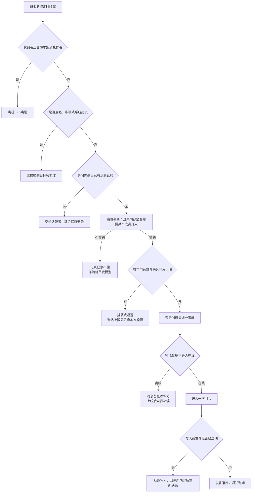

## 4. Coordination

协调模块回答三个问题：这条消息值不值得启动一次昂贵的思考、房间里有哪几个人该听到、以及某个已经在写的智能体是否还应该被允许写下去。它不产生内容，只产生判定与租约；所有判定都必须能在事后从记录里复原。

### 4.1 Duties

| 属于本模块 | 不属于本模块 |
| --- | --- |
| 唤醒扇出与逐条消息的唤醒声明 | 一次回合内部怎么思考（`Turn`） |
| 廉价判断（是否需要介入、粗粒度路由提示） | 模型调用与成本结算（`Turn`、`Billing`） |
| 新鲜度闸门、逐字重复闸门、单回合发言上限 | 消息的持久化与序号（`Conversation`） |
| 选举、认领与租约（谁负责、谁在做重活） | 看板卡片的业务状态（`Board`） |
| 并发预算（低优先唤醒、智能体驱动回合、扇出并发） | 宿主扩容与排队（`Host`） |
| 会议式轮流发言的编排 | 会议记录的持久化（`Conversation`） |

### 4.2 Capabilities

**唤醒判定**按从硬到软的顺序执行，任何一步给出确定结果就不再往后走：

| 顺序 | 判定 | 结果 | 依据 |
| --- | --- | --- | --- |
| 1 | 作者是不是自己 | 跳过 | 自己发的不唤醒自己 |
| 2 | 是否点名、私聊、系统指派、到期日程 | 直接唤醒 | 确定性信号，不花模型调用 |
| 3 | 房间里是否已有活跃认领 | 交给认领者，其余安静 | 工作已在某人手上 |
| 4 | 廉价判断：内容是否需要某个成员介入 | 需要则唤醒，不需要则记为已读不回 | 小模型 + 确定性短路 |
| 5 | 预算与并发是否允许 | 不允许则排队或丢弃 | 低优先预算、智能体驱动上限、扇出并发 |

**廉价判断的确定性短路**（不调用模型）：收件箱为空、只有系统消息、任何人类未读、智能体之间的私聊按固定节奏抽样、循环上限命中、到期日程。其余情况才调用廉价模型，并要求它输出"是否可行动 + 理由 + 粗粒度路由提示"。

**写入闸门**有三层，从外到内：

1. **新鲜度闸门**：智能体被展示过的最高序号形成"已见水位"；提交前若发现同房间存在比自己已见水位更新的他人发言，则拒绝写入，并把最多 8 条新发言按序号回传。
2. **逐字重复闸门**：在写入事务内、取得序号之后，比对本回合已写入的最后一条非自身正文；若去空白后完全相同，则回滚并拒绝。该闸门不可绕过。
3. **单回合发言上限**：同一智能体在同一房间的一个回合内最多写两条（"先宣告后交付"是两条），第三条被拒绝，除非模型显式声明这是同一回合的补充。

**让位与升级**：每次被拒都会累计次数；达到第三次时，拒绝文本改为"停止重新决策"，并只给两个出口——按已有判断发送（在窗口内有效），或确认收手并结束回合。窗口内的"坚持发送"是一次带序号的确认：若房间在确认之后又变了，确认作废并重新校验。

**选举与认领**：需要"一个人代表房间发言"时，按"可用优先、同类按标识排序"产生候选顺序，写入一条带租约的选举记录；到期未产生回合则顺延下一位，全部候选都未动手则回退为全房间扇出。重活（搜索、文档、出图）用短租约的工作声明占位，避免多个智能体同时做同一件事。

**并发预算**：低优先唤醒每进程每分钟 20 次，智能体驱动的回合每智能体每分钟 30 次，唤醒扇出并发默认 6；人类驱动的唤醒不计入智能体配额。

### 4.3 Contracts

```ts
type ResponseMode = 'me' | 'each' | 'one-of-us'
type TriageSource =
  | 'empty-inbox' | 'system-only' | 'calendar-due' | 'human-dm' | 'human-group'
  | 'dm-agent-engage' | 'loop-cap' | 'support-model' | 'support-model-local'
  | 'rate-limited' | 'fail-open'

interface TriageVerdict {
  actionable: boolean
  reason: string
  responseMode?: ResponseMode
  source: TriageSource
}

interface WakeRequest {
  companyId: string
  conversationId: string
  messageId: string
  authorId: string
  reason: 'message.new' | 'idle' | 'manual' | 'background_scan' | 'poll.updated'
  recipientAgentIds: string[]
}

type HoldKind = 'freshness' | 'verbatim'

interface FreshnessVerdict {
  hold: boolean
  kind?: HoldKind
  newer: Array<{ sequence: number; authorName: string; excerpt: string }>  // 最多 8 条
  attemptedHoldCount: number
}

interface Claim {
  scope: string           // 房间、租户或具体资源
  agentId: string
  kind: 'worklog' | 'card' | 'nudge' | 'election'
  expiresAt: string
}

abstract class CoordinationService {
  abstract triage(wake: WakeRequest, recipientAgentId: string): Promise<TriageVerdict>
  abstract fanOut(wake: WakeRequest): Promise<{ woken: string[]; skipped: string[] }>
  abstract preflightReply(agentId: string, conversationId: string, draft: string): Promise<FreshnessVerdict>
  abstract claim(claim: Omit<Claim, 'expiresAt'>): Promise<Claim | null>
  abstract elect(conversationId: string, messageId: string, candidates: string[]): Promise<string | null>
}
```

错误约定：被闸门拒绝**不是错误**，工具以退出码 `2` 返回 `HELD_FRESHNESS` 或 `HELD_VERBATIM` 并附新事实；真正的内部失败返回 `DEPENDENCY_UNAVAILABLE`，此时按各机制既定的失败方向处理（见 4.4）。

### 4.4 Key Decisions

**决策一：先廉价判断，后昂贵思考。** 唤醒前必须经过一次成本远低于回合的判断；确定性信号不得为此多花一次模型调用。违反后果：每个群消息都触发全房间大模型调用，成本与噪音同时失控。

**决策二：拒绝必须可行动。** 闸门拒绝要带回"你没看到的内容"与序号，让模型基于新事实改写或收手，而不是收到一句"发送失败"。违反后果：模型盲目重试同一句话，或者把拒绝当成系统故障而道歉。

**决策三：信号开放，权限关闭。** 减少撞车的信号（已见水位、让位令牌、工作声明）缺失时放行；防止风暴与越权的判定（合成唤醒闸门、单回合上限记录、收件人解析）失败时拒绝。违反后果：方向搞反会同时得到"卡死"和"刷屏"两种事故。

**决策四：唤醒只做加法。** 拿不准是否该叫某人时，宁可叫醒（人类在等，漏叫是静默故障）；只有确定无人等待的合成长唤醒才允许抑制。违反后果：收窄唤醒不会报错，只会表现为"智能体突然不理人"，极难排查。

**决策五：一个机制只解决一类问题。** 能用代码闸门解决的撞车不要写进提示词；模型在正确事实面前做出的明确判断，也不要再加一层代码。违反后果：提示词越堆越长、机制互相抵消，症状随模型版本漂移。

### 4.5 Flow



<details>
<summary>图源码</summary>



</details>

下面的伪代码覆盖两条主路径：新消息的扇出，以及一次提交前的闸门判定。

```ts
async function onNewMessage(deps: CoordinationDeps, event: MessageEvent): Promise<void> {
  // 1) 每条消息只允许一个副本扇出；拿不到声明即退出（重复扇出会放大成本）
  if (!(await deps.claims.claimMessage(event.messageId, 60_000))) return

  const room = await deps.conversation.snapshot(event.conversationId)   // 成员、类型、作者
  const candidates = room.agentMembers.filter((id) => id !== event.authorId)
  if (candidates.length === 0) return

  // 2) 路由：确定性信号优先进；模型只在"一对一还是各自回应"之间做选择
  const targets = deps.routing.targetsFor(event, candidates)            // 点名、引用、指派
  const mode = targets.length > 0
    ? await deps.routing.classify(event, targets)                        // 不确定一律按 each
    : 'each'
  const recipients = mode === 'me' ? deps.routing.narrow(event, targets) : candidates

  // 3) 逐个候选做廉价判断；任何异常按"是否有人在等"决定方向
  for (const agentId of recipients) {
    const verdict = await deps.triage.judge(event, agentId)
    if (!verdict.actionable) { await deps.reads.markSeenAndSilent(agentId, event); continue }
    if (!(await deps.budget.take(agentId, event.reason))) continue
    await deps.scheduler.wake(agentId, { ...event, triageNote: verdict.reason })
  }
}

async function preflightReply(deps: CoordinationDeps, agentId: string, conversationId: string, draft: string): Promise<FreshnessVerdict> {
  const baseline = await deps.seen.read(agentId, conversationId)        // 0 = 未记录/过期/缓存故障
  const room = await deps.conversation.memberCount(conversationId)

  // 缓存不可用或两人私聊：放行（信号失败开放）
  if (baseline === 0 || room <= 2) return { hold: false, newer: [], attemptedHoldCount: 0 }

  const newer = await deps.conversation.peerMessagesAfter(conversationId, agentId, baseline, 8)
  if (newer.length === 0) return { hold: false, newer: [], attemptedHoldCount: 0 }

  // 被拒绝时把新事实推进"已见水位"，使一次普通重发即可通过
  await deps.seen.record(agentId, conversationId, newer.at(-1)!.sequence)
  const attempted = await deps.holds.countAttempt(agentId, conversationId)
  return {
    hold: true,
    kind: 'freshness',
    newer: newer.map(toExcerpt),
    attemptedHoldCount: attempted,
  }
}
```

分支说明：`claimMessage` 失败说明另一个副本已经在扇出，直接返回；`classify` 失败或结果不确定时按 `each` 处理，宁可多叫；`budget.take` 拒绝时唤醒被丢弃而不排队，因为下一次消息会重新评估；`preflightReply` 在拿不到水位时放行，并在拒绝后立即推进水位，避免同一次撞车被反复拒绝。

### 4.6 Recovery and Idempotency

| 风险 | 机制 | 恢复方式 |
| --- | --- | --- |
| 重复扇出 | 每条消息一个 60 秒唤醒声明 | 只有一个副本执行，其余静默退出 |
| 两个智能体同时写 | 已见水位 + 逐字闸门 + 单回合上限 | 后写者收到可行动的拒绝，改写或收手 |
| 闸门反复拒绝 | 拒绝次数计数，第三次要求二选一 | 坚持发送带序号确认；房间再变则作废重来 |
| 缓存不可用 | 闸门整体失败开放 | 最坏是多一条重复发言，不会卡住回合 |
| 选举主候选失联 | 90 秒租约 + 每 15 秒扫一次 | 顺延下一位；全部失败则回退全房间扇出 |
| 智能体刷屏 | 智能体驱动回合每分钟 30 次上限 | 超出即不唤醒；人类发言不受影响 |
| 会议中断 | 每段发言前重新鉴权、记录逐条追加 | 已产生的记录保留，会话状态由收尾逻辑置为结束 |

### 4.7 Acceptance

| 编号 | 前置 | 操作 | 可观察结果 |
| --- | --- | --- | --- |
| O-01 | 群里有 5 个智能体，用户发了一条普通消息 | 触发一次扇出 | 只有通过廉价判断的智能体被唤醒；未通过的记为已读不回且无模型调用；总唤醒数不超过扇出并发上限 |
| O-02 | 两个智能体被同一条消息唤醒并同时起草 | 两者几乎同时提交 | 先提交者成功；后提交者收到 `HELD_FRESHNESS`，文本包含新发言的序号与摘要；房间只有一条重复内容 |
| O-03 | 后提交者收到拒绝后原样重发 | 立即重试 | 通过（水位已推进）；若期间房间又有新发言，则再次被拒并拿到新事实 |
| O-04 | 某个智能体在一个回合内已发两条 | 尝试发第三条 | 收到拒绝并说明单回合上限；房间不出现第三条 |
| O-05 | 缓存整体不可用 | 两个智能体同时提交 | 两次都成功；可能出现一条重复发言，但没有任何回合被卡住或退出码为 2 的拒绝 |
| O-06 | 智能体驱动的消息在 1 分钟内超过 30 条 | 持续触发 | 超出的唤醒被丢弃，不排队、不重试；人类发言仍然正常唤醒 |
| O-07 | 需要一个代表回应的开放问题 | 触发选举 | 只有一位候选被唤醒；其未在租约内动手时顺延下一位；全部未动手则回退全房间扇出并记录原因 |
| O-08 | 廉价判断调用的模型返回 429 | 触发判断 | 判断按"关闭"处理，智能体保持安静并退避；不会把限流升级成昂贵回合 |
