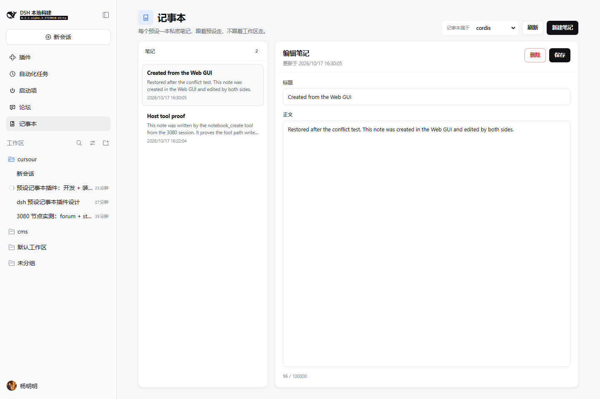

# Preset Notebook: a non-engineer verification guide

This guide only says where to click and what you should see. No code reading or
terminal work is required. The plugin is already installed in the running 3080
node (`DSH_HOME=~/.dsh_test_2`, web profile); installation took effect without
restarting 3080.



## 0. Open the page

1. Open the 3080 page you normally use. If it was already open, press **Ctrl+R**
   once.
2. The left sidebar should show a new entry: **Notebook** (in a Chinese UI,
   **记事本**).
3. Click it. The main area opens the notebook page.

You should see:

- the title **Notebook**, with the subtitle "One private notebook per preset,
  carried by the preset, not by the workspace";
- a **Notebook owner** selector at the top right;
- a note list on the left and an editor on the right.

## 1. Write a note and read it back

1. In **Notebook owner**, choose **cordis** (the preset of this agent session).
2. Click **New note**.
3. Title: `My first verification note`
4. Body: `I wrote this in the 3080 notebook.`
5. Click **Save**.

You should see:

- the new title in the list;
- a green **Saved** line under the editor;
- the editor heading changes to **Edit note**.

Confirm the read-back:

6. Press **Ctrl+R**.
7. Click **Notebook** again and choose **cordis**.
8. The note is still there; open it and the body is unchanged.

## 2. Edit a note

1. Click **My first verification note**.
2. Change the body to `I edited it, and it should survive a refresh.`
3. Click **Save**.
4. Click the same note again.

You should see the new body and a newer **Updated** time.

## 3. Delete a note

1. Open **My first verification note**.
2. Click **Delete**.
3. The button changes to **Click again to delete**; click it again.

You should see:

- the note disappear from the list;
- the editor move to the next note, not stay on the deleted one.

## 4. A cannot see B (positive and reverse checks)

Here A and B are two presets, for example **cordis** and **standard**.

### 4.1 Positive: write a note that only B can see

1. Choose **standard** in **Notebook owner**.
2. Click **New note**; title: `standard's private note`
3. Body: `This belongs to standard only.`
4. Click **Save**.
5. The note appears in standard's list.

### 4.2 Reverse: switch back to A and confirm A really cannot see it

1. Switch **Notebook owner** back to **cordis**.
2. The list must **not** contain `standard's private note`.
3. Switch back to **standard**; it must be there.

That only proves the UI does not show it. To prove A structurally cannot reach
it, do this reverse check:

4. In a **cordis** session, ask the agent to call `notebook_list`. The result
   must not contain `standard's private note`.
5. Ask the agent to call `notebook_read` with that note's id. It must fail with
   `no note with id "..." in this notebook.`
6. Ask the agent to call `notebook_update` or `notebook_delete` with the same id.
   Both must fail the same way.

Why this is structural:

- The `notebook_*` tools have no owner parameter; an agent cannot name another
  preset's notebook.
- The Host always composes the storage key from the calling session's own preset.
  A foreign note id composes a key under the caller's own owner, where no row
  exists.
- So this is not "the agent happened not to read it"; there is no call path that
  could read it.

## 5. The notebook follows the preset, not the workspace

1. Click another workspace in the left sidebar, for example **cms**.
2. Click **Notebook** again and choose **cordis**.
3. The notes **Host tool proof** and **Created from the Web GUI** are still there.

A notebook is never attached to a workspace; changing projects or workspaces
shows the same notebook.

## 6. Refresh and restart

### Refresh

Verified: press **Ctrl+R**, reopen **Notebook**, choose the same preset, and the
notes are still there.

### Restart

Installation itself needs **no restart**. To verify a full process restart, you
must restart 3080 yourself; restarting it from inside this session would kill the
running session, so the agent must not press that button for you.

Suggested steps:

1. Wait for the current session's work to reach a safe point.
2. Stop the 3080 process the way you normally do.
3. Start it again with the original command:

   ```powershell
   $env:DSH_HOME='C:\Users\imeep\.dsh_test_2'
   pnpm --dir deepseek\deepseek-harness dsh web --port 3080 --no-open
   ```

4. Open the URL with `?token=...` printed in the startup log, or refresh the
   existing page.
5. Click **Notebook** and choose **cordis**.

You should see `Host tool proof` and `Created from the Web GUI`; **standard**
still has its own note, and **cordis** still cannot see it.

During verification the agent did not restart 3080. It started an independent
cold process (temporary port 3082, same `DSH_HOME` and profile) against the same
storage and confirmed the same notes and isolation, then stopped that process. A
real 3080 restart should show the same result.

## 7. Known boundaries

### A preset is deleted

Its notes are **kept**, not deleted. Silent data loss is worse than an orphan.

- The owner selector still lists that preset, marked **Preset removed; notes
  retained**.
- A person can still read, edit, and delete those notes.
- If the same preset id appears again, it sees the same notebook.

### A note is very long

- Title limit: 200 characters.
- Body limit: 100,000 characters.
- The page shows a live counter such as `104 / 100000`.
- Over the limit, the page shows an error and a tool returns
  `notebook/body-too-long` with the actual length.

### A blank note

- A title is required; the body may be empty.
- A whitespace-only title is refused with `notebook/title-required`; the page
  says "A title is required."

### Both sides edit at once

- The page sends the update time it last read.
- If a tool or another page changed the note in between, the save is refused,
  the page keeps the draft, and nothing is overwritten.
- Tools accept the same optional `expectedUpdatedAt`; without it, the last write
  wins.

### Storage cannot open

- The page shows "Could not read: notebook storage is unavailable: ..." and a
  **Retry** button.
- Tools return the stable `notebook/storage-unavailable` code.
- The rest of the Harness keeps running.

## 8. Where it lives

- Source:
  - `plugins/notebook` — Host service, `notebook_*` tools, storage domain;
    package `@veren/notebook`
  - `plugins/notebook-ui` — sidebar entry and Web page; package
    `@veren/notebook-ui`
  - `plugins/notebook-bundle` — configuration-only bundle; package
    `@veren/notebook-bundle`
- Installed profile: `C:\Users\imeep\.dsh_test_2\profiles\web`
- `dsh.profile.bundles` includes `@veren/notebook-bundle`
- Local installation tarballs: `plugins/notebook-bundle/tarballs/`
- Data file: `C:\Users\imeep\.dsh_test_2\storages\notebook.json`

## 9. Evidence already collected

- **Tool path**: `notebook_create` wrote `Host tool proof`; `notebook_list` read
  it; `notebook_update` changed title and body; `notebook_read` read the whole
  body; `notebook_delete` removed a temporary note.
- **UI path**: browser automation on 3080 actually clicked edit, create, delete,
  switch preset, and reload; all passed with zero console errors.
- **One record set**: a note created in the UI appeared in the next
  `notebook_list`; a note deleted by a tool disappeared after a page refresh.
- **After restart**: an independent cold process with the same `DSH_HOME` (port
  3082) still saw both notes and the isolation.
- **Isolation**: as `cordis`, `notebook_read`, `notebook_update`, and
  `notebook_delete` against the `standard` note id all returned
  `no note with id ... in this notebook.`
- **Cross-workspace**: a same-preset sub-session working in
  `deepseek/deepseek-harness` called `notebook_list` and saw the same notebook.
- **Live slots**: client slot inspection shows `notebook:panel` active in both
  `sidebar.panellist` and `main`.
