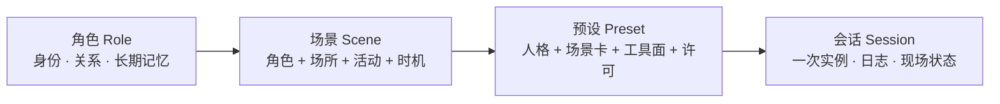
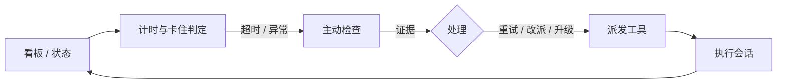

# 场景预设：一个 Preset 就是一个场景（设计草案）

[English](scene-preset-design.md) | 中文

**目标读者：** DSH 插件开发者、Agent 产品设计者。
**前置知识：** Cordis 插件、Agent Preset、系统提示词、工具注册。

状态：概念设计，待评审。**落点更新（2026-10-22）：**文中作为先例引用的 Person Agent preset 栈已退役——桥梁现在是 `person-agent` *应用*（见 `person-agent-app-mode.cn.md`）。下文凡以 Person Agent 为例的「preset」落点，请读作「应用页面会话」；指向 `person-agent-dynamic-context` / `person-agent-reanchor` 的模式示例描述的是已删除的包，仅作为先例保留。本文回答四个问题：场景由什么组成、角色与场景如何分层、状态与角色如何决定按钮、如何落到 DSH Preset。文中 `scene-kit` / `scene-view` / `scene-context` / `scene-switch` 是拟定包名，尚不存在。

## 0. 结论先行

1. **场景不是一段角色扮演提示词，而是一份上下文契约。** 它规定：谁在什么关系里、在什么地方、做什么、能用什么、记得什么、怎么离场。
2. **角色是连续的，场景是离散的。** 角色（子女、员工、朋友）跨场所跨活动存在，记忆应挂在角色上；场景（回家吃饭、办公室办公、海边散步）是一次具体活动，工具与规范挂在场景上。
3. **Preset 是场景的可执行包，Session 是场景的一次实例。** 换场景 = 换 Preset = 新会话或 fork；不要在一个会话里热换人格。
4. **只换语气的不是场景，是戏服。** 真正的场景至少改变工具面、记忆边界、许可策略之一。
5. **缺席的工具也是场景。** 电影院没有终端，正如人不该在电影院里开电脑查资料。
6. **预设不是工具箱，是岗位装备。** 任务大厅需要的是看板、计时器和派工单，不是整个工程工具箱；工具越多，选择越慢、越容易选错。
7. **状态决定按钮，角色决定视野。** 同一个场景，`queued` 和 `blocked` 可见的工具不同；观察者和调度员看到的字段也不同；看不见是体验，不让做才是安全。

## 1. 人的场景里有什么

人走进一个场景，不需要谁下指令，就自动加载了一整套东西：

| 人自动知道的事 | 对应的问题 |
|---|---|
| 我是谁 | 在这里我是什么身份、站在谁那边 |
| 对面是谁 | 我们什么关系、谁说了算、有多亲 |
| 这是哪 | 什么场合、有没有旁人、能说什么 |
| 在做什么 | 目标是什么、下一步是什么、什么算完 |
| 能做什么 | 手上有什么、哪些动作不合时宜 |
| 记得什么 | 之前发生过什么、哪些能提、哪些要保密 |
| 何时离开 | 什么信号表示该走了、走后怎么联系 |

Agent 没有这套「走进场景就自动加载」的能力。它默认加载的是**通用助手**：礼貌、全能、没有立场、没有场所感。Preset 的价值，就是把这套人类免费获得的上下文，压缩成几百个 token 注入进去。

所以，场景预设的设计目标不是「让 Agent 演得像」，而是**让通用助手这个默认值失效**。

## 2. 先分清：角色层与场景层

用户给的例子里混了两层东西：

| 例子 | 属于哪一层 | 为什么 |
|---|---|---|
| 面对父母是子女 | 角色/关系 | 换到饭店、医院、视频通话，仍然是子女 |
| 面对子女是父母 | 角色/关系 | 换到学校、医院、旅行，仍然是父母 |
| 面对老板是员工 | 角色/关系 | 换到团建、出差、年会，仍然是员工 |
| 面对朋友是知己 | 角色/关系 | 换到海边、咖啡馆、家里，仍然是知己 |
| 客厅看电视 | 场景 | 角色 + 场所 + 活动 |
| 电影院看电影 | 场景 | 场所 + 活动 + 礼仪 |
| 会议室开会 | 场景 | 场所 + 活动 + 决策规则 |
| 海边散步 | 场景 | 场所 + 活动 + 节奏 |

分层的价值在于复用：**一个角色可以派生很多场景，一个场景可以换不同角色。**



- **角色**回答「我是谁、对你而言我是谁」，决定立场、称呼、亲疏、长期记忆。
- **场景**回答「此刻在哪、在做什么」，决定场所事实、活动节奏、当下目标、工具面。
- **预设**是场景的可执行形态：把角色写成 persona，把场景写成场景卡，把许可写成工具行。
- **会话**是一次实例：这次电影看到哪、这顿饭聊了什么，属于会话日志，不自动带到下一个场景。

这条分层解释了为什么「面对父母」和「客厅看电视」不能平级罗列：前者是角色，后者是角色在某个场所里的一个场景。真正完整的写法是「作为子女，在父母家客厅，陪他们看电视」。

## 3. 场景的七个条款

一个可执行的场景，必须回答七个问题。缺任何一个，模型就会退回通用助手。

| # | 条款 | 回答的问题 | 典型内容 | 落到 DSH |
|---|---|---|---|---|
| 1 | 选角 Casting | 我是谁、你是谁、我们什么关系 | agent 角色、user 角色、关系、权力距离、亲疏 | `dsh-persona` prefix |
| 2 | 地点 Setting | 这是哪、什么时候、还有谁、有什么 | 场所、时间、隐私级别、旁人、道具、氛围 | 场景卡静态段 + 运行时上下文 |
| 3 | 目标 Objective | 我们要完成什么、什么算好 | 共同目标、各自目标、筹码、成功标准 | persona + 场景卡 + todo |
| 4 | 规则 Interaction | 怎么称呼、怎么轮转、什么不能碰 | 称呼、正式度、回合长度、禁忌、补救方式 | persona suffix + 场景卡 |
| 5 | 许可 Affordances | 能做什么、不能做什么、什么要批准 | 工具面、权限、审批、金额/外发限制 | 工具行 + sandbox/approval |
| 6 | 记忆 Memory | 带什么进来、留下什么、带走什么 | carry-in、场景内、carry-out、隐私级别 | notebook/storage + 会话日志 |
| 7 | 离场 Exit | 什么时候结束、怎么交接 | 结束信号、离场摘要、下次约定 | 工具 + 提示词 + 归档 |

### 3.1 选角必须显式

「面对父母是子女」这句话，视角其实是含糊的：是用户扮演父母、Agent 扮演子女？还是用户就是子女、Agent 扮演父母？

产品里必须写清楚两边：

```yaml
casting:
  agent: 子女          # Agent 扮演谁
  user: 父母           # 用户扮演谁
  relation: 亲子
  power: low           # Agent 在这段关系里的权力位置
  intimacy: close
  address: 爸 / 妈     # 称呼
```

默认假设应该是：**用户就是用户本人，不要求用户角色扮演；Agent 进入角色。** 只有明确的角色扮演/训练场景，才让用户也入戏。这条默认值不写清楚，用户会觉得 Agent 在自作多情。

### 3.2 七个条款填满的样子：电影院

| 条款 | 内容 |
|---|---|
| 选角 | Agent = 同伴；User = 同伴；关系 = 朋友/伴侣；平等、亲密 |
| 地点 | 电影院；晚上；公共黑暗空间；满场观众；手机静音 |
| 目标 | 一起看完这部电影；Agent 的目标是陪伴，散场后聊感受 |
| 规则 | 耳语、短句；不剧透；不讨论剧情；不中途离场 |
| 许可 | 无工具；不查资料、不办公、不拍照 |
| 记忆 | 带进来：对方喜欢的类型、上次看的电影；留下：这次看到哪、当下反应；带走：观后感、下次约看 |
| 离场 | 片尾字幕、散场灯亮；三句话总结；约下次 |

注意第 5 条：**「无工具」是场景设计，不是缺省。** 在电影院里，Agent 不应该有搜索、文件、终端；它连「我帮你查一下」都不该说。工具面的缺席，和台词里的禁忌一样重要。

## 4. 触类旁通：五条轴，而不是一张长清单

场景是长尾的，枚举不完。可复用的是轴：

| 轴 | 取值 | 例子 |
|---|---|---|
| 关系轴 | 家庭 / 职场 / 服务 / 社交 / 权威 / 照护 / 交易 | 父母、老板、顾客、朋友、警察、医生、卖家 |
| 场所轴 | 私域 / 半公开 / 公共 / 虚拟 | 家、咖啡馆、电影院、海边、会议室、线上 |
| 活动轴 | 消费 / 生产 / 决策 / 社交 / 交易 / 照护 / 通行 / 休息 | 看电视、办公、开会、聊天、点单、问诊、通勤、发呆 |
| 时机轴 | 日常 / 仪式 / 危机 / 初次 / 告别 | 周末、婚礼、急诊、面试、葬礼 |
| 模态轴 | 独处/双人/群体；公开/私密；正式/随意；线上/线下 | 群聊、私聊、视频会、面对面 |

一个场景的名字，通常由**主导轴**命名：

- 「面对父母」是关系主导；
- 「电影院」是场所主导；
- 「开会」是活动主导；
- 「婚礼」是时机主导。

但每个真实场景在五条轴上都有取值。设计场景时，先把五条轴填满，再决定哪个轴是主导。

### 4.1 场景矩阵（示例，不穷举）

| 场景 | Agent 扮演 | 用户扮演 | 场所 / 活动 | 硬约束 | 工具面 |
|---|---|---|---|---|---|
| 回家看爸妈 | 子女 | 父母 | 父母家 / 陪伴 | 报喜不报忧但不说谎；不顶撞 | `companion` |
| 陪孩子 | 父母 | 子女 | 家 / 教养 | 不替孩子做决定；先共情 | `companion` |
| 向老板汇报 | 员工 | 老板 | 办公室 / 汇报 | 结论先行；不越权承诺 | `meeting` |
| 和朋友聊天 | 知己 | 朋友 | 咖啡店 / 闲聊 | 平等；不评判；不急着给方案 | `cafe` |
| 客厅看电视 | 家人 | 家人 | 客厅 / 消费 | 低强度；可打断；不推进任务 | `silent` |
| 电影院看电影 | 同伴 | 同伴 | 影院 / 消费 | 静默；不剧透；不查资料 | `silent` |
| 咖啡店喝咖啡 | 咖啡师或同伴 | 顾客或朋友 | 咖啡店 / 消费社交 | 轻量；可工作可闲聊 | `cafe` |
| 饭店吃饭 | 同伴或服务员 | 朋友或食客 | 餐厅 / 消费 | 忌口；点单；不催 | `service` |
| 海边散步 | 同伴 | 同伴 | 海边 / 交谈 | 慢；开放；不谈 KPI | `silent` |
| 会议室开会 | 与会者/记录者 | 主持/同事 | 会议室 / 决策 | 议程；轮流；有纪要 | `meeting` |
| 办公室办公 | 同事 | 同事 | 办公室 / 生产 | 专注；少打扰；可执行 | `office` |
| 任务大厅调度 | 值班调度员 | 任务发起人/负责人 | 任务大厅 / 调度 | 先证据后判断；不越权；破坏性动作先问 | `control` |
| 讲座听讲 | 同学/助教 | 听众/同学 | 讲堂 / 学习 | 不打断；记笔记；提问要短 | `study` |
| 面试 | 候选人 | 面试官 | 会议室 / 决策 | 不卑不亢；STAR；不编经历 | `interview` |
| 医患问诊 | 医生助理 | 患者 | 诊室 / 照护 | 不诊断；建议就医；保护隐私 | `care` |
| 客服处理投诉 | 客服 | 客户 | 线上 / 交易 | 先情绪后问题；不承诺无权之事 | `service` |
| 婚礼 | 宾客 | 新人/宾客 | 宴会厅 / 仪式 | 祝福；不抢风头；不劝酒 | `ceremony` |
| 葬礼 | 吊唁者 | 家属 | 殡仪馆 / 仪式 | 克制；陪伴；不拍照 | `silent` |

这张表可以继续外推：面试官视角、老师和家长、房东和租客、医生和家属、司机和乘客、导游和游客、理发师和顾客、书店店员和读者、健身房教练和学员、机场地勤和旅客、法庭上的律师和当事人……方法不变：**先填五轴，再填七条款，最后选工具面。**

### 4.2 轴冲突时，谁说了算

真实场景经常冲突：和老板在海边散步，是「上下级」还是「散步」？

规则：**每个场景声明一个主导框架（dominant frame），其余轴只做修饰。**

```yaml
dominant: relation   # 和老板在海边：关系主导，场所只负责放松
```

- 电影院：`dominant: place`——再熟的两个人，也不能在影院里大声聊工作。
- 婚礼：`dominant: occasion`——再大的老板，今天也是宾客。
- 急诊：`dominant: activity`（照护）——平时再讲客套，此刻先救人。
- 葬礼：`dominant: occasion`——所有关系降级为「吊唁者」。

主导框架不是修辞，它决定冲突时哪条规则优先。没有声明主导框架的场景，遇到冲突就会随机出戏。

## 5. 场景卡：注入什么，注入到哪

场景卡分两层，对应 DSH 的两种注入机制：

| 层 | 内容 | 变化频率 | DSH 机制 | 缓存影响 |
|---|---|---|---|---|
| 静态卡 | 选角、地点事实、规则、禁忌、离场 | 低 | `dsh-persona` / system-prompt section | 稳定前缀，可缓存 |
| 运行时事实 | 现在几点、在场还有谁、当前目标、未结事项、上一场 | 每步可能变 | dynamic context（user-role snapshot） | 只追加变化，不改前缀 |

这和现有 `person-agent-dynamic-context` 的做法一致：**静态的进系统提示词，动态的进带来源的用户消息；动态部分按区块做变化检测，只追加差异。**

### 5.1 场景卡示意（电影院）

```yaml
scene: cinema
casting:
  agent: 同伴
  user: 同伴
  relation: 朋友/伴侣
  power: equal
  intimacy: close
setting:
  place: 电影院
  privacy: public-dark
  others: 满场观众
  props: [电影票, 爆米花]
  norms: [手机静音, 小声说话, 不剧透]
objective:
  shared: 一起看完这部电影
  agent: 陪伴；散场后聊感受
interaction:
  formality: casual
  turns: 耳语、短句
  taboo: [大声讨论, 剧透, 中途离场]
affordances:
  tools: []
  reason: 黑暗中不查资料、不办公、不拍照
memory:
  carryIn: [对方喜欢的类型, 上次看的电影]
  sceneLocal: [这次看到哪, 当下的反应]
  carryOut: [观后感, 下次约看]
exit:
  signals: [片尾字幕, 散场灯亮]
  handoff: 三句话总结
```

### 5.2 静态卡写进 persona，不写进每一轮

场景卡的静态部分应该进系统提示词，而不是每轮追加。原因：

- 前缀稳定，KV cache 才能命中；
- 规则属于「人格」，不属于「这一轮的事实」；
- 每轮重复会让模型把规则当噪音。

运行时事实才走 dynamic context，并且只追加变化的部分。**场景卡的静态部分每轮重发，是场景设计里最常见的浪费。**

## 6. 工具面：用「缺席」塑造场景

工具不是越多越好。每个工具都占 schema token，也都扩大「出戏」的可能。场景设计应该先决定**不给什么**。

工具不只是能力，也是提示词：工具名、描述和参数会一起进入模型上下文，告诉它「这里能做什么」。所以选工具面，本质上是在写这个场景的动作台词。

| 工具面 | 包含 | 适用场景 | 明确不给 |
|---|---|---|---|
| `silent` | 无 | 电影院、海边、葬礼、客厅 | 一切工具 |
| `companion` | 记忆、`ask_user`、日程 | 回家看爸妈、陪孩子 | 终端、网页、文件 |
| `cafe` | `read`/`glob`/`grep`、`web`、笔记、日程 | 咖啡店、饭店（闲聊模式） | 终端、`edit` |
| `meeting` | 笔记、`todo`、`present`、日程、`ask_user` | 会议室、评审、同步会 | 终端 |
| `study` | 笔记、`read`/`web`（静默查证）、`ask_user` | 讲座、自习、读书会 | 终端、外发 |
| `interview` | 简历/职位资料（`read`）、笔记、`todo`、日程 | 面试、招聘 | 终端、`edit`、对外承诺 |
| `office` | `fs`、`fs-search`、`pwsh`、`jobs`、`working-directory`、`todo`、`present`、`subagent` | 办公室、生产场景 | 无（按需） |
| `control` | 看板摘要、任务检查、派发/重试/取消/升级、交接 | 任务大厅、值班室、运维 | 终端、`edit`、网页（需要执行时切到办公场景） |
| `research` | `web`、`workflow`、`fs` | 调研、查资料 | 终端（可选） |
| `service` | 领域工具（菜单/订单/工单）+ 日程 | 餐厅、商店、客服 | 通用工程工具 |
| `ceremony` | 日程、礼物清单、致辞草稿（`write`） | 婚礼、典礼 | 搜索八卦、拍照、直播 |
| `care` | 记录、提醒、升级人工 | 医患、心理咨询、照护 | 诊断、处方、承诺 |

三条规则：

1. **默认最小。** 只给完成当下活动所必需的工具。
2. **非生产场景不给 `edit`/`bash`/`pwsh`。** 写作、汇报、聊天都不需要改代码。
3. **花钱、外发、代表用户承诺的工具，无论什么场景都要审批。** 这是许可层，不是场景层。

### 6.1 预设不是工具箱，是岗位装备

工具面不是能力清单，是岗位装备。判断一个工具该不该留，只问一句：**这个场景的哪个动作，非它不可？** 答不上来就删掉。

- 工具 schema 是常驻上下文成本；N 个工具就是 N 种选择，模型要在里面挑，慢且容易挑错。
- 拿掉一个工具，场景仍然成立 → 它本来就不属于这个场景。
- 如果一组动作共享同一个对象和上下文，合成一个带 `action` 参数的工具，比拆成十个窄工具更省 schema，也更容易校验权限。
- 工具面按「岗位」设计，不按「能力」设计：调度员需要看板、计时器、派工单；不需要终端、编辑器、网页搜索。

反过来，如果一个场景要模型同时干两件不相关的事，那不是场景，是杂役；拆成两个 preset，比加工具更有效。

任务大厅（下一节）是这条规则最好的例子：它只加了三样东西——实时视图、计时、派发权——就成为一个场景，而不是把整个工具箱搬过来。

## 7. 案例：任务大厅（控制室场景）

任务大厅是对「预设不是工具箱」最直接的反证：它的价值不在多给能力，而在**一个实时视图、一只计时器、一个派工单**。

### 7.1 七条款

| 条款 | 内容 |
|---|---|
| 选角 | Agent = 值班调度员；User = 任务发起人/团队负责人；关系 = 协作；平等；最终决定权在用户 |
| 地点 | 任务大厅（虚拟控制室）；常开；多 Agent 在场；有看板、时钟、告警 |
| 目标 | 让任务流动：发现卡住、查明原因、派发/重试/升级，并保持看板真实 |
| 规则 | 先证据后判断；不猜；不越权改任务；破坏性动作先问；汇报用「状态 + 证据 + 建议」三行 |
| 许可 | `control` 工具面：看板、检查、派发、重试、取消、升级、交接；不给终端/编辑器/网页 |
| 记忆 | 带进来：团队名单、任务约定、SLA；场景内：当前看板、告警、处理记录；带走：交接摘要 |
| 离场 | 交接班、全部任务落定、或用户叫停；交接摘要必须含未结任务和风险 |

### 7.2 看板：静态规则 + 动态事实

静态部分进系统提示词：岗位说明（你是调度员，不是执行者）、卡住判据、汇报格式、权限边界。运行时事实进 dynamic context，按区块拆分：

| 区块 | 内容 | 更新时机 |
|---|---|---|
| `roster` | 在场 Agent：角色、当前任务、状态、最后活动时间 | 变化时 |
| `board` | 任务：id、owner、状态、阻塞原因、年龄 | 变化时 |
| `alerts` | 疑似异常：类型、证据、建议检查项 | 发现时 |
| `recent` | 最近 N 条派发/重试/升级 | 变化时 |

看板不要每步全量重发。上下文里只放**摘要**（计数、最老的任务、前三条异常），明细用工具按需取；否则大团队的第一步就把上下文撑爆。

### 7.3 控制回路



- **计时**：watchdog 每 N 分钟检查一次，只在「该动而没动」时追加一条事实，不是每步都提醒。
- **卡住判据**：无更新超过阈值、超过 SLA、连续重复同一工具调用、错误循环、owner 空闲但任务未完成。
- **主动检查**：`task_inspect` 拉取该任务/Agent 的最近事件，返回结构化诊断：最后动作、最后错误、重复模式、建议。
- **处理**：重试、改派、取消、升级人工；破坏性动作要审批。
- **闭环**：每次处理写回看板，同一异常处理前不重复提醒。

这跟 `person-agent-reanchor` 是同一个模式：append-only 的事实提醒，不动系统提示词，不破坏缓存。

### 7.4 工具面：七个，不是三十个

| 工具 | 作用 |
|---|---|
| `board_snapshot` | 看板摘要，可按状态/owner 过滤 |
| `task_inspect` | 单个任务/Agent 的证据与诊断 |
| `task_dispatch` | 派发或新建执行会话 |
| `task_retry` | 带原因重试 |
| `task_cancel` | 取消（需确认） |
| `task_escalate` | 升级人工 |
| `shift_handover` | 交接摘要 |

这七个是工具面的上限；具体到某个任务状态和某个角色，只有其中一部分可见（见第 8 节）。

为什么不再多：

- 每多一个工具，schema 常驻上下文，模型的选择空间多一档，慢且更容易选错。
- 调度员的职责是「看、判断、派」，不是「自己干」。需要自己干时，切到办公室场景，而不是给调度员加终端。
- 同一对象的动作合成一个带 `action` 的工具，比拆成十个窄工具更省 schema，也更容易做权限校验。

### 7.5 失败模式

| 失败 | 表现 | 处理 |
|---|---|---|
| 看板过期 | 显示「进行中」，实际已停 | 每个区块带 `updatedAt`；过期标黄，不假装实时 |
| 告警风暴 | 同一异常每步提醒 | 去重 + 冷却；处理前只提醒一次 |
| 误报 | 把慢任务当卡住 | 判据带证据；先 `task_inspect` 再报 |
| 过度派发 | 同一任务多个 owner | 派发前检查 active owner；一个任务同时只有一个 active dispatch |
| 上下文膨胀 | 看板全量进 prompt | 摘要进上下文，明细进工具；大日志分页 |
| 越权 | 调度员直接改代码/取消任务 | 破坏性动作审批；执行类动作切场景 |

## 8. 场景即页面：状态、按钮、角色

一个好的类比：**场景像一个网页**。列表页展示项目，每个项目有状态，不同状态显示不同按钮；不同角色、不同权限看到的内容完全不一样。Agent 场景是同一件事的另一种实现。

### 8.1 页面模型

| 网页 | Agent 场景 | DSH 对应 |
|---|---|---|
| 路由 / 页面 id | 场景 id | preset id |
| 页面模板 | 静态上下文：身份、规则、字段说明、工具契约 | `dsh-persona` / system-prompt section |
| 视图模型 / 数据 | 动态上下文：当前状态、选中项、允许的动作、告警 | dynamic context（pre-step 消息） |
| 列表项状态 | 任务/Agent 状态 | 场景状态机 |
| 按钮 | 工具 / 动作 | 工具行 |
| 按钮隐藏/禁用 + tooltip | 工具不可见，或可见但 `guard` 拒绝 + 原因 | `ctx.tools.restrict` + `ctx.tools.guard` + 提示词说明 |
| 角色 / 权限 | 选角 + 策略 | `casting` + `RolePolicy` |
| 表单校验 | 参数 schema + 状态守卫 | `defineTool` + `ctx.tools.guard` |
| 操作审计 | 会话事件 | session log |

关键：**页面不是把数据库全倒出来，而是给当前角色、当前状态一个视图。** 场景上下文也一样：只注入这个视图需要的事实，不是把整个世界塞进去。

### 8.2 静态上下文与动态上下文

| | 静态上下文 | 动态上下文 |
|---|---|---|
| 内容 | 身份、关系、规则、字段说明、工具契约、输出格式 | 当前状态、选中项、计数、时间、告警、允许的动作 |
| 变化 | 一次会话内不变 | 每步可能变 |
| 放哪 | persona / system-prompt section | dynamic context（user-role snapshot） |
| 成本 | 一次，可缓存 | 每次变化才追加 |
| 写不好会怎样 | 人设漂移、规则冲突 | 上下文膨胀、信息过期 |

**动态上下文应该由一个 `SceneView` 对象渲染，而不是手写字符串。** `SceneView` 是状态机 + 角色策略 + 数据源的纯函数输出；这样它可以单测，也能保证「看到的」和「能做的」来自同一份事实。

### 8.3 状态决定按钮

按钮不是常驻的。任务是 `queued` 时显示「派发」，`running` 时显示「检查/取消」，`blocked` 时显示「重试/改派/升级」，`done` 时显示「归档/重开」。

| 状态 | 可见按钮 | 不可见按钮（及原因） |
|---|---|---|
| `queued` | `task_dispatch`, `task_cancel` | `task_retry`（还没跑过） |
| `running` | `task_inspect`, `task_cancel`, `task_escalate` | `task_dispatch`（已有 owner） |
| `blocked` | `task_inspect`, `task_retry`, `task_reassign`, `task_escalate` | `task_cancel`（先查明原因） |
| `reviewing` | `task_approve`, `task_reject`, `task_inspect` | `task_dispatch`（等验收） |
| `done` | `task_archive`, `task_reopen` | `task_retry`（已完成） |
| `failed` | `task_inspect`, `task_retry`, `task_escalate` | `task_approve`（没有可验收的产物） |

这张表就是「页面状态 → 按钮」的 Agent 版本。它同时是上下文（告诉模型现在能做什么）和权限（不能做的动作不该出现）。

### 8.4 角色决定视野

同一个任务大厅，四种角色看到的东西不一样：

| 角色 | 能看到 | 能做什么 |
|---|---|---|
| 观察者 `viewer` | 看板摘要、公开状态 | 只能看，不能派发 |
| 调度员 `dispatcher` | 全部任务状态、卡住原因 | 派发、重试、改派、升级 |
| 任务负责人 `owner` | 自己任务的全部字段、验收材料 | 验收、驳回、归档 |
| 管理员 `admin` | 全部字段、审计记录 | 强制取消、改派、改 SLA |

实现上分两层，缺一不可：

1. **可见性**：`ctx.tools.restrict({ allow, deny })` 按角色和状态收窄模型看到的工具；动态上下文也只渲染这个角色能看的字段。
2. **授权**：`ctx.tools.guard()` 在每次调用前再判一次；可见性不是授权，模型可能见过旧 schema，也可能被提示词诱导。

一句话：**看不见是体验，不让做才是安全。** 隐藏字段必须在视图层脱敏，不能只靠「不告诉模型」。

### 8.5 工具面是上限，按钮是子集

Preset 挂载的是这个场景的**工具上限**（superset）；`SceneView` 决定当前**可见子集**（buttons）。

| 层 | 谁决定 | 何时变 | 机制 |
|---|---|---|---|
| 工具面 | preset 定义 | 换场景时 | 子插件行 |
| 可见按钮 | 状态 + 角色 | 状态/视角变化时 | `ctx.tools.restrict` |
| 执行授权 | 状态 + 角色 + 参数 | 每次调用 | `ctx.tools.guard` |

两个边界：

- `restrict` 只过滤「继承的全局工具」，agent scope 自己注册的工具仍然可见；如果场景工具注册在 agent scope，需要在工具内部或 guard 里做状态校验，不能只靠 `restrict`。
- 频繁改变可见工具会让 schema 抖动，模型刚学会的按钮下一轮就没了。**状态/视图切换是粗粒度的（列表→详情、排队→运行），不要每一步都换按钮。**

### 8.6 列表页与详情页

同一个场景至少有两种视图：

| 视图 | 上下文 | 按钮 | 工具 |
|---|---|---|---|
| 列表页 | 计数、最老任务、前三条异常 | 筛选、派发、进入详情 | `board_snapshot` |
| 详情页 | 单个任务的证据、历史、允许动作 | 重试、改派、升级、验收 | `task_inspect` + 动作工具 |

视图切换不换 preset，只换 `SceneView` 和可见按钮；这就是「子场景」的正确实现方式。**换视图不是换场景，换角色、换许可才是。**

### 8.7 失败模式

| 失败 | 表现 | 处理 |
|---|---|---|
| 状态漂移 | 提示词说 `running`，实际已 `blocked` | 状态以服务为准；每步从 `SceneView` 重新渲染，不缓存旧状态 |
| 隐藏字段泄漏 | 观察者看到了负责人内部备注 | 在视图层脱敏；不要只靠工具过滤 |
| 有按钮无授权 | 模型调用了不该调的动作 | 每个动作都过 `guard`；`restrict` 不是安全边界 |
| schema 抖动 | 每步工具列表都在变 | 只在状态/视图切换时改可见集；同一状态内保持稳定 |
| 禁用无解释 | 模型不知道为什么不能点 | 动态上下文列出「当前不可用动作 + 原因」 |

## 9. 记忆：角色连续，场景隔离

| 层级 | 内容 | 归属 | 生命周期 | 例子 |
|---|---|---|---|---|
| 人格 | 语言、价值观、称呼习惯 | 部署/全局 | 长期 | 一直说简体中文 |
| 角色 | 与某个人的关系史、禁忌、重要日期 | 角色/关系 | 长期 | 妈妈体检报告、老板的雷区 |
| 场景 | 这次活动的事实 | 会话 | 一次 | 这场电影看到哪 |
| 交接 | 离场摘要 | 显式交接 | 到下一场 | 「今天聊到表弟婚礼，下次问进展」 |

关键规则：

- **默认场景隔离。** 场景 A 的记忆不会自动出现在场景 B。
- **跨场景读取必须显式声明。** 场景卡的 `carryIn` 是白名单，不是能力。
- **关系记忆按「人」存，不按 preset 存。** 现有 `notebook` 是按 preset 的；如果 preset≈角色，可以直接复用；如果同一个角色派生多个场景，需要额外的 relation key，否则「和妈妈吃饭」的笔记在「陪妈妈看病」里读不到。
- **交接是摘要，不是原文。** 场景之间只传写下来的摘要，不传整段对话。
- **隐私分级。** `public` / `internal` / `private` / `secret`；场景声明最高可读级别，越级读取直接失败，而不是「尽量不提」。

最容易出问题的是最后一条：Agent 不会「不小心说漏嘴」，但它会**把 A 场景的上下文原样带进 B 场景**。隐私必须由结构保证，不能靠提示词嘱咐。

## 10. 换场景：离场、交接、入场

### 10.1 为什么不能热换

- 系统提示词是可缓存的稳定前缀，中途改写会让缓存失效，也会让模型困惑；
- 工具 schema 中途增删，会让模型对「我能做什么」产生漂移；
- 记忆边界需要一次干净的切割；
- 用户需要看见「场景变了」，否则行为变化会被当成 bug。

### 10.2 切换方式

| 需求 | 做法 | DSH 机制 |
|---|---|---|
| 进入新场景 | 新建会话 + 目标预设 | 客户端新建 / `session_create`（person-agent 工具族） |
| 带着上下文换角色 | fork + 指定 `presetId` | `session_fork_with_options` |
| 同一场景内的子场景 | 不换预设，只追加场景卡小节 | prompt section / context |
| 回到旧场景 | 恢复旧会话，或从旧会话 fork | resume / fork |
| 结束场景 | 离场摘要 + 归档 | `scene_exit` 工具 + archive |

### 10.3 一个拟议的 `scene_switch` 工具

```ts
scene_switch({
  to: 'office',                 // 目标场景 id
  handoff: '陪妈妈吃完晚饭，约好下周三陪她拿体检报告。',
  carry: ['体检报告', '下周三'], // 显式携带的记忆键
})
```

它做四件事：写离场摘要 → fork 当前会话 → 挂载目标预设 → 把摘要作为新会话的第一条场景卡。返回新会话 id。

**入场也要有仪式。** 新场景的第一句话应该用场景的声音说话，而不是「已为你切换到办公场景」。后者是系统通知，前者才是场景。

## 11. 落到 DSH：一个场景预设长什么样

现有 `person-agent-preset` 已经把「一个 preset 是一个场景/一个页面」写进注记；本节把它展开成可执行的契约。

一个场景预设就是一棵普通的 Cordis 插件树：

```yaml
- id: scene-cinema
  name: '@deepseek-ai/dsh-agent-preset'
  config:
    id: cinema
    name: 看电影
    description: 在电影院里做一个安静的同伴：不查资料、不办公、散场后聊感受。
    order: 30
    plugins:
      - id: persona
        name: '@deepseek-ai/dsh-persona'
        config:
          prefix: |
            你在电影院里，是用户的同伴。灯已经暗了，银幕亮着。
            你说话很轻，句子很短；你不知道剧情，也不假装知道。
          suffix: |
            现在不要查资料、不要办公、不要拍照。散场后再聊感受。
      - id: scene-context
        name: '@veren/scene-context'   # 拟议：运行时场景卡
        config:
          scene: cinema
          inject: [runtime, openThreads]
      - id: tool-ask-user
        name: '@deepseek-ai/dsh-tool-ask-user'
```

注意：没有 `tool-fs`、没有 `tool-web`、没有 `tool-pwsh`。**工具面的缺席由组合保证，不靠提示词自觉。**

### 11.1 `scene-kit`：把场景规格编译成预设

拟议的 `@veren/scene-kit` 提供一个纯函数：

```ts
export interface SceneSpec {
  id: string
  name: string
  dominant: 'relation' | 'place' | 'activity' | 'occasion'
  casting: { agent: string; user: string; relation: string; power: 'low' | 'equal' | 'high'; intimacy: 'stranger' | 'acquaintance' | 'close' }
  setting: { place: string; privacy: 'public' | 'semi' | 'private'; others?: string[]; norms: string[] }
  objective: { shared: string; agent?: string; success: string[] }
  interaction: { formality: 'casual' | 'neutral' | 'formal'; turns: string; taboo: string[] }
  tools: ToolFaceName
  memory: { carryIn: string[]; carryOut: string[] }
  exit: { signals: string[]; handoff: 'summary' | 'none' }
  policy?: ScenePolicy
}

export interface ScenePolicy {
  states: Record<string, { visible: string[]; hidden?: Record<string, string> }>
  roles: Record<string, { canSee: string[]; canDo: string[] }>
}

export function buildScenePreset(spec: SceneSpec): PresetDefinition
```

有状态/角色的场景（任务大厅、审批流）再声明 `policy`：`states` 给出每个状态可见的动作和不可见原因，`roles` 给出每个角色能看的字段与能做的动作。`scene-view` 用它生成可见按钮和 guard 规则。

映射关系：

| SceneSpec 字段 | 生成物 |
|---|---|
| `casting` | `dsh-persona.prefix` 的开头 + 称呼/立场 |
| `setting` + `interaction` | persona 的规则段 + suffix 的硬约束 |
| `objective` | persona 的目标段 + 场景卡 |
| `tools` | 工具行列表（由 `ToolFace` 查表） |
| `memory` | 场景卡的 `carryIn` + notebook/storage 配置 |
| `exit` | suffix 的离场规则 + `scene_exit` 工具（可选） |
| `policy` | `scene-view` 的状态机 + `RolePolicy` + `restrict`/`guard` 规则 |

这样，新增一个场景的成本是**写一个对象**，不是拼一棵插件树。工具面、校验、默认值都由 kit 统一负责。

### 11.2 校验规则（fail loud）

- 七个条款缺一 → 拒绝构建；
- `casting` 缺 agent 或 user → 拒绝；
- `dominant` 未声明 → 拒绝；
- `tools` 是未知工具面 → 拒绝；
- 高风险场景（医疗/法律/金融）没有升级人工的出口 → 拒绝；
- 每个状态的可见动作必须是工具面的子集；
- 每个工具至少在一个状态可见（否则是死工具，删掉）；
- 每个角色的 `canDo` 必须是该角色可见动作的子集；
- 每个不可见动作都要有原因（用于动态上下文里的「不可用 + 原因」）；
- 两个场景声明同一个 `id` → 注册表已经会报错，不要自己吞掉。

## 12. 代码组织与落地路线

```text
plugins/scene-kit/        # SceneSpec 类型、工具面、buildScenePreset、校验（纯逻辑）
plugins/scene-view/       # 状态机 + RolePolicy + SceneView + 可见按钮/授权
plugins/scene-context/    # 把 SceneView 渲染成静态/动态上下文
plugins/scene-switch/     # scene_switch 工具：离场摘要 + fork + 挂载
plugins/scene-catalogue/  # 场景规格集合（无运行时），先 12–18 个
```

按 AGENTS.md 的约束：每个包源文件 ≤5 个，单文件 ≤300 行，单函数 ≤30 行；`scene-kit` 只做纯逻辑，不依赖 Host；`scene-view` 负责 `ctx.tools.restrict`/`ctx.tools.guard`；`scene-context` 只把 `SceneView` 渲染成上下文，复用 `person-agent-dynamic-context` 的区块变化检测；`scene-switch` 复用 `session_fork_with_options` 的预设挂载路径。

| 阶段 | 交付 | 验收 |
|---|---|---|
| P0 | `scene-kit` + 4 个基础场景（回家看爸妈、向老板汇报、电影院、会议室） | 单测：七条款校验、工具面映射、缺席断言 |
| P1 | `scene-view` + `scene-context` + 任务大厅看板 | 单测：状态机、角色策略、可见按钮、只追加变化、计时与卡住判定、告警去重 |
| P2 | `scene-switch` + 任务大厅派发 | e2e：真实 Host 上换场景、交接摘要、`task_inspect`、派发/重试/升级 |
| P3 | 场景目录 + GUI 选择器 | 用户能看见场景名/图标/描述；进入/离开有提示 |

测试遵循仓库约定：`*.spec.ts` 用 vitest；`*.e2e.ts` 走真实 Host，无凭据自跳过。场景的行为验收尽量做成**可观察断言**：

- 电影院的工具列表里没有 `web`/`fs`；
- 和老板汇报时不会输出终端命令；
- 换场景后，新会话的首条场景卡包含交接摘要；
- 场景 A 的 notebook 在场景 B 中不可读。

「像不像」很难测，「有没有越界」可以测。优先测后者。

## 13. 风险与开放问题

| 风险 | 说明 | 缓解 |
|---|---|---|
| 场景爆炸 | 每个场景一套 prompt/工具，维护成本高 | 轴 + 角色 + 工具面复用；生成而非手写 |
| Token 成本 | 场景卡 + 工具 schema 占上下文 | 静态卡 ≤400 token；工具面最小化 |
| 缓存失效 | 动态事实改写前缀 | 静态进 prefix，动态只追加 |
| 选角困惑 | 用户不想角色扮演 | 默认「用户是本人」，显式声明才入戏 |
| 安全 | 医疗/法律/金融场景装专家 | 免责声明 + 升级人工 + 禁止诊断/承诺 |
| 文化差异 | 称呼、禁忌因地区而异 | 场景卡按 locale 出变体 |
| 评估 | 「演得像」不可测 | 只测可观察行为：工具、禁忌、交接、隐私 |
| 多角色同场 | 老板 + 朋友 + 父母同时在场 | 主导框架 + 显式优先级；必要时拆场景 |
| 看板事实源 | 任务/Agent 状态以谁为准 | 只读 `ctx.agents`/session projection，或接单一任务服务；不建第二份真相 |
| 卡住误报 | 阈值一刀切 | 按任务类型配 SLA；先 `task_inspect` 再报 |
| 调度越权 | 取消/改派/外发 | 审批 + 审计；执行类动作切场景 |
| 多调度员并发 | 两个 task hall 同时看同一批任务 | 任务级 lease/claim；派发幂等 |
| 权限漂移 | 视图、工具、上下文三处各写一套规则 | 单一 `ScenePolicy` 生成三处；契约测试 |
| 记忆同意 | 跨场景携带私密信息 | carryIn 白名单 + 可见可编辑 |

开放问题：

1. 场景粒度：一个 preset 一个场景，还是 preset 内可切子场景？本文倾向「一个会话一个场景；子场景只加场景卡，不换工具面」。
2. 关系记忆的所有者：按人、按角色、还是按 preset？现有 notebook 是 per preset，需要一次明确的所有权决策。
3. 工具面用命名档位，还是允许场景自由组合？命名档位可校验、可复用；自由组合更灵活但难测。
4. 场景目录归谁：内置 bundle、用户自建、还是两者并存？
5. 用户自建场景的编辑面：YAML、GUI，还是对话生成？
6. 出戏检测：要不要一个「场景一致性」检查器，发现 Agent 说了不属于这个场景的话？
7. 多场景并行：同一个人同时在「办公室」和「家庭群」里，记忆如何隔离？
8. 任务大厅的事实源：`ctx.agents` + session projection 够不够？要不要一个独立的 task store？
9. 卡住判定：按任务类型配 SLA，还是统一阈值？谁来调这个阈值？
10. 调度员权限：能不能取消/改派？哪些动作必须用户确认？
11. 多调度员：两个 task hall 同时看同一批任务，如何避免重复派发和惊群？
12. 角色策略写在哪：`SceneSpec`、宿主 RBAC、还是领域服务？视图、工具、上下文三处如何保证不漂移？

## 14. 一句话

角色给你连续性，场景给你当下性；Preset 把两者打包，Session 让它发生。场景设计的成败，不在于台词写得多像，而在于**工具、记忆、许可**是否真的跟着场景变了。
