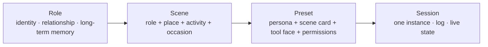
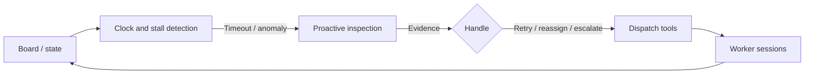

# Scene Presets: One Preset Is One Scene (Design Draft)

English | [中文](scene-preset-design.cn.md)

**Audience:** DSH plugin developers and Agent product designers.
**Prerequisites:** Cordis plugins, Agent presets, system prompts, tool registration.

Status: concept design, awaiting review. **Landing-point update (2026-10-22):** the Person Agent preset stack this document cites as the precedent has retired — the bridge is now the `person-agent` *application* (see `person-agent-app-mode.md`). Wherever the text below says "preset", read "app page session" for the Person Agent references; the pattern examples that pointed at `person-agent-dynamic-context` / `person-agent-reanchor` describe deleted packages and survive only as prior art. This document answers four questions: what a scene is made of, how roles and scenes layer, how state and role decide the buttons, and how the model maps onto DSH presets. `scene-kit` / `scene-view` / `scene-context` / `scene-switch` are proposed package names; they do not exist yet.

## 0. In short

1. **A scene is not a role-play prompt; it is a context contract.** It states who is in what relationship, where they are, what they are doing, what they may use, what they remember, and how they leave.
2. **Roles are continuous; scenes are discrete.** A role (child, employee, friend) persists across places and activities, so memory belongs to the role. A scene (dinner at home, working in the office, walking by the sea) is one concrete activity, so tools and norms belong to the scene.
3. **A preset is the executable form of a scene; a session is one instance of it.** Switching scenes means switching presets, which means a new session or a fork. Do not hot-swap a persona inside a live session.
4. **A costume change is not a scene change.** A real scene changes at least one of: the tool face, the memory boundary, or the permission policy.
5. **Absent tools are part of the scene.** A cinema has no terminal, just as a person would not open a laptop to look things up in a cinema.
6. **A preset is role equipment, not a toolbox.** The task hall needs a board, a clock, and a work order — not the whole engineering toolbox; more tools make choosing slower and more error-prone.
7. **State decides the buttons; role decides the view.** In one scene, `queued` and `blocked` expose different tools, and a viewer and a dispatcher see different fields; invisibility is experience, denial is security.

## 1. What a human scene already contains

A person walks into a scene and loads a whole set of things without being told:

| What a person already knows | The question it answers |
|---|---|
| Who I am | What identity I hold here, whose side I am on |
| Who you are | What relationship we have, who has authority, how close we are |
| Where I am | What kind of occasion this is, who else is present, what may be said |
| What I am doing | What the goal is, what the next step is, what counts as done |
| What I can do | What I have at hand, which actions are out of place |
| What I remember | What happened before, what may be mentioned, what must stay private |
| When I leave | What signals the end, how we stay in touch afterwards |

An Agent has none of this "load on entering a scene" machinery. By default it loads the **generic assistant**: polite, universal, stance-free, placeless. The value of a preset is to compress the context a human gets for free into a few hundred tokens.

So the design goal of a scene preset is not to make the Agent sound like a character. It is to **make the generic-assistant default impossible**.

## 2. First, separate the role layer from the scene layer

The examples that prompted this design mix two layers:

| Example | Layer | Why |
|---|---|---|
| With parents, I am the child | Role / relationship | Still the child in a restaurant, a hospital, or a video call |
| With children, I am the parent | Role / relationship | Still the parent at school, in a hospital, or on a trip |
| With my boss, I am the employee | Role / relationship | Still the employee at a retreat, on a trip, at the annual party |
| With friends, I am the confidant | Role / relationship | Still the confidant by the sea, in a café, at home |
| Watching TV in the living room | Scene | Role + place + activity |
| Watching a movie in a cinema | Scene | Place + activity + etiquette |
| Meeting in a meeting room | Scene | Place + activity + decision rules |
| Walking by the sea | Scene | Place + activity + pace |

The value of the split is reuse: **one role can spawn many scenes, and one scene can cast different roles.**



- **Role** answers "who am I, and who am I to you." It sets stance, address form, intimacy, and long-term memory.
- **Scene** answers "where am I right now, and what am I doing." It sets place facts, activity pace, the immediate goal, and the tool face.
- **Preset** is the scene's executable form: the role becomes the persona, the scene becomes the scene card, and permissions become tool rows.
- **Session** is one instance: where this movie is, what was said at this dinner. It lives in the session log and does not travel to the next scene on its own.

This is why "with parents" and "watching TV in the living room" cannot sit in one flat list: the first is a role, the second is a scene that role plays in a particular place. The complete statement is "as the child, in my parents' living room, watching TV with them."

## 3. The seven clauses of a scene

An executable scene must answer seven questions. Miss one, and the model falls back to the generic assistant.

| # | Clause | Question | Typical content | DSH landing point |
|---|---|---|---|---|
| 1 | Casting | Who am I, who are you, what are we to each other | Agent role, user role, relation, power distance, intimacy | `dsh-persona` prefix |
| 2 | Setting | Where, when, who else, what is here | Place, time, privacy level, others present, props, atmosphere | Static scene card + runtime context |
| 3 | Objective | What are we completing, what counts as good | Shared goal, individual goals, stakes, success criteria | Persona + scene card + todo |
| 4 | Interaction | How to address, how to take turns, what is off-limits | Address form, formality, turn length, taboos, repair moves | Persona suffix + scene card |
| 5 | Affordances | What may be done, what may not, what needs approval | Tool face, permissions, approvals, spending/external-send limits | Tool rows + sandbox/approval |
| 6 | Memory | What comes in, what stays, what leaves | Carry-in, scene-local, carry-out, privacy level | Notebook/storage + session log |
| 7 | Exit | When it ends, how to hand off | End signals, handoff summary, next appointment | Tools + prompt + archive |

### 3.1 Casting must be explicit

"With parents, I am the child" is ambiguous about whose perspective it states: does the user play the parent while the Agent plays the child, or is the user the child while the Agent plays the parent?

A product must name both sides:

```yaml
casting:
  agent: child          # Who the Agent plays
  user: parent          # Who the user plays
  relation: parent-child
  power: low            # The Agent's power position in this relationship
  intimacy: close
  address: Dad / Mom    # Address form
```

The default assumption should be: **the user is themselves and is never asked to role-play; the Agent enters the role.** Only explicit role-play or training scenes put the user in character too. Without that default, the Agent feels presumptuous.

### 3.2 All seven clauses, filled in: the cinema

| Clause | Content |
|---|---|
| Casting | Agent = companion; user = companion; relation = friend/partner; equal, close |
| Setting | A cinema; evening; a dark public space; a full audience; phones on silent |
| Objective | Watch the film together; the Agent's goal is companionship and a conversation afterwards |
| Interaction | Whispers and short sentences; no spoilers; no plot discussion; no leaving mid-film |
| Affordances | No tools; no lookups, no work, no photos |
| Memory | Carry in: the other person's favorite genres, the last film they saw; keep local: where this film is, their live reactions; carry out: impressions, the next plan |
| Exit | End credits, house lights; a three-sentence summary; make a next plan |

Note clause 5: **"No tools" is a scene decision, not a default.** In a cinema the Agent should have no search, no files, no terminal; it should not even say "let me look that up for you." The absence of a tool face matters as much as a taboo in the dialogue.

## 4. Drawing the inference: five axes, not one long list

Scenes are long-tailed and cannot be enumerated. The axes are what generalize:

| Axis | Values | Examples |
|---|---|---|
| Relationship | Family / workplace / service / social / authority / care / transaction | Parent, boss, customer, friend, police officer, doctor, seller |
| Place | Private / semi-public / public / virtual | Home, café, cinema, seaside, meeting room, online |
| Activity | Consume / produce / decide / socialize / transact / care / transit / rest | Watch TV, work, meet, chat, order, consult, commute, zone out |
| Occasion | Everyday / ritual / crisis / first time / farewell | Weekend, wedding, emergency, interview, funeral |
| Mode | Solo/pair/group; public/private; formal/casual; online/offline | Group chat, direct message, video call, face to face |

A scene's name usually comes from its **dominant axis**:

- "With parents" is relationship-dominant.
- "Cinema" is place-dominant.
- "Meeting" is activity-dominant.
- "Wedding" is occasion-dominant.

But every real scene has a value on all five axes. When designing a scene, fill all five first, then decide which one dominates.

### 4.1 Scene matrix (examples, not exhaustive)

| Scene | Agent plays | User plays | Place / activity | Hard constraints | Tool face |
|---|---|---|---|---|---|
| Visiting parents | Child | Parent | Parents' home / accompany | Share good news first but never lie; do not fight back | `companion` |
| Looking after a child | Parent | Child | Home / care | Do not decide for the child; empathize first | `companion` |
| Reporting to the boss | Employee | Boss | Office / report | Conclusion first; never promise beyond authority | `meeting` |
| Chatting with a friend | Confidant | Friend | Café / small talk | Equal; non-judgmental; do not rush to solutions | `cafe` |
| Watching TV in the living room | Family member | Family member | Living room / consume | Low intensity; interruptible; do not push tasks | `silent` |
| Watching a movie in a cinema | Companion | Companion | Cinema / consume | Silence; no spoilers; no lookups | `silent` |
| Drinking coffee in a café | Barista or companion | Customer or friend | Café / consume and socialize | Light; work or chat is fine | `cafe` |
| Eating in a restaurant | Companion or server | Friend or diner | Restaurant / consume | Dietary needs; ordering; do not rush | `service` |
| Walking by the sea | Companion | Companion | Seaside / talk | Slow; open; no KPIs | `silent` |
| Meeting in a meeting room | Participant/scribe | Chair/colleague | Meeting room / decide | Agenda; turn-taking; minutes | `meeting` |
| Working in the office | Colleague | Colleague | Office / produce | Focus; few interruptions; executable | `office` |
| Task-hall dispatch | Duty dispatcher | Task owner/lead | Task hall / dispatch | Evidence before judgment; no overreach; ask before destructive actions | `control` |
| Attending a lecture | Classmate/TA | Listener/classmate | Lecture hall / learn | Do not interrupt; take notes; ask short questions | `study` |
| Job interview | Candidate | Interviewer | Meeting room / decide | Neither servile nor arrogant; STAR; never invent experience | `interview` |
| Medical consultation | Doctor's assistant | Patient | Clinic / care | Do not diagnose; recommend care; protect privacy | `care` |
| Handling a complaint | Support agent | Customer | Online / transact | Emotion before problem; never promise what you cannot do | `service` |
| Wedding | Guest | Couple/guest | Banquet hall / ritual | Bless; do not steal the spotlight; do not push drinks | `ceremony` |
| Funeral | Mourner | Family | Funeral home / ritual | Restrained; accompany; no photos | `silent` |

The table extrapolates further: interviewer's perspective, teacher and parent, landlord and tenant, doctor and family, driver and passenger, guide and tourist, barber and customer, bookseller and reader, trainer and trainee, gate agent and traveler, lawyer and client in court. The method is unchanged: **fill the five axes, fill the seven clauses, then choose the tool face.**

### 4.2 When axes conflict, who wins

Real scenes conflict constantly: walking by the sea with your boss — is this a reporting relationship or a walk?

Rule: **each scene declares a dominant frame; the other axes only modify it.**

```yaml
dominant: relation   # With the boss by the sea: relationship dominates; the place only relaxes it
```

- Cinema: `dominant: place` — however close the two people are, they cannot discuss work loudly in the cinema.
- Wedding: `dominant: occasion` — however senior the boss, today they are a guest.
- Emergency room: `dominant: activity` (care) — whatever the usual pleasantries, saving the patient comes first.
- Funeral: `dominant: occasion` — every relationship is downgraded to "mourner."

The dominant frame is not decoration; it decides which rule wins in a conflict. A scene without one breaks character at random the first time the axes disagree.

## 5. The scene card: what to inject, and where

The scene card has two layers, matching the two DSH injection mechanisms:

| Layer | Content | Change rate | DSH mechanism | Cache effect |
|---|---|---|---|---|
| Static card | Casting, place facts, rules, taboos, exit | Low | `dsh-persona` / system-prompt section | Stable prefix, cacheable |
| Runtime facts | Current time, who else is present, current goal, open threads, previous scene | May change every step | Dynamic context (user-role snapshot) | Append only changes; never rewrite the prefix |

This matches the existing `person-agent-dynamic-context` pattern: **static material goes into the system prompt, dynamic material goes into sourced user messages, and the dynamic part is diffed by section so only changes are appended.**

### 5.1 Scene card sketch (cinema)

```yaml
scene: cinema
casting:
  agent: companion
  user: companion
  relation: friend/partner
  power: equal
  intimacy: close
setting:
  place: cinema
  privacy: public-dark
  others: full audience
  props: [ticket, popcorn]
  norms: [phones on silent, whispers, no spoilers]
objective:
  shared: watch this film together
  agent: accompany; talk about it afterwards
interaction:
  formality: casual
  turns: whispers, short sentences
  taboo: [loud discussion, spoilers, leaving mid-film]
affordances:
  tools: []
  reason: no lookups, no work, no photos in the dark
memory:
  carryIn: [their favorite genres, the last film they saw]
  sceneLocal: [where this film is, their live reactions]
  carryOut: [impressions, the next plan]
exit:
  signals: [end credits, house lights]
  handoff: three-sentence summary
```

### 5.2 Put the static card in the persona, not in every turn

The static part of the scene card belongs in the system prompt, not in a per-turn append. Reasons:

- A stable prefix is what makes the KV cache hit.
- Rules belong to the persona, not to "the facts of this turn."
- Repeating them every turn teaches the model to treat them as noise.

Only runtime facts travel through dynamic context, and only their changes are appended. **Re-sending the static card every turn is the most common waste in scene design.**

## 6. The tool face: shape a scene with absence

More tools do not make a better scene. Every tool costs schema tokens and widens the chance of breaking character. A scene should decide **what not to give** first.

Tools are not only capabilities but also prompts: their names, descriptions, and parameters enter the model's context together and tell it what is possible here. Choosing a tool face is, in effect, writing the scene's action lines.

| Tool face | Contains | Fits | Explicitly withheld |
|---|---|---|---|
| `silent` | Nothing | Cinema, seaside, funeral, living room | Every tool |
| `companion` | Memory, `ask_user`, schedule | Visiting parents, looking after a child | Terminal, web, files |
| `cafe` | `read`/`glob`/`grep`, `web`, notes, schedule | Café, restaurant (chat mode) | Terminal, `edit` |
| `meeting` | Notes, `todo`, `present`, schedule, `ask_user` | Meeting room, review, standup | Terminal |
| `study` | Notes, `read`/`web` (silent verification), `ask_user` | Lecture, study session, book club | Terminal, external sends |
| `interview` | Résumé/role materials (`read`), notes, `todo`, schedule | Interview, recruiting | Terminal, `edit`, external commitments |
| `office` | `fs`, `fs-search`, `pwsh`, `jobs`, `working-directory`, `todo`, `present`, `subagent` | Office, production scenes | None (as needed) |
| `control` | Board summary, task inspection, dispatch/retry/cancel/escalate, handover | Task hall, duty room, operations | Terminal, `edit`, web (switch to the office scene to execute) |
| `research` | `web`, `workflow`, `fs` | Research, fact-finding | Terminal (optional) |
| `service` | Domain tools (menu/order/ticket) + schedule | Restaurant, shop, support | General engineering tools |
| `ceremony` | Schedule, gift list, speech draft (`write`) | Wedding, ceremony | Gossip search, photos, livestreaming |
| `care` | Record, remind, escalate to a human | Medical, counseling, caregiving | Diagnosis, prescriptions, promises |

Three rules:

1. **Minimal by default.** Give only what the current activity requires.
2. **No `edit`/`bash`/`pwsh` outside production scenes.** Writing, reporting, and chatting do not need to change code.
3. **Anything that spends money, sends externally, or commits on the user's behalf needs approval in every scene.** That is the permission layer, not the scene layer.

### 6.1 A preset is role equipment, not a toolbox

A tool face is not a capability list; it is the equipment of a post. To decide whether a tool belongs, ask one question: **which action of this scene absolutely requires it?** If there is no answer, remove it.

- Every tool schema is a standing context cost; N tools means N choices, and the model has to pick, slowly and often wrongly.
- Remove a tool and the scene still works → it never belonged to this scene.
- When a group of actions shares one object and one context, one tool with an `action` parameter beats ten narrow tools: fewer schemas and easier permission checks.
- Design tool faces by **post**, not by **capability inventory**: a dispatcher needs a board, a clock, and a work order; not a terminal, an editor, or web search.

Conversely, if a scene asks the model to do two unrelated jobs, it is not a scene but a chore list; split it into two presets instead of adding tools.

The task hall (next section) is the best proof: it adds exactly three things — a live view, a clock, and dispatch authority — and that makes a scene, without dragging in the whole toolbox.

## 7. Case study: the task hall (a control-room scene)

The task hall is the cleanest counter-example to "a preset is a toolbox": its value is not more capability but **one live view, one clock, one work order**.

### 7.1 The seven clauses

| Clause | Content |
|---|---|
| Casting | Agent = duty dispatcher; user = task owner/team lead; relation = collaboration; equal; the user holds final authority |
| Setting | A task hall (virtual control room); always on; multiple Agents present; board, clock, alerts |
| Objective | Keep work moving: detect stalls, find the cause, dispatch/retry/escalate, keep the board truthful |
| Interaction | Evidence before judgment; never guess; never change a task beyond authority; ask before destructive actions; report in three lines: status, evidence, recommendation |
| Affordances | The `control` tool face: board, inspection, dispatch, retry, cancel, escalate, handover; no terminal/editor/web |
| Memory | Carry in: team roster, task conventions, SLAs; scene-local: the current board, alerts, handling records; carry out: a shift handover |
| Exit | Shift change, all tasks settled, or the user stops it; the handover must list open tasks and risks |

### 7.2 The board: static rules + dynamic facts

Static material goes into the system prompt: the post description (you are a dispatcher, not an executor), stall criteria, report format, permission boundaries. Runtime facts go through dynamic context, split into sections:

| Section | Content | Update trigger |
|---|---|---|
| `roster` | Agents present: role, current task, state, last activity | On change |
| `board` | Tasks: id, owner, state, blocked reason, age | On change |
| `alerts` | Suspected anomalies: type, evidence, suggested check | On discovery |
| `recent` | The last N dispatches/retries/escalations | On change |

Do not resend the whole board every step. The context carries a **summary** (counts, the oldest task, the top three anomalies); details come from a tool on demand. Otherwise the first step of a large team blows the context.

### 7.3 The control loop



- **Clock**: the watchdog checks every N minutes and appends one fact only when something should have moved and did not; it does not remind every step.
- **Stall criteria**: no update past a threshold, SLA exceeded, repeated identical tool calls, an error loop, an owner idle while the task is unfinished.
- **Proactive inspection**: `task_inspect` pulls the recent events of that task/Agent and returns a structured diagnosis: last action, last error, repetition pattern, recommendation.
- **Handling**: retry, reassign, cancel, escalate; destructive actions need approval.
- **Closure**: every handling writes back to the board; the same anomaly is not re-alerted before it is handled.

This is the same pattern as `person-agent-reanchor`: append-only factual reminders, no system-prompt rewrite, no cache break.

### 7.4 The tool face: seven, not thirty

| Tool | Purpose |
|---|---|
| `board_snapshot` | Board summary, filterable by state/owner |
| `task_inspect` | Evidence and diagnosis for one task/Agent |
| `task_dispatch` | Dispatch or create a worker session |
| `task_retry` | Retry with a stated reason |
| `task_cancel` | Cancel (needs confirmation) |
| `task_escalate` | Escalate to a human |
| `shift_handover` | Shift handover summary |

These seven are the tool ceiling; for a given task state and role, only a subset is visible (see section 8).

Why no more:

- Every extra tool keeps its schema in context and adds one more choice; the model gets slower and picks wrong more often.
- The dispatcher's job is to look, judge, and dispatch, not to do the work. When it must do the work, it switches to the office scene instead of growing a terminal.
- Actions on the same object belong in one tool with an `action` parameter: fewer schemas and simpler permission checks.

### 7.5 Failure modes

| Failure | Symptom | Handling |
|---|---|---|
| Stale board | Shows "running" when the work has stopped | Every section carries `updatedAt`; mark stale, never fake real time |
| Alert storm | The same anomaly alerts every step | Deduplicate + cool down; alert once until handled |
| False positive | A slow task is called stuck | Criteria carry evidence; `task_inspect` before reporting |
| Over-dispatch | One task gets multiple owners | Check the active owner; one active dispatch per task |
| Context bloat | The whole board enters the prompt | Summary in context, details in tools; paginate large logs |
| Overreach | The dispatcher edits code or cancels on its own | Approval for destructive actions; execution moves to another scene |

## 8. A scene is a page: state, buttons, roles

A useful analogy: **a scene is like a web page.** A list page shows items, each item has a state, different states show different buttons, and different roles and permissions see completely different things. An Agent scene is the same idea in another medium.

### 8.1 The page model

| Web page | Agent scene | DSH counterpart |
|---|---|---|
| Route / page id | Scene id | preset id |
| Page template | Static context: identity, rules, field descriptions, tool contract | `dsh-persona` / system-prompt section |
| View model / data | Dynamic context: current state, selected item, allowed actions, alerts | Dynamic context (pre-step message) |
| Item state | Task/Agent state | Scene state machine |
| Buttons | Tools / actions | Tool rows |
| Hidden/disabled button + tooltip | Tool hidden, or visible but denied by a guard + reason | `ctx.tools.restrict` + `ctx.tools.guard` + prompt note |
| Role / permission | Casting + policy | `casting` + `RolePolicy` |
| Form validation | Parameter schema + state guard | `defineTool` + `ctx.tools.guard` |
| Audit trail | Session events | session log |

The point: **a page does not dump the database; it gives one role and one state a view.** Scene context is the same: inject only what this view needs, not the whole world.

### 8.2 Static and dynamic context

| | Static context | Dynamic context |
|---|---|---|
| Content | Identity, relationship, rules, field descriptions, tool contract, output format | Current state, selected item, counts, time, alerts, allowed actions |
| Change | Fixed for the session | May change every step |
| Where | Persona / system-prompt section | Dynamic context (user-role snapshot) |
| Cost | Once, cacheable | Appended only when changed |
| Failure | Persona drift, conflicting rules | Context bloat, stale facts |

**Dynamic context should be rendered from a `SceneView` object, not hand-written strings.** `SceneView` is a pure function of the state machine, role policy, and data sources; that makes it testable and guarantees that "what is seen" and "what can be done" come from the same fact.

### 8.3 State decides the buttons

Buttons are not permanent. A task shows "dispatch" when `queued`, "inspect/cancel" when `running`, "retry/reassign/escalate" when `blocked`, "archive/reopen" when `done`.

| State | Visible buttons | Hidden buttons (and why) |
|---|---|---|
| `queued` | `task_dispatch`, `task_cancel` | `task_retry` (never ran) |
| `running` | `task_inspect`, `task_cancel`, `task_escalate` | `task_dispatch` (already has an owner) |
| `blocked` | `task_inspect`, `task_retry`, `task_reassign`, `task_escalate` | `task_cancel` (find the cause first) |
| `reviewing` | `task_approve`, `task_reject`, `task_inspect` | `task_dispatch` (waiting for acceptance) |
| `done` | `task_archive`, `task_reopen` | `task_retry` (already done) |
| `failed` | `task_inspect`, `task_retry`, `task_escalate` | `task_approve` (nothing to accept) |

This table is the Agent version of "page state → buttons." It is both context (telling the model what it can do now) and permission (what it cannot do should not appear).

### 8.4 Role decides the view

In the same task hall, four roles see different things:

| Role | Can see | Can do |
|---|---|---|
| Viewer `viewer` | Board summary, public state | Look only; no dispatch |
| Dispatcher `dispatcher` | All task states, stall reasons | Dispatch, retry, reassign, escalate |
| Task owner `owner` | All fields of their own tasks, acceptance material | Accept, reject, archive |
| Admin `admin` | All fields, audit trail | Force cancel, reassign, change SLAs |

Two layers, both required:

1. **Visibility**: `ctx.tools.restrict({ allow, deny })` narrows the tools the model sees by role and state; dynamic context also renders only the fields this role may see.
2. **Authorization**: `ctx.tools.guard()` checks again before every call. Visibility is not authorization; the model may have seen an old schema, or be steered by the prompt.

One sentence: **invisibility is experience; denial is security.** Hidden fields must be redacted in the view layer, not merely "not mentioned to the model."

### 8.5 The tool face is the ceiling; buttons are the subset

The preset mounts the scene's **tool ceiling** (superset); `SceneView` decides the current **visible subset** (buttons).

| Layer | Decided by | Changes when | Mechanism |
|---|---|---|---|
| Tool face | Preset definition | Scene switch | Child plugin rows |
| Visible buttons | State + role | State/view change | `ctx.tools.restrict` |
| Execution authorization | State + role + arguments | Every call | `ctx.tools.guard` |

Two boundaries:

- `restrict` filters only **inherited global tools**; tools registered in the agent scope stay visible. If scene tools are registered in the agent scope, enforce state in the tool body or a guard; do not rely on `restrict` alone.
- Changing visible tools frequently makes the schema flap, and the button the model just learned disappears next turn. **State/view transitions are coarse (list → detail, queued → running); do not change buttons every step.**

### 8.6 List page and detail page

A scene has at least two views:

| View | Context | Buttons | Tools |
|---|---|---|---|
| List | Counts, oldest task, top three anomalies | Filter, dispatch, open detail | `board_snapshot` |
| Detail | Evidence, history, allowed actions for one task | Retry, reassign, escalate, accept | `task_inspect` + action tools |

Switching views does not switch presets; it switches `SceneView` and visible buttons. That is the right implementation of a "sub-scene." **Changing the view is not changing the scene; changing the role or permission is.**

### 8.7 Failure modes

| Failure | Symptom | Handling |
|---|---|---|
| State drift | The prompt says `running`, the task is `blocked` | The service owns state; re-render `SceneView` every step; never cache old state |
| Hidden-field leak | A viewer sees the owner's private notes | Redact in the view layer; do not rely on tool filtering |
| Button without authorization | The model calls an action it should not | Every action passes a `guard`; `restrict` is not a security boundary |
| Schema flap | The tool list changes every step | Change the visible set only on state/view transitions; keep it stable within a state |
| Unexplained disable | The model does not know why it cannot click | Dynamic context lists "currently unavailable actions + reasons" |

## 9. Memory: roles continue, scenes isolate

| Layer | Content | Owner | Lifetime | Example |
|---|---|---|---|---|
| Persona | Language, values, address habits | Deployment/global | Long | Always speaks Simplified Chinese |
| Role | Relationship history with one person, taboos, important dates | Role/relationship | Long | Mom's checkup report, the boss's sore spots |
| Scene | Facts of this activity | Session | One scene | Where this film is |
| Handoff | Leaving summary | Explicit handoff | Until the next scene | "We talked about my cousin's wedding; ask how it went next time" |

Key rules:

- **Scenes are isolated by default.** Scene A's memory never appears in scene B on its own.
- **Cross-scene reads must be declared.** `carryIn` is an allowlist, not a capability.
- **Relationship memory is keyed by person, not by preset.** The existing `notebook` is per preset; if preset ≈ role, it can be reused directly. If one role spawns several scenes, an extra relation key is needed; otherwise the notes from "dinner with Mom" are unreadable in "taking Mom to the doctor."
- **A handoff is a summary, not a transcript.** Scenes pass written summaries, not whole conversations.
- **Privacy levels.** `public` / `internal` / `private` / `secret`; a scene declares the highest level it may read, and a violation fails loudly instead of "trying not to mention it."

The last rule is where things usually go wrong: an Agent does not "accidentally let something slip," but it will **carry scene A's context into scene B verbatim**. Privacy must be structural, not a prompt reminder.

## 10. Switching scenes: exit, handoff, entrance

### 10.1 Why not hot-swap

- The system prompt is a cacheable stable prefix; rewriting it mid-session invalidates the cache and confuses the model.
- Adding or removing tool schemas mid-session makes "what I can do" drift.
- The memory boundary needs one clean cut.
- The user must see that the scene changed; otherwise the behavior change reads as a bug.

### 10.2 Switching mechanisms

| Need | Approach | DSH mechanism |
|---|---|---|
| Enter a new scene | New session + target preset | Client-side creation / `session_create` (the person-agent tool family) |
| Change role with context | Fork + explicit `presetId` | `session_fork_with_options` |
| Sub-scene within one scene | Keep the preset; append a scene-card section | Prompt section / context |
| Return to an old scene | Resume the old session, or fork from it | Resume / fork |
| End a scene | Leaving summary + archive | `scene_exit` tool + archive |

### 10.3 A proposed `scene_switch` tool

```ts
scene_switch({
  to: 'office',                 // Target scene id
  handoff: 'Finished dinner with Mom; we agreed I would take her for the checkup next Wednesday.',
  carry: ['checkup report', 'next Wednesday'], // Explicitly carried memory keys
})
```

It does four things: write the leaving summary, fork the current session, mount the target preset, and put the summary in as the new session's first scene card. It returns the new session id.

**Entrances need ritual too.** The first sentence in a new scene should speak in that scene's voice, not "Switched you to the office scene." The latter is a system notification; the former is a scene.

## 11. Landing on DSH: what a scene preset looks like

The existing `person-agent-preset` already records the intuition that "a preset is a scene, a page." This section turns it into an executable contract.

A scene preset is an ordinary Cordis plugin tree:

```yaml
- id: scene-cinema
  name: '@deepseek-ai/dsh-agent-preset'
  config:
    id: cinema
    name: Watching a Movie
    description: A quiet companion in a cinema: no lookups, no work, a conversation after the credits.
    order: 30
    plugins:
      - id: persona
        name: '@deepseek-ai/dsh-persona'
        config:
          prefix: |
            You are in a cinema, the user's companion. The lights are down and the screen is bright.
            You speak softly and briefly; you do not know the plot and do not pretend to.
          suffix: |
            Do not look anything up, do not work, do not take photos. Talk about the film afterwards.
      - id: scene-context
        name: '@veren/scene-context'   # Proposed: runtime scene card
        config:
          scene: cinema
          inject: [runtime, openThreads]
      - id: tool-ask-user
        name: '@deepseek-ai/dsh-tool-ask-user'
```

Note the absence of `tool-fs`, `tool-web`, and `tool-pwsh`. **The tool face's absence is enforced by composition, not by hoping the prompt behaves.**

### 11.1 `scene-kit`: compile a scene spec into a preset

The proposed `@veren/scene-kit` exposes one pure function:

```ts
export interface SceneSpec {
  id: string
  name: string
  dominant: 'relation' | 'place' | 'activity' | 'occasion'
  casting: { agent: string; user: string; relation: string; power: 'low' | 'equal' | 'high'; intimacy: 'stranger' | 'acquaintance' | 'close' }
  setting: { place: string; privacy: 'public' | 'semi' | 'private'; others?: string[]; norms: string[] }
  objective: { shared: string; agent?: string; success: string[] }
  interaction: { formality: 'casual' | 'neutral' | 'formal'; turns: string; taboo: string[] }
  tools: ToolFaceName
  memory: { carryIn: string[]; carryOut: string[] }
  exit: { signals: string[]; handoff: 'summary' | 'none' }
  policy?: ScenePolicy
}

export interface ScenePolicy {
  states: Record<string, { visible: string[]; hidden?: Record<string, string> }>
  roles: Record<string, { canSee: string[]; canDo: string[] }>
}

export function buildScenePreset(spec: SceneSpec): PresetDefinition
```

A scene with states or roles (the task hall, approval flows) also declares `policy`: `states` gives the visible actions and the reason each hidden action is hidden, and `roles` gives the fields each role may see and the actions it may perform. `scene-view` turns that into visible buttons and guard rules.

Mapping:

| SceneSpec field | Output |
|---|---|
| `casting` | Opening of `dsh-persona.prefix`, plus address form and stance |
| `setting` + `interaction` | Persona rule block + hard constraints in the suffix |
| `objective` | Persona goal block + scene card |
| `tools` | Tool row list (looked up from the `ToolFace` table) |
| `memory` | Scene card `carryIn` + notebook/storage config |
| `exit` | Exit rules in the suffix + optional `scene_exit` tool |
| `policy` | `scene-view`'s state machine + `RolePolicy` + `restrict`/`guard` rules |

Adding a scene then costs **one object**, not a plugin tree. Tool faces, validation, and defaults live in the kit.

### 11.2 Validation rules (fail loud)

- Any of the seven clauses missing → reject the build.
- `casting` missing the agent or the user → reject.
- No `dominant` declared → reject.
- Unknown tool face → reject.
- A high-stakes scene (medical/legal/financial) with no human-escalation path → reject.
- Every state's visible actions must be a subset of the tool face.
- Every tool must be visible in at least one state (otherwise it is dead weight; remove it).
- Every role's `canDo` must be a subset of the actions that role can see.
- Every hidden action needs a reason (used for the "unavailable + why" line in dynamic context).
- Two scenes declaring the same `id` → the registry already fails; do not swallow it.

## 12. Code layout and delivery path

```text
plugins/scene-kit/        # SceneSpec types, tool faces, buildScenePreset, validation (pure logic)
plugins/scene-view/       # State machine + RolePolicy + SceneView + visible buttons/authorization
plugins/scene-context/    # Render SceneView into static/dynamic context
plugins/scene-switch/     # scene_switch tool: leaving summary + fork + mount
plugins/scene-catalogue/  # Scene specs (no runtime), twelve to eighteen to start
```

Per AGENTS.md: at most five source files per package, at most 300 lines per file, at most 30 lines per function. `scene-kit` is pure logic and does not depend on the Host; `scene-view` owns `ctx.tools.restrict`/`ctx.tools.guard`; `scene-context` only renders `SceneView` into context and reuses the per-section change detection of `person-agent-dynamic-context`; `scene-switch` reuses the preset-mount path of `session_fork_with_options`.

| Phase | Deliverable | Acceptance |
|---|---|---|
| P0 | `scene-kit` + four base scenes (visiting parents, reporting to the boss, cinema, meeting room) | Unit tests: seven-clause validation, tool-face mapping, absence assertions |
| P1 | `scene-view` + `scene-context` + the task-hall board | Unit tests: state machine, role policy, visible buttons, append-only changes, clock and stall detection, alert deduplication |
| P2 | `scene-switch` + task-hall dispatch | E2E on a real Host: scene switch, handoff summary, `task_inspect`, dispatch/retry/escalate |
| P3 | Scene catalogue + GUI picker | Users see scene names/icons/descriptions; entering and leaving is announced |

Tests follow the repository conventions: `*.spec.ts` runs on vitest; `*.e2e.ts` runs against a real Host and skips without credentials. Behavioral acceptance should be **observable assertions**:

- The cinema tool list contains no `web`/`fs`.
- Reporting to the boss never emits terminal commands.
- After a scene switch, the new session's first scene card contains the handoff summary.
- Scene A's notebook is unreadable from scene B.

"Does it feel right" is hard to test; "did it cross a line" is testable. Test the latter first.

## 13. Risks and open questions

| Risk | Description | Mitigation |
|---|---|---|
| Scene explosion | One prompt/tool set per scene is expensive to maintain | Reuse axes + roles + tool faces; generate instead of hand-writing |
| Token cost | Scene cards and tool schemas consume context | Static card ≤400 tokens; minimal tool faces |
| Cache invalidation | Dynamic facts rewrite the prefix | Static in the prefix; dynamic append-only |
| Casting confusion | Users do not want to role-play | Default to "the user is themselves"; only explicit casting puts them in character |
| Safety | Medical/legal/financial scenes pretend expertise | Disclaimers + human escalation + no diagnosis or promises |
| Cultural variation | Address forms and taboos vary by region | Locale variants of the scene card |
| Evaluation | "In character" is not measurable | Test observable behavior only: tools, taboos, handoff, privacy |
| Multiple roles at once | Boss + friend + parent in the same room | Dominant frame + explicit precedence; split the scene when needed |
| Board source of truth | Who owns task/Agent state | Read `ctx.agents`/session projections, or attach one task service; never a second truth |
| Stall false positives | One threshold for every task | Per-task-type SLAs; `task_inspect` before reporting |
| Dispatch overreach | Cancel/reassign/external sends | Approval + audit; execution moves to another scene |
| Multiple dispatchers | Two task halls watching the same queue | Task-level lease/claim; idempotent dispatch |
| Permission drift | The view, tools, and context each carry their own rules | Generate all three from one `ScenePolicy`; contract tests |
| Memory consent | Private facts carried across scenes | `carryIn` allowlist + visible and editable |

Open questions:

1. Scene granularity: one preset per scene, or switchable sub-scenes inside a preset? This document leans toward "one scene per session; sub-scenes add a scene-card section without changing the tool face."
2. Who owns relationship memory: the person, the role, or the preset? The existing notebook is per preset and needs an explicit ownership decision.
3. Named tool faces versus free composition per scene? Named faces are validatable and reusable; free composition is flexible but hard to test.
4. Who owns the catalogue: a built-in bundle, user-created scenes, or both?
5. How do users author scenes: YAML, GUI, or conversation?
6. Should a "scene consistency" checker flag lines that do not belong to the current scene?
7. Parallel scenes: the same person in "the office" and "the family group chat" at once — how is memory isolated?
8. Task-hall source of truth: are `ctx.agents` + session projections enough, or is a dedicated task store needed?
9. Stall detection: per-task-type SLAs or one threshold? Who tunes it?
10. Dispatcher authority: may it cancel or reassign? Which actions require user confirmation?
11. Multiple dispatchers: how do two task halls avoid duplicate dispatch and thundering herds?
12. Where do role policies live: the `SceneSpec`, host RBAC, or the domain service? How do the view, tools, and context stay consistent?

## 14. One sentence

A role gives you continuity; a scene gives you presence. The preset packages both, and the session makes it happen. A scene succeeds not when the lines sound right, but when the **tools, memory, and permissions** actually change with it.
