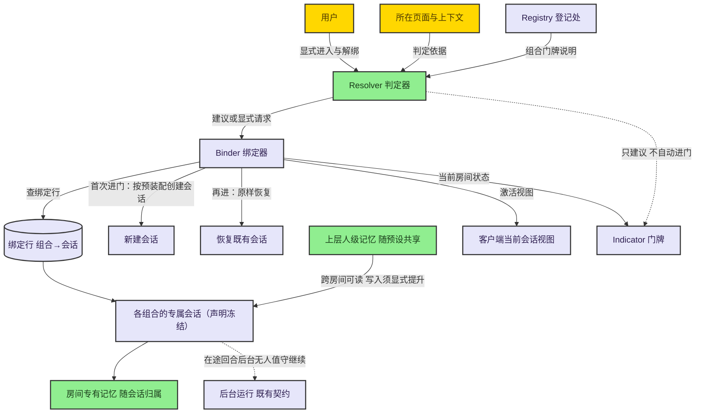
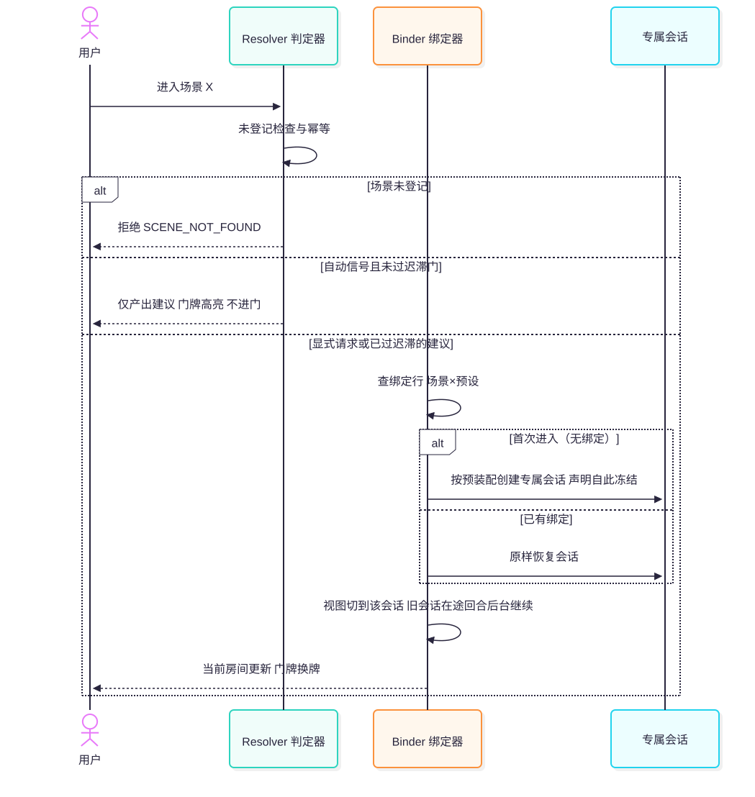
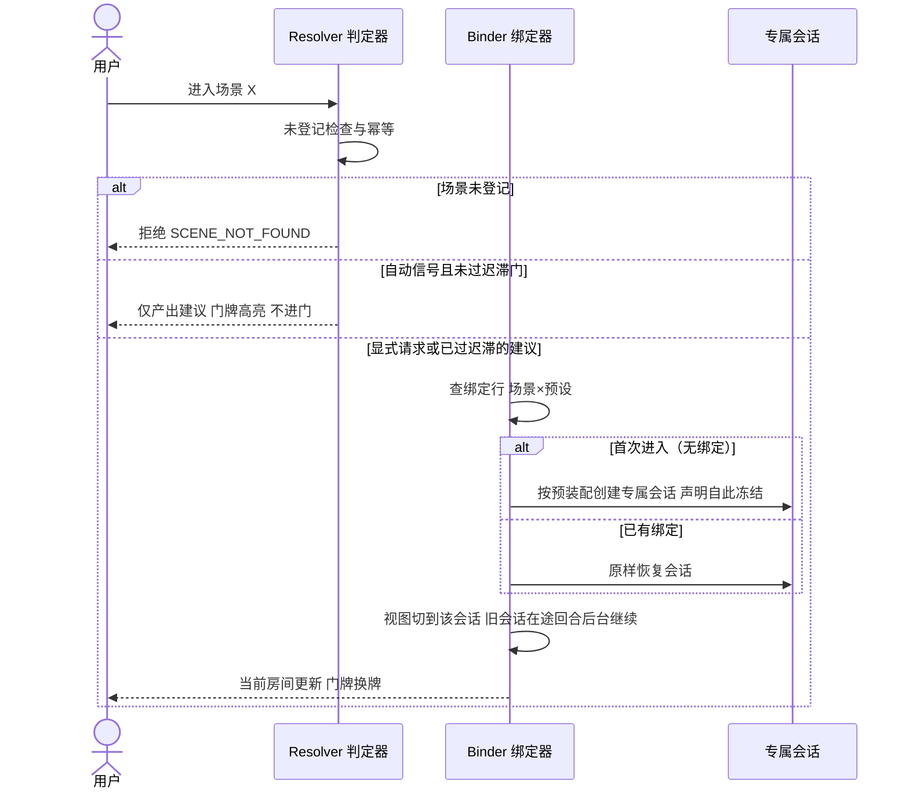

## 1. Boundary

系统边界内是宿主里的一个运行时能力组：它维护「场景×预设组合 ↔ 专属会话」的绑定，判定该进哪间房，并在进入时把对应的会话带到人面前。边界外的参与者有三个：

| 参与者 | 角色 | 与本系统的接触面 |
| --- | --- | --- |
| 用户 | 房子的主人 | 显式进入某房间、接受或忽略自动建议、解绑房间 |
| 模型 | 房间里的住户 | 每个会话自带其组合的能力面；不感知「切换」这件事，只知道自己被打开了 |
| 插件 | 房间的装修方 | 登记组合定义、提供自动判定依据（如「当前在文档页」） |

宿主既有设施是地基而非边界内构件：会话注册表与客户端会话服务（激活/恢复会话）、按会话作用域装配预置能力、长对话压缩、应用页面的「键→会话」绑定行模式、用量记账。方案不重建其中任何一个（见 [6. Why Session Switching](#6-why-session-switching)）。

## 2. Modules

五个模块，每个以一个英文单词命名：

| 模块 | 一句话职责 | 与相邻模块的分界 | 核心域 |
| --- | --- | --- | --- |
| [Registry](./modules/registry/) | 收下组合门牌说明（场景×预设组合定义），校验合格后登记 | 只管「有哪些房」，不管「进哪间」「怎么进」 | 外围 |
| [Resolver](./modules/resolver/) | 决定「现在该进哪间房」：显式请求立即进门，自动信号过迟滞门产出建议 | 只产出建议或执行显式请求，不碰会话 | **核心** |
| [Binder](./modules/binder/) | 维护组合↔会话绑定行：首次进门创建专属会话，再进恢复，解绑作废 | 只做绑定与激活，不做判定 | 外围 |
| [Recall](./modules/recall/) | 守住记忆五层阶梯：重复提炼上行、读取全阶梯可见、跨主体晋升过治理门 | 只管记忆归属、晋升与可见性，不做判定与绑定 | **核心** |
| [Indicator](./modules/indicator/) | 门牌：当前房间、建议提示、一键进入 | 纯呈现，不产生状态变更 | 外围 |

依赖方向：Registry 向其余模块供给组合定义；Resolver 的显式请求与建议交给 Binder 落成「激活哪间房」；Binder 读写绑定行并驱动宿主的会话创建/恢复；Recall 依附于绑定（记忆归属跟着绑定行走）；Indicator 读 Resolver 的建议与 Binder 的当前状态。

## 3. Core Business Identification

核心业务流取「一次进入房间」：请求/信号 → 判定（迟滞） → 绑定查找 → 创建或恢复会话 → 视图激活 → （切走后在途回合后台继续）。沿这条链裁决：

| 模块 | 承担的价值 | 命中判据 | 关键设计决策（铁律级） |
| --- | --- | --- | --- |
| Resolver | 自动建议的唯一入口，抖动防线 | ① 主链不可缺：没有它自动场景不存在；② 失守即失格：乱建议等于把人往错房间里引，产品对「场合感」的承诺失守 | 显式永远压过自动；自动默认**建议制**（不自动进门）；迟滞门；幂等 |
| Recall | 记忆阶梯的归属、晋升与隔离 | ① 主链不可缺：记忆串房即产品失信；② 失守即失格：兄弟房间泄漏是隐私事故，产品立身之本失守 | 五层阶梯（临时/工作/场景/个人/世界）；晋升判据 = 重复提炼且只上行；兄弟房间零泄漏靠结构不靠过滤；L3→L4 跨主体晋升必须过治理门 |

比例核对：核心域 2 ÷ 模块总数 5 = 0.4，可接受区间上缘。Binder 判据②不成立（绑定行损坏走 fail-loud，不产生隐性错误），Recall 入核心的简证与 Resolver 判据②的存疑记录见 [校验与假设](./review/)。

## 4. Architecture Diagram

图源码

读图要点：绿色两个核心模块之外全部长在既有设施上；虚线是「协作但不驱动」——判定器建议房间，进不进门由人；会话的后台运行是宿主既有的无人值守契约，本系统只是不打断它。

## 5. Core Link Sequence

核心链路：一次进入房间的完整旅程，含首次创建、再进恢复与建议制三个分支。

图源码

## 6. Why Session Switching

设计走到 v3 的决策记录：**为什么是「切换会话」而不是「会话内换装」**。会话内换装（改工具声明、换场景提示词）有三座绕不开的大山：

1. **声明位于缓存前缀的最前面**：工具声明排在请求缓存前缀的头部，中途改声明 = 从头部全量失效。补救方案（声明一次加激活块）能稳住缓存，却把工具变成「可见待激活」，牺牲 schema 级互斥；要真不可见就得改声明，回到必死。
2. **切换碎片永久累积**：每次换装在历史里留下激活块与旧提示词，往返切换线性变胖，只能靠压缩折叠兜底。
3. **记忆串味**：同一会话承载多个场合，记忆召回必须靠打标与过滤，过滤逻辑一旦有漏就是隐私事故。房间模型下记忆按五层阶梯组织（临时/工作/场景/个人/世界），层间流动只走晋升管道——重复提炼、只上行、跨主体晋升过治理门；兄弟房间之间零泄漏，不靠过滤器靠结构。

房间模型把三个问题**连同其全部补救机制一起消掉**：每个会话的能力声明自创建起字节不变（前缀缓存按会话各自稳定、交替保温，切换动作本身零缓存代价）；没有追加碎片；记忆归属是结构性的（会话与摘要天然属于所属组合，隔离不需要过滤器）。代价是失去「单会话内的能力演进」——而那正是场景的本意：换场合，不是在同一间房里换家具。

**与本仓既有先例的一致性**：任务工作台早已实践「页面×预设 → 会话绑定、不同会话交叉不可见」并经真机验收。房间模型不是新发明，是把这一模式升为一等概念、去掉页面这个特例载体。

## 7. Invariants And Degradation

三条铁律，违反任何一条都算实现失败：

1. **换房权在人**：模型没有进入/离开任何房间的入口；自动判定默认只产出建议（门牌高亮），经设置显式开启自动跟随才自动进门。
2. **会话面冻结**：每个会话的能力声明自创建起不变；场景系统在任何情况下不得中途修改任何会话的声明与提示词。
3. **记忆单一写入口**：记忆只有一套工具——recall 读全阶梯、write 只写 L0（本会话临时记忆）；L1–L4 全部来自 L0 的晋升（只上行、判据是重复提炼，显式晋升是 L0 源的即时通道）；兄弟房间零泄漏（结构性隔离）；跨主体晋升（个人→世界）必须过治理门，禁止自动；工作区的组织元数据仍对模型不可见，项目工作记忆按需可召回。

降级行为：判定器不可用时，显式进门与全部既有会话不受影响；绑定行损坏走 fail-loud（见 [错误码](./errors/)），不产生隐性错误房间；指示面不可用时，进门与记忆不受影响；自动建议未开启时，一切退化为纯手动。
