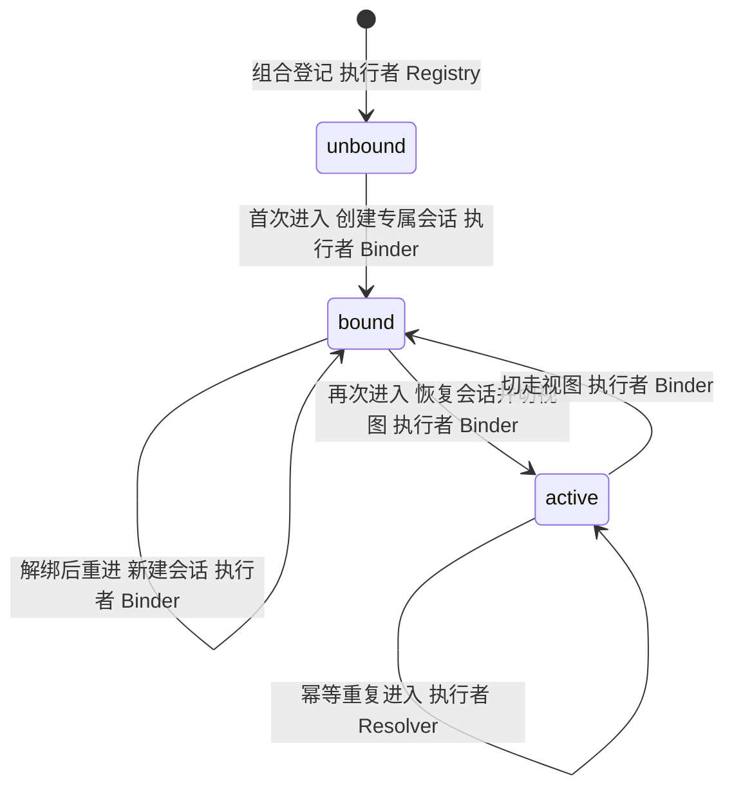

## 1. Entity And States

状态机的实体是**房间**（一个组合一个实体）。会话自身还有宿主既有的会话状态与后台运行状态——那些不归场景系统管，本章只管房间维度的三个状态：

| 状态 | 含义 | 人看到什么（门牌取材） |
| --- | --- | --- |
| `unbound` | 房间已登记但从未进入 | 房间列表中可点，无门牌 |
| `bound` | 已绑定专属会话，当前视图不在其中 | 绑定管理里可见，门牌显示「上次来过」 |
| `active` | 当前视图所在房间 | 门牌高亮 |

被切走的房间其会话可能在后台运行回合——那是宿主的会话状态，不改变房间的绑定状态（`bound`）。

## 2. Transitions

图源码

转移与账面动作一一对应：`unbound → bound` 必然伴随绑定行创建与 `combo/activated(mode: created)`；`bound → active` 必然伴随 `combo/activated(mode: resumed)`；解绑把房间送回 `unbound`（绑定行与房间专有记忆清除，再次进入即全新会话）。

## 3. Illegal Transitions

| 非法转移 | 为什么非法 | 处理 |
| --- | --- | --- |
| `unbound → active` | 跳过创建，无会话可激活 | 实现层断言拒绝；触发即属缺陷 |
| `active → unbound` | 跳过解绑流程，绑定行与记忆残留 | 拒绝；拆除房间必须走显式解绑（破坏性确认），见[绑定器](./modules/binder/) |
| `active` 视图并存 | 两个房间同时为当前视图 | 拒绝；视图唯一，进入新房间即切走旧房间 |
| 任何转移隐匿 `combo/activated` | 换房无协调信号，客户端视图与绑定状态漂移 | 实现层断言拒绝；触发即属缺陷 |

非法转移统一不产生协调事件；对用户可见的失败语义只有[错误码表](./errors/)中的三项。
