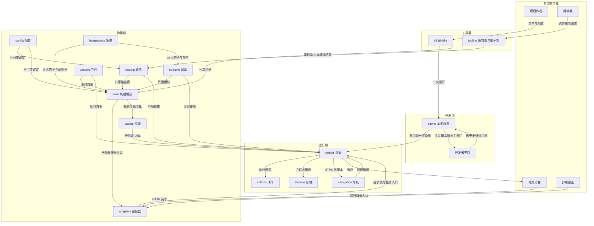
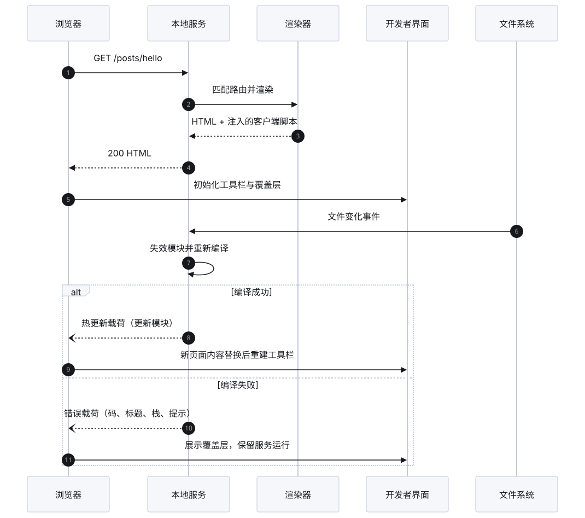
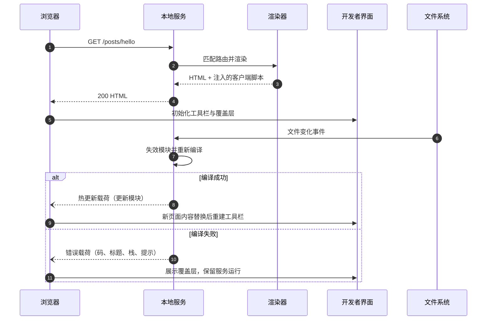
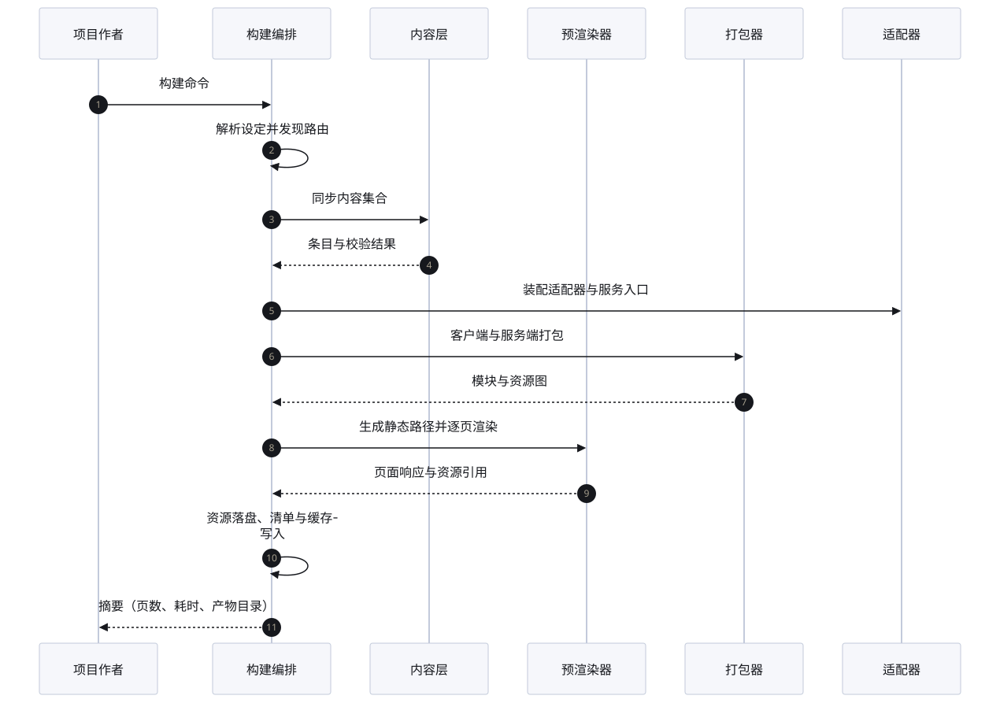
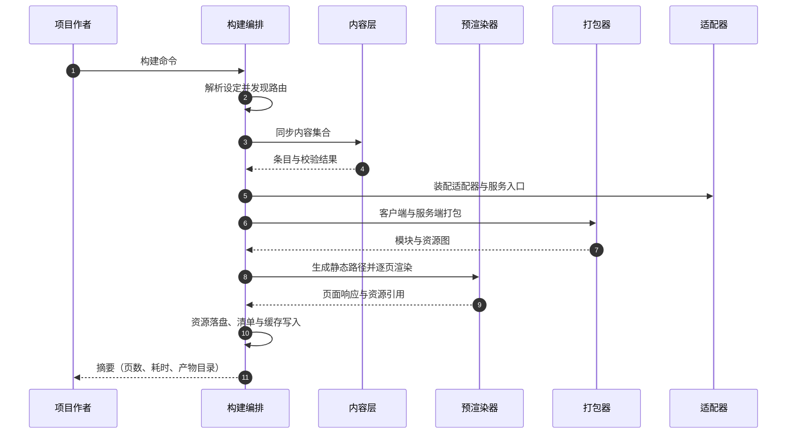

## 1. Architecture

本方案描述一个"把组件与内容编译成站点、再按部署形态交付为静态文件或按需渲染服务"的框架。框架本身不承载业务数据，它承载的是**一次构建设定与一组运行期契约**：构建期把项目源码编译为可部署产物，运行期把一次请求变成一次响应。全部设计围绕这两个阶段展开，任何模块都必须能回答"我属于构建期还是运行期、我拥有哪份数据、我失败的后果是什么"。

### 1.1 Boundary and Actors

| 参与者 | 与系统的关系 | 进入方式 | 系统对其承诺 |
| --- | --- | --- | --- |
| 项目作者 | 提供源码、配置、内容与集成声明 | 命令行、配置文件、目录结构 | 确定的构建结果、可读的失败原因、可复现的产物 |
| 站点访客 | 消费产物：页面、资源、动作接口 | HTTP 请求（静态托管或按需渲染宿主） | 正确的响应、正确的缓存语义、可预期的错误页 |
| 集成作者 | 通过钩子扩展编译与构建 | 集成包声明 | 稳定的钩子顺序、明确的配置与产物访问面 |
| 部署宿主 | 执行产物并提供请求入口 | 适配器约定的服务入口 | 一份自描述的服务入口与一份路由清单 |
| 编辑器 | 在书写阶段提供诊断与补全 | 语言服务协议 | 与编译器一致的诊断、可定位到源码的映射 |

边界之外：包管理、宿主机调度、CDN、数据库、身份提供方均不属于框架职责，框架只通过适配器与集成把请求和配置交给它们。

### 1.2 Core Business Identification

按二八原则，先沿"作者执行一次构建或一次开发请求，把源码变成可访问响应"这条主链追踪，再用三判据裁决候选域：主链不可缺、失守即失格、砍余仍可用。四个域同时命中三判据，构成核心域清单。

| 模块 | 承担的价值 | 命中判据 | 铁律级设计决策 |
| --- | --- | --- | --- |
| `routing` | 决定一个请求由谁响应：命中、重定向、重写或 404 | ① 主链不可缺；② 路由错即页面错；③ 无路由则无站点 | 路由表一次生成、请求期只读；同一路径只允许一个结论；匹配是纯函数 |
| `compile` | 把组件与内容变成可执行渲染单元，并划定客户端边界 | ① 主链不可缺；② 编译错即页面缺段；③ 无编译则无页面 | 失败不产出半成品模块；岛屿属性必须可序列化；客户端边界在编译期定稿 |
| `render` | 把已匹配请求推进为响应：中间件、会话、动作、缓存与错误兜底 | ① 主链不可缺；② 响应错即用户可见故障；③ 无渲染则无响应 | 一次请求只允许一个响应；中间件必须继续或返回；错误不吞 |
| `build` | 把一次运行固化为可部署产物与服务入口 | ① 主链不可缺；② 产物错则无法发布；③ 只保留构建即可静态交付 | 写盘只在构建编排内；失败不写成功缓存；同目录同时只允许一个构建 |

比例核对：核心 4 个，模块总数 15 个，核心占比约 27%，落在 0.1–0.4 的可接受区间。其余 11 个模块为外围域：`config`、`cli` 提供入口与设定，`assets`、`content`、`actions`、`storage` 提供输入与状态，`server`、`integrations`、`adapters`、`navigation`、`tooling` 提供开发期与扩展能力。外围域失效会降低可用性或体验，但不改变"由谁响应"的裁决权，因此不进入核心清单；判定依据与存疑项记录在 [校验记录](/design/review/#309-core-business-check)。

核心链路的时序在第 1.6 节以开发期与构建期两条序列展开；四个核心域的模块章按二八原则加深：铁律决策成文、伪代码覆盖失败与恢复、验收含失败与幂等路径。

### 1.3 Module Inventory

每个模块一个英文词命名，后接一句职责边界；"拥有数据"列指该模块是唯一可写方。

| 模块 | 一句话职责 | 拥有数据 | 主要依赖 |
| --- | --- | --- | --- |
| `cli` | 把用户意图翻译成一次受控的运行：解析参数、选择命令、呈现结果与退出码 | 进程退出状态、终端交互状态 | config、server、build、tooling |
| `config` | 把散落在配置、环境与命令行中的设定收敛成一份不可变设定，并在非法时立即失败 | `ProjectConfig` 与解析后的设定快照 | 无（最底层） |
| `routing` | 从目录与注入声明推导出有序路由表，并把请求路径解析为唯一路由或明确的未命中 | `RouteRecord[]`、`SSRManifest` 的路由段 | config |
| `compile` | 把单文件组件与内容编译为可执行模块，保留源码位置与客户端边界 | 编译产物与源码映射 | config、integrations |
| `render` | 把一次已匹配请求推进为响应：中间件、会话、动作、缓存、错误兜底 | `RenderContext` 与 `RequestOutcome` | routing、compile、storage、actions |
| `build` | 编排一次产物生成：预渲染、打包、资源落盘、增量复用与产物清点 | `BuildRun` 与构建缓存 | config、routing、compile、assets、adapters |
| `server` | 在本地把同一套渲染能力挂到开发服务器上，并提供热更新与开发者界面宿主 | 开发服务器生命周期、覆盖层与工具栏注入 | config、routing、render、build |
| `assets` | 把图片、字体与静态资源变成带指纹的可部署 URL，并保证转换可缓存、可失败可诊断 | 资源转换结果与静态资源清单 | config、render |
| `content` | 把内容集合声明与数据源同步为可查询、可校验的条目存储 | `ContentCollection`、`ContentEntry` | config、routing |
| `actions` | 把服务端函数暴露为带输入校验与错误语义的单一路由入口 | `ActionDefinition` 与调用结果 | config、render |
| `storage` | 为会话与响应缓存提供可替换的持久化与失效能力 | `SessionRecord`、缓存条目 | config、adapters |
| `integrations` | 定义扩展点与调用顺序，使第三方能在不修改内核的前提下改变构建与运行时 | 钩子注册表与渲染器注册表 | config、routing、compile |
| `adapters` | 把产物与请求入口适配到具体部署形态，并声明自身能力边界 | 服务入口与能力声明 | build、integrations |
| `navigation` | 在浏览器内接管同源跳转与预取，使多页体验接近单页且可降级 | 客户端路由状态与预取缓存 | compile、render |
| `tooling` | 在书写与初始化阶段提供与运行时一致的诊断、补全与项目模板 | 诊断结果、模板元数据 | config、routing、compile |

模块分界的三条硬规则：

1. **设定只由 `config` 写**。其他模块可以读设定快照，但不得在运行中修改全局设定；需要变更必须重新走一次解析。
2. **路由只由 `routing` 裁定**。请求"命中哪条路由"只能有一个答案；`render` 不得自行拼路径或猜测回退。
3. **产物只由 `build` 落盘**。开发期与构建期共用编译与渲染，但写文件、清目录、生成清单只发生在构建编排内，避免两条写路径互相覆盖。

### 1.4 Dependencies and Ownership

图源码

读图约定：实线标签写"传递什么"，不写"调用什么函数"。`config`、`routing`、`compile` 是构建期与运行期共用的三个只读上游；`build`、`render` 是两条互不直接调用的执行线，只有 `assets`、`content`、`storage` 同时被两条线读取。

### 1.5 Control Flow

| 环节 | 推进方式 | 同步/异步 | 失败面 |
| --- | --- | --- | --- |
| 参数解析与命令选择 | 直接调用 | 同步 | 未知命令、非法参数 → 帮助或错误退出 |
| 设定解析 | 直接调用，失败即中止 | 同步（可含异步读取） | `UnknownConfigError`、`ConfigNotFound` |
| 路由发现 | 直接调用 | 同步 | 非法路由段、重复参数 |
| 内容同步 | 构建/开发启动时的一次性作业 | 异步（可并发） | `ContentEntryDataError` 等 |
| 页面预渲染 | 构建编排内的并行作业 | 异步（受并发上限约束） | `NoMatchingStaticPathFound`、`PrerenderRouteConflict` |
| 请求渲染 | 一次请求一条链路 | 异步 | 未命中、中间件未继续、动作不存在 |
| 资源转换 | 按需触发，结果可缓存 | 异步 | `ImageNotFound`、`UnsupportedImageFormat` |
| 热更新 | 事件驱动：文件变化 → 失效 → 客户端替换 | 异步事件 | 构建错误转为覆盖层载荷，不终止服务器 |
| 集成钩子 | 构建/服务生命周期上的串行回调 | 异步（顺序执行） | 钩子抛错即中止当前阶段 |

**唯一允许"先返回、后推进"的地方是热更新与流式响应**：前者通过长连接把变化推给浏览器，后者在响应已开始后只允许追加字节。其他路径都必须在一个调用栈内给出结果或抛出带稳定码的错误，避免"看似成功、实际稍后失败"。

### 1.6 Async Sequences

开发期一次请求与一次热更新（`API-04`、`API-05`、`API-06` 见 17 章）：

图源码

构建期一次完整产物生成（异步作业只在此处并行）：

图源码

### 1.7 Tradeoffs

| 取舍 | 选择 | 代价 | 收益 |
| --- | --- | --- | --- |
| 编译期 vs 请求期决定路由 | 编译期生成有序路由表 | 开发期新增文件需要重建路由表 | 请求期匹配是纯函数，可预测、可测试 |
| 组件边界 vs 数据边界 | 组件只描述结构，数据由内容层与请求上下文中注入 | 组件不能自行取数 | 同一组件可同时用于预渲染与按需渲染 |
| 岛屿 vs 整页水合 | 只为声明了客户端指令的边界下发脚本 | 交互跨岛需要显式事件或存储 | 首屏脚本量与页面复杂度解耦 |
| 适配器 vs 内核感知宿主 | 内核只产出标准请求入口，宿主差异收敛在适配器 | 适配器需自行声明能力 | 同一份产物可迁移到多种部署形态 |
| 集成的权限 | 钩子可读设定、可改打包配置，但不能改路由裁定 | 扩展能力有边界 | 路由唯一性不被第三方破坏 |

### 1.8 Architecture Acceptance

| 编号 | 前置条件 | 操作 | 可观察结果 |
| --- | --- | --- | --- |
| A-1-01 | 全新项目、无适配器 | 执行构建 | 产出静态站点；日志明确 `output` 与产物目录；不出现"缺少适配器"错误 |
| A-1-02 | 配置了按需渲染但未装适配器 | 执行构建 | 构建以 `NoAdapterInstalled` 失败，退出码非 0，提示缺少适配器 |
| A-1-03 | 同一路由既有静态页又有同名端点 | 请求该路径 | 只有一条路由胜出，结果稳定可复现，两次构建一致 |
| A-1-04 | 集成在 `astro:config:done` 抛错 | 执行构建 | 当前阶段中止，错误带集成名与钩子名，已写产物不被误报为成功 |
| A-1-05 | 开发服务器运行中修改页面 | 保存文件 | 浏览器收到热更新并替换内容；工具栏在新内容上重建，不残留旧高亮 |
