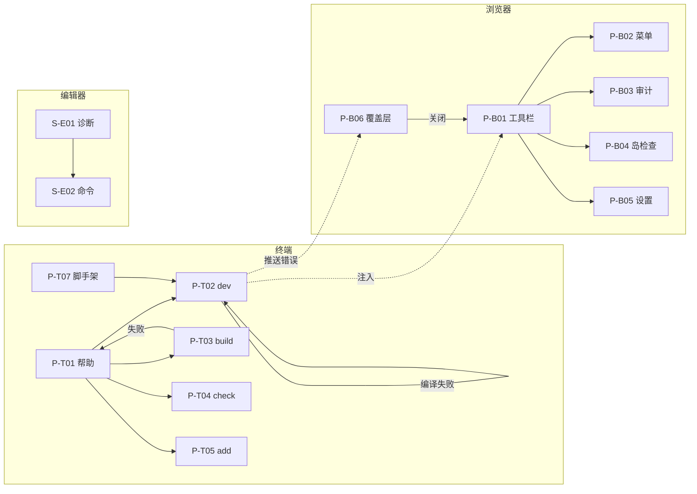

## 22. Product Surfaces

框架的产品端不是"使用者角色数"，而是**独立的体验载体**：终端、浏览器开发界面、编辑器集成。三者共享同一份错误码与同一条构建/渲染事实，但呈现方式、可达性与状态恢复规则完全不同。被构建出来的站点是框架的**产物**而非框架的产品端，它的页面设计属于站点作者，不在本方案内。

### 22.1 Surfaces

| 产品端 | 服务人群 | 入口 | 能力边界 | 权限 |
| --- | --- | --- | --- | --- |
| `terminal` | 项目作者、CI | `astro <command>`、`create-astro` | 运行、构建、检查、同步、添加集成、管理后台服务器 | 项目根内全部能力；不访问浏览器存储 |
| `browser` | 项目作者（本机） | 开发服务器注入的工具栏与覆盖层 | 观察与调试当前页面：审计、岛检查、设置、错误详情 | 仅开发模式、仅本机来源；无写项目文件能力 |
| `editor` | 项目作者 | VS Code 扩展、语言服务器 | 诊断、补全、格式化、跳转；不启动构建 | 只读项目；不执行用户代码 |

不设更多产品端：框架不提供云端控制台、账号体系或托管面板，这些属于适配器与平台方。

### 22.2 Terminal Pages

终端没有 URL，页面由"命令 + 参数 + 当前状态"决定；下表用命令作为页面标识。

| 页面 | 入口 | 一句话边界 | 主要操作 | 关键区域 | 状态 |
| --- | --- | --- | --- | --- | --- |
| `P-T01` 帮助与版本 | `astro --help`、`astro --version` | 列出命令与参数，不读项目 | 选择命令、查看版本 | 用法块、命令表、示例 | 成功即退出 |
| `P-T02` dev 运行 | `astro dev [flags]` | 启动并维护本地服务 | 打开浏览器、查看 URL、`logs`/`status`/`stop`、`--background` | 版本行、URL、就绪耗时、错误摘要 | 启动中 / 就绪 / 降级 / 停止 |
| `P-T03` build 汇总 | `astro build` | 生成产物并汇总 | 查看页数、资源、耗时、产物目录 | 阶段行、摘要表、失败块 | 进行中 / 成功 / 失败 |
| `P-T04` check 报告 | `astro check` | 运行诊断并列出问题 | 按文件过滤、跳转编辑器、退出码 | 计数条、问题表（文件/行/列/级别/消息） | 无问题 / 有问题 / 工具缺失 |
| `P-T05` add 选择 | `astro add <integration>` | 安装并写入配置 | 选择集成、确认写入、取消 | 集成列表、将修改的文件、确认提示 | 选择中 / 写入中 / 已写入 / 已存在 |
| `P-T06` info 诊断 | `astro info` | 输出可粘贴的环境摘要 | 复制、查看包管理器与版本 | 系统信息、依赖版本、配置摘要 | 成功 / 部分缺失 |
| `P-T07` 项目脚手架 | `create astro` | 从模板创建项目 | 输入目录、选模板、装依赖、初始化仓库 | 步骤提示、进度、完成摘要 | 交互中 / 非交互 / 失败回滚 |

终端页面共 7 个；`astro sync`、`astro preview`、`astro telemetry`、`astro preferences`、`astro create-key`、`astro docs` 复用上述页面的形态（一次性输出或长驻服务），不单列，避免把"参数差异"当成新页面。

### 22.3 Browser Surface

浏览器页面由开发服务器注入，只在开发模式存在；URL 通常就是被调试的站点页面，界面状态寄居在页面之上。

| 页面 | 入口 | 一句话边界 | 主要操作 | 关键区域 | URL/状态承载 |
| --- | --- | --- | --- | --- | --- |
| `P-B01` 工具栏外壳 | 任意开发页面底部 | 承载应用入口与开关 | 展开/收起、切换应用、拖动位置 | 应用按钮条、通知徽标、隐藏把手 | 位置持久化在 `localStorage`（键 `astro:dev-toolbar:settings`）；不入 URL |
| `P-B02` 菜单 | 点击工具栏首个按钮 | 展示版本、调试信息与生态入口 | 复制调试信息、打开文档、查看集成 | 版本行、调试信息块、外链列表 | 打开态不写 URL；刷新后回到收起态 |
| `P-B03` 无障碍审计 | 点击审计按钮 | 列出当前页的可访问性与性能问题 | 按类别筛选、定位元素、重跑 | 结果列表、规则说明、空态插图 | 选中项在组件内存；刷新重跑 |
| `P-B04` 岛检查 | 点击检查按钮 | 高亮所有客户端岛并显示其指令 | 悬停查看、点击定位、关闭 | 高亮框、tooltip（指令/渲染器/属性） | 不写 URL；页面切换后重建 |
| `P-B05` 工具栏设置 | 点击设置按钮 | 修改工具栏自身行为 | 关闭通知、开启详细日志、改位置 | 三行设置、即时生效提示 | 持久化在 `localStorage`；与配置默认值合并 |
| `P-B06` 错误覆盖层 | 编译/渲染失败时自动出现 | 展示一条主错误与可操作建议 | 复制错误、打开文件、切换主题、关闭 | 标题区、提示区、栈帧、源码片段 | 由热更新通道推送；关闭后本次错误不再弹出，修复后自动清除 |

浏览器页面共 6 个。审计与检查的数据都来自**当前 DOM 与页面内已加载的模块**，不发起跨域请求；菜单中的生态列表是唯一的外部数据源，必须失败可降级（离线时显示"暂不可用"而不是空列表）。

### 22.4 Editor Surfaces

编辑器不拥有自绘页面：界面由宿主（VS Code 等）提供，框架只提供数据与命令。按"表面"记录，避免虚构页面。

| 表面 | 载体 | 内容 | 失败表现 |
| --- | --- | --- | --- |
| `S-E01` 诊断列表 | 编辑器 Problems 面板 | 来自语言服务器的诊断，码与位置与构建一致 | 语言服务器未启动时显示"正在初始化"，不显示空结论 |
| `S-E02` 命令面板 | 编辑器命令面板 | 重启语言服务器、运行检查、生成类型 | 命令失败时以通知说明原因 |
| `S-E03` 状态栏 | 编辑器状态栏 | 项目状态（就绪/检查中/有错误数） | 无项目时隐藏，不显示 0 |

### 22.5 Page Flows

图源码

流转规则：终端是唯一入口，浏览器界面只能由终端启动的开发服务器注入；覆盖层出现时不阻塞工具栏，两者可同时可见；关闭覆盖层不改变页面内容，修复后由下一次成功编译自动清除；从终端 `stop` 后浏览器界面随连接断开而失效，不保留"半可用"状态。

### 22.6 Prototype

交互原型是一个独立静态文件，位于 `design/prototype/prototype.html`，覆盖工具栏外壳、四个应用面板与错误覆盖层。原型中的审计结果、岛数量与版本号都是演示数据，不连接真实服务、不写真实存储；它用于评审布局、状态与微交互，不代表实现已具备这些能力。原型不参与 Astro 构建，也不提供站点路由；阅读站点与原型相互独立。

### 22.7 Acceptance

| 编号 | 前置条件 | 操作 | 可观察结果 |
| --- | --- | --- | --- |
| A-22-01 | 开发服务器就绪 | 打开站点 | 工具栏出现在配置的位置；刷新后位置保持 |
| A-22-02 | 页面无客户端岛 | 打开岛检查 | 显示"No islands detected."空态与下一步建议，不显示空白面板 |
| A-22-03 | 页面存在可访问性问题 | 打开审计 | 列出问题并可按类别筛选；点击条目能定位元素 |
| A-22-04 | 编译失败 | 观察浏览器 | 覆盖层出现且只含一条主错误；工具栏仍可用；修复后覆盖层消失 |
| A-22-05 | 关闭开发服务器 | 刷新页面 | 页面不可用；不出现残留工具栏或"假就绪"提示 |
| A-22-06 | 非交互终端（CI） | `astro check` | 输出表格化诊断，无交互提示，问题数决定退出码 |
