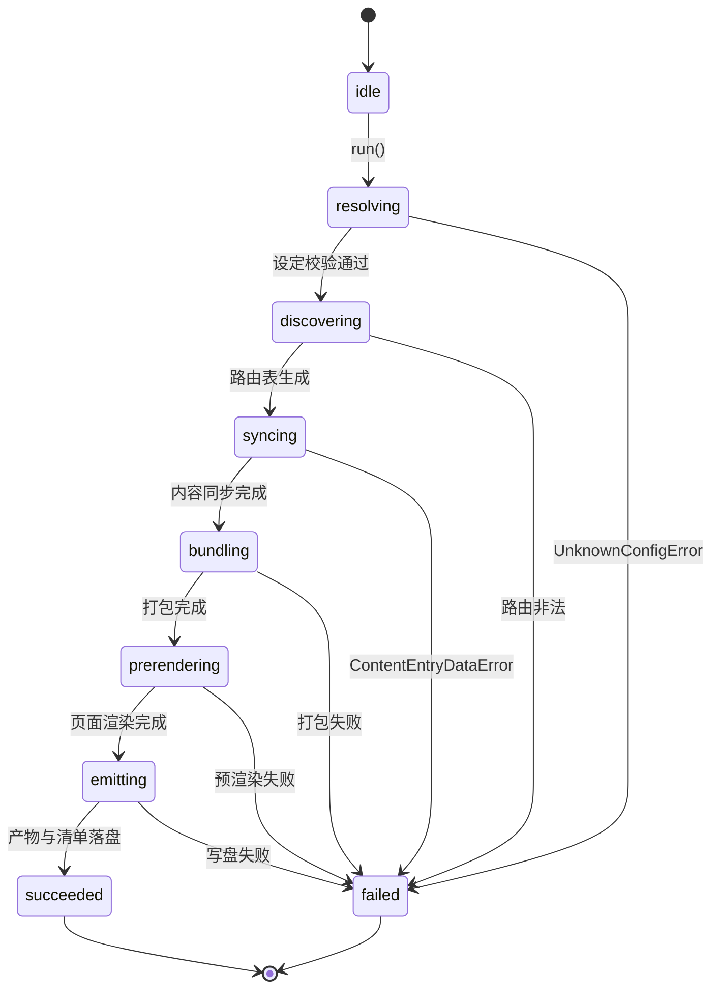
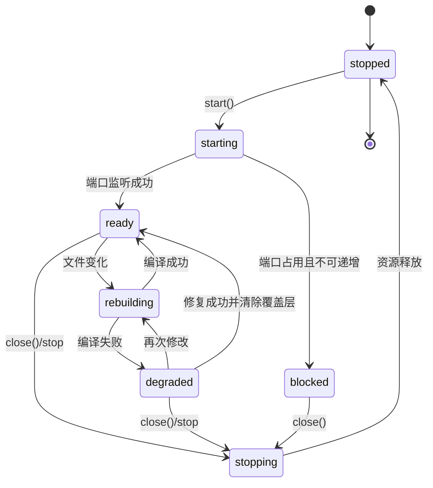
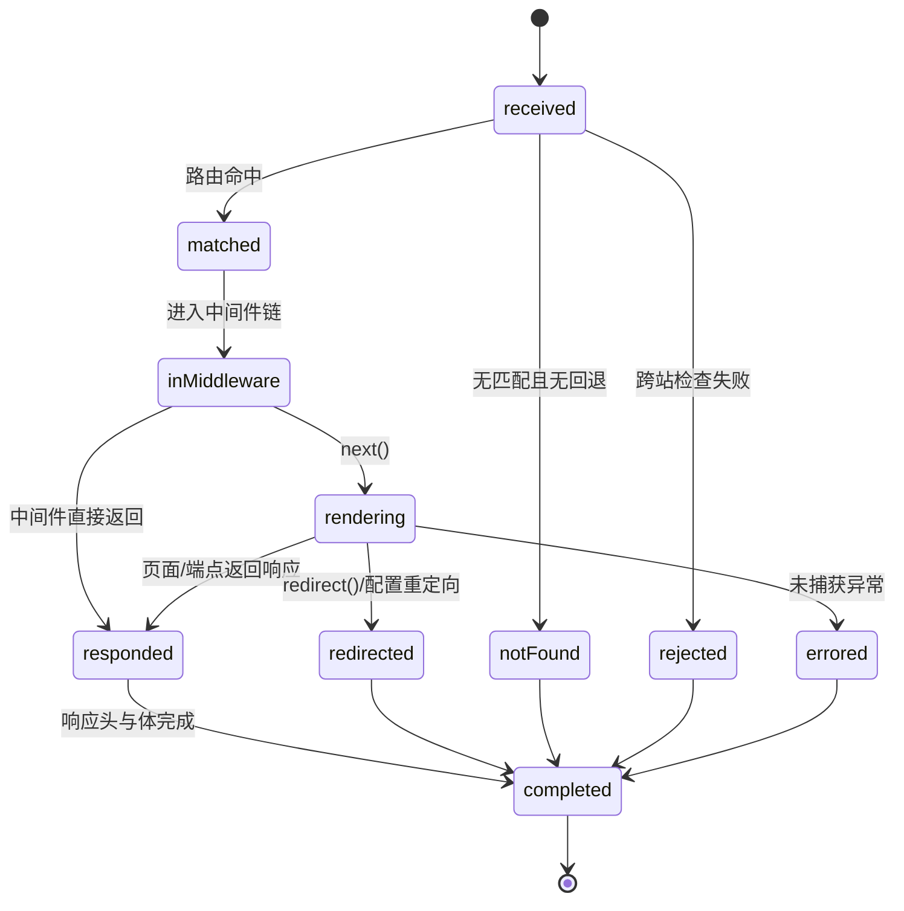

## 20. State Models

状态只描述"当前允许做什么"，不描述进度百分比。凡状态数达到三个及以上的实体，给出转移图与非法转移表；状态名与代码枚举一致，其他章节引用时不得改写。

### 20.1 BuildRun

图源码

| 非法转移 | 触发尝试 | 失败码 |
| --- | --- | --- |
| `idle → bundling` | 跳过设定解析直接打包 | `UnknownConfigError` |
| `discovering → prerendering` | 未同步内容就渲染 | `ContentCollectionMissingLoader` |
| `failed → emitting` | 失败后继续写盘 | 不产生转移；写盘被拒绝并保留上次成功产物 |
| `succeeded → resolving` | 同一 `BuildRun` 复用 | 拒绝；新构建必须新建 `BuildRun` |

`BuildRun` 的所有权在 `build`：其他模块只能读取当前阶段，不得推进状态。失败即终态，重试等于新建一次运行。

### 20.2 DevServer

图源码

| 非法转移 | 触发尝试 | 失败码/行为 |
| --- | --- | --- |
| `stopped → ready` | 未监听即标记就绪 | 拒绝；`status()` 返回未运行 |
| `degraded → stopped`（直接） | 跳过清理 | 拒绝；必须先进入 `stopping` 释放端口与锁文件 |
| `ready → starting` | 重复启动 | 复用已有实例（`--force` 才替换） |
| `blocked → ready` | 端口未释放即重试 | `UnknownCLIError`，提示换端口或终止占用进程 |

`degraded` 是关键状态：服务器仍可服务未受影响页面，只有出错模块的请求返回覆盖层数据。任何实现都不得把编译失败升级为进程退出。

### 20.3 RequestOutcome

图源码

| 非法转移 | 触发尝试 | 结果 |
| --- | --- | --- |
| `received → rendering` | 跳过匹配直接渲染 | 拒绝；未命中时必须走 404 或回退 |
| `responded → rendering` | 响应开始后再次渲染 | `ResponseSentError` |
| `errored → redirected` | 失败后重定向掩盖错误 | 拒绝；错误必须呈现为 5xx 或覆盖层 |
| `completed → received` | 复用同一上下文处理下一请求 | 拒绝；`RenderContext` 不得跨请求复用 |

### 20.4 Other States

| 实体 | 状态（含终态） | 关键规则 |
| --- | --- | --- |
| `SessionRecord` | `none → pending → active → expired → destroyed` | `pending` 只在首次写入时创建；`expired` 由 `ttl` 触发；`destroyed` 后同 ID 不可复活。写入失败 → `SessionStorageSaveError`，会话保持 `active` 但不落盘（下次请求视为不存在） |
| `ActionCall` | `received → validating → executing → serializing → completed`，失败为 `failed` | `validating` 不通过 → 422，不进入 `executing`；`serializing` 失败 → `ActionsReturnedInvalidDataError`；`executing` 抛错 → 按业务码返回 |
| `ContentSync` | `idle → scanning → validating → writing → synced`，失败为 `failed` | `validating` 失败不写存储；`writing` 必须原子替换；`failed` 保留上次成功快照 |
| `ToolbarAppState` | `registered → initialized → active → inactive → destroyed` | `inactive → destroyed` 前可被 `beforeTogglingOff` 否决（保持 `active`）；`destroyed` 后不得再接收事件 |

### 20.5 Acceptance

| 编号 | 前置条件 | 操作 | 可观察结果 |
| --- | --- | --- | --- |
| A-20-01 | 构建进行中 | 触发一次新的构建 | 旧运行进入失败/完成终态后再新建；不出现两个运行同时写同一目录 |
| A-20-02 | 开发服务器 `degraded` | 修复并保存 | 回到 `ready`，覆盖层消失，工具栏可用 |
| A-20-03 | 请求已完成 | 复用同一上下文再次渲染 | 被拒绝，返回 `ResponseSentError` 或明确 500 |
| A-20-04 | 会话已 `destroyed` | 用旧 cookie 再次请求 | 视为新访客；不复活旧数据 |
| A-20-05 | 工具栏应用请求关闭 | `beforeTogglingOff` 返回 `false` | 应用保持 `active`，窗口不关闭，事件不销毁 |
| A-20-06 | 内容同步 `failed` | 再次构建 | 保留上次成功数据；错误指向具体条目与字段 |
