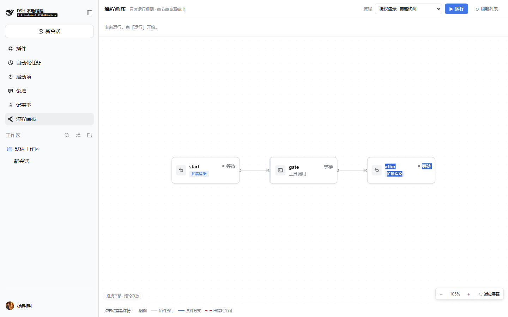
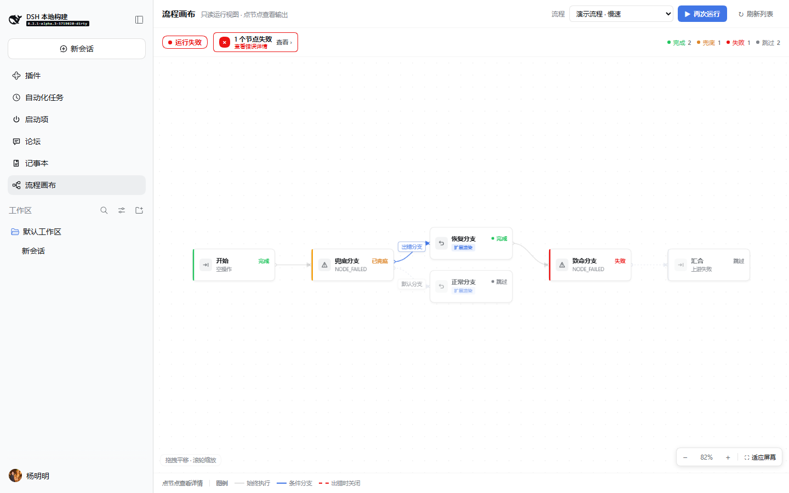
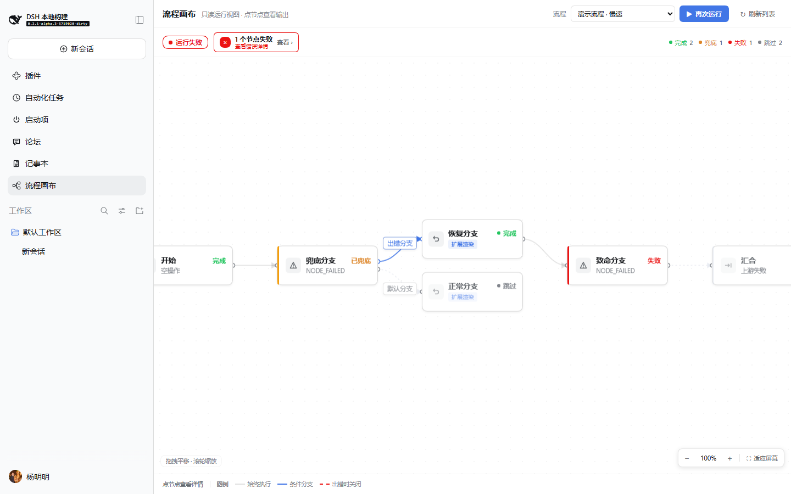
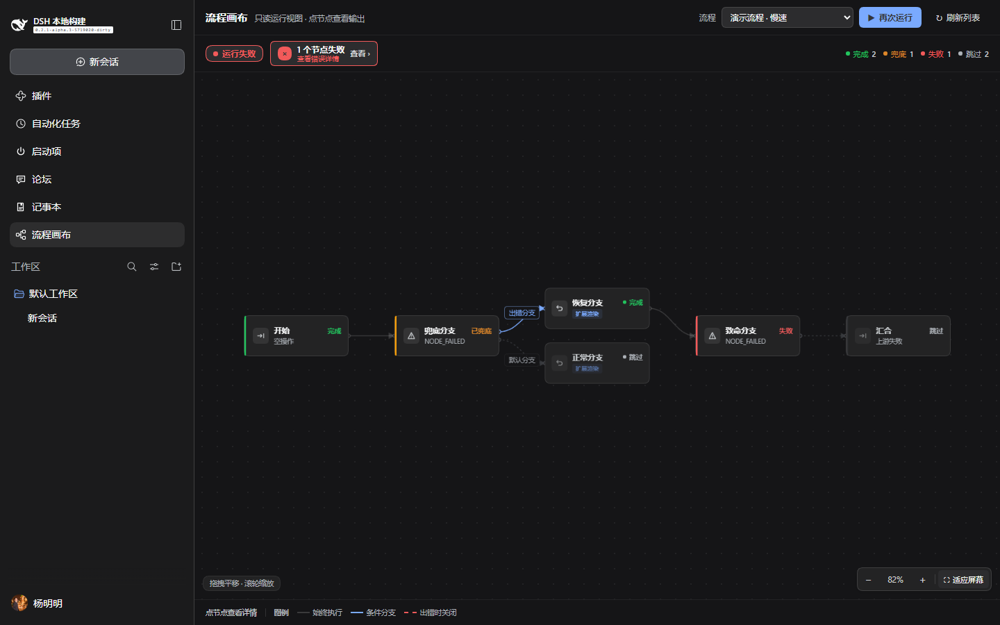
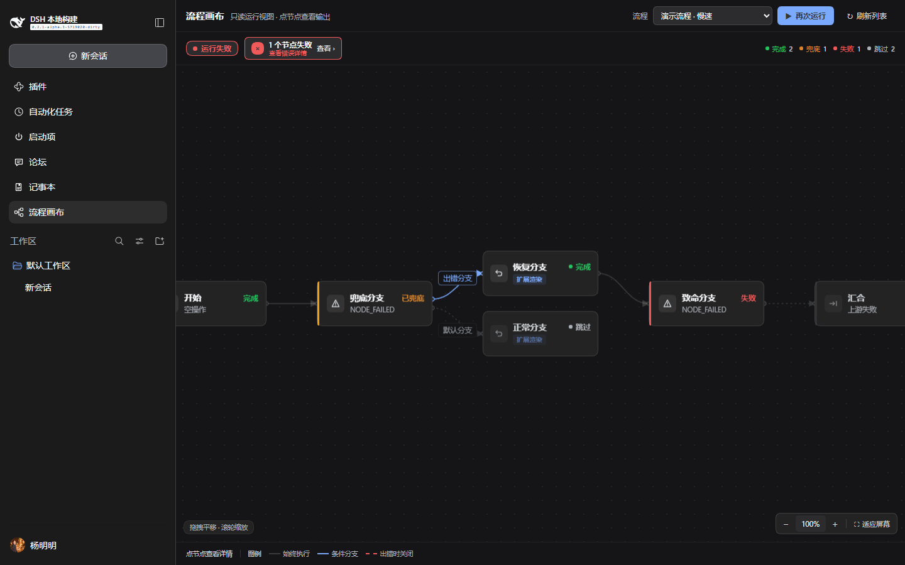
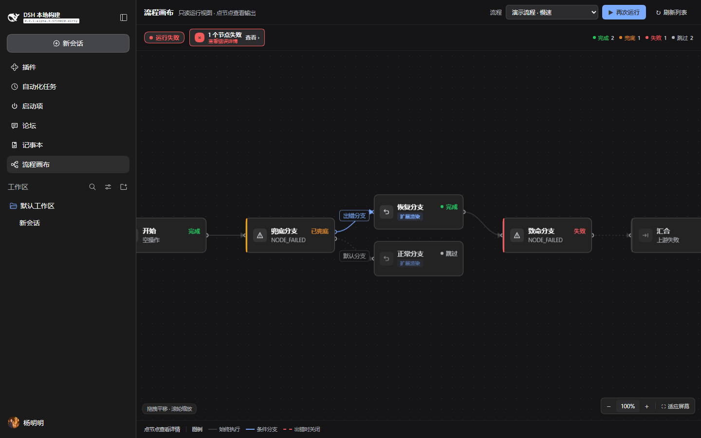

# 节点卡片视觉打磨

日期：2026-10-18 · 面板 `0.1.13` · echo 演示 `0.1.5`

范围：节点卡片本身、与它直接相连的边，以及和它一起阅读的状态视觉。从左到右分层、
平移缩放、右侧详情等布局结构沿用 `0.1.11`；`0.1.13` 只加强卡片轮廓与端口对比度，
不改卡片解剖。

## 目标

让这排节点看起来像成熟流程工具（n8n / Dify / Coze）里的节点，而不是小表单卡片：
一个清晰标题、一个状态主视觉、一个安静副标题、一个统一的类型图标，连线明确从端口进出。

## 改前 / 改后

1440×900，同一批 flow。改前是 `0.1.11` 的卡片（`ui-card-before`，即上一轮的
`ui-after` 截图）；改后是 `0.1.13`（`ui-card-after`）。

| 改前 | 改后 |
|---|---|
|  |  |
|  |  |
|  |  |
|  |  |
|  |  |

补充证据：

- `ui-card-after/after-zoom-in.png`：126% 缩放下文字与 1px 描边仍然清晰。
- `ui-card-after/after-dark-settled.png`、`after-dark-approval.png`：宿主深色主题下的同一批卡片。

## 边界修复（0.1.13）

0.1.12 的卡片用 `border-l2`（浅色 `rgba(0,0,0,0.10)`，深色
`rgba(255,255,255,0.12)`）配 `shadow-lv1`。在适应屏幕（约 82%）下，计算出的 1px
描边被缩放、深色主题里卡片几乎融进画布。

0.1.13 改用 `border-l4`（浅色 `rgba(0,0,0,0.16)`，深色
`rgba(255,255,255,0.20)`）并保持 1px，`shadow-lv1` 只负责轻微层次；hover 增加
`30% business + border-l4` 的轮廓变化。选中仍是 2px 业务蓝描边，并新增 5% 业务蓝背景
着色，因此选中与键盘 focus 可以区分。始终存在的端口圆点改用
`label-tertiary`，半径加大到 3.5px（起点）/ 3px（终点）。

| 浅色 82% | 浅色 100% |
|---|---|
|  |  |
|  |  |

| 深色 82% | 深色 100% |
|---|---|
|  |  |
|  |  |

hover / 选中证据：`ui-borders-after/after-hover-light.png`、
`after-hover-dark.png`、`after-selected-light.png`。

## 卡片解剖

```
┌─┬─────┬─────────────────────────────┐
│ │icon │ 标题                   状态 │  ← 13.5px/600 · 12px/600，状态色
│ │28px │ 副标题                        │  ← 11.5px/400，tertiary
└─┴─────┴─────────────────────────────┘
 ↑ 3px 状态色条（卡片上唯一的状态色来源）
```

| 规则 | 值 |
|---|---|
| 卡片 | `184 × 72`，圆角 `--dsw-radius-md`（12px），1px `border-l4`；所有状态卡使用同一描边对比度 |
| 内边距 | `9px 12px 9px 15px`（左侧多留 3px 给状态条） |
| 间距 | 图标↔正文 `9px`；标题↔副标题 `4px`；标题↔状态 `8px` |
| 图标 | `28 × 28`，圆角 `--dsw-radius-sm`（8px），16px 内联 SVG |
| 状态条 | `3px` 宽，颜色只表达状态 |
| 标题 | 13.5px / 600 / primary；单行省略 |
| 状态 | 12px / 600 / 状态色；与标题同一行右对齐 |
| 副标题 | 11.5px / 400 / tertiary；没有详情时显示类型名，否则显示错误码、跳过原因或授权提示 |
| 类型 | 一个小图标 + hover title；不再占一整行，也不再是灰色胶囊 |

副标题只保留一行。完整错误、策略、重试、耗时与授权审计在右侧详情里。

## 状态色板

| 状态 | 主色 / 色条 | 说明 |
|---|---|---|
| 等待 | `label-tertiary` / `label-dimmed` | 安静，不抢注意力 |
| 就绪 | `state-business-primary` | 可以运行 |
| 运行中 | `state-business-primary` | 只有色条做 1.8s 透明度呼吸，尊重 reduced-motion |
| 等待授权 | `state-warn-label` / `state-warn-primary` | 琥珀色；动作由授权坞承担 |
| 完成 | `state-success-primary` | 绿色 |
| 已兜底 | `state-warn-label` / `state-warn-primary` | 琥珀色，文字为「已兜底」，不与干净完成混淆 |
| 失败 | `state-error-primary` | 红色 |
| 跳过 / 已取消 | `label-tertiary` / `label-dimmed` | 图标与色条弱化，文字仍可读 |

卡片描边在所有状态下保持中性。状态只出现两次：左侧色条 + 状态文字。没有第三种边框色，
也没有状态图标。

## 边与端口

- 每条边都从可见的起点端口圆点出发，在终点端口圆点结束（SVG 圆，3.5px / 3px，
  1.5px 描边，填充容器色；始终执行的边用 `label-tertiary`，条件边用语义色）。
- 边是三次贝塞尔：从卡片右缘离开、从目标左缘进入，箭头明确（marker 7）。
- 条件边保留语义色：命名端口 = 业务蓝，谓词 = 琥珀，error 默认边 = 红色且虚线 `6 5`。
- 目标未执行（`skipped` / `cancelled`）的边变成弱化**点线** `2 5`，标签也变灰。
  这和 error 默认边的虚线刻意不同：虚线 = “出错时关闭”，点线 = “这条分支没有跑”。
- 标签是 21px 圆角矩形（圆角 6，11.5px/500），描边/文字都走主题 token，带宿主阴影；
  放在曲线中点，并对节点与其他标签做碰撞避让。

## 主题与交互

全部来自宿主 CSS 变量：

`--dsw-alias-bg-layer-1/2`、`--dsw-alias-border-l1/l2/l3`、
`--dsw-alias-label-primary/secondary/tertiary`、
`--dsw-alias-interactive-bg-hover`、
`--dsw-alias-state-{business,success,warn,error}-primary`、
`--dsw-alias-state-warn-label`、`--dsw-alias-state-warn-primary`、
`--dsw-shadow-lv1/lv2`、`--dsw-radius-sm/md`、
`--dsw-focus-ring-width/--dsw-focus-ring-color`。

- hover：layer-2 背景 + `30% business + border-l4` 轮廓 + shadow-lv2，不做位移。
- focus-visible：2px focus ring，offset 2px（不加背景着色）。
- 选中：2px 业务蓝描边 + offset 2px，并加 **8% 业务蓝背景着色**；与键盘 focus、
  hover 都能区分。选中描边直接用业务蓝 token，不依赖 focus ring 变量，
  宿主关闭 focus ring 也不会丢选中态。
- 按下：`--dsw-alias-interactive-bg-hover`。
- 禁用：55% 透明度、无阴影、默认光标。
- 图标全部内联 SVG；没有图标字体、CDN、emoji 或外链资源。
- 没有渐变、发光、3D 变换，也没有按类型给图标上色：那会和状态色、授权坞抢注意力。

## 验证

- `pnpm --dir packages/graph/flow-canvas-panel test`：58 条通过。
- `pnpm --dir packages/graph/flow-canvas-node-echo test`：2 条通过。
- graph 12 个包共 230 条 spec 通过。
- 类型检查：面板与 echo 均无诊断。
- 真实浏览器：沿用上一轮的临时隔离节点与 `docs/e2e-ui.mjs`；脚本新增 126%、100%、
  适应屏幕、深色运行结束、深色授权五张截图，均为 1440×900。`after-zoom-100.png`
  是 100% 可读性检查；`after-dark-*.png` 是深色主题检查。
- 边界专项：`docs/e2e-borders.mjs` 在 1440×900 下截取 82%/100% 的浅色/深色、
  hover 与选中态，并记录计算后的描边/阴影。改前为
  `1px rgba(0,0,0,0.10)` / `rgba(255,255,255,0.12)` + `shadow-lv1`；改后为
  `1px rgba(0,0,0,0.16)` / `rgba(255,255,255,0.20)`；hover 计算为 41% alpha
  的蓝灰描边；选中额外有 8% 背景着色 + 2px 环。
- 没有碰 3080 与 `~/.dsh`；临时节点已清理。

## 故意没做

- 不做节点拖拽、连接手柄、多选、小地图、布局持久化（属于布局结构，不在本轮范围）。
- 不按节点类型给图标上色：类型用中性图标，颜色留给状态。
- 不做发光、渐变、3D、卡片大插画或整图动画。
- 不引图标字体或 CDN。
- 不做每个节点的进度环；运行中只有色条呼吸这一处动效。

## 设计师视角的判断

这排节点现在有清楚的视觉语法：类型图标、标题、状态色、副标题。它不再像表单卡片，
连线也明确从端口进出。边界修复用了主题里最强的中性描边层 `border-l4`，状态色仍只留在
色条上，所以卡片有明确的边，但没有变重或发光。100% 缩放下文字清晰；六节点整图适应屏幕
约 82%，文字按比例缩小，用户可以放大或适应屏幕。对于只读运行画布，我认为这套视觉达到了
可上产品的完成度；唯一仍然存在的取舍是“整图适应”必然会把文字缩小。
