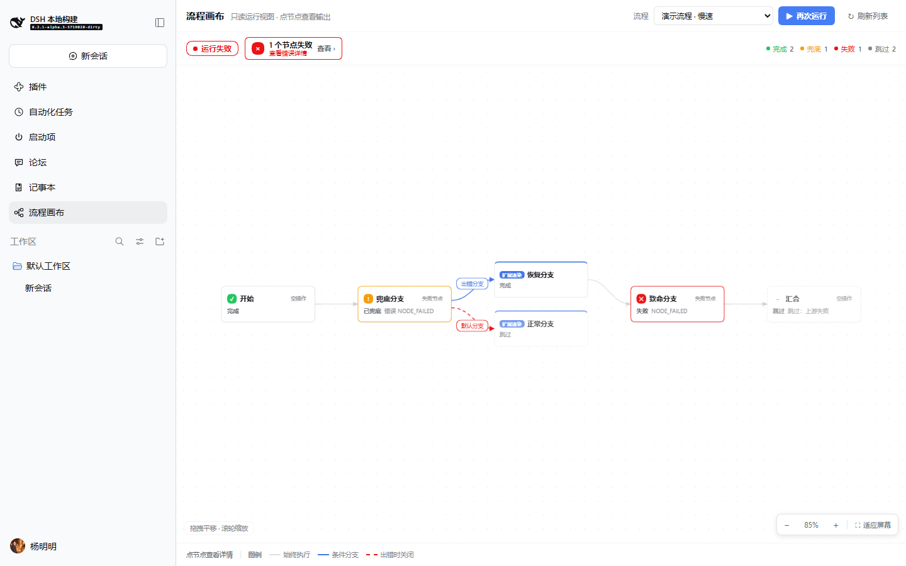
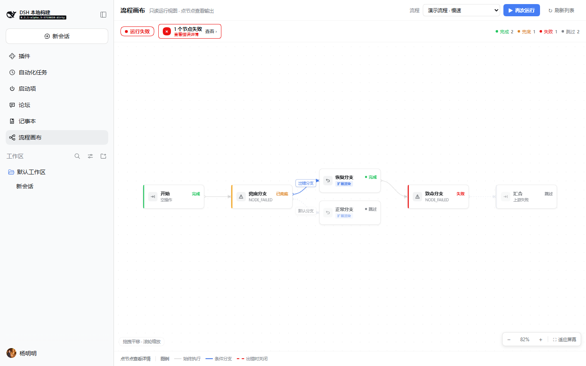
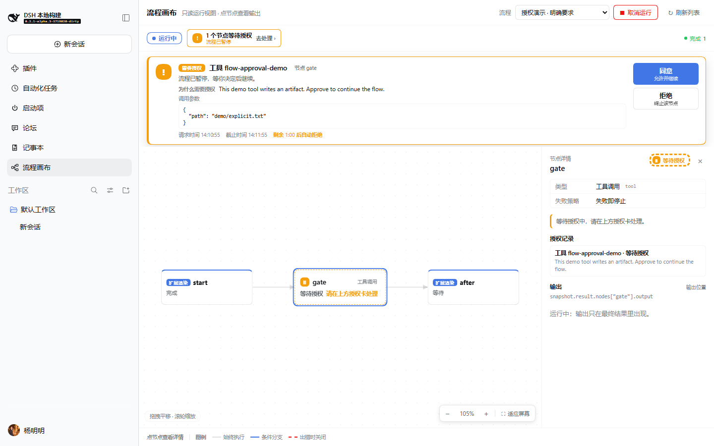
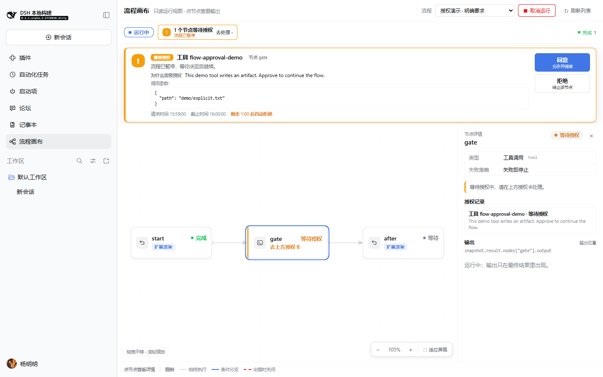
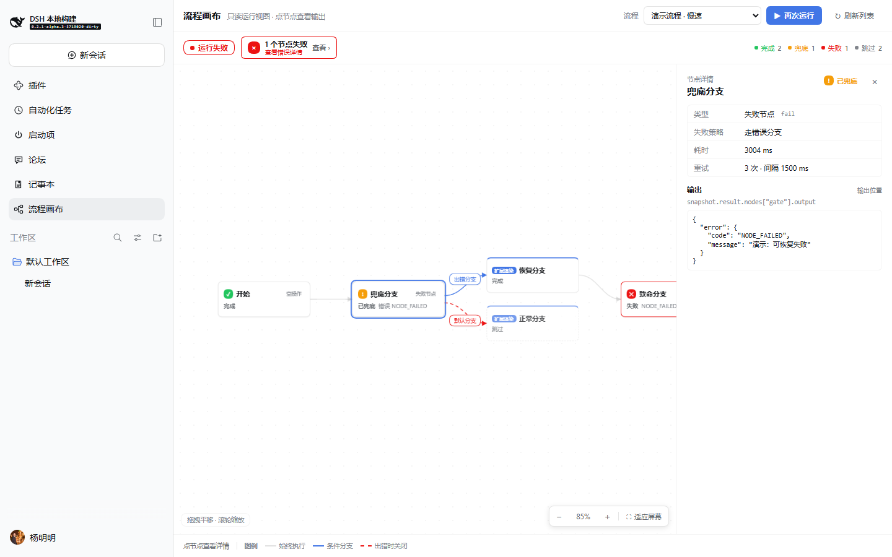
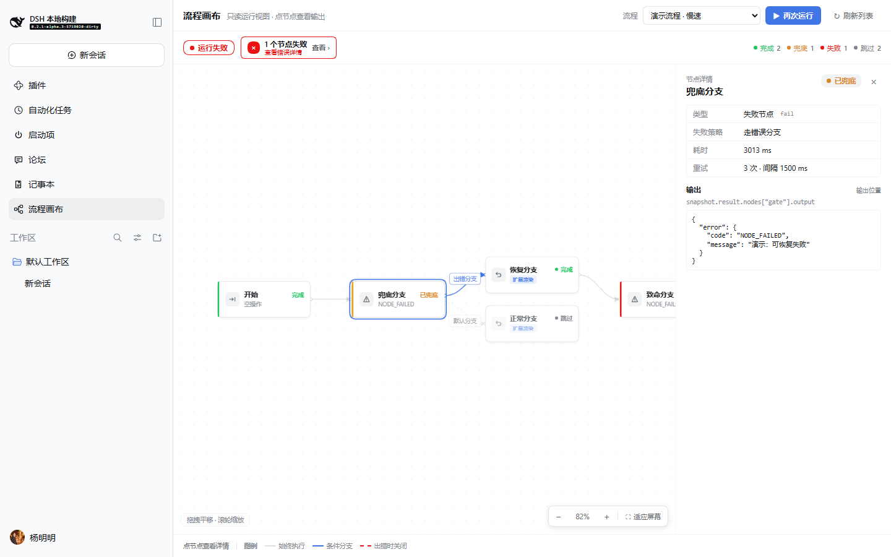
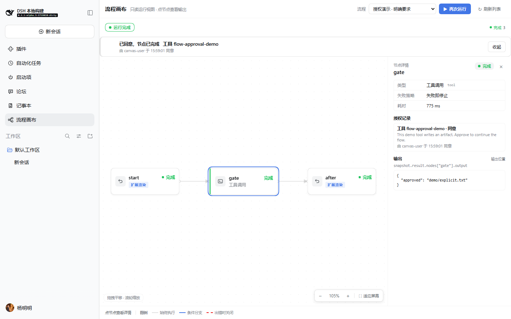
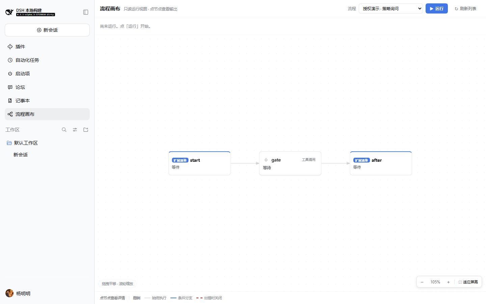
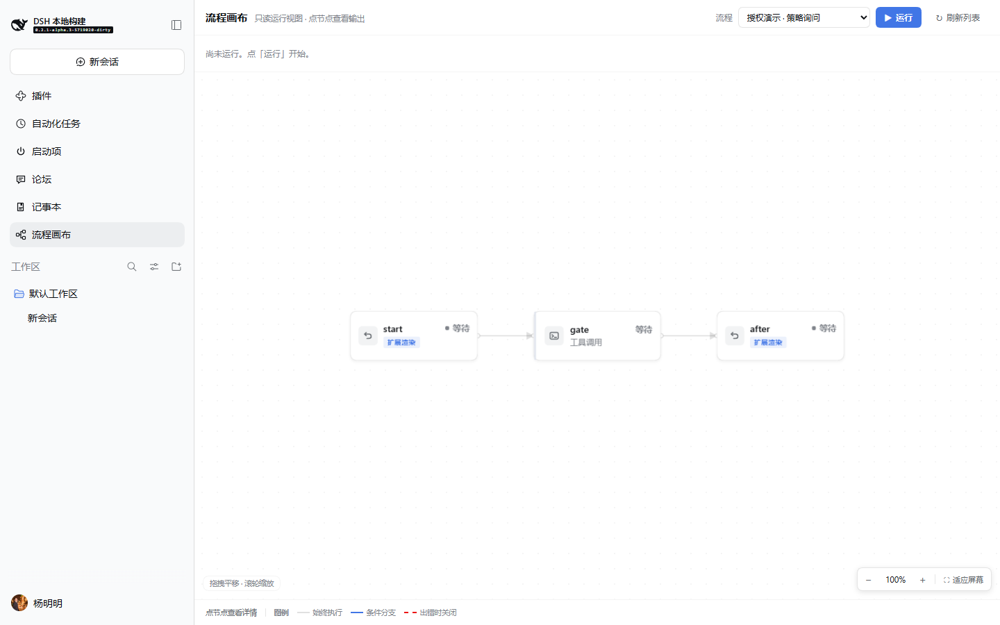

# Node card visual polish

Date: 2026-10-18 · Panel `0.1.12` · Echo demo `0.1.4`

Scope: the node card itself, the edges that touch it, and the status visuals
that read with it. Layout structure (left-to-right ranking, pan/zoom, inspector
drawer) is unchanged from `0.1.11`.

## Goal

Make the row read like nodes from a mature flow editor (n8n / Dify / Coze), not
like small form cards: one strong title, one status accent, one quiet subtitle,
one consistent type glyph, and edges that visibly leave and enter ports.

## Before / after

1440×900, same flows. "Before" is the `0.1.11` card (`ui-card-before`, copied
from the earlier `ui-after` set); "after" is `0.1.12` (`ui-card-after`).

| Before | After |
|---|---|
|  |  |
|  |  |
|  |  |
|  |  |
|  |  |

Additional after evidence:

- `ui-card-after/after-zoom-in.png` — 126% zoom; text and 0.5px strokes stay
  crisp.
- `ui-card-after/after-dark-settled.png` and `after-dark-approval.png` — the
  same cards under the host dark theme.

## Card anatomy

```
┌─┬─────┬─────────────────────────────┐
│ │icon │ title                  status│  ← 13.5px/600 · 12px/600, accent
│ │28px │ subtitle                      │  ← 11.5px/400, tertiary
└─┴─────┴─────────────────────────────┘
 ↑ 3px status rail (the only status colour on the card)
```

| Rule | Value |
|---|---|
| Card | `184 × 72`, radius `--dsw-radius-md` (12px), 0.5px neutral border |
| Padding | `9px 12px 9px 15px` (extra left space for the rail) |
| Gap | icon↔body `9px`; title↔subtitle `4px`; title↔status `8px` |
| Icon | `28 × 28`, radius `--dsw-radius-sm` (8px), 16px inline SVG glyph |
| Rail | `3px` wide, radius follows the card; status colour only |
| Title | 13.5px / 600 / primary; one line with ellipsis |
| Status | 12px / 600 / accent colour; right-aligned with the title |
| Subtitle | 11.5px / 400 / tertiary; type name when no detail, otherwise the error code, skip reason or approval hint |
| Type | one small glyph + hover title; no full type row and no pill |

The subtitle is deliberately a single line. Full error text, policy, retry,
duration and approval audit stay in the inspector.

## Status palette

| State | Accent / rail | Notes |
|---|---|---|
| pending | `label-tertiary` / `label-dimmed` | quiet; no colour competition |
| ready | `state-business-primary` | ready to run |
| running | `state-business-primary` | only the rail pulses (1.8s opacity, reduced-motion aware) |
| awaiting approval | `state-warn-label` / `state-warn-primary` | amber; the approval dock owns the action |
| completed | `state-success-primary` | green |
| recovered | `state-warn-label` / `state-warn-primary` | amber, label `已兜底`; not a clean success |
| failed | `state-error-primary` | red |
| skipped / cancelled | `label-tertiary` / `label-dimmed` | muted icon/rail, text still readable |

The card border stays neutral in every state. Status appears exactly twice: the
left rail and the status word. There is no third border colour and no status
icon.

## Edges and ports

- Every edge starts at a visible source port dot and ends at a target port dot
  (SVG circles, 3px / 2.6px, filled with the container layer).
- Edges are cubic Béziers; the line leaves the card's right edge and enters the
  target's left edge with a clear arrowhead (marker size 7).
- Conditional edges keep their semantic colour: port = business blue, predicate
  = amber, error-branch default = red and dashed `6 5`.
- Edges whose target never executed (`skipped` / `cancelled`) become muted
  **dotted** `2 5` lines with muted labels. This is intentionally different from
  the dashed error-branch default: dashed = "closes on error", dotted = "this
  branch did not run".
- Labels are 21px rounded rectangles (radius 6, 11.5px/500), token border/text
  and a host shadow; they are placed at the curve midpoint with collision
  avoidance against nodes and other labels.

## Theme and interaction

Everything is derived from host CSS variables:

`--dsw-alias-bg-layer-1/2`, `--dsw-alias-border-l1/l2/l3`,
`--dsw-alias-label-primary/secondary/tertiary`,
`--dsw-alias-interactive-bg-hover`,
`--dsw-alias-state-{business,success,warn,error}-primary`,
`--dsw-alias-state-warn-label`, `--dsw-alias-state-warn-primary`,
`--dsw-shadow-lv1/lv2`, `--dsw-radius-sm/md`,
`--dsw-focus-ring-width/--dsw-focus-ring-color`.

- Hover: layer-2 background, border-l3 + shadow-lv2; no movement.
- Focus-visible: 2px focus ring with 2px offset.
- Selected: 2px business outline with 2px offset (independent from the focus
  ring colour, so a host "no focus ring" preference never hides selection).
- Active: `--dsw-alias-interactive-bg-hover`.
- Disabled: 55% opacity, no shadow, default cursor.
- Icons are inline SVG; no icon font, CDN, emoji or external asset.
- No gradients, glow, 3D transforms, or colour-coded type icons. Those would
  compete with the status rail and the approval dock.

## Verification

- `pnpm --dir packages/graph/flow-canvas-panel test`: 58 passed.
- `pnpm --dir packages/graph/flow-canvas-node-echo test`: 2 passed.
- All 12 graph packages: 230 specs passed.
- Typecheck: panel and echo packages clean.
- Real browser: same temporary isolated node and `docs/e2e-ui.mjs` as the
  previous round; the script now also captures 126%, 100%, fit, dark settled and
  dark approval at 1440×900. `after-zoom-100.png` is the 100% readability check;
  `after-dark-*.png` is the theme check.
- 3080 and `~/.dsh` were not touched; the temporary node was removed.

## Deliberately not done

- No node dragging, handles, multi-select, minimap, or layout persistence
  (outside the layout scope of this round).
- No per-type colour coding: type is a neutral glyph, status owns colour.
- No glow, gradient, 3D card, large illustration or animated graph.
- No icon font or CDN.
- No per-node progress ring; the running rail pulse is the only motion.

## Designer check

The row now has a clear visual grammar: type glyph, title, status accent,
subtitle. It no longer reads as a form card, and the edges visibly connect ports
instead of floating between boxes. At 100% the text is crisp; the six-node fit
view (≈82%) is smaller by construction, and the user can zoom or fit. I would
call this production-ready for a read-only run canvas; the only remaining
compromise is that fitting the entire six-node graph necessarily scales text
down.
