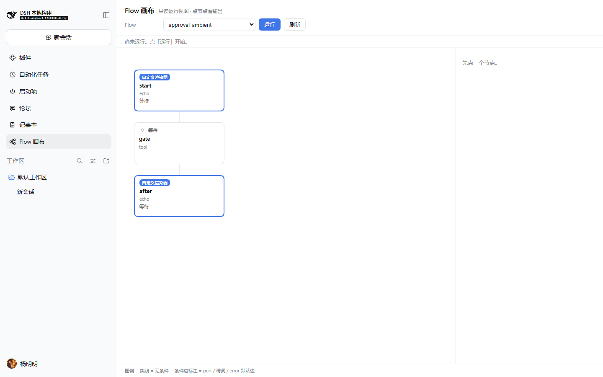
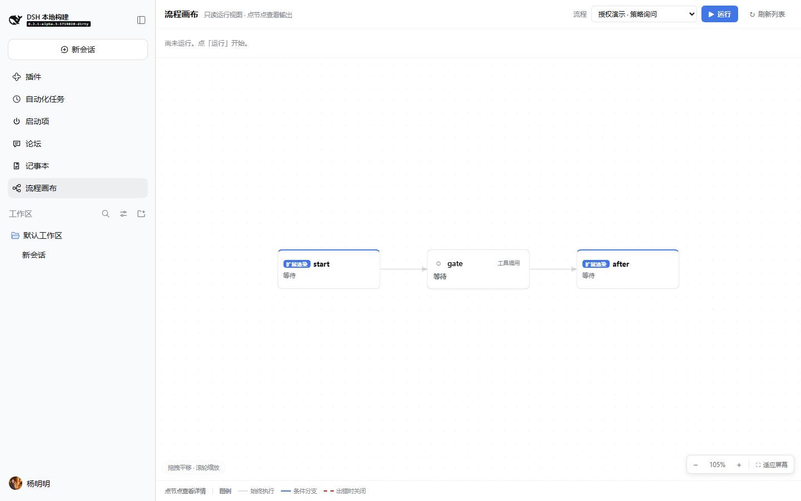
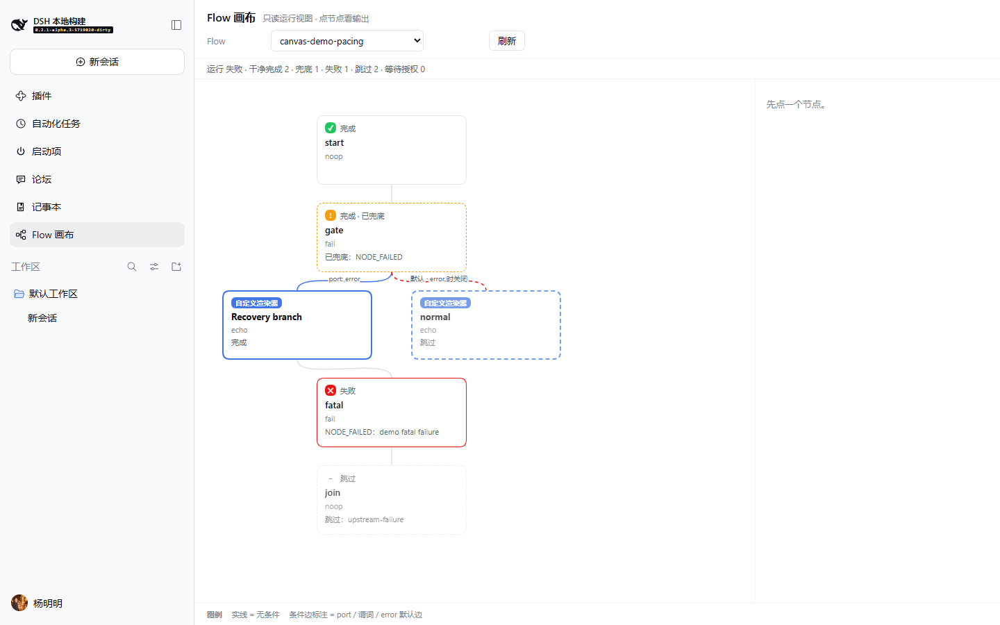
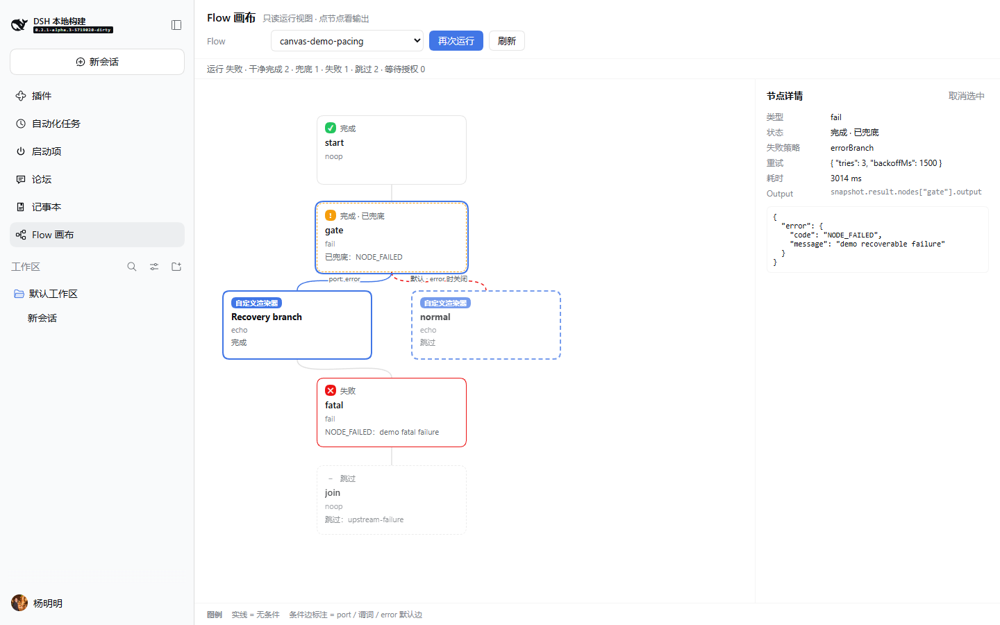
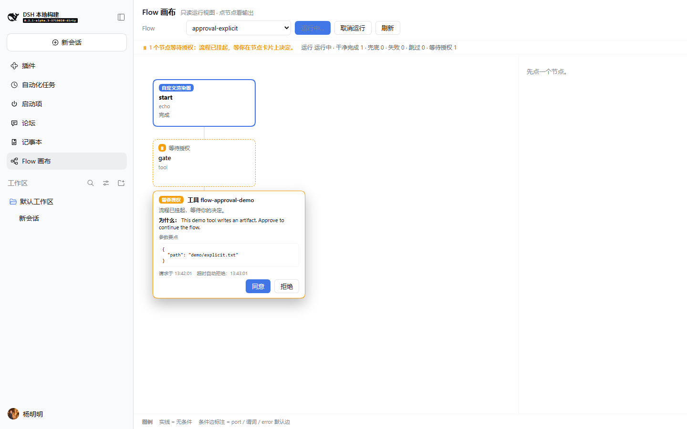
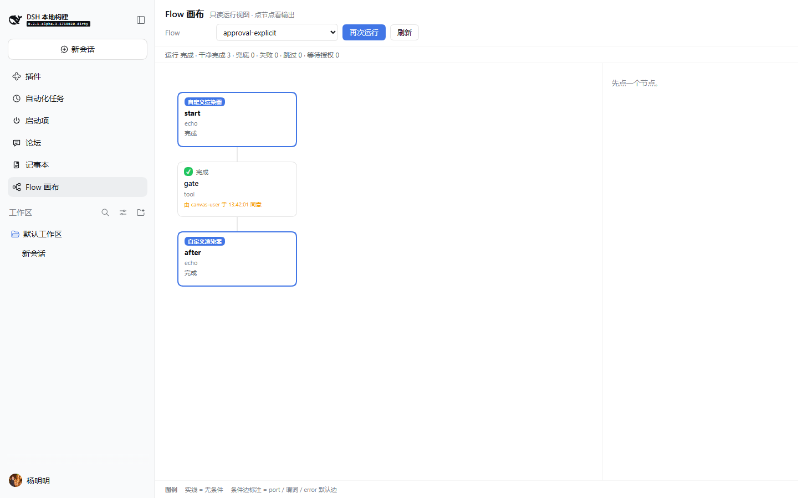
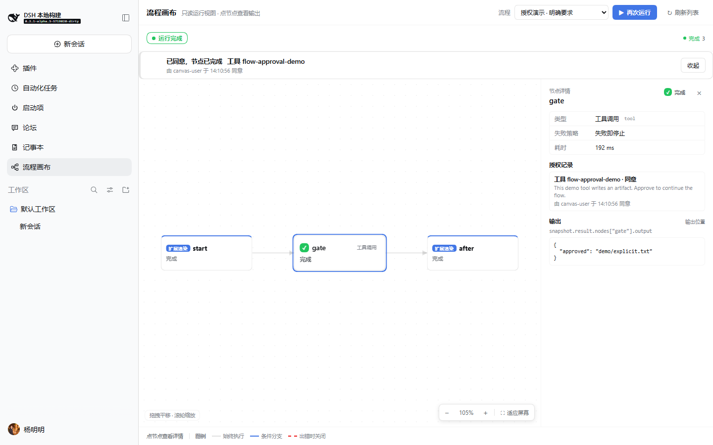

# Flow canvas UI/UX refactor

Date: 2026-10-18 · Panel `0.1.11` · Echo demo `0.1.3`

> The follow-up node-card visual polish and border fix (`0.1.13`) are documented
> in [`ui-cards.md`](ui-cards.md). This page covers the layout/interaction round.

This is an interaction/layout refactor of `packages/graph/flow-canvas-panel`, not
a palette change. The data plane, the read-only contract, the approval
lifecycle, the keyed node-renderer slot, and reload recovery are unchanged and
covered by the same tests.

## Goal

A user who has used n8n / Dify / Coze should, without documentation, be able to:

**pick a flow → run it → see what is running, what is waiting for a human,
what failed → click a node for its output → allow a pending approval.**

The panel is Chinese-first. Host ids (node labels, tool names, error codes and
flow-provided reasons) remain verbatim; every product-owned chrome string is
localized.

## Before / after

Both sets are 1440×900, captured on the same flows in the isolated node. The
before set is the previous `0.1.10` build; the after set is `0.1.11`.

| Before | After |
|---|---|
|  |  |
|  |  |
|  |  |
|  |  |
|  |  |

Extra after-only evidence:

- `ui-after/after-reload-resumed.png` — a pending approval restored after a full
  page reload; the same run is finished afterwards.
- `ui-after/after-zoom-fit.png` — zoom-in changed 105% → 126%, **Fit to screen**
  restored 105%.

## Complaint → change

| Complaint | Change | Main files |
|---|---|---|
| The graph is a narrow vertical strip and the right quarter is permanently blank. | Layered **left-to-right** layout (the n8n / Dify / Coze convention); graph viewport fills the body. The inspector is a right drawer that exists only while a node is selected, so the initial canvas gets the full width. | `layout.ts`, `FlowGraph.tsx`, `Panel.tsx`, `panel.module.css` |
| Cards are large and repeat status/type/badge information. | Compact `176×68` cards: status icon + short word, node label, readable type badge, one truncated detail. Policy, retry/timeout, duration, full error and approval audit moved into the inspector. | `DefaultNodeCard.tsx`, `Inspector.tsx`, `panel.module.css` |
| Edge labels sit on the line, overlap and are too close to nodes. | Short localized pills (`出错分支`, `默认分支`), arrowheads, branch fan-out ordered by target position, and a placement pass that avoids nodes and other labels. | `layout.ts`, `FlowGraph.tsx`, `model.ts` |
| `运行中…` looks like a button; `刷新` looks like a page reload; the flow dropdown shows internal ids. | Run is the primary action; while running it becomes **Cancel run** and the state lives in the status strip. Refresh is **刷新列表** with an explicit tooltip. Flow ids get readable Chinese labels (the raw id stays in the option title). | `Panel.tsx`, `StatusStrip.tsx`, `present.ts`, `locales.ts` |
| The status row is a string of numbers; failures/approvals are not prominent. | Run-status pill plus actionable amber **“N nodes awaiting approval”** and red **“N nodes failed”** buttons that open the owning node. Completion counters become quiet chips on the right. | `StatusStrip.tsx`, `present.ts` |
| The approval card floats over nodes/edges and its buttons are small. | A full-width approval **dock above the canvas** (never over the graph): action/tool, owning node, key arguments, why, request time, live auto-deny countdown, a 44px primary **Allow** and a secondary **Deny**. After the answer the dock stays and reports the result (including who/when) until dismissed. | `ApprovalDock.tsx`, `NodeApprovalCard.tsx`, `panel.module.css` |
| Mixed Chinese/English chrome. | Chinese-first dictionaries; readable flow names, node-type names, skip reasons, policies and run statuses. Host data stays verbatim by design. | `locales.ts`, `present.ts`, `demo.ts` |
| No pan/zoom/fit, no clear selection, details do not open automatically. | Drag to pan, wheel zoom around the cursor, zoom out / reset / zoom in / **Fit to screen**. Selected node has a ring; the inspector opens on click, auto-opens for a pending approval, and clicking the empty canvas clears it. | `FlowGraph.tsx`, `view.ts`, `Panel.tsx` |
| High-frequency actions all look equally important. | One header action cluster with hierarchy: flow selector → primary Run → secondary Cancel → ghost Refresh list. | `Panel.tsx`, `panel.module.css` |

On complaint 8 (“clicking a node does not open the inspector”): that was **not**
reproducible. Clicking a node already opened the inspector; the real gaps were
the permanently empty inspector, no auto-open for a pending approval, and no
selection feedback. Those gaps are fixed; the click path is covered by the
jsdom test.

## Preserved capabilities

- Approval wait / allow / deny / timeout / cancel, through the same single-use,
  run-scoped Remote path.
- `flow.canvas.node` keyed renderer slot with the default card as fallback,
  including owner props `pendingApproval`, `approvals` and `onApprovalDecision`.
- Full-page reload recovery: the list, selected flow and `runId` are restored
  and the same run is re-subscribed, never restarted.
- Read-only projection: the panel still never writes to the kernel and never
  reads output from the runtime record; output comes only from
  `snapshot.result.nodes[id].output`.

## Verification

- Typecheck: `pnpm --dir packages/graph/flow-canvas-panel typecheck` and the echo
  package typecheck are clean.
- Tests: all 12 graph packages pass **230 specs**; the panel package alone has
  **58** (status/viewport/layout/name/attention/output/store/reload/slot plus the
  jsdom end-to-end passes).
- Real browser: a temporary isolated node (own `DSH_HOME` and pnpm store, port
  3099; removed after verification), with the graph bundle, panel `0.1.11`, echo
  `0.1.3` and the approval fixture. Headless Chrome at 1440×900 drove:
  zoom in → fit → drag-pan; select flow → run; watch the approval dock → allow;
  click a node → read output; reload while the approval was pending → finish the
  same run. `docs/e2e-ui.mjs` reproduces it.
- 3080 and `~/.dsh` were not modified.

## Deliberate non-goals

- No drag/drop flow editing, node creation, multi-select, copy/paste or undo.
- No minimap and no persisted layout/viewport.
- No run history; the cancel button targets the current run.
- No predicate expression text (the projection exposes a summary only).
- No allow-all or long-lived approval grant.
- No per-deployment flow registration UI.

## Honest first-use check

A person who has used a flow editor can finish the whole path without docs:
the flow dropdown is readable, Run is the obvious blue action, the status strip
says what is waiting, the amber dock makes the decision obvious, and a node
click opens its output. The remaining English text is host data (node ids such
as `start`/`gate`, tool names such as `flow-approval-demo`, error codes and the
reason supplied by a deployment) — deliberately not rewritten by the UI.

One trade-off: with the 348 px inspector open on a six-node graph, the graph is
wider than the remaining viewport, so the right edge can be clipped. The
selected node stays in view and **Fit to screen** or closing the inspector
restores the whole graph. We chose this over shrinking every node whenever the
inspector opens, which would make labels too small to read.
