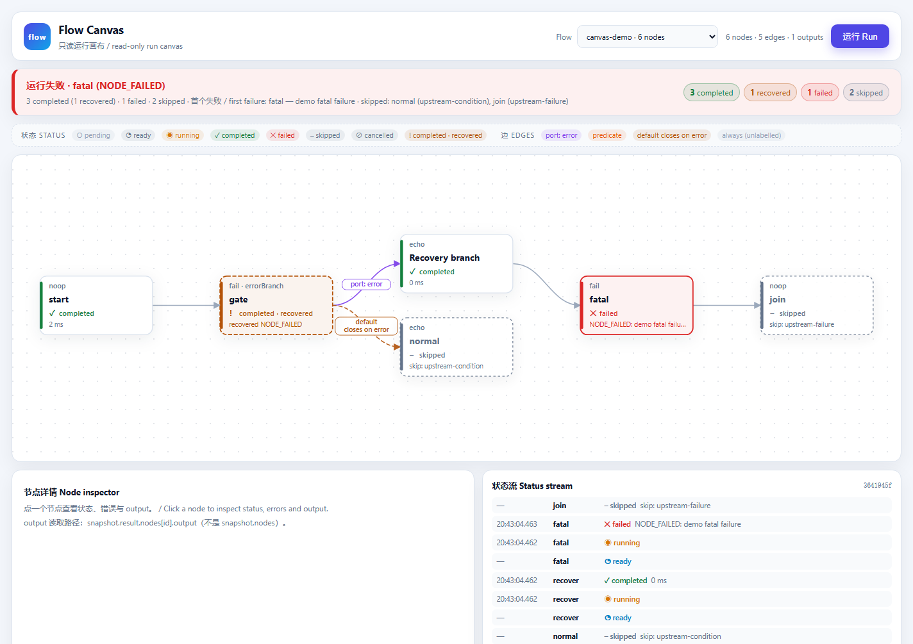
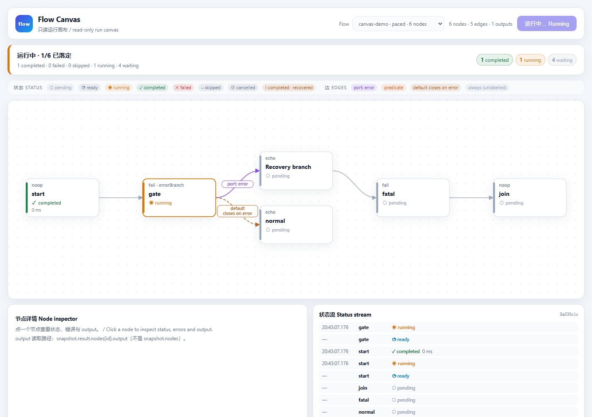
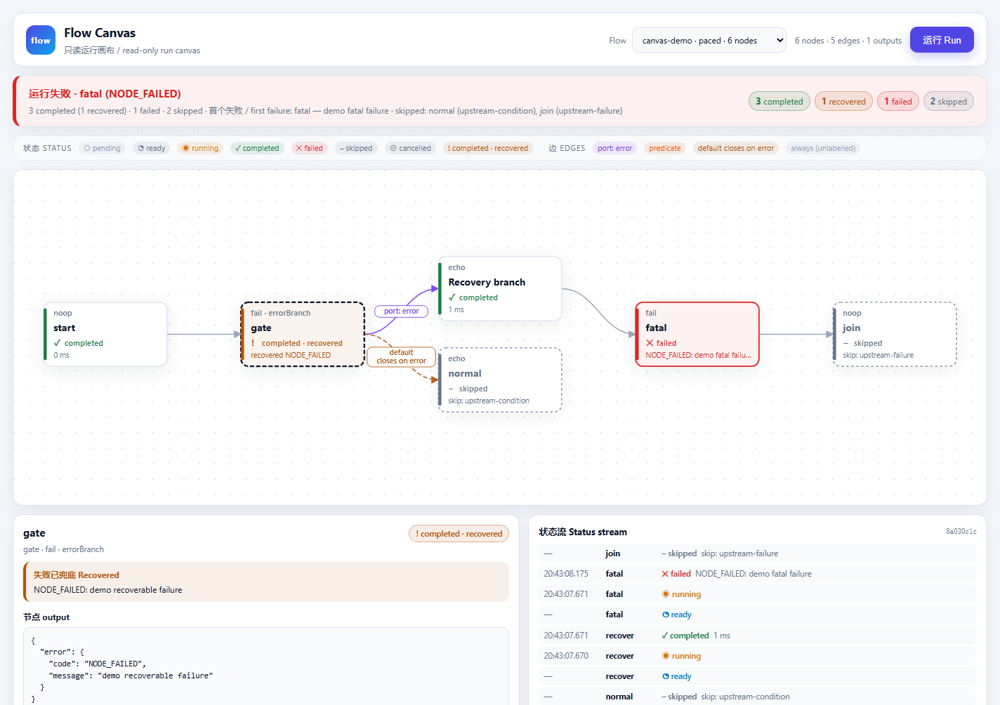
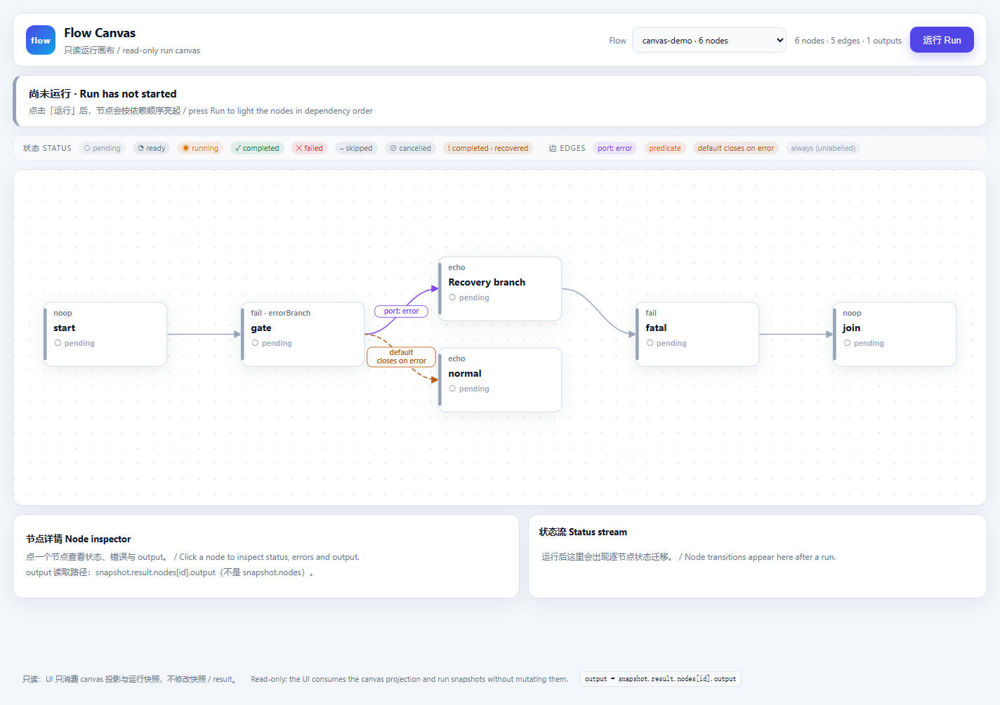
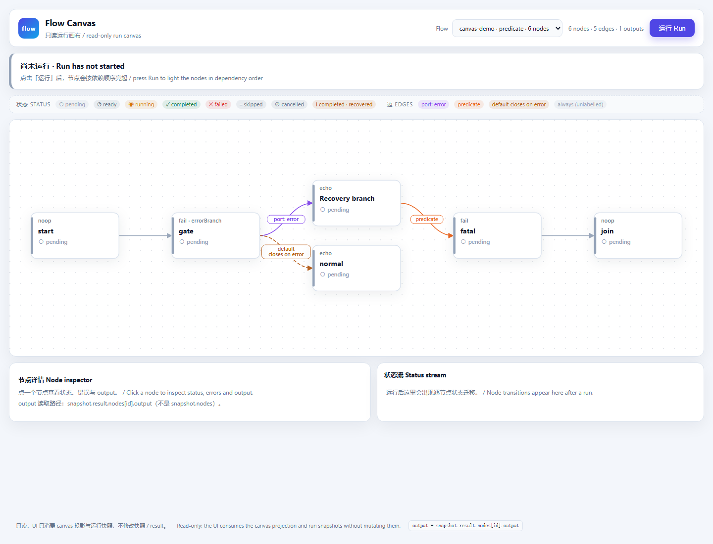

# @deepseek-ai/dsh-graph-flow-canvas-ui

一个已注册 flow 的**只读浏览器画布第一版**。它是一个独立的本地页面：通过真实
YAML Loader 装载演示 flow，用 `@deepseek-ai/dsh-graph-flow-canvas` 做静态投影，
在浏览器里自动布局 DAG，用 SSE 接收实时节点状态，并按契约从
`snapshot.result` 读取节点 output。

适用场景：一个人想**看懂**一个 flow 怎么跑、一次运行在哪里失败，又不想打开编辑器。
不适用：编辑、拖拽、布局持久化、生产级 flow 设计器。这是「第一版、能看」，不是 n8n。



## 你会看到什么

- **一张自动排开的图** — 节点按依赖关系从左到右分层，边用贝塞尔曲线画出，节点卡片上
  显示类型（`fail · errorBranch`、`echo`、`noop`……）。不需要手工拖拽。
- **条件边带标注** — `port: error` 表示命名输出端口，`predicate` 表示声明了谓词，
  `default` / `closes on error` 表示 `errorBranch` 节点的默认输出在 error 端口激活时关闭。
  无条件边不标注，由图例说明。
- **不刷新页面的实时状态** — `pending → ready → running → completed | failed |
  skipped | cancelled` 通过 SSE 到达。running 卡片有脉冲；failed 标红；skipped 虚线并显示
  `skipReason`；`errorBranch` 失败后被兜底的节点是琥珀色虚线，文案是
  `completed · recovered`，与干净成功的绿色区分开。
- **运行摘要** — 顶栏直接写出「运行失败 · fatal (NODE_FAILED)」，并统计
  completed / recovered / failed / skipped。演示 run 不点任何节点就能回答「哪里失败了」。
- **点节点看 output** — 详情面板从 `snapshot.result.nodes[id].output` 读取，显示完整
  来源路径；失败/跳过节点会说明为什么没有 output，而不是编造一个。
- **只读是结构性的** — UI 只读投影和快照。增量状态叠加在快照的**副本**上；收到的
  snapshot 及其 `result` 不会被原地修改。服务端只调 canvas 公开 API，不直接订阅内核事件。



## 怎么开

要求：Node.js 24+、pnpm 10+（与本仓库现有版本一致）。服务只监听 `127.0.0.1`。

```bash
pnpm install
pnpm --filter @deepseek-ai/dsh-graph-flow-canvas-ui build
pnpm --filter @deepseek-ai/dsh-graph-flow-canvas-ui start
```

打开 **http://127.0.0.1:4780/**。

启动日志会打印实际 URL。换端口：

```powershell
$env:FLOW_CANVAS_UI_PORT = '4780'
pnpm --filter @deepseek-ai/dsh-graph-flow-canvas-ui start
```

也可以直接跑构建产物：

```bash
node packages/graph/flow-canvas-ui/lib/server.js
```

`Ctrl+C` 停止。演示 YAML 从
`packages/graph/flow-canvas/examples/demo.flow.yaml` 读取，没有复制进本包。

## 30 秒怎么看

1. **先看摘要条。** 演示结果会写
   `运行失败 · fatal (NODE_FAILED)`，以及
   `3 completed (1 recovered) · 1 failed · 2 skipped`。
2. **再看图。**
   - `fatal` 红色，显示 `NODE_FAILED: demo fatal failure`。
   - `gate` 琥珀色虚线，显示 `completed · recovered`：它失败过，但 error 端口兜住了。
     这是本 UI 与「干净成功」最重要的视觉区分。
   - `normal` 是 skipped，原因是 `upstream-condition`；`join` 是 skipped，原因是
     `upstream-failure`。
   - `gate → recover` 这条边标 `port: error`；`gate → normal` 标
     `default / closes on error`。
3. **点任意节点。** 详情面板给出状态、耗时、策略、错误/兜底/跳过事实；运行结束后还有
   完整 output JSON。失败节点会明确写「该节点记录没有 output 键」。

   
4. **再点一次「运行」。** 画布下方的 Status stream 面板会逐条出现带时间戳的迁移，页面不刷新。

运行前的初始页面：



## 演示 flow

服务端注册三个可选条目：

| Flow | 说明 |
|---|---|
| `canvas-demo` | 规范的 `examples/demo.flow.yaml`，走真实 YAML Loader。运行几乎瞬间结束。 |
| `canvas-demo-pacing` | **同一张图、同一组状态**，只给两个 `fail` 节点加 `retry: { tries: 3, backoffMs: 240 }`，让 `running` 状态可见约半秒。这是引擎真实重试，不是回放或人为延迟事件。 |
| `canvas-demo-predicate` | 同一张图，只给 `recover → fatal` 加一个恒真谓词，让 `predicate` 边标注在画布上可见（YAML 不承载函数谓词）。运行行为不变。 |

paced 是独立条目，原因很明确：规范 fixture 保持规范；UI 不伪造时间戳，也不在事件之间
sleep。predicate 条目只用于让第三种条件边可见，图与运行行为仍是规范那套。想观察 running
就选 `canvas-demo · paced`。



## UI 遵守的两条数据契约

1. **output 只从 `snapshot.result.nodes[id].output` 取。**
   `snapshot.nodes[id]` 是 canvas runtime，只有状态/时间/`error`/`recovered`/
   `skipReason`，**没有 output**。详情面板与测试都按这条断言。output 不可用时给出原因
   （`no-run` / `running` / `missing-node` / `no-output`），不把缺失当成 `{}`。
2. **snapshot 与 result 只读。** canvas 投影返回浅拷贝；嵌套对象和 `result` 本身仍与引擎
   共享。UI 绝不写入。增量通过 `withLiveChanges()` 叠到新的 snapshot 对象上，原对象保持不变。

契约的其余边界：

- 布局在浏览器里算（`layout.ts`），不写回内核、存储或投影；投影的 layout 槽位保持为空。
- 服务端组合数据面（`graph-core → flow-engine → flow-yaml → flow-canvas`），只读
  `project`、`run`、`snapshot()`、`finished`；不监听 `flow/node-status` 或任何内核事件。
- 谓词表达式文本按数据面设计不可得；边标 `predicate`，tooltip 使用投影给的人类可读摘要。

## 测试与验证

```bash
# 新 UI 包（25 个 spec）
pnpm --filter @deepseek-ai/dsh-graph-flow-canvas-ui test

# 全部 graph 包（旧 104 + 新 25 = 129 个 spec）
pnpm -r --no-bail --filter "./packages/graph/*" test

# 9 个 graph 包全部编译
pnpm -r --filter "./packages/graph/*" build
```

新 spec 覆盖：

- 每个状态 → 色板 / 标记 / class，以及 recovered 与干净成功的差异；
- 每种条件边 → 标注 / 虚线 / tooltip；
- output 契约：忽略「canvas runtime 上被塞的 output」、假值 output、全部不可用原因；
- 只读叠加：原 snapshot 不变，`result` 引用保持不变；
- 自动布局：依赖顺序、卡片不重叠、标注在卡片外、并列边错开、确定性；
- 真实 HTTP 运行（真实 Loader/引擎/画布）：终态、`gate.recovered`、
  `normal.skipReason`、SSE 流，以及 output 只在 `result.nodes`。

## 文件

| 文件 | 职责 |
|---|---|
| `src/server.ts` | HTTP 路由、静态资源、JSON/SSE 端点、直接启动判断。 |
| `src/runtime.ts` | 真实数据面组合与三个演示 flow 的注册。 |
| `src/runs.ts` | 服务器侧运行登记与 SSE 传输。 |
| `src/model.ts` | 纯映射：状态视觉、条件边标注、output 契约、API 类型。 |
| `src/summary.ts` | 运行摘要：标题、明细、失败/跳过/兜底列表。 |
| `src/layout.ts` | 纯分层 DAG 布局与边路由。 |
| `src/graph.ts` | SVG 边、节点卡片与条件标注。 |
| `src/panels.ts` | 工具栏、运行摘要、详情面板、事件流与图例。 |
| `src/client.ts` | 浏览器状态、SSE 消费与运行操作。 |
| `src/dom.ts` | 小型 DOM/SVG/时间工具。 |
| `public/index.html`、`public/styles.css` | 页面壳、图例、主题与状态色板。 |
| `tests/model.spec.ts`、`tests/layout.spec.ts`、`tests/server.spec.ts` | 映射、布局、真实服务端测试。 |

没有改动任何已有 graph 包。UI 单独成包，旧的 104 个 spec 含义不变。

## 本版做了 / 没做

做了：图形渲染、依赖排序、条件边标注、实时状态、recovered 区分、skipReason、运行摘要、
节点 output、只读契约、重复运行、错误提示、基础可访问性（节点可聚焦、摘要 `aria-live`、
role）、减少动效偏好。

没做：拖拽/缩放、布局持久化、取消按钮（handle 已经暴露）、搜索过滤、编辑、谓词文本、
多 YAML 文件选择、接进 3080 的客户端插件。

## 接进 3080 的下一步

本版先做独立页面，是因为客户端插件链路需要 Host 服务 + profile 安装；第一版要先在不碰
DSH、不碰 `~/.dsh` 的前提下证明只读 UI/数据面契约。数据契约已经是插件需要的形状。下一步：

1. **Host 半边** — 加一个小插件（DSH checkout 内或独立包），注入 `FlowCanvasToken`，暴露
   一个 Remote 命名空间（如 `flowCanvas`），只开四个调用：`list()`、`project(flowId)`、
   `startRun(flowId)`、`subscribe(runId)`。`subscribe` 可以直接转发这里同样的
   `{ snapshot, changes, finished }` 消息；不要暴露内核事件。
2. **Client 半边** — 用 `ctx.slots.inject(...)` / `ctx.slots.register(...)` 注册侧栏入口和
   主面板，精确声明 children，用 `ctx.locale` 注册中英词典，用 `HostObservable` 包住状态流。
   `model.ts` 与 `layout.ts` 可以原样复用，只换传输层和外壳。
3. **安装/验证** — 装到测试节点（`DSH_HOME=~/.dsh_test_2`，绝不动 `~/.dsh`），刷新现有 URL。
   客户端插件源码变更时，只有同一 checkout 跑着 `pnpm run dev:web` 才免刷新生效；否则需要
   重建 Web 产物并在 `Ctrl+R` 后验证。不要为 GUI 另起第二个服务器。

在接入之前，上面的独立 URL 就是查看演示的受支持方式。

## License

MIT。
