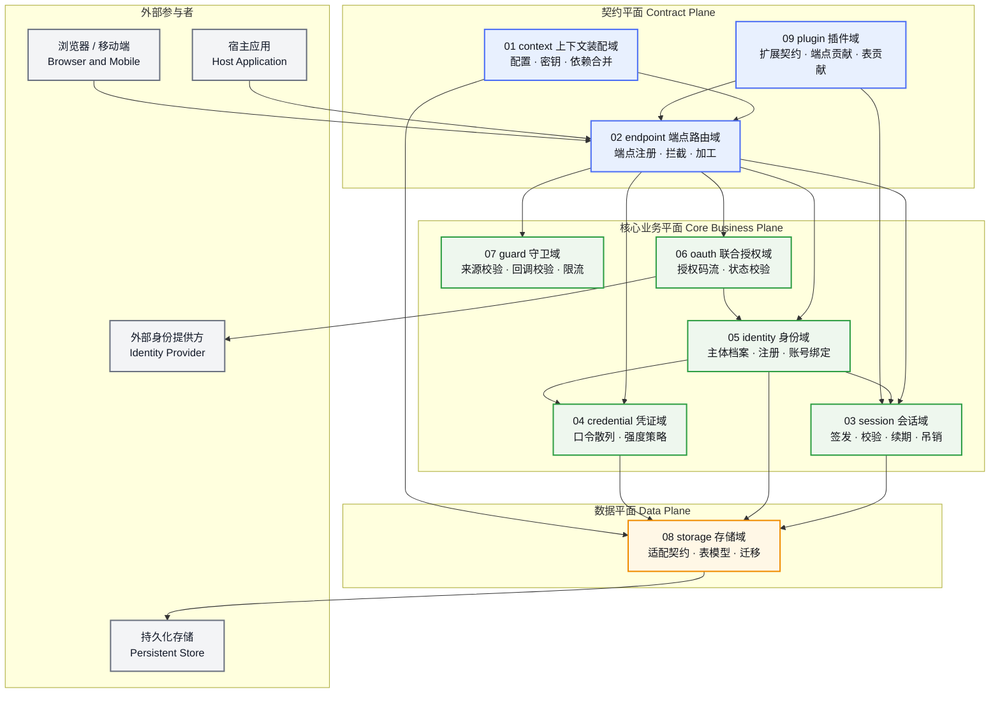
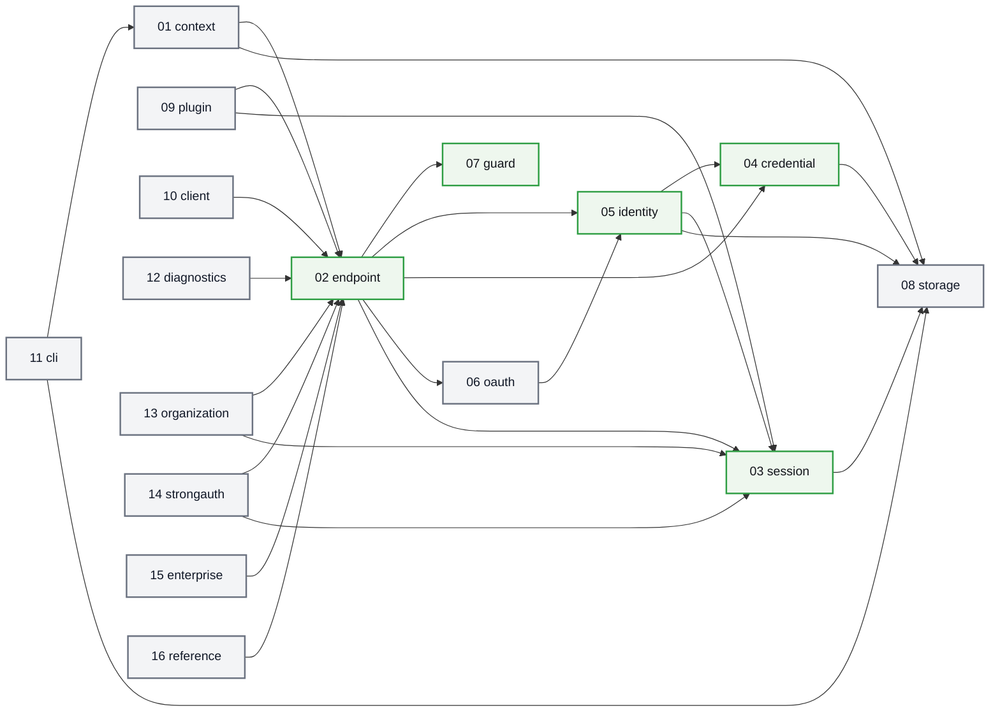
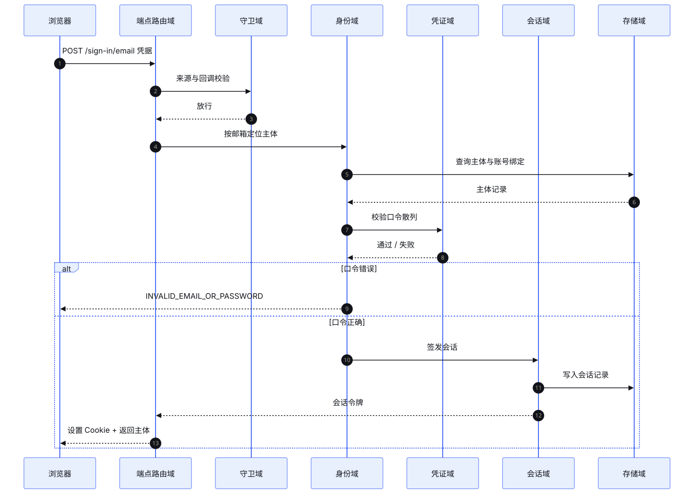
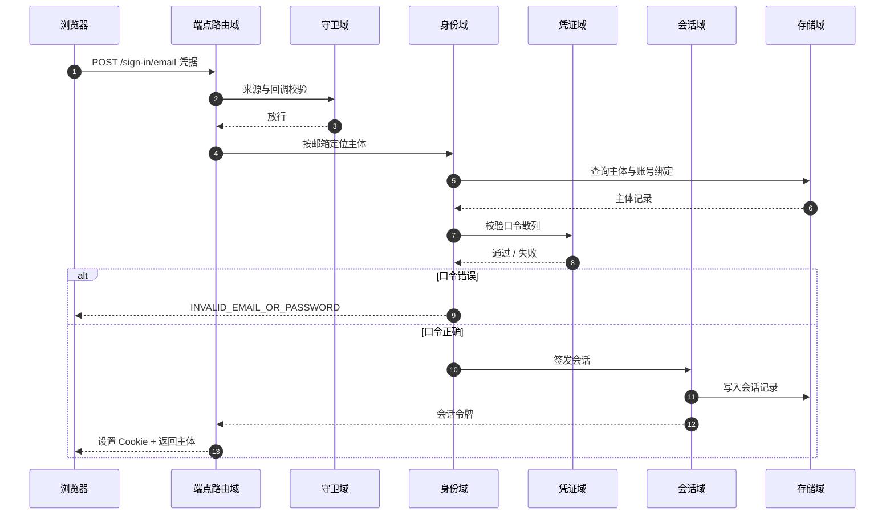
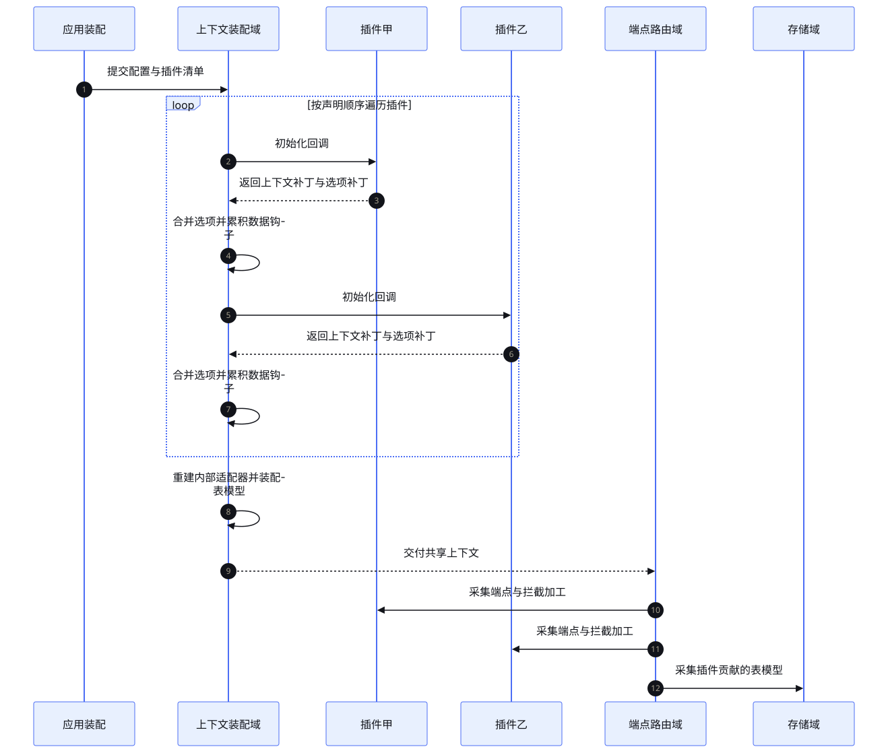
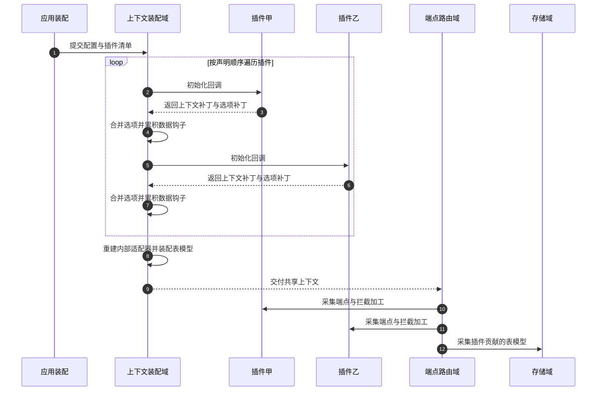
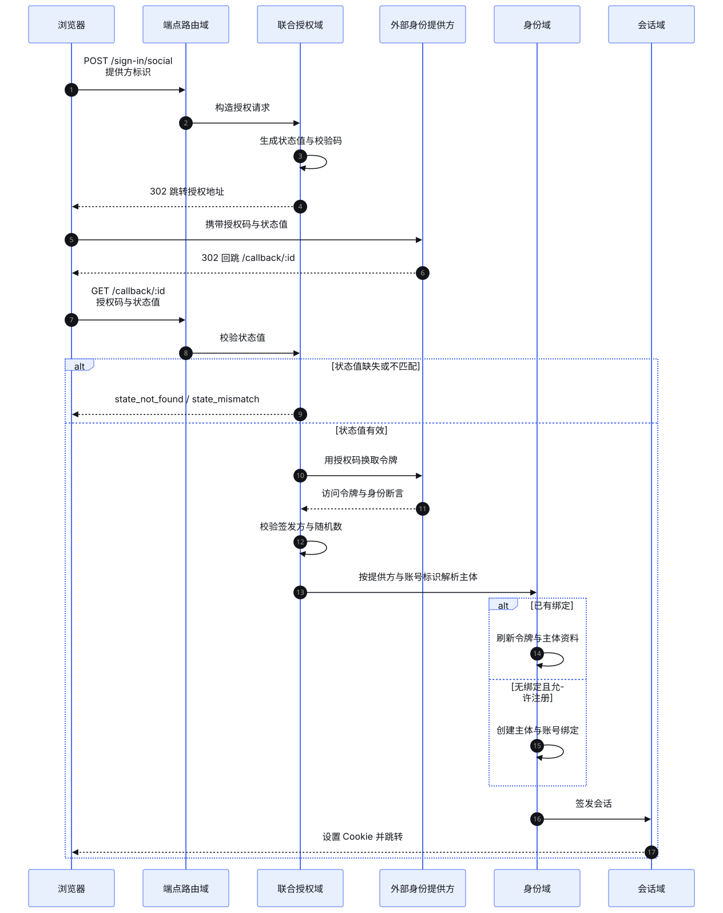
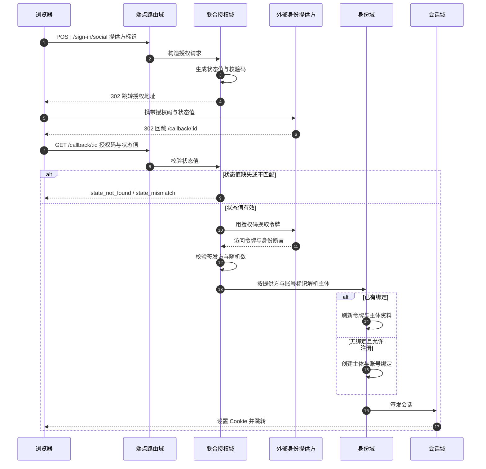

## 1. Architecture

本方案所述系统是一个认证框架：它接收宿主应用交付的配置与扩展声明，装配出一份可共享的运行时上下文，把认证能力注册为可路由端点，并在请求进入时完成来源判定、主体识别、凭证校验与会话签发。系统不包含业务功能，也不替宿主应用决定界面。

### 1.1 Boundary

系统边界是「一次请求进入认证端点，到认证结论产出」这段区间。边界之外的部分由宿主应用承担：它负责发起请求、渲染界面、决定何时调用认证能力、保管业务数据。

外部参与者共四类：

| 参与者 | 交互方式 | 在系统中的位置 |
|---|---|---|
| 宿主应用 | 服务端调用认证工厂与端点处理器；声明配置与扩展 | 边界外，系统的装配者与调用者 |
| 浏览器 / 移动端 | 通过认证基路径发起请求，携带会话凭据 | 边界外，系统的服务对象 |
| 外部身份提供方 | 标准授权协议交互；框架同时作为授权方与客户端 | 边界外，联合授权域的协议对端 |
| 持久化存储 | 适配契约读写主体、会话与校验凭据 | 边界外，存储域的读写对端 |

系统内部不持有任何界面渲染逻辑，除两个内建页面：端点错误页与接口参考页——它们是诊断域与参考域的产物，用于在宿主未提供自有错误页时兜底。

### 1.2 Module Inventory

全部模块按职责命名，边界见 [统一命名清单](./index/#71-module-names)。下表给出模块清单、承担的价值与依赖方向，图中节点与本表一一对应。

| 编号 | 模块 | 承担的价值 | 依赖（下游） | 定位 |
|---|---|---|---|---|
| 01 | `context` 上下文装配域 | 把散落的配置、密钥、存储契约与扩展声明合并为单一事实来源 | `endpoint`、`storage` | 外围 |
| 02 | `endpoint` 端点路由域 | 统一请求入口、参数校验、拦截与加工的时序 | `guard`、`identity`、`credential`、`oauth`、`session` | **核心** |
| 03 | `session` 会话域 | 认证状态的唯一载体：签发、校验、续期、吊销 | `storage` | **核心** |
| 04 | `credential` 凭证域 | 密钥材料的校验与强度策略 | `storage` | **核心** |
| 05 | `identity` 身份域 | 主体档案、注册流程与账号绑定的唯一权威 | `credential`、`session`、`storage` | **核心** |
| 06 | `oauth` 联合授权域 | 以标准协议换取外部身份断言并回落到身份解析链 | `identity`、外部身份提供方 | 外围 |
| 07 | `guard` 守卫域 | 在业务逻辑之前拦截跨站伪造、越权跳转与高频滥用 | 无 | **核心** |
| 08 | `storage` 存储域 | 以统一适配契约读写数据并保证一致性语义 | 持久化存储 | 外围 |
| 09 | `plugin` 插件域 | 受控的扩展点集合与隔离保证 | `endpoint`、`session` | 外围 |
| 10 | `client` 客户端域 | 向浏览器与移动端暴露类型安全的调用面 | `endpoint` | 外围 |
| 11 | `cli` 命令行域 | 脚手架、模型生成、迁移与自检 | `context`、`storage` | 外围 |
| 12 | `diagnostics` 诊断域 | 错误语义统一与可观测性输出 | `endpoint` | 外围 |
| 13 | `organization` 组织域 | 多租户组织、团队与角色授权结构 | `endpoint`、`session` | 外围 |
| 14 | `strongauth` 强认证域 | 二次验证、无密码凭证与受限设备授权 | `endpoint`、`session` | 外围 |
| 15 | `enterprise` 企业域 | 企业目录联邦、供给与计费对接 | `endpoint` | 外围 |
| 16 | `reference` 参考域 | 运行时契约的机器可读导出 | `endpoint` | 外围 |

图源码

### 1.3 Dependency Direction

依赖方向是单向的：上层可以调用下层，下层不得反向调用上层；同层之间只有明确声明的一对允许直接调用。

图源码

三条方向性铁律贯穿全系统：

1. **契约平面不得下沉判断**。端点路由域只负责"这个请求是谁发的、参数合不合法、在处理前后要做什么"，不负责"这个人有没有权限做这件事"。后者属于身份域、组织域与守卫域。
2. **核心业务平面不得依赖扩展**。身份域、会话域、凭证域、守卫域不得感知任何具体扩展的存在，否则扩展一旦缺席或损坏，核心链路即断裂。扩展只能通过上下文补丁与端点贡献接入。
3. **数据平面不得解释业务**。存储域只按模型名与字段名读写并保证原子性语义，不解释"被禁用"是什么意思——那是身份域的字段语义。

### 1.4 Core Business Identification

按二八原则识别核心业务：先选一条核心业务流，再以三判据（主链不可缺、失守即失格、砍余仍可用）逐一裁决。

#### 1.4.1 Core Flow Selection

选定的核心业务流是：**主体携凭据发起登录 → 系统判定凭据 → 建立会话 → 后续受保护请求凭会话被识别**。这是认证框架存在的全部理由；其余能力（组织、双因素、企业联邦、支付）都是在这条链上叠加或旁挂的增强。

沿这条链追踪完整调用链，落在链上的域为：`endpoint` → `guard` → `identity` → `credential` → `session` → `storage`。`oauth` 在链上但只覆盖第三方凭据这一条支线。

#### 1.4.2 Adjudication

| 候选域 | ① 主链不可缺 | ② 失守即失格 | ③ 砍余仍可用 | 裁决 |
|---|---|---|---|---|
| `session` 会话域 | ✔ 会话是"已认证"这一状态的唯一载体，缺失则主流程断裂 | ✔ 无会话则系统无法回答"你是谁"，产品失去立身之本 | ✔ 仅留会话域与最简入口，系统仍是完整可用的会话系统 | **核心** |
| `credential` 凭证域 | ✔ 凭据校验在链上 | ✔ 口令散列或强度策略失效，安全边界即刻崩塌 | ✔ 仅留凭证域与最简入口，仍是一个完整的口令校验系统 | **核心** |
| `identity` 身份域 | ✔ 主体档案是账号的唯一权威 | ✔ 主体不存在则账号、绑定与权限判定全部失去依据 | ✔ 仅留身份域与最简入口，仍是一个完整的主体档案系统 | **核心** |
| `guard` 守卫域 | ✔ 请求在到达业务逻辑前必过守卫 | ✔ 来源校验与限流失效，跨站伪造与暴力破解可直接穿透 | ✘ 砍掉守卫后系统仍能跑，但不再具备安全属性——不满足"砍余仍可用" | **核心**（命中①②） |
| `endpoint` 端点路由域 | ✔ 所有请求入口 | ✔ 端点路由失效则无任何能力可被调用 | ✔ 仅留端点域与最简入口，仍是一个完整的路由与校验系统 | **核心** |
| `storage` 存储域 | ✔ 所有状态落地必经此域 | ✔ 存储失效则全部状态不可持久 | ✘ 砍掉存储后系统无状态可存，不可用；但它命中②"事实权威"，按"①且②或③"仍成立 | **核心**（命中①②） |
| `oauth` 联合授权域 | ✘ 仅覆盖第三方凭据支线 | ✘ 移除后邮箱口令链完整 | — | 外围 |
| `plugin` 插件域 | ✘ | ✘ | — | 外围 |
| `client` 客户端域 | ✘ 宿主可自行发起请求 | ✘ | — | 外围 |
| `organization` 组织域 | ✘ | ✘ | — | 外围 |
| `strongauth` 强认证域 | ✘ | ✘ | — | 外围 |
| `enterprise` 企业域 | ✘ | ✘ | — | 外围 |
| `cli` 命令行域 | ✘ | ✘ | — | 外围 |
| `diagnostics` 诊断域 | ✘ | ✘ | — | 外围 |
| `reference` 参考域 | ✘ | ✘ | — | 外围 |
| `context` 上下文装配域 | ✔ 所有依赖经此装配 | ✔ 装配失效则无依赖可用 | ✔ 仅留装配域与最简入口，仍是一个完整的配置装配系统 | **核心** |

裁决后的核心域清单：

| 模块 | 承担的价值 | 命中判据 | 关键设计决策（铁律级） |
|---|---|---|---|
| `context` 上下文装配域 | 依赖单一事实来源 | ①②③ | **装配先行、读取单一**：所有能力只从共享上下文取依赖，禁止在运行时从全局变量或闭包外取用 |
| `endpoint` 端点路由域 | 请求入口与扩展时序的唯一控制点 | ①③ | **准入与执行分离**：先校验来源与参数，再进入业务；拦截与加工按固定时序挂载，业务逻辑不得感知扩展存在 |
| `guard` 守卫域 | 跨站伪造与滥用的拦截点 | ①② | **先判来源后判频率**：来源校验先于限流命中，否则攻击者可用错误来源消耗配额；**失败即拒**：来源不可判定时一律拒绝，不做推测性放行 |
| `identity` 身份域 | 主体与绑定的唯一权威 | ①②③ | **绑定先行**：先按提供方与账号标识查绑定，再回落到邮箱匹配，避免把两个不同主体的账号合并 |
| `credential` 凭证域 | 密钥材料的安全边界 | ①②③ | **等时失败**：账号不存在时同样执行一次散列运算并返回同一错误码，不通过响应差异泄露账号存在性 |
| `session` 会话域 | 认证状态的唯一载体 | ①②③ | **先落库后分发**：会话先写入权威存储再下发凭据；**敏感操作读权威源**：敏感端点不得信任客户端缓存的会话副本 |
| `storage` 存储域 | 一致性根基 | ①② | **更新失败即失败**：单行更新命中零行不得返回"成功"；**原子消费**：一次性凭据的核销必须原子，重复核销只有一方成功 |

#### 1.4.3 Ratio Check

核心域 7 个，全部模块 16 个，比例 7 ÷ 16 = **0.44**，超出二八原则建议的 0.1–0.4 区间上沿。

原因说明：本系统是**协议与框架**而非业务系统，其"业务"本身就是一条认证判定链；链上任一环缺失都会让系统从"认证框架"退化为"一堆工具函数"。七个核心域中，`context`、`endpoint`、`storage` 属于链路的必要骨架，`guard`、`identity`、`credential`、`session` 属于业务判定本体，缺一即不可用。这一偏高的比例是模块划分粒度偏细所致——若把 `context` 与 `endpoint` 合并为"内核装配域"、把 `storage` 并入 `session` 的持久化契约，核心域可降至 5 个、比例 0.31；但那样会让"数据平面"这一职责被拆散到两个语义不同的域中，与模块清单的可读性冲突。

裁决：本方案**接受 0.44 的比例**，但按二八原则对核心域执行深化要求——核心域章必须显式成文铁律级决策、伪代码覆盖失败分支与幂等恢复、验收标准不少于 4 条且含失败与恢复路径；外围域章声明外围定位并适度简化。相关判断记入 [校验记录](./review/#131-core-business-judgment)。

### 1.5 Data Flow

一次认证请求的数据流分五段，与 [核心链路时序](#16-core-chain-sequence) 一一对应：

1. **准入段**：请求进入路由域，守卫域判定来源可信性并校验回调地址；不合格在此终止。
2. **解析段**：路由域按端点声明的模式校验路径、查询与体参数，并把解析结果交予业务处理。
3. **判定段**：业务处理按凭据类型选择分支——口令走凭证域，第三方断言走联合授权域——最终都汇聚到身份域的主体解析。
4. **建立段**：身份域确认主体后，会话域签发会话并写回权威存储，凭据经安全通道送达客户端。
5. **回写段**：路由域合并端点响应与加工结果，交还客户端。

数据归属：主体档案、账号绑定、会话记录、校验凭据的唯一权威在存储域；会话凭据在客户端侧只是副本，任何影响认证结论的判断都必须回到权威源。

### 1.6 Core Chain Sequence

核心链路时序以口令登录为例，标注发起方、接收方、消息语义与失败分支。

图源码

### 1.7 Asynchronous Progression and Compensation

系统整体是同步请求-响应模型，但存在三处需要显式补偿的异步推进点：

| 场景 | 推进方式 | 失败补偿 |
|---|---|---|
| 第三方授权回调 | 浏览器中转：授权方 → 浏览器 → 回调端点 | 状态值校验失败即中止并回跳错误页；授权码交换失败时不得降级为"当作已登录" |
| 一次性凭据核销（邮件验证码、邀请、备份码） | 同步核销，靠存储域的原子消费保证唯一性 | 消费失败返回"已失效"而非"无效"，避免泄露尝试次数 |
| 会话续期 | 同步续期，读权威源后回写 | 权威源不可用时不得沿用过期凭据，返回"会话已过期"要求重新登录 |

### 1.8 Extension Model

扩展模型是契约平面的核心机制，其完整设计见 [插件域](./modules/09-plugin/)。在架构层面，扩展只被允许做四件事：

1. 注册新端点（拥有自己的路径与请求响应模式）。
2. 贡献表模型（新增表，或向既有表追加字段）。
3. 挂载拦截与加工（在业务逻辑前后插入自己的判定与结果改写）。
4. 声明限流规则与请求级处理器。

扩展**不得**做的一件事：直接改写会话记录与主体档案。核心域对这些实体的写入权是排他的，扩展要影响它们只能通过声明自己的端点。

装配时序见下：

图源码

### 1.9 Federated Identity Chain

第三方凭据的链路与口令链路在身份域汇合。

图源码

### 1.10 Consistency and Ownership

| 数据 | 唯一权威 | 可被谁写入 | 冲突处理 |
|---|---|---|---|
| 主体档案 | 存储域 `User` 表 | 身份域（注册、资料更新、邮箱变更）、企业域（目录同步） | 邮箱唯一约束；冲突时以"已存在"错误码拒绝，不做静默合并 |
| 账号绑定 | 存储域 `Account` 表 | 身份域（绑定与解绑）、联合授权域（首次授权） | `(提供方, 账号标识)` 唯一；已归属他人时报"绑定冲突" |
| 会话记录 | 存储域 `Session` 表或二级存储 | 会话域 | 令牌唯一；吊销以权威源为准 |
| 校验凭据 | 存储域 `Verification` 表或二级存储 | 身份域、组织域、强认证域 | 标识符索引；核销必须原子 |
| 表模型 | 上下文装配域产出的模型定义 | 上下文装配域（核心表）+ 插件域（贡献表） | 同名字段按插件声明顺序后者覆盖前者；同名表模型合并字段 |

### 1.11 Failure Taxonomy

失败分三类，系统对每类有统一处理：

| 类别 | 定义 | 处理 | 典型错误码 |
|---|---|---|---|
| 拒绝 | 请求本身合法，但条件不满足 | 返回语义化错误码，不泄露内部细节 | `INVALID_EMAIL_OR_PASSWORD`、`EMAIL_NOT_VERIFIED` |
| 故障 | 系统或依赖不可用 | 返回可重试信号，日志记录细节 | `FAILED_TO_CREATE_SESSION`、`FAILED_TO_GET_SESSION` |
| 攻击 | 请求被判定为恶意或越界 | 拒绝并记录，不区分信息 | `INVALID_ORIGIN`、`MISSING_OR_NULL_ORIGIN` |

全部错误码见 [错误码](./errors/)。
