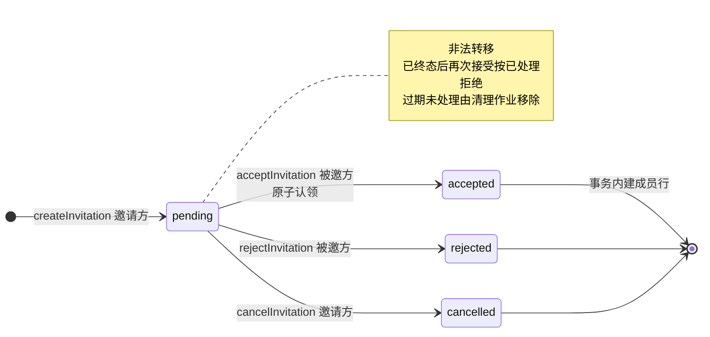
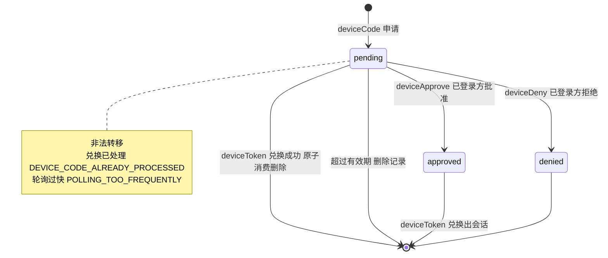
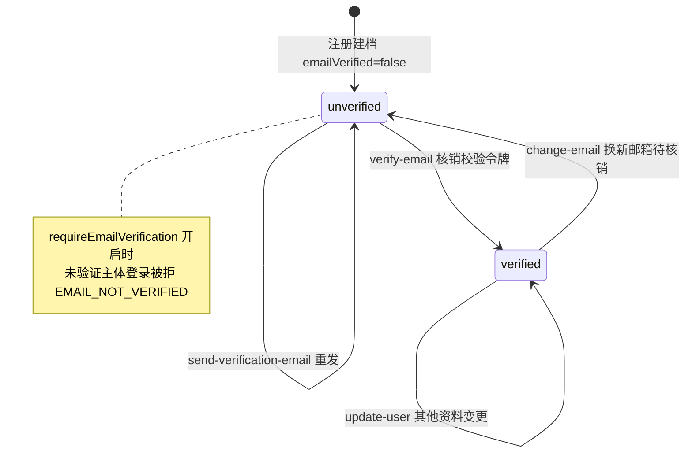

## 6. State Models

本方案达到三个及以上状态的实体共五个：会话、校验凭据、组织邀请、设备码、邮箱验证位。会话与校验凭据以**时间驱动**过期（无显式状态列，过期由 `expiresAt` 判定），组织邀请与设备码有**显式状态列**。每个状态机同时给出合法转移与非法转移及其失败码；错误码语义统一见 [错误码](./errors/)，字段定义见 [数据字典](./data/)。

### 6.1 Session Lifecycle

会话没有显式状态列，生命周期由时间与存在性驱动：

| 相位 | 判定 | 进入动作 | 退出动作 |
|---|---|---|---|
| `active` | 记录存在且 `expiresAt > now` | 登录成功签发 | 续期（刷新 `expiresAt`）或吊销（删除记录） |
| `expired` | `expiresAt <= now` | 时间流逝 | 读到即删除记录、清除凭据 |
| `revoked` | 记录已删除 | 用户登出 / 管理端吊销 / 重置口令连带吊销 | 终态，凭据同步失效 |

非法转移：**expired 后仍接受凭据**——被会话域拒绝（返回空），失败码 `SESSION_EXPIRED`（敏感端点语境）；**revoked 后凭据复活**——凭据 Cookie 残留时按"无会话"处理，缓存副本在吊销时一并清除。

### 6.2 Verification Lifecycle

校验凭据（邮箱校验、口令重置、魔法链接、一次性令牌、状态值等共用）同样由时间驱动，但多了**原子消费**这一关键约束：

| 相位 | 判定 | 进入动作 | 退出动作 |
|---|---|---|---|
| `pending` | 记录存在且 `expiresAt > now` | 各流程签发 | 原子消费（`consumeOne`，只有一方成功）或过期 |
| `consumed` | 记录已删除 | 消费成功 | 终态 |
| `expired` | `expiresAt <= now` | 时间流逝 | 读到即视为无效 |

非法转移：**consumed 后再次消费**——原子消费保证只有一方成功，后者返回"已失效/无效"（各流程失败码：`INVALID_TOKEN`、`TOKEN_EXPIRED`、`INVALID_OTP`、`OTP_EXPIRED`）；**pending 期间重复签发**——按流程语义旋转（重发覆盖同标识新值）或复用，由 `resendStrategy`/`storeToken` 配置决定。

### 6.3 Invitation Lifecycle

组织邀请有显式状态列（取证：`packages/better-auth/src/plugins/organization/schema.ts:304-306`），四个状态：`pending`、`accepted`、`rejected`、`canceled`（拼写为单 l，源码原样）。

图源码

| 当前态 | 动作 | 执行者 | 目标态 | 条件 | 失败码 |
|---|---|---|---|---|---|
| `pending` | accept | 被邀方 | `accepted` | 邮箱匹配且原子认领成功 | `INVITATION_NOT_FOUND`、组织侧满员/重复码 |
| `pending` | reject | 被邀方 | `rejected` | 邮箱匹配 | `INVITATION_NOT_FOUND` |
| `pending` | cancel | 邀请方 | `canceled` | 邀请方具备管理角色 | `YOU_ARE_NOT_ALLOWED_TO_CANCEL_THIS_INVITATION` |
| 终态 | accept / reject / cancel | 任意 | — | — | 按已处理拒绝（原子认领失败） |

非法转移：终态间任何互转均被拒绝——接受走**两段式**（先原子认领 `pending → accepted`，再事务内建成员行；建行失败释放回 `pending`），不存在"已拒绝后又被接受"的窗口。

### 6.4 DeviceCode Lifecycle

设备码有显式状态列，但**落库状态只有三个**：`pending`、`approved`、`denied`（取证：`packages/better-auth/src/plugins/device-authorization/schema.ts:25`）。`expired` 与 `consumed` 是**行为**而非持久状态：过期即删除记录，兑换用原子消费（消费成功即记录删除）。

图源码

| 当前态 | 动作 | 执行者 | 目标态 | 条件 | 失败码 |
|---|---|---|---|---|---|
| `pending` | 轮询兑换 | 设备 | 记录删除（消费） | 已被批准 | `AUTHORIZATION_PENDING`（未批）、`POLLING_TOO_FREQUENTLY`（间隔不足） |
| `pending` | approve | 已登录方 | `approved` | 用户码有效且未过期 | `INVALID_USER_CODE`、`EXPIRED_USER_CODE` |
| `pending` | deny | 已登录方 | `denied` | 用户码有效 | 同上；拒绝后兑换返回 `ACCESS_DENIED` |
| `pending` | 轮询兑换（未批/被拒/过期） | 设备 | — | — | `AUTHORIZATION_PENDING` / `ACCESS_DENIED` / `EXPIRED_DEVICE_CODE` |
| `approved` | 再兑换 | 设备 | — | — | `DEVICE_CODE_ALREADY_PROCESSED`（原子消费保证唯一出会话） |
| `denied` | 兑换 | 设备 | — | — | `ACCESS_DENIED` |

非法转移：`approved` → `pending` 回退不存在；拒绝后批准不存在（记录已消费）。

### 6.5 Email Verification Bit

主体上的 `emailVerified` 是布尔位，语义上构成两态机：

图源码

| 当前值 | 动作 | 目标值 | 条件 | 失败码 |
|---|---|---|---|---|
| `false` | 核销校验令牌 | `true` | 令牌有效且未过期 | `INVALID_TOKEN`、`TOKEN_EXPIRED` |
| `true` | 变更邮箱 | `false`（暂） | 新邮箱核销后回 `true` | `EMAIL_MISMATCH` |
| `true` | 再次校验 | `true` | 幂等 | `EMAIL_ALREADY_VERIFIED` |

非法转移：`requireEmailVerification` 开启时未验证主体登录被拒（`EMAIL_NOT_VERIFIED`），不存在"未验证但已登录"的持久态。

### 6.6 Invalid Transition Summary

| 非法转移 | 所属实体 | 失败码 |
|---|---|---|
| expired 会话继续使用 | 会话 | `SESSION_EXPIRED` / 返回空 |
| revoked 凭据复活 | 会话 | 按无会话处理 |
| consumed 令牌再次消费 | 校验凭据 | `INVALID_TOKEN` / `INVALID_OTP` 等按流程 |
| 终态邀请再接受 | 组织邀请 | 原子认领失败拒绝 |
| approved 设备码二次兑换 | 设备码 | `DEVICE_CODE_ALREADY_PROCESSED` |
| denied 设备码兑换 | 设备码 | `ACCESS_DENIED` |
| 未验证主体登录（强校验开启） | 邮箱验证位 | `EMAIL_NOT_VERIFIED` |
