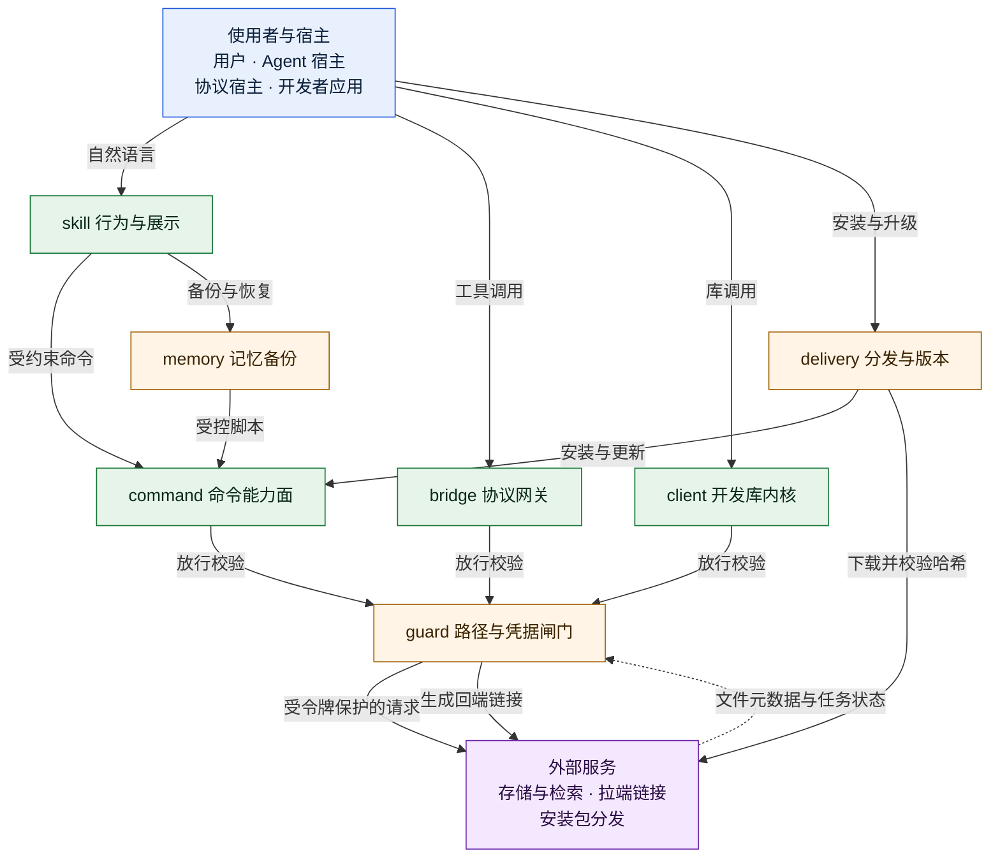
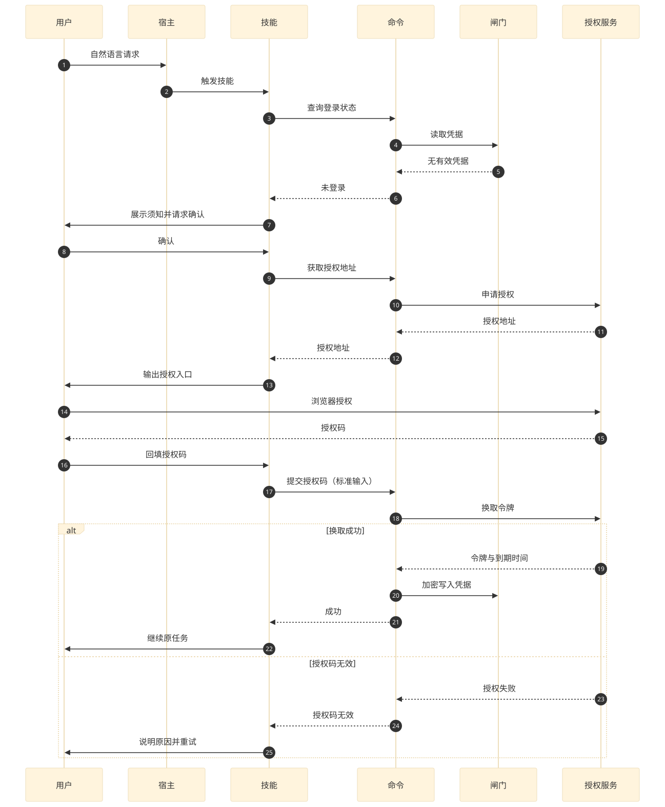
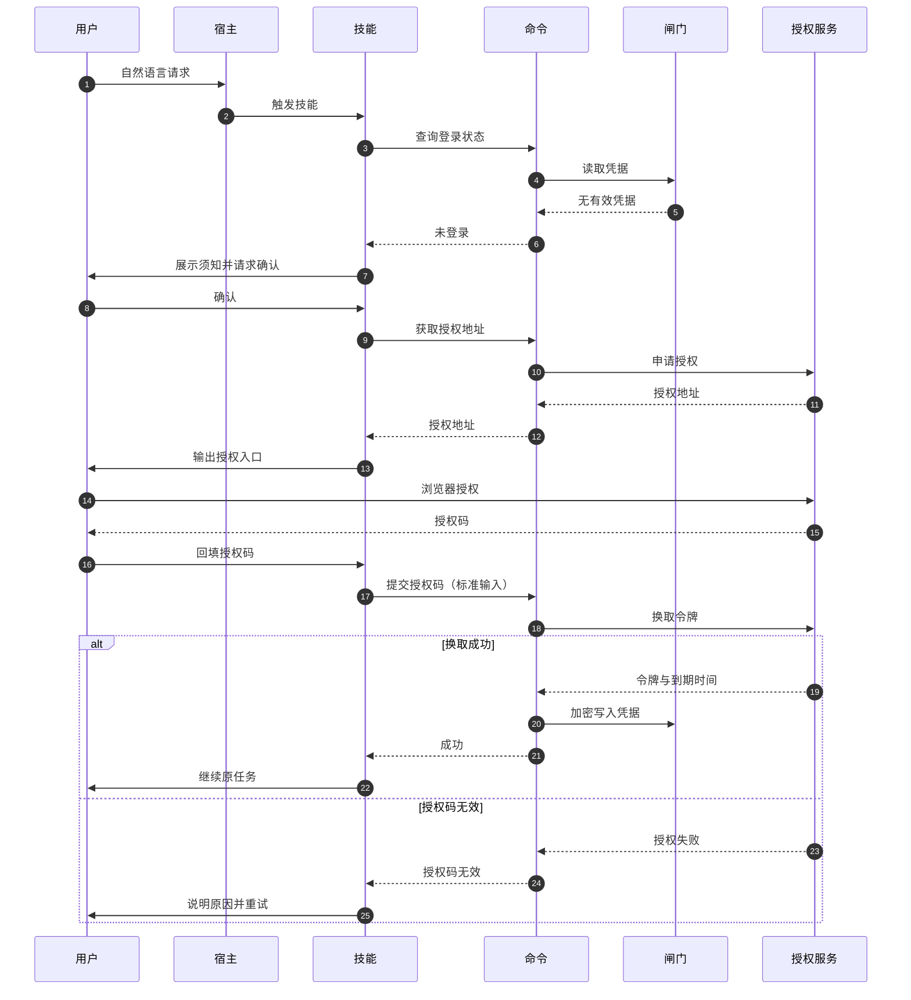
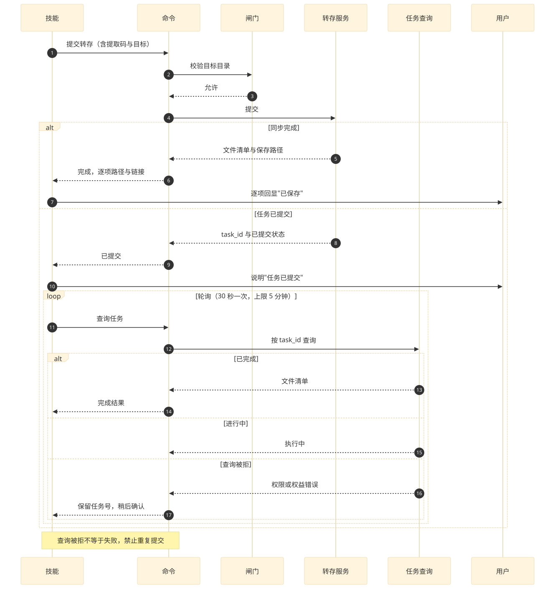
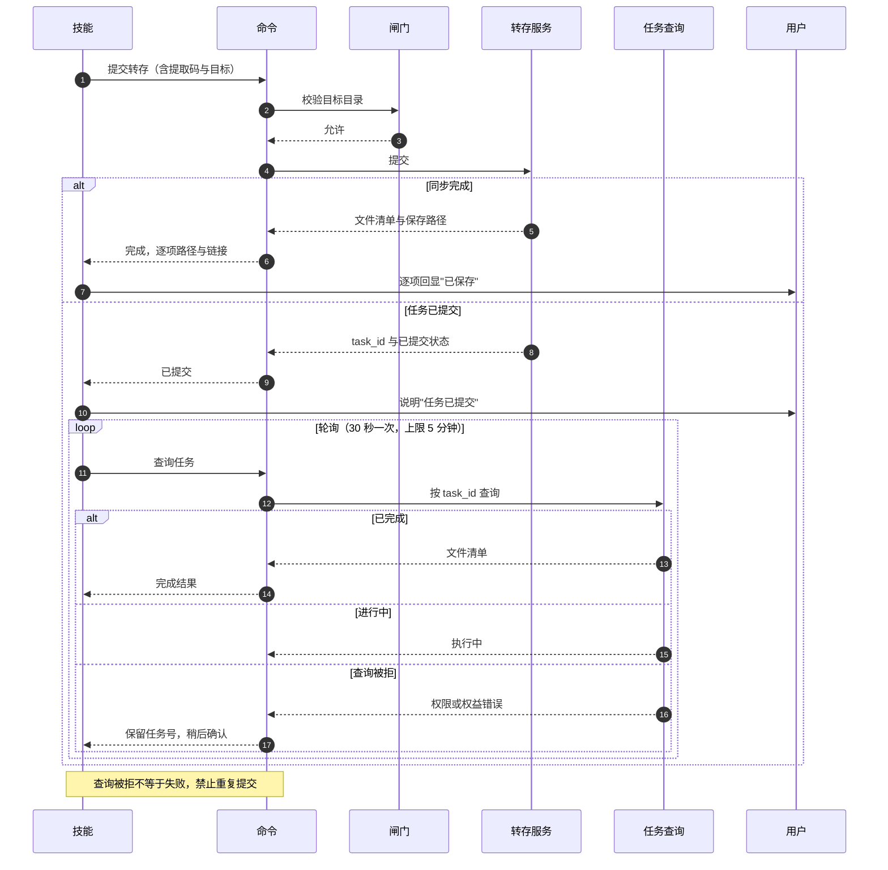
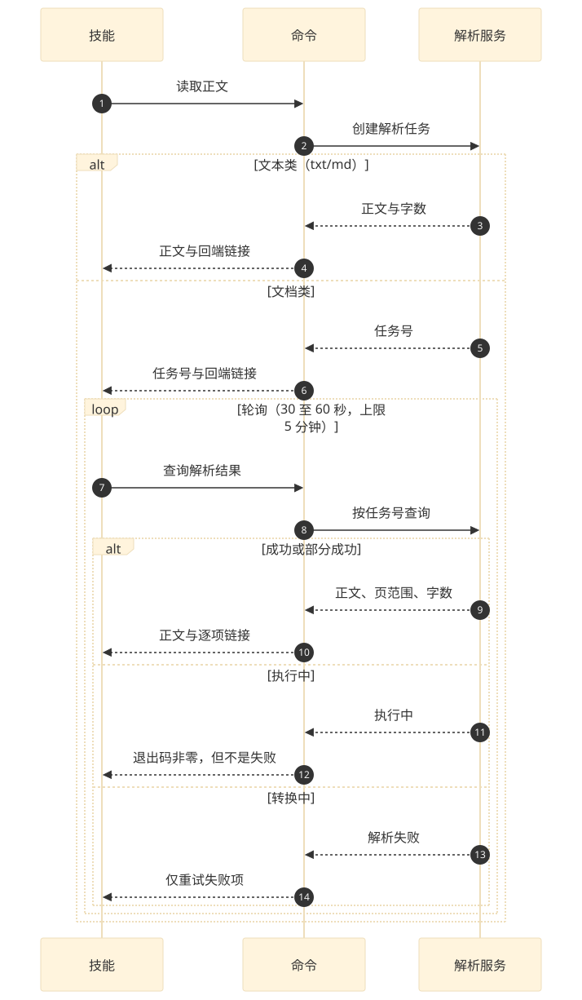
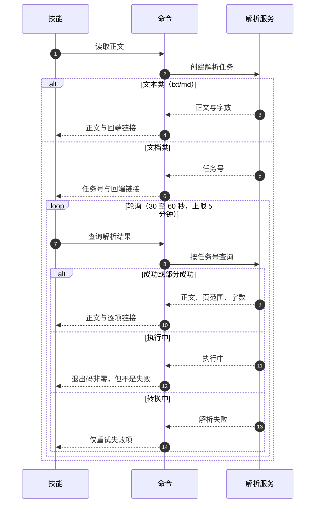

## 1. Architecture

本章先划定系统边界，按二八原则识别核心业务，再给出模块清单与依赖方向，然后用一张架构图把"谁调用谁、数据往哪走"固定下来；凡涉及异步推进的路径，另附时序图并标注失败分支。全文的模块名、实体名与接口标识都以本章清单为准。

### 1.1 Boundary and Participants

系统本身不存储用户文件，也不签发身份：它把百度网盘的开放能力包装成四类入口，并在入口与外部服务之间插入一层治理判断。边界之内包含：意图识别与确认（行为层）、命令执行（命令层）、工具暴露（协议层）、库级调用（库层）、路径与凭据治理、记忆备份清单、安装与版本分发。边界之外包含：账号体系与授权服务、文件存储与转码、正文索引、拉端链接服务、安装包分发网络。

| 参与者 | 身份 | 与本系统的关系 | 交互方式 | 是否持有凭据 |
|---|---|---|---|---|
| 用户 | 百度账号持有人 | 授权、确认危险操作、接收结果 | 自然语言、终端命令 | 否（仅在授权页输入） |
| Agent 宿主 | 承载会话的运行时 | 触发行为层、转述结果、注入会话上下文 | 技能触发与命令调用 | 否 |
| 协议宿主 | 支持工具目录的客户端 | 发现并调用工具 | 工具调用（请求/响应） | 否 |
| 开发者应用 | 第三方服务 | 嵌入库层、自行编排 | 库调用 | 否（由应用保管） |
| 账号与授权服务 | 外部身份提供方 | 签发访问令牌与刷新令牌 | 授权码、令牌交换、刷新 | 是（令牌签发方） |
| 存储与转码服务 | 外部能力提供方 | 文件读写、转存、正文解析 | 受令牌保护的服务调用 | 是（服务端会话） |
| 拉端链接服务 | 外部链接生成方 | 生成可点击的回端链接 | 链接生成 | 否 |
| 分发网络 | 外部下载源 | 提供安装包与版本清单 | 下载、哈希校验 | 否 |

不变约束有三条，后续各章不得违反：其一，所有文件路径必须落在账号下的应用授权根内，根外路径一律在本地拒绝、不发起请求；其二，凭据只以加密形式存放于本机凭据库，任何入口都不得输出其内容；其三，面向用户的成功结论只能来自实际返回，`submitted`、`running` 这类中间态不能表述为完成。

### 1.2 Modules and Responsibilities

七个模块，每个模块一个英文单词命名，职责用一句完整的话界定；相邻模块的分界写在"分界"列，避免同一判断出现在两处。

| 模块 | 职责（一句话） | 分界与不承担的事 | 实现状态 |
|---|---|---|---|
| client | 以库的形式提供网盘读写、检索、上传下载编排与错误分类，供开发者直接组合调用。 | 不做意图识别、不做界面展示、不做危险操作确认；确认由调用方负责。 | 【实现】Go 实现，api 与 scene 两层 |
| command | 以子命令形式提供完整能力面，产出面向人的文本与面向机器的结构化结果。 | 不判断"用户是否想删除"，只执行已确认的调用；越界路径在本地拒绝。 | 【实现】预编译二进制分发 |
| bridge | 把能力注册成宿主可发现的工具目录，并把调用结果转成宿主可消费的文本块。 | 不接触本地文件、不维护账号凭据、不做跨会话记忆。 | 【实现】两种传输：远端托管与本地标准输入输出 |
| skill | 把自然语言意图翻译成受约束的调用序列，并负责确认、展示与版本对齐。 | 不实现文件操作、不拼接链接、不解释内部标识。 | 【实现】技能包 + 管理脚本 |
| guard | 统一裁决路径边界、凭据可用性与危险动作前置条件，是所有对外请求的唯一放行点。 | 不生成业务结果、不决定展示文案。 | 【部分实现】路径与凭据判断现分散在命令层与行为层，收敛为独立职责属【拟议】 |
| memory | 以清单为中心完成记忆文件的备份、列举与恢复，并保证恢复前有本地安全网。 | 不承载普通文件操作；备份走受控脚本而非裸上传命令。 | 【实现】脚本 + 清单格式 |
| delivery | 负责安装、完整性校验、版本对齐与发布产物，确保入口与内核版本匹配。 | 不参与业务调用、不判断用户意图。 | 【实现】安装/更新脚本与发布流水线 |

依赖方向是单向的：`skill → command`、`bridge → guard`、`command → guard`、`client → guard`、`memory → command`、`delivery → command`。反向依赖一律禁止，尤其禁止 `command` 感知 `skill` 的文案、禁止 `guard` 读取业务结果。

### 1.3 Core Business Identification

本方案先按二八原则识别核心业务，再展开逐模块设计。选取的核心业务流是"用户在 Agent 会话里让网盘办一件事"：一句话进入行为层，判定触发与风险后形成受约束命令，命令层经安全闸门校验路径与凭据，最后落到外部服务，结果回到会话并带链接展示。

| 模块 | 承担的价值 | 命中判据 | 关键设计决策 |
|---|---|---|---|
| command | 把意图变成可执行、可核对的调用，并给出人机两种结果 | ①主链不可缺 ③砍余仍可用 | 写操作先预检再落盘；结果不确定时先查询后重试，禁止重复写入 |
| guard | 决定一次调用能不能出网、能不能碰这个路径 | ①主链不可缺 ②失守即失格 | 准入与执行分离，所有外部请求唯一放行点；拒绝与需确认分开 |
| skill | 把自然语言收敛成受约束调用，并承担确认与展示 | ①主链不可缺 ③砍余仍可用 | 先判风险再执行；中间态不得表述为完成；链接原样透传 |

裁决说明：bridge 与 client 是并列入口而不是主链环节，缺其一仍保留完整入口，未命中②，归外围；memory 是增值能力，砍去不影响文件主流程，归外围；delivery 是前置条件而非业务流环节，失守表现为不可用而非数据错误，归外围并单列版本对齐约束。核心占比 3/7 ≈ 0.43，高于 20% 的经验值，原因是七个模块按入口与职责切分、粒度较细；比例核对与存疑项记在 review.md。

### 1.4 Architecture Diagram

图中实线表示调用，虚线表示数据或状态回传；所有指向外部服务的连线都必须经过治理面，这是本架构唯一的强制收敛点。

图源码

读图要点：治理面位于接入面与外部依赖之间，图中不存在绕过它的调用线；`memory` 与 `delivery` 不直接对外，而是通过命令层落地；协议宿主与开发者应用各走一条独立入口，二者共享同一套路径与凭据判断。图中"使用者与宿主""外部服务"为聚合节点，成员在 1.1 节逐项列出，模块节点与 1.2 节清单一一对应。

> 现状差异：治理面在现有实现中尚未成为独立进程或独立库——路径判断分别在命令层与行为层各写一份，凭据读取由命令层直接完成。图中把它画成单一节点是本方案的收敛目标（P-03），不是对现状的描述。

### 1.5 Control Flow and Data Ownership

同步与异步的分界写在返回语义里：凡是能在一次调用内给出确定结论的（列表、容量、分享创建、移动复制重命名、创建目录），一律同步返回；凡是服务端需要排队或转码的（分享转存的批量落盘、文档正文解析），一律先返回任务标识，再由调用方轮询推进。

| 流程 | 触发方式 | 返回语义 | 失败分支 | 幂等要求 |
|---|---|---|---|---|
| 授权登录 | 用户确认后取授权地址，回填授权码 | 同步返回令牌与到期时间 | 授权码无效、超时、用户取消 | 重复提交授权码按失败处理，不重复建会话 |
| 列目录与检索 | 直接调用 | 同步返回条目与回端链接 | 未登录、越界、上游错误 | 只读，天然幂等 |
| 上传 | 冲突预检后三步写入 | 同步返回落点与动作类型 | 分片失败、创建失败、响应缺失 | 以"同内容复用、同名不同内容另存"保证可重试 |
| 下载 | 取直链后流式写入 | 同步返回本地落点 | 直链失效、写入中断 | 失败清理半成品，不留下截断文件 |
| 分享转存 | 提交转存任务 | 同步完成或返回已提交 | 提取码错误、链接失效、数量超限、任务不可查 | 以任务标识去重，禁止重复提交 |
| 正文解析 | 创建解析任务 | 同步返回正文（文本类）或任务标识（文档类） | 转换中、文件无效、配额超限、超时 | 同一文件重复发起会新建任务，需按任务标识轮询 |
| 记忆备份 | 受控脚本 | 同步返回清单与远端目录 | 未登录、清单校验失败、上传失败 | 以时间戳目录保证每次备份独立 |
| 记忆恢复 | 受控脚本 | 同步返回恢复结果 | 清单不兼容、下载失败、写回失败 | 恢复前先做本地安全网备份 |

数据归属按下表划分，任何模块不得持有不属于自己的状态；尤其注意"任务状态以服务端为准"，本地缓存只在单次命令生命周期内有效。

| 数据 | 归属方 | 持久化位置 | 生命周期 | 谁可读 | 谁可写 |
|---|---|---|---|---|---|
| 访问令牌与刷新令牌 | guard | 本机凭据库（加密） | 至过期或被注销 | guard、命令层（仅取用，不输出） | guard |
| 账号资料（昵称、会员类型） | 外部账号服务 | 不落盘，按需查询 | 单次调用 | 命令层、协议网关（按需） | 无 |
| 文件与目录元数据 | 外部存储服务 | 不落盘 | 单次调用 | 接入面 | 外部存储服务 |
| 转存与解析任务 | 外部服务 | 不落盘（仅命令输出携带任务标识） | 服务端定义 | 接入面 | 外部服务 |
| 回端链接 | 拉端链接服务 | 不落盘 | 单次结果 | 接入面（只透传） | 拉端链接服务 |
| 会话上下文（Agent 名、会话标识、原始提问、归因标识） | 宿主 | 不落盘 | 单次会话 | 行为层 | 宿主注入 |
| 记忆清单 | memory | 网盘时间戳目录 + 本地临时目录 | 每次备份一份 | memory | memory |
| 本地安全网备份 | memory | 工作区 `.backup-before-restore/<时间戳>/` | 保留至用户清理 | memory、用户 | memory |
| 版本与安装产物 | delivery | 分发网络 + 本地安装目录 | 至下次更新 | delivery | delivery |

### 1.6 Key Asynchronous Sequences

三条路径存在跨步骤推进或补偿，必须用图固定失败分支；其余同步路径在模块章中给出伪代码即可。

#### 1.6.1 First Authorization

图源码

失败分支的补偿只有一条：不写入半成品凭据。若换取成功但写入失败，命令层必须回滚内存中的令牌并返回"凭据保存失败"，避免出现"看着已登录、下次又未登录"的错觉。

#### 1.6.2 Share Transfer Polling

图源码

#### 1.6.3 Document Parse Two Phase

图源码

### 1.7 Deployment and Runtime

系统不设集中服务端：命令层与库层运行在用户设备或开发者进程内；协议层有两种形态，远端托管（宿主直接连远端地址）与本地进程（标准输入输出传输，可访问本地文件）；行为层以技能包形式随宿主加载，技能包内自带安装、登录、更新、卸载与记忆备份脚本；治理面与命令层同进程，记忆备份与分发由脚本承担。这样安排的原因是：文件访问必须发生在数据所在的一侧，集中服务端既拿不到本地文件，也会把凭据集中成新的风险点。

| 运行单元 | 运行位置 | 启动方式 | 网络依赖 | 关键约束 |
|---|---|---|---|---|
| 命令层 | 用户设备 | 直接执行子命令 | 需访问存储与授权服务 | 单进程、无守护、无后台常驻 |
| 行为层 | Agent 宿主内的技能目录 | 宿主按技能清单加载 | 仅通过命令层出网 | 脚本以 `bash` 执行，路径由宿主注入 |
| 协议层（远端） | 托管环境 | 宿主配置远端地址 | 需访问托管地址 | 不提供本地文件上传工具 |
| 协议层（本地） | 用户设备 | 宿主拉起本地进程 | 需访问存储服务 | 仅标准输入输出，凭据经环境变量注入 |
| 库层 | 开发者进程 | 由应用初始化 | 需访问存储服务 | 无全局状态、上下文可取消 |
| 记忆备份 | 用户设备 | 由行为层调用脚本 | 经命令层出网 | 仅支持四类宿主，其余环境直接拒绝 |

图 1-1 至图 1-4 由 Markdown 中的 Mermaid 源码在构建期预渲染，源码随图折叠保留，可对照阅读。

