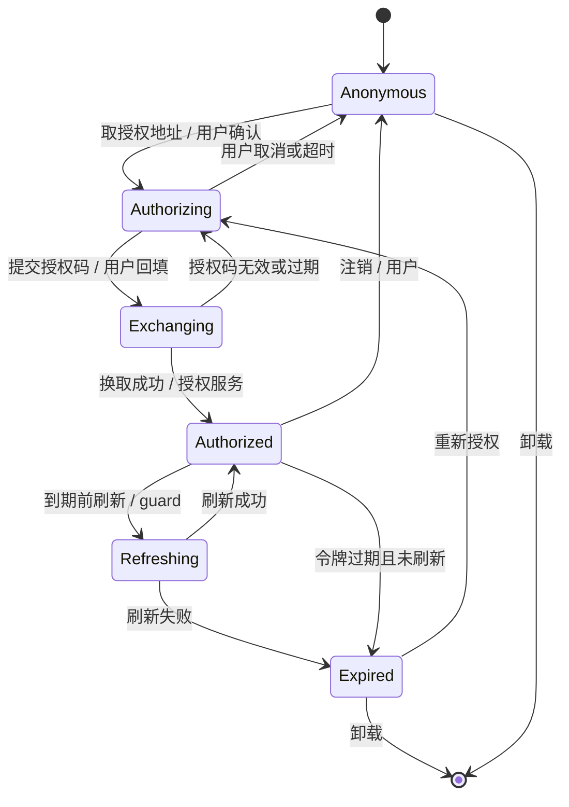
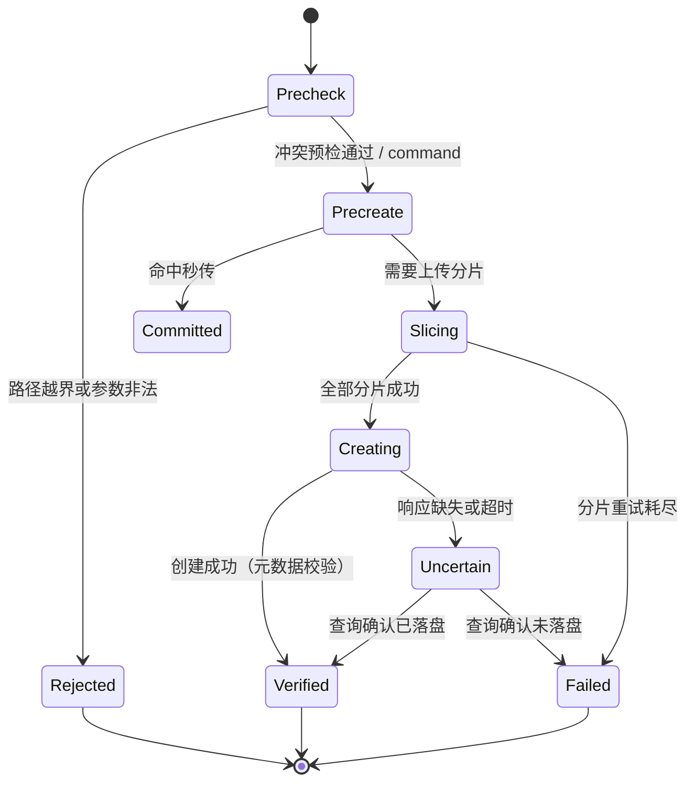
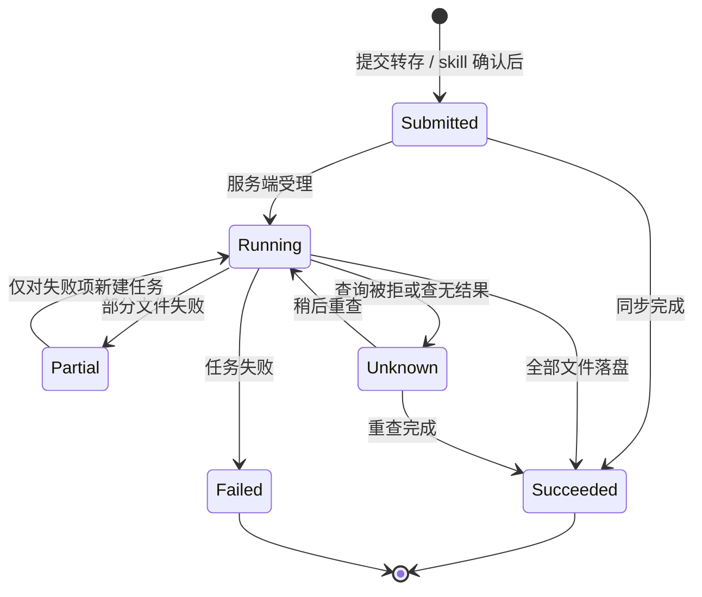
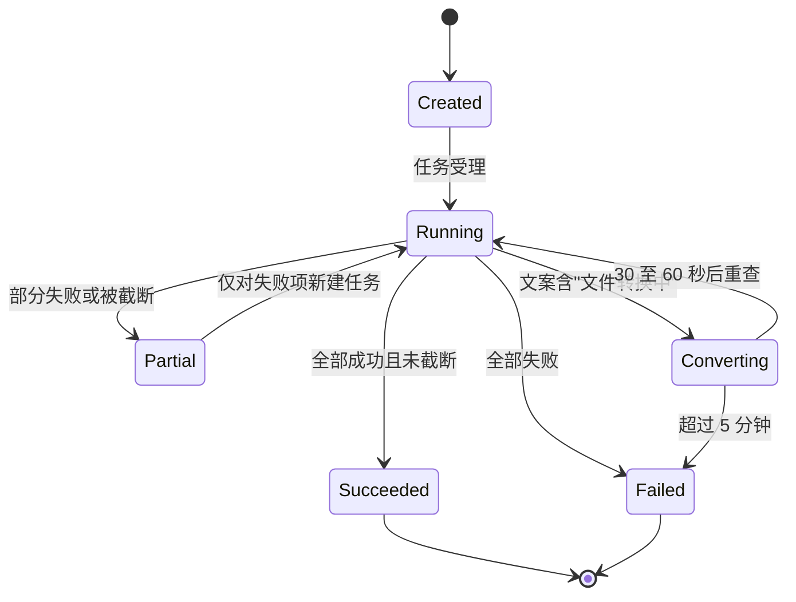

## 6. State Model

状态只描述"服务端已确认的事实"，不描述界面进度。凡状态数量达到三个及以上的实体，本章给出转移图，边上标注触发动作、执行者与判定条件；非法转移集中列在 6.7 节，并与第 5 章错误码一一对应。

### 6.1 Inventory

| 实体 | 状态字段 | 状态取值 | 归属 | 持久化 |
|---|---|---|---|---|
| 授权会话 | `authStatus` | 未登录、授权中、令牌交换中、已登录、刷新中、已过期 | guard | 本机凭据库（仅"已登录"含凭据） |
| 上传 | `uploadPhase` | 预检、预创建、分片上传、创建文件、已确认、结果不确定、已失败、已拒绝 | client、command | 不持久化（单次调用） |
| 转存任务 | `transferStatus` | 已提交、执行中、已完成、部分完成、已失败、状态不可查 | command、skill | 服务端 |
| 正文解析任务 | `parseStatus` | 已创建、执行中、转换中、已完成、部分完成、已失败 | command | 服务端 |
| 分享链接 | `shareStatus` | 有效、已过期、已取消 | 转存服务 | 服务端 |

### 6.2 Authorization Session

图源码

状态说明：只有"已登录"持有可用凭据；"授权中"与"令牌交换中"都不写盘，避免半成品凭据；"刷新中"允许并发调用排队，但只允许一次实际刷新。

### 6.3 Upload

图源码

判定条件：`Precheck` 通过的条件是路径归一后在授权根内且目标不是目录；`Committed` 的条件是预创建返回秒传标记；`Verified` 只代表路径与大小一致（`content_verified=false`），不代表逐字节校验；`Uncertain` 必须走查询确认，禁止直接重试。

### 6.4 Transfer

图源码

判定条件：`Submitted` 转 `Succeeded` 只有在同时拿到完成文件清单与保存路径时成立；`Unknown` 不是终态，最长保留 5 分钟后按"稍后在网盘确认"结束，且不允许重复提交同一任务；`Partial` 的重试必须是新任务，不能复用旧任务号。

### 6.5 Content Parse

图源码

判定条件：`Succeeded` 要求 `status=succeeded` 且各项 `truncated=false`；`truncated=true` 归入 `Partial`（正文被单文件 50 万字上限截断）；`Converting` 只由文案判定，不能只看 `50101`。

### 6.6 Share Link

分享链接的状态由服务端决定，客户端只读，不存在"续期"或"复活"操作。

| 当前状态 | 事件 | 新状态 | 允许 | 说明 |
|---|---|---|---|---|
| 有效 | 到期时间到达 | 已过期 | 是 | 到期后不可下载、不可转存 |
| 有效 | 创建者取消分享 | 已取消 | 是 | 与过期同等处理 |
| 已过期 | 任意复制、转存 | 已过期 | 是（状态不变） | 返回 BDPAN_SHARE_EXPIRED |
| 已取消 | 任意复制、转存 | 已取消 | 是（状态不变） | 同上 |
| 已过期 / 已取消 | 重新创建分享 | 有效（新对象） | 是 | 新链接是新实体，不继承旧有效期 |

### 6.7 Illegal Transitions

| 实体 | 非法转移 | 触发场景 | 返回码 | 可重试 |
|---|---|---|---|---|
| 授权会话 | 未登录 → 已登录（无授权码） | 直接写凭据或伪造令牌 | BDPAN_AUTH_REQUIRED | 否 |
| 授权会话 | 已过期 → 已登录（无刷新令牌） | 刷新令牌失效仍尝试刷新 | BDPAN_TOKEN_INVALID | 否（需重新授权） |
| 上传 | 预检失败 → 分片上传 | 绕过路径校验 | BDPAN_PATH_OUT_OF_SCOPE | 否 |
| 上传 | 结果不确定 → 已确认（无查询） | 超时后直接重发 | BDPAN_OUTPUT_UNCERTAIN | 是（先查询） |
| 上传 | 已确认 → 已失败 | 把成功结果改判失败 | —（禁止的本地行为） | 否 |
| 转存 | 已提交 → 已完成（无文件清单） | 只拿到任务号就宣称完成 | BDPAN_TASK_RUNNING | 是 |
| 转存 | 状态不可查 → 已失败 | 把查询被拒当失败 | BDPAN_TRANSFER_STATE_UNKNOWN | 是（稍后） |
| 转存 | 部分完成 → 已完成（未重试失败项） | 忽略失败项 | —（禁止的本地行为） | 否 |
| 正文解析 | 已创建 → 已完成（未轮询） | 把任务号当正文 | BDPAN_TASK_RUNNING | 是 |
| 正文解析 | 转换中 → 已失败（未到时限） | 一次失败就放弃 | BDPAN_PARSE_CONVERTING | 是 |
| 正文解析 | 部分完成 → 已完成（含截断） | 忽略 `truncated` | —（禁止的本地行为） | 否 |
| 分享链接 | 已过期 → 有效 | 修改本地缓存假装有效 | BDPAN_SHARE_EXPIRED | 否 |
