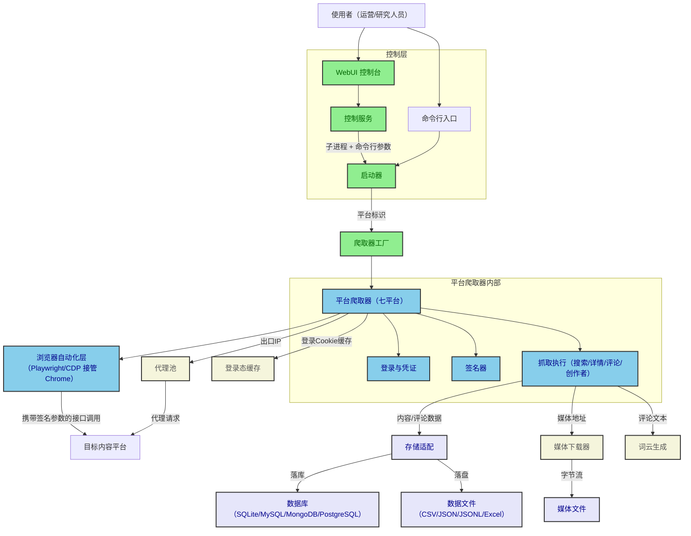
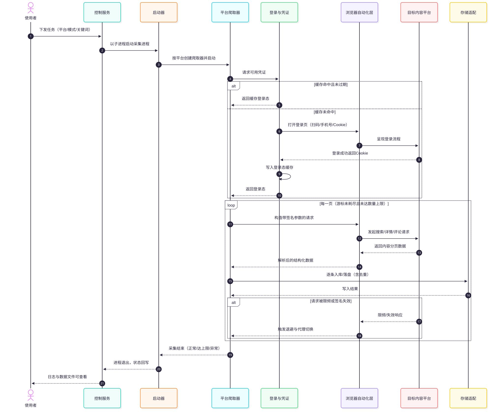
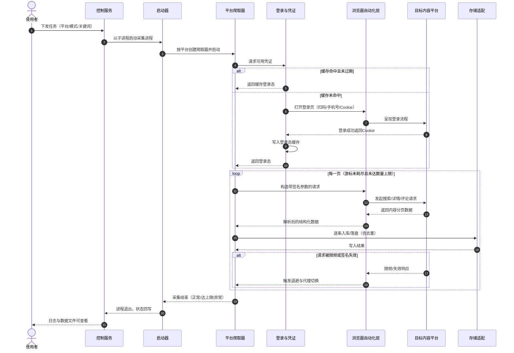

总体方案与架构章给出系统边界与外部参与者，先以三判据识别核心业务，再列出全部模块的职责、依赖与数据流，并给出总体架构图与主链路时序图。

## 1. Boundary

系统是一个单机运行的内容采集工具，边界与外部参与者如下。

- **使用者**：唯一的人类参与者。通过两种入口表达采集意图：命令行参数（脚本化、可无人值守）或控制台面板（交互式、可视化管理）。使用者必须自行提供目标平台的登录凭证（扫码、手机号或 Cookie），并对采集行为的合规性负责。
- **目标内容平台**：七个外部系统（七家主流中文内容社区）。它们是被读取方，不受系统控制；会施加登录校验、接口签名校验、限频与风控等约束。
- **可选外部服务**：数据库（关系型或文档型）、缓存服务、代理服务提供商。仅在对应保存方式或代理开关启用时接入。
- **非目标**：不提供多用户体系与服务化多租户部署；不做数据分发或下游消费端的对接；单机单任务，同一时刻至多运行一个采集进程。

系统内部按职责分为四层：**控制层**（命令行入口、控制服务、启动器）负责把使用者意图转为采集进程；**采集层**（平台爬取器及其内部的登录凭证、签名器、浏览器自动化）承担主链路；**存储层**（存储适配与各介质实现）拥有全部落地数据的变更权；**外围层**（媒体下载、代理池、缓存、工具集）以旁路能力支撑采集层。数据流向单向：平台接口 → 采集层 → 存储层 → 介质；控制流双向：控制层下发任务、采集进程回吐日志与状态。

## 2. Core Business Identification

沿一条核心业务流追踪完整调用链：**使用者以关键词搜索模式采集某平台的内容与评论**。调用链为：命令行/控制服务 → 启动器 → 平台爬取器（启动浏览器 → 登录凭证校验 → 签名参数生成 → 分页抓取 → 限频与退避）→ 存储适配 → 介质。链上全部域列为候选，逐一以三判据裁决。

### 2.1 Verdict Criteria

三判据定义如下，命中判据①且命中②③之一方可入核心清单。

1. **主链不可缺**：沿核心业务流追踪，该域在链上，缺失则主流程断裂。
2. **失守即失格**：该域失效时产品失去立身之本。
3. **砍余仍可用**：其余模块全部砍去，仅留该域与最简入口，产品仍完整可用。

### 2.2 Core Domain List

| 模块 | 承担的价值 | 命中判据 | 关键设计决策 |
| --- | --- | --- | --- |
| 平台爬取器（crawler） | 全部采集能力的执行主体，覆盖七平台三种模式 | ①②③ | 双模式浏览器（CDP 接管/标准启动）；信号量并发与固定限频间隔；每平台一个实现、共享统一骨架 |
| 登录与凭证（auth） | 登录态是访问一切接口的前提，失守则全部请求被拒 | ①②③ | 登录探测三段式（探测→登录→回写 Cookie）；登录态持久化到浏览器用户目录；三种登录方式统一契约 |
| 存储适配（store） | 唯一拥有落地数据变更权的域，数据丢失即产品失格 | ①②③ | 工厂按配置选择介质；按业务主键存在即更新否则插入；人物标识强制匿名化脱敏 |

裁决说明：浏览器自动化层（CDP 管理、隐身注入）在主链上不可缺，但它是爬取器模块的内部支撑，不独立成域；代理池、缓存、媒体下载、词云、控制服务均不满足「砍余仍可用」（去掉后最简入口仍能完成采集），列为外围。核心数 ÷ 模块总数 = 3 ÷ 9 = 0.33，处于可接受区间（0.1–0.4）。判定过程与存疑项记录于[校验记录](./review/)。

核心域模块章按深化要求展开：关键设计决策成文、伪代码覆盖失败分支与恢复策略、验收标准不少于 4 条。外围域在章首声明外围定位。

## 3. Module List

每个模块以一个英文单词命名，并用一句话说明职责边界。

| 模块 | 定位 | 职责边界 |
| --- | --- | --- |
| [启动器 launcher](./modules/launcher/) | 外围 | 解析命令行参数、覆写全局配置、按平台标识创建爬取器并管理进程生命周期。 |
| [平台爬取器 crawler](./modules/crawler/) | 核心 | 按统一骨架执行单平台的搜索、详情、创作者采集，内含浏览器自动化与签名生成。 |
| [登录与凭证 auth](./modules/auth/) | 核心 | 以扫码、手机号、Cookie 三种方式取得并维持目标平台的登录态，持久化登录凭证。 |
| [存储适配 store](./modules/store/) | 核心 | 把各平台异构数据整形为统一实体，按所选介质落库或落盘，拥有全部落地数据的变更权。 |
| [媒体下载 downloader](./modules/downloader/) | 外围 | 平台无关地把内容附带的图片与视频字节流落盘，含断点续传与音视频合流。 |
| [代理池 proxy](./modules/proxy/) | 外围 | 从代理服务商拉取出口 IP，维护单活跃代理并在到期时自动切换。 |
| [缓存 cache](./modules/cache/) | 外围 | 提供带过期时间的键值缓存抽象，内存与外部服务双后端按配置切换。 |
| [工具集 tools](./modules/tools/) | 外围 | 提供日志、时间、Cookie 转换、二维码展示、浏览器启动、优雅退出、词云等横切工具。 |
| [控制服务 api](./modules/api/) | 外围 | 以子进程方式包装命令行入口，向控制台面板提供启停、状态、日志与数据文件服务。 |

依赖方向：控制层（launcher、api）依赖 crawler 的工厂契约；crawler 依赖 auth、store、downloader、proxy、tools；auth 依赖 tools（浏览器启动、Cookie 转换）；store 依赖 tools（文件写入、脱敏）与外部介质驱动；proxy 依赖 cache（IP 缓存）；外围模块相互之间无横向依赖。数据归属：store 独占落地数据写权；auth 独占登录态缓存（浏览器用户目录）；cache 独占代理 IP 缓存键。

图源码

## 4. Control Flow and Timing

同步与异步的划分：控制层到采集进程是**进程级异步**——控制服务以子进程拉起采集进程后立即返回，通过读取标准输出与探测进程状态推进；采集进程内部是**协程级并发**——内容详情与评论任务在信号量约束下并发执行；采集层到存储层是**同步调用**——数据整形与落库发生在数据生产之后、下一页抓取之前；媒体下载是**跟随式旁路**——串行执行在内容落库之后，失败只记日志不中断采集。

多步推进存在两处需要显式编排的位置，以时序图标注：

1. **登录凭证获取**：采集启动后先探测已有登录态，未命中才走完整登录流程，登录成功后写回持久化缓存——这是一次带缓存命中的补偿流程。
2. **限频与退避**：请求被目标平台限频或风控时，触发退避等待、代理切换或 Cookie 刷新，随后重试——这是主链路上的失败分支。

图源码

## 5. Architecture Invariants

三条铁律级架构不变量，违反即架构破坏：

1. **先凭证后请求**：任何接口调用发生前必须通过登录探测；探测失败的请求一律不发出。
2. **数据变更权集中于存储适配**：采集层只生产内存中的结构化数据，任何落库或落盘动作必须经存储适配层完成，介质选择完全由配置驱动。
3. **人物标识强制脱敏**：所有进入落地介质的人物标识必须先经过匿名化与昵称遮蔽处理，明文可识别字段不得出现在任何介质中。
