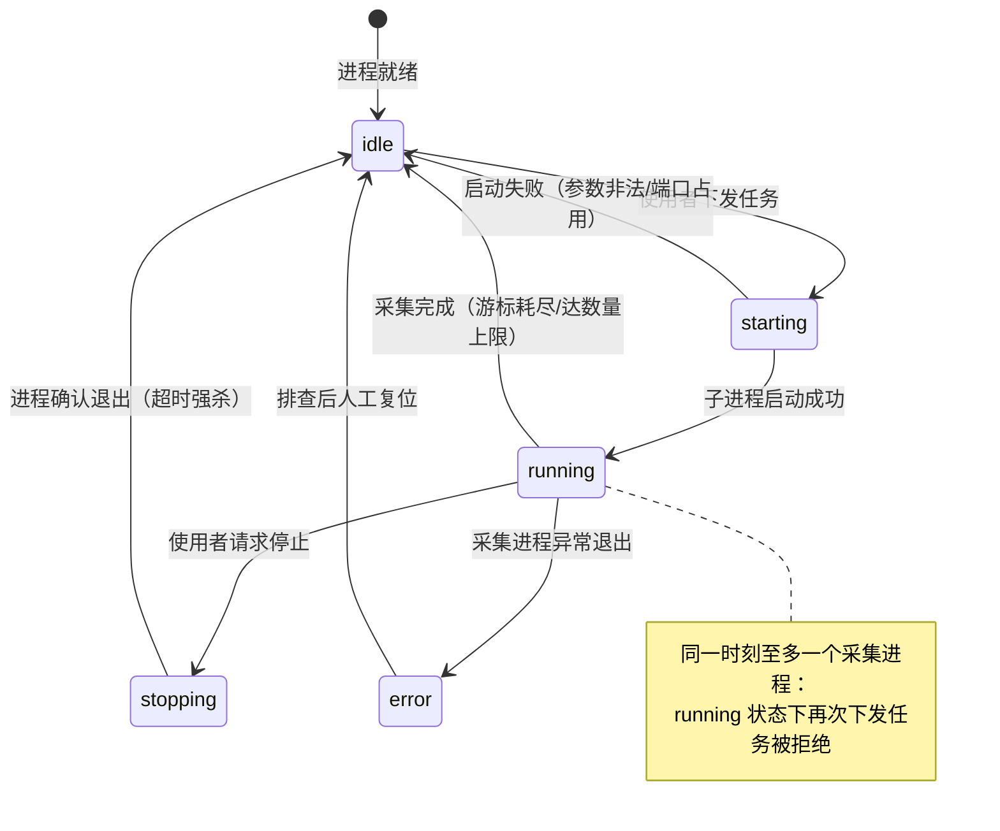
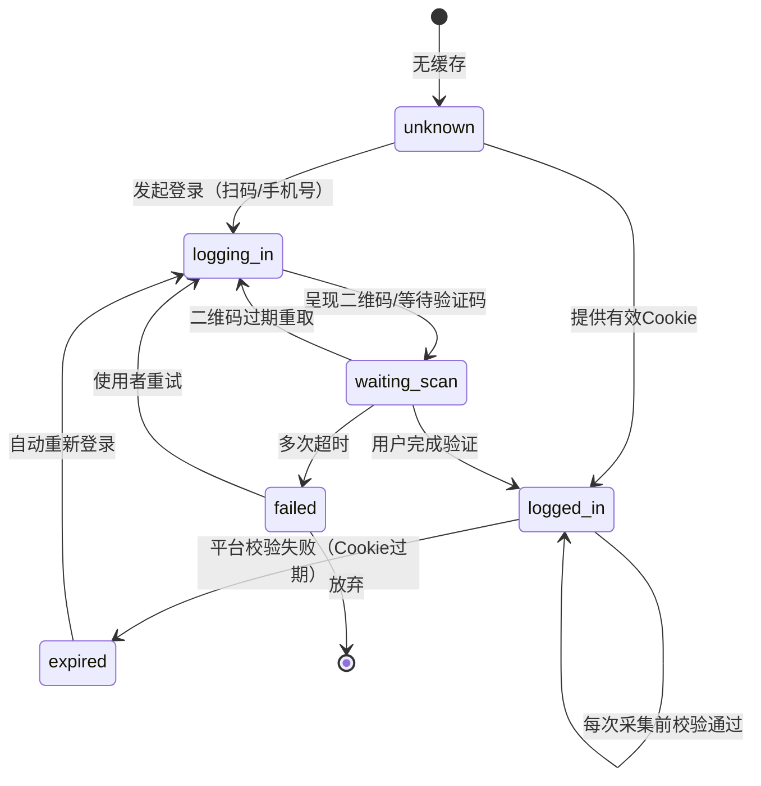

本系统有两个状态数达到三个及以上的实体：采集任务（控制服务视角）与登录会话（登录凭证视角）。转移图如下，非法转移与失败码一并列出，与[错误码](./errors/)一致。

## 1. Crawler Task

状态枚举：`idle`（空闲）、`starting`（启动中）、`running`（运行中）、`stopping`（停止中）、`error`（异常）。归属模块：[控制服务](./modules/api/)。

图源码

| 当前态 | 目标态 | 触发动作 | 执行者 | 判定条件 |
| --- | --- | --- | --- | --- |
| idle | starting | 启动任务 | 控制服务 | 无运行中任务 |
| starting | running | 子进程存活确认 | 控制服务 | 启动成功 |
| starting | idle | 启动失败 | 控制服务 | 参数错误或进程立即退出 |
| running | stopping | 停止请求 | 使用者 | — |
| running | idle | 采集完成 | 控制服务 | 进程零退出 |
| running | error | 异常退出 | 控制服务 | 进程非零退出 |
| stopping | idle | 停止完成 | 控制服务 | 退出确认或超时强杀 |
| error | idle | 人工复位 | 使用者 | 排查后重新就绪 |

非法转移及失败码：

| 当前态 | 目标态 | 失败码 |
| --- | --- | --- |
| running / starting | starting | `CRAWLER_ALREADY_RUNNING` |
| idle / stopping | stopping | `CRAWLER_NOT_RUNNING` |
| stopping / error | stopping | `CRAWLER_NOT_RUNNING` |
| error | running | `CRAWLER_NOT_RUNNING`（先复位到 idle 再启动） |

## 2. Login Session

状态枚举：`unknown`（无缓存）、`logging_in`（登录中）、`waiting_scan`（等待扫码/验证码）、`logged_in`（已登录）、`expired`（已过期）、`failed`（登录失败）。归属模块：[登录与凭证](./modules/auth/)。

图源码

非法转移及失败码：

| 当前态 | 目标态 | 失败码 |
| --- | --- | --- |
| logged_in | logged_in 以外业务态 | 不允许在未失效时重新登录（探测命中直接跳过登录） |
| unknown | logged_in | `CREDENTIAL_INVALID`（Cookie 注入后探测不通过） |
| waiting_scan | logged_in 以外的成功态 | 无（唯一成功出口是完成验证） |
| failed | 业务采集态 | `LOGIN_TIMEOUT`（未完成登录不得进入采集） |

两个状态机的联动约束：登录会话进入 `failed` 或 `expired` 且自动恢复耗尽时，采集任务不得保持 `running`——由[平台爬取器](./modules/crawler/)的失败分支触发进程异常退出，任务转入 `error`。
